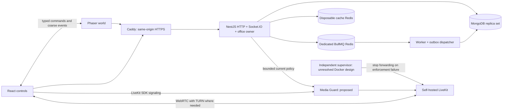

# Architecture plan

Status: draft decomposition of the supplied project brief · Updated: 2026-11-05

## Runtime boundaries

Start with one modular NestJS process owning HTTP, Socket.IO and the office simulation, plus a worker and separate media services. There is one canonical runtime owner per office. Multi-process office ownership/routing/fencing is deferred. Socket.IO Redis Adapter alone would not supply that consistency.

## Module responsibilities

| Module/component | Responsibility | Entity plans |
|---|---|---|
| Auth / Users | Credentials, verification, recovery, sessions, account eligibility | users, credentials, sessions, auth-tokens |
| Workspaces / Memberships / Invitations | Tenant policy, owner transfer, scoped onboarding | workspaces, memberships, invitations |
| Maps / packages/world | Immutable geometry and pure collision/seat/zone rules | offices, map-versions, map-overrides, seats, meeting-zones |
| OfficeRuntime / Realtime | Admission, simulation, snapshots, presence, leases | join-tickets, participants, offices |
| Conversations | Proximity pairs, fixed groups and versioned member sets | conversations, meeting-zones |
| Media / Guard / supervision | Scoped grants, live permits and generation retirement | media-grants, media-permits |
| Jobs / Worker | Durable outbox dispatch, bounded retries and mail | outbox, jobs |
| Audit / Health | Security mutations, health and recovery evidence | audit-events |
| React / Phaser / asset pipeline | Controls, rendering, appearance and cleared artwork | avatars, assets |

## Shared invariants

- B2B SaaS is the product requirement. Recommended MVP: one company per workspace/tenant. Global identities have independent company memberships; platform operations are separate from customer roles. Resolve any organization hierarchy before schema freeze.
- Shared-service budgets must isolate company workloads; measure noisy-neighbor and shared media-shutdown impact. See the [product plan](../product/B2B_SAAS.md).

- MongoDB is authoritative for identity, session and tenant policy. Redis is not a substitute for current authorization.
- All tenant-owned lookups validate workspace plus resource relationships. Allowlist DTOs and updates; never pass request objects/operators directly to MongoDB.
- Sensitive authorization-plus-write operations use transactions and real conditional writes on the policy records that concurrent revocation also changes. Retrying requires fresh authorization.
- Security writes require majority acknowledgement. Admission/lease freshness needs explicitly designed bounded primary reads; evaluate per-document linearizable checks where strict ordering is required. Snapshot reads alone do not solve revocation races.
- Expiry is checked in application logic; TTL deletion is cleanup. Monotonic deadlines, response sequences and boot epochs govern live authorization.
- Occupancy, positions and conversations are transient. A crash creates a fresh office epoch, requires reauthorization and returns users to a valid spawn.
- Essential controls have accessible React equivalents. A typed bridge connects React to one mounted Phaser game; destroy listeners, timers and media on lifecycle exit.
- Microphone/camera begin off; screen share requires explicit action. LiveKit handles media signaling and packets; NestJS does not implement an SFU.
- Media privacy requires current authorized member sets and separate rooms/generations. Local mute/volume is not access control.
- Docker-compatible independent media shutdown remains an M0 proof requirement. A guard or JWT lifetime alone does not establish bounded forwarding revocation.

## Repository layout

The initial scaffold now uses feature-owned web folders and grouped API modules (identity, tenancy, office, conversations, media and audit). See [implemented repository layout](REPOSITORY.md) for actual paths and package ownership. The worker is separate, public contracts and world rules are shared, and delivery contracts are server-only. Media enforcement remains under `spikes/` pending proof.

The earlier proposed separate Auth/Users/Workspaces/Memberships module names map into these grouped module boundaries; their entity responsibilities and tenant/security requirements still apply. No feature or infrastructure deployment is established by empty folders.

See [decisions](../decisions/README.md), [data model](DATA_MODEL.md) and [migration](../migration/README.md).
