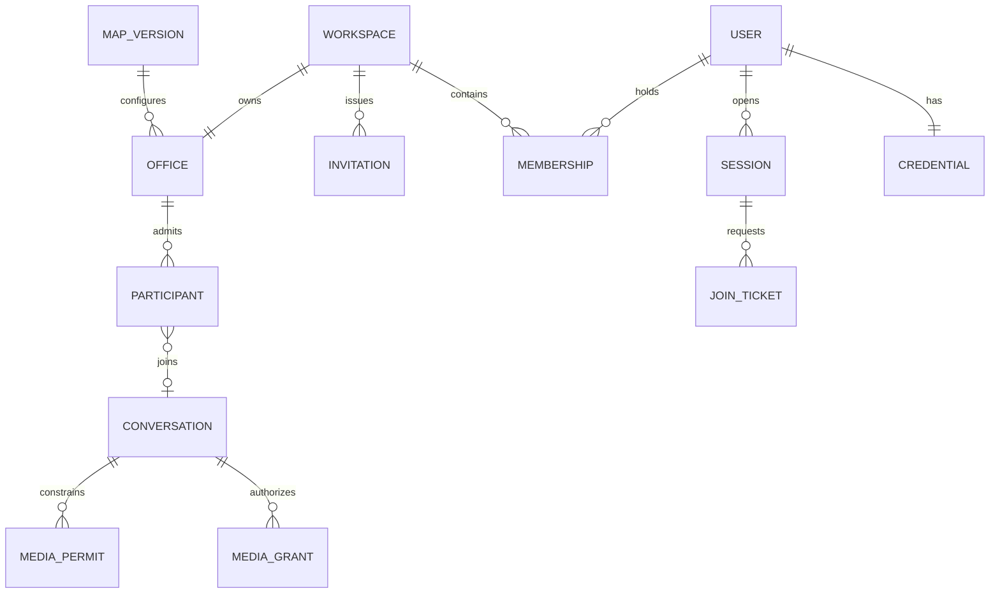

# System entity catalog

Status: product entity catalog with implemented and planned boundaries · Updated: 2026-11-08

A folder represents a durable record, runtime entity, static definition or security capability. It does not imply a MongoDB collection. Map overrides are conditional scope; the final four entries are deferred features.

| Entity | Target | State location |
|---|---|---|
| [Users](users/README.md) | M1 | MongoDB: users |
| [Credentials](credentials/README.md) | M1 | MongoDB: credentials |
| [Sessions](sessions/README.md) | M1 | MongoDB: sessions |
| [Authentication tokens](auth-tokens/README.md) | M1 | MongoDB: auth_tokens |
| [Workspaces](workspaces/README.md) | M1 | MongoDB: workspaces |
| [Memberships](memberships/README.md) | M1 | MongoDB: memberships |
| [Invitations](invitations/README.md) | M1 | MongoDB: invitations |
| [Offices](offices/README.md) | M1–M2 | MongoDB: offices; active world in process memory |
| [Map versions](map-versions/README.md) | M0–M2 | Immutable static manifests; MongoDB metadata if needed |
| [Map overrides](map-overrides/README.md) | M0 design; implementation conditional after M2 | MongoDB: map_overrides |
| [Avatars](avatars/README.md) | M0–M2 | Allowlisted appearance in users; textures in static assets |
| [Office participants and presence](participants/README.md) | M2 | Authoritative office-owner memory |
| [Office join tickets](join-tickets/README.md) | M2 | MongoDB: office_join_tickets |
| [Seats](seats/README.md) | M2 | Static map seat definitions; transient occupancy in memory |
| [Meeting zones](meeting-zones/README.md) | M2 geometry; M4 interaction | Static map definitions; office policy if configurable; live membership in memory |
| [Conversations](conversations/README.md) | M3–M4 | Office-owner memory; current authorization exported to media control |
| [Media grants](media-grants/README.md) | M0 spike; M3 integration | Short-lived JWT in browser memory; no durable raw-token store |
| [Media permits and generations](media-permits/README.md) | M0 spike; M3 integration | Guard-local expiring state; process epochs; no reusable durable allow cache |
| [Outbox events](outbox/README.md) | M1 | MongoDB: outbox |
| [Background jobs](jobs/README.md) | M1 | Dedicated persistent noeviction BullMQ Redis |
| [Audit events](audit-events/README.md) | M1–M5 | MongoDB: audit_events plus independent restricted recovery evidence |
| [Assets and provenance](assets/README.md) | M0–M2 | Versioned static files and provenance manifest |
| [Chat channels](channels/README.md) | CP06 limited slice | Fixed `office` channel projection; no channel collection |
| [Chat messages](chat-messages/README.md) | CP06 limited slice | MongoDB: `office_messages`; 90-day TTL |
| [Calendar events](calendar-events/README.md) | Deferred | Proposed MongoDB collection; not scheduled |
| [Desk assignments](desk-assignments/README.md) | Deferred | Proposed MongoDB collection; not scheduled |

Internal implementation records also exist: Mongo `operations` stores scoped command fingerprints/results, and `rate_limits` stores Mongo-backed budget counts/TTL. They support existing entity services rather than introducing new customer features. See [actual data model](../architecture/DATA_MODEL.md) for their keys/expiry and limitations.

Each folder contains a specification (`README.md`) and an actionable `PLAN.md`. Service boundaries, deployment components and UI ownership are covered by [architecture](../architecture/README.md).

The diagram is conceptual: participants, conversations and permits are transient; credentials are backend-only; pending users may not have a completed profile. A conversation's member set changes only through the authoritative runtime.
