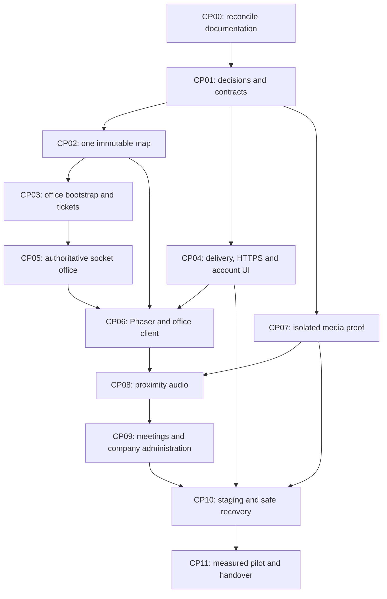

# Gather Lite project completion plan

Date: 2026-11-08 (Africa/Cairo). Status: proposed delivery plan, not implementation or release approval. Baseline: `5040ca83dc3a3ffdbab48711e9e7b7161cce1329`, plus the project-local EGM installation. Prepared after the [EGM drift report](2026-11-08_DRIFT_REPORT.md).

This plan completes the currently agreed B2B virtual-office MVP through a measured pilot. It adds a cross-stack delivery sequence to the [backend system plan](BACKEND_SYSTEM_IMPLEMENTATION.md); it does not replace the [project brief](../../GATHER_LITE_PROJECT_KNOWLEDGE.md), invent approval for open decisions, or expand deferred scope. Technical documents remain in English; owner discussions can be in Arabic.

The drift comparison followed `egm-drift-report`. This delivery plan is not a section-approved `egm-draft` feature specification and has not received an independent `egm-review`. Each implementation packet must freeze its affected contracts before code changes. Architecture choices below remain explicitly proposed until the owner records a decision.

## 1. Completion means a working company journey

A new user can register, receive verification mail, verify and sign in, create or join their company, and enter that company's fixed office. Two authorized users can see each other, move without passing through walls, sit and stand, and reconnect safely. Available users can opt into one-to-one proximity audio. Authorized users can explicitly join fixed meetings, enable camera and share a screen. Owners can manage membership and transfer ownership. Revoked access ends at HTTP, office and media boundaries within measured budgets.

The same product must handle a second company without exposing the first company's people, policy or calls. Deployment, delivery, failures, backups and restores must be demonstrated before pilot signoff.

Out of this completion scope: billing/payments/subscriptions, direct/nearby/meeting chat and customer-managed channels, calendars, recorder/AI notes/egress, desk ownership, map editor/uploads, dynamic group clustering, mobile apps, SSO/SCIM/social login/email changes, E2EE, multi-region and horizontal office ownership. The MVP now includes one fixed company-wide text channel with 90-day retention. Arabic conversation does not imply a new Arabic/RTL product requirement: the selected pilot language is English first and the browser matrix is desktop Chrome/Edge. Any expansion gets its own decision and estimate.

## 2. Starting point and evidence

| Area | Preserve and extend | Remaining work |
| --- | --- | --- |
| Tooling | Pinned Node/pnpm monorepo, CI, strict package/API TypeScript and build checks | Browser/service test suites and environment-specific delivery |
| Identity | Account/password/token/session lifecycle, cookie/CSRF/Origin guards, budgets | Frontend forms/session UX, wider password screening, deployed-origin and real mail checks |
| Tenancy | Transactional company/owner creation, memberships/invitations, transfer/removal, exact quotas and idempotency | UI, activation-grant identity, settings and agreed company lifecycle/live revocation |
| Delivery | Encrypted Mongo outbox, stable-ID BullMQ jobs, SMTP provider adapter | Real queue/provider fault tests, key management, alerts and recovery |
| Audit | Transactional safe records with 30-day TTL | Independently protected recovery evidence, acknowledgement policy and restore reconciliation |
| Frontend/assets | Authenticated OpenOfficeForAll-style app, Vivo map, company APIs, office runtime controls, and first fixed office-chat slice | Guarded LiveKit media UX, remaining browser/accessibility review, obsolete presentation cleanup and deployment evidence |
| World/realtime | Versioned map contracts, tickets, runtime, leases, movement, seats, snapshots, takeover, Vivo renderer, and current chat room event | Vivo live collision/seat contention signoff, production-scale ownership/rate budgets and deployment evidence |
| Media | Imported browser code/SDKs plus a measured isolated CP07 guard/shutdown proof | Product conversation lifecycle, scoped LiveKit grants, browser integration, source policy and deployment-profile acceptance |
| Infrastructure | Compose/Caddy/private services and local delivery stack configured and previously run for live office checks | Current-environment Docker availability, SFU/TURN/guard product deployment, protected secrets, monitoring, restore drills and release evidence |

Fresh baseline on 2026-11-08: `pnpm check` passed, including formatting, lint, typechecking, five shared tests, 32 backend tests and all builds. Tests used temporary real MongoDB/HTTP processes; SMTP and queue boundaries in backend tests were faked. The lazy LiveKit browser chunk still produces a size warning around 532 kB minified. No Docker, real mail, deployed browser, media or pilot test was run in this planning task. A passing baseline does not close A01–A11.

## 3. Decisions and external inputs

Close each decision before its dependent packet freezes a contract. Record the choice, owner, date and affected documents in [decisions](../decisions/README.md). Recommendations here preserve existing planning defaults; they are not newly approved architecture.

| Decision | Proposed working direction and alternatives | Needed before |
| --- | --- | --- |
| D12: tenant hierarchy | Accepted 2026-11-08: one company = workspace = office. Parent organizations/multiple workspaces are outside MVP; a later change needs separate scope and migration | CP02/CP03 tenant-facing freeze |
| D13: onboarding/lifecycle | Accepted: active verified users create companies themselves. Full suspension/resumption/closure authority, retention/export remain open; no owner gains platform privileges | CP04 onboarding and CP09 lifecycle |
| D04: map/catalog | The owner directed the project to adopt the pinned OpenOfficeForAll Vivo map on 2026-11-10, superseding the original multi-room `commons` direction; [decision history](../decisions/2026-11-08_CP02.md). Versioned API/runtime/renderer support and local existing-office migration are implemented. Keep source provenance visible; Vivo live collision/seat and accessibility evidence remain open | CP02 integrated; review remains |
| D02: proximity topology | Accepted: all-LiveKit for proximity and groups. No new production P2P path; D03/CP07 enforcement proof still gates product media | CP07 media proof |
| D03: media shutdown | Choose a container-aware independent supervisor with narrowly bounded authority. Prove failure behavior; ordinary restart policies do not establish it | CP07 and any product media |
| D05: hosting/network | Choose region/host, app and media endpoints, public IP/UDP, TURN/TLS arrangement and private network layout. Shared logical tenancy is the existing default | CP04 environment and CP07 fixture |
| D06: mail/keys | Supply sending domain/provider, test inboxes, DNS setup and protected API/worker key storage; define rotation and lost-key behavior | Real CP04 delivery |
| D07/D09: budgets | Preserve current auth behavior initially; freeze provisional live/camera/source limits and measurement profiles. Tune from evidence | CP03/CP05/CP07 and CP11 |
| D08: decoration | Keep fixed geometry and hide editor controls. Enabling overrides requires a separate revision/conflict/collision plan | CP06 |
| D10: business data | Determine whether real upstream company/account data exists. If none, clean verified onboarding; if present, use a separately rehearsed offline importer | CP10 migration |
| D11: recovery evidence | Select storage outside app backups, allowed mutation/acknowledgement failure behavior, retention and reconciliation ownership | CP04 design; before pilot |
| Browser/UX policy | Accepted: English-first UI, desktop Chrome/Edge. Record actual OS/browser versions in tests. Accessibility essentials and token entry UX follow CP04; code forms preserve current mail, while links require a safe route/history policy | CP04/CP06/CP08 |

External inputs still needed at their gates: provider credentials and domain control, host/region access, TLS/DNS, protected secret/audit stores, authorized real-delivery recipients, and people/devices/networks for pilot measurements. Work on local contracts, pure rules, backend tests and UI adapters can proceed without inventing those credentials.

## 4. Dependency sequence and reviewable checkpoints

CP04 infrastructure/delivery and CP07 risk proof can progress independently of office implementation after their decisions are recorded. CP02 includes the verified Phaser sample. Full browser multiplayer waits for CP05. These are dependency options for team scheduling, not a claim that parallel work or reviewers have been run.

| Checkpoint | Demonstrable result | Existing work references |
| --- | --- | --- |
| Foundation | One approved map, current docs, frozen admission contracts | M0; B001–B006/B022 |
| Backend office | Owner/member bootstrap and one-use ticket consumption | M2 first slice; B015 |
| Connected company | Real account and invitation journey on same-origin HTTPS | M1; B007/B011–B014/B021/B023 |
| Two-user office | Server-owned movement/seats, leases, fresh reconnect, Phaser client | M2; B004/B005/B015–B017 |
| Proven media | Fault-tested guarded SFU and measured removal | M0 proof; B008–B010 |
| Voice | Explicit proximity pairing and permitted audio | M3; B018 |
| Pilot features | Fixed meetings, explicit video/share and company controls | M4; B019/B023 |
| Operational pilot | Workload, outages, recovery, documented owners and signoff | M5; B020/B021/B023 |

Each packet records a named implementer/reviewer at kickoff, its chosen decisions, commit/build, scenario evidence and remaining limitations. CP00 is implemented by Codex; other implementers and calendar dates remain unassigned. Do not present duration or completion percentages without a staffed estimate; reforecast after the map and media proofs, which carry the largest uncertainty.

## 5. Ordered work packets

### CP00 — Reconcile documentation and keep one status source

Status: completed as documentation work on 2026-11-08 by Codex. See [batch/push progress and residual finding disposition](IMPLEMENTATION_PROGRESS.md). Remaining architecture/product implementation is not completed by this packet.

Deliverable: current-status notes with links to code/evidence; historical setup/import records remain dated.

1. Correct stale liveness-only, worker-scaffold, no-import and audit-empty statements identified in the drift report. Reconcile credential/session/invitation/outbox/audit field names to actual types. Explain equivalent representations instead of adding unnecessary fields.
2. Document internal `operations` and `rate_limits`; record Mongo-backed request budgeting as current behavior. Separate code complete, locally tested, environment verified and release accepted.
3. Update B001–B014 item status by subtask without marking M0/M1 accepted wholesale. Keep A01–A11 as the release register and use evidence links for partial results.
4. Cross-link this delivery plan from the docs entrypoint and older roadmap/system plan. Future status changes update the owning entity, contract and acceptance record together.

Paths: `README.md`, `GATHER_LITE_PROJECT_KNOWLEDGE.md`, `docs/README.md`, `docs/architecture/{README,REPOSITORY,DATA_MODEL}.md`, `docs/migration/{README,WEB_IMPORT}.md`, `docs/planning/{SETUP_PROGRESS,BACKLOG,ROADMAP}.md`, `docs/security/README.md`, affected entity READMEs/PLANs and `packages/{assets,contracts,delivery,tooling}/README.md`. Preserve historical `GATHER_LITE_TECH_STACK.md` with a clear supersession reference.

Exit: all identified status/model discrepancies have either a correction or a linked, intentionally open issue. No historical test result is rewritten as current production evidence.

### CP01 — Close boundary decisions and freeze the first interfaces

Status: completed for the first contract boundary (2026-11-08, Codex). [Owner choices](../decisions/2026-11-08_CP01.md) accept D12, D13 onboarding, D02, Vivo candidate, English-first and desktop Chrome/Edge; see the [scoped contract work](CP01_CONTRACTS_AND_DECISIONS.md) and [progress](IMPLEMENTATION_PROGRESS.md). Other questions retain their recorded gates.

Deliverable: decision records and strict shared contracts for the next working slice.

1. Resolve D12 and the required D13 onboarding subset; preserve current owner/member semantics and independent company roles. Record map/browser choice and D02/D03 experiment scope.
2. Establish map/protocol constants, safe errors, runtime request/response schemas and bounded event envelopes. Preserve existing auth contracts; add new DTOs without silently changing create/list results.
3. Define ownership of HTTP policy, office runtime commands, private conversation state and media control. One NestJS process remains the office authority. Do not add horizontal replicas for the same offices without fencing/routing work.
4. Specify proposed live budgets, retry semantics, participant takeover reference, availability values and blocked-seat exits before the affected implementation packet.

Existing paths: `docs/decisions/README.md`, `docs/product/B2B_SAAS.md`, `docs/contracts/{HTTP,REALTIME,MEDIA,AUTH_AND_ROLES_API}.md`, `packages/contracts/src/index.ts`, `packages/contracts/src/http/auth.ts`.

Proposed additions: `packages/contracts/src/{versions,errors,limits}.ts`, `packages/contracts/src/http/{office,profile}.ts`, `packages/contracts/src/realtime/{office,world,conversations}.ts`. Add focused schema tests under `packages/contracts/test/` and test scripts when these contracts land. Proposed filenames are implementation targets, not files that already exist.

Exit: owner decisions and safe request/response/error/version rules are recorded. Schema tests reject extra fields, injected identities/roles, invalid versions and oversized/range-invalid commands. Future unresolved decisions stay visibly gated.

### CP02 — Establish one immutable map and asset catalog

The initial Commons implementation and renderer sample remain as historical evidence. The owner later directed the product to use the imported Vivo map and OpenOfficeForAll renderer. The CP02.6a server registry and CP02.6b authenticated UI adapter are implemented; real two-browser Vivo verification and formal visual/accessibility review remain. See [Vivo runtime map adoption](CP02_WORLD_AND_MAP.md#owner-directed-vivo-runtime-map-2026-11-10) and the [UI integration plan](../migration/OPENOFFICE_UI_INTEGRATION.md).

Depends on: D04 and CP01's version/geometry contract. Deliverable: the same trusted map rules for API and Phaser.

1. Pin the owner's selected Vivo source, map helpers, public assets and MIT/provenance notices. The source header records the measured-reference attribution; preserve it with the import. **Complete.**
2. Derive pure world geometry, terrain/wall/object blockers, seats and meeting zones in `packages/world`; validate against the shared map source. **Complete.**
3. Store immutable content-hashed manifests, verify packaged bytes against registered geometry, use Vivo for new offices, and migrate existing offices from the exact trusted Commons version to Vivo with a repeatable dry-run/apply command. **Implementation complete; apply to each environment after backup.**
4. Mount the supplied `VivoScene` in the authenticated React office and adapt its participant, movement, availability and seat controls to this project's HTTP bootstrap and Socket.IO client. Show the owner-approved camera-off pre-join screen without loading a map, then display the server-selected map after Socket.IO admission. Keep the legacy bearer-token services unmounted. **Integrated; full browser review remains.**
5. Keep the supplied office/message navigation and connect implemented features to project-owned APIs. Show clear unavailable states for calendar/activity/editor/media actions until their contracts exist.

Existing inputs: `apps/shared/{vivo-map,vivo-geometry,office-world,office-seats,office-meetings,office-objects}.js`, `apps/shared/maps/`, `apps/web/{VivoScene.tsx,avatarLook,avatarSprite,navigation}.ts`, `apps/web/sprites/`, `apps/web/public/`, `packages/assets/manifests/provenance.json`, `docs/migration/UPSTREAM_IMPORT.json`.

Current additions: `packages/world/src/vivo.ts`, generated hashed manifests under `packages/assets/manifests/`, the API map registry and `scripts/vivo-assets.mjs`. Keep API collision geometry and the renderer's pinned shared map aligned as either gains a new version.

Exit: unit/integration tests cover geometry/version acceptance, API tests cover both maps, and the mocked browser test covers authenticated Vivo rendering and controls. Live two-browser movement/collision/seat contention on Vivo, visual anchor/occlusion review, screen-reader audit and Chrome/Edge signoff remain release evidence. Record the partial A05/A06 evidence.

### CP03 — Implement office bootstrap and one-use admission tickets

Status: completed for the HTTP and internal consumption boundary. See the [CP03 implementation evidence](OFFICE_ADMISSION_IMPLEMENTATION.md#cp03-implementation-evidence).

Depends on: CP01, CP02; local backend tests require no Docker. Deliverable: the exact first backend slice in [OFFICE_ADMISSION_IMPLEMENTATION.md](OFFICE_ADMISSION_IMPLEMENTATION.md).

1. Add authorized office discovery to workspace detail, scoped office bootstrap and POST join-ticket. Validate `(workspaceId, officeId)` together; deny `pending-m0`, unknown maps and incompatible versions.
2. Assign an approved map version to new offices and provide a repeatable backfill for existing `pending-m0` rows. Preserve IDs and previously configured versions; support dry-run/counts and avoid mass updates to arbitrary map values.
3. Add membership activation-grant identity. Ordinary policy writes retain it; removal/reactivation changes it. Existing rows can initially use their membership ID, as the detailed admission plan specifies.
4. Persist only a ticket digest and its user/session/tenant/office/activation-grant/epoch/map/protocol/expiry bindings. Enforce a maximum thirty-second lifetime bounded by session validity and dedicated actor/company/global issuance budgets.
5. Consume once inside a transaction with fresh conditional policy writes. Recheck current epoch before later runtime reservation. A spent ticket stays spent after capacity failure; retry needs a new ticket.
6. Validate exact unique/TTL indexes at startup. Keep ticket secrets out of logs, URLs, operation-result stores and persistent browser storage.

Modify: `apps/api/src/modules/office/office.module.ts`, `apps/api/src/modules/tenancy/{tenancy.models,tenancy.service,tenancy.module}.ts`, `apps/api/src/platform/database/{indexes.service,create-indexes}.ts`, `packages/contracts/src/index.ts` and auth/tenancy tests as needed.

Proposed additions: `apps/api/src/modules/office/{office.controller,office.service}.ts`, `admission/{join-ticket.models,join-ticket.service,epoch-registry}.ts`, `maps/map-registry.ts`, explicit backfill script and `apps/api/test/office-admission.integration.test.ts`; export CP01 office schemas.

Exit: real HTTP/Mongo tests for owner/member/two-company access, ID substitution, explicit expiry, one concurrent consume winner, replay, old epoch/map/protocol, logout/reset/suspension/removal and removal-plus-reinvitation. Verify idempotent backfill and bad-index startup. Record partial A03/A04/A11; this is not yet a live office.

### CP04 — Finish delivery, same-origin browser auth and company onboarding

Depends on: onboarding/provider/hosting decisions, existing backend APIs. CP03 is complete. Delivery batches and browser-verification boundaries are tracked in [CP04_BROWSER_AND_DELIVERY.md](CP04_BROWSER_AND_DELIVERY.md).

1. Build a private reproducible non-media environment: Caddy TLS, web/API, transaction-capable Mongo, persistent queue Redis, worker and a local mail sink. Use explicit start commands and separate disposable cache configuration. API container binding must be private-network reachable; the current loopback default cannot be copied unchanged into a separate container.
2. Configure SMTP/domain and protected outbox-key storage for a controlled staging test. Verify real verification, recovery and invitation delivery with authorized test recipients. Choose code-entry UX or a separately reviewed no-referrer/history-safe link flow; current emails provide backend code instructions.
3. Test API commit before enqueue, dispatcher restart, duplicate processing, ambiguous SMTP acknowledgement, expired/superseded messages, queue outage/restart and noeviction enforcement. Preserve at-least-once email semantics; single-use redemption stays transactional.
4. Add the common browser API adapter: same-origin cookies, in-memory CSRF, JSON mutations, structured error handling and stable idempotency keys for durable retries. Refresh CSRF after login/reauth; do not blindly retry commands whose outcome is unknown.
5. Implement registration/verification/resend/login/forgot/reset/change-password, reauth, session list/revoke/logout-all and explicit idle-extension warning. Never restore a legacy localStorage session or browser-generated identity as authenticated state.
6. Connect company list/create/invitation acceptance and owner/member views to UUID DTOs. Clear tenant caches and tear down old world/media state on company switch. Remove obsolete credential/admin/invite storage keys while preserving non-sensitive user preferences.
7. Specify broader compromised-password screening and benchmark Argon2/concurrency on the target host; preserve existing reset/verification protections. The [CP04.5b–c audit mirror design and outbox](CP04_AUDIT_MIRROR_DESIGN.md) now implement a same-transaction local projection; select the independent destination, retention/immutability, lag budget and outage policy before adding delivery or relying on pilot backups.

Existing paths: `apps/web/{main.tsx,WorkspaceHome.tsx,config.ts,workspaces.ts}`, `apps/worker/src/{main.ts,outbox/dispatcher.ts,processors/delivery.ts,providers/mail.ts}`, `apps/api/src/platform/{http/configure.ts,config/environment.ts}`, identity/tenancy services, `.env.example`.

Proposed additions: `apps/web/src/lib/api.ts`, `apps/web/src/features/{auth,workspaces}/` with adapters/forms/session state, private `infra/{compose,caddy,mongodb,redis}/` configuration, `tests/integration/delivery/`, `tests/e2e/auth-company.spec.ts` and corresponding package scripts/CI jobs. Browser tests use a private mail sink, never a public debug-token endpoint.

Exit: a real browser completes registration → mail → verification → login → company creation/invitation → session revocation. Confirm Secure/HttpOnly/host-only cookies and correct Origin behind ingress, wrong Origin/CSRF denial, reload recovery and cross-company cache isolation. Validate sanitized proxy headers before enabling proxy trust. Record A01–A03/A09/A11 portions and the remaining real-provider limits.

### CP05 — Build the authoritative Socket.IO office

Status: CP05.1–CP05.4b implemented and locally verified for one API process. Browser integration, real Mongo outage and multi-process coordination are deployment gates. Depends on: CP03 and CP02. Deliverable: two real socket clients with server-owned state, initially independent of the renderer. Batches and local exit evidence are tracked in the [CP05 implementation plan](CP05_REALTIME_IMPLEMENTATION.md).

1. **CP05.1/CP05.2 complete locally:** exact-Origin Engine.IO gate, WebSocket-only transport, 4 KiB raw-message limit, strict `/office` auth, one-use ticket consumption, serialized capacity/participation reservation, safe `office:ready`, join/removal deltas and disconnect/epoch cleanup. Enforce a 5-second handshake timeout, 60 attempts/minute per direct TCP peer, primary-policy checks every second and five-second request-start leases. Idle socket tests prove removal after logout, session rotation, password change/reset, account/workspace suspension, membership removal and policy uncertainty/delay; reconnect tests require fresh tickets/snapshots. Connection-state recovery remains disabled. Current limiter and runtime are process-local.
2. Implement a single serialized office command owner, safe participants and state versions. One active participation per user/workspace; an ordinary second tab gets a conflict. Explicit takeover targets only the same user's current server-issued participation reference.
3. **CP05.2 complete locally for one API process:** recheck session/account/company/membership/map/epoch every second using bounded primary policy reads, monotonic request-start leases and independent expiry deadlines. Late replies cannot revive ended access. Polling detects committed policy revocation within the lease bound; fail closed when reads fail.
4. **CP05.2 complete locally:** idle sockets leave after logout/reset/session rotation, account/company suspension and membership changes. The current mechanism polls instead of sending immediate post-commit hints. Multi-process policy notifications and shared rate limiting are required before scaling the API horizontally.
5. **CP05.3a/b complete locally for one API process:** advance bounded directional intent from server time at 192 pixels/sec, normalize diagonals, reject stale sequences/epochs, enforce a 30/s per-participation movement budget, expire stale intent and apply shared map collision. Presence and seat commands use a shared 30/s per-socket budget. Runtime serializes seat claims/stand/release and publishes occupancy with each participant projection; chair tiles are excluded from spawn and occupied-chair collision. Cross-process authority, shared workspace command budgets and Socket.IO seat-race verification remain open.
6. **CP05.4a/b complete locally for one API process:** an admitted socket can request a current full snapshot after a delta gap; the server validates actor/epoch, rejects future versions, limits resync to three requests per second per socket and emits only to the requester. Explicit takeover uses a 30-second maximum, one-use same-session reference and separate ticket; it atomically replaces the target participation and releases its seat. Browser gap detection/recovery and reconnect UX remain CP06.
7. Publish safe versioned snapshots/deltas and gap resync. Bound event sizes/rates and resync budgets separately from outbound snapshots. Never broadcast session IDs, emails, policy records or private call membership.

Implemented CP05.1–CP05.4b paths: `apps/api/src/modules/office/realtime/{office.gateway,office-socket.adapter}.ts`, `runtime/office-runtime.service.ts`, `office-admission.service.ts` and its controller. Remaining gates include real Mongo-outage drills, shared multi-instance policy/rate coordination, per-workspace command budgets, browser integration and load evidence. Update owning modules and app startup/shutdown as each batch lands.

Exit: two real Socket.IO test clients move/collide/sit; final seat/capacity races have one winner; fake roles/identity, direct join, wrong Origin, replay, old sequence/epoch and oversized/flooded events fail. Test gaps/reconnect, explicit takeover, policy removal while idle, Mongo loss, expired sessions, delayed lease replies and restart. Record A04/A05/A11.

### CP06 — Replace the legacy office path with Phaser and typed client adapters

Status: CP06.1–CP06.10b implement the typed client, authenticated entry, live map, presence and seat controls, two-browser admission/movement/availability, authoritative collision, seat contention, company isolation, snapshot recovery, re-entry, named controls and keyboard-focus evidence. CP06.11 implements the supplied chat view against tenant-scoped history/send APIs, 90-day retention and office-room Socket.IO delivery. Frontend placeholder/data cleanup is recorded in the [data audit](FRONTEND_DATA_AUDIT.md). Remaining CP06 exit work: formal visual/screen-reader/Chrome-Edge review, profile appearance persistence/picker and live chat browser acceptance. Calendar/activity and product media remain in their owning phases. See [implementation progress](IMPLEMENTATION_PROGRESS.md#cp061-typed-office-client-core).

Depends on: CP02 sample, CP04 account/company path and CP05 protocol. Deliverable: the browser-based two-user office.

1. Mount one Phaser instance with a typed React bridge. Phaser owns drawing, input, camera, animations, local prediction/reconciliation and remote interpolation; React owns forms, panels and essential accessible controls.
2. Load the approved manifest/assets and render the fixed map, walls/furniture, labels, approved avatars and seat animations with consistent origins/depth. Client geometry improves feel but never grants authority.
3. Replace raw `/ws` with a Socket.IO client that obtains memory-only tickets, waits for `office:ready`, applies only matching-version/epoch deltas and requests a full snapshot after gaps. Drop offline inputs; rejoin from fresh bootstrap on relevant conflicts.
4. Add visible connecting/offline/full/access-ended/takeover/version-mismatch/session-expiry states. Clear participants and private state on leave, tenant switch, logout and teardown. CP06.2/06.4 implement basic connection/access states, explicit leave, availability and seat controls; richer reconnect and gap UI remain.
5. Add allowlisted display-name/appearance persistence through the proposed profile API and publish safe changes to authorized office state. Reject arbitrary texture URLs and unsupported catalog IDs.
6. Keep the supplied map and message navigation, while showing clear unavailable states for calendar/activity/recording/editor/desk-ownership controls until their APIs exist. Keep useful artwork and licensed helpers; delete obsolete transport/auth adapters after callers move.
7. Verify keyboard/focus/dialog behavior, zoom/essential controls, resize and reduced-motion behavior where applicable. Product language/RTL expansion follows CP01's explicit scope, not chat language.

CP06.1 implements the typed browser boundary first: fetch a company-scoped bootstrap, request a short-lived ticket in memory, connect WebSocket-only to `/office`, validate `office:ready`, apply only contiguous epoch/version deltas and request a full snapshot on a gap. CP06.2 mounts it behind an explicit action in the authenticated company route, displays connection/access states and the server roster, and closes it on leave or route teardown. CP06.3 mounts the version-checked upstream map, server-positioned avatars/seats, local camera follow and keyboard/pointer movement intent. CP06.11 wires the supplied OpenOfficeForAll messages view to a fixed office channel, membership-scoped history/send APIs and typed room broadcasts; retention is 90 days. DMs, nearby chat, files and channel management remain out of scope until separately authorized.

Existing paths to migrate: `apps/web/{App.tsx,VivoScene.tsx,MiniOffice.tsx,useOffice.ts,AvatarEditor.tsx,avatarLook.ts,avatarSprite.ts,navigation.ts,types.ts,styles.css,scene.css,main.tsx,vite.config.ts}`; reused sprite/public files retain notices. Update imported shared tests deliberately when import ownership changes.

Proposed additions: `apps/web/src/features/office/{OfficePage,PhaserWorld}.tsx`, `world/{OfficeScene,bridge,assets}.ts`, `realtime/{client,state,reconcile}.ts`, profile adapter/components, API profile schemas/service/controller, `tests/e2e/office.spec.ts` and visual/render fixtures. Retire `config.ts` legacy auth, raw `useOffice.ts` and old renderer callers only once replacement routes pass.

Exit: two separate browser contexts sign in, enter the same office, move/collide/sit, switch availability and reconnect. A second company stays isolated. UI rerenders do not recreate Phaser; repeated route/tenant switches leave no extra games, listeners or timers. Screenshots establish anchors/occlusion/pixel quality; browser tests cover keyboard controls and access loss. Record A04–A06/A11.

### CP07 — Prove bounded media enforcement before product integration

Status: local isolated ICE/TCP spike exit demonstrated on 2026-11-10. See [the evidence matrix and failure boundaries](MEDIA_ENFORCEMENT_EVIDENCE.md). This scoped local proof does not accept production A07 or implement application media policy; promotion and additional transports require their own validation.

Depends on: D02/D03/D05 and approved private fixture environment. Start early after CP01 because failure can change media feasibility.

1. Pin compatible LiveKit server/SDK and container image digests for the experiment. Inventory every join/reconnect/refreshed-token path and required media/TURN listener.
2. Build the proposed guard: machine-auth scoped pulls with nonce/sequence/epochs, request-start deadlines, exact permit-version installation acknowledgements and irreversible generation retirement. Begin default-deny.
3. Build an independent container-aware supervisor able to stop SFU forwarding if guard progress stalls or retirement/deletion cannot be trusted. Keep authority narrowly scoped; expose no unrestricted Docker/control interface to the app/browser.
4. Route all public signaling through the guard; isolate underlying signaling/admin/webhook endpoints and test alternate ingress/TURN routes for bypass. A disconnected UI or successful DeleteRoom response is not forwarding evidence.
5. Use private two-/three-user fixtures to test wrong identity/room/source, original/refreshed replay, expiry, delayed policy replies, controller loss, guard freeze, failed/uncertain deletion and cold restart. Capture last protected forwarding evidence and call interruption.
6. Measure the provisional eight-second cutoff, including the five-second authorization and three-second enforcement budget. Measure shared-node company impact. Document if the mechanism cannot meet the requirement and stop product media until the owner resolves the architecture/guarantee trade-off.

Paths: implement inside `spikes/media-enforcement/` first, plus private `infra/media/` experiment configuration and `docs/planning/MEDIA_ENFORCEMENT_EVIDENCE.md`. Proposed spike sources cover guard/policy client, supervisor, fixtures and fault scenarios; exact production process/package boundary is decided from the proof, not invented as another empty app now.

Exit: reproducible pinned-stack evidence for A07 with observed cutoffs and failure limits. Retain explicit failures. Only a passing proven design is promoted to production media services.

### CP08 — Implement opt-in proximity conversations and voice

Depends on: CP05/CP06 and passing CP07. Deliverable: authorized one-to-one proximity audio in the real office.

Progress: CP08.1 implements deterministic application-side pairing and private realtime state.
CP08.2a defines strict shared media-token, policy-pull, permit-snapshot and install-ack schemas;
CP08.2b implements HMAC-authenticated application pull/ack routes and marks only still-current
generations active after an exact installation acknowledgement. CP08.2c adds the guard-side signed
ACK client and shared canonical base64 key decoding. CP08.3a adds a protected session/company/current-
pair-bound token endpoint (microphone-only JWT, maximum 60 seconds, bounded by session expiry,
no-store response) and a CP07 guard mode that validates changing participation IDs against current
installed permits. CP08.3b connects the supplied office-shell controls to the token route and lazy
pinned `livekit-client`, including remote-audio attachment, microphone-off default and teardown on
mute/leave/context change. CP08.3c starts the real CP07 guard as a separate process against the live
Nest integration-test server over signed localhost HTTP. The guard installs a current pair's
permits, authorizes its application-issued JWT to a mock signaling upstream, then denies that token
after pair end and after a fresh-epoch guard restart. The focused API process-integration test,
web/type/lint/build checks and mocked office browser flow pass. The policy remains process-local.
This does not prove actual LiveKit join/audio, SFU forwarding cutoff or production deployment.

**CP08.4 — actual application-grant media fixture (complete locally, 2026-11-11).** Added the
opt-in `pnpm test:media-live` path. It starts the pinned LiveKit image
`livekit/livekit-server@sha256:25cd902de7cacbd5f1f779f6a6ac1eae20ba8f56b0935934ce6b0ab80d1e3d20`,
the real CP07 guard process connected to the Nest test API over signed pull/ACK, and two Chromium
clients with fake microphones. Both API-issued, current-participation grants publish/subscribe only
through the guard; each browser receives active audio from exactly its paired participation. The
fixture loads the production `ProximityAudioSession` implementation, ends the server-side pair,
applies the session stop, and measures the final decoded waveform sample. The observed cutoff was
**0 ms at a 20 ms sample interval**, with stable post-stop counters. It then verifies both still-
unexpired original grants are denied after guard and SFU restart. Containers, browser pages,
processes and temporary policy/retirement state are cleaned up. This local fixture does not mount
the full `CompanyOfficePreview` or verify its Socket.IO-to-component stop wiring; that belongs in
CP08.5. Full `pnpm check` passed all 215 tests and the production build. This is real media-path
evidence, not production deployment acceptance.

**CP08.5 — revocation/failure matrix (in progress).** CP08.5.1 now toggles the production
`ProximityAudioSession` microphone through the real API-grant/guard/LiveKit/two-Chromium path. On
2026-11-11, the receiver's last active decoded sample was 59 ms after mute was requested; active
samples then remained stable for 500 ms. After unmute, decoded audio resumed after 668 ms and
produced at least six additional active samples. Both transitions stayed within the existing
eight-second cutoff budget. This validates the media-session mute/unmute path but does not mount the
full office component. CP08.5.2 extends the supplied UI E2E: when the mocked media WebSocket closes,
the live map stays mounted and keyboard movement still reaches the office socket. This checks UI
resilience to media-service failure, not browser permission denial. CP08.5.3 runs the same
two-browser actual-grant fixture with opt-out and Away triggers: the API emits an empty-policy
install ACK while the guard remains alive, and measured final decoded audio cutoff was **0 ms** in
both runs. The fixture explicitly stops the production `ProximityAudioSession` after the server
policy ACK; it does not yet prove `CompanyOfficePreview` reacts to these Socket.IO events itself.
Permission denial with the office/map still usable, active-media leave through the mounted UI,
active-media teardown after membership/session revocation, office/API lease expiry, guard loss and
independent-supervisor progress loss remain in the matrix.
CP08.5.4 also runs session logout and owner-driven membership removal during
the real media fixture: both close the affected office socket, end the pair for the surviving
participant, install the empty policy while the guard remains alive, and measure **0 ms** decoded-
audio cutoff. Both old grants are rejected before and after a fresh guard/SFU restart while their
JWTs are still unexpired. The browser session is explicitly stopped after the server ACK; this does
not yet prove the mounted UI teardown for these revocations. Record each input, policy ACK, last
active audio sample, process state and outcome. Do not close A07/A08 from token expiry or UI state
alone.

CP08.5.5 restarts the pinned SFU during an active, real two-browser application-grant call. Both
production clients observed `reconnecting`, returned to `live`, and resumed decoded audio with the
same still-valid application JWTs; recovery took **14,024 ms** from the restart request. CP08.5.6
then forced a real LiveKit participant update, captured the production SDK's SFU-refreshed JWT,
verified its identity/room/microphone-only claims, and reconnected the production media session
through the live guard with audio recovery. After conversation revocation plus fresh guard/SFU
restart, the still-unexpired refreshed JWT and original application JWT were both denied by the
guard. This covers refresh and replay within the pinned local fixture; mounted UI teardown, the
actual browser permission prompt/map flow, lease/process loss and deployment ingress remain open.

CP08.5.7 adds a mounted-office E2E where the mocked media WebSocket fails, the user leaves the
conversation through the UI, and the Vivo map continues to render and accept movement. It verifies
the UI's session-stop/ended-state path under media failure. A real audio cutoff caused by leaving an
active media call, browser permission prompt/map flow, active-call membership/session teardown and
lease/process faults remain open.

CP08.5.8 extends the mocked E2E to hold a LiveKit signaling socket during connection, deliver
`office:access-ended` with `authorization_ended`, and verify the mounted preview closes that socket
and returns to the re-entry state. This proves UI cleanup for a pending connection, not live audio
forwarding cutoff or a particular backend revocation trigger. CP08.5.9 runs a real API/guard/pinned-
LiveKit pair while Chromium makes one production media session's `getUserMedia` reject with
`NotAllowedError`: the peer remains in the SFU, the denied participant is removed, the office
socket stays connected, the production UI-facing session reports its recovery message, and both
sessions leave the SFU cleanly after conversation termination. This verifies deterministic media
API denial handling, not the browser's operating-system permission prompt or map usability in the
same mounted UI scenario. Active-call leave cutoff, mounted-UI permission/map behavior, active-call
session/membership revocation through the UI, and lease/guard/supervisor fault cases remain open.

**CP08.6 — webhook reconciliation (pending).** Add strict raw-body signature verification,
event-ID deduplication and late-event handling under `apps/api/src/modules/media/`; webhooks observe
SFU state and never authorize admission. Add integration cases for valid, invalid, duplicate and
late events in `apps/api/test/auth.integration.test.ts`. Keep the webhook listener private and
document the secret provisioning and replay window.

**CP08.7 — release evidence (pending).** Run denied-capture, TURN-only, weak-network and cross-
company media tests. Record deployment listener exposure and SDK/SFU digests in
`docs/planning/MEDIA_ENFORCEMENT_EVIDENCE.md`, link each result to A07/A08 and keep release gated
until the actual media path passes.

The old `apps/web/{useMedia.ts,useSfu.ts,MeetingView.tsx}` P2P lifecycle is not mounted and must not
be reconnected. The active adapter is `apps/web/src/features/office/proximity-audio-session.ts`;
fixed meeting camera/screen controls remain CP09.

Exit: real two-browser audio, denied capture, opt-out/away/leave, boundary churn, logout/reset/removal during calls, expired leases, reconnect, stale original/refreshed grants and isolated companies. Re-run forwarding measurements on the integrated path. TURN-only and weak-network scenarios have recorded outcomes. Record A07/A08/A11.

### CP09 — Complete fixed meetings and company administration

Depends on: CP08, approved D13 lifecycle and settings scope. Deliverable: the remaining agreed pilot functions.

1. Add explicit fixed-zone meeting join/leave with physical/access checks and serialized capacity. Proximity and meeting participation are mutually exclusive. Leaving the zone or losing access retires the applicable generation.
2. Enforce the provisional six-person zone cap and source-specific microphone/camera/screen grants. Screen audio remains disabled in the first slice per current media plan. Test whether the pinned SFU actually enforces required track/source caps; a client-side limit is insufficient.
3. Implement camera/screen consent and device selection/ended-track behavior, meeting tiles and clear join/retry/migration states. No recorder, bots or egress capability.
4. Finish owner member/invitation administration and reauthenticated ownership transfer UI. Add only approved workspace settings, initially proposed name/revision/idempotency handling.
5. Implement the agreed lifecycle through an explicitly authorized operational boundary: suspend/resume/close/export/retention according to D13. Verify old grants/leases never revive on resumption. If self-service deletion is not approved, provide the chosen operator procedure rather than an invented owner DELETE endpoint.
6. Apply tenant-specific runtime/media/delivery budgets, audit actions and safe errors; do not derive commercial entitlements from engineering caps.

Paths: extend `office/runtime/`, `conversations/`, `media/`, tenancy services/controllers/models as approved, shared meeting/settings contracts, `apps/web/src/features/{meetings,workspaces}/`, adapted `MeetingView.tsx`, and `tests/{integration,e2e}/` meeting/lifecycle scenarios. Update corresponding entity plans and D13 record.

Exit: three-plus users and concurrent final-slot joins; private-zone/company isolation; removal of one member blocks their old media while authorized survivors reconnect; camera/screen source caps, permissions and teardown pass. Owner/member roles remain independent across companies. Approved lifecycle/offboarding is rehearsed. Record A03/A07/A08/A11.

### CP10 — Deliver staging, observability and safe recovery

Depends on: CP04 environment, CP07 proven media mechanism and CP09 complete feature path. Design the audit mirror earlier in CP04; do not wait until restore time to collect evidence.

1. Complete pinned Compose/Caddy/media deployment with private networks, least-privilege processes, durable volumes, secrets outside Git and explicit migrations. Configure exact app Origin, safe proxy trust/redaction and protected operational access.
2. Add readiness distinct from liveness, admission draining, graceful shutdown and fresh runtime/guard epochs. Deploy one office authority initially. Document how a failed rollout returns to a compatible build without restoring stale tickets/leases/generations.
3. Instrument safe request/event IDs, tick delay, socket/input load, snapshot size, auth/hash saturation, lease expiry, media join success/latency, permit retirement/cutoff, TURN egress, queue age/failure, backup age and audit mirror gaps. Assign alert thresholds and recipients before enabling them.
4. Implement independently protected security evidence outside application backups, acknowledgement monitoring, retention and restore reconciliation. Define behavior on mirror failure and verify it under outage.
5. Create encrypted backups with protected restore access. Rehearse restoration in isolation: suspend access, invalidate restored sessions/tokens/invites, retire generations, reconcile later resets/suspensions/removals, require mailbox recovery where history is uncertain, and reconcile expired outbox/queue state.
6. Resolve D10. If real business data exists, build a dry-run/idempotent offline importer with stable mappings, backups/count/error reports and fresh verified credentials/session invalidation. Otherwise record clean onboarding explicitly; never add JSON/Mongo dual writes.
7. Add build/deploy/rollback jobs only for the chosen environment with appropriate approval/secrets policy. Document infrastructure/patching/incident/restore owners. Provisioning, real sending and publishing occur as their explicitly scoped implementation/deployment work, not as side effects of this plan.

Paths: `infra/{compose,caddy,mongodb,redis,media}/`, image/build files for apps, `.env.example`, `.github/workflows/`, API health/readiness/drain hooks, worker lifecycle/metrics, `docs/operations/{DEPLOYMENT,INCIDENTS,BACKUP_RESTORE,DELIVERY_RECOVERY}.md`, restricted audit mirror/reconciliation implementation and `tests/integration/operations/`. File boundaries for mirror/supervisor follow the approved D03/D11 design.

Exit: staging starts from documented configuration; readiness/draining and compatible rollback work; alerts trigger in controlled faults; restore cannot resurrect old passwords, removed memberships or stale tokens. Record measured recovery against provisional RPO one hour/RTO four hours. Record A09/A10/A11 and operational limits.

### CP11 — Run the declared pilot and hand over

Depends on: all prior packets and complete evidence prerequisites. Deliverable: a small operationally supported MVP with an honest capacity statement.

1. Define hardware/browser/network and simultaneous-media workload. Exercise the provisional twenty-participant office across more than one tenant; include meeting/proximity distribution, camera/share sources and TURN usage.
2. Measure simulation latency/backlog, memory/CPU, snapshot bandwidth, SFU resources/egress, media join success/p95, permission handling, reconnect and weak-network behavior. Evaluate the proposed 95% join success and two-second p95 only against the declared profile.
3. Inject Mongo loss/slowness, cache pressure, queue outage, worker restart, authority restart, guard freeze, SFU control failure and shared-node shutdown. Record tenant impact, actual denial/cutoff and recovery.
4. Run complete browser journeys, keyboard/accessibility essentials, supported-language/browser coverage and deferred-feature absence. Verify no credential/ticket/media secret appears in logs, storage or bundles.
5. Resolve failures, tune measured configuration, and rerun affected scenarios. Record each A01–A11 criterion with build, environment, date, responsible person and artifact link. A failure remains open; do not replace evidence with a design statement.
6. Publish pilot limitations, supported capacity/network profile, incident/restore/patching ownership and operator instructions. Obtain owner pilot signoff and make the approved deployment concrete through the deployment workflow. Any broader public/commercial launch gets a separate scope decision.

Paths: `tests/integration/{load,faults}/`, `tests/e2e/`, declared workload fixtures, `docs/planning/{PILOT_EVIDENCE,ACCEPTANCE}.md`, operations runbooks and relevant configuration. Test scripts/CI must distinguish fast checks from service/fault/browser suites.

Exit: A01–A11 have sufficient actual evidence for the approved pilot scope, all release-blocking failures are resolved, restoration/cutoff budgets are demonstrated or explicitly revised by the owner, and named people own operation. Installing dependencies, rendering a dashboard or passing backend-only tests is not this exit gate.

## 6. Verification matrix and release constraints

| Acceptance | Primary packets | Required evidence still to obtain |
| --- | --- | --- |
| A01 browser security | CP04/CP06/CP10 | Real browser cookies, CSRF/Origin/proxy, secret storage and redaction |
| A02 account lifecycle | CP04 | Real delivery, full browser verification/recovery/session paths, target-host password controls |
| A03 tenant policy | CP03/CP04/CP09 | Preserve existing local race tests; add new profile/settings/lifecycle and deployed tenant paths |
| A04 admission | CP03/CP05/CP06 | Ticket replay/expiry/epoch, socket Origin, takeover/reconnect and live removal |
| A05 world | CP02/CP05/CP06 | Server-time collision/speed, seats, floods, gaps, incompatible versions and stale lease replies |
| A06 renderer | CP02/CP06 | Provenance plus actual Phaser anchors/occlusion, bridge lifecycle and essential accessibility |
| A07 media privacy | CP07/CP08/CP09/CP11 | Original/refreshed replay, source restrictions, no bypass and forwarding cutoff under faults |
| A08 media UX | CP08/CP09/CP11 | Explicit devices, denied permissions, TURN/weak networks, private meetings and migration |
| A09 delivery | CP04/CP10/CP11 | Real queue/provider acknowledgement/crash/outage, duplicate/expiry/key handling and alerts |
| A10 operations | CP10/CP11 | Readiness/drain/restart, measured workload/cutoff, independent evidence and safe timed restore |
| A11 B2B | CP03–CP11 | Two companies across HTTP/socket/media/jobs, lifecycle, current-company UX and noisy-neighbor/shutdown impact |

For each implementation change: run relevant focused tests, then `pnpm check` before a verified implementation handoff. Add real socket/browser/service tests as their capabilities land. Fast CI must not silently claim a real SMTP/SFU/deployment test when using fakes. Add explicit service jobs with controlled fixtures, bounded cleanup and no production credentials.

No Docker execution, infrastructure provisioning, real email, publishing or source implementation is performed by this planning artifact. Earlier backend-only/no-Docker task constraints remain recorded; carry out future environment work under its actual authorized implementation scope.

## 7. Main risks and stop conditions

| Risk | Consequence | Mitigation and decision boundary |
| --- | --- | --- |
| Unproven independent SFU shutdown | Media cannot meet retained revocation requirement | CP07 early proof; stop product media if it fails, then obtain an explicit architecture/requirement decision |
| Organization requirement changes | Tenant schema/routes and all scopes change | D12 is accepted for MVP; a later organization expansion requires a new scope/migration plan |
| Imported UI exceeds MVP | Unsupported controls imply features/security the backend lacks | CP06 route/bundle cleanup and browser checks; no hidden legacy backend |
| Map/asset migration effort is larger than expected | Phaser integration delays | Prove one avatar/object and one map first; preserve notices; block unresolved artwork |
| Live authorization renewal load | Database contention/tick delay under active users | Measure real read/write budgets separately from simulation; bounded leases fail closed and never wait on queue |
| Shared SFU emergency stop | Other companies lose calls | Measure and publish blast radius; narrower isolation needs a separately justified infrastructure choice |
| Ambiguous SMTP acknowledgement | Duplicate or delayed emails | At-least-once delivery, single-use redemption, expiry/supersession, real fault tests and safe replay runbook |
| Audit gaps or restored old credentials | Backup could reopen removed access | Independent evidence and suspended reconciliation; no automatic reopening of uncertain identities |
| No staffed delivery estimate/provider access | Calendar dates become fiction | Assign people/access at kickoff and reforecast after CP02/CP07; maintain packet dependencies and evidence |

## 8. Next implementation handoff

CP00–CP05.4b are implemented with local evidence for the agreed slices. CP04.4c external SMTP remains deferred; local Mailpit evidence is not provider acceptance. CP04.5 has a transactional audit outbox, while independent audit delivery, retention and recovery acceptance remain open. CP05 single-process admission, authorization/revocation, movement/presence/seats, snapshot recovery and explicit takeover are locally verified; multi-process coordination and real Mongo outage drills remain open. CP06.1–CP06.10b provide typed client entry, live Phaser rendering/controls, two-browser admission/presence/movement, availability, wall collision, seat contention, two-company office isolation, scene teardown, browser snapshot recovery, fresh-ticket re-entry and separately verified mocked-client/API disconnect recovery. Preserve CP01 decisions and do not reopen accepted choices without a specific change.

Immediate next implementation packet: **CP08 — application-scoped opt-in proximity and guarded voice**, using the final isolated/SFU-local-lease CP07 design in [the evidence report](MEDIA_ENFORCEMENT_EVIDENCE.md). Replace synthetic fixture policy with real participation/session/company authorization. CP06 formal browser, visual and screen-reader release acceptance remains open in A06; external SMTP remains owner-deferred.

For each packet, record environment, scenario, observed result and remaining limits in implementation progress and the acceptance register. Keep local test-created accounts/workspaces isolated to the local development stack. Codex owns implementation review and independent verification in this run; preserve the owner's external SMTP deferral and do not treat Mailpit or simulated acknowledgements as provider acceptance.

Maintain this plan as delivery status changes; detailed feature specifications and optional independent EGM reviews are separate artifacts. No approval is implied for a future feature or open architecture choice merely because its packet appears here.
