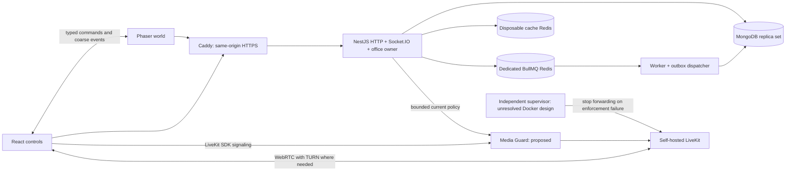
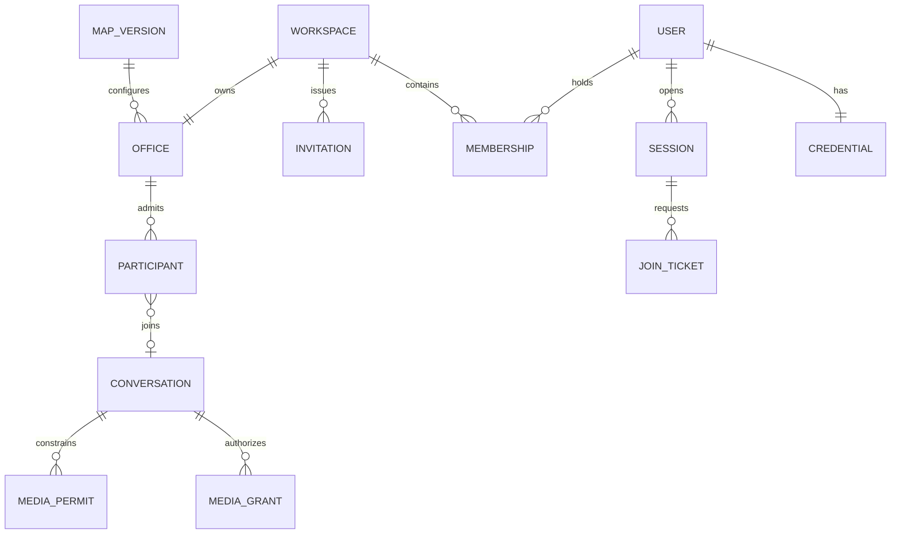
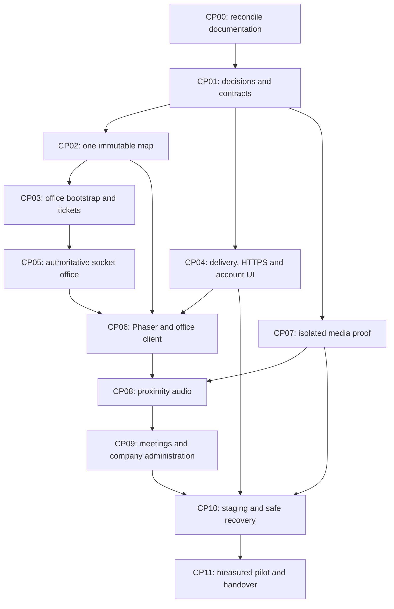

This file is a merged representation of the entire codebase, combined into a single document by Repomix.

# File Summary

## Purpose
This file contains a packed representation of the entire repository's contents.
It is designed to be easily consumable by AI systems for analysis, code review,
or other automated processes.

## File Format
The content is organized as follows:
1. This summary section
2. Repository information
3. Directory structure
4. Repository files (if enabled)
5. Multiple file entries, each consisting of:
  a. A header with the file path (## File: path/to/file)
  b. The full contents of the file in a code block

## Usage Guidelines
- This file should be treated as read-only. Any changes should be made to the
  original repository files, not this packed version.
- When processing this file, use the file path to distinguish
  between different files in the repository.
- Be aware that this file may contain sensitive information. Handle it with
  the same level of security as you would the original repository.

## Notes
- Some files may have been excluded based on .gitignore rules and Repomix's configuration
- Binary files are not included in this packed representation. Please refer to the Repository Structure section for a complete list of file paths, including binary files
- Files matching patterns in .gitignore are excluded
- Files matching default ignore patterns are excluded
- Files are sorted by Git change count (files with more changes are at the bottom)

# Directory Structure
````
.agents/
  plugins/
    marketplace.json
.codex/
  config.toml
.github/
  workflows/
    ci.yml
apps/
  api/
    src/
      modules/
        audit/
          audit.module.ts
          audit.service.ts
        conversations/
          conversation.models.ts
          conversations.controller.ts
          conversations.module.ts
          conversations.service.ts
        identity/
          accounts/
            .gitkeep
          credentials/
            .gitkeep
          delivery/
            outbox.service.ts
          security/
            abuse.service.ts
            guards.ts
            password.service.ts
            secrets.ts
          sessions/
            .gitkeep
            session.service.ts
          auth.controller.ts
          auth.service.ts
          identity.models.ts
          identity.module.ts
        media/
          media-machine.guard.ts
          media-policy.service.ts
          media-token.controller.ts
          media-token.service.ts
          media-webhook.controller.ts
          media-webhook.models.ts
          media-webhook.service.ts
          media.controller.ts
          media.module.ts
        office/
          admission/
            .gitkeep
          maps/
            .gitkeep
          realtime/
            .gitkeep
            office-socket.adapter.ts
            office.gateway.ts
          runtime/
            .gitkeep
            office-runtime.service.ts
            proximity-pairing.ts
          seats/
            .gitkeep
          backfill-office-map.ts
          join-ticket.models.ts
          migrate-legacy-office-maps.ts
          office-admission.service.ts
          office-epoch.registry.ts
          office-map-registry.ts
          office-room-event-publisher.ts
          office.controller.ts
          office.module.ts
        tenancy/
          invitations/
            .gitkeep
          memberships/
            .gitkeep
          policies/
            .gitkeep
            workspace.guard.ts
          workspaces/
            .gitkeep
          tenancy.controller.ts
          tenancy.models.ts
          tenancy.module.ts
          tenancy.service.ts
      platform/
        config/
          environment.ts
        database/
          .gitkeep
          backfill-office-map.ts
          create-indexes.ts
          database.module.ts
          database.service.ts
          indexes.service.ts
          migrate-legacy-office-maps-to-vivo.ts
          models.ts
        health/
          health.controller.ts
        http/
          configure.ts
          errors.ts
          exception.filter.ts
          validation.pipe.ts
        redis/
          .gitkeep
      app.module.ts
      main.ts
    test/
      auth.integration.test.ts
      office-runtime.test.ts
      primitives.test.ts
      proximity-pairing.test.ts
    package.json
    README.md
    tsconfig.json
    tsconfig.tests.json
    vitest.config.ts
  shared/
    maps/
      compose.js
      index.js
      vivo.js
    tests/
      imports.test.js
    catalog-extra.js
    LICENSE.upstream
    office-meetings.d.ts
    office-meetings.js
    office-objects.d.ts
    office-objects.js
    office-seats.d.ts
    office-seats.js
    office-world.d.ts
    office-world.js
    package.json
    README.md
    vivo-catalog.d.ts
    vivo-catalog.js
    vivo-geometry.d.ts
    vivo-geometry.js
    vivo-map.d.ts
    vivo-map.js
  web/
    calendar/
      CalendarView.tsx
    chat/
      ChatView.tsx
      markdown.tsx
    commons-preview/
      CommonsPreview.tsx
      CommonsScene.tsx
      data.ts
      LiveCommonsScene.tsx
      preview.css
      scene-lifecycle.ts
    i18n/
      en.ts
      index.ts
    public/
      assets/
        pixel/
          cliente-avatar/
            east.png
            north.png
            README.md
            sit-east.png
            sit-north.png
            sit-south.png
            sit-west.png
            south.png
            walk-east-0.png
            walk-east-1.png
            walk-east-2.png
            walk-east-3.png
            walk-east-4.png
            walk-east-5.png
            walk-north-0.png
            walk-north-1.png
            walk-north-2.png
            walk-north-3.png
            walk-north-4.png
            walk-north-5.png
            walk-south-0.png
            walk-south-1.png
            walk-south-2.png
            walk-south-3.png
            walk-south-4.png
            walk-south-5.png
            walk-west-0.png
            walk-west-1.png
            walk-west-2.png
            walk-west-3.png
            walk-west-4.png
            walk-west-5.png
            west.png
          cliente-avatar-mujer/
            east.png
            north.png
            README.md
            sit-east.png
            sit-north.png
            sit-south.png
            sit-west.png
            south.png
            walk-east-0.png
            walk-east-1.png
            walk-east-2.png
            walk-east-3.png
            walk-east-4.png
            walk-east-5.png
            walk-north-0.png
            walk-north-1.png
            walk-north-2.png
            walk-north-3.png
            walk-north-4.png
            walk-north-5.png
            walk-south-0.png
            walk-south-1.png
            walk-south-2.png
            walk-south-3.png
            walk-south-4.png
            walk-south-5.png
            walk-west-0.png
            walk-west-1.png
            walk-west-2.png
            walk-west-3.png
            walk-west-4.png
            walk-west-5.png
            west.png
          objects/
            abstract-painting.png
            aeron-chair-black-up.png
            aloe-vera.png
            arcade-machine-white-up.png
            arcade-machine.png
            bamboo-planter.png
            barcelona-chair-teal-down.png
            barcelona-chair-teal-left.png
            barcelona-chair-teal-right.png
            barcelona-chair-teal-up.png
            beach-ball-red.png
            beach-rocks-grey.png
            beach-towel-yellow.png
            beach-umbrella-blue.png
            beach-umbrella-red.png
            beanbag-chair-blue-left.png
            beanbag-chair-blue-right.png
            beanbag-chair-blue-up.png
            beanbag-chair-pink-right.png
            beanbag-chair-purple-left.png
            bike-rack-grey.png
            birch-tree.png
            bird-of-paradise-green.png
            book-closed-green-down.png
            book-closed-green-up.png
            book-closed-grey-down.png
            book-closed-grey-up.png
            book-open-blue-down.png
            book-open-blue-up.png
            bookcase-tall-black-down.png
            bookcase-tall-black-up.png
            bookcase-tall-white-down.png
            bookcase-tall-white-up.png
            bus-stop-glass.png
            ceramic-planter-brown.png
            ceramic-planter-white.png
            cubicle-shelves-black-up.png
            cubicle-shelves-black.png
            cubicle-shelves-white-up.png
            cubicle-shelves-white.png
            digital-artist-computer-grey-up.png
            digital-artist-computer.png
            document-single-white-down.png
            document-single-white-up.png
            espresso-machine.png
            fern.png
            ficus-black-down.png
            ficus.png
            fiddle-leaf-fig.png
            filing-cabinet-black-down.png
            filing-cabinet-black-up.png
            filing-cabinet-grey-down.png
            fire-hydrant-red.png
            floating-bookshelf-black-up.png
            floating-bookshelf.png
            flower-bed-pink.png
            food-cart-red.png
            fountain-stone.png
            gamer-chair-blue-up.png
            gamer-chair.png
            globe.png
            hardware-dev-computer-blue-up.png
            hardware-dev-computer-blue.png
            hardware-dev-computer-grey-up.png
            hardware-dev-computer-grey.png
            hedge-green.png
            hip-wall-art-lightblue-down.png
            hip-wall-art.png
            inkpen-notes-blue-down.png
            inkpen-notes-blue-up.png
            kitchen-cabinet-large-black-down.png
            kitchen-cabinet-large-grey-down.png
            koi-pond.png
            laptop-computer-white-down.png
            laptop-computer-white-up.png
            lawn-chair-blue-down.png
            lawn-chair-blue-up.png
            lifeguard-tower-white.png
            maple-tree-green.png
            maple-tree-lightgreen.png
            mid-century-leather-couch-brown-down.png
            mid-century-leather-couch-brown-up.png
            mid-century-side-table-lightcoffee-down.png
            mid-century-side-table-lightcoffee-up.png
            mini-fridge-white-down.png
            mini-fridge-white-up.png
            mini-fridge.png
            modular-couch-corner-blue-down.png
            modular-couch-segment-blue-down.png
            modular-couch-segment-blue-right.png
            modular-couch-segment-blue-up.png
            molecular-lamp-black.png
            molecular-lamp-grey.png
            mondrian-painting-black-up.png
            mondrian-painting.png
            mug-regular-black-down.png
            mug-regular-blue-left.png
            mug-wide-coffee-down.png
            mug-wide-purple-right.png
            office-cabinet-black-down.png
            office-desk-white-down.png
            office-desk-white-up.png
            oval-desk-white-down.png
            palm-tree-green.png
            palm-tree-short-green.png
            park-bench-wood.png
            philodendron.png
            pine-tree-large.png
            pine-tree-small.png
            portfolio-drawers-purple-up.png
            portfolio-drawers.png
            poster-easel-black-up.png
            poster-easel-down.png
            poster-easel-left.png
            pp501-chair-blue-down.png
            pp501-chair-blue-left.png
            pp501-chair-blue-right.png
            pp501-chair-blue-up.png
            README.md
            round-coffee-table-coffee-down.png
            round-table-grey-down.png
            rowboat-wood.png
            rubber-ducky-yellow-left.png
            sandcastle-sand.png
            simple-chair-coffee-down.png
            simple-chair-coffee-left.png
            simple-chair-coffee-right.png
            simple-chair-coffee-up.png
            simple-coffee-table-black-down.png
            simple-table-2x3-white-down.png
            single-coffee-machine-purple-down.png
            single-coffee-machine.png
            small-fishtank-lightteal-down.png
            small-fishtank.png
            small-potted-hosta-orange.png
            small-potted-hosta-white.png
            space-chair-red-down.png
            space-chair-red-left.png
            space-chair-red-right.png
            space-chair-red-up.png
            sprout.png
            street-lamp-black.png
            street-tree-green.png
            sun-lounger-white.png
            surfboard-white.png
            tablet-and-phone-grey-down.png
            tablet-and-phone-white-down.png
            television-screen-wall-grey-down.png
            traffic-light-black.png
            trash-bin-green.png
            u-shaped-armchair-black-left.png
            u-shaped-armchair-black-up.png
            wall-cabinet-black-down.png
            wall-clock-minimal-face-black-down.png
            wall-clock-minimal-face-black-up.png
            water-cooler.png
            whiteboard.png
            z-chair-blue-down.png
            z-chair-blue-left.png
            z-chair-blue-right.png
            z-chair-blue-up.png
          vehicles/
            car-blue.png
            car-green.png
            car-red.png
            car-taxi.png
            city-bus.png
            van-white.png
          coworker-east.png
          coworker-north.png
          coworker-south.png
          coworker-walk-east-frame_000.png
          coworker-walk-east-frame_001.png
          coworker-walk-east-frame_002.png
          coworker-walk-east-frame_003.png
          coworker-walk-north-frame_000.png
          coworker-walk-north-frame_001.png
          coworker-walk-north-frame_002.png
          coworker-walk-north-frame_003.png
          coworker-walk-south-frame_000.png
          coworker-walk-south-frame_001.png
          coworker-walk-south-frame_002.png
          coworker-walk-south-frame_003.png
          coworker-walk-west-frame_000.png
          coworker-walk-west-frame_001.png
          coworker-walk-west-frame_002.png
          coworker-walk-west-frame_003.png
          coworker-west.png
          dracaena.png
          README.md
      thumbnails/
        campus.jpg
        empty.jpg
        office.jpg
        studio.jpg
        vivo.jpg
      favicon.svg
    sprites/
      artPack.ts
      assets.ts
      assetSizes.ts
      draw.ts
      floors.tsx
      furniture.ts
      furnitureAssets.ts
      objects.tsx
      pixel.ts
      PixelSprite.tsx
      referenceArt.ts
      rotatedAssets.ts
      walls.tsx
    src/
      features/
        auth/
          account.css
          AccountSecurity.tsx
          AuthApp.tsx
          messages.ts
          session-clock.ts
          use-session-expiry.ts
          use-session-guard.ts
        office/
          office-client.ts
          proximity-audio-session.ts
          proximity-conversation.ts
          remote-audio-playback.ts
          world-state.ts
        workspaces/
          company-overview-view.ts
          CompanyInvitationManager.tsx
          CompanyOfficePreview.tsx
          CompanyOverview.tsx
          office-preview.css
          WorkspaceHome.tsx
      lib/
        api.ts
        idempotency.ts
        legacy-storage.ts
      brand.ts
    test/
      api.test.ts
      commons-render-data.test.ts
      company-office-preview.test.ts
      media-fixture.html
      media-fixture.ts
      office-world-state.test.ts
      proximity-audio-session.test.ts
      remote-audio-playback.test.ts
      session-clock.test.ts
    activity.ts
    App.tsx
    AvatarEditor.tsx
    avatarLook.ts
    avatarSprite.ts
    catalogNames.ts
    config.ts
    footsteps.ts
    index.html
    LICENSE.upstream
    main.tsx
    meetingMusic.ts
    meetingRecorder.ts
    MeetingView.tsx
    MiniOffice.tsx
    navigation.ts
    package.json
    PixelPlants.tsx
    PixelPond.tsx
    README.md
    scene.css
    styles.css
    traffic.ts
    tsconfig.json
    tsconfig.node.json
    types.ts
    useEditHistory.ts
    useMedia.ts
    useOffice.ts
    useSfu.ts
    vite-env.d.ts
    vite.config.ts
    vitest.config.ts
    VivoScene.tsx
    WorkspaceHome.tsx
    workspaces.ts
  worker/
    src/
      outbox/
        .gitkeep
        dispatcher.ts
      processors/
        .gitkeep
        delivery.ts
      providers/
        .gitkeep
        mail.ts
      main.ts
    package.json
    README.md
    tsconfig.json
docs/
  architecture/
    DATA_MODEL.md
    README.md
    REPOSITORY.md
  contracts/
    AUTH_AND_ROLES_API.md
    HTTP.md
    MEDIA.md
    OFFICE_V1.md
    REALTIME.md
  decisions/
    2026-11-08_CP01.md
    2026-11-08_CP02.md
    README.md
  entities/
    assets/
      PLAN.md
      README.md
    audit-events/
      PLAN.md
      README.md
    auth-tokens/
      PLAN.md
      README.md
    avatars/
      PLAN.md
      README.md
    calendar-events/
      PLAN.md
      README.md
    channels/
      PLAN.md
      README.md
    chat-messages/
      PLAN.md
      README.md
    conversations/
      PLAN.md
      README.md
    credentials/
      PLAN.md
      README.md
    desk-assignments/
      PLAN.md
      README.md
    invitations/
      PLAN.md
      README.md
    jobs/
      PLAN.md
      README.md
    join-tickets/
      PLAN.md
      README.md
    map-overrides/
      PLAN.md
      README.md
    map-versions/
      PLAN.md
      README.md
    media-grants/
      PLAN.md
      README.md
    media-permits/
      PLAN.md
      README.md
    meeting-zones/
      PLAN.md
      README.md
    memberships/
      PLAN.md
      README.md
    offices/
      PLAN.md
      README.md
    outbox/
      PLAN.md
      README.md
    participants/
      PLAN.md
      README.md
    seats/
      PLAN.md
      README.md
    sessions/
      PLAN.md
      README.md
    users/
      PLAN.md
      README.md
    workspaces/
      PLAN.md
      README.md
    README.md
  migration/
    OPENOFFICE_UI_INTEGRATION.md
    README.md
    UPSTREAM_IMPORT.json
    WEB_IMPORT.md
  operations/
    EGM.md
    README.md
  planning/
    2026-11-08_DRIFT_REPORT.md
    2026-11-10_DRIFT_REPORT.md
    ACCEPTANCE.md
    AUTH_AND_ROLES_IMPLEMENTATION.md
    AUTH_IMPLEMENTATION_EVIDENCE.md
    BACKEND_SYSTEM_IMPLEMENTATION.md
    BACKLOG.md
    CP01_CONTRACTS_AND_DECISIONS.md
    CP02_WORLD_AND_MAP.md
    CP04_AUDIT_MIRROR_DESIGN.md
    CP04_BROWSER_AND_DELIVERY.md
    CP05_REALTIME_IMPLEMENTATION.md
    DRIFT_DISPOSITION.md
    FRONTEND_DATA_AUDIT.md
    IMPLEMENTATION_PROGRESS.md
    MEDIA_ENFORCEMENT_EVIDENCE.md
    OFFICE_ADMISSION_IMPLEMENTATION.md
    PROJECT_COMPLETION_PLAN.md
    ROADMAP.md
    SETUP_PROGRESS.md
  product/
    B2B_SAAS.md
  releases/
    v0.1.0.md
  security/
    README.md
  README.md
infra/
  caddy/
    .gitkeep
  compose/
    .gitkeep
  deploy/
    .env.example
    api.env.example
    backup.sh
    Caddyfile
    compose.mailpit.yaml
    compose.media-pilot.yaml
    compose.yaml
    enable-media-host.sh
    gather.imtelak.com.nginx.conf
    init-env.mjs
    init-media-env.mjs
    nginx-bootstrap.conf
    nginx-site.conf.template
    README.md
    worker.env.example
  media/
    .gitkeep
    local-guard-entry.mjs
  mongodb/
    .gitkeep
    init-replica.js
  redis/
    .gitkeep
  Caddyfile
  compose.media-e2e.yaml
  compose.yaml
  configure-media-e2e-network.mjs
  Dockerfile
  init-local-env.mjs
  init-media-e2e-env.mjs
  README.md
packages/
  assets/
    manifests/
      commons-art-v1-c8b015529d31999841c00e9b5962f226f694467b811540d5eb9c01740951770f.json
      commons-map.json
      provenance.json
      vivo-art-v1-cfbbea6919ccb8327b9ea370f2a5bf911d7bc76c328b51789da04d932bb417fb.json
      vivo-map.json
    maps/
      .gitkeep
      commons-v1-d980be0345e864c38446a3f4effeaf12534e4ae68c10926e3c190d69c1958364.json
      vivo-v1-0208da25a5cdc4cbb4036ae04a5bb8796962752a3d84de24961ebc15d8038e7b.json
    source/
      commons/
        avatar-sit-east.svg
        avatar-sit-north.svg
        avatar-sit-south.svg
        avatar-sit-west.svg
        avatar-stand-east.svg
        avatar-stand-north.svg
        avatar-stand-south.svg
        avatar-stand-west.svg
        chair-backrest.svg
        README.md
        table.svg
    sprites/
      .gitkeep
      21e6ec4e4f4a70f577281350b1579c58cff31089a813c2afe5253813a102eecf.svg
      376bc7c13f889eff17b005eed9c08c22a74c019f38ee7f55f41041db636cf0e9.svg
      4e04bca6147347563b47271d96e21752210a95828305444dd6cee89340b51bad.svg
      623bf42c95f29dd87f8aa82684804ee84b382e8ea309cc42eb777e5fc3df3c41.svg
      631988afba3f5c349e09331fb55a04bcd51cedee910b4371143fcd4370e2426a.svg
      7723b4d7660b212152768918955451e5787e67974b83c5064427c0666c17729f.svg
      b1e629ce9b710bba9af446bae726dfe72aa14141be514bc99097819c8910042e.svg
      b9b9a4f56e618554937a5016efa9350d7a43a9da17dfe7ee35b085b884d31148.svg
      d91209867736a4146fff6312288a1a8eb9f2791e1a682f1ba76b18bbebdc2db0.svg
      f848c63b7047c27b965db585d5d5376e69ecb0429bb703049fa284f62afd5eec.svg
    package.json
    README.md
  contracts/
    src/
      errors/
        .gitkeep
      http/
        auth.ts
        chat.ts
        health.ts
        media.ts
        office.ts
        profile.ts
        responses.ts
      realtime/
        .gitkeep
        conversations.ts
        events.ts
        office.ts
      versions/
        .gitkeep
      errors.ts
      index.ts
      limits.ts
      versions.ts
    test/
      chat.test.ts
      conversations.test.ts
      http.test.ts
      media.test.ts
      office.test.ts
    package.json
    README.md
    tsconfig.json
    tsconfig.tests.json
    vitest.config.ts
  delivery/
    src/
      index.ts
      outbox.ts
    package.json
    README.md
    tsconfig.json
  tooling/
    typescript/
      base.json
      node.json
      react.json
    eslint.config.js
    package.json
    README.md
  world/
    src/
      collision.ts
      commons.ts
      geometry.ts
      index.ts
      types.ts
      vivo.ts
    test/
      collision.test.ts
      commons.test.ts
      vivo.test.ts
    LICENSE.upstream
    package.json
    README.md
    tsconfig.json
    tsconfig.tests.json
    vitest.config.ts
plugins/
  egm/
    .codex-plugin/
      plugin.json
    agents/
      bootstrap_orchestrator.md
      codebase_details.md
      comprehension.md
      design_critic.md
      implementation_readiness.md
      inventive_catalyst.md
      structural.md
      style.md
      synthesizer.md
      zoom_out.md
    assets/
      icon.svg
    docs/
      assets/
        readme-header.svg
      claude.md
      codex.md
      faq.md
      getting_started.md
      harnesses.md
      index.md
      privacy.md
      releases.md
    resources/
      document_standards/
        feature-spec-standard.md
        heilmeier-standard.md
        implementation-readiness-standard.md
        re-implementation-standard.md
        zoom-out-standard.md
      execution_instructions.md
      README.md
    skills/
      egm-bootstrap/
        agents/
          openai.yaml
        assets/
          icon.svg
        references/
          templates.md
          worker-return.schema.json
        SKILL.md
      egm-brainstorm/
        agents/
          openai.yaml
        assets/
          icon.svg
        SKILL.md
      egm-draft/
        agents/
          openai.yaml
        assets/
          icon.svg
        references/
          design_doc.md
        SKILL.md
      egm-drift-report/
        agents/
          openai.yaml
        assets/
          icon.svg
        SKILL.md
      egm-resolve/
        agents/
          openai.yaml
        assets/
          icon.svg
        SKILL.md
      egm-review/
        agents/
          openai.yaml
        assets/
          icon.svg
        SKILL.md
      egm-review-loop/
        agents/
          openai.yaml
        assets/
          icon.svg
        SKILL.md
    LICENSE
    plugin.json
    README.md
scripts/
  clean.mjs
  commons-assets-cli.mjs
  commons-assets.mjs
  commons-assets.test.mjs
  commons-source.mjs
  vivo-assets.mjs
spikes/
  media-enforcement/
    evidence/
      2026-11-10-final-fault.json
    test/
      application-token-authorization.test.mjs
      permit-state.test.mjs
      policy-pull.test.mjs
      retirement-store.test.mjs
      signaling-guard.test.mjs
      source-grants.test.mjs
      supervisor-state.test.mjs
    application-media-client.mjs
    application-token-authorization.mjs
    guard-process.mjs
    media-cutoff.mjs
    permit-state.mjs
    policy-process.mjs
    policy-pull.mjs
    README.md
    retirement-store.mjs
    sfu-lease.sh
    signaling-guard.mjs
    source-grants.mjs
    supervisor-guardian.mjs
    supervisor-process.mjs
    supervisor-state.mjs
tests/
  e2e/
    .gitkeep
    company-office-preview.spec.ts
    live-office.spec.ts
  integration/
    .gitkeep
  README.md
.dockerignore
.editorconfig
.env.example
.env.local.example
.gitignore
.node-version
.npmrc
.prettierignore
.prettierrc.json
eslint.config.js
GATHER_LITE_PROJECT_KNOWLEDGE.md
GATHER_LITE_TECH_STACK.md
package.json
playwright.config.ts
pnpm-workspace.yaml
README.md
````

# Files

## File: .agents/plugins/marketplace.json
````json
{
  "name": "gather-space",
  "interface": {
    "displayName": "Gather Space project plugins"
  },
  "plugins": [
    {
      "name": "egm",
      "source": {
        "source": "local",
        "path": "./plugins/egm"
      },
      "policy": {
        "installation": "INSTALLED_BY_DEFAULT",
        "authentication": "ON_INSTALL"
      },
      "category": "Productivity"
    }
  ]
}
````

## File: .codex/config.toml
````toml
[plugins."egm@gather-space"]
enabled = true
````

## File: .github/workflows/ci.yml
````yaml
name: CI

on:
  push:
    branches: [main]
  pull_request:

permissions:
  contents: read

concurrency:
  group: ci-${{ github.workflow }}-${{ github.ref }}
  cancel-in-progress: true

jobs:
  check:
    runs-on: ubuntu-latest
    timeout-minutes: 15
    steps:
      - uses: actions/checkout@v7
        with:
          persist-credentials: false
      - uses: pnpm/action-setup@v6
      - uses: actions/setup-node@v7
        with:
          node-version-file: .node-version
          cache: pnpm
      - run: pnpm install --frozen-lockfile
      - run: pnpm exec playwright install --with-deps chromium
      - run: pnpm check
      - run: pnpm test:e2e
````

## File: apps/api/src/modules/audit/audit.module.ts
````typescript
import { Module } from '@nestjs/common';
import { AuditService } from './audit.service.js';
@Module({ providers: [AuditService], exports: [AuditService] })
export class AuditModule {}
````

## File: apps/api/src/modules/audit/audit.service.ts
````typescript
import { Injectable } from '@nestjs/common';
import { InjectConnection } from '@nestjs/mongoose';
import { createHash, randomUUID } from 'node:crypto';
import { Schema } from 'mongoose';
import type { Connection } from 'mongoose';
import type { ClientSession } from 'mongoose';
import { registerModel, schemaOptions } from '../../platform/database/models.js';

interface AuditRecord {
  _id: string;
  actorId: string;
  workspaceId: string | null;
  action: string;
  targetId: string;
  createdAt: Date;
  expiresAt: Date;
}
interface AuditMirrorOutboxRecord {
  _id: string;
  schemaVersion: number;
  eventId: string;
  occurredAt: Date;
  actorId: string;
  workspaceId: string | null;
  action: string;
  targetId: string;
  digest: string;
  state: 'pending';
  createdAt: Date;
}
const schema = new Schema<AuditRecord>(
  {
    _id: { type: String, required: true },
    actorId: { type: String, required: true },
    workspaceId: { type: String, default: null },
    action: { type: String, required: true },
    targetId: { type: String, required: true },
    createdAt: { type: Date, required: true },
    expiresAt: { type: Date, required: true },
  },
  schemaOptions,
);
schema.index({ expiresAt: 1 }, { expireAfterSeconds: 0 });
schema.set('collection', 'audit_events');
const mirrorOutboxSchema = new Schema<AuditMirrorOutboxRecord>(
  {
    _id: { type: String, required: true },
    schemaVersion: { type: Number, required: true },
    eventId: { type: String, required: true },
    occurredAt: { type: Date, required: true },
    actorId: { type: String, required: true },
    workspaceId: { type: String, default: null },
    action: { type: String, required: true },
    targetId: { type: String, required: true },
    digest: { type: String, required: true },
    state: { type: String, enum: ['pending'], required: true },
    createdAt: { type: Date, required: true },
  },
  schemaOptions,
);
mirrorOutboxSchema.index({ state: 1, createdAt: 1 });
mirrorOutboxSchema.set('collection', 'audit_mirror_outbox');
@Injectable()
export class AuditService {
  readonly model;
  readonly mirrorOutbox;
  constructor(@InjectConnection() connection: Connection) {
    this.model = registerModel(connection, 'AuditEvent', schema);
    this.mirrorOutbox = registerModel(connection, 'AuditMirrorOutbox', mirrorOutboxSchema);
  }
  async record(
    actorId: string,
    action: string,
    targetId: string,
    session: ClientSession,
    workspaceId: string | null = null,
  ) {
    const now = new Date();
    const eventId = randomUUID();
    const occurredAt = now.toISOString();
    const projection = {
      schemaVersion: 1,
      eventId,
      occurredAt,
      actorId,
      workspaceId,
      action,
      targetId,
    };
    const digest = createHash('sha256').update(JSON.stringify(projection), 'utf8').digest('hex');
    await this.model.create(
      [
        {
          _id: eventId,
          actorId,
          action,
          targetId,
          workspaceId,
          createdAt: now,
          expiresAt: new Date(now.getTime() + 30 * 86400_000),
        },
      ],
      { session },
    );
    await this.mirrorOutbox.create(
      [
        {
          _id: eventId,
          ...projection,
          occurredAt: now,
          digest,
          state: 'pending',
          createdAt: now,
        },
      ],
      { session },
    );
  }
}
````

## File: apps/api/src/modules/identity/accounts/.gitkeep
````

````

## File: apps/api/src/modules/identity/credentials/.gitkeep
````

````

## File: apps/api/src/modules/identity/delivery/outbox.service.ts
````typescript
import { Injectable, Inject } from '@nestjs/common';
import { ConfigService } from '@nestjs/config';
import { InjectConnection } from '@nestjs/mongoose';
import type { Connection } from 'mongoose';
import type { ClientSession } from 'mongoose';
import { randomUUID } from 'node:crypto';
import { outboxModel, encryptionKey, encryptMail } from '@gather/delivery';
import type { MailPayload } from '@gather/delivery';
import type { ApiEnvironment } from '../../../platform/config/environment.js';

@Injectable()
export class OutboxService {
  readonly model;
  private readonly key: Buffer;
  constructor(
    @InjectConnection() connection: Connection,
    @Inject(ConfigService) config: ConfigService<ApiEnvironment, true>,
  ) {
    this.model = outboxModel(connection);
    this.key = encryptionKey(config.get('OUTBOX_ENCRYPTION_KEY', { infer: true }));
  }
  async create(subjectId: string, payload: MailPayload, expiresAt: Date, session: ClientSession) {
    const id = randomUUID();
    await this.model.create(
      [
        {
          _id: id,
          subjectId,
          kind: payload.kind,
          payload: encryptMail(id, payload, this.key),
          state: 'pending',
          attempts: 0,
          expiresAt,
          cleanupAt: new Date(expiresAt.getTime() + 7 * 86400_000),
          createdAt: new Date(),
          deliveredAt: null,
        },
      ],
      { session },
    );
  }
  async expire(subjectId: string, kind: MailPayload['kind'], session: ClientSession) {
    await this.model.updateMany(
      { subjectId, kind, state: { $in: ['pending', 'queued'] } },
      { $set: { state: 'expired', payload: null } },
      { session },
    );
  }
}
````

## File: apps/api/src/modules/identity/security/abuse.service.ts
````typescript
import { Injectable, Inject } from '@nestjs/common';
import { IdentityModels } from '../identity.models.js';
import { digest } from './secrets.js';
import { fail } from '../../../platform/http/errors.js';

@Injectable()
export class AbuseService {
  constructor(@Inject(IdentityModels) private readonly models: IdentityModels) {}
  async consume(scope: string, key: string, limit: number, windowMs: number) {
    const now = Date.now();
    const bucket = Math.floor(now / windowMs);
    const id = digest(`${scope}:${key}:${bucket}`);
    const record = await this.models.rateLimits
      .findOneAndUpdate(
        { _id: id },
        { $inc: { count: 1 }, $setOnInsert: { expiresAt: new Date((bucket + 1) * windowMs) } },
        { upsert: true, returnDocument: 'after' },
      )
      .lean();
    if (!record || record.count > limit) fail(429, 'rate_limited');
  }
  async authRequest(kind: string, ip: string, email?: string) {
    await this.consume('auth-global', 'global', 1000, 60_000);
    await this.consume(`auth-ip:${kind}`, ip, 30, 15 * 60_000);
    if (email)
      await this.consume(
        `auth-account:${kind}`,
        email,
        kind === 'login' ? 5 : 3,
        kind === 'login' ? 15 * 60_000 : 60 * 60_000,
      );
  }
}
````

## File: apps/api/src/modules/identity/security/password.service.ts
````typescript
import { Injectable } from '@nestjs/common';
import argon2 from 'argon2';
import { randomBytes } from 'node:crypto';
import { fail } from '../../../platform/http/errors.js';

const weak = new Set([
  'passwordpassword',
  'passwordpassword123',
  '123456789012345',
  '1234567890123456',
  'qwertyuiopasdfgh',
  'correcthorsebatterystaple',
  'thisisapassword',
  'iloveyouiloveyou',
  'letmeinletmein123',
  'password123456789',
]);
@Injectable()
export class PasswordService {
  private active = 0;
  private dummy: Promise<string> | undefined;
  private async bounded<T>(work: () => Promise<T>): Promise<T> {
    if (this.active >= 4) fail(429, 'password_work_limited');
    this.active++;
    try {
      return await work();
    } finally {
      this.active--;
    }
  }
  assertAllowed(password: string) {
    if (
      password.length < 15 ||
      password.length > 128 ||
      Buffer.byteLength(password) > 512 ||
      weak.has(password.toLowerCase()) ||
      /^(.)\1+$/.test(password)
    )
      fail(400, 'weak_password');
  }
  async hash(password: string) {
    this.assertAllowed(password);
    return this.bounded(() =>
      argon2.hash(password, {
        type: argon2.argon2id,
        memoryCost: 19456,
        timeCost: 2,
        parallelism: 1,
      }),
    );
  }
  async verify(hash: string | undefined, password: string) {
    if (password.length > 128 || Buffer.byteLength(password) > 512) return false;
    this.dummy ??= argon2.hash(randomBytes(32).toString('hex'), {
      type: argon2.argon2id,
      memoryCost: 19456,
      timeCost: 2,
      parallelism: 1,
    });
    const candidate = hash ?? (await this.dummy);
    const valid = await this.bounded(() => argon2.verify(candidate, password));
    return Boolean(hash) && valid;
  }
}
````

## File: apps/api/src/modules/identity/security/secrets.ts
````typescript
import { createHash, createHmac, randomBytes, timingSafeEqual } from 'node:crypto';

export const newSecret = () => randomBytes(32).toString('base64url');
export const digest = (value: string) => createHash('sha256').update(value).digest('hex');
export const csrfToken = (secret: string, sessionId: string) =>
  createHmac('sha256', secret).update(sessionId).digest('base64url');
export function safeEqual(left: string, right: string): boolean {
  const a = Buffer.from(left);
  const b = Buffer.from(right);
  return a.length === b.length && timingSafeEqual(a, b);
}
````

## File: apps/api/src/modules/identity/sessions/.gitkeep
````

````

## File: apps/api/src/modules/identity/sessions/session.service.ts
````typescript
import { Injectable, Inject } from '@nestjs/common';
import type { ClientSession } from 'mongoose';
import { randomUUID } from 'node:crypto';
import { IdentityModels } from '../identity.models.js';
import type { SessionRecord, UserRecord } from '../identity.models.js';
import { csrfToken, digest, newSecret } from '../security/secrets.js';
import { invariant } from '../../../platform/http/errors.js';

export interface BrowserContext {
  session: SessionRecord;
  user: UserRecord | null;
}
export interface ActorContext extends BrowserContext {
  user: UserRecord;
}
export const SESSION_COOKIE = '__Host-gather_session';
export const cookieOptions = { httpOnly: true, secure: true, sameSite: 'lax' as const, path: '/' };
export function actor(context: BrowserContext | undefined | null): ActorContext {
  invariant(context?.user && context.session.kind === 'authenticated', 401, 'unauthorized');
  return context as ActorContext;
}
@Injectable()
export class SessionService {
  constructor(@Inject(IdentityModels) private readonly models: IdentityModels) {}
  async load(raw: unknown): Promise<BrowserContext | null> {
    if (typeof raw !== 'string' || !/^[A-Za-z0-9_-]{43}$/.test(raw)) return null;
    const now = new Date();
    const session = await this.models.sessions
      .findOne({
        tokenDigest: digest(raw),
        revokedAt: null,
        absoluteExpiresAt: { $gt: now },
        idleExpiresAt: { $gt: now },
      })
      .select('+csrfSecret +tokenDigest')
      .read('primary')
      .readConcern('linearizable')
      .maxTimeMS(2000)
      .lean();
    if (!session) return null;
    let user: UserRecord | null = null;
    if (session.kind === 'authenticated') {
      user = await this.models.users
        .findOne({
          _id: session.userId,
          status: 'active',
          verifiedAt: { $ne: null },
          authVersion: session.authVersion,
        })
        .read('primary')
        .readConcern('linearizable')
        .maxTimeMS(2000)
        .lean();
      if (!user) return null;
    }
    if (
      session.absoluteExpiresAt.getTime() <= Date.now() ||
      session.idleExpiresAt.getTime() <= Date.now()
    )
      return null;
    return { session, user };
  }
  draft(user?: UserRecord) {
    const raw = newSecret();
    const now = new Date();
    const duration = user ? 12 * 3600_000 : 15 * 60_000;
    const record: SessionRecord = {
      _id: randomUUID(),
      tokenDigest: digest(raw),
      csrfSecret: newSecret(),
      kind: user ? 'authenticated' : 'anonymous',
      userId: user ? user._id : null,
      authVersion: user ? user.authVersion : 0,
      version: 0,
      createdAt: now,
      absoluteExpiresAt: new Date(now.getTime() + duration),
      idleExpiresAt: new Date(now.getTime() + (user ? 3600_000 : duration)),
      revokedAt: null,
      reauthenticatedAt: user ? now : null,
    };
    return { raw, record, csrfToken: csrfToken(record.csrfSecret, record._id) };
  }
  async anonymous() {
    const draft = this.draft();
    await this.models.sessions.create([draft.record], { w: 'majority', wtimeout: 5000 });
    return draft;
  }
  async lockBrowser(context: BrowserContext, tx: ClientSession) {
    const now = new Date();
    const session = await this.models.sessions
      .findOneAndUpdate(
        {
          _id: context.session._id,
          revokedAt: null,
          absoluteExpiresAt: { $gt: now },
          idleExpiresAt: { $gt: now },
          authVersion: context.session.authVersion,
        },
        { $inc: { version: 1 } },
        { session: tx, returnDocument: 'after' },
      )
      .select('+csrfSecret +tokenDigest')
      .lean();
    invariant(session, 401, 'unauthorized');
    return session;
  }
  async lockActor(context: ActorContext, tx: ClientSession) {
    const session = await this.lockBrowser(context, tx);
    const user = await this.models.users
      .findOneAndUpdate(
        {
          _id: session.userId,
          status: 'active',
          verifiedAt: { $ne: null },
          authVersion: session.authVersion,
        },
        { $inc: { policyVersion: 1 } },
        { session: tx, returnDocument: 'after' },
      )
      .lean();
    invariant(user, 401, 'unauthorized');
    return user;
  }
  recent(context: ActorContext) {
    invariant(
      context.session.reauthenticatedAt &&
        Date.now() - context.session.reauthenticatedAt.getTime() < 10 * 60_000,
      403,
      'reauthentication_required',
    );
  }
}
````

## File: apps/api/src/modules/identity/auth.controller.ts
````typescript
import {
  Controller,
  Get,
  Post,
  Delete,
  Body,
  Param,
  Req,
  Res,
  Inject,
  HttpCode,
} from '@nestjs/common';
import { ConfigService } from '@nestjs/config';
import type { Response } from 'express';
import {
  registerSchema,
  loginSchema,
  emailRequestSchema,
  verifyEmailSchema,
  resetPasswordSchema,
  changePasswordSchema,
  reauthenticateSchema,
  emptyBodySchema,
  idSchema,
} from '@gather/contracts';
import { ValidationPipe } from '../../platform/http/validation.pipe.js';
import { invariant } from '../../platform/http/errors.js';
import { AuthService, accountDto } from './auth.service.js';
import {
  SessionService,
  SESSION_COOKIE,
  cookieOptions,
  actor,
} from './sessions/session.service.js';
import type { BrowserContext } from './sessions/session.service.js';
import { Public } from './security/guards.js';
import type { AuthRequest } from './security/guards.js';
import { csrfToken } from './security/secrets.js';
import { AbuseService } from './security/abuse.service.js';
import type { ApiEnvironment } from '../../platform/config/environment.js';

function browser(request: AuthRequest): BrowserContext {
  invariant(request.authContext, 403, 'csrf_rejected');
  return request.authContext;
}
function ip(request: AuthRequest): string {
  return request.ip ?? request.socket.remoteAddress ?? 'unknown';
}
@Controller('auth')
export class AuthController {
  constructor(
    @Inject(AuthService) private readonly auth: AuthService,
    @Inject(SessionService) private readonly sessions: SessionService,
    @Inject(AbuseService) private readonly abuse: AbuseService,
    @Inject(ConfigService) private readonly config: ConfigService<ApiEnvironment, true>,
  ) {}
  @Public()
  @Get('csrf')
  async csrf(@Req() request: AuthRequest, @Res({ passthrough: true }) response: Response) {
    const origin = request.get('origin');
    invariant(
      request.get('sec-fetch-site') === 'same-origin' &&
        request.get('x-requested-with') === 'XMLHttpRequest' &&
        (!origin || origin === this.config.get('APP_ORIGIN', { infer: true })),
      403,
      'origin_rejected',
    );
    await this.abuse.authRequest('csrf', ip(request));
    const current = request.authContext;
    if (current) return { csrfToken: csrfToken(current.session.csrfSecret, current.session._id) };
    const draft = await this.sessions.anonymous();
    response.cookie(SESSION_COOKIE, draft.raw, {
      ...cookieOptions,
      expires: draft.record.absoluteExpiresAt,
    });
    return { csrfToken: draft.csrfToken };
  }
  @Public()
  @Post('register')
  @HttpCode(202)
  async register(
    @Body(new ValidationPipe(registerSchema))
    body: { email: string; password: string; displayName: string },
    @Req() request: AuthRequest,
  ) {
    await this.abuse.authRequest('register', ip(request), body.email);
    return this.auth.register(body, browser(request));
  }
  @Public()
  @Post('verify-email')
  @HttpCode(200)
  async verify(
    @Body(new ValidationPipe(verifyEmailSchema)) body: { token: string; password: string },
    @Req() request: AuthRequest,
  ) {
    await this.abuse.authRequest('verify', ip(request));
    return this.auth.verifyEmail(body, browser(request));
  }
  @Public()
  @Post('resend-verification')
  @HttpCode(202)
  async resend(
    @Body(new ValidationPipe(emailRequestSchema)) body: { email: string },
    @Req() request: AuthRequest,
  ) {
    await this.abuse.authRequest('resend', ip(request), body.email);
    return this.auth.issueRequested(body.email, 'verify-email', browser(request));
  }
  @Public()
  @Post('forgot-password')
  @HttpCode(202)
  async forgot(
    @Body(new ValidationPipe(emailRequestSchema)) body: { email: string },
    @Req() request: AuthRequest,
  ) {
    await this.abuse.authRequest('recovery', ip(request), body.email);
    return this.auth.issueRequested(body.email, 'reset-password', browser(request));
  }
  @Public()
  @Post('reset-password')
  @HttpCode(200)
  async reset(
    @Body(new ValidationPipe(resetPasswordSchema)) body: { token: string; newPassword: string },
    @Req() request: AuthRequest,
  ) {
    await this.abuse.authRequest('reset', ip(request));
    return this.auth.resetPassword(body, browser(request));
  }
  @Public()
  @Post('login')
  @HttpCode(200)
  async login(
    @Body(new ValidationPipe(loginSchema)) body: { email: string; password: string },
    @Req() request: AuthRequest,
    @Res({ passthrough: true }) response: Response,
  ) {
    await this.abuse.authRequest('login', ip(request), body.email);
    const draft = await this.auth.login(body, browser(request));
    response.cookie(SESSION_COOKIE, draft.raw, {
      ...cookieOptions,
      expires: draft.record.absoluteExpiresAt,
    });
    return { account: draft.account, csrfToken: draft.csrfToken };
  }
  @Get('me') me(@Req() request: AuthRequest) {
    return { account: accountDto(actor(request.authContext).user) };
  }
  @Get('sessions') list(@Req() request: AuthRequest) {
    return this.auth.listSessions(actor(request.authContext));
  }
  @Delete('sessions/:sessionId')
  async revoke(
    @Param('sessionId', new ValidationPipe(idSchema)) id: string,
    @Req() request: AuthRequest,
    @Res({ passthrough: true }) response: Response,
  ) {
    const context = actor(request.authContext);
    const result = await this.auth.revokeSession(context, id);
    if (id === context.session._id) response.clearCookie(SESSION_COOKIE, cookieOptions);
    return result;
  }
  @Post('logout')
  @HttpCode(200)
  async logout(
    @Body(new ValidationPipe(emptyBodySchema)) _body: Record<string, never>,
    @Req() request: AuthRequest,
    @Res({ passthrough: true }) response: Response,
  ) {
    const result = await this.auth.logout(actor(request.authContext));
    response.clearCookie(SESSION_COOKIE, cookieOptions);
    return result;
  }
  @Post('logout-all')
  @HttpCode(200)
  async logoutAll(
    @Body(new ValidationPipe(emptyBodySchema)) _body: Record<string, never>,
    @Req() request: AuthRequest,
    @Res({ passthrough: true }) response: Response,
  ) {
    const result = await this.auth.logout(actor(request.authContext), true);
    response.clearCookie(SESSION_COOKIE, cookieOptions);
    return result;
  }
  @Post('change-password')
  @HttpCode(200)
  async change(
    @Body(new ValidationPipe(changePasswordSchema))
    body: { currentPassword: string; newPassword: string },
    @Req() request: AuthRequest,
    @Res({ passthrough: true }) response: Response,
  ) {
    const result = await this.auth.changePassword(actor(request.authContext), body);
    response.clearCookie(SESSION_COOKIE, cookieOptions);
    return result;
  }
  @Post('reauthenticate')
  @HttpCode(200)
  async reauthenticate(
    @Body(new ValidationPipe(reauthenticateSchema)) body: { password: string },
    @Req() request: AuthRequest,
    @Res({ passthrough: true }) response: Response,
  ) {
    const draft = await this.auth.reauthenticate(actor(request.authContext), body.password);
    response.cookie(SESSION_COOKIE, draft.raw, {
      ...cookieOptions,
      expires: draft.record.absoluteExpiresAt,
    });
    return { account: draft.account, csrfToken: draft.csrfToken };
  }
  @Post('session/extend')
  @HttpCode(200)
  extend(
    @Body(new ValidationPipe(emptyBodySchema)) _body: Record<string, never>,
    @Req() request: AuthRequest,
  ) {
    return this.auth.extend(actor(request.authContext));
  }
}
````

## File: apps/api/src/modules/identity/auth.service.ts
````typescript
import { Injectable, Inject } from '@nestjs/common';
import type { ClientSession } from 'mongoose';
import { randomUUID } from 'node:crypto';
import type { AccountDto } from '@gather/contracts';
import { IdentityModels } from './identity.models.js';
import type { UserRecord } from './identity.models.js';
import { PasswordService } from './security/password.service.js';
import { SessionService } from './sessions/session.service.js';
import type { ActorContext, BrowserContext } from './sessions/session.service.js';
import { DatabaseService } from '../../platform/database/database.service.js';
import { OutboxService } from './delivery/outbox.service.js';
import { AuditService } from '../audit/audit.service.js';
import { digest, newSecret } from './security/secrets.js';
import { fail, invariant } from '../../platform/http/errors.js';

export const genericResponse = {
  message: 'If the request is eligible, instructions will be sent.',
};
export function accountDto(user: UserRecord): AccountDto {
  return {
    id: user._id,
    email: user.normalizedEmail,
    displayName: user.displayName,
    verifiedAt: user.verifiedAt?.toISOString() ?? '',
  };
}
@Injectable()
export class AuthService {
  constructor(
    @Inject(IdentityModels) readonly models: IdentityModels,
    @Inject(DatabaseService) private readonly db: DatabaseService,
    @Inject(PasswordService) private readonly passwords: PasswordService,
    @Inject(SessionService) private readonly sessions: SessionService,
    @Inject(OutboxService) private readonly outbox: OutboxService,
    @Inject(AuditService) private readonly audit: AuditService,
  ) {}
  private async issue(
    user: UserRecord,
    purpose: 'verify-email' | 'reset-password',
    tx: ClientSession,
  ) {
    const now = new Date();
    const raw = newSecret();
    const expiresAt = new Date(
      now.getTime() + (purpose === 'verify-email' ? 86400_000 : 15 * 60_000),
    );
    await this.models.tokens.updateMany(
      { userId: user._id, purpose, consumedAt: null },
      { $set: { consumedAt: now } },
      { session: tx },
    );
    await this.outbox.expire(user._id, purpose, tx);
    await this.models.tokens.create(
      [
        {
          _id: randomUUID(),
          userId: user._id,
          purpose,
          tokenDigest: digest(raw),
          authVersion: user.authVersion,
          expiresAt,
          consumedAt: null,
          createdAt: now,
        },
      ],
      { session: tx },
    );
    await this.outbox.create(
      user._id,
      { recipient: user.normalizedEmail, kind: purpose, token: raw },
      expiresAt,
      tx,
    );
  }
  async register(
    input: { email: string; displayName: string; password: string },
    browser: BrowserContext,
  ) {
    const hash = await this.passwords.hash(input.password);
    try {
      await this.db.transaction(async (tx) => {
        await this.sessions.lockBrowser(browser, tx);
        if (await this.models.users.exists({ normalizedEmail: input.email }).session(tx)) return;
        const user: UserRecord = {
          _id: randomUUID(),
          normalizedEmail: input.email,
          displayName: input.displayName,
          status: 'pending',
          verifiedAt: null,
          authVersion: 0,
          policyVersion: 0,
          ownedWorkspaceCount: 0,
          createdAt: new Date(),
        };
        await this.models.users.create([user], { session: tx });
        await this.models.credentials.create(
          [
            {
              _id: randomUUID(),
              userId: user._id,
              passwordHash: hash,
              version: 0,
              accessFence: 0,
              changedAt: new Date(),
            },
          ],
          { session: tx },
        );
        await this.issue(user, 'verify-email', tx);
        await this.audit.record(user._id, 'account.registered', user._id, tx);
      });
    } catch (error) {
      if (!(typeof error === 'object' && error !== null && 'code' in error && error.code === 11000))
        throw error;
    }
    return genericResponse;
  }
  async issueRequested(
    email: string,
    purpose: 'verify-email' | 'reset-password',
    browser: BrowserContext,
  ) {
    await this.db.transaction(async (tx) => {
      await this.sessions.lockBrowser(browser, tx);
      const user = await this.models.users
        .findOneAndUpdate(
          { normalizedEmail: email, ...(purpose === 'verify-email' ? { status: 'pending' } : {}) },
          { $inc: { policyVersion: 1 } },
          { session: tx, returnDocument: 'after' },
        )
        .lean();
      if (user) await this.issue(user, purpose, tx);
    });
    return genericResponse;
  }
  private async credentialProof(userId: string, password: string) {
    const credential = await this.models.credentials
      .findOne({ userId })
      .select('+passwordHash')
      .lean();
    const valid = await this.passwords.verify(credential?.passwordHash, password);
    invariant(valid && credential, 401, 'invalid_credentials');
    return credential;
  }
  private async fenceCredential(id: string, version: number, hash: string, tx: ClientSession) {
    const result = await this.models.credentials.updateOne(
      { _id: id, version, passwordHash: hash },
      { $inc: { accessFence: 1 } },
      { session: tx },
    );
    invariant(result.modifiedCount === 1, 401, 'credentials_changed');
  }
  async verifyEmail(input: { token: string; password: string }, browser: BrowserContext) {
    const token = await this.models.tokens
      .findOne({
        tokenDigest: digest(input.token),
        purpose: 'verify-email',
        consumedAt: null,
        expiresAt: { $gt: new Date() },
      })
      .lean();
    invariant(token, 400, 'invalid_token');
    const credential = await this.credentialProof(token.userId, input.password);
    await this.db.transaction(async (tx) => {
      await this.sessions.lockBrowser(browser, tx);
      const current = await this.models.tokens
        .findOneAndUpdate(
          { _id: token._id, consumedAt: null, expiresAt: { $gt: new Date() } },
          { $set: { consumedAt: new Date() } },
          { session: tx, returnDocument: 'after' },
        )
        .lean();
      invariant(current, 400, 'invalid_token');
      await this.fenceCredential(credential._id, credential.version, credential.passwordHash, tx);
      const user = await this.models.users
        .findOneAndUpdate(
          { _id: token.userId, status: 'pending', authVersion: token.authVersion },
          {
            $set: { status: 'active', verifiedAt: new Date() },
            $inc: { authVersion: 1, policyVersion: 1 },
          },
          { session: tx, returnDocument: 'after' },
        )
        .lean();
      invariant(user, 400, 'invalid_token');
      await this.expireTokens(user._id, tx);
      await this.audit.record(user._id, 'account.verified', user._id, tx);
    });
    return { message: 'Email verified. Sign in to continue.' };
  }
  async login(input: { email: string; password: string }, browser: BrowserContext) {
    const user = await this.models.users.findOne({ normalizedEmail: input.email }).lean();
    const credential = user
      ? await this.models.credentials.findOne({ userId: user._id }).select('+passwordHash').lean()
      : null;
    const valid = await this.passwords.verify(credential?.passwordHash, input.password);
    invariant(
      valid && user && credential && user.status === 'active' && user.verifiedAt,
      401,
      'invalid_credentials',
    );
    return this.db.transaction(async (tx) => {
      await this.sessions.lockBrowser(browser, tx);
      await this.fenceCredential(credential._id, credential.version, credential.passwordHash, tx);
      const current = await this.models.users
        .findOneAndUpdate(
          {
            _id: user._id,
            status: 'active',
            verifiedAt: { $ne: null },
            authVersion: user.authVersion,
          },
          { $inc: { policyVersion: 1 } },
          { session: tx, returnDocument: 'after' },
        )
        .lean();
      invariant(current, 401, 'invalid_credentials');
      const draft = this.sessions.draft(current);
      await this.models.sessions.updateOne(
        { _id: browser.session._id },
        { $set: { revokedAt: new Date() } },
        { session: tx },
      );
      await this.models.sessions.create([draft.record], { session: tx });
      await this.audit.record(current._id, 'session.login', draft.record._id, tx);
      return { ...draft, account: accountDto(current) };
    });
  }
  private async expireTokens(userId: string, tx: ClientSession) {
    await this.models.tokens.updateMany(
      { userId, consumedAt: null },
      { $set: { consumedAt: new Date() } },
      { session: tx },
    );
    await this.outbox.expire(userId, 'verify-email', tx);
    await this.outbox.expire(userId, 'reset-password', tx);
  }
  async resetPassword(input: { token: string; newPassword: string }, browser: BrowserContext) {
    const hash = await this.passwords.hash(input.newPassword);
    await this.db.transaction(async (tx) => {
      await this.sessions.lockBrowser(browser, tx);
      const token = await this.models.tokens
        .findOneAndUpdate(
          {
            tokenDigest: digest(input.token),
            purpose: 'reset-password',
            consumedAt: null,
            expiresAt: { $gt: new Date() },
          },
          { $set: { consumedAt: new Date() } },
          { session: tx, returnDocument: 'after' },
        )
        .lean();
      invariant(token, 400, 'invalid_token');
      const user = await this.models.users
        .findOne({ _id: token.userId, authVersion: token.authVersion })
        .session(tx)
        .lean();
      invariant(user, 400, 'invalid_token');
      const changed = await this.models.users.updateOne(
        { _id: user._id, authVersion: token.authVersion },
        {
          $set: {
            status: user.status === 'pending' ? 'active' : user.status,
            verifiedAt: user.verifiedAt ?? new Date(),
          },
          $inc: { authVersion: 1, policyVersion: 1 },
        },
        { session: tx },
      );
      invariant(changed.modifiedCount === 1, 400, 'invalid_token');
      await this.models.credentials.updateOne(
        { userId: user._id },
        { $set: { passwordHash: hash, changedAt: new Date() }, $inc: { version: 1 } },
        { session: tx },
      );
      await this.models.sessions.updateMany(
        { userId: user._id, revokedAt: null },
        { $set: { revokedAt: new Date() } },
        { session: tx },
      );
      await this.expireTokens(user._id, tx);
      await this.audit.record(user._id, 'password.reset', user._id, tx);
    });
    return { message: 'Password changed. Sign in again.' };
  }
  async changePassword(
    context: ActorContext,
    input: { currentPassword: string; newPassword: string },
  ) {
    this.sessions.recent(context);
    const credential = await this.credentialProof(context.user._id, input.currentPassword);
    const hash = await this.passwords.hash(input.newPassword);
    await this.db.transaction(async (tx) => {
      const user = await this.sessions.lockActor(context, tx);
      await this.fenceCredential(credential._id, credential.version, credential.passwordHash, tx);
      await this.models.credentials.updateOne(
        { _id: credential._id },
        { $set: { passwordHash: hash, changedAt: new Date() }, $inc: { version: 1 } },
        { session: tx },
      );
      await this.models.users.updateOne(
        { _id: user._id },
        { $inc: { authVersion: 1 } },
        { session: tx },
      );
      await this.models.sessions.updateMany(
        { userId: user._id, revokedAt: null },
        { $set: { revokedAt: new Date() } },
        { session: tx },
      );
      await this.expireTokens(user._id, tx);
      await this.audit.record(user._id, 'password.changed', user._id, tx);
    });
    return { message: 'Password changed. Sign in again.' };
  }
  async reauthenticate(context: ActorContext, password: string) {
    const credential = await this.credentialProof(context.user._id, password);
    return this.db.transaction(async (tx) => {
      const user = await this.sessions.lockActor(context, tx);
      await this.fenceCredential(credential._id, credential.version, credential.passwordHash, tx);
      const draft = this.sessions.draft(user);
      await this.models.sessions.updateOne(
        { _id: context.session._id },
        { $set: { revokedAt: new Date() } },
        { session: tx },
      );
      await this.models.sessions.create([draft.record], { session: tx });
      return { ...draft, account: accountDto(user) };
    });
  }
  async logout(context: ActorContext, all = false) {
    await this.db.transaction(async (tx) => {
      const user = await this.sessions.lockActor(context, tx);
      if (all) await this.expireTokens(user._id, tx);
      if (all)
        await this.models.users.updateOne(
          { _id: user._id },
          { $inc: { authVersion: 1 } },
          { session: tx },
        );
      await this.models.sessions.updateMany(
        all ? { userId: user._id, revokedAt: null } : { _id: context.session._id },
        { $set: { revokedAt: new Date() } },
        { session: tx },
      );
      await this.audit.record(
        user._id,
        all ? 'session.logout_all' : 'session.logout',
        context.session._id,
        tx,
      );
    });
    return { message: 'Signed out.' };
  }
  async listSessions(context: ActorContext) {
    const rows = await this.models.sessions
      .find({
        userId: context.user._id,
        kind: 'authenticated',
        revokedAt: null,
        absoluteExpiresAt: { $gt: new Date() },
        idleExpiresAt: { $gt: new Date() },
      })
      .sort({ createdAt: -1 })
      .limit(100)
      .lean();
    return {
      sessions: rows.map((row) => ({
        id: row._id,
        current: row._id === context.session._id,
        createdAt: row.createdAt.toISOString(),
        absoluteExpiresAt: row.absoluteExpiresAt.toISOString(),
        idleExpiresAt: row.idleExpiresAt.toISOString(),
      })),
    };
  }
  async revokeSession(context: ActorContext, id: string) {
    await this.db.transaction(async (tx) => {
      await this.sessions.lockActor(context, tx);
      const result = await this.models.sessions.updateOne(
        { _id: id, userId: context.user._id, kind: 'authenticated' },
        { $set: { revokedAt: new Date() } },
        { session: tx },
      );
      if (!result.matchedCount) fail(404, 'not_found');
      await this.audit.record(context.user._id, 'session.revoked', id, tx);
    });
    return { message: 'Session revoked.' };
  }
  async extend(context: ActorContext) {
    return this.db.transaction(async (tx) => {
      await this.sessions.lockActor(context, tx);
      const expiresAt = new Date(
        Math.min(context.session.absoluteExpiresAt.getTime(), Date.now() + 3600_000),
      );
      await this.models.sessions.updateOne(
        { _id: context.session._id },
        { $set: { idleExpiresAt: expiresAt } },
        { session: tx },
      );
      return { idleExpiresAt: expiresAt.toISOString() };
    });
  }
}
````

## File: apps/api/src/modules/identity/identity.models.ts
````typescript
import { Injectable } from '@nestjs/common';
import { InjectConnection } from '@nestjs/mongoose';
import { Schema } from 'mongoose';
import type { Connection } from 'mongoose';
import type { Model } from 'mongoose';
import { registerModel, schemaOptions } from '../../platform/database/models.js';

export interface UserRecord {
  _id: string;
  normalizedEmail: string;
  displayName: string;
  status: 'pending' | 'active' | 'suspended';
  verifiedAt: Date | null;
  authVersion: number;
  policyVersion: number;
  ownedWorkspaceCount: number;
  createdAt: Date;
}
export interface CredentialRecord {
  _id: string;
  userId: string;
  passwordHash: string;
  version: number;
  accessFence: number;
  changedAt: Date;
}
export interface SessionRecord {
  _id: string;
  tokenDigest: string;
  csrfSecret: string;
  kind: 'anonymous' | 'authenticated';
  userId: string | null;
  authVersion: number;
  version: number;
  createdAt: Date;
  absoluteExpiresAt: Date;
  idleExpiresAt: Date;
  revokedAt: Date | null;
  reauthenticatedAt: Date | null;
}
export interface AuthTokenRecord {
  _id: string;
  userId: string;
  purpose: 'verify-email' | 'reset-password';
  tokenDigest: string;
  authVersion: number;
  expiresAt: Date;
  consumedAt: Date | null;
  createdAt: Date;
}
export interface RateLimitRecord {
  _id: string;
  count: number;
  expiresAt: Date;
}

export const userSchema = new Schema<UserRecord>(
  {
    _id: { type: String, required: true },
    normalizedEmail: { type: String, required: true },
    displayName: { type: String, required: true },
    status: { type: String, enum: ['pending', 'active', 'suspended'], required: true },
    verifiedAt: { type: Date, default: null },
    authVersion: { type: Number, required: true },
    policyVersion: { type: Number, required: true },
    ownedWorkspaceCount: { type: Number, required: true },
    createdAt: { type: Date, required: true },
  },
  schemaOptions,
);
userSchema.index({ normalizedEmail: 1 }, { unique: true });
export const credentialSchema = new Schema<CredentialRecord>(
  {
    _id: { type: String, required: true },
    userId: { type: String, required: true },
    passwordHash: { type: String, required: true, select: false },
    version: { type: Number, required: true },
    accessFence: { type: Number, required: true, default: 0 },
    changedAt: { type: Date, required: true },
  },
  schemaOptions,
);
credentialSchema.index({ userId: 1 }, { unique: true });
export const sessionSchema = new Schema<SessionRecord>(
  {
    _id: { type: String, required: true },
    tokenDigest: { type: String, required: true, select: false },
    csrfSecret: { type: String, required: true, select: false },
    kind: { type: String, enum: ['anonymous', 'authenticated'], required: true },
    userId: { type: String, default: null },
    authVersion: { type: Number, required: true },
    version: { type: Number, required: true },
    createdAt: { type: Date, required: true },
    absoluteExpiresAt: { type: Date, required: true },
    idleExpiresAt: { type: Date, required: true },
    revokedAt: { type: Date, default: null },
    reauthenticatedAt: { type: Date, default: null },
  },
  schemaOptions,
);
sessionSchema.index({ tokenDigest: 1 }, { unique: true });
sessionSchema.index({ userId: 1, revokedAt: 1 });
sessionSchema.index({ absoluteExpiresAt: 1 }, { expireAfterSeconds: 0 });
export const tokenSchema = new Schema<AuthTokenRecord>(
  {
    _id: { type: String, required: true },
    userId: { type: String, required: true },
    purpose: { type: String, enum: ['verify-email', 'reset-password'], required: true },
    tokenDigest: { type: String, required: true, select: false },
    authVersion: { type: Number, required: true },
    expiresAt: { type: Date, required: true },
    consumedAt: { type: Date, default: null },
    createdAt: { type: Date, required: true },
  },
  schemaOptions,
);
tokenSchema.index({ tokenDigest: 1 }, { unique: true });
tokenSchema.index({ userId: 1, purpose: 1 });
tokenSchema.index({ expiresAt: 1 }, { expireAfterSeconds: 0 });
const rateLimitSchema = new Schema<RateLimitRecord>(
  {
    _id: { type: String, required: true },
    count: { type: Number, required: true },
    expiresAt: { type: Date, required: true },
  },
  schemaOptions,
);
rateLimitSchema.index({ expiresAt: 1 }, { expireAfterSeconds: 0 });

userSchema.set('collection', 'users');
credentialSchema.set('collection', 'credentials');
sessionSchema.set('collection', 'sessions');
tokenSchema.set('collection', 'auth_tokens');
rateLimitSchema.set('collection', 'rate_limits');

@Injectable()
export class IdentityModels {
  readonly users: Model<UserRecord>;
  readonly credentials: Model<CredentialRecord>;
  readonly sessions: Model<SessionRecord>;
  readonly tokens: Model<AuthTokenRecord>;
  readonly rateLimits: Model<RateLimitRecord>;
  constructor(@InjectConnection() connection: Connection) {
    this.users = registerModel(connection, 'User', userSchema);
    this.credentials = registerModel(connection, 'Credential', credentialSchema);
    this.sessions = registerModel(connection, 'BrowserSession', sessionSchema);
    this.tokens = registerModel(connection, 'AuthToken', tokenSchema);
    this.rateLimits = registerModel(connection, 'RateLimit', rateLimitSchema);
  }
  async createIndexes() {
    for (const model of [this.users, this.credentials, this.sessions, this.tokens, this.rateLimits])
      await model.createIndexes();
  }
}
````

## File: apps/api/src/modules/identity/identity.module.ts
````typescript
import { Module } from '@nestjs/common';
import { APP_GUARD } from '@nestjs/core';
import { AuditModule } from '../audit/audit.module.js';
import { IdentityModels } from './identity.models.js';
import { AuthService } from './auth.service.js';
import { AuthController } from './auth.controller.js';
import { PasswordService } from './security/password.service.js';
import { SessionService } from './sessions/session.service.js';
import { AbuseService } from './security/abuse.service.js';
import { AuthenticationGuard, CsrfGuard, RequestBudgetGuard } from './security/guards.js';
import { OutboxService } from './delivery/outbox.service.js';

@Module({
  imports: [AuditModule],
  controllers: [AuthController],
  providers: [
    IdentityModels,
    PasswordService,
    SessionService,
    AbuseService,
    OutboxService,
    AuthService,
    { provide: APP_GUARD, useClass: AuthenticationGuard },
    { provide: APP_GUARD, useClass: RequestBudgetGuard },
    { provide: APP_GUARD, useClass: CsrfGuard },
  ],
  exports: [IdentityModels, PasswordService, SessionService, AbuseService, OutboxService],
})
export class IdentityModule {}
````

## File: apps/api/src/modules/office/admission/.gitkeep
````

````

## File: apps/api/src/modules/office/maps/.gitkeep
````

````

## File: apps/api/src/modules/office/realtime/.gitkeep
````

````

## File: apps/api/src/modules/office/realtime/office-socket.adapter.ts
````typescript
import type { INestApplication } from '@nestjs/common';
import { IoAdapter } from '@nestjs/platform-socket.io';
import type { ServerOptions } from 'socket.io';
import { OFFICE_LIMITS } from '@gather/contracts';

export class OfficeSocketAdapter extends IoAdapter {
  private readonly connectionAttempts = new Map<string, { windowStart: number; count: number }>();
  private readonly maxTrackedAddresses = 10_000;

  constructor(
    app: INestApplication,
    private readonly appOrigin: string,
  ) {
    super(app);
  }

  override createIOServer(port: number, options?: ServerOptions) {
    const serverOptions = {
      ...options,
      path: '/socket.io',
      serveClient: false,
      transports: ['websocket'],
      maxHttpBufferSize: OFFICE_LIMITS.maxInboundEventBytes,
      connectTimeout: OFFICE_LIMITS.socketHandshakeTimeoutMs,
      allowRequest: (request, callback) => {
        const allowedOrigin = request.headers.origin === this.appOrigin;
        const remoteAddress = request.socket.remoteAddress;
        const now = Date.now();
        for (const [address, bucket] of this.connectionAttempts) {
          if (now - bucket.windowStart >= 60_000) this.connectionAttempts.delete(address);
        }
        let allowedRate = false;
        if (remoteAddress) {
          const bucket = this.connectionAttempts.get(remoteAddress);
          if (!bucket || now - bucket.windowStart >= 60_000) {
            if (bucket || this.connectionAttempts.size < this.maxTrackedAddresses) {
              this.connectionAttempts.set(remoteAddress, { windowStart: now, count: 1 });
              allowedRate = true;
            }
          } else if (bucket.count < OFFICE_LIMITS.socketConnectionsPerIpPerMinute) {
            bucket.count += 1;
            allowedRate = true;
          }
        }
        callback(null, allowedOrigin && allowedRate);
      },
      // Socket.IO recovery is intentionally off; reconnect requires a fresh HTTP ticket.
    } satisfies Partial<ServerOptions>;
    // Socket.IO applies defaults to options not specified here; its public type marks those
    // defaulted constructor options as required even though callers can omit them.
    return super.createIOServer(port, serverOptions as ServerOptions);
  }
}
````

## File: apps/api/src/modules/office/runtime/.gitkeep
````

````

## File: apps/api/src/modules/office/seats/.gitkeep
````

````

## File: apps/api/src/modules/office/office-epoch.registry.ts
````typescript
import { Injectable } from '@nestjs/common';
import { randomUUID } from 'node:crypto';

@Injectable()
export class OfficeEpochRegistry {
  private readonly epochs = new Map<string, string>();

  forOffice(officeId: string): string {
    let epoch = this.epochs.get(officeId);
    if (!epoch) {
      epoch = randomUUID();
      this.epochs.set(officeId, epoch);
    }
    return epoch;
  }

  current(officeId: string): string | null {
    return this.epochs.get(officeId) ?? null;
  }

  rotate(officeId: string): string {
    const epoch = randomUUID();
    this.epochs.set(officeId, epoch);
    return epoch;
  }
}
````

## File: apps/api/src/modules/tenancy/invitations/.gitkeep
````

````

## File: apps/api/src/modules/tenancy/memberships/.gitkeep
````

````

## File: apps/api/src/modules/tenancy/policies/.gitkeep
````

````

## File: apps/api/src/modules/tenancy/policies/workspace.guard.ts
````typescript
import { Injectable, Inject, SetMetadata } from '@nestjs/common';
import type { CanActivate, ExecutionContext } from '@nestjs/common';
import { Reflector } from '@nestjs/core';
import { idSchema } from '@gather/contracts';
import { TenancyService } from '../tenancy.service.js';
import { actor } from '../../identity/sessions/session.service.js';
import type { AuthRequest } from '../../identity/security/guards.js';
import { invariant } from '../../../platform/http/errors.js';

export const OwnerOnly = () => SetMetadata('gather:owner', true);
@Injectable()
export class WorkspaceGuard implements CanActivate {
  constructor(
    @Inject(TenancyService) private readonly tenancy: TenancyService,
    @Inject(Reflector) private readonly reflector: Reflector,
  ) {}
  async canActivate(context: ExecutionContext) {
    const request = context.switchToHttp().getRequest<AuthRequest>();
    const id = idSchema.safeParse(request.params['workspaceId']);
    invariant(id.success, 400, 'invalid_workspace_id');
    const owner =
      this.reflector.getAllAndOverride<boolean>('gather:owner', [
        context.getHandler(),
        context.getClass(),
      ]) ?? false;
    await this.tenancy.access(actor(request.authContext), id.data, owner);
    return true;
  }
}
````

## File: apps/api/src/modules/tenancy/workspaces/.gitkeep
````

````

## File: apps/api/src/modules/tenancy/tenancy.controller.ts
````typescript
import {
  Controller,
  Get,
  Post,
  Delete,
  Body,
  Param,
  Req,
  Inject,
  UseGuards,
  HttpCode,
} from '@nestjs/common';
import {
  createWorkspaceSchema,
  createInvitationSchema,
  acceptInvitationSchema,
  transferOwnershipSchema,
  idSchema,
  emptyBodySchema,
} from '@gather/contracts';
import type { AuthRequest } from '../identity/security/guards.js';
import { actor } from '../identity/sessions/session.service.js';
import { AbuseService } from '../identity/security/abuse.service.js';
import { ValidationPipe } from '../../platform/http/validation.pipe.js';
import { invariant } from '../../platform/http/errors.js';
import { TenancyService } from './tenancy.service.js';
import { WorkspaceGuard, OwnerOnly } from './policies/workspace.guard.js';

function key(request: AuthRequest) {
  const value = request.get('idempotency-key');
  invariant(value && /^[A-Za-z0-9_-]{16,100}$/.test(value), 400, 'idempotency_key_required');
  return value;
}
@Controller('workspaces')
export class WorkspacesController {
  constructor(
    @Inject(TenancyService) private readonly tenancy: TenancyService,
    @Inject(AbuseService) private readonly abuse: AbuseService,
  ) {}
  @Post()
  async create(
    @Body(new ValidationPipe(createWorkspaceSchema)) body: { name: string; slug: string },
    @Req() request: AuthRequest,
  ) {
    const context = actor(request.authContext);
    await this.abuse.consume('workspace-create', context.user._id, 10, 15 * 60_000);
    return this.tenancy.create(context, body, key(request));
  }
  @Get() list(@Req() request: AuthRequest) {
    return this.tenancy.list(actor(request.authContext));
  }
}
@Controller('workspaces/:workspaceId')
@UseGuards(WorkspaceGuard)
export class WorkspaceController {
  constructor(
    @Inject(TenancyService) private readonly tenancy: TenancyService,
    @Inject(AbuseService) private readonly abuse: AbuseService,
  ) {}
  @Get() get(
    @Param('workspaceId', new ValidationPipe(idSchema)) id: string,
    @Req() request: AuthRequest,
  ) {
    return this.tenancy.get(actor(request.authContext), id);
  }
  @Get('members') members(
    @Param('workspaceId', new ValidationPipe(idSchema)) id: string,
    @Req() request: AuthRequest,
  ) {
    return this.tenancy.members(actor(request.authContext), id);
  }
  @OwnerOnly() @Get('invitations') invitations(
    @Param('workspaceId', new ValidationPipe(idSchema)) id: string,
    @Req() request: AuthRequest,
  ) {
    return this.tenancy.invitations(actor(request.authContext), id);
  }
  @OwnerOnly()
  @Post('invitations')
  async invite(
    @Param('workspaceId', new ValidationPipe(idSchema)) id: string,
    @Body(new ValidationPipe(createInvitationSchema)) body: { email: string },
    @Req() request: AuthRequest,
  ) {
    const context = actor(request.authContext);
    await this.abuse.consume('invitation-create', id, 30, 3600_000);
    return this.tenancy.invite(context, id, body.email, key(request));
  }
  @OwnerOnly()
  @Delete('invitations/:invitationId')
  revokeInvitation(
    @Param('workspaceId', new ValidationPipe(idSchema)) id: string,
    @Param('invitationId', new ValidationPipe(idSchema)) invitationId: string,
    @Req() request: AuthRequest,
  ) {
    return this.tenancy.revokeInvitation(
      actor(request.authContext),
      id,
      invitationId,
      key(request),
    );
  }
  @OwnerOnly()
  @Delete('members/:userId')
  remove(
    @Param('workspaceId', new ValidationPipe(idSchema)) id: string,
    @Param('userId', new ValidationPipe(idSchema)) userId: string,
    @Req() request: AuthRequest,
  ) {
    return this.tenancy.remove(actor(request.authContext), id, userId, key(request));
  }
  @Post('leave')
  @HttpCode(200)
  leave(
    @Param('workspaceId', new ValidationPipe(idSchema)) id: string,
    @Body(new ValidationPipe(emptyBodySchema)) _body: Record<string, never>,
    @Req() request: AuthRequest,
  ) {
    const context = actor(request.authContext);
    return this.tenancy.remove(context, id, context.user._id, key(request), true);
  }
  @OwnerOnly()
  @Post('transfer-ownership')
  @HttpCode(200)
  transfer(
    @Param('workspaceId', new ValidationPipe(idSchema)) id: string,
    @Body(new ValidationPipe(transferOwnershipSchema)) body: { userId: string },
    @Req() request: AuthRequest,
  ) {
    return this.tenancy.transfer(actor(request.authContext), id, body.userId, key(request));
  }
}
@Controller('invitations')
export class InvitationAcceptanceController {
  constructor(@Inject(TenancyService) private readonly tenancy: TenancyService) {}
  @Post('accept')
  @HttpCode(200)
  accept(
    @Body(new ValidationPipe(acceptInvitationSchema)) body: { token: string },
    @Req() request: AuthRequest,
  ) {
    return this.tenancy.accept(actor(request.authContext), body.token, key(request));
  }
}
````

## File: apps/api/src/modules/tenancy/tenancy.models.ts
````typescript
import { Injectable } from '@nestjs/common';
import { InjectConnection } from '@nestjs/mongoose';
import { Schema } from 'mongoose';
import type { Connection, Model } from 'mongoose';
import { registerModel, schemaOptions } from '../../platform/database/models.js';

export interface WorkspaceRecord {
  _id: string;
  name: string;
  slug: string;
  ownerId: string;
  status: 'active' | 'suspended';
  policyVersion: number;
  memberCount: number;
  createdAt: Date;
}
export interface MembershipRecord {
  _id: string;
  workspaceId: string;
  userId: string;
  role: 'owner' | 'member';
  status: 'active' | 'revoked';
  policyVersion: number;
  membershipGrantId?: string;
  joinedAt: Date;
}
export interface InvitationRecord {
  _id: string;
  workspaceId: string;
  email: string;
  tokenDigest: string;
  createdBy: string;
  expiresAt: Date;
  consumedAt: Date | null;
  acceptedBy: string | null;
  revokedAt: Date | null;
  createdAt: Date;
}
export interface OperationRecord {
  _id: string;
  fingerprint: string;
  result: unknown;
  createdAt: Date;
}
export interface OfficeRecord {
  _id: string;
  workspaceId: string;
  mapVersion: string;
  createdAt: Date;
}
const workspaceSchema = new Schema<WorkspaceRecord>(
  {
    _id: { type: String, required: true },
    name: { type: String, required: true },
    slug: { type: String, required: true },
    ownerId: { type: String, required: true },
    status: { type: String, enum: ['active', 'suspended'], required: true },
    policyVersion: { type: Number, required: true },
    memberCount: { type: Number, required: true },
    createdAt: { type: Date, required: true },
  },
  schemaOptions,
);
workspaceSchema.index({ slug: 1 }, { unique: true });
const membershipSchema = new Schema<MembershipRecord>(
  {
    _id: { type: String, required: true },
    workspaceId: { type: String, required: true },
    userId: { type: String, required: true },
    role: { type: String, enum: ['owner', 'member'], required: true },
    status: { type: String, enum: ['active', 'revoked'], required: true },
    policyVersion: { type: Number, required: true },
    membershipGrantId: { type: String, required: false },
    joinedAt: { type: Date, required: true },
  },
  schemaOptions,
);
membershipSchema.index({ workspaceId: 1, userId: 1 }, { unique: true });
// Ownership changes serialize against workspace policy in one transaction.
membershipSchema.index({ workspaceId: 1, role: 1, status: 1 });
membershipSchema.index({ userId: 1, status: 1 });
const invitationSchema = new Schema<InvitationRecord>(
  {
    _id: { type: String, required: true },
    workspaceId: { type: String, required: true },
    email: { type: String, required: true },
    tokenDigest: { type: String, required: true, select: false },
    createdBy: { type: String, required: true },
    expiresAt: { type: Date, required: true },
    consumedAt: { type: Date, default: null },
    acceptedBy: { type: String, default: null },
    revokedAt: { type: Date, default: null },
    createdAt: { type: Date, required: true },
  },
  schemaOptions,
);
invitationSchema.index({ tokenDigest: 1 }, { unique: true });
invitationSchema.index({ workspaceId: 1, email: 1 });
invitationSchema.index({ expiresAt: 1 }, { expireAfterSeconds: 0 });
const operationSchema = new Schema<OperationRecord>(
  {
    _id: { type: String, required: true },
    fingerprint: { type: String, required: true },
    result: { type: Schema.Types.Mixed, required: true },
    createdAt: { type: Date, required: true },
  },
  schemaOptions,
);
const officeSchema = new Schema<OfficeRecord>(
  {
    _id: { type: String, required: true },
    workspaceId: { type: String, required: true },
    mapVersion: { type: String, required: true },
    createdAt: { type: Date, required: true },
  },
  schemaOptions,
);
officeSchema.index({ workspaceId: 1 }, { unique: true });

workspaceSchema.set('collection', 'workspaces');
membershipSchema.set('collection', 'memberships');
invitationSchema.set('collection', 'invitations');
operationSchema.set('collection', 'operations');
officeSchema.set('collection', 'offices');

@Injectable()
export class TenancyModels {
  readonly workspaces: Model<WorkspaceRecord>;
  readonly memberships: Model<MembershipRecord>;
  readonly invitations: Model<InvitationRecord>;
  readonly operations: Model<OperationRecord>;
  readonly offices: Model<OfficeRecord>;
  constructor(@InjectConnection() connection: Connection) {
    this.workspaces = registerModel(connection, 'Workspace', workspaceSchema);
    this.memberships = registerModel(connection, 'Membership', membershipSchema);
    this.invitations = registerModel(connection, 'Invitation', invitationSchema);
    this.operations = registerModel(connection, 'Operation', operationSchema);
    this.offices = registerModel(connection, 'Office', officeSchema);
  }
  async createIndexes() {
    for (const model of [
      this.workspaces,
      this.memberships,
      this.invitations,
      this.operations,
      this.offices,
    ])
      await model.createIndexes();
  }
}
````

## File: apps/api/src/modules/tenancy/tenancy.module.ts
````typescript
import { Module } from '@nestjs/common';
import { IdentityModule } from '../identity/identity.module.js';
import { AuditModule } from '../audit/audit.module.js';
import { TenancyModels } from './tenancy.models.js';
import { TenancyService } from './tenancy.service.js';
import { WorkspaceGuard } from './policies/workspace.guard.js';
import {
  WorkspacesController,
  WorkspaceController,
  InvitationAcceptanceController,
} from './tenancy.controller.js';
@Module({
  imports: [IdentityModule, AuditModule],
  providers: [TenancyModels, TenancyService, WorkspaceGuard],
  controllers: [WorkspacesController, WorkspaceController, InvitationAcceptanceController],
  exports: [TenancyModels, TenancyService],
})
export class TenancyModule {}
````

## File: apps/api/src/platform/database/.gitkeep
````

````

## File: apps/api/src/platform/database/backfill-office-map.ts
````typescript
import 'reflect-metadata';
import { createConnection } from 'mongoose';
import { TenancyModels } from '../../modules/tenancy/tenancy.models.js';
import { backfillOfficeMap } from '../../modules/office/backfill-office-map.js';

const args = process.argv.slice(2);
if (args.some((arg) => arg !== '--apply') || args.length > 1) {
  console.error('Usage: pnpm --filter @gather/api db:backfill-office-map [--apply]');
  process.exitCode = 2;
} else {
  const uri = process.env['MONGODB_URI'];
  if (!uri) {
    console.error('MONGODB_URI is required');
    process.exitCode = 1;
  } else {
    const connection = createConnection(uri, {
      autoIndex: false,
      serverSelectionTimeoutMS: 5000,
    });
    try {
      await connection.asPromise();
      const models = new TenancyModels(connection);
      const result = await backfillOfficeMap(models.offices, args[0] === '--apply');
      console.info(
        `Office map backfill ${args[0] === '--apply' ? 'applied' : 'dry-run'}: ` +
          `${result.pending} pending, ${result.updated} updated, ${result.remaining} remaining.`,
      );
    } catch {
      console.error('Office map backfill failed. Check database availability and permissions.');
      process.exitCode = 1;
    } finally {
      await connection.close();
    }
  }
}
````

## File: apps/api/src/platform/database/database.module.ts
````typescript
import { Global, Module } from '@nestjs/common';
import { ConfigService } from '@nestjs/config';
import { MongooseModule } from '@nestjs/mongoose';
import { DatabaseService } from './database.service.js';
import type { ApiEnvironment } from '../config/environment.js';

@Global()
@Module({
  imports: [
    MongooseModule.forRootAsync({
      inject: [ConfigService],
      useFactory: (config: ConfigService<ApiEnvironment, true>) => ({
        uri: config.get('MONGODB_URI', { infer: true }),
        autoIndex: false,
        bufferCommands: false,
        serverSelectionTimeoutMS: 5000,
        connectTimeoutMS: 5000,
        maxPoolSize: 20,
        readPreference: 'primary',
      }),
    }),
  ],
  providers: [DatabaseService],
  exports: [MongooseModule, DatabaseService],
})
export class DatabaseModule {}
````

## File: apps/api/src/platform/database/database.service.ts
````typescript
import { Injectable } from '@nestjs/common';
import { InjectConnection } from '@nestjs/mongoose';
import type { Connection } from 'mongoose';
import type { ClientSession } from 'mongoose';

@Injectable()
export class DatabaseService {
  constructor(@InjectConnection() readonly connection: Connection) {}
  async transaction<T>(work: (session: ClientSession) => Promise<T>): Promise<T> {
    return this.connection.transaction(work, {
      readConcern: { level: 'snapshot' },
      writeConcern: { w: 'majority', wtimeout: 5000 },
      readPreference: 'primary',
      maxCommitTimeMS: 5000,
    });
  }
}
````

## File: apps/api/src/platform/database/models.ts
````typescript
import type { Connection, Model, Schema } from 'mongoose';

export function registerModel<T>(
  connection: Connection,
  name: string,
  schema: Schema<T>,
): Model<T> {
  return (connection.models[name] as Model<T> | undefined) ?? connection.model<T>(name, schema);
}
export const schemaOptions = {
  versionKey: false,
  strict: 'throw' as const,
  autoIndex: false,
} as const;
````

## File: apps/api/src/platform/health/health.controller.ts
````typescript
import { Controller, Get, Header } from '@nestjs/common';
import type { LivenessResponse } from '@gather/contracts';
import { Public } from '../../modules/identity/security/guards.js';

@Controller('health')
export class HealthController {
  /** Process liveness only: this does not report infrastructure readiness. */
  @Public()
  @Get('live')
  @Header('Cache-Control', 'no-store')
  live(): LivenessResponse {
    return { status: 'ok', service: 'api' };
  }
}
````

## File: apps/api/src/platform/http/configure.ts
````typescript
import type { INestApplication } from '@nestjs/common';
import cookieParser from 'cookie-parser';
import helmet from 'helmet';
import { randomUUID } from 'node:crypto';
import type { Request, Response, NextFunction } from 'express';
import { ApiExceptionFilter } from './exception.filter.js';

export function configureHttp(app: INestApplication) {
  app.setGlobalPrefix('api');
  app.use(helmet());
  app.use(cookieParser());
  app.getHttpAdapter().getInstance().disable('x-powered-by');
  app.getHttpAdapter().getInstance().set('trust proxy', false);
  app.use((_request: Request, response: Response, next: NextFunction) => {
    response.locals['requestId'] = randomUUID();
    response.setHeader('X-Request-Id', response.locals['requestId']);
    response.setHeader('Cache-Control', 'no-store');
    next();
  });
  app.useGlobalFilters(new ApiExceptionFilter());
}
````

## File: apps/api/src/platform/http/errors.ts
````typescript
import { HttpException } from '@nestjs/common';

export function fail(status: number, code: string, message = code): never {
  throw new HttpException({ code, message }, status);
}
export function invariant(condition: unknown, status: number, code: string): asserts condition {
  if (!condition) fail(status, code);
}
````

## File: apps/api/src/platform/http/exception.filter.ts
````typescript
import { Catch, HttpException } from '@nestjs/common';
import type { ArgumentsHost, ExceptionFilter } from '@nestjs/common';
import type { Response } from 'express';
import { randomUUID } from 'node:crypto';

@Catch()
export class ApiExceptionFilter implements ExceptionFilter {
  catch(exception: unknown, host: ArgumentsHost) {
    const response = host.switchToHttp().getResponse<Response>();
    let status = 503;
    let code = 'service_unavailable';
    if (exception instanceof HttpException) {
      status = exception.getStatus();
      const body = exception.getResponse();
      code =
        typeof body === 'object' && body !== null && 'code' in body && typeof body.code === 'string'
          ? body.code
          : status === 404
            ? 'not_found'
            : status === 429
              ? 'rate_limited'
              : 'request_failed';
    } else if (exception instanceof Error && 'status' in exception && exception.status === 413) {
      status = 413;
      code = 'payload_too_large';
    } else if (
      exception instanceof SyntaxError &&
      'status' in exception &&
      exception.status === 400
    ) {
      status = 400;
      code = 'invalid_json';
    } else if (
      typeof exception === 'object' &&
      exception !== null &&
      'code' in exception &&
      exception.code === 11000
    ) {
      status = 409;
      code = 'conflict';
    }
    if (status === 429) response.setHeader('Retry-After', '60');
    response.setHeader('Cache-Control', 'no-store');
    const requestId =
      typeof response.locals['requestId'] === 'string'
        ? response.locals['requestId']
        : randomUUID();
    response.status(status).json({ error: { code, message: code, requestId } });
    // Deliberately do not serialize exception objects, request bodies, URLs or headers.
  }
}
````

## File: apps/api/src/platform/http/validation.pipe.ts
````typescript
import { Injectable } from '@nestjs/common';
import type { PipeTransform } from '@nestjs/common';
import type { ZodType } from 'zod';
import { fail } from './errors.js';

@Injectable()
export class ValidationPipe implements PipeTransform {
  constructor(private readonly schema: ZodType) {}
  transform(value: unknown): unknown {
    const parsed = this.schema.safeParse(value);
    if (!parsed.success) fail(400, 'validation_failed');
    return parsed.data;
  }
}
````

## File: apps/api/src/platform/redis/.gitkeep
````

````

## File: apps/api/src/app.module.ts
````typescript
import { Module } from '@nestjs/common';
import { DatabaseModule } from './platform/database/database.module.js';
import { IndexesService } from './platform/database/indexes.service.js';
import { ConfigModule } from '@nestjs/config';
import { IdentityModule } from './modules/identity/identity.module.js';
import { TenancyModule } from './modules/tenancy/tenancy.module.js';
import { OfficeModule } from './modules/office/office.module.js';
import { ConversationsModule } from './modules/conversations/conversations.module.js';
import { MediaModule } from './modules/media/media.module.js';
import { AuditModule } from './modules/audit/audit.module.js';
import { HealthController } from './platform/health/health.controller.js';
import { environmentSchema } from './platform/config/environment.js';

@Module({
  imports: [
    ConfigModule.forRoot({
      isGlobal: true,
      ignoreEnvFile: true,
      validate: (config: Record<string, unknown>) => environmentSchema.parse(config),
    }),
    DatabaseModule,
    IdentityModule,
    TenancyModule,
    OfficeModule,
    ConversationsModule,
    MediaModule,
    AuditModule,
  ],
  controllers: [HealthController],
  providers: [IndexesService],
})
export class AppModule {}
````

## File: apps/api/test/primitives.test.ts
````typescript
import { describe, it, expect } from 'vitest';
import { randomBytes } from 'node:crypto';
import { registerSchema, createInvitationSchema } from '@gather/contracts';
import { encryptMail, decryptMail, encryptionKey } from '@gather/delivery';
import { PasswordService } from '../dist/modules/identity/security/password.service.js';
import {
  newSecret,
  digest,
  csrfToken,
  safeEqual,
} from '../dist/modules/identity/security/secrets.js';

describe('security primitives', () => {
  it('rejects overposting and Mongo operator values and canonicalizes email without provider rewrites', () => {
    const value = {
      email: '  PERSON+tag@Example.com ',
      displayName: 'Someone',
      password: 'an independent long password',
    };
    expect(registerSchema.parse(value).email).toBe('person+tag@example.com');
    expect(registerSchema.safeParse({ ...value, role: 'owner' }).success).toBe(false);
    expect(registerSchema.safeParse({ ...value, email: { $ne: null } }).success).toBe(false);
    expect(
      createInvitationSchema.safeParse({ email: 'target@example.com', workspaceId: 'injected' })
        .success,
    ).toBe(false);
  });
  it('generates separate opaque secrets and binds CSRF to the session', () => {
    const a = newSecret(),
      b = newSecret();
    expect(a).toHaveLength(43);
    expect(a === b).toBe(false);
    expect(digest(a)).toHaveLength(64);
    expect(safeEqual(csrfToken(a, 'session-a'), csrfToken(a, 'session-b'))).toBe(false);
    expect(safeEqual('same', 'same')).toBe(true);
    expect(safeEqual('a', 'long')).toBe(false);
  });
  it('encrypts mail and rejects changed ciphertext or a different outbox identity', () => {
    const key = randomBytes(32);
    const value = {
      recipient: 'person@example.com',
      kind: 'verify-email' as const,
      token: newSecret(),
    };
    const encrypted = encryptMail('event-a', value, key);
    expect(JSON.stringify(encrypted).includes(value.token)).toBe(false);
    expect(decryptMail('event-a', encrypted, key).recipient).toBe(value.recipient);
    expect(() => decryptMail('event-b', encrypted, key)).toThrow();
    expect(() =>
      decryptMail('event-a', { ...encrypted, tag: randomBytes(16).toString('base64') }, key),
    ).toThrow();
    expect(() => encryptionKey('not-a-key')).toThrow();
  });
  it('uses Argon2id and validates wrong/unknown passwords without truncation', async () => {
    const passwords = new PasswordService();
    const hash = await passwords.hash('a long independent passphrase');
    expect(hash.startsWith('$argon2id$')).toBe(true);
    expect(await passwords.verify(hash, 'a long independent passphrase')).toBe(true);
    expect(await passwords.verify(hash, 'a wrong independent passphrase')).toBe(false);
    expect(await passwords.verify(undefined, 'a long independent passphrase')).toBe(false);
    expect(() => passwords.assertAllowed('passwordpassword')).toThrow();
    expect(() => passwords.assertAllowed('x'.repeat(129))).toThrow();
  });
});
````

## File: apps/api/tsconfig.json
````json
{
  "extends": "@gather/tooling/typescript/node.json",
  "compilerOptions": {
    "rootDir": "src",
    "outDir": "dist",
    "experimentalDecorators": true,
    "emitDecoratorMetadata": true
  },
  "include": ["src/**/*.ts"],
  "exclude": ["dist", "node_modules", "src/**/*.test.ts"]
}
````

## File: apps/api/tsconfig.tests.json
````json
{
  "extends": "@gather/tooling/typescript/node.json",
  "compilerOptions": { "rootDir": ".", "noEmit": true },
  "include": ["test/**/*.ts", "vitest.config.ts"]
}
````

## File: apps/api/vitest.config.ts
````typescript
import { defineConfig } from 'vitest/config';
export default defineConfig({
  test: {
    environment: 'node',
    include: ['test/**/*.test.ts'],
    fileParallelism: false,
    maxWorkers: 1,
    testTimeout: 30000,
    hookTimeout: 180000,
  },
});
````

## File: apps/shared/maps/compose.js
````javascript
// Builds a new office map by reusing whole pieces of another: rooms (areas with their walls, floors and doors) and the
// furniture standing in them. Doors that led into a walled room that was not copied are closed.
import { CATALOG } from '../vivo-catalog.js';

const TILE = 32;
const inside = (rect, x, y) =>
  x >= rect.x && x < rect.x + rect.w && y >= rect.y && y < rect.y + rect.h;
const containsArea = (rect, area) =>
  area.x >= rect.x &&
  area.y >= rect.y &&
  area.x + area.w <= rect.x + rect.w &&
  area.y + area.h <= rect.y + rect.h;

export function composeMap(
  base,
  { cols, rows, stamps, spawn, areas: extraAreas = [], objects: placements = [], traffic = [] },
) {
  const root = {
    id: 'root',
    name: 'Public area',
    type: 'Public',
    parent: null,
    x: 0,
    y: 0,
    w: cols,
    h: rows,
    depth: 1,
    capacity: null,
    floor: 'NewStyleGrass',
    floorColor: 'Green',
    walls: null,
    doorways: [],
  };
  const areas = [root],
    objects = [],
    extras = [];
  const walled = base.AREAS.filter((area) => area.walls);
  for (const { rect, dx = 0, dy = 0, suffix = '', label = '' } of stamps) {
    const copied = base.AREAS.filter((area) => area.parent !== null && containsArea(rect, area));
    const copiedIds = new Set(copied.map((area) => area.id));
    // Furniture comes along when it stands inside the stamp and its room (the deepest area under it) comes too.
    const roomOf = (tx, ty) =>
      base.AREAS.filter((area) => area.parent !== null && inside(area, tx, ty)).sort(
        (a, b) => b.depth - a.depth,
      )[0] ?? null;
    const objectIds = new Set(
      [...base.OBJECTS, ...base.EXTRA_OBJECTS]
        .filter((o) => {
          const tx = Math.floor(o.x / TILE),
            ty = Math.floor(o.y / TILE),
            room = roomOf(tx, ty);
          return inside(rect, tx, ty) && (!room || copiedIds.has(room.id));
        })
        .map((o) => o.id),
    );
    const id = (value) =>
      value === null
        ? null
        : copiedIds.has(value) || objectIds.has(value)
          ? value + suffix
          : 'root';
    for (const area of copied) {
      const doorways = area.doorways.filter((door) => {
        const tx = area.x + door.x,
          ty = area.y + door.y;
        const [ox, oy] =
          door.orientation === 'Horizontal'
            ? [tx, door.y === 0 ? ty - 1 : ty + 1]
            : [door.x === 0 ? tx - 1 : tx + 1, ty];
        const target = walled.find(
          (other) =>
            other.id !== area.id &&
            inside(other, ox, oy) &&
            !(
              other.x <= area.x &&
              other.y <= area.y &&
              other.x + other.w >= area.x + area.w &&
              other.y + other.h >= area.y + area.h
            ),
        );
        return !target || copiedIds.has(target.id);
      });
      const name =
        label && area.type !== 'Desk' && area.type !== 'Public'
          ? `${area.name} ${label}`
          : area.name;
      areas.push({
        ...area,
        id: area.id + suffix,
        name,
        parent: id(area.parent),
        x: area.x + dx,
        y: area.y + dy,
        doorways,
      });
    }
    const move = (o) => ({
      ...o,
      id: o.id + suffix,
      parent: id(o.parent),
      x: o.x + dx * TILE,
      y: o.y + dy * TILE,
      ...(o.blocks ? { blocks: o.blocks.map(([x, y]) => [x + dx, y + dy]) } : {}),
      ...(o.seat ? { seat: o.seat.map(([x, y]) => [x + dx, y + dy]) } : {}),
    });
    for (const o of base.OBJECTS) if (objectIds.has(o.id)) objects.push(move(o));
    for (const o of base.EXTRA_OBJECTS) if (objectIds.has(o.id)) extras.push(move(o));
  }
  // New ground: paths, plazas, sand, sea and piers. Copied furniture standing on a cleared area (paths, sand, water) is
  // removed so it never blocks the way; then the new pieces are placed by tile.
  extraAreas.forEach((spec, index) =>
    areas.push({
      id: `ground-${index}`,
      name: spec.name,
      type: 'Public',
      parent: 'root',
      x: spec.x,
      y: spec.y,
      w: spec.w,
      h: spec.h,
      depth: spec.depth ?? 2,
      capacity: null,
      floor: spec.floor,
      floorColor: spec.floorColor,
      walls: null,
      doorways: [],
      ...(spec.blocked ? { blocked: true } : {}),
    }),
  );
  const cleared = extraAreas.filter((spec) => spec.clear !== false);
  const onCleared = (tiles) => tiles.some(([x, y]) => cleared.some((spec) => inside(spec, x, y)));
  const keep = (o) =>
    !onCleared([
      [Math.floor(o.x / TILE), Math.floor(o.y / TILE)],
      ...(o.blocks ?? []),
      ...(o.seat ?? []),
    ]);
  for (const list of [objects, extras]) {
    const kept = list.filter(keep);
    list.length = 0;
    list.push(...kept);
  }
  placements.forEach(([kind, color, ax, ay], index) => {
    const entry = CATALOG[`${kind}/${color}`];
    if (!entry) throw new Error(`Unknown catalog piece ${kind}/${color}`);
    const variant = entry.facings.Down ?? Object.values(entry.facings)[0];
    const facing = entry.facings.Down ? 'Down' : Object.keys(entry.facings)[0];
    const [px, py] = variant.seat[0] ?? variant.blocks[0] ?? [0, 0];
    const tx = ax - px,
      ty = ay - py; // (ax, ay) is the tile the piece stands on
    objects.push({
      id: `placed-${index}`,
      parent: 'root',
      kind,
      family: entry.family,
      color,
      facing,
      w: variant.w,
      h: variant.h,
      originX: variant.originX,
      originY: variant.originY,
      x: tx * TILE + variant.offLeft + variant.originX,
      y: ty * TILE + variant.offTop + variant.originY,
      ...(variant.blocks.length
        ? { blocks: variant.blocks.map(([x, y]) => [tx + x, ty + y]) }
        : {}),
      ...(variant.seat.length ? { seat: variant.seat.map(([x, y]) => [tx + x, ty + y]) } : {}),
    });
  });
  return {
    TILE,
    WORLD: Object.freeze({ cols, rows, width: cols * TILE, height: rows * TILE }),
    AREAS: areas,
    OBJECTS: objects,
    EXTRA_OBJECTS: extras,
    SPAWN_TILE: Object.freeze(spawn),
    TRAFFIC: traffic,
  };
}
````

## File: apps/shared/maps/index.js
````javascript
import * as vivo from './vivo.js';
import { composeMap } from './compose.js';

/** Office maps. Studio and Campus reuse Vivo's own rooms and furniture, then add their own grounds: stone paths,
    a plaza, gardens and a beach by the sea. Every outdoor piece is listed as [kind, colour, tile x, tile y]. */

const ground = (name, floor, floorColor, x, y, w, h, extra = {}) => ({
  name,
  floor,
  floorColor,
  x,
  y,
  w,
  h,
  ...extra,
});
const path = (x, y, w, h) => ground('Camino', 'StonePath', 'Grey', x, y, w, h);
/** A beach from row `top` to the bottom of the map: an uneven line of dunes biting into the lawn (skipping the `gaps`,
    where paths come down), wide sand, a frothy shore and the sea getting deeper. The sea continues past the map edge. */
const beach = (cols, top, rows, gaps = []) => {
  const shoreRow = rows - 10,
    bumps = [];
  // Dune bumps of varying width and height: a natural coastline instead of a ruler-straight edge.
  const widths = [5, 3, 6, 4, 7, 3, 5, 4],
    heights = [2, 1, 0, 2, 1, 2, 0, 1];
  for (let x = 0, i = 0; x < cols; i++) {
    const w = Math.min(widths[i % widths.length], cols - x),
      h = heights[i % heights.length];
    if (h && !gaps.some(([from, to]) => x < to && x + w > from))
      bumps.push(ground('Dunas', 'Dune', 'Beige', x, top - h, w, h));
    x += w;
  }
  return [
    ...bumps,
    ground('Dunas', 'Dune', 'Beige', 0, top, cols, 1),
    ground('Playa', 'Sand', 'Beige', 0, top + 1, cols, shoreRow - top - 1),
    ground('Orilla', 'Shore', 'Foam', 0, shoreRow, cols, 1, { blocked: true }),
    ground('Mar', 'Water', 'Shallow', 0, shoreRow + 1, cols, 3, { blocked: true }),
    ground('Mar abierto', 'Water', 'Deep', 0, shoreRow + 4, cols, rows - shoreRow - 4, {
      blocked: true,
    }),
  ];
};
/** A pier three tiles wide from the shore out to sea: planks, beams with posts on both sides and a beam at the end. */
const pier = (x, top, length) => [
  ground('Muelle', 'Pier', 'Left', x, top, 1, length - 1, { depth: 3 }),
  ground('Muelle', 'Pier', 'Center', x + 1, top, 1, length - 1, { depth: 3 }),
  ground('Muelle', 'Pier', 'Right', x + 2, top, 1, length - 1, { depth: 3 }),
  ground('Muelle', 'Pier', 'EndLeft', x, top + length - 1, 1, 1, { depth: 3 }),
  ground('Muelle', 'Pier', 'EndCenter', x + 1, top + length - 1, 1, 1, { depth: 3 }),
  ground('Muelle', 'Pier', 'EndRight', x + 2, top + length - 1, 1, 1, { depth: 3 }),
];
const every = (from, to, step, make) => {
  const out = [];
  for (let v = from; v <= to; v += step) out.push(...make(v));
  return out;
};
/** An umbrella with two loungers and a towel beside it, standing on the tile (x, y). */
const sunSpot = (x, y, color) => [
  ['beach-umbrella', color, x, y],
  ['sun-lounger', 'white', x - 1, y + 2],
  ['sun-lounger', 'white', x + 1, y + 2],
  ['beach-towel', 'yellow', x + 3, y + 2],
];

// ---------------------------------------------------------------------------------------------------------------
// Studio: the lobby, the team hall and the media room on a city street, with a garden walk down to the pavement,
// a zebra crossing, traffic in both directions and a small park across the road.
const STUDIO_COLS = 40,
  STUDIO_ROWS = 52;
const ROAD = 40; // first row of the road
const studio = composeMap(vivo, {
  cols: STUDIO_COLS,
  rows: STUDIO_ROWS,
  spawn: { tx: 10, ty: 27 },
  stamps: [
    { rect: { x: 13, y: 20, w: 27, h: 23 }, dx: -10, dy: -12 }, // lobby, main hall with six desks, kitchen, lounge and media room
    { rect: { x: 22, y: 11, w: 7, h: 7 }, dx: -10, dy: -11 }, // the koi pond behind the hall
  ],
  areas: [
    path(10, 31, 2, 4), // from the lobby door
    path(2, 34, 36, 2), // the garden walk
    path(32, 8, 2, 26), // along the east side of the building
    path(15, 6, 2, 2), // from the hall's garden door to the pond
    ground('Plaza', 'StonePath', 'Grey', 31, 2, 8, 6),
    path(19, 36, 3, 2), // down to the pavement
    // The street: pavement, kerb, two lanes with a dashed centre line, kerb and pavement again.
    ground('Acera', 'Sidewalk', 'Grey', 0, ROAD - 2, STUDIO_COLS, 1),
    ground('Acera', 'Sidewalk', 'CurbBottom', 0, ROAD - 1, STUDIO_COLS, 1),
    ground('Calle', 'Road', 'Asphalt', 0, ROAD, STUDIO_COLS, 4, { blocked: true }),
    ground('Calle', 'Road', 'Line', 0, ROAD + 1, STUDIO_COLS, 1, { blocked: true, depth: 3 }),
    ground('Paso de peatones', 'Road', 'Zebra', 19, ROAD, 3, 4, { depth: 4 }),
    ground('Acera', 'Sidewalk', 'CurbTop', 0, ROAD + 4, STUDIO_COLS, 1),
    ground('Acera', 'Sidewalk', 'Grey', 0, ROAD + 5, STUDIO_COLS, 1),
    // The park across the street.
    path(19, ROAD + 6, 3, 3),
    path(3, ROAD + 8, 34, 2),
  ],
  objects: [
    // Garden along the walk: hedges with gaps, flower beds, benches and lamps.
    ['hedge', 'green', 2, 32],
    ['hedge', 'green', 4, 32],
    ['flower-bed', 'pink', 6, 32],
    ['hedge', 'green', 13, 32],
    ['flower-bed', 'pink', 15, 32],
    ['hedge', 'green', 17, 32],
    ['hedge', 'green', 22, 32],
    ['flower-bed', 'pink', 24, 32],
    ['hedge', 'green', 26, 32],
    ['hedge', 'green', 28, 32],
    ['park-bench', 'wood', 5, 36],
    ['park-bench', 'wood', 25, 36],
    ['park-bench', 'wood', 33, 36],
    ...[3, 14, 24, 30, 37].map((x) => ['street-lamp', 'black', x, 33]),
    // The plaza with a fountain, benches and greenery.
    ['fountain', 'stone', 34, 3],
    ['park-bench', 'wood', 31, 2],
    ['park-bench', 'wood', 36, 2],
    ['street-tree', 'green', 38, 3],
    ['street-tree', 'green', 38, 7],
    ['flower-bed', 'pink', 31, 7],
    // Trees around the building.
    ['pine-tree-small', 'green', 1, 10],
    ['pine-tree-large', 'green', 1, 18],
    ['maple-tree', 'lightgreen', 1, 25],
    ['birch-tree', 'lightgreen', 36, 14],
    ['pine-tree-small', 'green', 37, 21],
    ['maple-tree', 'green', 36, 28],
    ['pine-tree-small', 'green', 5, 2],
    ['birch-tree', 'lightgreen', 24, 3],
    ['pine-tree-large', 'green', 28, 1],
    // Near pavement: street trees, lamps, the bus stop, bins, bikes, a hydrant and traffic lights at the crossing.
    ['street-tree', 'green', 2, ROAD - 2],
    ['street-tree', 'green', 11, ROAD - 2],
    ['street-tree', 'green', 27, ROAD - 2],
    ['street-tree', 'green', 38, ROAD - 2],
    ['bus-stop', 'glass', 32, ROAD - 2],
    ['bike-rack', 'grey', 6, ROAD - 2],
    ['trash-bin', 'green', 16, ROAD - 2],
    ['trash-bin', 'green', 30, ROAD - 2],
    ['fire-hydrant', 'red', 24, ROAD - 1],
    ['traffic-light', 'black', 18, ROAD - 1],
    ['traffic-light', 'black', 22, ROAD - 1],
    // Far pavement.
    ['traffic-light', 'black', 18, ROAD + 4],
    ['traffic-light', 'black', 22, ROAD + 4],
    ['street-tree', 'green', 4, ROAD + 5],
    ['street-tree', 'green', 13, ROAD + 5],
    ['street-tree', 'green', 29, ROAD + 5],
    ['street-tree', 'green', 36, ROAD + 5],
    ['food-cart', 'red', 25, ROAD + 5],
    ['trash-bin', 'green', 9, ROAD + 5],
    ['fire-hydrant', 'red', 33, ROAD + 4],
    // The park.
    ['park-bench', 'wood', 6, ROAD + 7],
    ['park-bench', 'wood', 13, ROAD + 7],
    ['park-bench', 'wood', 25, ROAD + 7],
    ['park-bench', 'wood', 32, ROAD + 7],
    ['flower-bed', 'pink', 9, ROAD + 7],
    ['flower-bed', 'pink', 28, ROAD + 7],
    ['maple-tree', 'lightgreen', 2, ROAD + 11],
    ['pine-tree-small', 'green', 10, ROAD + 11],
    ['birch-tree', 'lightgreen', 17, ROAD + 11],
    ['pine-tree-large', 'green', 25, ROAD + 11],
    ['maple-tree', 'green', 32, ROAD + 11],
    ['pine-tree-small', 'green', 38, ROAD + 10],
  ],
  traffic: [
    {
      row: ROAD + 1,
      direction: 1,
      speed: 80,
      vehicles: ['car-red', 'car-taxi', 'van-white', 'car-green', 'city-bus', 'car-blue'],
    },
    {
      row: ROAD + 3,
      direction: -1,
      speed: 70,
      vehicles: ['car-blue', 'city-bus', 'car-green', 'car-taxi', 'car-red', 'van-white'],
    },
  ],
});

// ---------------------------------------------------------------------------------------------------------------
// Campus: two buildings joined by a promenade and a fountain plaza, gardens in between and a long beach.
const CAMPUS_COLS = 92,
  CAMPUS_ROWS = 78,
  CAMPUS_SAND = 59;
const campus = composeMap(vivo, {
  cols: CAMPUS_COLS,
  rows: CAMPUS_ROWS,
  spawn: { tx: 20, ty: 39 },
  stamps: [
    { rect: { x: 0, y: 0, w: 46, h: 44 } }, // the whole office
    { rect: { x: 6, y: 0, w: 46, h: 44 }, dx: 40, suffix: '-b', label: '2' }, // and a second building beside it
  ],
  areas: [
    path(20, 43, 2, 5),
    path(60, 43, 2, 5), // from each lobby door
    path(4, 47, 84, 2), // the promenade joining both buildings
    path(44, 8, 3, 39), // the garden alley between the buildings, up to the northern walk
    path(24, 8, 44, 2), // the northern walk past both koi ponds
    ground('Plaza', 'StonePath', 'Grey', 39, 49, 14, 7),
    path(44, 56, 3, 3), // down to the sand
    ...beach(CAMPUS_COLS, CAMPUS_SAND, CAMPUS_ROWS, [[38, 54]]),
    ...pier(72, CAMPUS_ROWS - 10, 8),
    ...pier(16, CAMPUS_ROWS - 10, 8),
  ],
  objects: [
    // Hedges and flower beds along the promenade, open in front of the doors, the alley and the plaza.
    ...every(4, 36, 4, (x) =>
      x >= 18 && x <= 22
        ? []
        : [[x % 8 === 0 ? 'flower-bed' : 'hedge', x % 8 === 0 ? 'pink' : 'green', x, 45]],
    ),
    ...every(52, 84, 4, (x) =>
      x >= 58 && x <= 62
        ? []
        : [[x % 8 === 0 ? 'flower-bed' : 'hedge', x % 8 === 0 ? 'pink' : 'green', x, 45]],
    ),
    ...every(6, 34, 7, (x) => [['street-lamp', 'black', x, 49]]),
    ...every(56, 86, 7, (x) => [['street-lamp', 'black', x, 49]]),
    ['park-bench', 'wood', 10, 50],
    ['park-bench', 'wood', 28, 50],
    ['park-bench', 'wood', 64, 50],
    ['park-bench', 'wood', 80, 50],
    // The plaza: fountain, benches around it, flowers and palms at the corners.
    ['fountain', 'stone', 44, 51],
    ['park-bench', 'wood', 40, 50],
    ['park-bench', 'wood', 49, 50],
    ['park-bench', 'wood', 40, 54],
    ['park-bench', 'wood', 49, 54],
    ['palm-tree-short', 'green', 39, 49],
    ['palm-tree-short', 'green', 52, 49],
    ['flower-bed', 'pink', 39, 55],
    ['flower-bed', 'pink', 51, 55],
    // The alley between the buildings: lamps, benches and a little greenery.
    ...every(21, 41, 6, (y) => [
      ['street-lamp', 'black', 43, y],
      ['street-lamp', 'black', 47, y],
    ]),
    ['park-bench', 'wood', 44, 30],
    ['flower-bed', 'pink', 41, 26],
    ['flower-bed', 'pink', 41, 34],
    // Northern walk: lamps between the ponds.
    ...every(30, 64, 8, (x) => [['street-lamp', 'black', x, 7]]),
    // Gardens south of the buildings.
    ['pine-tree-large', 'green', 2, 50],
    ['maple-tree', 'lightgreen', 8, 52],
    ['birch-tree', 'lightgreen', 30, 52],
    ['pine-tree-small', 'green', 35, 50],
    ['pine-tree-small', 'green', 56, 50],
    ['birch-tree', 'lightgreen', 62, 53],
    ['maple-tree', 'green', 76, 52],
    ['pine-tree-large', 'green', 88, 50],
    // The beach.
    ...every(1, 90, 6, (x) => (x >= 42 && x <= 48 ? [] : [['palm-tree', 'green', x, CAMPUS_SAND]])),
    ...sunSpot(6, CAMPUS_SAND + 3, 'red'),
    ...sunSpot(24, CAMPUS_SAND + 4, 'blue'),
    ...sunSpot(34, CAMPUS_SAND + 3, 'red'),
    ...sunSpot(54, CAMPUS_SAND + 3, 'blue'),
    ...sunSpot(64, CAMPUS_SAND + 4, 'red'),
    ...sunSpot(82, CAMPUS_SAND + 3, 'blue'),
    ['lifeguard-tower', 'white', 44, CAMPUS_SAND + 5],
    ['surfboard', 'white', 69, CAMPUS_SAND + 6],
    ['surfboard', 'white', 70, CAMPUS_SAND + 6],
    ['surfboard', 'white', 13, CAMPUS_SAND + 6],
    ['sandcastle', 'sand', 30, CAMPUS_SAND + 7],
    ['sandcastle', 'sand', 58, CAMPUS_SAND + 7],
    ['beach-ball', 'red', 50, CAMPUS_SAND + 7],
    ['beach-ball', 'red', 18, CAMPUS_SAND + 2],
    ['beach-rocks', 'grey', 2, CAMPUS_SAND + 7],
    ['beach-rocks', 'grey', 40, CAMPUS_SAND + 7],
    ['beach-rocks', 'grey', 89, CAMPUS_SAND + 7],
    ['rowboat', 'wood', 76, CAMPUS_SAND + 5],
    ['rowboat', 'wood', 20, CAMPUS_SAND + 5],
  ],
});

export const MAPS = { vivo: { ...vivo }, studio, campus };
export const MAP_IDS = Object.keys(MAPS);
````

## File: apps/shared/maps/vivo.js
````javascript
// Generated by scripts/build-map-data.mjs from docs/references/vivo/vivo-map-spec.json.
// Measurements of the reference office "Vivo" (Gather 2.0, floor 1). Do not edit by hand.
export const TILE = 32;
export const WORLD = Object.freeze({ cols: 52, rows: 50, width: 1664, height: 1600 });
export const AREAS = [
  {
    id: '932f1f74',
    name: "victor's desk",
    type: 'Desk',
    parent: 'fe578a4a',
    x: 27,
    y: 27,
    w: 3,
    h: 2,
    depth: 3,
    capacity: 3,
    floor: 'CarpetWave',
    floorColor: 'Blue',
    walls: null,
    doorways: [],
  },
  {
    id: '900985a6',
    name: 'Unclaimed desk',
    type: 'Desk',
    parent: 'fe578a4a',
    x: 27,
    y: 23,
    w: 3,
    h: 2,
    depth: 3,
    capacity: 3,
    floor: 'CarpetWave',
    floorColor: 'Blue',
    walls: null,
    doorways: [],
  },
  {
    id: '094907c0',
    name: 'Media room',
    type: 'MeetingRoom',
    parent: '91fc78fc',
    x: 29,
    y: 34,
    w: 11,
    h: 9,
    depth: 1,
    capacity: 10,
    floor: 'WoodSlats',
    floorColor: 'Wood',
    walls: 'PlainIndigo',
    doorways: [
      { x: 4, y: 0, orientation: 'Horizontal' },
      { x: 0, y: 3, orientation: 'Vertical' },
    ],
  },
  {
    id: 'e6db33b1',
    name: 'Unclaimed desk',
    type: 'Desk',
    parent: '91fc78fc',
    x: 12,
    y: 14,
    w: 5,
    h: 6,
    depth: 1,
    capacity: 4,
    floor: 'CarpetWave',
    floorColor: 'Blue',
    walls: 'PlainBlack',
    doorways: [{ x: 2, y: 5, orientation: 'Horizontal' }],
  },
  {
    id: '52ca736f',
    name: 'Fishtank Huddle',
    type: 'MeetingRoom',
    parent: '91fc78fc',
    x: 38,
    y: 27,
    w: 5,
    h: 7,
    depth: 1,
    capacity: 4,
    floor: 'CarpetStripeGray',
    floorColor: 'LightGray',
    walls: 'PlainBlack',
    doorways: [{ x: 0, y: 2, orientation: 'Vertical' }],
  },
  {
    id: 'ce876016',
    name: 'Unclaimed desk',
    type: 'Desk',
    parent: '91fc78fc',
    x: 34,
    y: 14,
    w: 5,
    h: 6,
    depth: 1,
    capacity: 4,
    floor: 'CarpetWave',
    floorColor: 'Blue',
    walls: 'PlainBlack',
    doorways: [{ x: 1, y: 5, orientation: 'Horizontal' }],
  },
  {
    id: 'be62b275',
    name: 'Lobby',
    type: 'Lobby',
    parent: '91fc78fc',
    x: 13,
    y: 34,
    w: 16,
    h: 9,
    depth: 1,
    capacity: 12,
    floor: 'WoodSlatsLt',
    floorColor: 'LightWood',
    walls: 'PlainWhite',
    doorways: [
      { x: 7, y: 8, orientation: 'Horizontal' },
      { x: 7, y: 0, orientation: 'Horizontal' },
      { x: 15, y: 3, orientation: 'Vertical' },
    ],
  },
  {
    id: 'b5d28fd7',
    name: 'Data Huddle',
    type: 'MeetingRoom',
    parent: '91fc78fc',
    x: 38,
    y: 20,
    w: 5,
    h: 7,
    depth: 1,
    capacity: 4,
    floor: 'CarpetCouture',
    floorColor: 'White',
    walls: 'PlainBlack',
    doorways: [{ x: 0, y: 2, orientation: 'Vertical' }],
  },
  {
    id: '78e83558',
    name: 'Unclaimed desk',
    type: 'Desk',
    parent: '91fc78fc',
    x: 17,
    y: 14,
    w: 5,
    h: 6,
    depth: 1,
    capacity: 4,
    floor: 'CarpetWave',
    floorColor: 'Blue',
    walls: 'PlainBlack',
    doorways: [{ x: 2, y: 5, orientation: 'Horizontal' }],
  },
  {
    id: '67a8e126',
    name: 'Lobby Couches',
    type: 'Common',
    parent: 'be62b275',
    x: 15,
    y: 35,
    w: 5,
    h: 3,
    depth: 2,
    capacity: null,
    floor: 'CarpetDiamond',
    floorColor: 'LightWhite',
    walls: null,
    doorways: [],
  },
  {
    id: 'b41c5ed9',
    name: 'Unclaimed desk',
    type: 'Desk',
    parent: 'fe578a4a',
    x: 33,
    y: 23,
    w: 3,
    h: 2,
    depth: 3,
    capacity: 3,
    floor: 'CarpetWave',
    floorColor: 'Blue',
    walls: null,
    doorways: [],
  },
  {
    id: 'f10b86c4',
    name: 'Unclaimed desk',
    type: 'Desk',
    parent: 'fe578a4a',
    x: 30,
    y: 23,
    w: 3,
    h: 2,
    depth: 3,
    capacity: 3,
    floor: 'CarpetWave',
    floorColor: 'Blue',
    walls: null,
    doorways: [],
  },
  {
    id: '77ef5c78',
    name: 'Study Huddle',
    type: 'MeetingRoom',
    parent: '91fc78fc',
    x: 8,
    y: 27,
    w: 5,
    h: 7,
    depth: 1,
    capacity: 4,
    floor: 'CarpetWaveGray',
    floorColor: 'LightGray',
    walls: 'PlainBlack',
    doorways: [{ x: 4, y: 2, orientation: 'Vertical' }],
  },
  {
    id: 'fb64735d',
    name: 'Unclaimed desk',
    type: 'Desk',
    parent: 'fe578a4a',
    x: 30,
    y: 27,
    w: 3,
    h: 2,
    depth: 3,
    capacity: 3,
    floor: 'CarpetWave',
    floorColor: 'Blue',
    walls: null,
    doorways: [],
  },
  {
    id: '72cb612c',
    name: 'Unclaimed desk',
    type: 'Desk',
    parent: 'fe578a4a',
    x: 33,
    y: 27,
    w: 3,
    h: 2,
    depth: 3,
    capacity: 3,
    floor: 'CarpetWave',
    floorColor: 'Blue',
    walls: null,
    doorways: [],
  },
  {
    id: 'fe578a4a',
    name: 'Team',
    type: 'Team',
    parent: '5e4cfa56',
    x: 27,
    y: 23,
    w: 9,
    h: 6,
    depth: 2,
    capacity: null,
    floor: 'CarpetWave',
    floorColor: 'Blue',
    walls: null,
    doorways: [],
  },
  {
    id: 'fec8bbf1',
    name: 'Central Couches',
    type: 'Common',
    parent: '5e4cfa56',
    x: 16,
    y: 23,
    w: 8,
    h: 6,
    depth: 2,
    capacity: null,
    floor: 'CarpetStripeGray',
    floorColor: 'LightGray',
    walls: null,
    doorways: [],
  },
  {
    id: '5e4cfa56',
    name: 'Public area',
    type: 'Public',
    parent: '91fc78fc',
    x: 13,
    y: 20,
    w: 25,
    h: 14,
    depth: 1,
    capacity: null,
    floor: 'WoodSlatsLt',
    floorColor: 'LightWood',
    walls: 'PlainBlack',
    doorways: [
      { x: 12, y: 0, orientation: 'Horizontal' },
      { x: 0, y: 2, orientation: 'Vertical' },
      { x: 1, y: 0, orientation: 'Horizontal' },
      { x: 24, y: 9, orientation: 'Vertical' },
      { x: 18, y: 0, orientation: 'Horizontal' },
      { x: 22, y: 0, orientation: 'Horizontal' },
      { x: 6, y: 0, orientation: 'Horizontal' },
      { x: 0, y: 9, orientation: 'Vertical' },
      { x: 20, y: 13, orientation: 'Horizontal' },
      { x: 24, y: 2, orientation: 'Vertical' },
      { x: 7, y: 13, orientation: 'Horizontal' },
    ],
  },
  {
    id: '157a5259',
    name: 'Unclaimed desk',
    type: 'Desk',
    parent: '91fc78fc',
    x: 29,
    y: 14,
    w: 5,
    h: 6,
    depth: 1,
    capacity: 4,
    floor: 'CarpetWave',
    floorColor: 'Blue',
    walls: 'PlainBlack',
    doorways: [{ x: 2, y: 5, orientation: 'Horizontal' }],
  },
  {
    id: '1d86cb31',
    name: 'Coffee Huddle',
    type: 'MeetingRoom',
    parent: '91fc78fc',
    x: 8,
    y: 20,
    w: 5,
    h: 7,
    depth: 1,
    capacity: 4,
    floor: 'CarpetCouture',
    floorColor: 'White',
    walls: 'PlainBlack',
    doorways: [{ x: 4, y: 2, orientation: 'Vertical' }],
  },
  {
    id: '57ec8b90',
    name: 'Koi Pond',
    type: 'Common',
    parent: '91fc78fc',
    x: 23,
    y: 12,
    w: 5,
    h: 5,
    depth: 1,
    capacity: null,
    floor: 'NewStyleGrass',
    floorColor: 'Green',
    walls: null,
    doorways: [],
  },
  {
    id: '91fc78fc',
    name: 'Public area',
    type: 'Public',
    parent: null,
    x: 0,
    y: 0,
    w: 52,
    h: 50,
    depth: 0,
    capacity: null,
    floor: 'NewStyleGrass',
    floorColor: 'Green',
    walls: null,
    doorways: [],
  },
];
export const OBJECTS = [
  {
    id: 'fe55a7df',
    parent: '34cdc21e',
    kind: 'mug-wide',
    family: 'Coffee',
    color: 'purple',
    facing: 'Right',
    x: 722.81,
    y: 638.497,
    w: 14,
    h: 12,
    originX: 4,
    originY: 9,
  },
  {
    id: 'e488d104',
    parent: '34cdc21e',
    kind: 'mug-wide',
    family: 'Coffee',
    color: 'purple',
    facing: 'Right',
    x: 710.128,
    y: 634.691,
    w: 14,
    h: 12,
    originX: 4,
    originY: 9,
  },
  {
    id: '2dfed525',
    parent: '34cdc21e',
    kind: 'single-coffee-machine',
    family: 'Coffee',
    color: 'purple',
    facing: 'Down',
    x: 688.241,
    y: 637.832,
    w: 22,
    h: 32,
    originX: 11,
    originY: 26,
  },
  {
    id: '34cdc21e',
    parent: null,
    kind: 'kitchen-cabinet-large',
    family: 'Kitchen Counters',
    color: 'black',
    facing: 'Down',
    x: 703.968,
    y: 649.976,
    w: 64,
    h: 32,
    originX: 32,
    originY: 22,
    wall: true,
  },
  {
    id: '77d4855c',
    parent: null,
    kind: 'wall-cabinet',
    family: 'Wall Cabinet',
    color: 'black',
    facing: 'Down',
    x: 690.568,
    y: 603.449,
    w: 32,
    h: 24,
    originX: 16,
    originY: 18,
  },
  {
    id: 'e2b67c05',
    parent: null,
    kind: 'wall-cabinet',
    family: 'Wall Cabinet',
    color: 'black',
    facing: 'Down',
    x: 723.023,
    y: 603.485,
    w: 32,
    h: 24,
    originX: 16,
    originY: 18,
  },
  {
    id: '457ba34f',
    parent: null,
    kind: 'mini-fridge',
    family: 'Fridge',
    color: 'white',
    facing: 'Down',
    x: 748.676,
    y: 648,
    w: 24,
    h: 38,
    originX: 12,
    originY: 29,
    wall: true,
  },
  {
    id: 'cd8e7e59',
    parent: null,
    kind: 'fiddle-leaf-fig',
    family: 'Room Plant',
    color: 'white',
    facing: 'Up',
    x: 1198.461,
    y: 648,
    w: 24,
    h: 46,
    originX: 13,
    originY: 36,
    wall: true,
  },
  {
    id: 'a2c8ad89',
    parent: null,
    kind: 'office-desk',
    family: 'Desk',
    color: 'white',
    facing: 'Down',
    x: 1104,
    y: 764,
    w: 92,
    h: 41,
    originX: 46,
    originY: 28,
    desk: true,
    blocks: [
      [33, 23],
      [34, 23],
      [35, 23],
    ],
  },
  {
    id: '7e0bb940',
    parent: null,
    kind: 'aeron-chair',
    family: 'Chair',
    color: 'black',
    facing: 'Up',
    x: 1104,
    y: 793,
    w: 24,
    h: 23,
    originX: 12,
    originY: 17,
    seat: [[34, 24]],
  },
  {
    id: '8a8e9632',
    parent: null,
    kind: 'office-desk',
    family: 'Desk',
    color: 'white',
    facing: 'Down',
    x: 1008,
    y: 764,
    w: 92,
    h: 41,
    originX: 46,
    originY: 28,
    desk: true,
    blocks: [
      [30, 23],
      [31, 23],
      [32, 23],
    ],
  },
  {
    id: '1b553513',
    parent: null,
    kind: 'aeron-chair',
    family: 'Chair',
    color: 'black',
    facing: 'Up',
    x: 1008,
    y: 793,
    w: 24,
    h: 23,
    originX: 12,
    originY: 17,
    seat: [[31, 24]],
  },
  {
    id: 'd9f0e937',
    parent: null,
    kind: 'office-desk',
    family: 'Desk',
    color: 'white',
    facing: 'Down',
    x: 912,
    y: 892,
    w: 92,
    h: 41,
    originX: 46,
    originY: 28,
    desk: true,
    blocks: [
      [27, 27],
      [28, 27],
      [29, 27],
    ],
  },
  {
    id: '467896ab',
    parent: null,
    kind: 'aeron-chair',
    family: 'Chair',
    color: 'black',
    facing: 'Up',
    x: 912,
    y: 921,
    w: 24,
    h: 23,
    originX: 12,
    originY: 17,
    seat: [[28, 28]],
  },
  {
    id: '5ea4e7ca',
    parent: null,
    kind: 'office-desk',
    family: 'Desk',
    color: 'white',
    facing: 'Down',
    x: 912,
    y: 764,
    w: 92,
    h: 41,
    originX: 46,
    originY: 28,
    desk: true,
    blocks: [
      [27, 23],
      [28, 23],
      [29, 23],
    ],
  },
  {
    id: 'efece49d',
    parent: null,
    kind: 'aeron-chair',
    family: 'Chair',
    color: 'black',
    facing: 'Up',
    x: 912,
    y: 793,
    w: 24,
    h: 23,
    originX: 12,
    originY: 17,
    seat: [[28, 24]],
  },
  {
    id: '811b6106',
    parent: null,
    kind: 'office-desk',
    family: 'Desk',
    color: 'white',
    facing: 'Down',
    x: 1008,
    y: 892,
    w: 92,
    h: 41,
    originX: 46,
    originY: 28,
    desk: true,
    blocks: [
      [30, 27],
      [31, 27],
      [32, 27],
    ],
  },
  {
    id: '75a3b7ca',
    parent: null,
    kind: 'aeron-chair',
    family: 'Chair',
    color: 'black',
    facing: 'Up',
    x: 1008,
    y: 921,
    w: 24,
    h: 23,
    originX: 12,
    originY: 17,
    seat: [[31, 28]],
  },
  {
    id: 'f0a621ae',
    parent: null,
    kind: 'office-desk',
    family: 'Desk',
    color: 'white',
    facing: 'Down',
    x: 1104,
    y: 892,
    w: 92,
    h: 41,
    originX: 46,
    originY: 28,
    desk: true,
    blocks: [
      [33, 27],
      [34, 27],
      [35, 27],
    ],
  },
  {
    id: '896f5532',
    parent: null,
    kind: 'aeron-chair',
    family: 'Chair',
    color: 'black',
    facing: 'Up',
    x: 1104,
    y: 921,
    w: 24,
    h: 23,
    originX: 12,
    originY: 17,
    seat: [[34, 28]],
  },
  {
    id: '7c77568a',
    parent: null,
    kind: 'cubicle-shelves',
    family: 'Bookcase',
    color: 'black',
    facing: 'Down',
    x: 720,
    y: 763,
    w: 72,
    h: 54,
    originX: 36,
    originY: 49,
    blocks: [
      [21, 23],
      [22, 23],
      [23, 23],
    ],
  },
  {
    id: 'a1746e09',
    parent: null,
    kind: 'cubicle-shelves',
    family: 'Bookcase',
    color: 'black',
    facing: 'Up',
    x: 560,
    y: 763,
    w: 72,
    h: 54,
    originX: 36,
    originY: 49,
    blocks: [
      [16, 23],
      [17, 23],
      [18, 23],
    ],
  },
  {
    id: '579e98d8',
    parent: '18903743',
    kind: 'rubber-ducky',
    family: 'Duck',
    color: 'yellow',
    facing: 'Left',
    x: 718.774,
    y: 878,
    w: 13,
    h: 10,
    originX: 8,
    originY: 6,
  },
  {
    id: '18903743',
    parent: null,
    kind: 'mid-century-side-table',
    family: '1x1 Table',
    color: 'lightcoffee',
    facing: 'Up',
    x: 719,
    y: 889,
    w: 24,
    h: 24,
    originX: 11,
    originY: 17,
    blocks: [[22, 27]],
  },
  {
    id: '3eb6ce1e',
    parent: null,
    kind: 'mid-century-leather-couch',
    family: 'Couch',
    color: 'brown',
    facing: 'Down',
    x: 640,
    y: 791,
    w: 64,
    h: 37,
    originX: 32,
    originY: 32,
    seat: [
      [19, 24],
      [20, 24],
    ],
  },
  {
    id: '3e150cb3',
    parent: null,
    kind: 'beanbag-chair',
    family: 'Chair',
    color: 'blue',
    facing: 'Right',
    x: 555,
    y: 815,
    w: 23,
    h: 23,
    originX: 11,
    originY: 13,
    seat: [[17, 25]],
  },
  {
    id: '17d3ffe4',
    parent: null,
    kind: 'beanbag-chair',
    family: 'Chair',
    color: 'blue',
    facing: 'Left',
    x: 724,
    y: 847,
    w: 23,
    h: 23,
    originX: 11,
    originY: 13,
    seat: [[22, 26]],
  },
  {
    id: '2d11784f',
    parent: '98313d3a',
    kind: 'mug-wide',
    family: 'Coffee',
    color: 'coffee',
    facing: 'Down',
    x: 625.921,
    y: 810.307,
    w: 11,
    h: 14,
    originX: 5,
    originY: 11,
  },
  {
    id: '98313d3a',
    parent: null,
    kind: 'round-coffee-table',
    family: 'Coffee Table',
    color: 'coffee',
    facing: 'Down',
    x: 640,
    y: 816,
    w: 54,
    h: 37,
    originX: 27,
    originY: 16,
    blocks: [
      [19, 25],
      [20, 25],
    ],
  },
  {
    id: 'b7564e9b',
    parent: null,
    kind: 'beanbag-chair',
    family: 'Chair',
    color: 'purple',
    facing: 'Left',
    x: 724,
    y: 815,
    w: 23,
    h: 23,
    originX: 11,
    originY: 13,
    seat: [[22, 25]],
  },
  {
    id: 'f5f8680c',
    parent: null,
    kind: 'beanbag-chair',
    family: 'Chair',
    color: 'pink',
    facing: 'Right',
    x: 555,
    y: 847,
    w: 23,
    h: 23,
    originX: 11,
    originY: 13,
    seat: [[17, 26]],
  },
  {
    id: 'cafbd37f',
    parent: null,
    kind: 'bird-of-paradise-green',
    family: 'Room Plant',
    color: 'green',
    facing: 'Down',
    x: 720,
    y: 791,
    w: 36,
    h: 50,
    originX: 17,
    originY: 43,
    blocks: [[22, 24]],
  },
  {
    id: '8269d6d2',
    parent: '79f21241',
    kind: 'ceramic-planter',
    family: 'Room Plant',
    color: 'white',
    facing: 'Down',
    x: 559.963,
    y: 783.359,
    w: 16,
    h: 26,
    originX: 8,
    originY: 20,
    blocks: [[17, 24]],
  },
  {
    id: '79f21241',
    parent: null,
    kind: 'mid-century-side-table',
    family: '1x1 Table',
    color: 'lightcoffee',
    facing: 'Down',
    x: 559,
    y: 793,
    w: 24,
    h: 24,
    originX: 11,
    originY: 17,
    blocks: [[17, 24]],
  },
  {
    id: '69531572',
    parent: null,
    kind: 'mid-century-leather-couch',
    family: 'Couch',
    color: 'brown',
    facing: 'Up',
    x: 672,
    y: 887,
    w: 64,
    h: 28,
    originX: 32,
    originY: 23,
    seat: [
      [20, 27],
      [21, 27],
    ],
  },
  {
    id: '8fcefcf4',
    parent: null,
    kind: 'bird-of-paradise-green',
    family: 'Room Plant',
    color: 'green',
    facing: 'Up',
    x: 560,
    y: 887,
    w: 36,
    h: 50,
    originX: 19,
    originY: 43,
    blocks: [[17, 27]],
  },
  {
    id: '9c7d11f2',
    parent: null,
    kind: 'mid-century-leather-couch',
    family: 'Couch',
    color: 'brown',
    facing: 'Up',
    x: 608,
    y: 887,
    w: 64,
    h: 28,
    originX: 32,
    originY: 23,
    seat: [
      [18, 27],
      [19, 27],
    ],
  },
  {
    id: '282ee631',
    parent: null,
    kind: 'lawn-chair',
    family: 'Chair',
    color: 'blue',
    facing: 'Down',
    x: 784,
    y: 404,
    w: 24,
    h: 38,
    originX: 12,
    originY: 29,
    seat: [[24, 12]],
  },
  {
    id: '286440f2',
    parent: null,
    kind: 'lawn-chair',
    family: 'Chair',
    color: 'blue',
    facing: 'Up',
    x: 848,
    y: 532,
    w: 24,
    h: 27,
    originX: 12,
    originY: 18,
    seat: [[26, 16]],
  },
  {
    id: '46e9207a',
    parent: null,
    kind: 'simple-chair',
    family: 'Chair',
    color: 'coffee',
    facing: 'Down',
    x: 816,
    y: 403,
    w: 20,
    h: 29,
    originX: 10,
    originY: 20,
    seat: [[25, 12]],
  },
  {
    id: '694aa2df',
    parent: null,
    kind: 'simple-chair',
    family: 'Chair',
    color: 'coffee',
    facing: 'Down',
    x: 848,
    y: 403,
    w: 20,
    h: 29,
    originX: 10,
    originY: 20,
    seat: [[26, 12]],
  },
  {
    id: '03d03b6e',
    parent: null,
    kind: 'simple-chair',
    family: 'Chair',
    color: 'coffee',
    facing: 'Up',
    x: 784,
    y: 534,
    w: 20,
    h: 21,
    originX: 10,
    originY: 14,
    seat: [[24, 16]],
  },
  {
    id: '634bdffa',
    parent: null,
    kind: 'simple-chair',
    family: 'Chair',
    color: 'coffee',
    facing: 'Up',
    x: 816,
    y: 534,
    w: 20,
    h: 21,
    originX: 10,
    originY: 14,
    seat: [[25, 16]],
  },
  {
    id: '1cb3fc64',
    parent: null,
    kind: 'fern',
    family: 'Ground Plant',
    color: 'green',
    facing: 'Down',
    x: 850.019,
    y: 503.83,
    w: 27,
    h: 20,
    originX: 13,
    originY: 12,
  },
  {
    id: '1ea624b2',
    parent: null,
    kind: 'fern',
    family: 'Ground Plant',
    color: 'green',
    facing: 'Down',
    x: 749,
    y: 526.907,
    w: 27,
    h: 20,
    originX: 13,
    originY: 12,
  },
  {
    id: '9285dec7',
    parent: null,
    kind: 'fern',
    family: 'Ground Plant',
    color: 'green',
    facing: 'Down',
    x: 750.019,
    y: 426.138,
    w: 27,
    h: 20,
    originX: 13,
    originY: 12,
  },
  {
    id: '8322676c',
    parent: null,
    kind: 'fern',
    family: 'Ground Plant',
    color: 'green',
    facing: 'Down',
    x: 882,
    y: 401.522,
    w: 27,
    h: 20,
    originX: 13,
    originY: 12,
  },
  {
    id: '7cb662e7',
    parent: null,
    kind: 'fern',
    family: 'Ground Plant',
    color: 'green',
    facing: 'Down',
    x: 880.919,
    y: 451.854,
    w: 27,
    h: 20,
    originX: 13,
    originY: 12,
  },
  {
    id: 'd0c0e5da',
    parent: null,
    kind: 'fern',
    family: 'Ground Plant',
    color: 'green',
    facing: 'Down',
    x: 882,
    y: 481.854,
    w: 27,
    h: 20,
    originX: 13,
    originY: 12,
  },
  {
    id: 'aee822f8',
    parent: null,
    kind: 'fern',
    family: 'Ground Plant',
    color: 'green',
    facing: 'Down',
    x: 749,
    y: 482.254,
    w: 27,
    h: 20,
    originX: 13,
    originY: 12,
  },
  {
    id: '08e55563',
    parent: null,
    kind: 'fern',
    family: 'Ground Plant',
    color: 'green',
    facing: 'Down',
    x: 749,
    y: 436.908,
    w: 27,
    h: 20,
    originX: 13,
    originY: 12,
  },
  {
    id: 'e1be2224',
    parent: null,
    kind: 'fern',
    family: 'Ground Plant',
    color: 'green',
    facing: 'Down',
    x: 824,
    y: 396,
    w: 27,
    h: 20,
    originX: 13,
    originY: 12,
  },
  {
    id: '426a83f2',
    parent: null,
    kind: 'fern',
    family: 'Ground Plant',
    color: 'green',
    facing: 'Down',
    x: 876.004,
    y: 415.37,
    w: 27,
    h: 20,
    originX: 13,
    originY: 12,
  },
  {
    id: '184c16e4',
    parent: null,
    kind: 'koi-pond',
    family: 'Pond',
    color: 'grey',
    facing: 'Down',
    x: 815,
    y: 464,
    w: 96,
    h: 95,
    originX: 47,
    originY: 48,
    blocks: [
      [24, 13],
      [25, 13],
      [26, 13],
      [24, 14],
      [26, 14],
      [25, 14],
    ],
  },
  {
    id: '00bc89bb',
    parent: null,
    kind: 'office-desk',
    family: 'Desk',
    color: 'white',
    facing: 'Down',
    x: 624,
    y: 508,
    w: 92,
    h: 41,
    originX: 46,
    originY: 28,
    desk: true,
    blocks: [
      [18, 15],
      [19, 15],
      [20, 15],
    ],
  },
  {
    id: 'b1249725',
    parent: null,
    kind: 'window-modern',
    family: 'Window Large',
    color: 'green',
    facing: 'Down',
    x: 622.335,
    y: 447.451,
    w: 100,
    h: 58,
    originX: 50,
    originY: 57,
  },
  {
    id: '74a3350f',
    parent: null,
    kind: 'ficus',
    family: 'Room Plant',
    color: 'black',
    facing: 'Down',
    x: 685.724,
    y: 455,
    w: 26,
    h: 46,
    originX: 13,
    originY: 39,
    wall: true,
  },
  {
    id: 'add67483',
    parent: null,
    kind: 'aeron-chair',
    family: 'Chair',
    color: 'black',
    facing: 'Up',
    x: 624,
    y: 537,
    w: 24,
    h: 23,
    originX: 12,
    originY: 17,
    seat: [[19, 16]],
  },
  {
    id: '117a0657',
    parent: null,
    kind: 'office-desk',
    family: 'Desk',
    color: 'white',
    facing: 'Down',
    x: 1168,
    y: 508,
    w: 92,
    h: 41,
    originX: 46,
    originY: 28,
    desk: true,
    blocks: [
      [35, 15],
      [36, 15],
      [37, 15],
    ],
  },
  {
    id: 'f5a6a42f',
    parent: null,
    kind: 'window-modern',
    family: 'Window Large',
    color: 'green',
    facing: 'Down',
    x: 1166.335,
    y: 447.451,
    w: 100,
    h: 58,
    originX: 50,
    originY: 57,
  },
  {
    id: '7b71a1be',
    parent: null,
    kind: 'ficus',
    family: 'Room Plant',
    color: 'black',
    facing: 'Down',
    x: 1229.724,
    y: 455,
    w: 26,
    h: 46,
    originX: 13,
    originY: 39,
    wall: true,
  },
  {
    id: '657c8fd9',
    parent: null,
    kind: 'aeron-chair',
    family: 'Chair',
    color: 'black',
    facing: 'Up',
    x: 1168,
    y: 537,
    w: 24,
    h: 23,
    originX: 12,
    originY: 17,
    seat: [[36, 16]],
  },
  {
    id: '8b5f1db1',
    parent: null,
    kind: 'office-desk',
    family: 'Desk',
    color: 'white',
    facing: 'Down',
    x: 1008,
    y: 508,
    w: 92,
    h: 41,
    originX: 46,
    originY: 28,
    desk: true,
    blocks: [
      [30, 15],
      [31, 15],
      [32, 15],
    ],
  },
  {
    id: '628eba7b',
    parent: null,
    kind: 'window-modern',
    family: 'Window Large',
    color: 'green',
    facing: 'Down',
    x: 1006.335,
    y: 447.451,
    w: 100,
    h: 58,
    originX: 50,
    originY: 57,
  },
  {
    id: 'de5f3458',
    parent: null,
    kind: 'ficus',
    family: 'Room Plant',
    color: 'black',
    facing: 'Down',
    x: 1069.724,
    y: 455,
    w: 26,
    h: 46,
    originX: 13,
    originY: 39,
    wall: true,
  },
  {
    id: '16c69e1d',
    parent: null,
    kind: 'aeron-chair',
    family: 'Chair',
    color: 'black',
    facing: 'Up',
    x: 1008,
    y: 537,
    w: 24,
    h: 23,
    originX: 12,
    originY: 17,
    seat: [[31, 16]],
  },
  {
    id: '8e5ca2eb',
    parent: null,
    kind: 'wall-clock-minimal-face',
    family: 'Wall Clock',
    color: 'black',
    facing: 'Down',
    x: 942.501,
    y: 611.227,
    w: 21,
    h: 21,
    originX: 10,
    originY: 11,
  },
  {
    id: '2ef203d0',
    parent: null,
    kind: 'barcelona-chair',
    family: 'Chair',
    color: 'teal',
    facing: 'Up',
    x: 1296,
    y: 982,
    w: 22,
    h: 23,
    originX: 11,
    originY: 13,
    seat: [[40, 30]],
  },
  {
    id: 'af3ead48',
    parent: null,
    kind: 'barcelona-chair',
    family: 'Chair',
    color: 'teal',
    facing: 'Right',
    x: 1261,
    y: 950,
    w: 22,
    h: 33,
    originX: 13,
    originY: 24,
    seat: [[39, 29]],
  },
  {
    id: '416ca300',
    parent: null,
    kind: 'barcelona-chair',
    family: 'Chair',
    color: 'teal',
    facing: 'Left',
    x: 1330,
    y: 950,
    w: 22,
    h: 33,
    originX: 8,
    originY: 24,
    seat: [[41, 29]],
  },
  {
    id: '95288d3c',
    parent: null,
    kind: 'barcelona-chair',
    family: 'Chair',
    color: 'teal',
    facing: 'Down',
    x: 1296,
    y: 915,
    w: 23,
    h: 36,
    originX: 11,
    originY: 25,
    seat: [[40, 28]],
  },
  {
    id: '750289be',
    parent: null,
    kind: 'molecular-lamp',
    family: 'Floor Lamp',
    color: 'black',
    facing: 'Down',
    x: 1356.985,
    y: 869.795,
    w: 23,
    h: 51,
    originX: 11,
    originY: 45,
  },
  {
    id: '9cc4bc59',
    parent: 'ee782bb3',
    kind: 'aloe-vera',
    family: 'Desk Plant',
    color: 'grey',
    facing: 'Down',
    x: 1261.553,
    y: 869.502,
    w: 19,
    h: 25,
    originX: 9,
    originY: 21,
  },
  {
    id: 'a491d5bc',
    parent: 'ee782bb3',
    kind: 'small-fishtank',
    family: 'Small Fishtank',
    color: 'lightteal',
    facing: 'Down',
    x: 1238.22,
    y: 872.835,
    w: 29,
    h: 40,
    originX: 15,
    originY: 30,
    wall: true,
  },
  {
    id: 'ee782bb3',
    parent: null,
    kind: 'simple-coffee-table',
    family: 'Coffee Table',
    color: 'black',
    facing: 'Down',
    x: 1246.74,
    y: 876,
    w: 54,
    h: 30,
    originX: 27,
    originY: 15,
    wall: true,
  },
  {
    id: '3a6560c0',
    parent: null,
    kind: 'round-table',
    family: '1x1 Table',
    color: 'grey',
    facing: 'Down',
    x: 1296,
    y: 947,
    w: 28,
    h: 31,
    originX: 14,
    originY: 18,
    blocks: [[40, 29]],
  },
  {
    id: '4caac257',
    parent: null,
    kind: 'floating-bookshelf',
    family: 'Shelf',
    color: 'black',
    facing: 'Down',
    x: 1296.09,
    y: 848.211,
    w: 44,
    h: 21,
    originX: 22,
    originY: 12,
  },
  {
    id: 'e8f36257',
    parent: null,
    kind: 'office-desk',
    family: 'Desk',
    color: 'white',
    facing: 'Down',
    x: 464,
    y: 508,
    w: 92,
    h: 41,
    originX: 46,
    originY: 28,
    desk: true,
    blocks: [
      [13, 15],
      [14, 15],
      [15, 15],
    ],
  },
  {
    id: 'e3e4462e',
    parent: null,
    kind: 'window-modern',
    family: 'Window Large',
    color: 'green',
    facing: 'Down',
    x: 462.335,
    y: 447.451,
    w: 100,
    h: 58,
    originX: 50,
    originY: 57,
  },
  {
    id: '7f293c2a',
    parent: null,
    kind: 'ficus',
    family: 'Room Plant',
    color: 'black',
    facing: 'Down',
    x: 525.724,
    y: 455,
    w: 26,
    h: 46,
    originX: 13,
    originY: 39,
    wall: true,
  },
  {
    id: 'e21ff8a9',
    parent: null,
    kind: 'aeron-chair',
    family: 'Chair',
    color: 'black',
    facing: 'Up',
    x: 464,
    y: 537,
    w: 24,
    h: 23,
    originX: 12,
    originY: 17,
    seat: [[14, 16]],
  },
  {
    id: '6a436b5d',
    parent: null,
    kind: 'philodendron',
    family: 'Room Plant',
    color: 'orange',
    facing: 'Right',
    x: 393.801,
    y: 647,
    w: 25,
    h: 39,
    originX: 11,
    originY: 32,
    wall: true,
  },
  {
    id: 'a7897bd3',
    parent: '1dde2a23',
    kind: 'espresso-machine',
    family: 'Coffee',
    color: 'black',
    facing: 'Down',
    x: 308.158,
    y: 633.908,
    w: 30,
    h: 39,
    originX: 15,
    originY: 32,
  },
  {
    id: '1dde2a23',
    parent: null,
    kind: 'kitchen-cabinet-large',
    family: 'Kitchen Counters',
    color: 'grey',
    facing: 'Down',
    x: 322.602,
    y: 650.019,
    w: 64,
    h: 32,
    originX: 32,
    originY: 22,
    wall: true,
  },
  {
    id: '1e220d08',
    parent: null,
    kind: 'window-modern',
    family: 'Window Large',
    color: 'green',
    facing: 'Down',
    x: 339.269,
    y: 639.352,
    w: 100,
    h: 58,
    originX: 50,
    originY: 57,
  },
  {
    id: '46db4c8c',
    parent: null,
    kind: 'simple-chair',
    family: 'Chair',
    color: 'coffee',
    facing: 'Right',
    x: 301,
    y: 726,
    w: 22,
    h: 31,
    originX: 10,
    originY: 24,
    seat: [[9, 22]],
  },
  {
    id: '8043b7e4',
    parent: null,
    kind: 'simple-chair',
    family: 'Chair',
    color: 'coffee',
    facing: 'Left',
    x: 370,
    y: 726,
    w: 22,
    h: 31,
    originX: 11,
    originY: 24,
    seat: [[11, 22]],
  },
  {
    id: 'fbffea85',
    parent: null,
    kind: 'simple-chair',
    family: 'Chair',
    color: 'coffee',
    facing: 'Up',
    x: 336,
    y: 758,
    w: 20,
    h: 21,
    originX: 10,
    originY: 14,
    seat: [[10, 23]],
  },
  {
    id: '147f76da',
    parent: null,
    kind: 'simple-chair',
    family: 'Chair',
    color: 'coffee',
    facing: 'Down',
    x: 336,
    y: 691,
    w: 20,
    h: 29,
    originX: 10,
    originY: 20,
    seat: [[10, 21]],
  },
  {
    id: '4148f205',
    parent: null,
    kind: 'office-cabinet',
    family: 'Cabinet',
    color: 'black',
    facing: 'Down',
    x: 273.964,
    y: 649.51,
    w: 32,
    h: 58,
    originX: 16,
    originY: 50,
    wall: true,
  },
  {
    id: '3a380f68',
    parent: null,
    kind: 'ceramic-planter',
    family: 'Room Plant',
    color: 'brown',
    facing: 'Down',
    x: 400,
    y: 631,
    w: 16,
    h: 26,
    originX: 8,
    originY: 20,
    blocks: [[12, 19]],
  },
  {
    id: '9d558538',
    parent: '9e8e0892',
    kind: 'mug-regular',
    family: 'Coffee',
    color: 'blue',
    facing: 'Left',
    x: 329.021,
    y: 716.299,
    w: 12,
    h: 13,
    originX: 6,
    originY: 9,
  },
  {
    id: '64ab1ebb',
    parent: '9e8e0892',
    kind: 'mug-regular',
    family: 'Coffee',
    color: 'black',
    facing: 'Down',
    x: 338.688,
    y: 722.299,
    w: 9,
    h: 14,
    originX: 4,
    originY: 9,
  },
  {
    id: '9e8e0892',
    parent: null,
    kind: 'round-table',
    family: '1x1 Table',
    color: 'grey',
    facing: 'Down',
    x: 336,
    y: 723,
    w: 28,
    h: 31,
    originX: 14,
    originY: 18,
    blocks: [[10, 22]],
  },
  {
    id: 'c8a1b722',
    parent: null,
    kind: 'pine-tree-small',
    family: 'Tree',
    color: 'green',
    facing: 'Down',
    x: 1360,
    y: 1335,
    w: 46,
    h: 82,
    originX: 23,
    originY: 68,
    blocks: [[42, 41]],
  },
  {
    id: '19f1fba1',
    parent: null,
    kind: 'pine-tree-large',
    family: 'Tree',
    color: 'green',
    facing: 'Down',
    x: 784,
    y: 279,
    w: 62,
    h: 113,
    originX: 31,
    originY: 98,
    blocks: [[24, 8]],
  },
  {
    id: '46b27786',
    parent: null,
    kind: 'pine-tree-large',
    family: 'Tree',
    color: 'green',
    facing: 'Down',
    x: 1392,
    y: 631,
    w: 62,
    h: 113,
    originX: 31,
    originY: 98,
    blocks: [[43, 19]],
  },
  {
    id: 'dbce95ba',
    parent: null,
    kind: 'window-modern',
    family: 'Window Large',
    color: 'blue',
    facing: 'Down',
    x: 1296,
    y: 1087,
    w: 100,
    h: 58,
    originX: 50,
    originY: 57,
  },
  {
    id: '933fa315',
    parent: null,
    kind: 'birch-tree',
    family: 'Tree',
    color: 'lightgreen',
    facing: 'Left',
    x: 912,
    y: 1463,
    w: 133,
    h: 158,
    originX: 67,
    originY: 143,
    blocks: [[28, 45]],
  },
  {
    id: '1a0d419a',
    parent: null,
    kind: 'window-modern',
    family: 'Window Large',
    color: 'blue',
    facing: 'Down',
    x: 1008,
    y: 1375,
    w: 100,
    h: 58,
    originX: 50,
    originY: 57,
  },
  {
    id: '2549bee7',
    parent: null,
    kind: 'birch-tree',
    family: 'Tree',
    color: 'lightgreen',
    facing: 'Up',
    x: 1456,
    y: 983,
    w: 133,
    h: 158,
    originX: 66,
    originY: 143,
    blocks: [[45, 30]],
  },
  {
    id: 'f9815eef',
    parent: null,
    kind: 'birch-tree',
    family: 'Tree',
    color: 'lightgreen',
    facing: 'Left',
    x: 1424,
    y: 1303,
    w: 133,
    h: 158,
    originX: 67,
    originY: 143,
    blocks: [[44, 40]],
  },
  {
    id: '417c4eb8',
    parent: null,
    kind: 'birch-tree',
    family: 'Tree',
    color: 'lightgreen',
    facing: 'Left',
    x: 976,
    y: 279,
    w: 133,
    h: 158,
    originX: 67,
    originY: 143,
    blocks: [[30, 8]],
  },
  {
    id: 'b2e53643',
    parent: null,
    kind: 'pine-tree-large',
    family: 'Tree',
    color: 'green',
    facing: 'Down',
    x: 304,
    y: 1239,
    w: 62,
    h: 113,
    originX: 31,
    originY: 98,
    blocks: [[9, 38]],
  },
  {
    id: '075cbda0',
    parent: null,
    kind: 'maple-tree',
    family: 'Tree',
    color: 'lightgreen',
    facing: 'Down',
    x: 176,
    y: 1047,
    w: 114,
    h: 140,
    originX: 58,
    originY: 126,
    blocks: [[5, 32]],
  },
  {
    id: '907d7a5c',
    parent: null,
    kind: 'birch-tree',
    family: 'Tree',
    color: 'lightgreen',
    facing: 'Down',
    x: 368,
    y: 1431,
    w: 127,
    h: 150,
    originX: 67,
    originY: 135,
    blocks: [[11, 44]],
  },
  {
    id: 'b7351fb8',
    parent: null,
    kind: 'pine-tree-small',
    family: 'Tree',
    color: 'green',
    facing: 'Down',
    x: 1104,
    y: 1399,
    w: 46,
    h: 82,
    originX: 23,
    originY: 68,
    blocks: [[34, 43]],
  },
  {
    id: 'ebcf8b49',
    parent: null,
    kind: 'pine-tree-small',
    family: 'Tree',
    color: 'green',
    facing: 'Down',
    x: 1296,
    y: 535,
    w: 46,
    h: 82,
    originX: 23,
    originY: 68,
    blocks: [[40, 16]],
  },
  {
    id: 'cedf850c',
    parent: null,
    kind: 'pine-tree-large',
    family: 'Tree',
    color: 'green',
    facing: 'Down',
    x: 944,
    y: 375,
    w: 62,
    h: 113,
    originX: 31,
    originY: 98,
    blocks: [[29, 11]],
  },
  {
    id: 'cd15c463',
    parent: null,
    kind: 'birch-tree',
    family: 'Tree',
    color: 'lightgreen',
    facing: 'Up',
    x: 1328,
    y: 503,
    w: 133,
    h: 158,
    originX: 66,
    originY: 143,
    blocks: [[41, 15]],
  },
  {
    id: '7c60adb1',
    parent: null,
    kind: 'maple-tree',
    family: 'Tree',
    color: 'green',
    facing: 'Left',
    x: 1360,
    y: 1175,
    w: 112,
    h: 140,
    originX: 53,
    originY: 126,
    blocks: [[42, 36]],
  },
  {
    id: 'a953112b',
    parent: null,
    kind: 'pine-tree-large',
    family: 'Tree',
    color: 'green',
    facing: 'Down',
    x: 528,
    y: 375,
    w: 62,
    h: 113,
    originX: 31,
    originY: 98,
    blocks: [[16, 11]],
  },
  {
    id: 'fbde84ac',
    parent: null,
    kind: 'pine-tree-small',
    family: 'Tree',
    color: 'green',
    facing: 'Down',
    x: 144,
    y: 503,
    w: 46,
    h: 82,
    originX: 23,
    originY: 68,
    blocks: [[4, 15]],
  },
  {
    id: '31e689e0',
    parent: null,
    kind: 'pine-tree-small',
    family: 'Tree',
    color: 'green',
    facing: 'Down',
    x: 176,
    y: 567,
    w: 46,
    h: 82,
    originX: 23,
    originY: 68,
    blocks: [[5, 17]],
  },
  {
    id: '2219acce',
    parent: null,
    kind: 'pine-tree-small',
    family: 'Tree',
    color: 'green',
    facing: 'Down',
    x: 336,
    y: 1143,
    w: 46,
    h: 82,
    originX: 23,
    originY: 68,
    blocks: [[10, 35]],
  },
  {
    id: 'df4af61f',
    parent: null,
    kind: 'pine-tree-large',
    family: 'Tree',
    color: 'green',
    facing: 'Down',
    x: 1328,
    y: 1399,
    w: 62,
    h: 113,
    originX: 31,
    originY: 98,
    blocks: [[41, 43]],
  },
  {
    id: '23c98783',
    parent: null,
    kind: 'bookcase-tall',
    family: 'Bookcase',
    color: 'white',
    facing: 'Down',
    x: 577.583,
    y: 647,
    w: 59,
    h: 59,
    originX: 29,
    originY: 51,
    wall: true,
  },
  {
    id: '04adea9e',
    parent: null,
    kind: 'molecular-lamp',
    family: 'Floor Lamp',
    color: 'grey',
    facing: 'Up',
    x: 969.599,
    y: 645.239,
    w: 23,
    h: 51,
    originX: 11,
    originY: 45,
  },
  {
    id: '5163991a',
    parent: null,
    kind: 'poster-easel',
    family: 'Easel',
    color: 'black',
    facing: 'Down',
    x: 916.969,
    y: 652,
    w: 32,
    h: 42,
    originX: 16,
    originY: 34,
    wall: true,
  },
  {
    id: '72136c06',
    parent: null,
    kind: 'arcade-machine',
    family: 'Arcade Machine',
    color: 'white',
    facing: 'Down',
    x: 531.868,
    y: 651,
    w: 32,
    h: 67,
    originX: 16,
    originY: 60,
    wall: true,
  },
  {
    id: '21d37419',
    parent: null,
    kind: 'pine-tree-large',
    family: 'Tree',
    color: 'green',
    facing: 'Down',
    x: 240,
    y: 1175,
    w: 62,
    h: 113,
    originX: 31,
    originY: 98,
    blocks: [[7, 36]],
  },
  {
    id: '6821bb42',
    parent: null,
    kind: 'pine-tree-small',
    family: 'Tree',
    color: 'green',
    facing: 'Down',
    x: 816,
    y: 311,
    w: 46,
    h: 82,
    originX: 23,
    originY: 68,
    blocks: [[25, 9]],
  },
  {
    id: '926c146c',
    parent: null,
    kind: 'pine-tree-small',
    family: 'Tree',
    color: 'green',
    facing: 'Down',
    x: 976,
    y: 343,
    w: 46,
    h: 82,
    originX: 23,
    originY: 68,
    blocks: [[30, 10]],
  },
  {
    id: 'd5a6a894',
    parent: null,
    kind: 'pine-tree-large',
    family: 'Tree',
    color: 'green',
    facing: 'Down',
    x: 1136,
    y: 375,
    w: 62,
    h: 113,
    originX: 31,
    originY: 98,
    blocks: [[35, 11]],
  },
  {
    id: 'f72ccb35',
    parent: null,
    kind: 'pine-tree-large',
    family: 'Tree',
    color: 'green',
    facing: 'Down',
    x: 208,
    y: 599,
    w: 62,
    h: 113,
    originX: 31,
    originY: 98,
    blocks: [[6, 18]],
  },
  {
    id: 'dc531d8c',
    parent: null,
    kind: 'maple-tree',
    family: 'Tree',
    color: 'green',
    facing: 'Left',
    x: 336,
    y: 1303,
    w: 112,
    h: 140,
    originX: 53,
    originY: 126,
    blocks: [[10, 40]],
  },
  {
    id: '30f955c3',
    parent: null,
    kind: 'birch-tree',
    family: 'Tree',
    color: 'lightgreen',
    facing: 'Left',
    x: 304,
    y: 535,
    w: 133,
    h: 158,
    originX: 67,
    originY: 143,
    blocks: [[9, 16]],
  },
  {
    id: 'fbd93f7a',
    parent: null,
    kind: 'molecular-lamp',
    family: 'Floor Lamp',
    color: 'grey',
    facing: 'Down',
    x: 829.507,
    y: 1097.953,
    w: 23,
    h: 51,
    originX: 11,
    originY: 45,
  },
  {
    id: 'a9d714fa',
    parent: 'f0feded3',
    kind: 'tablet-and-phone',
    family: 'Mobile',
    color: 'white',
    facing: 'Down',
    x: 804.351,
    y: 1129.853,
    w: 22,
    h: 19,
    originX: 11,
    originY: 9,
  },
  {
    id: 'f0feded3',
    parent: null,
    kind: 'oval-desk',
    family: 'Desk',
    color: 'white',
    facing: 'Down',
    x: 784,
    y: 1148,
    w: 92,
    h: 43,
    originX: 46,
    originY: 28,
    desk: true,
    blocks: [
      [23, 35],
      [24, 35],
      [25, 35],
    ],
  },
  {
    id: 'b34830e2',
    parent: null,
    kind: 'gamer-chair',
    family: 'Chair',
    color: 'blue',
    facing: 'Down',
    x: 784,
    y: 1097,
    w: 28,
    h: 43,
    originX: 14,
    originY: 36,
    seat: [[24, 34]],
  },
  {
    id: 'a8e075ed',
    parent: null,
    kind: 'abstract-painting-rectangles',
    family: 'Painting',
    color: 'white',
    facing: 'Down',
    x: 727.007,
    y: 1062.119,
    w: 30,
    h: 45,
    originX: 15,
    originY: 25,
  },
  {
    id: 'f1f04c0a',
    parent: '45e0cf5f',
    kind: 'small-potted-hosta',
    family: 'Desk Plant',
    color: 'white',
    facing: 'Down',
    x: 862.465,
    y: 1050.622,
    w: 17,
    h: 21,
    originX: 9,
    originY: 17,
  },
  {
    id: '45e0cf5f',
    parent: null,
    kind: 'cubicle-shelves',
    family: 'Bookcase',
    color: 'white',
    facing: 'Down',
    x: 882.465,
    y: 1093,
    w: 72,
    h: 54,
    originX: 36,
    originY: 49,
    wall: true,
  },
  {
    id: '4521f9da',
    parent: null,
    kind: 'window-modern',
    family: 'Window Large',
    color: 'lightblue',
    facing: 'Down',
    x: 784,
    y: 1375,
    w: 100,
    h: 58,
    originX: 50,
    originY: 57,
  },
  {
    id: '3c1c03bc',
    parent: null,
    kind: 'window-modern',
    family: 'Window Large',
    color: 'lightblue',
    facing: 'Down',
    x: 560,
    y: 1375,
    w: 100,
    h: 58,
    originX: 50,
    originY: 57,
  },
  {
    id: 'ca5c5112',
    parent: null,
    kind: 'hip-wall-art',
    family: 'Wall Cover',
    color: 'lightblue',
    facing: 'Down',
    x: 590.577,
    y: 1087.199,
    w: 96,
    h: 60,
    originX: 48,
    originY: 59,
  },
  {
    id: '692f8906',
    parent: null,
    kind: 'fiddle-leaf-fig',
    family: 'Room Plant',
    color: 'white',
    facing: 'Down',
    x: 432.381,
    y: 1095,
    w: 24,
    h: 46,
    originX: 10,
    originY: 36,
    wall: true,
  },
  {
    id: '489f12f9',
    parent: null,
    kind: 'television-screen-wall',
    family: 'Mounted Display',
    color: 'grey',
    facing: 'Down',
    x: 502.381,
    y: 1060.063,
    w: 47,
    h: 31,
    originX: 24,
    originY: 15,
  },
  {
    id: 'd8fe8680',
    parent: null,
    kind: 'modular-couch-segment',
    family: 'Couch',
    color: 'blue',
    facing: 'Down',
    x: 560,
    y: 1137,
    w: 34,
    h: 31,
    originX: 17,
    originY: 20,
    seat: [[17, 35]],
  },
  {
    id: '88544309',
    parent: null,
    kind: 'modular-couch-segment',
    family: 'Couch',
    color: 'blue',
    facing: 'Right',
    x: 490,
    y: 1163,
    w: 20,
    h: 46,
    originX: 10,
    originY: 27,
    seat: [[15, 36]],
  },
  {
    id: '995f4c32',
    parent: null,
    kind: 'mid-century-side-table',
    family: '1x1 Table',
    color: 'lightcoffee',
    facing: 'Down',
    x: 623,
    y: 1209,
    w: 24,
    h: 24,
    originX: 11,
    originY: 17,
    blocks: [[19, 37]],
  },
  {
    id: '4aefd515',
    parent: 'e854b580',
    kind: 'globe',
    family: 'Globe',
    color: 'black',
    facing: 'Down',
    x: 534.939,
    y: 1168.302,
    w: 23,
    h: 29,
    originX: 11,
    originY: 24,
  },
  {
    id: 'e854b580',
    parent: null,
    kind: 'round-coffee-table',
    family: 'Coffee Table',
    color: 'coffee',
    facing: 'Down',
    x: 544,
    y: 1168,
    w: 54,
    h: 37,
    originX: 27,
    originY: 16,
    blocks: [
      [16, 36],
      [17, 36],
    ],
  },
  {
    id: 'd2fa8c1c',
    parent: null,
    kind: 'modular-couch-corner',
    family: 'Couch',
    color: 'blue',
    facing: 'Down',
    x: 528,
    y: 1136,
    w: 64,
    h: 31,
    originX: 47,
    originY: 19,
    seat: [[16, 35]],
    blocks: [[15, 35]],
  },
  {
    id: '24c48737',
    parent: null,
    kind: 'u-shaped-armchair',
    family: 'Armchair',
    color: 'black',
    facing: 'Left',
    x: 629,
    y: 1170,
    w: 21,
    h: 33,
    originX: 10,
    originY: 21,
    seat: [[19, 36]],
  },
  {
    id: '52e00cff',
    parent: null,
    kind: 'u-shaped-armchair',
    family: 'Armchair',
    color: 'black',
    facing: 'Up',
    x: 560,
    y: 1204,
    w: 26,
    h: 29,
    originX: 13,
    originY: 18,
    seat: [[17, 37]],
  },
  {
    id: 'a66481fe',
    parent: null,
    kind: 'whiteboard',
    family: 'Whiteboard',
    color: 'white',
    facing: 'Down',
    x: 1255.137,
    y: 649.142,
    w: 62,
    h: 51,
    originX: 31,
    originY: 45,
    wall: true,
  },
  {
    id: '81acd8ea',
    parent: null,
    kind: 'pp501-chair',
    family: 'Chair',
    color: 'blue',
    facing: 'Down',
    x: 1296,
    y: 691,
    w: 22,
    h: 27,
    originX: 11,
    originY: 16,
    seat: [[40, 21]],
  },
  {
    id: '83ecc57f',
    parent: null,
    kind: 'pp501-chair',
    family: 'Chair',
    color: 'blue',
    facing: 'Right',
    x: 1261,
    y: 726,
    w: 18,
    h: 27,
    originX: 8,
    originY: 19,
    seat: [[39, 22]],
  },
  {
    id: 'a70e3285',
    parent: null,
    kind: 'pp501-chair',
    family: 'Chair',
    color: 'blue',
    facing: 'Up',
    x: 1296,
    y: 758,
    w: 24,
    h: 22,
    originX: 12,
    originY: 12,
    seat: [[40, 23]],
  },
  {
    id: 'e791de89',
    parent: 'c4e0700b',
    kind: 'book-open',
    family: 'Book',
    color: 'blue',
    facing: 'Down',
    x: 1354.65,
    y: 625.826,
    w: 25,
    h: 14,
    originX: 12,
    originY: 7,
  },
  {
    id: 'c4e0700b',
    parent: null,
    kind: 'filing-cabinet',
    family: 'Cabinet',
    color: 'black',
    facing: 'Down',
    x: 1354.737,
    y: 649.805,
    w: 30,
    h: 42,
    originX: 15,
    originY: 31,
    wall: true,
  },
  {
    id: '17710584',
    parent: null,
    kind: 'pp501-chair',
    family: 'Chair',
    color: 'blue',
    facing: 'Left',
    x: 1330,
    y: 726,
    w: 18,
    h: 27,
    originX: 9,
    originY: 19,
    seat: [[41, 22]],
  },
  {
    id: '392c4680',
    parent: 'ce9e5c3d',
    kind: 'inkpen-notes',
    family: 'Handwritten Notes',
    color: 'blue',
    facing: 'Down',
    x: 1296.793,
    y: 714.397,
    w: 22,
    h: 17,
    originX: 11,
    originY: 8,
  },
  {
    id: 'ce9e5c3d',
    parent: null,
    kind: 'round-table',
    family: '1x1 Table',
    color: 'grey',
    facing: 'Down',
    x: 1296,
    y: 723,
    w: 28,
    h: 31,
    originX: 14,
    originY: 18,
    blocks: [[40, 22]],
  },
  {
    id: 'a8b2f083',
    parent: null,
    kind: 'window-modern',
    family: 'Window Large',
    color: 'green',
    facing: 'Down',
    x: 1295.22,
    y: 639.229,
    w: 100,
    h: 58,
    originX: 50,
    originY: 57,
  },
  {
    id: '00236f4e',
    parent: null,
    kind: 'poster-easel',
    family: 'Easel',
    color: 'black',
    facing: 'Left',
    x: 1322.685,
    y: 648,
    w: 31,
    h: 48,
    originX: 16,
    originY: 39,
    wall: true,
  },
  {
    id: 'f0674088',
    parent: null,
    kind: 'television-screen-wall',
    family: 'Mounted Display',
    color: 'grey',
    facing: 'Down',
    x: 1017.282,
    y: 1058.065,
    w: 47,
    h: 31,
    originX: 24,
    originY: 15,
  },
  {
    id: '1a090ed2',
    parent: '8accce05',
    kind: 'tablet-and-phone',
    family: 'Mobile',
    color: 'grey',
    facing: 'Down',
    x: 1200.542,
    y: 1072.372,
    w: 22,
    h: 19,
    originX: 11,
    originY: 9,
  },
  {
    id: '8accce05',
    parent: null,
    kind: 'filing-cabinet',
    family: 'Filing Cabinet',
    color: 'grey',
    facing: 'Down',
    x: 1200.999,
    y: 1097.667,
    w: 30,
    h: 42,
    originX: 15,
    originY: 33,
  },
  {
    id: '9a11718d',
    parent: '84794f45',
    kind: 'digital-artist-computer',
    family: 'Computer Set',
    color: 'grey',
    facing: 'Down',
    x: 955.282,
    y: 1077.398,
    w: 37,
    h: 33,
    originX: 15,
    originY: 21,
  },
  {
    id: '84794f45',
    parent: null,
    kind: 'portfolio-drawers',
    family: 'Cabinet',
    color: 'purple',
    facing: 'Down',
    x: 957.282,
    y: 1098.065,
    w: 48,
    h: 35,
    originX: 24,
    originY: 25,
    wall: true,
  },
  {
    id: '9b9cbe4e',
    parent: '55611b82',
    kind: 'hardware-dev-computer',
    family: 'Computer Set',
    color: 'blue',
    facing: 'Down',
    x: 1007.726,
    y: 1090.961,
    w: 49,
    h: 38,
    originX: 23,
    originY: 26,
  },
  {
    id: '55611b82',
    parent: null,
    kind: 'simple-coffee-table',
    family: 'Coffee Table',
    color: 'black',
    facing: 'Down',
    x: 1011.726,
    y: 1100,
    w: 54,
    h: 30,
    originX: 27,
    originY: 15,
    wall: true,
  },
  {
    id: 'd9536c91',
    parent: null,
    kind: 'office-cabinet',
    family: 'Cabinet',
    color: 'black',
    facing: 'Down',
    x: 1168.393,
    y: 1100.287,
    w: 32,
    h: 58,
    originX: 16,
    originY: 50,
    wall: true,
  },
  {
    id: '5ec2468e',
    parent: null,
    kind: 'water-cooler',
    family: 'Hydration',
    color: 'white',
    facing: 'Down',
    x: 1262.838,
    y: 1095.842,
    w: 20,
    h: 48,
    originX: 10,
    originY: 39,
    wall: true,
  },
  {
    id: '5c1334f9',
    parent: '89da3700',
    kind: 'tablet-and-phone',
    family: 'Mobile',
    color: 'grey',
    facing: 'Down',
    x: 1070.449,
    y: 1201.922,
    w: 22,
    h: 19,
    originX: 11,
    originY: 9,
  },
  {
    id: '0b6b7ebc',
    parent: '89da3700',
    kind: 'hardware-dev-computer',
    family: 'Computer Set',
    color: 'grey',
    facing: 'Down',
    x: 1111.988,
    y: 1230.384,
    w: 49,
    h: 38,
    originX: 23,
    originY: 26,
  },
  {
    id: '4e3c307e',
    parent: '89da3700',
    kind: 'laptop-computer',
    family: 'Computer Set',
    color: 'white',
    facing: 'Down',
    x: 1068.141,
    y: 1231.922,
    w: 20,
    h: 28,
    originX: 10,
    originY: 19,
  },
  {
    id: 'c2c024d0',
    parent: '89da3700',
    kind: 'laptop-computer',
    family: 'Computer Set',
    color: 'white',
    facing: 'Up',
    x: 1102.757,
    y: 1196.538,
    w: 20,
    h: 17,
    originX: 10,
    originY: 9,
  },
  {
    id: '6e034370',
    parent: '89da3700',
    kind: 'book-closed',
    family: 'Book',
    color: 'grey',
    facing: 'Down',
    x: 1134.295,
    y: 1194.999,
    w: 14,
    h: 16,
    originX: 7,
    originY: 9,
  },
  {
    id: '89da3700',
    parent: null,
    kind: 'simple-table-2x3',
    family: '2x3 Table',
    color: 'white',
    facing: 'Down',
    x: 1103,
    y: 1216,
    w: 96,
    h: 74,
    originX: 47,
    originY: 32,
    blocks: [
      [33, 37],
      [34, 37],
      [35, 37],
      [33, 38],
      [34, 38],
      [35, 38],
    ],
  },
  {
    id: '1b2804ff',
    parent: null,
    kind: 'space-chair',
    family: 'Chair',
    color: 'red',
    facing: 'Down',
    x: 1072,
    y: 1171,
    w: 24,
    h: 28,
    originX: 12,
    originY: 19,
    seat: [[33, 36]],
  },
  {
    id: '207753ac',
    parent: null,
    kind: 'space-chair',
    family: 'Chair',
    color: 'red',
    facing: 'Down',
    x: 1104,
    y: 1171,
    w: 24,
    h: 28,
    originX: 12,
    originY: 19,
    seat: [[34, 36]],
  },
  {
    id: '675d4b76',
    parent: null,
    kind: 'space-chair',
    family: 'Chair',
    color: 'red',
    facing: 'Down',
    x: 1136,
    y: 1171,
    w: 24,
    h: 28,
    originX: 12,
    originY: 19,
    seat: [[35, 36]],
  },
  {
    id: '53ceee93',
    parent: null,
    kind: 'space-chair',
    family: 'Chair',
    color: 'red',
    facing: 'Left',
    x: 1170,
    y: 1206,
    w: 21,
    h: 28,
    originX: 8,
    originY: 21,
    seat: [[36, 37]],
  },
  {
    id: 'deda387b',
    parent: null,
    kind: 'space-chair',
    family: 'Chair',
    color: 'red',
    facing: 'Left',
    x: 1170,
    y: 1238,
    w: 21,
    h: 28,
    originX: 8,
    originY: 21,
    seat: [[36, 38]],
  },
  {
    id: '28eb9617',
    parent: null,
    kind: 'space-chair',
    family: 'Chair',
    color: 'red',
    facing: 'Up',
    x: 1136,
    y: 1270,
    w: 22,
    h: 19,
    originX: 11,
    originY: 10,
    seat: [[35, 39]],
  },
  {
    id: '9c0332ab',
    parent: null,
    kind: 'space-chair',
    family: 'Chair',
    color: 'red',
    facing: 'Up',
    x: 1104,
    y: 1270,
    w: 22,
    h: 19,
    originX: 11,
    originY: 10,
    seat: [[34, 39]],
  },
  {
    id: '90bd6cfb',
    parent: null,
    kind: 'space-chair',
    family: 'Chair',
    color: 'red',
    facing: 'Up',
    x: 1072,
    y: 1270,
    w: 22,
    h: 19,
    originX: 11,
    originY: 10,
    seat: [[33, 39]],
  },
  {
    id: '1d1536b6',
    parent: null,
    kind: 'space-chair',
    family: 'Chair',
    color: 'red',
    facing: 'Right',
    x: 1037,
    y: 1206,
    w: 21,
    h: 28,
    originX: 12,
    originY: 21,
    seat: [[32, 37]],
  },
  {
    id: '9fe39123',
    parent: null,
    kind: 'space-chair',
    family: 'Chair',
    color: 'red',
    facing: 'Right',
    x: 1037,
    y: 1238,
    w: 21,
    h: 28,
    originX: 12,
    originY: 21,
    seat: [[32, 38]],
  },
  {
    id: 'e38ab389',
    parent: null,
    kind: 'filing-cabinet',
    family: 'Filing Cabinet',
    color: 'grey',
    facing: 'Down',
    x: 1229.666,
    y: 1097.667,
    w: 30,
    h: 42,
    originX: 15,
    originY: 33,
  },
  {
    id: '7c7e7d9d',
    parent: null,
    kind: 'window-modern',
    family: 'Window Large',
    color: 'blue',
    facing: 'Down',
    x: 1200,
    y: 1375,
    w: 100,
    h: 58,
    originX: 50,
    originY: 57,
  },
  {
    id: '820fa6e4',
    parent: null,
    kind: 'z-chair',
    family: 'Chair',
    color: 'blue',
    facing: 'Right',
    x: 301,
    y: 950,
    w: 17,
    h: 26,
    originX: 8,
    originY: 17,
    seat: [[9, 29]],
  },
  {
    id: 'ed7b1fef',
    parent: null,
    kind: 'z-chair',
    family: 'Chair',
    color: 'blue',
    facing: 'Down',
    x: 336,
    y: 915,
    w: 20,
    h: 28,
    originX: 10,
    originY: 17,
    seat: [[10, 28]],
  },
  {
    id: '0e2b610b',
    parent: null,
    kind: 'z-chair',
    family: 'Chair',
    color: 'blue',
    facing: 'Up',
    x: 336,
    y: 982,
    w: 20,
    h: 18,
    originX: 10,
    originY: 8,
    seat: [[10, 30]],
  },
  {
    id: '2a091179',
    parent: null,
    kind: 'z-chair',
    family: 'Chair',
    color: 'blue',
    facing: 'Left',
    x: 370,
    y: 950,
    w: 17,
    h: 26,
    originX: 8,
    originY: 17,
    seat: [[11, 29]],
  },
  {
    id: '64afe5b0',
    parent: '9486b07b',
    kind: 'small-potted-hosta',
    family: 'Desk Plant',
    color: 'orange',
    facing: 'Down',
    x: 398.869,
    y: 850.878,
    w: 17,
    h: 21,
    originX: 9,
    originY: 17,
  },
  {
    id: '9486b07b',
    parent: null,
    kind: 'filing-cabinet',
    family: 'Cabinet',
    color: 'black',
    facing: 'Down',
    x: 397.758,
    y: 872.856,
    w: 30,
    h: 42,
    originX: 15,
    originY: 31,
    wall: true,
  },
  {
    id: 'a3c283d2',
    parent: null,
    kind: 'bookcase-tall',
    family: 'Bookcase',
    color: 'black',
    facing: 'Down',
    x: 289.865,
    y: 876.127,
    w: 59,
    h: 59,
    originX: 29,
    originY: 51,
    wall: true,
  },
  {
    id: 'f27a84ea',
    parent: '46090a37',
    kind: 'document-single',
    family: 'Document',
    color: 'white',
    facing: 'Down',
    x: 331.423,
    y: 938.262,
    w: 13,
    h: 13,
    originX: 6,
    originY: 7,
  },
  {
    id: 'c1fb6f16',
    parent: '46090a37',
    kind: 'book-closed',
    family: 'Book',
    color: 'green',
    facing: 'Down',
    x: 342.011,
    y: 939.438,
    w: 14,
    h: 16,
    originX: 7,
    originY: 9,
  },
  {
    id: '46090a37',
    parent: null,
    kind: 'round-table',
    family: '1x1 Table',
    color: 'grey',
    facing: 'Down',
    x: 336,
    y: 947,
    w: 28,
    h: 31,
    originX: 14,
    originY: 18,
    blocks: [[10, 29]],
  },
  {
    id: 'd7abeffa',
    parent: null,
    kind: 'window-modern',
    family: 'Window Large',
    color: 'blue',
    facing: 'Down',
    x: 336,
    y: 1087,
    w: 100,
    h: 58,
    originX: 50,
    originY: 57,
  },
  {
    id: 'ea887d25',
    parent: null,
    kind: 'mondrian-painting',
    family: 'Painting',
    color: 'black',
    facing: 'Down',
    x: 350.264,
    y: 837.929,
    w: 50,
    h: 43,
    originX: 25,
    originY: 21,
  },
  {
    id: '1f120421',
    parent: null,
    kind: 'bamboo-planter',
    family: 'Room Plant',
    color: 'white',
    facing: 'Down',
    x: 432.949,
    y: 647,
    w: 18,
    h: 41,
    originX: 9,
    originY: 34,
    wall: true,
  },
  {
    id: '930ac9a1',
    parent: '23c98783',
    kind: 'sprout',
    family: 'Desk Plant',
    color: 'green',
    facing: 'Down',
    x: 596.93,
    y: 602,
    w: 14,
    h: 22,
    originX: 7,
    originY: 17,
  },
  {
    id: '30325bf9',
    parent: null,
    kind: 'ficus',
    family: 'Room Plant',
    color: 'black',
    facing: 'Down',
    x: 882.389,
    y: 647,
    w: 26,
    h: 46,
    originX: 13,
    originY: 39,
    wall: true,
  },
  {
    id: '8fffafac',
    parent: null,
    kind: 'ficus',
    family: 'Room Plant',
    color: 'black',
    facing: 'Down',
    x: 777.652,
    y: 647,
    w: 26,
    h: 46,
    originX: 13,
    originY: 39,
    wall: true,
  },
  {
    id: 'a7e1d061',
    parent: 'ad4e79ed',
    kind: 'aloe-vera',
    family: 'Desk Plant',
    color: 'grey',
    facing: 'Down',
    x: 1070.689,
    y: 604.047,
    w: 19,
    h: 25,
    originX: 9,
    originY: 21,
  },
  {
    id: 'ad4e79ed',
    parent: null,
    kind: 'bookcase-tall',
    family: 'Bookcase',
    color: 'white',
    facing: 'Down',
    x: 1088.546,
    y: 647.345,
    w: 59,
    h: 59,
    originX: 29,
    originY: 51,
    wall: true,
  },
];
/** Objects added for this office on top of the measured reference (see the generator). */
export const EXTRA_OBJECTS = [
  {
    id: 'extra-laptop-0',
    parent: 'a2c8ad89',
    kind: 'laptop-computer',
    family: 'Computer Set',
    color: 'white',
    facing: 'Down',
    x: 1104,
    y: 760,
    w: 20,
    h: 28,
    originX: 10,
    originY: 26,
  },
  {
    id: 'extra-laptop-1',
    parent: '8a8e9632',
    kind: 'laptop-computer',
    family: 'Computer Set',
    color: 'white',
    facing: 'Down',
    x: 1008,
    y: 760,
    w: 20,
    h: 28,
    originX: 10,
    originY: 26,
  },
  {
    id: 'extra-laptop-2',
    parent: 'd9f0e937',
    kind: 'laptop-computer',
    family: 'Computer Set',
    color: 'white',
    facing: 'Down',
    x: 912,
    y: 888,
    w: 20,
    h: 28,
    originX: 10,
    originY: 26,
  },
  {
    id: 'extra-laptop-3',
    parent: '5ea4e7ca',
    kind: 'laptop-computer',
    family: 'Computer Set',
    color: 'white',
    facing: 'Down',
    x: 912,
    y: 760,
    w: 20,
    h: 28,
    originX: 10,
    originY: 26,
  },
  {
    id: 'extra-laptop-4',
    parent: '811b6106',
    kind: 'laptop-computer',
    family: 'Computer Set',
    color: 'white',
    facing: 'Down',
    x: 1008,
    y: 888,
    w: 20,
    h: 28,
    originX: 10,
    originY: 26,
  },
  {
    id: 'extra-laptop-5',
    parent: 'f0a621ae',
    kind: 'laptop-computer',
    family: 'Computer Set',
    color: 'white',
    facing: 'Down',
    x: 1104,
    y: 888,
    w: 20,
    h: 28,
    originX: 10,
    originY: 26,
  },
  {
    id: 'extra-laptop-6',
    parent: '00bc89bb',
    kind: 'laptop-computer',
    family: 'Computer Set',
    color: 'white',
    facing: 'Down',
    x: 624,
    y: 504,
    w: 20,
    h: 28,
    originX: 10,
    originY: 26,
  },
  {
    id: 'extra-laptop-7',
    parent: '117a0657',
    kind: 'laptop-computer',
    family: 'Computer Set',
    color: 'white',
    facing: 'Down',
    x: 1168,
    y: 504,
    w: 20,
    h: 28,
    originX: 10,
    originY: 26,
  },
  {
    id: 'extra-laptop-8',
    parent: '8b5f1db1',
    kind: 'laptop-computer',
    family: 'Computer Set',
    color: 'white',
    facing: 'Down',
    x: 1008,
    y: 504,
    w: 20,
    h: 28,
    originX: 10,
    originY: 26,
  },
  {
    id: 'extra-laptop-9',
    parent: 'e8f36257',
    kind: 'laptop-computer',
    family: 'Computer Set',
    color: 'white',
    facing: 'Down',
    x: 464,
    y: 504,
    w: 20,
    h: 28,
    originX: 10,
    originY: 26,
  },
];
export const SPAWN_TILE = Object.freeze({ tx: 20, ty: 39 });
````

## File: apps/shared/tests/imports.test.js
````javascript
import assert from 'node:assert/strict';
import { readdir, readFile } from 'node:fs/promises';
import { fileURLToPath, pathToFileURL } from 'node:url';
import { resolve, dirname } from 'node:path';
import { execFileSync } from 'node:child_process';
import test from 'node:test';
import { createHash } from 'node:crypto';

const sharedDirectory = fileURLToPath(new URL('../', import.meta.url));
const webDirectory = resolve(sharedDirectory, '../web');

async function sourceFiles(directory) {
  const entries = await readdir(directory, { withFileTypes: true });
  const results = await Promise.all(
    entries.map(async (entry) => {
      if (['node_modules', 'dist', 'public'].includes(entry.name)) return [];
      const path = resolve(directory, entry.name);
      if (entry.isDirectory()) return sourceFiles(path);
      return /\.(ts|tsx)$/.test(entry.name) ? [path] : [];
    }),
  );
  return results.flat();
}

test('web shared imports resolve and provide their requested runtime exports', async () => {
  let count = 0;
  for (const file of await sourceFiles(webDirectory)) {
    const source = await readFile(file, 'utf8');
    for (const match of source.matchAll(
      /import\s*\{([^}]+)\}\s*from\s*['"]([^'"]*shared\/[^'"]+)['"]/g,
    )) {
      const module = await import(pathToFileURL(resolve(dirname(file), match[2])).href);
      for (const binding of match[1]
        .split(',')
        .map((value) => value.trim())
        .filter(Boolean)) {
        if (binding.startsWith('type ')) continue;
        const name = binding.split(/\s+as\s+/)[0];
        assert.ok(name in module, `${file}: missing export ${name} from ${match[2]}`);
      }
      count++;
    }
  }
  assert.ok(count >= 20, 'Expected all imported office/map helpers to be exercised');
});

for (const map of ['vivo', 'studio', 'campus']) {
  test(`${map} map can initialize in a fresh process with valid spawn and unique seat IDs`, () => {
    const script = `
      import assert from 'node:assert/strict';
      globalThis.__OFFICE_MAP__ = ${JSON.stringify(map)};
      const map = await import(${JSON.stringify(pathToFileURL(resolve(sharedDirectory, 'vivo-map.js')).href)});
      const world = await import(${JSON.stringify(pathToFileURL(resolve(sharedDirectory, 'office-world.js')).href)});
      const seats = await import(${JSON.stringify(pathToFileURL(resolve(sharedDirectory, 'office-seats.js')).href)});
      assert.equal(map.MAP_ID, ${JSON.stringify(map)});
    `;
    // Isolate map selection: the imported legacy helpers cache their active map per process.
    const checks =
      script +
      `
      assert.ok(map.WORLD.width > 0 && map.WORLD.height > 0);
      assert.ok(world.SPAWN.x >= 0 && world.SPAWN.x < map.WORLD.width);
      assert.ok(world.SPAWN.y >= 0 && world.SPAWN.y < map.WORLD.height);
      const allSeats = seats.getOfficeSeats();
      assert.ok(allSeats.length > 0);
      assert.equal(new Set(allSeats.map(seat => seat.id)).size, allSeats.length);
    `;
    execFileSync(process.execPath, ['--input-type=module', '-e', checks]);
  });
}

test('all pinned public files are present and match their imported Git blob hashes', async () => {
  const root = resolve(sharedDirectory, '../..');
  const manifest = JSON.parse(
    await readFile(resolve(root, 'docs/migration/UPSTREAM_IMPORT.json'), 'utf8'),
  );
  assert.ok(manifest.publicAssets.length > 0);
  for (const entry of manifest.publicAssets) {
    const bytes = await readFile(resolve(root, entry.path));
    const sha = createHash('sha1').update(`blob ${bytes.length}\0`).update(bytes).digest('hex');
    assert.equal(sha, entry.upstreamBlobSha, entry.path);
  }
});
````

## File: apps/shared/catalog-extra.js
````javascript
// Outdoor and beach objects drawn for Open Office (PixelLab, in the project's own style). Same shape as the main
// catalog: the sprite's top-left pixel is tile * 32 + offset, and blocks/seat are tiles from the top-left tile.
function entry(kind, color, family, w, h, { cols = 1, rows = 1, blocks = [], seat = [] } = {}) {
  const offLeft = Math.round((cols * 32 - w) / 2),
    offTop = rows * 32 - h - 2;
  return [
    `${kind}/${color}`,
    {
      kind,
      color,
      family,
      facings: {
        Down: { w, h, originX: Math.round(w / 2), originY: h - 4, offLeft, offTop, blocks, seat },
      },
    },
  ];
}
export const EXTRA_CATALOG = Object.fromEntries([
  entry('palm-tree', 'green', 'Palm Tree', 64, 96, { blocks: [[0, 0]] }),
  entry('palm-tree-short', 'green', 'Palm Tree', 56, 72, { blocks: [[0, 0]] }),
  entry('beach-umbrella', 'red', 'Beach Umbrella', 56, 64, { blocks: [[0, 0]] }),
  entry('beach-umbrella', 'blue', 'Beach Umbrella', 56, 64, { blocks: [[0, 0]] }),
  entry('sun-lounger', 'white', 'Beach Seat', 28, 52, {
    rows: 2,
    seat: [[0, 1]],
    blocks: [[0, 0]],
  }),
  entry('beach-towel', 'yellow', 'Beach Decor', 28, 48, { rows: 2 }),
  entry('surfboard', 'white', 'Beach Decor', 20, 56, { blocks: [[0, 0]] }),
  entry('sandcastle', 'sand', 'Beach Decor', 36, 32, { blocks: [[0, 0]] }),
  entry('beach-ball', 'red', 'Beach Decor', 16, 16),
  entry('lifeguard-tower', 'white', 'Beach Decor', 48, 84, {
    cols: 2,
    blocks: [
      [0, 0],
      [1, 0],
    ],
  }),
  entry('rowboat', 'wood', 'Beach Decor', 40, 64, {
    rows: 2,
    blocks: [
      [0, 0],
      [0, 1],
    ],
  }),
  entry('beach-rocks', 'grey', 'Beach Decor', 40, 28, { blocks: [[0, 0]] }),
  entry('hedge', 'green', 'Garden', 64, 40, {
    cols: 2,
    blocks: [
      [0, 0],
      [1, 0],
    ],
  }),
  entry('flower-bed', 'pink', 'Garden', 64, 32, {
    cols: 2,
    blocks: [
      [0, 0],
      [1, 0],
    ],
  }),
  entry('park-bench', 'wood', 'Garden Seat', 64, 40, {
    cols: 2,
    seat: [
      [0, 0],
      [1, 0],
    ],
  }),
  entry('street-lamp', 'black', 'Street Lamp', 24, 72, { blocks: [[0, 0]] }),
  entry('fountain', 'stone', 'Fountain', 96, 80, {
    cols: 3,
    rows: 2,
    blocks: [
      [0, 0],
      [1, 0],
      [2, 0],
      [0, 1],
      [1, 1],
      [2, 1],
    ],
  }),
  // Street furniture
  entry('bus-stop', 'glass', 'Street', 80, 64, {
    cols: 3,
    blocks: [
      [0, 0],
      [2, 0],
    ],
    seat: [[1, 0]],
  }),
  entry('traffic-light', 'black', 'Street', 20, 72, { blocks: [[0, 0]] }),
  entry('fire-hydrant', 'red', 'Street', 16, 22, { blocks: [[0, 0]] }),
  entry('bike-rack', 'grey', 'Street', 64, 40, {
    cols: 2,
    blocks: [
      [0, 0],
      [1, 0],
    ],
  }),
  entry('trash-bin', 'green', 'Street', 20, 32, { blocks: [[0, 0]] }),
  entry('street-tree', 'green', 'Street', 48, 80, { blocks: [[0, 0]] }),
  entry('food-cart', 'red', 'Street', 56, 56, {
    cols: 2,
    blocks: [
      [0, 0],
      [1, 0],
    ],
  }),
]);
````

## File: apps/shared/LICENSE.upstream
````
MIT License

Copyright (c) 2026 Victor - Dev

Permission is hereby granted, free of charge, to any person obtaining a copy
of this software and associated documentation files (the "Software"), to deal
in the Software without restriction, including without limitation the rights
to use, copy, modify, merge, publish, distribute, sublicense, and/or sell
copies of the Software, and to permit persons to whom the Software is
furnished to do so, subject to the following conditions:

The above copyright notice and this permission notice shall be included in all
copies or substantial portions of the Software.

THE SOFTWARE IS PROVIDED "AS IS", WITHOUT WARRANTY OF ANY KIND, EXPRESS OR
IMPLIED, INCLUDING BUT NOT LIMITED TO THE WARRANTIES OF MERCHANTABILITY,
FITNESS FOR A PARTICULAR PURPOSE AND NONINFRINGEMENT. IN NO EVENT SHALL THE
AUTHORS OR COPYRIGHT HOLDERS BE LIABLE FOR ANY CLAIM, DAMAGES OR OTHER
LIABILITY, WHETHER IN AN ACTION OF CONTRACT, TORT OR OTHERWISE, ARISING FROM,
OUT OF OR IN CONNECTION WITH THE SOFTWARE OR THE USE OR OTHER DEALINGS IN THE
SOFTWARE.
````

## File: apps/shared/office-meetings.d.ts
````typescript
import type { Seat } from './vivo-geometry';
export type MeetingArea = {
  id: string;
  name: string;
  type: string;
  x: number;
  y: number;
  w: number;
  h: number;
  capacity?: number;
  parent?: string | null;
};
export const MEETING_ROOMS: MeetingArea[];
export function meetingRoom(areaId: string): MeetingArea | null;
export function meetingRoomOf(point: { x: number; y: number }): MeetingArea | null;
export function meetingRoomAt(tx: number, ty: number): MeetingArea | null;
export function inMeetingRoom(point: { x: number; y: number }, area: MeetingArea): boolean;
export function roomSeats(area: MeetingArea, seats: Seat[]): Seat[];
export const DEFAULT_MEETING: { locked: boolean };
export const DESK_AREAS: MeetingArea[];
export function deskAt(tx: number, ty: number): MeetingArea | null;
export function deskSeats(area: MeetingArea, seats: Seat[]): Seat[];
export const FOCUS_ROOMS: MeetingArea[];
export function focusRoomOf(point: { x: number; y: number }): MeetingArea | null;
````

## File: apps/shared/office-meetings.js
````javascript
import { AREAS, TILE } from './vivo-map.js';
import { areaAt, privateRoomOf } from './vivo-geometry.js';

/** Meeting rooms of the office (the reference's MeetingRoom areas: the large room and the huddles). */
export const MEETING_ROOMS = AREAS.filter((area) => area.type === 'MeetingRoom');
export const meetingRoom = (areaId) => MEETING_ROOMS.find((area) => area.id === areaId) ?? null;
/** The meeting room a point is in, if any. */
export const meetingRoomOf = (point) => privateRoomOf(point);
export const meetingRoomAt = (tx, ty) => {
  const area = areaAt(tx, ty);
  return area && area.type === 'MeetingRoom' ? area : null;
};
export const inMeetingRoom = (point, area) => meetingRoomOf(point)?.id === area.id;
/** Seats inside a room, nearest to the room's centre first (the reference sits you at the table). */
export function roomSeats(area, seats) {
  const cx = (area.x + area.w / 2) * TILE,
    cy = (area.y + area.h / 2) * TILE;
  return seats
    .filter((seat) => meetingRoomAt(seat.tx, seat.ty)?.id === area.id)
    .sort((a, b) => Math.hypot(a.x - cx, a.y - cy) - Math.hypot(b.x - cx, b.y - cy));
}
export const DEFAULT_MEETING = { locked: false };

/** Desk areas: each can be assigned to one person. Ordered top to bottom, left to right. */
export const DESK_AREAS = AREAS.filter((area) => area.type === 'Desk').sort(
  (a, b) => a.y - b.y || a.x - b.x,
);
export const deskAt = (tx, ty) =>
  DESK_AREAS.find(
    (area) => tx >= area.x && tx < area.x + area.w && ty >= area.y && ty < area.y + area.h,
  ) ?? null;
/** Free chairs closest to a desk, nearest first (desk chairs stand just outside the desk area). */
export function deskSeats(area, seats) {
  const cx = (area.x + area.w / 2) * TILE,
    cy = (area.y + area.h / 2) * TILE;
  return seats
    .filter((seat) => Math.hypot(seat.x - cx, seat.y - cy) <= TILE * 2.6)
    .sort((a, b) => Math.hypot(a.x - cx, a.y - cy) - Math.hypot(b.x - cx, b.y - cy));
}

/** The private offices along the top: entering one alone switches you to focus (do not disturb). */
export const FOCUS_ROOMS = DESK_AREAS.filter((area) => area.w >= 5 && area.h >= 5);
export const focusRoomOf = (point) => {
  const tx = Math.floor(point.x / TILE),
    ty = Math.floor(point.y / TILE);
  return (
    FOCUS_ROOMS.find(
      (area) => tx >= area.x && tx < area.x + area.w && ty >= area.y && ty < area.y + area.h,
    ) ?? null
  );
};
````

## File: apps/shared/office-objects.d.ts
````typescript
import type { MapObject } from './vivo-map.js';
export type EditorObject = {
  id: string;
  kind: string;
  color?: string;
  facing?: string;
  x: number;
  y: number;
  /** Placed off the grid: drawn at its exact position. */ free?: boolean;
};
export type CatalogVariant = {
  w: number;
  h: number;
  originX: number;
  originY: number;
  offLeft: number;
  offTop: number;
  blocks: number[][];
  seat: number[][];
};
export type CatalogEntry = {
  kind: string;
  color: string;
  family: string;
  facings: Record<string, CatalogVariant>;
};
export const LEGACY_KINDS: Record<string, string>;
export const FACINGS: string[];
export function catalogEntry(object: Pick<EditorObject, 'kind' | 'color'>): CatalogEntry | null;
export function resolveObject(
  object: EditorObject,
): { entry: CatalogEntry; facing: string; variant: CatalogVariant; tx: number; ty: number } | null;
export function nextFacing(object: EditorObject): string | null;
export function officeObjectTiles(object: EditorObject): number[][];
export function asMapObject(object: EditorObject, id?: string): MapObject;
export type ObjectOverride = { facing?: string; x?: number; y?: number; removed?: boolean };
export type Overrides = Record<string, ObjectOverride>;
export const BASE_OBJECTS: readonly MapObject[];
export function isBaseObjectId(id: string): boolean;
export function baseObject(id: string): MapObject | null;
export function validOverride(id: string, override: unknown): boolean;
export function effectiveBaseObjects(overrides?: Overrides): MapObject[];
export function baseAsEditorObject(id: string, overrides?: Overrides): EditorObject | null;
export function officeObjectBlocksPoint(
  object: EditorObject,
  point: { x: number; y: number },
): boolean;
````

## File: apps/shared/office-objects.js
````javascript
import { EXTRA_OBJECTS, OBJECTS, TILE } from './vivo-map.js';
import { CATALOG } from './vivo-catalog.js';

/** Editor objects keep the short kinds of the first prototype as aliases of catalog entries. */
export const LEGACY_KINDS = Object.freeze({
  plant: 'ficus/black',
  chair: 'space-chair/red',
  table: 'simple-coffee-table/black',
  lamp: 'molecular-lamp/grey',
});
export const FACINGS = ['Up', 'Right', 'Down', 'Left'];

export const anchorOf = (variant) => variant.seat[0] ?? variant.blocks[0] ?? [0, 0];

export function catalogEntry(object) {
  const key =
    LEGACY_KINDS[object.kind] ??
    (object.color
      ? `${object.kind}/${object.color}`
      : Object.keys(CATALOG).find((candidate) => candidate.startsWith(`${object.kind}/`)));
  return key ? (CATALOG[key] ?? null) : null;
}

/** Resolve an editor object (kind, optional color/facing, x/y) to a concrete catalog variant and anchor tile. */
export function resolveObject(object) {
  const entry = catalogEntry(object);
  if (!entry) return null;
  const facing = entry.facings[object.facing] ? object.facing : Object.keys(entry.facings)[0];
  const variant = entry.facings[facing];
  // The editor's tile is where the object stands (its first seat or collision tile); the sprite's top-left tile follows from it.
  const [ax, ay] = anchorOf(variant);
  const tx = Math.floor(object.x / TILE) - ax,
    ty = Math.floor(object.y / TILE) - ay;
  return { entry, facing, variant, tx, ty };
}

/** The next facing available for this object in the catalog, clockwise. */
export function nextFacing(object) {
  const resolved = resolveObject(object);
  if (!resolved) return null;
  const available = FACINGS.filter((facing) => resolved.entry.facings[facing]);
  return available[(available.indexOf(resolved.facing) + 1) % available.length];
}

export function officeObjectTiles(object) {
  const resolved = resolveObject(object);
  if (!resolved) return [];
  return resolved.variant.blocks.map(([dx, dy]) => [resolved.tx + dx, resolved.ty + dy]);
}

/** Adapt an editor object to the map object shape used by the shared geometry and the renderer.
    The editor object's (x, y) selects its top-left tile; the sprite sits at tile*32 + offset like in the reference. */
export function asMapObject(object, id = `object:${object.id}`) {
  const resolved = resolveObject(object);
  if (!resolved)
    return {
      id,
      kind: object.kind,
      color: object.color ?? '',
      facing: 'Down',
      x: object.x,
      y: object.y,
      w: 32,
      h: 32,
      originX: 16,
      originY: 32,
    };
  const { entry, facing, variant, tx, ty } = resolved;
  // Freely placed objects keep their exact offset from the centre of the tile they stand on; collisions stay per tile.
  const shiftX = object.free ? object.x - (Math.floor(object.x / TILE) * TILE + TILE / 2) : 0;
  const shiftY = object.free ? object.y - (Math.floor(object.y / TILE) * TILE + TILE / 2) : 0;
  const blocks = variant.blocks.map(([dx, dy]) => [tx + dx, ty + dy]);
  const seat = variant.seat.map(([dx, dy]) => [tx + dx, ty + dy]);
  return {
    id,
    parent: null,
    kind: entry.kind,
    family: entry.family,
    color: entry.color,
    facing,
    x: tx * TILE + variant.offLeft + variant.originX + shiftX,
    y: ty * TILE + variant.offTop + variant.originY + shiftY,
    w: variant.w,
    h: variant.h,
    originX: variant.originX,
    originY: variant.originY,
    blocks: blocks.length ? blocks : undefined,
    seat: seat.length ? seat : undefined,
  };
}

/** Test only the new object's footprint, not unrelated walls or map boundaries. */
export function officeObjectBlocksPoint(object, point) {
  const px = Math.floor(point.x / TILE),
    py = Math.floor(point.y / TILE);
  return officeObjectTiles(object).some(([tx, ty]) => tx === px && ty === py);
}

export const BASE_OBJECTS = Object.freeze([...OBJECTS, ...EXTRA_OBJECTS]);
const BASE_BY_ID = new Map(BASE_OBJECTS.map((object) => [object.id, object]));
export const isBaseObjectId = (id) => BASE_BY_ID.has(id);
export const baseObject = (id) => BASE_BY_ID.get(id) ?? null;

/** Valid override for a base object: a new facing from its catalog entry and/or a new position. */
export function validOverride(id, override) {
  const base = BASE_BY_ID.get(id);
  if (!base || !override || typeof override !== 'object') return false;
  if (override.removed !== undefined && typeof override.removed !== 'boolean') return false;
  if (override.free !== undefined && typeof override.free !== 'boolean') return false;
  if (override.facing !== undefined && !catalogEntry(base)?.facings[override.facing]) return false;
  if (
    (override.x !== undefined || override.y !== undefined) &&
    !(Number.isFinite(override.x) && Number.isFinite(override.y))
  )
    return false;
  return true;
}

/** Base map objects with the room's overrides applied (rotated, moved or removed pieces). */
export function effectiveBaseObjects(overrides = {}) {
  return BASE_OBJECTS.flatMap((base) => {
    const override = overrides[base.id];
    if (!override) return [base];
    if (override.removed) return [];
    if (override.facing === undefined && override.x === undefined) return [base];
    const moved = asMapObject(baseAsEditorObject(base.id, overrides), base.id);
    return [{ ...moved, parent: base.parent, family: base.family }];
  });
}

/** Editor view of a base object (kind, colour, facing, top-left tile centre), with overrides applied. */
export function baseAsEditorObject(id, overrides = {}) {
  const base = BASE_BY_ID.get(id);
  if (!base) return null;
  const override = overrides[id] ?? {};
  if (override.x !== undefined)
    return {
      id,
      kind: base.kind,
      color: base.color,
      facing: override.facing ?? base.facing,
      x: override.x,
      y: override.y,
      ...(override.free ? { free: true } : {}),
    };
  const variant = catalogEntry(base)?.facings[base.facing];
  const [ax, ay] = variant ? anchorOf(variant) : [0, 0];
  const tx =
    (variant
      ? Math.round((base.x - base.originX - variant.offLeft) / TILE)
      : Math.floor(base.x / TILE)) + ax;
  const ty =
    (variant
      ? Math.round((base.y - base.originY - variant.offTop) / TILE)
      : Math.floor(base.y / TILE)) + ay;
  return {
    id,
    kind: base.kind,
    color: base.color,
    facing: override.facing ?? base.facing,
    x: tx * TILE + TILE / 2,
    y: ty * TILE + TILE / 2,
  };
}
````

## File: apps/shared/office-seats.d.ts
````typescript
import type { Seat } from './vivo-geometry.js';
import type { Overrides } from './office-objects.js';
export type OfficeSeat = Seat;
type EditorObject = { id: string; kind: string; x: number; y: number };
export const SEAT_INTERACTION_RADIUS: number;
export function getOfficeSeats(objects?: EditorObject[], overrides?: Overrides): OfficeSeat[];
export function getOfficeSeat(
  id: unknown,
  objects?: EditorObject[],
  overrides?: Overrides,
): OfficeSeat | undefined;
export function canExitSeat(
  seat: OfficeSeat,
  objects?: EditorObject[],
  overrides?: Overrides,
): boolean;
export function canApproachSeat(
  point: { x: number; y: number },
  seat: OfficeSeat,
  objects?: EditorObject[],
  overrides?: Overrides,
): boolean;
````

## File: apps/shared/office-seats.js
````javascript
import { TILE } from './vivo-map.js';
import { buildBlockedTiles, buildSeats, canStep } from './vivo-geometry.js';
import { asMapObject, effectiveBaseObjects } from './office-objects.js';

/** Sitting requires standing on, or orthogonally beside, the chair's tile. */
export const SEAT_INTERACTION_RADIUS = Math.ceil(Math.hypot(TILE, TILE)) + 1;

const NEIGHBOURS = [
  [0, 1],
  [0, -1],
  [1, 0],
  [-1, 0],
];
const tileOf = (point) => [Math.floor(point.x / TILE), Math.floor(point.y / TILE)];

/** Stable seat IDs and tile positions shared by the scene and realtime server. */
export function getOfficeSeats(objects = [], overrides = {}) {
  const extra = objects.map((object) => asMapObject(object));
  const base = effectiveBaseObjects(overrides);
  return buildSeats(extra, buildBlockedTiles(extra, base), base);
}

export function getOfficeSeat(id, objects = [], overrides = {}) {
  if (typeof id !== 'string') return undefined;
  return getOfficeSeats(objects, overrides).find((seat) => seat.id === id);
}

export function canExitSeat(seat, objects = [], overrides = {}) {
  const blocked = buildBlockedTiles(
    objects.map((object) => asMapObject(object)),
    effectiveBaseObjects(overrides),
  );
  return NEIGHBOURS.some(([dx, dy]) =>
    canStep(seat.tx, seat.ty, seat.tx + dx, seat.ty + dy, blocked),
  );
}

/** Being near a chair through a wall is not enough: the step onto it must be open. */
export function canApproachSeat(point, seat, objects = [], overrides = {}) {
  const blocked = buildBlockedTiles(
    objects.map((object) => asMapObject(object)),
    effectiveBaseObjects(overrides),
  );
  const [tx, ty] = tileOf(point);
  if (tx === seat.tx && ty === seat.ty) return canExitSeat(seat, objects, overrides);
  return (
    Math.abs(tx - seat.tx) + Math.abs(ty - seat.ty) === 1 &&
    canStep(tx, ty, seat.tx, seat.ty, blocked) &&
    canExitSeat(seat, objects, overrides)
  );
}
````

## File: apps/shared/office-world.d.ts
````typescript
export { TILE } from './vivo-map.js';
export const OFFICE_SIZE: { readonly width: number; readonly height: number };
export const MEDIA_RADIUS: number;
export const CHAT_RADIUS: number;
export const SPAWN_TILE: { readonly tx: number; readonly ty: number };
export const SPAWN: { readonly x: number; readonly y: number };
export function tileCenter(tx: number, ty: number): { x: number; y: number };
export function tileOf(point: { x: number; y: number }): { tx: number; ty: number };
export function sameTile(a: { x: number; y: number }, b: { x: number; y: number }): boolean;
export function isInMeetingArea(point: { x: number; y: number }): boolean;
export function sharesConversationArea(
  a: { x: number; y: number },
  b: { x: number; y: number },
  radius: number,
): boolean;
````

## File: apps/shared/office-world.js
````javascript
import { SPAWN_TILE as MAP_SPAWN, TILE, WORLD } from './vivo-map.js';
import { areaOf, sharesConversationArea as sharesArea } from './vivo-geometry.js';

export { TILE };
export const OFFICE_SIZE = Object.freeze({ width: WORLD.width, height: WORLD.height });
export const MEDIA_RADIUS = 220;
export const CHAT_RADIUS = 200;
// New participants enter the Lobby, like the office entry of the reference.
export const SPAWN_TILE = MAP_SPAWN;
export const SPAWN = Object.freeze({
  x: SPAWN_TILE.tx * TILE + TILE / 2,
  y: SPAWN_TILE.ty * TILE + TILE / 2,
});

export const tileCenter = (tx, ty) => ({ x: tx * TILE + TILE / 2, y: ty * TILE + TILE / 2 });
export const tileOf = (point) => ({
  tx: Math.floor(point.x / TILE),
  ty: Math.floor(point.y / TILE),
});
export const sameTile = (a, b) =>
  Math.floor(a.x / TILE) === Math.floor(b.x / TILE) &&
  Math.floor(a.y / TILE) === Math.floor(b.y / TILE);

/** Meeting rooms are closed; outside them, proximity decides. */
export const isInMeetingArea = (point) => areaOf(point)?.type === 'MeetingRoom';
export const sharesConversationArea = sharesArea;
````

## File: apps/shared/package.json
````json
{
  "name": "@gather/legacy-shared",
  "version": "0.0.0",
  "private": true,
  "type": "module",
  "scripts": {
    "test": "node --test tests/*.test.js"
  },
  "exports": {
    "./*": "./*"
  }
}
````

## File: apps/shared/README.md
````markdown
# Imported office helpers

`apps/shared` is the pnpm workspace `@gather/legacy-shared`. The imported web code resolves `../shared/*.js` from `apps/web`, and `../../shared/*.js` from its nested feature folders.

These are the original JavaScript helpers and adjacent TypeScript declarations, preserved as an intermediate migration layer. Upstream: OpenOfficeForAll commit `23d6b8999396f9e9d51291bf85bd7b72161f833f`. See `LICENSE.upstream` and [import provenance](../../docs/migration/UPSTREAM_IMPORT.json).

Run `pnpm test:shared` at the repository root to validate all web/shared runtime exports and independent initialization of the vivo, studio and campus maps. The helpers are not an authoritative multiplayer server. Reviewed pure rules can move into `packages/world` during the Phaser/NestJS migration.
````

## File: apps/shared/vivo-catalog.d.ts
````typescript
import type { CatalogEntry } from './office-objects.js';
export const CATALOG: Record<string, CatalogEntry>;
````

## File: apps/shared/vivo-catalog.js
````javascript
// Generated from docs/references/vivo/catalog-variants.json (reference catalog, every orientation). Do not edit by hand.
// Placement rule of the reference: an object's top-left pixel is tile*32 + offset; its origin pixel is top-left + origin.
import { EXTRA_CATALOG } from './catalog-extra.js';
export const CATALOG = {
  'mug-wide/purple': {
    kind: 'mug-wide',
    color: 'purple',
    family: 'Coffee',
    facings: {
      Right: {
        w: 14,
        h: 12,
        originX: 4,
        originY: 9,
        offLeft: 11,
        offTop: 11,
        blocks: [],
        seat: [],
      },
      Down: { w: 11, h: 14, originX: 4, originY: 9, offLeft: 11, offTop: 11, blocks: [], seat: [] },
      Left: { w: 14, h: 12, originX: 8, originY: 9, offLeft: 8, offTop: 11, blocks: [], seat: [] },
      Up: { w: 11, h: 14, originX: 5, originY: 11, offLeft: 11, offTop: 9, blocks: [], seat: [] },
    },
  },
  'single-coffee-machine/purple': {
    kind: 'single-coffee-machine',
    color: 'purple',
    family: 'Coffee',
    facings: {
      Down: { w: 22, h: 32, originX: 11, originY: 26, offLeft: 5, offTop: 4, blocks: [], seat: [] },
    },
  },
  'kitchen-cabinet-large/black': {
    kind: 'kitchen-cabinet-large',
    color: 'black',
    family: 'Kitchen Counters',
    facings: {
      Down: {
        w: 64,
        h: 32,
        originX: 32,
        originY: 22,
        offLeft: 0,
        offTop: 32,
        blocks: [
          [0, 1],
          [1, 1],
        ],
        seat: [],
      },
      Left: {
        w: 23,
        h: 64,
        originX: 11,
        originY: 38,
        offLeft: 37,
        offTop: 0,
        blocks: [
          [1, 0],
          [1, 1],
        ],
        seat: [],
      },
      Up: {
        w: 64,
        h: 32,
        originX: 32,
        originY: 22,
        offLeft: 0,
        offTop: 32,
        blocks: [
          [0, 1],
          [1, 1],
        ],
        seat: [],
      },
      Right: {
        w: 23,
        h: 64,
        originX: 11,
        originY: 38,
        offLeft: 4,
        offTop: 0,
        blocks: [
          [0, 0],
          [0, 1],
        ],
        seat: [],
      },
    },
  },
  'wall-cabinet/black': {
    kind: 'wall-cabinet',
    color: 'black',
    family: 'Wall Cabinet',
    facings: {
      Down: { w: 32, h: 24, originX: 16, originY: 18, offLeft: 0, offTop: 8, blocks: [], seat: [] },
    },
  },
  'mini-fridge/white': {
    kind: 'mini-fridge',
    color: 'white',
    family: 'Fridge',
    facings: {
      Down: {
        w: 24,
        h: 38,
        originX: 12,
        originY: 29,
        offLeft: 4,
        offTop: 26,
        blocks: [[0, 1]],
        seat: [],
      },
      Right: {
        w: 17,
        h: 45,
        originX: 8,
        originY: 33,
        offLeft: 4,
        offTop: 19,
        blocks: [[0, 1]],
        seat: [],
      },
      Left: {
        w: 17,
        h: 45,
        originX: 8,
        originY: 33,
        offLeft: 11,
        offTop: 19,
        blocks: [[0, 1]],
        seat: [],
      },
      Up: {
        w: 24,
        h: 38,
        originX: 12,
        originY: 29,
        offLeft: 4,
        offTop: 26,
        blocks: [[0, 1]],
        seat: [],
      },
    },
  },
  'fiddle-leaf-fig/white': {
    kind: 'fiddle-leaf-fig',
    color: 'white',
    family: 'Room Plant',
    facings: {
      Up: {
        w: 24,
        h: 46,
        originX: 13,
        originY: 36,
        offLeft: 3,
        offTop: 17,
        blocks: [[0, 1]],
        seat: [],
      },
      Down: {
        w: 24,
        h: 46,
        originX: 10,
        originY: 36,
        offLeft: 6,
        offTop: 17,
        blocks: [[0, 1]],
        seat: [],
      },
    },
  },
  'office-desk/white': {
    kind: 'office-desk',
    color: 'white',
    family: 'Desk',
    facings: {
      Down: {
        w: 92,
        h: 41,
        originX: 46,
        originY: 28,
        offLeft: 2,
        offTop: 0,
        blocks: [
          [0, 0],
          [1, 0],
          [2, 0],
        ],
        seat: [],
      },
      Up: {
        w: 92,
        h: 41,
        originX: 46,
        originY: 28,
        offLeft: 2,
        offTop: 0,
        blocks: [
          [0, 0],
          [1, 0],
          [2, 0],
        ],
        seat: [],
      },
    },
  },
  'aeron-chair/black': {
    kind: 'aeron-chair',
    color: 'black',
    family: 'Chair',
    facings: {
      Up: {
        w: 24,
        h: 23,
        originX: 12,
        originY: 17,
        offLeft: 4,
        offTop: 40,
        blocks: [],
        seat: [[0, 1]],
      },
      Right: {
        w: 21,
        h: 33,
        originX: 13,
        originY: 26,
        offLeft: 0,
        offTop: 27,
        blocks: [],
        seat: [[0, 1]],
      },
      Left: {
        w: 21,
        h: 33,
        originX: 7,
        originY: 26,
        offLeft: 11,
        offTop: 27,
        blocks: [],
        seat: [[0, 1]],
      },
      Down: {
        w: 24,
        h: 35,
        originX: 12,
        originY: 28,
        offLeft: 4,
        offTop: 25,
        blocks: [],
        seat: [[0, 1]],
      },
    },
  },
  'cubicle-shelves/black': {
    kind: 'cubicle-shelves',
    color: 'black',
    family: 'Bookcase',
    facings: {
      Up: {
        w: 72,
        h: 54,
        originX: 36,
        originY: 49,
        offLeft: 12,
        offTop: 74,
        blocks: [
          [0, 3],
          [1, 3],
          [2, 3],
        ],
        seat: [],
      },
      Down: {
        w: 72,
        h: 54,
        originX: 36,
        originY: 49,
        offLeft: 12,
        offTop: 74,
        blocks: [
          [0, 3],
          [1, 3],
          [2, 3],
        ],
        seat: [],
      },
      Right: {
        w: 17,
        h: 104,
        originX: 8,
        originY: 71,
        offLeft: 3,
        offTop: 24,
        blocks: [
          [0, 2],
          [0, 3],
        ],
        seat: [],
      },
      Left: {
        w: 17,
        h: 104,
        originX: 8,
        originY: 71,
        offLeft: 76,
        offTop: 24,
        blocks: [
          [2, 2],
          [2, 3],
        ],
        seat: [],
      },
    },
  },
  'rubber-ducky/yellow': {
    kind: 'rubber-ducky',
    color: 'yellow',
    family: 'Duck',
    facings: {
      Left: { w: 13, h: 10, originX: 8, originY: 6, offLeft: 7, offTop: 11, blocks: [], seat: [] },
      Up: { w: 11, h: 14, originX: 5, originY: 8, offLeft: 11, offTop: 8, blocks: [], seat: [] },
      Down: { w: 11, h: 11, originX: 5, originY: 5, offLeft: 11, offTop: 11, blocks: [], seat: [] },
      Right: {
        w: 13,
        h: 10,
        originX: 4,
        originY: 6,
        offLeft: 12,
        offTop: 11,
        blocks: [],
        seat: [],
      },
    },
  },
  'mid-century-side-table/lightcoffee': {
    kind: 'mid-century-side-table',
    color: 'lightcoffee',
    family: '1x1 Table',
    facings: {
      Down: {
        w: 24,
        h: 24,
        originX: 11,
        originY: 17,
        offLeft: 4,
        offTop: 8,
        blocks: [[0, 0]],
        seat: [],
      },
      Up: {
        w: 24,
        h: 24,
        originX: 11,
        originY: 17,
        offLeft: 4,
        offTop: 8,
        blocks: [[0, 0]],
        seat: [],
      },
      Right: {
        w: 20,
        h: 27,
        originX: 9,
        originY: 13,
        offLeft: 6,
        offTop: 5,
        blocks: [[0, 0]],
        seat: [],
      },
      Left: {
        w: 20,
        h: 27,
        originX: 11,
        originY: 13,
        offLeft: 6,
        offTop: 5,
        blocks: [[0, 0]],
        seat: [],
      },
    },
  },
  'mid-century-leather-couch/brown': {
    kind: 'mid-century-leather-couch',
    color: 'brown',
    family: 'Couch',
    facings: {
      Down: {
        w: 64,
        h: 37,
        originX: 32,
        originY: 32,
        offLeft: 0,
        offTop: 55,
        blocks: [],
        seat: [
          [0, 2],
          [1, 2],
        ],
      },
      Up: {
        w: 64,
        h: 28,
        originX: 32,
        originY: 23,
        offLeft: 0,
        offTop: 64,
        blocks: [],
        seat: [
          [0, 2],
          [1, 2],
        ],
      },
      Left: {
        w: 21,
        h: 64,
        originX: 10,
        originY: 59,
        offLeft: 43,
        offTop: 29,
        blocks: [],
        seat: [
          [1, 1],
          [1, 2],
        ],
      },
      Right: {
        w: 21,
        h: 64,
        originX: 10,
        originY: 59,
        offLeft: 0,
        offTop: 29,
        blocks: [],
        seat: [
          [0, 1],
          [0, 2],
        ],
      },
    },
  },
  'beanbag-chair/blue': {
    kind: 'beanbag-chair',
    color: 'blue',
    family: 'Chair',
    facings: {
      Left: {
        w: 23,
        h: 23,
        originX: 11,
        originY: 13,
        offLeft: 9,
        offTop: 2,
        blocks: [],
        seat: [[0, 0]],
      },
      Right: {
        w: 23,
        h: 23,
        originX: 11,
        originY: 13,
        offLeft: 0,
        offTop: 2,
        blocks: [],
        seat: [[0, 0]],
      },
      Down: {
        w: 26,
        h: 23,
        originX: 13,
        originY: 13,
        offLeft: 3,
        offTop: 0,
        blocks: [],
        seat: [[0, 0]],
      },
      Up: {
        w: 26,
        h: 22,
        originX: 13,
        originY: 13,
        offLeft: 3,
        offTop: 7,
        blocks: [],
        seat: [[0, 0]],
      },
    },
  },
  'mug-wide/coffee': {
    kind: 'mug-wide',
    color: 'coffee',
    family: 'Coffee',
    facings: {
      Down: { w: 11, h: 14, originX: 5, originY: 11, offLeft: 10, offTop: 9, blocks: [], seat: [] },
      Left: { w: 14, h: 12, originX: 5, originY: 9, offLeft: 11, offTop: 11, blocks: [], seat: [] },
      Up: { w: 11, h: 13, originX: 5, originY: 9, offLeft: 11, offTop: 11, blocks: [], seat: [] },
      Right: { w: 14, h: 12, originX: 8, originY: 9, offLeft: 7, offTop: 11, blocks: [], seat: [] },
    },
  },
  'round-coffee-table/coffee': {
    kind: 'round-coffee-table',
    color: 'coffee',
    family: 'Coffee Table',
    facings: {
      Down: {
        w: 54,
        h: 37,
        originX: 27,
        originY: 16,
        offLeft: 5,
        offTop: 0,
        blocks: [
          [0, 0],
          [1, 0],
        ],
        seat: [],
      },
      Up: {
        w: 26,
        h: 48,
        originX: 12,
        originY: 21,
        offLeft: 3,
        offTop: 0,
        blocks: [[0, 0]],
        seat: [],
      },
    },
  },
  'beanbag-chair/purple': {
    kind: 'beanbag-chair',
    color: 'purple',
    family: 'Chair',
    facings: {
      Left: {
        w: 23,
        h: 23,
        originX: 11,
        originY: 13,
        offLeft: 9,
        offTop: 2,
        blocks: [],
        seat: [[0, 0]],
      },
      Right: {
        w: 23,
        h: 23,
        originX: 11,
        originY: 13,
        offLeft: 0,
        offTop: 2,
        blocks: [],
        seat: [[0, 0]],
      },
      Down: {
        w: 26,
        h: 23,
        originX: 13,
        originY: 13,
        offLeft: 3,
        offTop: 0,
        blocks: [],
        seat: [[0, 0]],
      },
      Up: {
        w: 26,
        h: 22,
        originX: 13,
        originY: 13,
        offLeft: 3,
        offTop: 7,
        blocks: [],
        seat: [[0, 0]],
      },
    },
  },
  'beanbag-chair/pink': {
    kind: 'beanbag-chair',
    color: 'pink',
    family: 'Chair',
    facings: {
      Right: {
        w: 23,
        h: 23,
        originX: 11,
        originY: 13,
        offLeft: 0,
        offTop: 2,
        blocks: [],
        seat: [[0, 0]],
      },
      Left: {
        w: 23,
        h: 23,
        originX: 11,
        originY: 13,
        offLeft: 9,
        offTop: 2,
        blocks: [],
        seat: [[0, 0]],
      },
      Down: {
        w: 26,
        h: 23,
        originX: 13,
        originY: 13,
        offLeft: 3,
        offTop: 0,
        blocks: [],
        seat: [[0, 0]],
      },
      Up: {
        w: 26,
        h: 22,
        originX: 13,
        originY: 13,
        offLeft: 3,
        offTop: 7,
        blocks: [],
        seat: [[0, 0]],
      },
    },
  },
  'ceramic-planter/white': {
    kind: 'ceramic-planter',
    color: 'white',
    family: 'Room Plant',
    facings: {
      Down: {
        w: 16,
        h: 26,
        originX: 8,
        originY: 20,
        offLeft: 8,
        offTop: 3,
        blocks: [[0, 0]],
        seat: [],
      },
      Right: {
        w: 16,
        h: 25,
        originX: 8,
        originY: 19,
        offLeft: 8,
        offTop: 4,
        blocks: [[0, 0]],
        seat: [],
      },
      Up: {
        w: 16,
        h: 26,
        originX: 8,
        originY: 20,
        offLeft: 8,
        offTop: 3,
        blocks: [[0, 0]],
        seat: [],
      },
      Left: {
        w: 16,
        h: 25,
        originX: 8,
        originY: 19,
        offLeft: 8,
        offTop: 4,
        blocks: [[0, 0]],
        seat: [],
      },
    },
  },
  'lawn-chair/blue': {
    kind: 'lawn-chair',
    color: 'blue',
    family: 'Chair',
    facings: {
      Up: {
        w: 24,
        h: 27,
        originX: 12,
        originY: 18,
        offLeft: 4,
        offTop: 34,
        blocks: [],
        seat: [[0, 1]],
      },
      Down: {
        w: 24,
        h: 38,
        originX: 12,
        originY: 29,
        offLeft: 4,
        offTop: 23,
        blocks: [],
        seat: [[0, 1]],
      },
      Left: {
        w: 19,
        h: 35,
        originX: 9,
        originY: 27,
        offLeft: 10,
        offTop: 26,
        blocks: [],
        seat: [[0, 1]],
      },
      Right: {
        w: 19,
        h: 35,
        originX: 9,
        originY: 27,
        offLeft: 3,
        offTop: 26,
        blocks: [],
        seat: [[0, 1]],
      },
    },
  },
  'simple-chair/coffee': {
    kind: 'simple-chair',
    color: 'coffee',
    family: 'Chair',
    facings: {
      Up: {
        w: 20,
        h: 21,
        originX: 10,
        originY: 14,
        offLeft: 6,
        offTop: 40,
        blocks: [],
        seat: [[0, 1]],
      },
      Left: {
        w: 22,
        h: 31,
        originX: 11,
        originY: 24,
        offLeft: 7,
        offTop: 30,
        blocks: [],
        seat: [[0, 1]],
      },
      Down: {
        w: 20,
        h: 29,
        originX: 10,
        originY: 20,
        offLeft: 6,
        offTop: 31,
        blocks: [],
        seat: [[0, 1]],
      },
      Right: {
        w: 22,
        h: 31,
        originX: 10,
        originY: 24,
        offLeft: 3,
        offTop: 30,
        blocks: [],
        seat: [[0, 1]],
      },
    },
  },
  'fern/green': {
    kind: 'fern',
    color: 'green',
    family: 'Ground Plant',
    facings: {
      Down: { w: 27, h: 20, originX: 13, originY: 12, offLeft: 3, offTop: 6, blocks: [], seat: [] },
    },
  },
  'koi-pond/grey': {
    kind: 'koi-pond',
    color: 'grey',
    family: 'Pond',
    facings: {
      Down: {
        w: 96,
        h: 95,
        originX: 47,
        originY: 48,
        offLeft: 0,
        offTop: 0,
        blocks: [
          [0, 0],
          [1, 0],
          [2, 0],
          [0, 1],
          [2, 1],
          [1, 1],
        ],
        seat: [],
      },
    },
  },
  'ficus/black': {
    kind: 'ficus',
    color: 'black',
    family: 'Room Plant',
    facings: {
      Down: {
        w: 26,
        h: 46,
        originX: 13,
        originY: 39,
        offLeft: 3,
        offTop: 16,
        blocks: [[0, 1]],
        seat: [],
      },
      Right: {
        w: 26,
        h: 46,
        originX: 13,
        originY: 39,
        offLeft: 3,
        offTop: 16,
        blocks: [[0, 1]],
        seat: [],
      },
      Up: {
        w: 26,
        h: 46,
        originX: 13,
        originY: 39,
        offLeft: 3,
        offTop: 16,
        blocks: [[0, 1]],
        seat: [],
      },
      Left: {
        w: 26,
        h: 46,
        originX: 13,
        originY: 39,
        offLeft: 3,
        offTop: 16,
        blocks: [[0, 1]],
        seat: [],
      },
    },
  },
  'wall-clock-minimal-face/black': {
    kind: 'wall-clock-minimal-face',
    color: 'black',
    family: 'Wall Clock',
    facings: {
      Down: {
        w: 21,
        h: 21,
        originX: 10,
        originY: 11,
        offLeft: 6,
        offTop: 23,
        blocks: [],
        seat: [],
      },
      Left: {
        w: 21,
        h: 21,
        originX: 10,
        originY: 11,
        offLeft: 6,
        offTop: 23,
        blocks: [],
        seat: [],
      },
      Up: { w: 21, h: 21, originX: 10, originY: 11, offLeft: 6, offTop: 23, blocks: [], seat: [] },
      Right: {
        w: 21,
        h: 21,
        originX: 10,
        originY: 11,
        offLeft: 6,
        offTop: 23,
        blocks: [],
        seat: [],
      },
    },
  },
  'barcelona-chair/teal': {
    kind: 'barcelona-chair',
    color: 'teal',
    family: 'Chair',
    facings: {
      Left: {
        w: 22,
        h: 33,
        originX: 8,
        originY: 24,
        offLeft: 10,
        offTop: 30,
        blocks: [],
        seat: [[0, 1]],
      },
      Down: {
        w: 23,
        h: 36,
        originX: 11,
        originY: 25,
        offLeft: 5,
        offTop: 26,
        blocks: [],
        seat: [[0, 1]],
      },
      Right: {
        w: 22,
        h: 33,
        originX: 13,
        originY: 24,
        offLeft: 0,
        offTop: 30,
        blocks: [],
        seat: [[0, 1]],
      },
      Up: {
        w: 22,
        h: 23,
        originX: 11,
        originY: 13,
        offLeft: 5,
        offTop: 41,
        blocks: [],
        seat: [[0, 1]],
      },
    },
  },
  'molecular-lamp/black': {
    kind: 'molecular-lamp',
    color: 'black',
    family: 'Floor Lamp',
    facings: {
      Down: {
        w: 23,
        h: 51,
        originX: 11,
        originY: 45,
        offLeft: 5,
        offTop: 11,
        blocks: [],
        seat: [],
      },
      Up: { w: 23, h: 51, originX: 11, originY: 45, offLeft: 5, offTop: 11, blocks: [], seat: [] },
    },
  },
  'aloe-vera/grey': {
    kind: 'aloe-vera',
    color: 'grey',
    family: 'Desk Plant',
    facings: {
      Down: { w: 19, h: 25, originX: 9, originY: 21, offLeft: 7, offTop: 3, blocks: [], seat: [] },
    },
  },
  'small-fishtank/lightteal': {
    kind: 'small-fishtank',
    color: 'lightteal',
    family: 'Small Fishtank',
    facings: {
      Down: {
        w: 29,
        h: 40,
        originX: 15,
        originY: 30,
        offLeft: 1,
        offTop: 24,
        blocks: [[0, 1]],
        seat: [],
      },
      Up: {
        w: 29,
        h: 40,
        originX: 14,
        originY: 30,
        offLeft: 2,
        offTop: 24,
        blocks: [[0, 1]],
        seat: [],
      },
      Left: {
        w: 22,
        h: 43,
        originX: 11,
        originY: 31,
        offLeft: 5,
        offTop: 21,
        blocks: [[0, 1]],
        seat: [],
      },
      Right: {
        w: 22,
        h: 43,
        originX: 11,
        originY: 31,
        offLeft: 5,
        offTop: 21,
        blocks: [[0, 1]],
        seat: [],
      },
    },
  },
  'simple-coffee-table/black': {
    kind: 'simple-coffee-table',
    color: 'black',
    family: 'Coffee Table',
    facings: {
      Down: {
        w: 54,
        h: 30,
        originX: 27,
        originY: 15,
        offLeft: 5,
        offTop: 1,
        blocks: [
          [0, 0],
          [1, 0],
        ],
        seat: [],
      },
      Up: {
        w: 24,
        h: 48,
        originX: 11,
        originY: 20,
        offLeft: 4,
        offTop: 1,
        blocks: [[0, 0]],
        seat: [],
      },
    },
  },
  'round-table/grey': {
    kind: 'round-table',
    color: 'grey',
    family: '1x1 Table',
    facings: {
      Down: {
        w: 28,
        h: 31,
        originX: 14,
        originY: 18,
        offLeft: 2,
        offTop: 1,
        blocks: [[0, 0]],
        seat: [],
      },
    },
  },
  'floating-bookshelf/black': {
    kind: 'floating-bookshelf',
    color: 'black',
    family: 'Shelf',
    facings: {
      Down: {
        w: 44,
        h: 21,
        originX: 22,
        originY: 12,
        offLeft: 26,
        offTop: 16,
        blocks: [],
        seat: [],
      },
      Left: {
        w: 44,
        h: 21,
        originX: 22,
        originY: 12,
        offLeft: 26,
        offTop: 16,
        blocks: [],
        seat: [],
      },
      Right: {
        w: 44,
        h: 21,
        originX: 22,
        originY: 12,
        offLeft: 26,
        offTop: 16,
        blocks: [],
        seat: [],
      },
      Up: { w: 44, h: 21, originX: 22, originY: 12, offLeft: 26, offTop: 16, blocks: [], seat: [] },
    },
  },
  'philodendron/orange': {
    kind: 'philodendron',
    color: 'orange',
    family: 'Room Plant',
    facings: {
      Right: {
        w: 25,
        h: 39,
        originX: 11,
        originY: 32,
        offLeft: 5,
        offTop: 23,
        blocks: [[0, 1]],
        seat: [],
      },
      Left: {
        w: 21,
        h: 36,
        originX: 7,
        originY: 29,
        offLeft: 9,
        offTop: 26,
        blocks: [[0, 1]],
        seat: [],
      },
      Up: {
        w: 21,
        h: 36,
        originX: 14,
        originY: 29,
        offLeft: 2,
        offTop: 26,
        blocks: [[0, 1]],
        seat: [],
      },
      Down: {
        w: 25,
        h: 39,
        originX: 14,
        originY: 32,
        offLeft: 2,
        offTop: 23,
        blocks: [[0, 1]],
        seat: [],
      },
    },
  },
  'espresso-machine/black': {
    kind: 'espresso-machine',
    color: 'black',
    family: 'Coffee',
    facings: {
      Down: { w: 30, h: 39, originX: 15, originY: 32, offLeft: 1, offTop: 8, blocks: [], seat: [] },
      Right: { w: 20, h: 46, originX: 8, originY: 34, offLeft: 4, offTop: 5, blocks: [], seat: [] },
      Left: { w: 21, h: 43, originX: 12, originY: 31, offLeft: 7, offTop: 8, blocks: [], seat: [] },
      Up: { w: 30, h: 39, originX: 15, originY: 32, offLeft: 1, offTop: 20, blocks: [], seat: [] },
    },
  },
  'kitchen-cabinet-large/grey': {
    kind: 'kitchen-cabinet-large',
    color: 'grey',
    family: 'Kitchen Counters',
    facings: {
      Down: {
        w: 64,
        h: 32,
        originX: 32,
        originY: 22,
        offLeft: 0,
        offTop: 32,
        blocks: [
          [0, 1],
          [1, 1],
        ],
        seat: [],
      },
      Left: {
        w: 23,
        h: 64,
        originX: 11,
        originY: 38,
        offLeft: 37,
        offTop: 0,
        blocks: [
          [1, 0],
          [1, 1],
        ],
        seat: [],
      },
      Right: {
        w: 23,
        h: 64,
        originX: 11,
        originY: 38,
        offLeft: 4,
        offTop: 0,
        blocks: [
          [0, 0],
          [0, 1],
        ],
        seat: [],
      },
      Up: {
        w: 64,
        h: 32,
        originX: 32,
        originY: 22,
        offLeft: 0,
        offTop: 32,
        blocks: [
          [0, 1],
          [1, 1],
        ],
        seat: [],
      },
    },
  },
  'office-cabinet/black': {
    kind: 'office-cabinet',
    color: 'black',
    family: 'Cabinet',
    facings: {
      Down: {
        w: 32,
        h: 58,
        originX: 16,
        originY: 50,
        offLeft: 0,
        offTop: 37,
        blocks: [[0, 2]],
        seat: [],
      },
      Up: {
        w: 32,
        h: 60,
        originX: 16,
        originY: 52,
        offLeft: 0,
        offTop: 35,
        blocks: [[0, 2]],
        seat: [],
      },
      Left: {
        w: 16,
        h: 75,
        originX: 8,
        originY: 59,
        offLeft: 12,
        offTop: 21,
        blocks: [[0, 2]],
        seat: [],
      },
      Right: {
        w: 16,
        h: 75,
        originX: 8,
        originY: 59,
        offLeft: 4,
        offTop: 21,
        blocks: [[0, 2]],
        seat: [],
      },
    },
  },
  'ceramic-planter/brown': {
    kind: 'ceramic-planter',
    color: 'brown',
    family: 'Room Plant',
    facings: {
      Down: {
        w: 16,
        h: 26,
        originX: 8,
        originY: 20,
        offLeft: 8,
        offTop: 3,
        blocks: [[0, 0]],
        seat: [],
      },
      Right: {
        w: 16,
        h: 25,
        originX: 8,
        originY: 19,
        offLeft: 8,
        offTop: 4,
        blocks: [[0, 0]],
        seat: [],
      },
      Up: {
        w: 16,
        h: 26,
        originX: 8,
        originY: 20,
        offLeft: 8,
        offTop: 3,
        blocks: [[0, 0]],
        seat: [],
      },
      Left: {
        w: 16,
        h: 25,
        originX: 8,
        originY: 19,
        offLeft: 8,
        offTop: 4,
        blocks: [[0, 0]],
        seat: [],
      },
    },
  },
  'mug-regular/blue': {
    kind: 'mug-regular',
    color: 'blue',
    family: 'Coffee',
    facings: {
      Left: { w: 12, h: 13, originX: 6, originY: 9, offLeft: 9, offTop: 9, blocks: [], seat: [] },
      Down: { w: 9, h: 14, originX: 4, originY: 9, offLeft: 12, offTop: 9, blocks: [], seat: [] },
      Right: { w: 12, h: 13, originX: 5, originY: 9, offLeft: 11, offTop: 9, blocks: [], seat: [] },
      Up: { w: 9, h: 15, originX: 4, originY: 11, offLeft: 12, offTop: 7, blocks: [], seat: [] },
    },
  },
  'mug-regular/black': {
    kind: 'mug-regular',
    color: 'black',
    family: 'Coffee',
    facings: {
      Down: { w: 9, h: 14, originX: 4, originY: 9, offLeft: 12, offTop: 9, blocks: [], seat: [] },
      Left: { w: 12, h: 13, originX: 6, originY: 9, offLeft: 9, offTop: 9, blocks: [], seat: [] },
      Right: { w: 12, h: 13, originX: 5, originY: 9, offLeft: 11, offTop: 9, blocks: [], seat: [] },
      Up: { w: 9, h: 15, originX: 4, originY: 11, offLeft: 12, offTop: 7, blocks: [], seat: [] },
    },
  },
  'pine-tree-small/green': {
    kind: 'pine-tree-small',
    color: 'green',
    family: 'Tree',
    facings: {
      Down: {
        w: 46,
        h: 82,
        originX: 23,
        originY: 68,
        offLeft: 25,
        offTop: 19,
        blocks: [[1, 2]],
        seat: [],
      },
      Up: {
        w: 46,
        h: 82,
        originX: 22,
        originY: 68,
        offLeft: 26,
        offTop: 19,
        blocks: [[1, 2]],
        seat: [],
      },
    },
  },
  'pine-tree-large/green': {
    kind: 'pine-tree-large',
    color: 'green',
    family: 'Tree',
    facings: {
      Down: {
        w: 62,
        h: 113,
        originX: 31,
        originY: 98,
        offLeft: 17,
        offTop: 21,
        blocks: [[1, 3]],
        seat: [],
      },
      Up: {
        w: 62,
        h: 113,
        originX: 31,
        originY: 98,
        offLeft: 17,
        offTop: 21,
        blocks: [[1, 3]],
        seat: [],
      },
    },
  },
  'birch-tree/lightgreen': {
    kind: 'birch-tree',
    color: 'lightgreen',
    family: 'Tree',
    facings: {
      Left: {
        w: 133,
        h: 158,
        originX: 67,
        originY: 143,
        offLeft: 13,
        offTop: 8,
        blocks: [[2, 4]],
        seat: [],
      },
      Down: {
        w: 127,
        h: 150,
        originX: 67,
        originY: 135,
        offLeft: 13,
        offTop: 16,
        blocks: [[2, 4]],
        seat: [],
      },
      Up: {
        w: 133,
        h: 158,
        originX: 66,
        originY: 143,
        offLeft: 14,
        offTop: 8,
        blocks: [[2, 4]],
        seat: [],
      },
      Right: {
        w: 127,
        h: 150,
        originX: 60,
        originY: 135,
        offLeft: 20,
        offTop: 16,
        blocks: [[2, 4]],
        seat: [],
      },
    },
  },
  'maple-tree/lightgreen': {
    kind: 'maple-tree',
    color: 'lightgreen',
    family: 'Tree',
    facings: {
      Down: {
        w: 114,
        h: 140,
        originX: 58,
        originY: 126,
        offLeft: 22,
        offTop: 25,
        blocks: [[2, 4]],
        seat: [],
      },
      Up: {
        w: 114,
        h: 140,
        originX: 56,
        originY: 126,
        offLeft: 24,
        offTop: 25,
        blocks: [[2, 4]],
        seat: [],
      },
      Left: {
        w: 112,
        h: 140,
        originX: 53,
        originY: 126,
        offLeft: 27,
        offTop: 25,
        blocks: [[2, 4]],
        seat: [],
      },
      Right: {
        w: 112,
        h: 140,
        originX: 57,
        originY: 126,
        offLeft: 23,
        offTop: 25,
        blocks: [[2, 4]],
        seat: [],
      },
    },
  },
  'maple-tree/green': {
    kind: 'maple-tree',
    color: 'green',
    family: 'Tree',
    facings: {
      Left: {
        w: 112,
        h: 140,
        originX: 53,
        originY: 126,
        offLeft: 27,
        offTop: 25,
        blocks: [[2, 4]],
        seat: [],
      },
      Up: {
        w: 114,
        h: 140,
        originX: 56,
        originY: 126,
        offLeft: 24,
        offTop: 25,
        blocks: [[2, 4]],
        seat: [],
      },
      Right: {
        w: 112,
        h: 140,
        originX: 57,
        originY: 126,
        offLeft: 23,
        offTop: 25,
        blocks: [[2, 4]],
        seat: [],
      },
      Down: {
        w: 114,
        h: 140,
        originX: 58,
        originY: 126,
        offLeft: 22,
        offTop: 25,
        blocks: [[2, 4]],
        seat: [],
      },
    },
  },
  'bookcase-tall/white': {
    kind: 'bookcase-tall',
    color: 'white',
    family: 'Bookcase',
    facings: {
      Down: {
        w: 59,
        h: 59,
        originX: 29,
        originY: 51,
        offLeft: 3,
        offTop: 5,
        blocks: [
          [0, 1],
          [1, 1],
        ],
        seat: [],
      },
      Right: {
        w: 13,
        h: 91,
        originX: 6,
        originY: 65,
        offLeft: 4,
        offTop: 5,
        blocks: [
          [0, 1],
          [0, 2],
        ],
        seat: [],
      },
      Left: {
        w: 13,
        h: 91,
        originX: 6,
        originY: 65,
        offLeft: 47,
        offTop: 5,
        blocks: [
          [1, 1],
          [1, 2],
        ],
        seat: [],
      },
      Up: {
        w: 59,
        h: 59,
        originX: 29,
        originY: 51,
        offLeft: 3,
        offTop: 5,
        blocks: [
          [0, 1],
          [1, 1],
        ],
        seat: [],
      },
    },
  },
  'molecular-lamp/grey': {
    kind: 'molecular-lamp',
    color: 'grey',
    family: 'Floor Lamp',
    facings: {
      Up: { w: 23, h: 51, originX: 11, originY: 45, offLeft: 5, offTop: 11, blocks: [], seat: [] },
      Down: {
        w: 23,
        h: 51,
        originX: 11,
        originY: 45,
        offLeft: 5,
        offTop: 11,
        blocks: [],
        seat: [],
      },
    },
  },
  'poster-easel/black': {
    kind: 'poster-easel',
    color: 'black',
    family: 'Easel',
    facings: {
      Down: {
        w: 32,
        h: 42,
        originX: 16,
        originY: 34,
        offLeft: 0,
        offTop: 22,
        blocks: [[0, 1]],
        seat: [],
      },
      Left: {
        w: 31,
        h: 48,
        originX: 16,
        originY: 39,
        offLeft: 0,
        offTop: 15,
        blocks: [[0, 1]],
        seat: [],
      },
      Right: {
        w: 31,
        h: 48,
        originX: 15,
        originY: 39,
        offLeft: 1,
        offTop: 15,
        blocks: [[0, 1]],
        seat: [],
      },
      Up: {
        w: 30,
        h: 41,
        originX: 15,
        originY: 32,
        offLeft: 1,
        offTop: 22,
        blocks: [[0, 1]],
        seat: [],
      },
    },
  },
  'arcade-machine/white': {
    kind: 'arcade-machine',
    color: 'white',
    family: 'Arcade Machine',
    facings: {
      Down: {
        w: 32,
        h: 67,
        originX: 16,
        originY: 60,
        offLeft: 32,
        offTop: 29,
        blocks: [[1, 2]],
        seat: [],
      },
      Left: {
        w: 30,
        h: 69,
        originX: 15,
        originY: 54,
        offLeft: 34,
        offTop: 27,
        blocks: [[1, 2]],
        seat: [],
      },
      Up: {
        w: 32,
        h: 67,
        originX: 15,
        originY: 53,
        offLeft: 32,
        offTop: 29,
        blocks: [[1, 2]],
        seat: [],
      },
      Right: {
        w: 30,
        h: 69,
        originX: 17,
        originY: 54,
        offLeft: 32,
        offTop: 27,
        blocks: [[1, 2]],
        seat: [],
      },
    },
  },
  'tablet-and-phone/white': {
    kind: 'tablet-and-phone',
    color: 'white',
    family: 'Mobile',
    facings: {
      Down: { w: 22, h: 19, originX: 11, originY: 9, offLeft: 5, offTop: 7, blocks: [], seat: [] },
      Up: { w: 22, h: 19, originX: 11, originY: 12, offLeft: 5, offTop: 4, blocks: [], seat: [] },
    },
  },
  'oval-desk/white': {
    kind: 'oval-desk',
    color: 'white',
    family: 'Desk',
    facings: {
      Down: {
        w: 92,
        h: 43,
        originX: 46,
        originY: 28,
        offLeft: 2,
        offTop: 0,
        blocks: [
          [0, 0],
          [1, 0],
          [2, 0],
        ],
        seat: [],
      },
    },
  },
  'gamer-chair/blue': {
    kind: 'gamer-chair',
    color: 'blue',
    family: 'Chair',
    facings: {
      Down: {
        w: 28,
        h: 43,
        originX: 14,
        originY: 36,
        offLeft: 2,
        offTop: 18,
        blocks: [],
        seat: [[0, 1]],
      },
      Right: {
        w: 24,
        h: 44,
        originX: 13,
        originY: 36,
        offLeft: 30,
        offTop: 17,
        blocks: [],
        seat: [[1, 1]],
      },
      Left: {
        w: 24,
        h: 44,
        originX: 10,
        originY: 36,
        offLeft: 10,
        offTop: 17,
        blocks: [],
        seat: [[0, 1]],
      },
      Up: {
        w: 28,
        h: 32,
        originX: 14,
        originY: 25,
        offLeft: 2,
        offTop: 29,
        blocks: [],
        seat: [[0, 1]],
      },
    },
  },
  'abstract-painting-rectangles/white': {
    kind: 'abstract-painting-rectangles',
    color: 'white',
    family: 'Painting',
    facings: {
      Down: {
        w: 30,
        h: 45,
        originX: 15,
        originY: 25,
        offLeft: 18,
        offTop: 12,
        blocks: [],
        seat: [],
      },
    },
  },
  'small-potted-hosta/white': {
    kind: 'small-potted-hosta',
    color: 'white',
    family: 'Desk Plant',
    facings: {
      Down: { w: 17, h: 21, originX: 9, originY: 17, offLeft: 7, offTop: 8, blocks: [], seat: [] },
      Up: { w: 17, h: 21, originX: 8, originY: 17, offLeft: 8, offTop: 8, blocks: [], seat: [] },
    },
  },
  'cubicle-shelves/white': {
    kind: 'cubicle-shelves',
    color: 'white',
    family: 'Bookcase',
    facings: {
      Down: {
        w: 72,
        h: 54,
        originX: 36,
        originY: 49,
        offLeft: 12,
        offTop: 74,
        blocks: [
          [0, 3],
          [1, 3],
          [2, 3],
        ],
        seat: [],
      },
      Right: {
        w: 17,
        h: 104,
        originX: 8,
        originY: 71,
        offLeft: 3,
        offTop: 24,
        blocks: [
          [0, 2],
          [0, 3],
        ],
        seat: [],
      },
      Left: {
        w: 17,
        h: 104,
        originX: 8,
        originY: 71,
        offLeft: 76,
        offTop: 24,
        blocks: [
          [2, 2],
          [2, 3],
        ],
        seat: [],
      },
      Up: {
        w: 72,
        h: 54,
        originX: 36,
        originY: 49,
        offLeft: 12,
        offTop: 74,
        blocks: [
          [0, 3],
          [1, 3],
          [2, 3],
        ],
        seat: [],
      },
    },
  },
  'hip-wall-art/lightblue': {
    kind: 'hip-wall-art',
    color: 'lightblue',
    family: 'Wall Cover',
    facings: {
      Down: { w: 96, h: 60, originX: 48, originY: 59, offLeft: 0, offTop: 4, blocks: [], seat: [] },
      Up: { w: 96, h: 60, originX: 48, originY: 59, offLeft: 0, offTop: 4, blocks: [], seat: [] },
    },
  },
  'television-screen-wall/grey': {
    kind: 'television-screen-wall',
    color: 'grey',
    family: 'Mounted Display',
    facings: {
      Down: {
        w: 47,
        h: 31,
        originX: 24,
        originY: 15,
        offLeft: 9,
        offTop: 17,
        blocks: [],
        seat: [],
      },
    },
  },
  'modular-couch-segment/blue': {
    kind: 'modular-couch-segment',
    color: 'blue',
    family: 'Couch',
    facings: {
      Down: {
        w: 34,
        h: 31,
        originX: 17,
        originY: 20,
        offLeft: 31,
        offTop: 29,
        blocks: [],
        seat: [[1, 1]],
      },
      Right: {
        w: 20,
        h: 46,
        originX: 10,
        originY: 27,
        offLeft: 32,
        offTop: 16,
        blocks: [],
        seat: [[1, 1]],
      },
      Up: {
        w: 34,
        h: 25,
        originX: 17,
        originY: 15,
        offLeft: 31,
        offTop: 36,
        blocks: [],
        seat: [[1, 1]],
      },
      Left: {
        w: 20,
        h: 46,
        originX: 9,
        originY: 27,
        offLeft: 44,
        offTop: 16,
        blocks: [],
        seat: [[1, 1]],
      },
    },
  },
  'globe/black': {
    kind: 'globe',
    color: 'black',
    family: 'Globe',
    facings: {
      Down: { w: 23, h: 29, originX: 11, originY: 24, offLeft: 5, offTop: 1, blocks: [], seat: [] },
      Up: { w: 23, h: 29, originX: 10, originY: 24, offLeft: 5, offTop: 1, blocks: [], seat: [] },
    },
  },
  'modular-couch-corner/blue': {
    kind: 'modular-couch-corner',
    color: 'blue',
    family: 'Couch',
    facings: {
      Down: {
        w: 64,
        h: 31,
        originX: 47,
        originY: 19,
        offLeft: 1,
        offTop: 29,
        blocks: [[0, 1]],
        seat: [[1, 1]],
      },
      Up: {
        w: 64,
        h: 25,
        originX: 17,
        originY: 12,
        offLeft: 31,
        offTop: 36,
        blocks: [[2, 1]],
        seat: [[1, 1]],
      },
      Left: {
        w: 31,
        h: 74,
        originX: 15,
        originY: 45,
        offLeft: 33,
        offTop: 3,
        blocks: [[1, 0]],
        seat: [[1, 1]],
      },
      Right: {
        w: 31,
        h: 77,
        originX: 16,
        originY: 32,
        offLeft: 32,
        offTop: 16,
        blocks: [[1, 2]],
        seat: [[1, 1]],
      },
    },
  },
  'u-shaped-armchair/black': {
    kind: 'u-shaped-armchair',
    color: 'black',
    family: 'Armchair',
    facings: {
      Left: {
        w: 21,
        h: 33,
        originX: 10,
        originY: 21,
        offLeft: 11,
        offTop: 29,
        blocks: [],
        seat: [[0, 1]],
      },
      Up: {
        w: 26,
        h: 29,
        originX: 13,
        originY: 18,
        offLeft: 3,
        offTop: 34,
        blocks: [],
        seat: [[0, 1]],
      },
      Down: {
        w: 26,
        h: 30,
        originX: 13,
        originY: 20,
        offLeft: 3,
        offTop: 31,
        blocks: [],
        seat: [[0, 1]],
      },
      Right: {
        w: 21,
        h: 33,
        originX: 10,
        originY: 21,
        offLeft: 0,
        offTop: 29,
        blocks: [],
        seat: [[0, 1]],
      },
    },
  },
  'pp501-chair/blue': {
    kind: 'pp501-chair',
    color: 'blue',
    family: 'Chair',
    facings: {
      Right: {
        w: 18,
        h: 27,
        originX: 8,
        originY: 19,
        offLeft: 5,
        offTop: 3,
        blocks: [],
        seat: [[0, 0]],
      },
      Left: {
        w: 18,
        h: 27,
        originX: 9,
        originY: 19,
        offLeft: 9,
        offTop: 3,
        blocks: [],
        seat: [[0, 0]],
      },
      Down: {
        w: 22,
        h: 27,
        originX: 11,
        originY: 16,
        offLeft: 5,
        offTop: 3,
        blocks: [],
        seat: [[0, 0]],
      },
      Up: {
        w: 24,
        h: 22,
        originX: 12,
        originY: 12,
        offLeft: 4,
        offTop: 10,
        blocks: [],
        seat: [[0, 0]],
      },
    },
  },
  'book-open/blue': {
    kind: 'book-open',
    color: 'blue',
    family: 'Book',
    facings: {
      Down: { w: 25, h: 14, originX: 12, originY: 7, offLeft: 4, offTop: 9, blocks: [], seat: [] },
      Right: { w: 14, h: 23, originX: 7, originY: 12, offLeft: 9, offTop: 5, blocks: [], seat: [] },
      Left: { w: 14, h: 23, originX: 7, originY: 12, offLeft: 9, offTop: 5, blocks: [], seat: [] },
      Up: { w: 25, h: 14, originX: 12, originY: 7, offLeft: 3, offTop: 9, blocks: [], seat: [] },
    },
  },
  'filing-cabinet/black': {
    kind: 'filing-cabinet',
    color: 'black',
    family: 'Cabinet',
    facings: {
      Down: {
        w: 30,
        h: 42,
        originX: 15,
        originY: 31,
        offLeft: 1,
        offTop: 22,
        blocks: [[0, 1]],
        seat: [],
      },
      Left: {
        w: 22,
        h: 48,
        originX: 11,
        originY: 34,
        offLeft: 6,
        offTop: 16,
        blocks: [[0, 1]],
        seat: [],
      },
      Up: {
        w: 30,
        h: 42,
        originX: 15,
        originY: 31,
        offLeft: 1,
        offTop: 22,
        blocks: [[0, 1]],
        seat: [],
      },
      Right: {
        w: 22,
        h: 48,
        originX: 11,
        originY: 34,
        offLeft: 4,
        offTop: 16,
        blocks: [[0, 1]],
        seat: [],
      },
    },
  },
  'inkpen-notes/blue': {
    kind: 'inkpen-notes',
    color: 'blue',
    family: 'Handwritten Notes',
    facings: {
      Down: { w: 22, h: 17, originX: 11, originY: 8, offLeft: 6, offTop: 6, blocks: [], seat: [] },
      Up: { w: 22, h: 17, originX: 11, originY: 8, offLeft: 4, offTop: 9, blocks: [], seat: [] },
    },
  },
  'tablet-and-phone/grey': {
    kind: 'tablet-and-phone',
    color: 'grey',
    family: 'Mobile',
    facings: {
      Down: { w: 22, h: 19, originX: 11, originY: 9, offLeft: 5, offTop: 7, blocks: [], seat: [] },
      Up: { w: 22, h: 19, originX: 11, originY: 12, offLeft: 5, offTop: 4, blocks: [], seat: [] },
    },
  },
  'digital-artist-computer/grey': {
    kind: 'digital-artist-computer',
    color: 'grey',
    family: 'Computer Set',
    facings: {
      Down: {
        w: 37,
        h: 33,
        originX: 15,
        originY: 21,
        offLeft: 33,
        offTop: 26,
        blocks: [],
        seat: [],
      },
      Up: { w: 38, h: 30, originX: 23, originY: 19, offLeft: 25, offTop: 28, blocks: [], seat: [] },
    },
  },
  'portfolio-drawers/purple': {
    kind: 'portfolio-drawers',
    color: 'purple',
    family: 'Cabinet',
    facings: {
      Down: {
        w: 48,
        h: 35,
        originX: 24,
        originY: 25,
        offLeft: 8,
        offTop: 29,
        blocks: [
          [0, 1],
          [1, 1],
        ],
        seat: [],
      },
      Up: {
        w: 48,
        h: 35,
        originX: 24,
        originY: 25,
        offLeft: 8,
        offTop: 29,
        blocks: [
          [0, 1],
          [1, 1],
        ],
        seat: [],
      },
      Right: {
        w: 26,
        h: 51,
        originX: 12,
        originY: 34,
        offLeft: 4,
        offTop: 13,
        blocks: [[0, 1]],
        seat: [],
      },
      Left: {
        w: 26,
        h: 51,
        originX: 14,
        originY: 34,
        offLeft: 34,
        offTop: 13,
        blocks: [[1, 1]],
        seat: [],
      },
    },
  },
  'hardware-dev-computer/blue': {
    kind: 'hardware-dev-computer',
    color: 'blue',
    family: 'Computer Set',
    facings: {
      Down: {
        w: 49,
        h: 38,
        originX: 23,
        originY: 26,
        offLeft: 9,
        offTop: 21,
        blocks: [],
        seat: [],
      },
      Up: { w: 57, h: 28, originX: 43, originY: 18, offLeft: 5, offTop: 29, blocks: [], seat: [] },
    },
  },
  'water-cooler/white': {
    kind: 'water-cooler',
    color: 'white',
    family: 'Hydration',
    facings: {
      Down: {
        w: 20,
        h: 48,
        originX: 10,
        originY: 39,
        offLeft: 6,
        offTop: 15,
        blocks: [[0, 1]],
        seat: [],
      },
    },
  },
  'hardware-dev-computer/grey': {
    kind: 'hardware-dev-computer',
    color: 'grey',
    family: 'Computer Set',
    facings: {
      Down: {
        w: 49,
        h: 38,
        originX: 23,
        originY: 26,
        offLeft: 9,
        offTop: 21,
        blocks: [],
        seat: [],
      },
      Up: { w: 57, h: 28, originX: 43, originY: 18, offLeft: 5, offTop: 29, blocks: [], seat: [] },
    },
  },
  'laptop-computer/white': {
    kind: 'laptop-computer',
    color: 'white',
    family: 'Computer Set',
    facings: {
      Down: {
        w: 20,
        h: 28,
        originX: 10,
        originY: 19,
        offLeft: 38,
        offTop: 30,
        blocks: [],
        seat: [],
      },
      Up: { w: 20, h: 17, originX: 10, originY: 9, offLeft: 38, offTop: 29, blocks: [], seat: [] },
    },
  },
  'book-closed/grey': {
    kind: 'book-closed',
    color: 'grey',
    family: 'Book',
    facings: {
      Down: { w: 14, h: 16, originX: 7, originY: 9, offLeft: 9, offTop: 8, blocks: [], seat: [] },
      Left: { w: 16, h: 14, originX: 7, originY: 8, offLeft: 8, offTop: 9, blocks: [], seat: [] },
      Up: { w: 14, h: 16, originX: 6, originY: 9, offLeft: 9, offTop: 8, blocks: [], seat: [] },
      Right: { w: 16, h: 14, originX: 8, originY: 8, offLeft: 8, offTop: 9, blocks: [], seat: [] },
    },
  },
  'simple-table-2x3/white': {
    kind: 'simple-table-2x3',
    color: 'white',
    family: '2x3 Table',
    facings: {
      Down: {
        w: 96,
        h: 74,
        originX: 47,
        originY: 32,
        offLeft: 0,
        offTop: 0,
        blocks: [
          [0, 0],
          [1, 0],
          [2, 0],
          [0, 1],
          [1, 1],
          [2, 1],
        ],
        seat: [],
      },
      Up: {
        w: 64,
        h: 106,
        originX: 31,
        originY: 52,
        offLeft: 32,
        offTop: 0,
        blocks: [
          [1, 0],
          [2, 0],
          [1, 1],
          [2, 1],
          [1, 2],
          [2, 2],
        ],
        seat: [],
      },
    },
  },
  'space-chair/red': {
    kind: 'space-chair',
    color: 'red',
    family: 'Chair',
    facings: {
      Down: {
        w: 24,
        h: 28,
        originX: 12,
        originY: 19,
        offLeft: 4,
        offTop: 0,
        blocks: [],
        seat: [[0, 0]],
      },
      Right: {
        w: 21,
        h: 28,
        originX: 12,
        originY: 21,
        offLeft: 1,
        offTop: 1,
        blocks: [],
        seat: [[0, 0]],
      },
      Up: {
        w: 22,
        h: 19,
        originX: 11,
        originY: 10,
        offLeft: 5,
        offTop: 12,
        blocks: [],
        seat: [[0, 0]],
      },
      Left: {
        w: 21,
        h: 28,
        originX: 8,
        originY: 21,
        offLeft: 10,
        offTop: 1,
        blocks: [],
        seat: [[0, 0]],
      },
    },
  },
  'z-chair/blue': {
    kind: 'z-chair',
    color: 'blue',
    family: 'Chair',
    facings: {
      Up: {
        w: 20,
        h: 18,
        originX: 10,
        originY: 8,
        offLeft: 6,
        offTop: 14,
        blocks: [],
        seat: [[0, 0]],
      },
      Left: {
        w: 17,
        h: 26,
        originX: 8,
        originY: 17,
        offLeft: 10,
        offTop: 5,
        blocks: [],
        seat: [[0, 0]],
      },
      Down: {
        w: 20,
        h: 28,
        originX: 10,
        originY: 17,
        offLeft: 6,
        offTop: 2,
        blocks: [],
        seat: [[0, 0]],
      },
      Right: {
        w: 17,
        h: 26,
        originX: 8,
        originY: 17,
        offLeft: 5,
        offTop: 5,
        blocks: [],
        seat: [[0, 0]],
      },
    },
  },
  'small-potted-hosta/orange': {
    kind: 'small-potted-hosta',
    color: 'orange',
    family: 'Desk Plant',
    facings: {
      Down: { w: 17, h: 21, originX: 9, originY: 17, offLeft: 7, offTop: 8, blocks: [], seat: [] },
      Up: { w: 17, h: 21, originX: 8, originY: 17, offLeft: 8, offTop: 8, blocks: [], seat: [] },
    },
  },
  'bookcase-tall/black': {
    kind: 'bookcase-tall',
    color: 'black',
    family: 'Bookcase',
    facings: {
      Down: {
        w: 59,
        h: 59,
        originX: 29,
        originY: 51,
        offLeft: 3,
        offTop: 5,
        blocks: [
          [0, 1],
          [1, 1],
        ],
        seat: [],
      },
      Right: {
        w: 13,
        h: 91,
        originX: 6,
        originY: 65,
        offLeft: 4,
        offTop: 5,
        blocks: [
          [0, 1],
          [0, 2],
        ],
        seat: [],
      },
      Left: {
        w: 13,
        h: 91,
        originX: 6,
        originY: 65,
        offLeft: 47,
        offTop: 5,
        blocks: [
          [1, 1],
          [1, 2],
        ],
        seat: [],
      },
      Up: {
        w: 59,
        h: 59,
        originX: 29,
        originY: 51,
        offLeft: 3,
        offTop: 5,
        blocks: [
          [0, 1],
          [1, 1],
        ],
        seat: [],
      },
    },
  },
  'document-single/white': {
    kind: 'document-single',
    color: 'white',
    family: 'Document',
    facings: {
      Down: { w: 13, h: 13, originX: 6, originY: 7, offLeft: 10, offTop: 9, blocks: [], seat: [] },
      Right: { w: 15, h: 12, originX: 7, originY: 7, offLeft: 9, offTop: 9, blocks: [], seat: [] },
      Up: { w: 13, h: 13, originX: 6, originY: 7, offLeft: 10, offTop: 9, blocks: [], seat: [] },
      Left: { w: 15, h: 12, originX: 7, originY: 7, offLeft: 9, offTop: 9, blocks: [], seat: [] },
    },
  },
  'book-closed/green': {
    kind: 'book-closed',
    color: 'green',
    family: 'Book',
    facings: {
      Down: { w: 14, h: 16, originX: 7, originY: 9, offLeft: 9, offTop: 8, blocks: [], seat: [] },
      Up: { w: 14, h: 16, originX: 6, originY: 9, offLeft: 9, offTop: 8, blocks: [], seat: [] },
      Left: { w: 16, h: 14, originX: 7, originY: 8, offLeft: 8, offTop: 9, blocks: [], seat: [] },
      Right: { w: 16, h: 14, originX: 8, originY: 8, offLeft: 8, offTop: 9, blocks: [], seat: [] },
    },
  },
  'mondrian-painting/black': {
    kind: 'mondrian-painting',
    color: 'black',
    family: 'Painting',
    facings: {
      Down: {
        w: 50,
        h: 43,
        originX: 25,
        originY: 21,
        offLeft: 7,
        offTop: 15,
        blocks: [],
        seat: [],
      },
      Left: {
        w: 50,
        h: 43,
        originX: 25,
        originY: 21,
        offLeft: 7,
        offTop: 15,
        blocks: [],
        seat: [],
      },
      Up: { w: 50, h: 43, originX: 25, originY: 21, offLeft: 7, offTop: 15, blocks: [], seat: [] },
      Right: {
        w: 50,
        h: 43,
        originX: 25,
        originY: 21,
        offLeft: 7,
        offTop: 15,
        blocks: [],
        seat: [],
      },
    },
  },
  'bamboo-planter/white': {
    kind: 'bamboo-planter',
    color: 'white',
    family: 'Room Plant',
    facings: {
      Down: {
        w: 18,
        h: 41,
        originX: 9,
        originY: 34,
        offLeft: 7,
        offTop: 21,
        blocks: [[0, 1]],
        seat: [],
      },
      Right: {
        w: 18,
        h: 41,
        originX: 9,
        originY: 34,
        offLeft: 7,
        offTop: 21,
        blocks: [[0, 1]],
        seat: [],
      },
      Left: {
        w: 17,
        h: 41,
        originX: 9,
        originY: 34,
        offLeft: 7,
        offTop: 21,
        blocks: [[0, 1]],
        seat: [],
      },
      Up: {
        w: 17,
        h: 41,
        originX: 9,
        originY: 34,
        offLeft: 7,
        offTop: 21,
        blocks: [[0, 1]],
        seat: [],
      },
    },
  },
  'sprout/green': {
    kind: 'sprout',
    color: 'green',
    family: 'Desk Plant',
    facings: {
      Down: { w: 14, h: 22, originX: 7, originY: 17, offLeft: 9, offTop: 5, blocks: [], seat: [] },
    },
  },
};
// Outdoor and beach objects drawn for this project.
Object.assign(CATALOG, EXTRA_CATALOG);
````

## File: apps/shared/vivo-geometry.d.ts
````typescript
import type { Area, MapObject } from './vivo-map.js';
export type WallSide = 'n' | 's' | 'e' | 'w' | 'nw' | 'ne' | 'sw' | 'se';
export type Wall = {
  area: string;
  texture: string;
  side: WallSide;
  tx: number;
  ty: number;
  open: boolean;
};
export type Doorway = {
  area: string;
  orientation: 'Horizontal' | 'Vertical';
  tx: number;
  ty: number;
  side: 'n' | 's' | 'e' | 'w';
};
export type Seat = {
  id: string;
  objectId: string;
  label: string;
  facing: 'north' | 'south' | 'east' | 'west';
  tx: number;
  ty: number;
  x: number;
  y: number;
  standX: number;
  standY: number;
  desk: boolean;
};
export type SeatObject = Pick<MapObject, 'id' | 'kind' | 'facing' | 'x' | 'y'> & {
  seat?: number[][];
  blocks?: number[][];
};
export function buildWalls(): Wall[];
export function buildDoorways(): Doorway[];
export const WALLS: Wall[];
export const DOORWAYS: Doorway[];
export function buildBlockedEdges(walls?: Wall[]): Set<string>;
export const BLOCKED_EDGES: Set<string>;
export function buildBlockedTiles(
  extraObjects?: SeatObject[],
  baseObjects?: readonly SeatObject[],
): Set<string>;
export const BLOCKED: Set<string>;
export function isBlockedTile(x: number, y: number, blocked?: Set<string>): boolean;
export function canStep(
  fromX: number,
  fromY: number,
  toX: number,
  toY: number,
  blocked?: Set<string>,
  edges?: Set<string>,
): boolean;
export function buildSeats(
  extraObjects?: SeatObject[],
  blocked?: Set<string>,
  baseObjects?: readonly SeatObject[],
): Seat[];
export const SEATS: Seat[];
export function areaAt(tx: number, ty: number): Area | null;
export function tileOf(point: { x: number; y: number }): { tx: number; ty: number };
export function areaOf(point: { x: number; y: number }): Area | null;
export function parentChain(area: Area | null): Area[];
export function privateRoomOf(point: { x: number; y: number }): Area | null;
export function sharesConversationArea(
  a: { x: number; y: number },
  b: { x: number; y: number },
  radius: number,
): boolean;
````

## File: apps/shared/vivo-geometry.js
````javascript
import { AREAS, OBJECTS, TILE, WORLD } from './vivo-map.js';

const key = (x, y) => `${x}/${y}`;
const areaById = new Map(AREAS.map((area) => [area.id, area]));

/** Wall tiles derived from walled areas: a thin wall around each area. Doorway tiles keep their wall face but do not block. */
export function buildWalls() {
  const walls = [];
  for (const area of AREAS) {
    if (!area.walls) continue;
    const gaps = new Set();
    for (const door of area.doorways) {
      if (door.orientation === 'Horizontal') {
        gaps.add(key(area.x + door.x, area.y + door.y));
        gaps.add(key(area.x + door.x + 1, area.y + door.y));
      } else {
        gaps.add(key(area.x + door.x, area.y + door.y));
        gaps.add(key(area.x + door.x, area.y + door.y + 1));
      }
    }
    const right = area.x + area.w - 1,
      bottom = area.y + area.h - 1;
    const push = (side, tx, ty) =>
      walls.push({ area: area.id, texture: area.walls, side, tx, ty, open: gaps.has(key(tx, ty)) });
    for (let x = area.x; x <= right; x++) {
      push(x === area.x ? 'nw' : x === right ? 'ne' : 'n', x, area.y);
      push(x === area.x ? 'sw' : x === right ? 'se' : 's', x, bottom);
    }
    for (let y = area.y + 1; y < bottom; y++) {
      push('w', area.x, y);
      push('e', right, y);
    }
  }
  return walls;
}

export function buildDoorways() {
  const doors = [];
  for (const area of AREAS) {
    if (!area.walls) continue;
    for (const door of area.doorways) {
      const tx = area.x + door.x,
        ty = area.y + door.y;
      doors.push({
        area: area.id,
        orientation: door.orientation,
        tx,
        ty,
        side:
          door.orientation === 'Horizontal' ? (door.y === 0 ? 'n' : 's') : door.x === 0 ? 'w' : 'e',
      });
    }
  }
  return doors;
}

export const WALLS = buildWalls();
export const DOORWAYS = buildDoorways();

/** Walls block the edge between two tiles; furniture blocks whole tiles. Both match the reference collision model. */
export function buildBlockedEdges(walls = WALLS) {
  const edges = new Set();
  const add = (ax, ay, bx, by) => {
    edges.add(`${ax}/${ay}:${bx}/${by}`);
    edges.add(`${bx}/${by}:${ax}/${ay}`);
  };
  for (const { tx, ty, side, open } of walls) {
    if (open) continue;
    if (side === 'n' || side === 'nw' || side === 'ne') add(tx, ty - 1, tx, ty);
    if (side === 's' || side === 'sw' || side === 'se') add(tx, ty, tx, ty + 1);
    if (side === 'w' || side === 'nw' || side === 'sw') add(tx - 1, ty, tx, ty);
    if (side === 'e' || side === 'ne' || side === 'se') add(tx, ty, tx + 1, ty);
  }
  return edges;
}
export const BLOCKED_EDGES = buildBlockedEdges();

/** Tiles nobody can walk on because of the ground itself (the sea); a deeper open area on top (a pier) wins. */
function buildBlockedGround() {
  const tiles = new Set();
  for (const area of AREAS) {
    if (!area.blocked) continue;
    for (let y = area.y; y < area.y + area.h; y++)
      for (let x = area.x; x < area.x + area.w; x++)
        if (areaAt(x, y)?.blocked) tiles.add(key(x, y));
  }
  return tiles;
}
let blockedGround = null;
export function buildBlockedTiles(extraObjects = [], baseObjects = OBJECTS) {
  blockedGround ??= buildBlockedGround();
  const blocked = new Set(blockedGround);
  for (const object of [...baseObjects, ...extraObjects])
    for (const [x, y] of object.blocks ?? []) blocked.add(key(x, y));
  return blocked;
}
export const BLOCKED = buildBlockedTiles();
export const isBlockedTile = (x, y, blocked = BLOCKED) =>
  x < 0 || y < 0 || x >= WORLD.cols || y >= WORLD.rows || blocked.has(key(x, y));
/** One orthogonal step between adjacent tiles. Diagonals require both orthogonal routes to be open. */
export function canStep(fromX, fromY, toX, toY, blocked = BLOCKED, edges = BLOCKED_EDGES) {
  if (isBlockedTile(toX, toY, blocked)) return false;
  const dx = toX - fromX,
    dy = toY - fromY;
  if (Math.abs(dx) > 1 || Math.abs(dy) > 1 || (!dx && !dy)) return false;
  if (dx && dy)
    return (
      canStep(fromX, fromY, toX, fromY, blocked, edges) &&
      canStep(toX, fromY, toX, toY, blocked, edges) &&
      canStep(fromX, fromY, fromX, toY, blocked, edges) &&
      canStep(fromX, toY, toX, toY, blocked, edges)
    );
  return !edges.has(`${fromX}/${fromY}:${toX}/${toY}`);
}

const FACING = { Up: 'north', Down: 'south', Left: 'west', Right: 'east' };
const OPPOSITE = { north: [0, 1], south: [0, -1], west: [1, 0], east: [-1, 0] };
const NEIGHBOURS = [
  [0, 1],
  [0, -1],
  [1, 0],
  [-1, 0],
];

/** Seats: one per sittable tile; standing exits prefer the tile behind the backrest. */
export function buildSeats(
  extraObjects = [],
  blocked = buildBlockedTiles(extraObjects),
  baseObjects = OBJECTS,
) {
  const seats = [];
  for (const object of [...baseObjects, ...extraObjects]) {
    if (!object.seat) continue;
    const facing = FACING[object.facing] ?? 'south';
    object.seat.forEach(([tx, ty], index) => {
      const area = areaAt(tx, ty);
      const label = `${area?.name ?? 'Oficina'} · ${object.kind.replace(/-/g, ' ')}`;
      const candidates = [OPPOSITE[facing], ...NEIGHBOURS].filter(([dx, dy]) =>
        canStep(tx, ty, tx + dx, ty + dy, blocked),
      );
      const [dx, dy] = candidates[0] ?? OPPOSITE[facing];
      seats.push({
        id: `${object.id}:${index}`,
        objectId: object.id,
        label,
        facing,
        tx,
        ty,
        x: tx * TILE + TILE / 2,
        y: ty * TILE + TILE / 2,
        standX: (tx + dx) * TILE + TILE / 2,
        standY: (ty + dy) * TILE + TILE / 2,
        desk: !!object.desk,
      });
    });
  }
  return seats;
}
export const SEATS = buildSeats();

/** Deepest area containing a tile; conversation rules follow the area type. */
export function areaAt(tx, ty) {
  let best = null;
  for (const area of AREAS) {
    if (
      tx >= area.x &&
      tx < area.x + area.w &&
      ty >= area.y &&
      ty < area.y + area.h &&
      (!best || area.depth > best.depth)
    )
      best = area;
  }
  return best;
}
export const tileOf = (point) => ({
  tx: Math.floor(point.x / TILE),
  ty: Math.floor(point.y / TILE),
});
export const areaOf = (point) => {
  const { tx, ty } = tileOf(point);
  return areaAt(tx, ty);
};
export const parentChain = (area) => {
  const chain = [];
  for (let current = area; current; current = current.parent ? areaById.get(current.parent) : null)
    chain.push(current);
  return chain;
};

/** Meeting rooms and huddles are acoustically closed; elsewhere proximity applies. */
export function privateRoomOf(point) {
  const chain = parentChain(areaOf(point));
  return chain.find((area) => area.type === 'MeetingRoom') ?? null;
}
export function sharesConversationArea(a, b, radius) {
  const roomA = privateRoomOf(a),
    roomB = privateRoomOf(b);
  if (roomA || roomB) return roomA === roomB;
  return Math.hypot(a.x - b.x, a.y - b.y) <= radius;
}
````

## File: apps/shared/vivo-map.d.ts
````typescript
export const TILE: 32;
export const WORLD: {
  readonly cols: number;
  readonly rows: number;
  readonly width: number;
  readonly height: number;
};
export type AreaType = 'Public' | 'Desk' | 'MeetingRoom' | 'Lobby' | 'Common' | 'Team';
export type Area = {
  id: string;
  name: string;
  type: AreaType;
  parent: string | null;
  x: number;
  y: number;
  w: number;
  h: number;
  depth: number;
  capacity: number | null;
  floor: string;
  floorColor: string;
  walls: string | null;
  /** Ground nobody can walk on, like the sea. */ blocked?: boolean;
  doorways: { x: number; y: number; orientation: 'Horizontal' | 'Vertical' }[];
};
export type MapObject = {
  id: string;
  parent: string | null;
  kind: string;
  family: string;
  color: string;
  facing: 'Up' | 'Down' | 'Left' | 'Right';
  x: number;
  y: number;
  w: number;
  h: number;
  originX: number;
  originY: number;
  desk?: boolean;
  seat?: number[][];
  blocks?: number[][];
  wall?: boolean;
};
export const AREAS: Area[];
export const OBJECTS: MapObject[];
export const EXTRA_OBJECTS: MapObject[];
export const SPAWN_TILE: { readonly tx: number; readonly ty: number };
export const MAP_ID: string;
export type TrafficLane = { row: number; direction: 1 | -1; speed: number; vehicles: string[] };
export const TRAFFIC: TrafficLane[];
````

## File: apps/shared/vivo-map.js
````javascript
// The office map in use. A server process loads one copy of the shared modules per map (`?map=<id>` on the module
// URL); a browser page shows one office and picks its map before the app starts (globalThis.__OFFICE_MAP__).
import { MAPS } from './maps/index.js';

const fromUrl = (() => {
  try {
    return new URL(import.meta.url).searchParams.get('map');
  } catch {
    return null;
  }
})();
export const MAP_ID = MAPS[fromUrl]
  ? fromUrl
  : MAPS[globalThis.__OFFICE_MAP__]
    ? globalThis.__OFFICE_MAP__
    : 'vivo';
const map = MAPS[MAP_ID];
export const TILE = 32;
export const WORLD = map.WORLD;
export const AREAS = map.AREAS;
export const OBJECTS = map.OBJECTS;
export const EXTRA_OBJECTS = map.EXTRA_OBJECTS;
export const SPAWN_TILE = map.SPAWN_TILE;
/** Vehicles driving along a street: lanes with a row (the lower of its two tiles), a direction, a speed (pixels a second) and the vehicles in order. */
export const TRAFFIC = map.TRAFFIC ?? [];
````

## File: apps/web/calendar/CalendarView.tsx
````typescript
import { useEffect, useMemo, useRef, useState } from 'react';
import { ChevronLeft, ChevronRight, Plus, RefreshCw, Trash2, Video, X } from 'lucide-react';
import type { CalendarEvent } from '../types';
import { locale, t } from '../i18n';

const HOUR = 56; // px per hour, as in the reference week view
const dayName = (date: Date) =>
  date.toLocaleDateString(locale(), { weekday: 'short' }).replace('.', '');
const startOfWeek = (date: Date) => {
  const day = new Date(date);
  day.setHours(0, 0, 0, 0);
  day.setDate(day.getDate() - day.getDay());
  return day;
};
const addDays = (date: Date, days: number) => {
  const next = new Date(date);
  next.setDate(next.getDate() + days);
  return next;
};
const sameDay = (a: Date, b: Date) => a.toDateString() === b.toDateString();
export const timeRange = (event: CalendarEvent) => {
  const start = new Date(event.start),
    end = new Date(event.end);
  const format = (date: Date) =>
    date.toLocaleTimeString(locale(), { hour: 'numeric', minute: '2-digit' });
  return `${format(start)} – ${format(end)}`;
};

type Props = {
  events: CalendarEvent[];
  roomName: (areaId: string) => string;
  selfUserId: string;
  selected: string | null;
  online: boolean;
  onSelect: (id: string | null) => void;
  onNew: (start: Date) => void;
  onJoin: (areaId: string) => void;
  onDelete: (id: string) => void;
};

/** The reference's week view: navigation, today, a red "now" line, events as tinted blocks, and event details. */
export default function CalendarView({
  events,
  roomName,
  selfUserId,
  selected,
  online,
  onSelect,
  onNew,
  onJoin,
  onDelete,
}: Props) {
  const [week, setWeek] = useState(() => startOfWeek(new Date()));
  const [now, setNow] = useState(() => new Date());
  const scroller = useRef<HTMLDivElement>(null);
  useEffect(() => {
    const timer = setInterval(() => setNow(new Date()), 60_000);
    return () => clearInterval(timer);
  }, []);
  useEffect(() => {
    if (scroller.current)
      scroller.current.scrollTop = Math.max(0, (Math.min(now.getHours(), 16) - 1) * HOUR);
  }, []);
  const days = useMemo(() => Array.from({ length: 7 }, (_, index) => addDays(week, index)), [week]);
  const month = (() => {
    const first = days[0],
      last = days[6];
    const name = (date: Date) => date.toLocaleDateString(locale(), { month: 'long' });
    return first.getMonth() === last.getMonth()
      ? `${name(first)} ${first.getFullYear()}`
      : `${name(first)} – ${name(last)} ${last.getFullYear()}`;
  })();
  const event = events.find((candidate) => candidate.id === selected);

  return (
    <section className="calendar-view" aria-label={t('Calendario')}>
      <header className="calendar-head">
        <button
          type="button"
          className="calendar-nav"
          aria-label={t('Semana anterior')}
          title={t('Semana anterior')}
          onClick={() => setWeek((value) => addDays(value, -7))}
        >
          <ChevronLeft size={16} />
        </button>
        <button
          type="button"
          className="calendar-nav"
          aria-label={t('Semana siguiente')}
          title={t('Semana siguiente')}
          onClick={() => setWeek((value) => addDays(value, 7))}
        >
          <ChevronRight size={16} />
        </button>
        <button
          type="button"
          className="calendar-today"
          onClick={() => setWeek(startOfWeek(new Date()))}
        >
          {t('Hoy')}
        </button>
        <p className="calendar-month">{month.charAt(0).toUpperCase() + month.slice(1)}</p>
        <span className="calendar-sync">
          <RefreshCw size={13} />
          {t('Hace un momento')}
        </span>
        <span className="calendar-source">
          <i />
          {t('Calendario de la oficina')}
        </span>
        <button
          type="button"
          className="primary calendar-new"
          disabled={!online}
          onClick={() => {
            const start = new Date();
            start.setMinutes(start.getMinutes() < 30 ? 30 : 60, 0, 0);
            onNew(start);
          }}
        >
          <Plus size={15} />
          {t('Nueva reunión')}
        </button>
      </header>
      <div className="calendar-days" aria-hidden="true">
        <span />
        {days.map((day) => (
          <div key={day.toISOString()} className={sameDay(day, now) ? 'is-today' : ''}>
            <span>{dayName(day)}</span>
            <b>{day.getDate()}</b>
          </div>
        ))}
      </div>
      <div className="calendar-grid" ref={scroller}>
        <div className="calendar-hours">
          {Array.from({ length: 24 }, (_, hour) => (
            <span key={hour} style={{ top: hour * HOUR }}>
              {hour === 0 ? (
                ''
              ) : (
                <>
                  {hour % 12 || 12}
                  <small>{hour < 12 ? 'AM' : 'PM'}</small>
                </>
              )}
            </span>
          ))}
        </div>
        {days.map((day) => {
          const dayEvents = events
            .filter((candidate) => sameDay(new Date(candidate.start), day))
            .sort((a, b) => a.start.localeCompare(b.start));
          return (
            <div
              key={day.toISOString()}
              className="calendar-column"
              onDoubleClick={(click) => {
                if (!online) return;
                const box = click.currentTarget.getBoundingClientRect();
                const minutes = Math.floor(((click.clientY - box.top) / HOUR) * 2) * 30;
                const start = new Date(day);
                start.setMinutes(minutes);
                onNew(start);
              }}
            >
              {Array.from({ length: 24 }, (_, hour) => (
                <i key={hour} style={{ top: hour * HOUR }} />
              ))}
              {dayEvents.map((item) => {
                const start = new Date(item.start),
                  end = new Date(item.end);
                const top = (start.getHours() + start.getMinutes() / 60) * HOUR,
                  height = Math.max(22, ((end.getTime() - start.getTime()) / 3_600_000) * HOUR - 2);
                const past = end < now;
                return (
                  <button
                    type="button"
                    key={item.id}
                    className={`calendar-event${past ? ' is-past' : ''}${selected === item.id ? ' is-selected' : ''}`}
                    style={{ top: top + 1, height }}
                    onClick={(click) => {
                      click.stopPropagation();
                      onSelect(item.id);
                    }}
                    onDoubleClick={(click) => click.stopPropagation()}
                  >
                    <p>{item.title}</p>
                    <span>{timeRange(item)}</span>
                  </button>
                );
              })}
              {sameDay(day, now) && (
                <div
                  className="calendar-now"
                  style={{ top: (now.getHours() + now.getMinutes() / 60) * HOUR }}
                >
                  <b>{now.toLocaleTimeString(locale(), { hour: 'numeric', minute: '2-digit' })}</b>
                </div>
              )}
            </div>
          );
        })}
      </div>
      {event && (
        <aside className="calendar-detail" role="dialog" aria-label={event.title}>
          <header>
            <h2>{event.title}</h2>
            <button
              type="button"
              aria-label={t('Cerrar')}
              title={t('Cerrar')}
              onClick={() => onSelect(null)}
            >
              <X size={16} />
            </button>
          </header>
          <p className="calendar-detail-time">
            {new Date(event.start).toLocaleDateString(locale(), {
              weekday: 'long',
              day: 'numeric',
              month: 'long',
            })}{' '}
            · {timeRange(event)}
          </p>
          {event.areaId && (
            <p className="calendar-detail-room">
              <Video size={14} />
              {roomName(event.areaId)}
            </p>
          )}
          {event.description && <p className="calendar-detail-description">{event.description}</p>}
          <p className="calendar-detail-organizer">
            {t('Organiza {name}', { name: event.organizer })}
          </p>
          <div className="calendar-detail-actions">
            {event.areaId && (
              <button
                type="button"
                className="primary"
                disabled={!online}
                onClick={() => onJoin(event.areaId!)}
              >
                <Video size={15} />
                {t('Unirse')}
              </button>
            )}
            {event.organizerId === selfUserId && (
              <button
                type="button"
                className="meeting-secondary"
                onClick={() => onDelete(event.id)}
              >
                <Trash2 size={15} />
                {t('Cancelar reunión')}
              </button>
            )}
          </div>
        </aside>
      )}
    </section>
  );
}
````

## File: apps/web/chat/markdown.tsx
````typescript
import type { ReactNode } from 'react';

/** A small, safe Markdown subset for chat messages: **bold**, _italic_, ~~strike~~, `code`, links, @mentions,
    ordered and bulleted lists, quotes and code blocks. It builds React nodes, never HTML strings. */
const INLINE =
  /(\[[^\]\n]+\]\(https?:\/\/[^\s)]+\)|\*\*[^*\n]+\*\*|~~[^~\n]+~~|`[^`\n]+`|_[^_\n]+_|\*[^*\n]+\*|https?:\/\/[^\s<>()]+|@[\p{L}\p{N}_.-]+)/gu;

function inline(text: string, key: string, names: string[]): ReactNode[] {
  const nodes: ReactNode[] = [];
  let last = 0,
    index = 0;
  for (const match of text.matchAll(INLINE)) {
    const token = match[0],
      at = match.index ?? 0;
    if (at > last) nodes.push(text.slice(last, at));
    const id = `${key}-${index++}`;
    if (token.startsWith('[')) {
      const split = token.indexOf('](');
      nodes.push(
        <a key={id} href={token.slice(split + 2, -1)} target="_blank" rel="noreferrer noopener">
          {token.slice(1, split)}
        </a>,
      );
    } else if (token.startsWith('**'))
      nodes.push(<strong key={id}>{inline(token.slice(2, -2), id, names)}</strong>);
    else if (token.startsWith('~~'))
      nodes.push(<s key={id}>{inline(token.slice(2, -2), id, names)}</s>);
    else if (token.startsWith('`')) nodes.push(<code key={id}>{token.slice(1, -1)}</code>);
    else if (token.startsWith('_') || token.startsWith('*'))
      nodes.push(<em key={id}>{inline(token.slice(1, -1), id, names)}</em>);
    else if (token.startsWith('http'))
      nodes.push(
        <a key={id} href={token} target="_blank" rel="noreferrer noopener">
          {token}
        </a>,
      );
    else if (token.startsWith('@')) {
      const name = token.slice(1).toLowerCase();
      nodes.push(
        names.some(
          (candidate) =>
            candidate.toLowerCase().replace(/\s+/g, '') === name ||
            candidate.toLowerCase().split(/\s+/)[0] === name,
        ) ? (
          <span key={id} className="chat-mention">
            {token}
          </span>
        ) : (
          token
        ),
      );
    }
    last = at + token.length;
  }
  if (last < text.length) nodes.push(text.slice(last));
  return nodes;
}

export function renderMessage(text: string, names: string[] = []): ReactNode {
  const lines = text.split('\n');
  const blocks: ReactNode[] = [];
  for (let i = 0; i < lines.length; i++) {
    const line = lines[i];
    if (line.startsWith('```')) {
      const code: string[] = [];
      for (i++; i < lines.length && !lines[i].startsWith('```'); i++) code.push(lines[i]);
      blocks.push(
        <pre key={`b${i}`}>
          <code>{code.join('\n')}</code>
        </pre>,
      );
      continue;
    }
    if (/^\s*[-*•] /.test(line)) {
      const items: string[] = [];
      for (; i < lines.length && /^\s*[-*•] /.test(lines[i]); i++)
        items.push(lines[i].replace(/^\s*[-*•] /, ''));
      i--;
      blocks.push(
        <ul key={`b${i}`}>
          {items.map((item, n) => (
            <li key={n}>{inline(item, `u${i}-${n}`, names)}</li>
          ))}
        </ul>,
      );
      continue;
    }
    if (/^\s*\d+[.)] /.test(line)) {
      const items: string[] = [];
      for (; i < lines.length && /^\s*\d+[.)] /.test(lines[i]); i++)
        items.push(lines[i].replace(/^\s*\d+[.)] /, ''));
      i--;
      blocks.push(
        <ol key={`b${i}`}>
          {items.map((item, n) => (
            <li key={n}>{inline(item, `o${i}-${n}`, names)}</li>
          ))}
        </ol>,
      );
      continue;
    }
    if (line.startsWith('> ')) {
      blocks.push(<blockquote key={`b${i}`}>{inline(line.slice(2), `q${i}`, names)}</blockquote>);
      continue;
    }
    blocks.push(<p key={`b${i}`}>{line ? inline(line, `p${i}`, names) : ' '}</p>);
  }
  return blocks;
}

/** Wraps the selected text of a textarea with a Markdown marker, or applies a line prefix. */
export function applyFormat(
  element: HTMLTextAreaElement,
  value: string,
  format: 'bold' | 'italic' | 'strike' | 'link' | 'ol' | 'ul' | 'quote' | 'code' | 'codeblock',
) {
  const start = element.selectionStart ?? value.length,
    end = element.selectionEnd ?? value.length;
  const selected = value.slice(start, end);
  const wrap = (left: string, right = left, placeholder = 'texto') => {
    const body = selected || placeholder;
    return {
      text: value.slice(0, start) + left + body + right + value.slice(end),
      from: start + left.length,
      to: start + left.length + body.length,
    };
  };
  const prefix = (marker: (n: number) => string) => {
    const lineStart = value.lastIndexOf('\n', start - 1) + 1;
    const block = value.slice(lineStart, end) || '';
    const next = block
      .split('\n')
      .map((line, n) => marker(n + 1) + line)
      .join('\n');
    return {
      text: value.slice(0, lineStart) + next + value.slice(end),
      from: lineStart + next.length,
      to: lineStart + next.length,
    };
  };
  switch (format) {
    case 'bold':
      return wrap('**');
    case 'italic':
      return wrap('_');
    case 'strike':
      return wrap('~~');
    case 'code':
      return wrap('`', '`', 'código');
    case 'codeblock':
      return wrap('```\n', '\n```', 'código');
    case 'link':
      return wrap('[', '](https://)', 'enlace');
    case 'ol':
      return prefix((n) => `${n}. `);
    case 'ul':
      return prefix(() => '- ');
    case 'quote':
      return prefix(() => '> ');
  }
}
````

## File: apps/web/commons-preview/CommonsPreview.tsx
````typescript
import { useState } from 'react';
import { CommonsScene } from './CommonsScene';

export function CommonsPreview() {
  const [open, setOpen] = useState(true);
  return (
    <main className="commons-preview">
      <h1>Commons renderer preview</h1>
      <p>Northwest meeting room</p>
      {open ? (
        <CommonsScene closeLabel="Close preview" onClose={() => setOpen(false)} />
      ) : (
        <button type="button" onClick={() => setOpen(true)}>
          Open preview
        </button>
      )}
    </main>
  );
}
````

## File: apps/web/commons-preview/scene-lifecycle.ts
````typescript
export type DisposableScene = {
  destroy: (removeCanvas: boolean) => void;
};

export type SceneParent = {
  remove: () => void;
};

/**
 * Destroy a mounted Phaser scene and detach its host exactly once.
 * The parent is removed even if Phaser throws during teardown.
 */
export function createCommonsSceneCleanup(game: DisposableScene, parent: SceneParent) {
  let disposed = false;
  return () => {
    if (disposed) return;
    disposed = true;
    try {
      game.destroy(true);
    } finally {
      parent.remove();
    }
  };
}
````

## File: apps/web/i18n/en.ts
````typescript
/** English translations, keyed by the Spanish source text. Missing keys fall back to Spanish. */
export const EN: Record<string, string> = {
  Sala: 'Room',
  'Esta reunión está bloqueada.': 'This meeting is locked.',
  'No quedan sillas libres en esta sala.': 'There are no free chairs left in this room.',
  'Enlace de la reunión copiado al portapapeles': 'Meeting link copied to clipboard',
  'Bloqueada: esta reunión ahora es privada': 'Locked - this meeting is now private',
  'Desbloqueada: otras personas pueden unirse': 'Unlocked - others can join',
  Oficina: 'Office',
  'Selecciona el enlace y cópialo para abrir otra sesión.':
    'Select the link and copy it to open another session.',
  'Controles de presencia, audio y vídeo': 'Presence, audio and video controls',
  'Tu perfil y disponibilidad': 'Your profile and availability',
  'Silenciar micrófono': 'Mute microphone',
  'Activar micrófono': 'Turn on microphone',
  'Apagar cámara': 'Turn off camera',
  'Activar cámara': 'Turn on camera',
  'Dejar de compartir': 'Stop sharing',
  'Compartir pantalla': 'Share screen',
  'Bajar la mano': 'Lower hand',
  'Levantar la mano': 'Raise hand',
  'Volver a mi escritorio · ⌘ D': 'Back to my desk · ⌘ D',
  'Más opciones': 'More options',
  '1 persona cerca': '1 person nearby',
  '{n} personas cerca': '{n} people nearby',
  'No hay personas cerca': 'Nobody nearby',
  'Chat cercano': 'Nearby chat',
  'Volver al lobby': 'Back to the lobby',
  'Controles y atajos': 'Controls and shortcuts',
  'Salir de la oficina': 'Leave the office',
  'Navegación principal': 'Main navigation',
  'Open Office — abrir oficina': 'Open Office - open the office',
  'Open Office': 'Open Office',
  'Buscar personas': 'Search people',
  'Buscar personas · ⌘ / Ctrl K': 'Search people · ⌘ / Ctrl K',
  'Chat, {n} sin leer': 'Chat, {n} unread',
  Chat: 'Chat',
  Calendario: 'Calendar',
  'Actividad, {n} sin leer': 'Activity, {n} unread',
  Actividad: 'Activity',
  Reunión: 'Meeting',
  'Vista de reunión': 'Meeting view',
  'Invitar a la oficina': 'Invite to the office',
  'Ayuda y controles': 'Help and controls',
  Ajustes: 'Settings',
  'Personas de la oficina': 'People in the office',
  Decorador: 'Decorator',
  Decorar: 'Decorate',
  Vivo: 'Vivo',
  'Chat de la reunión': 'Meeting chat',
  'No leídos': 'Unreads',
  'Marcar todo como leído': 'Mark all as read',
  'Nuevo mensaje': 'New message',
  'Acerca del chat': 'About chat',
  'Los canales y mensajes directos se guardan en esta oficina. «Cerca de ti» no se guarda.':
    'Channels and direct messages are saved in this office. Nearby chat is not saved.',
  'Contraer panel': 'Collapse panel',
  'Piso 1': 'Floor 1',
  'Comparte tu oficina': 'Share your office',
  'Invita a tus compañeros a trabajar juntos.': 'Invite your teammates to work together.',
  'Invitar colaboradores': 'Invite collaborators',
  'Buscar personas en la oficina': 'Search people in the office',
  'En línea': 'Online',
  '(tú)': '(you)',
  'Entra para ver quién está en la oficina.': 'Join to see who is in the office.',
  'No hay personas con ese nombre.': 'Nobody has that name.',
  'Explorar la oficina': 'Explore the office',
  Team: 'Team',
  'Media room': 'Media room',
  Lobby: 'Lobby',
  'Sin conexión': 'Offline',
  Conectado: 'Connected',
  'Conectando…': 'Connecting…',
  Privada: 'Private',
  'Abierta: otras personas pueden unirse': 'Open - others can join',
  'Mensaje a {name}': 'Message {name}',
  'Enviar mensaje': 'Send message',
  'Buscar o navegar…': 'Search or navigate…',
  'Buscar canales y personas': 'Search channels and people',
  'Cerca de ti': 'Nearby',
  'No tienes borradores.': 'You have no drafts.',
  Borradores: 'Drafts',
  Canales: 'Channels',
  'Crear canal': 'Create channel',
  'Mensajes directos': 'Direct messages',
  'Nuevo mensaje directo': 'New direct message',
  'Buscar reuniones': 'Search events',
  Programadas: 'Scheduled',
  'Notas de reunión': 'Meeting Notes',
  Hoy: 'Today',
  'No hay reuniones hoy.': 'No meetings today.',
  Próximas: 'Upcoming',
  'Las notas de reunión aparecerán aquí cuando se graben reuniones. La grabación todavía no está disponible.':
    'Meeting notes will appear here when meetings are recorded. Recording is not available yet.',
  'Estás al día.': "You're all caught up.",
  'Buscar una decoración': 'Search decorations',
  'Buscar en el catálogo': 'Search the catalogue',
  'Clic en la oficina para colocar · R gira · Esc termina':
    'Click in the office to place · R rotates · Esc finishes',
  'Arrastra para mover · R gira · Suprimir elimina · Esc deselecciona':
    'Drag to move · R rotates · Delete removes · Esc deselects',
  'Elige un objeto del catálogo, o haz clic en uno del mapa para moverlo, girarlo o eliminarlo. Mientras editas no puedes caminar.':
    "Pick an object from the catalogue, or click one on the map to move, rotate or remove it. You can't walk while editing.",
  'Girar (R)': 'Rotate (R)',
  Terminar: 'Finish',
  'Objeto seleccionado': 'Selected object',
  Eliminar: 'Delete',
  'Objetos colocados': 'Placed objects',
  'Los cambios se guardan en esta oficina.': 'Changes are saved in this office.',
  'Salir del modo edición': 'Exit edit mode',
  'Oficina Vivo': 'Vivo office',
  'Reunión en curso': 'Meeting in progress',
  'Desbloquear reunión': 'Unlock meeting',
  'Bloquear reunión': 'Lock meeting',
  'Copiar enlace de la reunión': 'Copy meeting link',
  'Vista de oficina': 'Office view',
  'Tu centro de actividad de la oficina': 'Your homebase for office activity',
  'Sala {name}': 'Room {name}',
  'Nombre de la sala': 'Room name',
  Guardar: 'Save',
  ' · {n} en reunión': ' · {n} in the meeting',
  Cerrar: 'Close',
  'Reunión privada': 'Private meeting',
  'Unirse a la reunión': 'Join meeting',
  'Iniciar reunión': 'Start meeting',
  'Cambiar el nombre de la sala': 'Rename room',
  'Reconectando a la oficina…': 'Reconnecting to the office…',
  'Clic para colocar · R gira · Esc termina': 'Click to place · R rotates · Esc finishes',
  'Modo edición · arrastra para mover · R gira · Suprimir elimina':
    'Edit mode · drag to move · R rotates · Delete removes',
  'Salir de edición': 'Exit editing',
  'Cerrar perfil': 'Close profile',
  'Editar perfil': 'Edit profile',
  Participante: 'Participant',
  'Controles del mapa': 'Map controls',
  'Centrar vista': 'Center view',
  'Ver oficina completa': 'Show the full office',
  'Simplificar el mapa': 'Simplify the map',
  'Cerrar ventana': 'Close window',
  'Crear un canal': 'Create a channel',
  'Los canales reúnen las conversaciones de un tema o equipo. Todos en la oficina pueden verlos.':
    'Channels gather the conversations of a topic or team. Everyone in the office can see them.',
  Nombre: 'Name',
  'p. ej. diseño': 'e.g. design',
  'Descripción (opcional)': 'Description (optional)',
  '¿De qué trata este canal?': 'What is this channel about?',
  'La reunión debe terminar después de empezar.': 'The meeting must end after it starts.',
  'Nueva reunión': 'New Meeting',
  'Todos en la oficina verán la reunión en su calendario.':
    'Everyone in the office will see the meeting in their calendar.',
  Título: 'Title',
  'p. ej. Planeación semanal': 'e.g. Weekly planning',
  Fecha: 'Date',
  Inicio: 'Start',
  Fin: 'End',
  'Sin sala': 'No room',
  'Programar reunión': 'Schedule meeting',
  'Elige con quién quieres hablar.': 'Choose who you want to talk to.',
  ' (tú)': ' (you)',
  'Cerrar aviso': 'Dismiss notice',
  'OPEN OFFICE': 'OPEN OFFICE',
  'Entrar a Vivo': 'Join Vivo',
  'Tu equipo y tus conversaciones, en un mismo lugar.':
    'Your team and your conversations, in one place.',
  'Tu nombre': 'Your name',
  '¿Cómo te llamas?': "What's your name?",
  'Color del avatar': 'Avatar colour',
  'Entrar a la oficina': 'Enter the office',
  'Micrófono y cámara apagados al entrar': 'Microphone and camera off when you join',
  'Tu perfil': 'Your profile',
  'Así te verá el resto de la oficina.': 'This is how the rest of the office will see you.',
  Disponibilidad: 'Availability',
  'Guardar cambios': 'Save changes',
  'Abre este enlace en otra pestaña de este computador para compartir la oficina.':
    'Open this link in another tab on this computer to share the office.',
  'Enlace de la oficina': 'Office link',
  'Enlace copiado': 'Link copied',
  'Copiar enlace': 'Copy link',
  'Esta oficina se ejecuta en tu computador. El acceso desde otros equipos necesita configurar un servidor.':
    'This office runs on your computer. Access from other devices needs a configured server.',
  Apariencia: 'Appearance',
  'Elige cómo se ve la interfaz de tu oficina.': 'Choose how your office interface looks.',
  Tema: 'Theme',
  Sistema: 'System',
  Claro: 'Light',
  Oscuro: 'Dark',
  'La opción Sistema se adapta a la apariencia de tu computador.':
    "The System option follows your computer's appearance.",
  Listo: 'Done',
  'Controles de la oficina': 'Office controls',
  'Acércate a tus compañeros para conversar.': 'Walk up to your teammates to talk.',
  Caminar: 'Walk',
  'Caminar más rápido': 'Walk faster',
  'Shift + flechas': 'Shift + arrows',
  'Ir a un lugar': 'Go to a place',
  'Doble clic': 'Double click',
  'Sentarse / levantarse': 'Sit down / stand up',
  'Clic en silla / E': 'Click a chair / E',
  'Explorar el mapa': 'Explore the map',
  'Volver al área de trabajo': 'Back to your desk',
  Entendido: 'Got it',
  '{label}. Clic para seleccionar, arrastra para mover; R gira, Suprimir elimina.':
    '{label}. Click to select, drag to move; R rotates, Delete removes.',
  ', tú': ', you',
  ', sentado': ', seated',
  'Oficina Vivo. Muévete con las flechas o WASD; clic para caminar, clic en una silla o E para sentarte; flechas o E para levantarte; arrastra el fondo para desplazar el mapa.':
    'Vivo office. Move with the arrow keys or WASD; click to walk, click a chair or press E to sit; arrows or E to stand up; drag the background to pan the map.',
  'Minimapa de la oficina': 'Office minimap',
  'Centrar cámara en el minimapa; Intro centra en tu posición':
    'Center the camera from the minimap; Enter centers on you',
  'Iniciada hace un momento': 'Started just now',
  'Iniciada hace {n} min': 'Started {n} min ago',
  'Iniciada hace {h} h {m} min': 'Started {h} h {m} min ago',
  Personas: 'People',
  'Detalles de la reunión': 'Meeting Details',
  'Cerrar panel': 'Close panel',
  'Adjuntar archivo': 'Attach file',
  Mencionar: 'Mention',
  Emoji: 'Emoji',
  'Añadir personas': 'Add people',
  'Enlace de la reunión': 'Meeting link',
  'Aquí ahora': 'Here now',
  '{n} aquí': '{n} here',
  Acceso: 'Access',
  'Privada: nadie más puede entrar': 'Private - nobody else can join',
  'Paneles de la reunión': 'Meeting panels',
  Ayer: 'Yesterday',
  Persona: 'Person',
  'esta persona': 'this person',
  'Mensaje a quienes están cerca': 'Message people nearby',
  'Conversación: {name}': 'Conversation: {name}',
  'Editar la descripción del canal': 'Edit the channel description',
  '{online} en línea · {total} miembros': '{online} online · {total} members',
  'Editar descripción': 'Edit description',
  'Copiar enlace de la oficina': 'Copy office link',
  'Añade una descripción': 'Add a description',
  'Descripción del canal': 'Channel description',
  'Este canal todavía no tiene descripción.': 'This channel has no description yet.',
  'Este es tu espacio': 'This is your space',
  'Escribe notas, enlaces o borradores. Solo tú puedes verlos.':
    'Jot down notes, links or drafts. Only you can see them.',
  'Esta es tu conversación privada con {name}. Solo ustedes dos pueden verla.':
    'This is your private conversation with {name}. Only the two of you can see it.',
  'Los mensajes llegan solo a quienes están en tu zona de conversación. No se guardan.':
    'Messages only reach people in your conversation area. They are not saved.',
  'Adjuntar archivo (próximamente)': 'Attach file (coming soon)',
  'Negrita (⌘ B)': 'Bold (⌘ B)',
  Negrita: 'Bold',
  'Cursiva (⌘ I)': 'Italic (⌘ I)',
  Cursiva: 'Italic',
  Tachado: 'Strikethrough',
  Enlace: 'Link',
  'Lista numerada': 'Ordered list',
  'Lista con viñetas': 'Bulleted list',
  Cita: 'Quote',
  Código: 'Code',
  'Bloque de código': 'Code block',
  'Enviar (Intro)': 'Send (Enter)',
  'Semana anterior': 'Previous week',
  'Semana siguiente': 'Next week',
  'Hace un momento': 'A moment ago',
  'Calendario de la oficina': 'Office calendar',
  Unirse: 'Join',
  'Cancelar reunión': 'Cancel meeting',
  'Volver a la oficina': 'Back to the office',
  'Abrir la oficina': 'Open the office',
  'La actividad del chat vive aquí': 'Chat activity lives here',
  'Cuando alguien te mencione, te escriba o programe una reunión, aparecerá aquí.':
    'When someone mentions you, messages you or schedules a meeting, it shows up here.',
  '{name} te escribió': '{name} messaged you',
  '{name} te mencionó en #{channel}': '{name} mentioned you in #{channel}',
  '{name} programó «{title}»': '{name} scheduled “{title}”',
  '«{title}» empieza pronto': '“{title}” starts soon',
  'A las {time}': 'At {time}',
  'No se autorizó {kind}. Revisa los permisos del navegador e inténtalo de nuevo.':
    'Access to {kind} was not allowed. Check the browser permissions and try again.',
  'No se encontró un dispositivo para {kind}.': 'No device was found for {kind}.',
  'No se pudo abrir {kind}. Puede estar en uso por otra aplicación.':
    'Could not open {kind}. Another app may be using it.',
  'No se pudo activar {kind}. {detail}': 'Could not turn on {kind}. {detail}',
  'Inténtalo de nuevo.': 'Try again.',
  'No se pudo conectar el audio o video con esta persona. Para conexiones entre redes distintas se necesita configurar STUN/TURN.':
    'Could not connect audio or video with this person. Connections across different networks need STUN/TURN configured.',
  'No se pudo iniciar la conexión de audio y video.':
    'Could not start the audio and video connection.',
  'Este navegador no pudo preparar una conexión de audio y video.':
    'This browser could not prepare an audio and video connection.',
  'No se pudo actualizar el audio o video de la llamada.':
    "Could not update the call's audio or video.",
  'El navegador no ofrece audio y video aquí. Abre la aplicación en localhost o mediante HTTPS y utiliza un navegador compatible.':
    'The browser does not offer audio and video here. Open the app on localhost or over HTTPS in a supported browser.',
  'El dispositivo no entregó una pista de medios.': 'The device did not provide a media track.',
  'el micrófono': 'the microphone',
  'la cámara': 'the camera',
  'Compartir pantalla no está disponible en este navegador. Utiliza un navegador compatible en localhost o mediante HTTPS.':
    'Screen sharing is not available in this browser. Use a supported browser on localhost or over HTTPS.',
  'No se recibió una pantalla para compartir.': 'No screen was received to share.',
  'No se pudo recibir la conexión de audio y video.':
    'Could not receive the audio and video connection.',
  'No se pudo completar la conexión de audio y video.':
    'Could not complete the audio and video connection.',
  Activo: 'Active',
  Ocupado: 'Busy',
  Ausente: 'Away',
  Concentrado: 'Focusing',
  'se unió': 'joined',
  'bloqueó la reunión': 'locked the meeting',
  'desbloqueó la reunión': 'unlocked the meeting',
  Idioma: 'Language',
  ' · privada': ' · private',
  'Sala de reunión': 'Meeting Room',
  'Sala de reunión: {name}': 'Meeting room: {name}',
  'Bienvenido a #{name}': 'Welcome to #{name}',
  Invitado: 'Guest',
  'No hay reuniones': 'No meetings',
  '📣 Comparte novedades, logros y anuncios de toda la empresa':
    '📣 Share company-wide updates, wins, announcements',
  '🎉 Conversaciones informales, celebraciones y lo que no es de trabajo':
    "🎉 Casual chats, celebrations and everything that isn't work",
  'Levantarse: {seat}': 'Stand up: {seat}',
  '{seat}, ocupada por {name}': '{seat}, taken by {name}',
  'Sentarse: {seat}': 'Sit down: {seat}',
  'Editar avatar': 'Edit Avatar',
  'Partes del avatar': 'Avatar parts',
  Color: 'Colour',
  'Vista previa': 'Preview',
  'Descargar imagen': 'Download image',
  'Vista previa del avatar': 'Avatar preview',
  'Girar a la izquierda': 'Turn left',
  'Girar a la derecha': 'Turn right',
  Aleatorio: 'Randomise',
  Cancelar: 'Cancel',
  Piel: 'Skin',
  Pelo: 'Hair',
  'Parte superior': 'Top',
  'Parte inferior': 'Bottom',
  Zapatos: 'Shoes',
  Gafas: 'Glasses',
  Sombrero: 'Hat',
  'Sin gafas': 'No glasses',
  Redondas: 'Round',
  Cuadradas: 'Square',
  'De sol': 'Sunglasses',
  'Sin sombrero': 'No hat',
  Gorra: 'Cap',
  'Gorro de lana': 'Beanie',
  'Actualiza tu estado': 'Update your status',
  'Borrar estado': 'Clear status',
  'Foto de perfil': 'Profile picture',
  Avatar: 'Avatar',
  'Cambiar el color de la foto de perfil': 'Change the profile picture colour',
  'Nombre completo': 'Full name',
  'p. ej. Ana Pérez': 'e.g. Jane Doe',
  'Clave de invitación': 'Invite key',
  'La recibiste con el enlace de la oficina': 'It came with the office link',
  'La clave de invitación no es válida.': 'That invite key is not valid.',
  'Comparte este enlace con tu equipo para que entre a la oficina.':
    'Share this link with your team so they can join the office.',
  'El enlace incluye la clave de invitación: compártelo solo con tu equipo.':
    'The link includes the invite key: share it only with your team.',
  'Only office admins can change this.': 'Only office admins can change this.',
  'Arte del mapa': 'Map art',
  'Referencia (idéntico a Gather)': 'Reference (identical to Gather)',
  'Original (libre para redistribuir)': 'Original (free to redistribute)',
  'Organiza {name}': 'Organized by {name}',
  Deshacer: 'Undo',
  Rehacer: 'Redo',
  'Deshacer (⌘ Z)': 'Undo (⌘ Z)',
  'Rehacer (⌘ ⇧ Z)': 'Redo (⌘ ⇧ Z)',
  'Enviar una reacción': 'Send a reaction',
  'Iniciar sesión': 'Sign in',
  'Crear cuenta': 'Create account',
  'Sesión iniciada como {email}': 'Signed in as {email}',
  'Cerrar sesión': 'Sign out',
  'Correo electrónico': 'Email',
  Contraseña: 'Password',
  'El correo o la contraseña no son correctos.': 'The email or password is not correct.',
  'Ya existe una cuenta con ese correo.': 'An account with that email already exists.',
  'La contraseña debe tener al menos 8 caracteres.': 'The password needs at least 8 characters.',
  'Escribe un correo válido.': 'Enter a valid email.',
  'Demasiados intentos. Espera un momento.': 'Too many attempts. Wait a moment.',
  'Esta oficina pide iniciar sesión.': 'This office asks you to sign in.',
  'No se pudo iniciar sesión.': 'Could not sign in.',
  'Iniciar sesión y entrar': 'Sign in and enter',
  'Crear cuenta y entrar': 'Create account and enter',
  'Continuar como {name}': 'Continue as {name}',
  'Pulsa X para interactuar': 'Press X to interact',
  'Interacción (sitio web o nota)': 'Interaction (website or note)',
  'Sitio web': 'Website',
  Nota: 'Note',
  'Abrir en una pestaña': 'Open in a tab',
  'Interacción del objeto': 'Object interaction',
  'Quien se acerque podrá abrirla con la tecla X.': 'Anyone nearby can open it with the X key.',
  'Título (opcional)': 'Title (optional)',
  'Dirección del sitio': 'Website address',
  'Texto de la nota': 'Note text',
  'Quitar interacción': 'Remove interaction',
  Cuerpo: 'Body',
  'Cuerpo masculino': 'Male body',
  'Cuerpo femenino': 'Female body',
  Grabando: 'Recording',
  'Detener la música': 'Stop music',
  'Poner música para todos': 'Start music for all',
  'Abrir en ventana emergente': 'Open as pop-out window',
  'Detener la grabación': 'Stop recording',
  'Grabar la reunión': 'Record meeting',
  'puso música para todos': 'started music for everyone',
  'detuvo la música': 'stopped the music',
  'empezó a grabar la reunión': 'started recording the meeting',
  'detuvo la grabación': 'stopped recording',
  Auriculares: 'Headphones',
  'Sin vello facial': 'No facial hair',
  Bigote: 'Moustache',
  'Barba corta': 'Short beard',
  'Barba completa': 'Full beard',
  'Vello facial': 'Facial hair',
  Tú: 'You',
  Alguien: 'Someone',
  'Escritorio de {name}': "{name}'s desk",
  'Escritorio {n} (libre)': 'Desk {n} (free)',
  Escritorios: 'Desks',
  'Tu escritorio: ⌘ D te lleva a él.': 'Your desk: ⌘ D takes you there.',
  'Ir a este escritorio': 'Go to this desk',
  Reclamar: 'Claim',
  'Cambiarme aquí': 'Move here',
  Liberar: 'Free up',
  'Asignar {desk} a': 'Assign {desk} to',
  'Asignar a…': 'Assign to…',
  'Tu escritorio': 'Your desk',
  'No hay objetos con ese nombre.': 'No objects with that name.',
  'Zona de concentración: estás en «No molestar» y nadie se conectará contigo por cercanía. Al salir vuelves a tu estado.':
    'Focus zone: you are on Do not disturb and nobody connects with you by proximity. Leaving restores your status.',
  'Saliste de la zona de concentración.': 'You left the focus zone.',
  'Zona de concentración': 'Focus zone',
  'No molestar': 'Do not disturb',
  'Tus espacios de trabajo · Open Office': 'Your workspaces · Open Office',
  'El nombre necesita entre 2 y 60 caracteres.': 'The name needs 2 to 60 characters.',
  'No se pudo crear el espacio. Inténtalo de nuevo.':
    'The workspace could not be created. Try again.',
  'Tus espacios de trabajo': 'Your workspaces',
  'Cada espacio tiene su propio mapa, sus personas, su chat y su calendario.':
    'Each workspace has its own map, people, chat and calendar.',
  'Quitar {name} de esta lista': 'Remove {name} from this list',
  'Quitar de esta lista': 'Remove from this list',
  'Crear un espacio de trabajo': 'Create a workspace',
  'Nuevo espacio de trabajo': 'New workspace',
  'Nombre del espacio': 'Workspace name',
  'p. ej. Equipo de diseño': 'e.g. Design team',
  Mapa: 'Map',
  'Oficina completa': 'Full office',
  'Salas de reunión, escritorios, cocina y jardín, ya amueblados.':
    'Meeting rooms, desks, kitchen and garden, already furnished.',
  'Oficina vacía': 'Empty office',
  'Las mismas salas sin muebles, para decorarla a tu gusto.':
    'The same rooms without furniture, to decorate your way.',
  'Creando…': 'Creating…',
  'Crear espacio': 'Create workspace',
  'Entrar a {name}': 'Enter {name}',
  'Espacios de trabajo': 'Workspaces',
  'Cambiar el nombre de este espacio': 'Rename this workspace',
  'Ver todos tus espacios': 'See all your workspaces',
  '{name} te dejó pasar.': '{name} let you in.',
  'Oficina en concentración': 'Focus office',
  'Alguien se está concentrando en esta oficina. Toca la puerta para pedir entrar.':
    'Someone is focusing in this office. Knock to ask to come in.',
  'Tocaste la puerta. Espera a que te dejen pasar.': 'You knocked. Wait to be let in.',
  'Tocar la puerta': 'Knock',
  'Puerta abierta': 'Door open',
  'Puerta cerrada': 'Door closed',
  'Cerrar la puerta': 'Close the door',
  'Abrir la puerta': 'Open the door',
  '{name} toca la puerta.': '{name} is knocking.',
  'Dejar pasar': 'Let in',
  Ignorar: 'Ignore',
  'Objeto para colocar': 'Object to place',
  Colocando: 'Placing',
  Seleccionado: 'Selected',
  'Clic en el mapa para colocar · R gira · Esc termina':
    'Click the map to place · R rotates · Esc finishes',
  'Arrastra para mover · R gira · Suprimir elimina': 'Drag to move · R rotates · Delete removes',
  Girar: 'Rotate',
  Interacción: 'Interaction',
  Deseleccionar: 'Deselect',
  'Colocación libre': 'Free placement',
  'Pon los objetos en cualquier punto, sin la cuadrícula. También manteniendo ⌥ (Alt).':
    'Put objects anywhere, off the grid. Or hold ⌥ (Alt).',
  'Visitados recientemente': 'Last Visited',
  'Creados por ti': 'Created Spaces',
  Buscar: 'Search',
  'Buscar espacios': 'Search spaces',
  'Opciones de {name}': 'Options for {name}',
  'Aún no has creado ningún espacio.': 'You have not created any space yet.',
  'No hay espacios con ese nombre.': 'No spaces with that name.',
  'Todavía no has entrado a ningún espacio.': 'You have not entered any space yet.',
  'Elige un mapa': 'Choose a map',
  'Oficina amueblada': 'Furnished office',
  'Solo los administradores pueden cambiar el nombre.': 'Only admins can rename this space.',
  'No se pudo cambiar el nombre.': 'The name could not be changed.',
  'Cambiar nombre': 'Rename',
  'Sonido de pasos al caminar': 'Footstep sounds when walking',
  'Entra a un escritorio para reclamarlo o asignarlo.': 'Walk into a desk to claim or assign it.',
  'Es tu escritorio. ⌘ D te trae aquí.': 'This is your desk. ⌘ D brings you here.',
  'Asignado a {name}': 'Assigned to {name}',
  'Nadie tiene este escritorio todavía.': 'Nobody has this desk yet.',
  'Cambiarme a este escritorio': 'Move to this desk',
  'Reclamar este escritorio': 'Claim this desk',
  'Liberar mi escritorio': 'Free up my desk',
  'Quitar la asignación': 'Remove the assignment',
  'Asignar a': 'Assign to',
  Nadie: 'Nobody',
  'Efectos de sonido': 'Sound effects',
  'Volumen de los efectos de sonido': 'Sound effects volume',
  Silencio: 'Muted',
  'Música de reunión': 'Meeting music',
  'Volumen de la música de reunión': 'Meeting music volume',
  'Con el mismo mapa y la misma decoración que la oficina principal: salas de reunión, escritorios, cocina y jardín.':
    'With the same map and decoration as the main office: meeting rooms, desks, kitchen and garden.',
  'Todos los espacios': 'All Spaces',
  'Eliminar espacio': 'Delete space',
  '¿Eliminar «{name}»?': 'Delete “{name}”?',
  'Se borran su mapa, su chat, su calendario y sus escritorios para todo el equipo. No se puede deshacer.':
    'Its map, chat, calendar and desks are deleted for the whole team. This cannot be undone.',
  'Hay personas dentro. Espera a que salgan.': 'People are inside. Wait until they leave.',
  'Solo los administradores pueden eliminar espacios.': 'Only admins can delete spaces.',
  'No se pudo eliminar el espacio.': 'The space could not be deleted.',
  'Elige el tamaño de la oficina': 'Choose the office size',
  Estudio: 'Studio',
  Campus: 'Campus',
  'Para equipos pequeños: 6 escritorios, una sala de reuniones, vestíbulo, cocina y estanque.':
    'For small teams: 6 desks, one meeting room, lobby, kitchen and pond.',
  'La oficina principal con su decoración: 10 escritorios, 5 salas de reunión y 4 oficinas de concentración.':
    'The main office with its decoration: 10 desks, 5 meeting rooms and 4 focus offices.',
  'Para equipos grandes: dos edificios con 20 escritorios, 10 salas de reunión y 8 oficinas de concentración.':
    'For large teams: two buildings with 20 desks, 10 meeting rooms and 8 focus offices.',
  'Para equipos pequeños, frente al mar: 6 escritorios, una sala de reuniones, jardín, plaza con fuente y playa con muelle.':
    'For small teams, by the sea: 6 desks, one meeting room, a garden, a fountain plaza and a beach with a pier.',
  'Para equipos grandes: dos edificios unidos por un paseo y una plaza, con 20 escritorios, 10 salas de reunión, 8 oficinas de concentración y una playa larga.':
    'For large teams: two buildings joined by a promenade and a plaza, with 20 desks, 10 meeting rooms, 8 focus offices and a long beach.',
};
````

## File: apps/web/i18n/index.ts
````typescript
import { EN } from './en';

/** Interface languages. Spanish is the source text; other languages translate it (gettext style), so a missing
    translation falls back to Spanish instead of breaking the interface. */
export type Language = 'es' | 'en';
export const LANGUAGES: { id: Language; label: string }[] = [
  { id: 'en', label: 'English' },
  { id: 'es', label: 'Español' },
];
const DICTIONARIES: Record<Language, Record<string, string> | null> = { es: null, en: EN };

function detect(): Language {
  try {
    const stored = localStorage.getItem('office-language');
    if (stored === 'es' || stored === 'en') return stored;
  } catch {
    /* storage unavailable */
  }
  return typeof navigator !== 'undefined' && navigator.language?.toLowerCase().startsWith('es')
    ? 'es'
    : 'en';
}
let current: Language = detect();
const listeners = new Set<() => void>();

export const language = () => current;
export const locale = () => (current === 'es' ? 'es' : 'en');
export function setLanguage(next: Language) {
  current = next;
  try {
    localStorage.setItem('office-language', next);
  } catch {
    /* storage unavailable */
  }
  if (typeof document !== 'undefined') document.documentElement.lang = next;
  listeners.forEach((listener) => listener());
}
export const onLanguageChange = (listener: () => void) => {
  listeners.add(listener);
  return () => {
    listeners.delete(listener);
  };
};

/** Translate a Spanish source string; `{name}` placeholders take values from `vars`. */
function translate(
  dictionary: Record<string, string> | null,
  source: string,
  vars?: Record<string, string | number>,
): string {
  const text = dictionary?.[source] ?? source;
  return vars
    ? text.replace(/\{(\w+)\}/g, (match, key: string) => (key in vars ? String(vars[key]) : match))
    : text;
}
export function t(source: string, vars?: Record<string, string | number>): string {
  return translate(DICTIONARIES[current], source, vars);
}
/** Explicit English copy for paths that must not inherit the current interface language. */
export function tEnglish(source: string, vars?: Record<string, string | number>): string {
  return translate(EN, source, vars);
}
if (typeof document !== 'undefined') document.documentElement.lang = current;
````

## File: apps/web/public/assets/pixel/cliente-avatar/README.md
````markdown
# Cliente Avatar

Original **Cliente Avatar** character exported from the user's configured PixelLab
account and selected by the user for Open Office. The PNGs are copied unchanged
from the official character ZIP export: no resizing, recoloring, cropping or new
generation was performed. The running app uses these local files without a
PixelLab API key or network connection to PixelLab.

The application uses only the four cardinal directions:

- `{south,north,east,west}.png`: four static idle views.
- `walk-{south,north,east,west}-{0,1,2,3,4,5}.png`: six walking frames per direction.
- All 32 files have a transparent **92 × 92 pixel** canvas.
- Walking frames preserve the order `frame_000.png` through `frame_005.png` from
  the export's `animations/walk/{direction}/` directories.
- `sit-{south,north,east,west}.png`: four existing seated views from the sibling
  state `sitting down on a se` (56b6106b-5d66-4c5d-b95e-1e2601b4c21d).
- Diagonal directions and animated idle are not included here.

Preserve the full canvas and use the common foot anchor **(46, 69)**. With a
render scale `s`, image placement relative to the participant's foot position is
`x = -46s`, `y = -69s`, `width = height = 92s`. A native scale of 1 avoids enlarging
the source pixels; the camera's zoom still affects their screen size. The canvas
size includes transparent margins and is not the visible height of the body.

Measured alpha bounds below use exclusive right and bottom coordinates:

| Idle direction | Left, top, right, bottom | Visible size |
| --- | --- | --- |
| South | 36, 23, 57, 69 | 21 × 46 |
| North | 36, 23, 57, 69 | 21 × 46 |
| East | 37, 23, 58, 68 | 21 × 45 |
| West | 35, 23, 56, 68 | 21 × 45 |

The six walking frames already share the original canvas alignment. Their alpha
bottom coordinates are 69 for south, 68–69 for north, 68 for east and 67–68 for
west. Small changes in the head, feet and arm bounds are part of the original
animation; do not independently recenter or crop frames, which would introduce
extra movement. The stable shared anchor also preserves the map's depth ordering
and collision position.

The seated state was selected because it contains only the character, without a
chair baked into the image. The map draws the chair base, seated character and,
for a north-facing seat, the backrest in that order. Its four PNGs are unchanged
92 × 92 exports and share the (46,69) map anchor. They required no new generation.

`sit-east.png` and `sit-west.png` come from the newer PixelLab state «Seated» (ca711f83, 2026-10-28) of the same character, which bends the knees in the side views; the south and north seated views keep the earlier state, like the reference avatars that keep their standing pose on a chair.
````

## File: apps/web/public/assets/pixel/cliente-avatar-mujer/README.md
````markdown
# Cliente Avatar (female body)

Generated for Open Office with the user's PixelLab account on 2026-10-29 (character
`84485afc-b45a-489f-abb1-855d256358cd`, Pro mode with the male Cliente Avatar as style reference;
seated state `98183399-aa45-4a4c-9c34-4630f26235cc`). Same canvas (92 × 92), foot anchor and clothing
zones as `../cliente-avatar/`, so the avatar editor recolours both bodies the same way.
Files: four standing views, six walking frames per direction and four seated views.
````

## File: apps/web/public/assets/pixel/objects/README.md
````markdown
# Generated object sprites

Trees, plants, the koi pond and most furniture were generated for Open Office with the user's
PixelLab account (Pro Flash, 2026-10-28) from text descriptions, using the
measured reference objects only as style guidance. They are original files
rendered at the exact canvas size of the reference object so they sit on the
same footprint and anchor. Furniture, walls and floors are drawn in code in
`src/sprites/`. No Gather asset is included in the project.

Naming: `<kind>.png` for single variants, `<kind>-<color>.png` or
`<kind>-<color>-<facing>.png` for colour and orientation variants; the map in
`src/sprites/furnitureAssets.ts` and `src/sprites/assets.ts` resolves them.

## Second pass (2026-10-29)

About thirty map pieces were regenerated with PixelLab Pro Flash so the original art
reads like the reference office: the same kind of object, the same orientation, the
reference colours as the palette and the exact footprint. Every pixel is newly
generated; no reference sprite was used as an input image. Chair side views are drawn
facing right and mirrored for the left.

## Third pass (2026-10-29)

Trees, the fish tank, the wooden chair, the side views of the chairs and the laptop were drawn again in our own style:
generic descriptions, our approved pieces as style guides and only the footprint size. Nothing from the reference was used as
input. Chair side views are flat profiles facing right, mirrored for the left.

## Outdoor and beach pieces (2026-10-29)

Palm trees, beach umbrellas, sun loungers, towels, surfboards, a sandcastle, a beach ball, a lifeguard tower, a rowboat,
rocks, hedges, flower beds, park benches, street lamps and a fountain were generated with PixelLab from generic
descriptions, using the project's own pieces as style guides. Their catalog entries live in `shared/catalog-extra.js`.
Sand, shore, water and cobblestone floors are drawn in code in `src/sprites/floors.tsx`.
````

## File: apps/web/public/assets/pixel/README.md
````markdown
# Original pixel assets

The user-selected application character is **Cliente Avatar**, exported unchanged
from the user's PixelLab account. Its four cardinal idle views and six walking
frames per direction are in [`cliente-avatar/`](cliente-avatar/README.md), all on
92 × 92 transparent canvases. The subfolder README documents its provenance,
measured bounds and shared foot anchor. These assets require no new generation.

The earlier provisional character was generated for Open Office with the user's configured PixelLab
account on 2026-10-27. These are local assets; the running app does not call
PixelLab or require an API key.

- `coworker-{south,east,north,west}.png`: four idle directions, 68 × 68 pixels.
- `coworker-walk-{direction}-frame_00{0,1,2,3}.png`: four walking frames per direction.
- Nominal foot anchor: `(34, 56)` on the full canvas. Render with nearest-neighbor
  scaling and preserve the transparent margins so frames do not jump.

Generation brief: compact office worker with short brown hair, purple sweatshirt,
navy trousers and white sneakers; low top-down RPG view, selective outlines and
basic pixel shading. Standard character generation, followed by the four-frame
walking template in all four directions.

This is the previous provisional original avatar, not an extracted Gather sprite. The current
profile color identifies participants in the people list and profile; it does not recolor
the sprite's clothing. Clothing customization remains future work.

`dracaena.png` is an original PixelLab map object generated during the refinement
pass: 80 × 112 pixels, transparent background, foot anchor `(40, 106)`. Its brief
requested a detailed office plant, individual leaf veins, selective one-pixel
outlines and a sage ceramic planter in a low top-down view. It renders at native
size in world coordinates. Smaller plants and trees are original procedural art
on a one-unit grid in `src/PixelPlants.tsx`.
````

## File: apps/web/public/favicon.svg
````xml
<svg xmlns="http://www.w3.org/2000/svg" viewBox="0 0 32 32"><rect width="32" height="32" rx="8" fill="#1d1d1f"/><rect x="7" y="7" width="8" height="8" rx="2" fill="#7c6cf2"/><rect x="17" y="7" width="8" height="8" rx="2" fill="#4f8df5"/><rect x="7" y="17" width="8" height="8" rx="2" fill="#4f8df5"/><rect x="17" y="17" width="8" height="8" rx="2" fill="#7c6cf2"/></svg>
````

## File: apps/web/sprites/artPack.ts
````typescript
import { hasReferenceArt } from './referenceArt';

/** Which art draws the office. There is no choice in the interface: the local reference art when it is installed,
    otherwise the project's own art. `?art=original` shows the own art (used for public screenshots). */
export type ArtPack = 'reference' | 'original';
const forced = (() => {
  try {
    return new URLSearchParams(location.search).get('art') === 'original';
  } catch {
    return false;
  }
})();
const current: ArtPack = hasReferenceArt && !forced ? 'reference' : 'original';
export const artPack = () => current;
````

## File: apps/web/sprites/assets.ts
````typescript
import { FURNITURE_ASSETS } from './furnitureAssets';
import { CATALOG } from '../../shared/vivo-catalog.js';
import { ROTATED_ASSETS } from './rotatedAssets';

/** Generated pixel assets (PixelLab, see public/assets/pixel/objects/README.md) keyed by object kind, optionally by colour. */
export const OBJECT_ASSETS: Record<string, string> = {
  // Outdoor and beach objects (PixelLab, project style)
  'bus-stop/glass': 'bus-stop-glass.png',
  'traffic-light/black': 'traffic-light-black.png',
  'fire-hydrant/red': 'fire-hydrant-red.png',
  'bike-rack/grey': 'bike-rack-grey.png',
  'trash-bin/green': 'trash-bin-green.png',
  'street-tree/green': 'street-tree-green.png',
  'food-cart/red': 'food-cart-red.png',
  'rowboat/wood': 'rowboat-wood.png',
  'palm-tree/green': 'palm-tree-green.png',
  'palm-tree-short/green': 'palm-tree-short-green.png',
  'beach-umbrella/red': 'beach-umbrella-red.png',
  'beach-umbrella/blue': 'beach-umbrella-blue.png',
  'sun-lounger/white': 'sun-lounger-white.png',
  'beach-towel/yellow': 'beach-towel-yellow.png',
  'surfboard/white': 'surfboard-white.png',
  'sandcastle/sand': 'sandcastle-sand.png',
  'beach-ball/red': 'beach-ball-red.png',
  'lifeguard-tower/white': 'lifeguard-tower-white.png',
  'beach-rocks/grey': 'beach-rocks-grey.png',
  'hedge/green': 'hedge-green.png',
  'flower-bed/pink': 'flower-bed-pink.png',
  'park-bench/wood': 'park-bench-wood.png',
  'street-lamp/black': 'street-lamp-black.png',
  'fountain/stone': 'fountain-stone.png',
  'pine-tree-large': 'pine-tree-large.png',
  'pine-tree-small': 'pine-tree-small.png',
  'birch-tree': 'birch-tree.png',
  'maple-tree/lightgreen': 'maple-tree-lightgreen.png',
  'maple-tree/green': 'maple-tree-green.png',
  ficus: 'ficus.png',
  'fiddle-leaf-fig': 'fiddle-leaf-fig.png',
  'bird-of-paradise-green': 'bird-of-paradise-green.png',
  'bamboo-planter': 'bamboo-planter.png',
  philodendron: 'philodendron.png',
  'ceramic-planter/white': 'ceramic-planter-white.png',
  'ceramic-planter/brown': 'ceramic-planter-brown.png',
  'arcade-machine': 'arcade-machine.png',
  'espresso-machine': 'espresso-machine.png',
  'water-cooler': 'water-cooler.png',
  'hardware-dev-computer/blue': 'hardware-dev-computer-blue.png',
  'hardware-dev-computer/grey': 'hardware-dev-computer-grey.png',
  'digital-artist-computer': 'digital-artist-computer.png',
  whiteboard: 'whiteboard.png',
  globe: 'globe.png',
  'small-fishtank': 'small-fishtank.png',
  'molecular-lamp/grey': 'molecular-lamp-grey.png',
  'molecular-lamp/black': 'molecular-lamp-black.png',
  'poster-easel/Down': 'poster-easel-down.png',
  'poster-easel/Left': 'poster-easel-left.png',
  'mini-fridge': 'mini-fridge.png',
  'single-coffee-machine': 'single-coffee-machine.png',
  'portfolio-drawers': 'portfolio-drawers.png',
  'gamer-chair': 'gamer-chair.png',
  'cubicle-shelves/black': 'cubicle-shelves-black.png',
  'cubicle-shelves/white': 'cubicle-shelves-white.png',
  'floating-bookshelf': 'floating-bookshelf.png',
  'hip-wall-art': 'hip-wall-art.png',
  'abstract-painting-rectangles': 'abstract-painting.png',
  'mondrian-painting': 'mondrian-painting.png',
  'aloe-vera': 'aloe-vera.png',
  'small-potted-hosta/white': 'small-potted-hosta-white.png',
  'small-potted-hosta/orange': 'small-potted-hosta-orange.png',
  sprout: 'sprout.png',
  fern: 'fern.png',
  'koi-pond': 'koi-pond.png',
};
export function objectAssetUrl(kind: string, color: string, facing = ''): string | null {
  // A view drawn for this exact facing first; an object's generic sprite is its front view only.
  const entry = CATALOG[`${kind}/${color}`];
  const facings = Object.keys(entry?.facings ?? {});
  // Plants, trees and other round things look the same from every side; furniture must use its own view.
  const sameFromEverySide =
    !entry || /Plant|Tree|Pond|Globe|Lamp|Duck|Coffee$|Hydration|Fishtank/.test(entry.family);
  const front =
    sameFromEverySide ||
    !facing ||
    facings.length <= 1 ||
    facing === (facings.includes('Down') ? 'Down' : facings[0]);
  const file =
    FURNITURE_ASSETS[`${kind}/${color}/${facing}`] ??
    OBJECT_ASSETS[`${kind}/${facing}`] ??
    ROTATED_ASSETS[`${kind}/${color}/${facing}`] ??
    (front ? (OBJECT_ASSETS[`${kind}/${color}`] ?? OBJECT_ASSETS[kind]) : undefined);
  return file ? `/assets/pixel/objects/${file}` : null;
}

/** The asset for a facing, or the opposite side mirrored when only that one exists (Left ↔ Right). */
export function objectAsset(
  kind: string,
  color: string,
  facing = '',
): { url: string; mirror: boolean } | null {
  const direct = objectAssetUrl(kind, color, facing);
  if (direct) return { url: direct, mirror: false };
  const opposite = facing === 'Left' ? 'Right' : facing === 'Right' ? 'Left' : '';
  if (!opposite) return null;
  const file =
    FURNITURE_ASSETS[`${kind}/${color}/${opposite}`] ??
    OBJECT_ASSETS[`${kind}/${opposite}`] ??
    ROTATED_ASSETS[`${kind}/${color}/${opposite}`];
  return file ? { url: `/assets/pixel/objects/${file}`, mirror: true } : null;
}
````

## File: apps/web/sprites/assetSizes.ts
````typescript
// Generated by scripts/build-asset-sizes.mjs. Do not edit by hand.
export const ASSET_SIZES: Record<string, [number, number]> = {
  'abstract-painting.png': [32, 48],
  'aeron-chair-black-up.png': [24, 23],
  'aloe-vera.png': [20, 28],
  'arcade-machine-white-up.png': [32, 67],
  'arcade-machine.png': [32, 68],
  'bamboo-planter.png': [20, 44],
  'barcelona-chair-teal-down.png': [23, 36],
  'barcelona-chair-teal-left.png': [22, 33],
  'barcelona-chair-teal-right.png': [22, 33],
  'barcelona-chair-teal-up.png': [22, 23],
  'beach-ball-red.png': [16, 16],
  'beach-rocks-grey.png': [40, 28],
  'beach-towel-yellow.png': [28, 48],
  'beach-umbrella-blue.png': [56, 64],
  'beach-umbrella-red.png': [56, 64],
  'beanbag-chair-blue-left.png': [24, 24],
  'beanbag-chair-blue-right.png': [24, 24],
  'beanbag-chair-blue-up.png': [26, 22],
  'beanbag-chair-pink-right.png': [24, 24],
  'beanbag-chair-purple-left.png': [24, 24],
  'birch-tree.png': [130, 154],
  'bird-of-paradise-green.png': [36, 52],
  'book-closed-green-down.png': [16, 16],
  'book-closed-green-up.png': [14, 16],
  'book-closed-grey-down.png': [16, 16],
  'book-closed-grey-up.png': [14, 16],
  'book-open-blue-down.png': [28, 16],
  'book-open-blue-up.png': [25, 14],
  'bookcase-tall-black-down.png': [59, 59],
  'bookcase-tall-black-up.png': [59, 59],
  'bookcase-tall-white-down.png': [60, 60],
  'bookcase-tall-white-up.png': [59, 59],
  'ceramic-planter-brown.png': [16, 28],
  'ceramic-planter-white.png': [16, 28],
  'cubicle-shelves-black-up.png': [72, 55],
  'cubicle-shelves-black.png': [72, 56],
  'cubicle-shelves-white-up.png': [72, 54],
  'cubicle-shelves-white.png': [72, 56],
  'digital-artist-computer-grey-up.png': [38, 30],
  'digital-artist-computer.png': [40, 36],
  'document-single-white-down.png': [16, 16],
  'document-single-white-up.png': [16, 14],
  'espresso-machine.png': [32, 40],
  'fern.png': [28, 20],
  'ficus-black-down.png': [26, 46],
  'ficus.png': [28, 48],
  'fiddle-leaf-fig.png': [24, 48],
  'filing-cabinet-black-down.png': [32, 44],
  'filing-cabinet-black-up.png': [30, 42],
  'filing-cabinet-grey-down.png': [32, 44],
  'floating-bookshelf-black-up.png': [44, 21],
  'floating-bookshelf.png': [44, 24],
  'flower-bed-pink.png': [64, 32],
  'fountain-stone.png': [96, 80],
  'gamer-chair-blue-up.png': [28, 40],
  'gamer-chair.png': [28, 44],
  'globe.png': [24, 32],
  'hardware-dev-computer-blue-up.png': [57, 33],
  'hardware-dev-computer-blue.png': [52, 40],
  'hardware-dev-computer-grey-up.png': [57, 28],
  'hardware-dev-computer-grey.png': [52, 40],
  'hedge-green.png': [64, 40],
  'hip-wall-art-lightblue-down.png': [96, 62],
  'hip-wall-art.png': [96, 60],
  'inkpen-notes-blue-down.png': [24, 20],
  'inkpen-notes-blue-up.png': [22, 18],
  'kitchen-cabinet-large-black-down.png': [64, 32],
  'kitchen-cabinet-large-grey-down.png': [64, 32],
  'koi-pond.png': [96, 96],
  'laptop-computer-white-down.png': [20, 28],
  'laptop-computer-white-up.png': [22, 19],
  'lawn-chair-blue-down.png': [24, 40],
  'lawn-chair-blue-up.png': [24, 27],
  'lifeguard-tower-white.png': [48, 84],
  'maple-tree-green.png': [112, 140],
  'maple-tree-lightgreen.png': [114, 140],
  'mid-century-leather-couch-brown-down.png': [64, 37],
  'mid-century-leather-couch-brown-up.png': [64, 28],
  'mid-century-side-table-lightcoffee-down.png': [24, 24],
  'mid-century-side-table-lightcoffee-up.png': [24, 24],
  'mini-fridge-white-down.png': [24, 38],
  'mini-fridge-white-up.png': [24, 38],
  'mini-fridge.png': [24, 40],
  'modular-couch-corner-blue-down.png': [64, 31],
  'modular-couch-segment-blue-down.png': [34, 26],
  'modular-couch-segment-blue-right.png': [20, 48],
  'modular-couch-segment-blue-up.png': [34, 25],
  'molecular-lamp-black.png': [24, 52],
  'molecular-lamp-grey.png': [24, 52],
  'mondrian-painting-black-up.png': [50, 43],
  'mondrian-painting.png': [52, 44],
  'mug-regular-black-down.png': [16, 16],
  'mug-regular-blue-left.png': [16, 16],
  'mug-wide-coffee-down.png': [16, 16],
  'mug-wide-purple-right.png': [16, 16],
  'office-cabinet-black-down.png': [32, 58],
  'office-desk-white-down.png': [92, 41],
  'office-desk-white-up.png': [92, 41],
  'oval-desk-white-down.png': [92, 44],
  'palm-tree-green.png': [64, 96],
  'palm-tree-short-green.png': [56, 72],
  'park-bench-wood.png': [64, 40],
  'philodendron.png': [28, 40],
  'pine-tree-large.png': [62, 113],
  'pine-tree-small.png': [46, 82],
  'portfolio-drawers-purple-up.png': [48, 35],
  'portfolio-drawers.png': [48, 36],
  'poster-easel-black-up.png': [30, 41],
  'poster-easel-down.png': [32, 44],
  'poster-easel-left.png': [32, 48],
  'pp501-chair-blue-down.png': [22, 27],
  'pp501-chair-blue-left.png': [19, 27],
  'pp501-chair-blue-right.png': [19, 27],
  'pp501-chair-blue-up.png': [24, 22],
  'round-coffee-table-coffee-down.png': [54, 37],
  'round-table-grey-down.png': [28, 32],
  'rowboat-wood.png': [40, 64],
  'rubber-ducky-yellow-left.png': [16, 16],
  'sandcastle-sand.png': [36, 32],
  'simple-chair-coffee-down.png': [20, 32],
  'simple-chair-coffee-left.png': [22, 31],
  'simple-chair-coffee-right.png': [22, 31],
  'simple-chair-coffee-up.png': [20, 21],
  'simple-coffee-table-black-down.png': [56, 32],
  'simple-table-2x3-white-down.png': [96, 74],
  'single-coffee-machine-purple-down.png': [22, 32],
  'single-coffee-machine.png': [24, 32],
  'small-fishtank-lightteal-down.png': [29, 40],
  'small-fishtank.png': [32, 40],
  'small-potted-hosta-orange.png': [20, 24],
  'small-potted-hosta-white.png': [20, 24],
  'space-chair-red-down.png': [24, 28],
  'space-chair-red-left.png': [21, 28],
  'space-chair-red-right.png': [21, 28],
  'space-chair-red-up.png': [22, 19],
  'sprout.png': [16, 24],
  'street-lamp-black.png': [24, 72],
  'sun-lounger-white.png': [28, 52],
  'surfboard-white.png': [20, 56],
  'tablet-and-phone-grey-down.png': [24, 20],
  'tablet-and-phone-white-down.png': [24, 20],
  'television-screen-wall-grey-down.png': [48, 32],
  'u-shaped-armchair-black-left.png': [24, 36],
  'u-shaped-armchair-black-up.png': [26, 29],
  'wall-cabinet-black-down.png': [32, 24],
  'wall-clock-minimal-face-black-down.png': [24, 24],
  'wall-clock-minimal-face-black-up.png': [22, 21],
  'water-cooler.png': [20, 48],
  'whiteboard.png': [64, 52],
  'z-chair-blue-down.png': [20, 28],
  'z-chair-blue-left.png': [20, 28],
  'z-chair-blue-right.png': [20, 28],
  'z-chair-blue-up.png': [20, 18],
};
````

## File: apps/web/sprites/draw.ts
````typescript
import type { PixelSprite } from './pixel.ts';

/** A tiny raster to author sprites in code: every call paints whole pixels. */
export class Surface {
  readonly w: number;
  readonly h: number;
  readonly rows: string[][];
  readonly palette: Record<string, string> = {};
  private keys = new Map<string, string>();
  constructor(w: number, h: number) {
    this.w = w;
    this.h = h;
    this.rows = Array.from({ length: h }, () => Array.from({ length: w }, () => '.'));
  }
  private key(color: string) {
    let key = this.keys.get(color);
    if (!key) {
      key = String.fromCharCode(65 + this.keys.size);
      this.keys.set(color, key);
      this.palette[key] = color;
    }
    return key;
  }
  px(x: number, y: number, color: string) {
    if (x >= 0 && y >= 0 && x < this.w && y < this.h) this.rows[y][x] = this.key(color);
    return this;
  }
  rect(x: number, y: number, w: number, h: number, color: string) {
    for (let j = y; j < y + h; j++) for (let i = x; i < x + w; i++) this.px(i, j, color);
    return this;
  }
  frame(x: number, y: number, w: number, h: number, color: string) {
    return this.hline(x, y, w, color)
      .hline(x, y + h - 1, w, color)
      .vline(x, y, h, color)
      .vline(x + w - 1, y, h, color);
  }
  hline(x: number, y: number, w: number, color: string) {
    return this.rect(x, y, w, 1, color);
  }
  vline(x: number, y: number, h: number, color: string) {
    return this.rect(x, y, 1, h, color);
  }
  /** Rounded rectangle with 1-px corner cuts (r = 1) or 2-px (r = 2). */
  rounded(x: number, y: number, w: number, h: number, color: string, r = 1) {
    this.rect(x + r, y, w - 2 * r, h, color).rect(x, y + r, w, h - 2 * r, color);
    if (r === 2) {
      this.rect(x + 1, y + 1, w - 2, h - 2, color);
    }
    return this;
  }
  /** Filled ellipse inside the box. */
  ellipse(x: number, y: number, w: number, h: number, color: string) {
    const rx = w / 2,
      ry = h / 2,
      cx = x + rx,
      cy = y + ry;
    for (let j = y; j < y + h; j++)
      for (let i = x; i < x + w; i++) {
        const dx = (i + 0.5 - cx) / rx,
          dy = (j + 0.5 - cy) / ry;
        if (dx * dx + dy * dy <= 1) this.px(i, j, color);
      }
    return this;
  }
  /** Dotted pattern: paints every other pixel. */
  checker(x: number, y: number, w: number, h: number, color: string, phase = 0) {
    for (let j = y; j < y + h; j++)
      for (let i = x; i < x + w; i++) if ((i + j + phase) % 2 === 0) this.px(i, j, color);
    return this;
  }
  flipX() {
    const surface = new Surface(this.w, this.h);
    Object.assign(surface.palette, this.palette);
    (surface as unknown as { keys: Map<string, string> }).keys = new Map(this.keys);
    this.rows.forEach((row, y) =>
      row
        .slice()
        .reverse()
        .forEach((key, x) => {
          surface.rows[y][x] = key;
        }),
    );
    return surface;
  }
  sprite(): PixelSprite {
    return {
      w: this.w,
      h: this.h,
      palette: { ...this.palette },
      rows: this.rows.map((row) => row.join('')),
    };
  }
}
export const surface = (w: number, h: number) => new Surface(w, h);
````

## File: apps/web/sprites/floors.tsx
````typescript
import { type PixelSprite } from './pixel';
import { spritePaths } from './pixel';
import { REFERENCE_FLOORS } from './referenceArt';
import { artPack } from './artPack';

/** Floor textures of the reference office, 32 × 32 tiles. Keys follow the area data (`floor` + `floorColor`). */
/** Lawn with texture: a mid green base, darker tufts and light blade tips, tileable at 32 px. */
function lawn(): PixelSprite {
  const rows: string[] = [];
  const tufts = [
    [3, 2],
    [14, 5],
    [25, 3],
    [8, 11],
    [20, 13],
    [29, 10],
    [2, 19],
    [12, 22],
    [23, 20],
    [6, 28],
    [17, 29],
    [28, 26],
  ];
  const blades = [
    [9, 1],
    [19, 3],
    [30, 7],
    [1, 8],
    [16, 9],
    [27, 16],
    [5, 15],
    [11, 18],
    [22, 24],
    [0, 25],
    [14, 26],
    [31, 29],
    [8, 31],
    [24, 31],
  ];
  for (let y = 0; y < 32; y++) {
    let row = '';
    for (let x = 0; x < 32; x++) {
      let ch = (x * 7 + y * 13) % 11 === 0 ? 'm' : 'b';
      for (const [tx, ty] of tufts) {
        const dx = x - tx,
          dy = y - ty;
        if (
          (dx === 0 && dy >= -1 && dy <= 1) ||
          (dy === 1 && Math.abs(dx) === 1) ||
          (dy === 0 && Math.abs(dx) === 1)
        )
          ch = 'd';
        if (dx === 0 && dy === -2) ch = 'l';
      }
      for (const [bx, by] of blades) if (x === bx && y === by) ch = 'l';
      row += ch;
    }
    rows.push(row);
  }
  return {
    w: 32,
    h: 32,
    palette: { b: '#4e8a48', m: '#478040', d: '#3d7239', l: '#69a65c' },
    rows,
  };
}
const grass = lawn();

function slats(base: string, seam: string): PixelSprite {
  // Horizontal planks, 8 px tall, with staggered vertical joints.
  const rows: string[] = [];
  for (let y = 0; y < 32; y++) {
    const plank = Math.floor(y / 8);
    const joint = [6, 22, 14, 30][plank];
    let row = '';
    for (let x = 0; x < 32; x++) row += y % 8 === 7 ? 's' : x === joint ? 's' : 'b';
    rows.push(row);
  }
  return { w: 32, h: 32, palette: { b: base, s: seam }, rows };
}
const woodLight = slats('#a27f6b', '#98735f');
const wood = slats('#98735f', '#8f6b59');

/** Offset blocks: 16 × 8 bricks that step half a block left and right row by row, with a 1 px saw edge. */
function steps(base: string, block: string): PixelSprite {
  const rows: string[] = [];
  const shift = [0, 8, 0, 24];
  for (let y = 0; y < 32; y++) {
    const start = shift[Math.floor(y / 8)] + (y % 2);
    let row = '';
    for (let x = 0; x < 32; x++) row += (x - start + 32) % 32 < 16 ? 'w' : 'b';
    rows.push(row);
  }
  return { w: 32, h: 32, palette: { b: base, w: block }, rows };
}
const carpetWavyBlue = steps('#465368', '#536176');
const carpetWavyGray = steps('#616670', '#6a6d77');

/** Wide vertical bands, 16 px each, with a 1 px saw edge. */
function stripe(base: string, line: string): PixelSprite {
  const rows: string[] = [];
  for (let y = 0; y < 32; y++) {
    let row = '';
    for (let x = 0; x < 32; x++) row += (x - 8 + (y % 2 ? 1 : 0) + 32) % 32 < 17 ? 'l' : 'b';
    rows.push(row);
  }
  return { w: 32, h: 32, palette: { b: base, l: line }, rows };
}
const carpetStripeGray = stripe('#616670', '#6a6d77');

/** A medallion carpet: a ring with a cross and a centre stone in every tile, quarter flowers at the corners. */
function couture(base: string, motif: string): PixelSprite {
  const rows: string[] = [];
  for (let y = 0; y < 32; y++) {
    let row = '';
    for (let x = 0; x < 32; x++) {
      const dx = x - 15.5,
        dy = y - 15.5,
        r = Math.hypot(dx, dy);
      const cx = Math.min(x, 31 - x),
        cy = Math.min(y, 31 - y),
        corner = Math.hypot(cx, cy);
      const ring = r > 8.5 && r < 11.5;
      const cross = (Math.abs(dx) < 1.5 && r < 8) || (Math.abs(dy) < 1.5 && r < 8);
      const stone = r < 3;
      const petals = corner < 6.5 && !(corner < 3.5 && corner > 2);
      const dots = Math.abs(Math.abs(dx) - Math.abs(dy)) < 1 && r > 12.5 && r < 14.5;
      row += ring || cross || stone || petals || dots ? 'm' : 'b';
    }
    rows.push(row);
  }
  return { w: 32, h: 32, palette: { b: base, m: motif }, rows };
}
const carpetCoutureWhite = couture('#8e8d9b', '#8b8596');

/** A diamond lattice drawn with double lines along both diagonals. */
function diamond(base: string, line: string): PixelSprite {
  const rows: string[] = [];
  const band = (v: number) => [1, 2, 3, 6, 7, 8].includes(v);
  for (let y = 0; y < 32; y++) {
    let row = '';
    for (let x = 0; x < 32; x++)
      row += band((x + y + 4) % 32) || band((x - y + 36) % 32) ? 'l' : 'b';
    rows.push(row);
  }
  return { w: 32, h: 32, palette: { b: base, l: line }, rows };
}
const carpetDiamondWhite = diamond('#9c949f', '#8e8d9b');

/** Outdoor floors: deterministic noise so every tile matches its neighbours. */
const noise = (x: number, y: number, seed: number) => {
  let h = (x * 374761393 + y * 668265263 + seed * 2147483647) | 0;
  h = (h ^ (h >>> 13)) * 1274126177;
  return ((h ^ (h >>> 16)) >>> 0) / 4294967295;
};
function sand(): PixelSprite {
  const rows: string[] = [];
  for (let y = 0; y < 32; y++) {
    let row = '';
    for (let x = 0; x < 32; x++) {
      const n = noise(x, y, 3);
      row += n > 0.94 ? 'd' : n > 0.88 ? 'l' : n < 0.04 ? 'p' : 'b';
    }
    rows.push(row);
  }
  return {
    w: 32,
    h: 32,
    palette: { b: '#e9d3a2', d: '#cfb37f', l: '#f6e6bf', p: '#d9a98a' },
    rows,
  };
}
/** Water, one frame of four: the ripples drift to the right and bob a pixel, so the sea moves. */
function water(base: string, ripple: string, light: string, frame = 0): PixelSprite {
  const rows: string[] = [];
  for (let y = 0; y < 32; y++) {
    let row = '';
    for (let x = 0; x < 32; x++) {
      const bob = frame % 2;
      const wave =
        (x - frame * 4 + Math.round(Math.sin(((y + frame * 2) / 32) * Math.PI * 2) * 3) + 64) % 16;
      const band = (y + bob) % 8 === 3 && wave < 5;
      const glint = (y + bob) % 8 === 4 && wave >= 1 && wave < 3;
      row += band ? 'r' : glint ? 'l' : noise((x - frame * 4 + 64) % 32, y, 7) > 0.975 ? 'l' : 'b';
    }
    rows.push(row);
  }
  return { w: 32, h: 32, palette: { b: base, r: ripple, l: light }, rows };
}
/** The shore, one frame of four: the foam line washes up the sand and back. */
function shore(frame = 0): PixelSprite {
  const reach = [0, 2, 4, 2][frame];
  const rows: string[] = [];
  for (let y = 0; y < 32; y++) {
    let row = '';
    for (let x = 0; x < 32; x++) {
      const edge = 16 - reach + Math.round(Math.sin(((x + frame * 3) / 32) * Math.PI * 2) * 2);
      row +=
        y < edge - 3
          ? noise(x, y, 3) > 0.92
            ? 'd'
            : y >= edge - 5 && reach < 2
              ? 'm'
              : 's'
          : y < edge - 1
            ? 'w'
            : y < edge + 1
              ? (x + frame) % 5 === 0
                ? 'f'
                : 'w'
              : y < edge + 3
                ? 'f'
                : noise(x, (y + frame) % 32, 9) > 0.95
                  ? 'l'
                  : 'b';
    }
    rows.push(row);
  }
  return {
    w: 32,
    h: 32,
    palette: {
      s: '#e9d3a2',
      d: '#d4b986',
      m: '#d8bf8f',
      w: '#f4f1e8',
      f: '#bfe6ea',
      b: '#5fb6c9',
      l: '#8fd3df',
    },
    rows,
  };
}
/** Dunes: sand with tufts of beach grass, between the lawn and the beach. */
function dune(): PixelSprite {
  const rows: string[] = [];
  const tufts = [
    [4, 6],
    [19, 3],
    [27, 14],
    [9, 20],
    [23, 25],
    [13, 11],
    [2, 28],
    [30, 22],
  ];
  for (let y = 0; y < 32; y++) {
    let row = '';
    for (let x = 0; x < 32; x++) {
      let ch = noise(x, y, 3) > 0.93 ? 'd' : 's';
      for (const [tx, ty] of tufts) {
        const dx = x - tx,
          dy = y - ty;
        if (dy >= -3 && dy <= 0 && Math.abs(dx) <= (dy === 0 ? 2 : dy === -1 ? 1 : 0))
          ch = dy === 0 ? 'g' : 'h';
        if (dy === -3 && Math.abs(dx) === 2) ch = 'h';
      }
      row += ch;
    }
    rows.push(row);
  }
  return {
    w: 32,
    h: 32,
    palette: { s: '#e6cd98', d: '#cfb37f', g: '#5f9a4f', h: '#7cb562' },
    rows,
  };
}
/** A pier tile: planks across the pier, a dark beam with round posts on the open sides and a beam at the end. */
function pier({ left = false, right = false, end = false } = {}): PixelSprite {
  const rows: string[] = [];
  for (let y = 0; y < 32; y++) {
    let row = '';
    for (let x = 0; x < 32; x++) {
      const outer = (left && x < 4) || (right && x > 27) || (end && y > 27);
      const post =
        (((left && x < 6) || (right && x > 25)) && y % 16 >= 5 && y % 16 <= 10) ||
        (end && y > 25 && x % 16 >= 5 && x % 16 <= 10);
      const postTop =
        post &&
        (((left || right) && (y % 16 === 5 || y % 16 === 6)) || (end && (y === 26 || y === 27)));
      if (post) row += postTop ? 'q' : 'p';
      else if (outer)
        row += (left && x === 3) || (right && x === 28) || (end && y === 28) ? 'e' : 'k';
      else {
        const gap = y % 6 === 5,
          plank = Math.floor(y / 6);
        const nail =
          !gap && y % 6 === 2 && (x === 6 + (plank % 2) * 2 || x === 25 - (plank % 2) * 2);
        row += gap
          ? 'g'
          : nail
            ? 'n'
            : noise(Math.floor(x / 11) + plank * 3, plank, 4) > 0.5
              ? 'b'
              : 'c';
      }
    }
    rows.push(row);
  }
  return {
    w: 32,
    h: 32,
    palette: {
      b: '#c39a6b',
      c: '#b38a5d',
      g: '#6e5038',
      n: '#7b5c43',
      k: '#5a3f2c',
      e: '#3f2b1f',
      p: '#6b4a33',
      q: '#9a7350',
    },
    rows,
  };
}
/** Asphalt; `line` paints the dashed centre line along the tile's bottom edge, `zebra` the crossing stripes. */
function asphalt({ line = false, zebra = false } = {}): PixelSprite {
  const rows: string[] = [];
  for (let y = 0; y < 32; y++) {
    let row = '';
    for (let x = 0; x < 32; x++) {
      const dash = line && y >= 29 && x % 32 < 18 && x % 32 >= 2;
      const stripe = zebra && x % 16 >= 3 && x % 16 < 12 && y >= 2 && y < 30;
      const n = noise(x, y, 11);
      row += dash ? 'y' : stripe ? (n > 0.9 ? 'z' : 'w') : n > 0.93 ? 'l' : n < 0.06 ? 'd' : 'b';
    }
    rows.push(row);
  }
  return {
    w: 32,
    h: 32,
    palette: { b: '#4b4f57', l: '#5a5e66', d: '#3f4249', y: '#f2c94c', w: '#e9e9e4', z: '#cfcfca' },
    rows,
  };
}
/** Sidewalk slabs; `curb` adds the kerb along the side that meets the road ('top' or 'bottom'). */
function sidewalk(curb: '' | 'top' | 'bottom' = ''): PixelSprite {
  const rows: string[] = [];
  for (let y = 0; y < 32; y++) {
    let row = '';
    for (let x = 0; x < 32; x++) {
      const kerb = (curb === 'bottom' && y >= 27) || (curb === 'top' && y < 5);
      const kerbEdge = (curb === 'bottom' && y === 27) || (curb === 'top' && y === 4);
      const kerbShade = (curb === 'bottom' && y >= 30) || (curb === 'top' && y < 2);
      const joint = x % 16 === 15 || y % 16 === 15;
      row += kerb
        ? kerbEdge
          ? 'e'
          : kerbShade
            ? 's'
            : 'k'
        : joint
          ? 'j'
          : noise(Math.floor(x / 16), Math.floor(y / 16), 6) > 0.5
            ? 'b'
            : 'c';
    }
    rows.push(row);
  }
  return {
    w: 32,
    h: 32,
    palette: { b: '#c9c6bf', c: '#c1beb6', j: '#a9a59d', k: '#b3b0a9', e: '#dedbd4', s: '#8d8a83' },
    rows,
  };
}
function cobbles(): PixelSprite {
  const rows: string[] = [];
  for (let y = 0; y < 32; y++) {
    let row = '';
    for (let x = 0; x < 32; x++) {
      const by = Math.floor(y / 8),
        offset = by % 2 ? 6 : 0,
        bx = (x + offset) % 12;
      const joint = y % 8 === 7 || bx === 11;
      row += joint
        ? 'j'
        : y % 8 === 0 || bx === 0
          ? 'l'
          : noise(Math.floor((x + offset) / 12), by, 5) > 0.5
            ? 'b'
            : 'c';
    }
    rows.push(row);
  }
  return {
    w: 32,
    h: 32,
    palette: { b: '#b6b2a8', c: '#a7a399', l: '#cdc9be', j: '#8a867c' },
    rows,
  };
}

/** The project's own floor drawings, used by the original art pack. */
export const ORIGINAL_FLOOR_TILES: Record<string, PixelSprite> = {
  'NewStyleGrass/Green': grass,
  'WoodSlatsLt/LightWood': woodLight,
  'WoodSlats/Wood': wood,
  'CarpetWave/Blue': carpetWavyBlue,
  'CarpetWaveGray/LightGray': carpetWavyGray,
  'CarpetStripeGray/LightGray': carpetStripeGray,
  'CarpetCouture/White': carpetCoutureWhite,
  'CarpetDiamond/LightWhite': carpetDiamondWhite,
  'Sand/Beige': sand(),
  'Shore/Foam': shore(),
  'Water/Shallow': water('#5fb6c9', '#8fd3df', '#c3ecf2'),
  'Water/Deep': water('#3a8fb3', '#5aa9c8', '#8fd3df'),
  'Dune/Beige': dune(),
  'Pier/Center': pier(),
  'Pier/Left': pier({ left: true }),
  'Pier/Right': pier({ right: true }),
  'Pier/EndCenter': pier({ end: true }),
  'Pier/EndLeft': pier({ left: true, end: true }),
  'Pier/EndRight': pier({ right: true, end: true }),
  'StonePath/Grey': cobbles(),
  'Road/Asphalt': asphalt(),
  'Road/Line': asphalt({ line: true }),
  'Road/Zebra': asphalt({ zebra: true }),
  'Sidewalk/Grey': sidewalk(),
  'Sidewalk/CurbBottom': sidewalk('bottom'),
  'Sidewalk/CurbTop': sidewalk('top'),
};
export const FLOOR_TILES: Record<string, PixelSprite> = {
  ...ORIGINAL_FLOOR_TILES,
  ...REFERENCE_FLOORS,
};
export const floorKey = (texture: string, color: string) => `${texture}/${color}`;
export const floorPatternId = (key: string) =>
  `floor-${key.replace(/[^a-z0-9]/gi, '-').toLowerCase()}`;

/** SVG pattern definitions for every floor tile. */
/** Floors that move: the sea and the shore cycle through four frames. */
const FRAMES = [0, 1, 2, 3];
const ANIMATED_FLOORS: Record<string, { frames: PixelSprite[]; duration: number }> = {
  'Water/Shallow': {
    frames: FRAMES.map((f) => water('#5fb6c9', '#8fd3df', '#c3ecf2', f)),
    duration: 1.6,
  },
  'Water/Deep': {
    frames: FRAMES.map((f) => water('#3a8fb3', '#5aa9c8', '#8fd3df', f)),
    duration: 2.2,
  },
  'Shore/Foam': { frames: FRAMES.map((f) => shore(f)), duration: 2.4 },
};
const reducedMotion = () => {
  try {
    return matchMedia('(prefers-reduced-motion: reduce)').matches;
  } catch {
    return false;
  }
};
function SpriteGroup({ sprite }: { sprite: PixelSprite }) {
  return (
    <>
      {spritePaths(sprite).map((path) => (
        <path key={path.color} d={path.d} fill={path.color} />
      ))}
    </>
  );
}

export function FloorPatterns() {
  const still = reducedMotion();
  return (
    <defs>
      {Object.entries(artPack() === 'reference' ? FLOOR_TILES : ORIGINAL_FLOOR_TILES).map(
        ([key, sprite]) => {
          const animated = !still && ANIMATED_FLOORS[key];
          return (
            <pattern
              key={key}
              id={floorPatternId(key)}
              width="32"
              height="32"
              patternUnits="userSpaceOnUse"
            >
              {animated ? (
                animated.frames.map((frame, index) => (
                  <g key={index} opacity={index === 0 ? 1 : 0}>
                    <SpriteGroup sprite={frame} />
                    <animate
                      attributeName="opacity"
                      dur={`${animated.duration}s`}
                      repeatCount="indefinite"
                      calcMode="discrete"
                      values={FRAMES.map((f) => (f === index ? 1 : 0)).join(';')}
                    />
                  </g>
                ))
              ) : (
                <SpriteGroup sprite={sprite} />
              )}
            </pattern>
          );
        },
      )}
    </defs>
  );
}
````

## File: apps/web/sprites/furniture.ts
````typescript
import { surface, Surface } from './draw.ts';
import type { PixelSprite } from './pixel.ts';

export type Facing = 'Up' | 'Down' | 'Left' | 'Right';
type Maker = (color: string, facing: Facing) => Surface | null;
const cache = new Map<string, PixelSprite | null>();

const P = {
  outline: '#20242e',
  white: '#f0f1fb',
  whiteEdge: '#c9cde0',
  whiteSide: '#aeb5cb',
  dark: '#2f3542',
  grey: '#8b93a8',
  greyDark: '#5a6275',
  red: '#e4484f',
  redDark: '#b8323c',
  redLight: '#f07076',
  redOutline: '#7a1f26',
  frame: '#3a4556',
  frameLight: '#55637a',
  black: '#343b4d',
  blackLight: '#4a5466',
  blackHi: '#6f7b92',
};
const GLASS: Record<string, [string, string]> = {
  green: ['#9ae0c6', '#c8f1e4'],
  blue: ['#5cc0f0', '#9ee2ff'],
  lightblue: ['#a8e4f6', '#d6f4ff'],
};
const BOOKS = [
  '#e05a5a',
  '#4e8fd6',
  '#f2c14e',
  '#5fb86a',
  '#f08b4b',
  '#9b6fd6',
  '#e6e8f2',
  '#3a4556',
];

function books(s: Surface, x: number, y: number, w: number, h: number, seed: number) {
  let i = x,
    n = seed;
  while (i < x + w) {
    const bw = 2 + (n % 2);
    const color = BOOKS[n % BOOKS.length];
    s.rect(i, y + (n % 3 === 0 ? 1 : 0), Math.min(bw, x + w - i), h - (n % 3 === 0 ? 1 : 0), color);
    i += bw + (n % 4 === 0 ? 1 : 0);
    n += 7;
  }
}

const MAKERS: Record<string, Maker> = {
  'office-desk': () => {
    const s = surface(92, 41);
    s.rect(0, 0, 92, 28, P.whiteEdge).rect(1, 1, 90, 26, P.white).hline(1, 27, 90, P.whiteEdge);
    s.rect(0, 28, 92, 3, P.whiteSide).rect(0, 31, 92, 10, P.dark);
    s.rect(2, 31, 30, 10, P.grey)
      .frame(2, 31, 30, 10, P.greyDark)
      .hline(3, 35, 28, P.greyDark)
      .rect(14, 33, 6, 1, P.whiteEdge)
      .rect(14, 37, 6, 1, P.whiteEdge);
    s.rect(86, 31, 4, 10, P.grey).rect(40, 31, 4, 10, P.grey);
    return s;
  },
  'oval-desk': () => {
    const s = surface(92, 43);
    s.ellipse(0, 0, 92, 30, P.whiteEdge)
      .ellipse(1, 1, 90, 28, P.white)
      .rect(10, 24, 72, 8, P.whiteSide)
      .rect(0, 30, 92, 2, P.whiteSide);
    s.rect(6, 31, 80, 12, P.dark).rect(20, 31, 52, 12, P.grey).rect(26, 33, 40, 6, P.dark);
    return s;
  },
  'simple-table-2x3': () => {
    const s = surface(96, 74);
    s.rect(0, 0, 96, 64, P.whiteEdge).rect(1, 1, 94, 62, P.white).rect(0, 62, 96, 3, P.whiteSide);
    s.rect(2, 65, 8, 9, P.grey)
      .rect(86, 65, 8, 9, P.grey)
      .rect(3, 65, 2, 9, P.whiteEdge)
      .rect(87, 65, 2, 9, P.whiteEdge);
    return s;
  },
  'aeron-chair': (_color, facing) => {
    const s = surface(24, 23);
    if (facing === 'Up') {
      s.rounded(2, 1, 20, 15, P.outline, 2)
        .rounded(3, 2, 18, 13, P.black, 2)
        .rect(5, 4, 14, 9, P.blackLight)
        .checker(6, 5, 12, 7, P.blackHi);
      s.rect(0, 6, 3, 7, P.outline)
        .rect(21, 6, 3, 7, P.outline)
        .rect(1, 7, 1, 5, P.blackHi)
        .rect(22, 7, 1, 5, P.blackHi);
      s.rect(11, 16, 2, 3, P.outline)
        .rect(4, 19, 16, 2, P.outline)
        .rect(6, 21, 3, 2, P.outline)
        .rect(15, 21, 3, 2, P.outline)
        .rect(11, 21, 2, 2, P.outline);
    } else if (facing === 'Down') {
      s.rounded(2, 0, 20, 8, P.outline, 2)
        .rounded(3, 1, 18, 6, P.black, 2)
        .rect(5, 2, 14, 3, P.blackHi);
      s.rounded(3, 7, 18, 9, P.outline, 2).rounded(4, 8, 16, 7, P.blackLight, 2);
      s.rect(0, 5, 3, 7, P.outline).rect(21, 5, 3, 7, P.outline);
      s.rect(11, 16, 2, 3, P.outline)
        .rect(4, 19, 16, 2, P.outline)
        .rect(6, 21, 3, 2, P.outline)
        .rect(15, 21, 3, 2, P.outline)
        .rect(11, 21, 2, 2, P.outline);
    } else {
      s.rounded(3, 0, 8, 16, P.outline, 2)
        .rounded(4, 1, 6, 14, P.black, 2)
        .checker(5, 2, 4, 12, P.blackHi);
      s.rounded(9, 8, 12, 8, P.outline, 2)
        .rounded(10, 9, 10, 6, P.blackLight, 2)
        .rect(8, 6, 12, 2, P.outline);
      s.rect(11, 16, 2, 3, P.outline)
        .rect(4, 19, 16, 2, P.outline)
        .rect(6, 21, 3, 2, P.outline)
        .rect(15, 21, 3, 2, P.outline)
        .rect(11, 21, 2, 2, P.outline);
      if (facing === 'Left') return s.flipX();
    }
    return s;
  },
  'space-chair': (_color, facing) => {
    if (facing === 'Down') {
      const s = surface(24, 28);
      s.rounded(1, 0, 22, 12, P.redOutline, 2)
        .rounded(2, 1, 20, 10, P.red, 2)
        .rect(4, 2, 16, 3, P.redLight);
      s.rounded(0, 9, 7, 13, P.redOutline, 2)
        .rounded(1, 10, 5, 11, P.redDark, 2)
        .rounded(17, 9, 7, 13, P.redOutline, 2)
        .rounded(18, 10, 5, 11, P.redDark, 2);
      s.rounded(5, 12, 14, 11, P.redOutline, 2)
        .rounded(6, 13, 12, 9, P.red, 2)
        .rect(7, 14, 10, 2, P.redLight);
      s.rect(3, 23, 3, 5, P.outline)
        .rect(18, 23, 3, 5, P.outline)
        .rect(4, 23, 1, 4, P.greyDark)
        .rect(19, 23, 1, 4, P.greyDark);
      return s;
    }
    if (facing === 'Up') {
      const s = surface(22, 19);
      s.rounded(1, 0, 20, 14, P.redOutline, 2)
        .rounded(2, 1, 18, 12, P.red, 2)
        .rect(4, 2, 14, 2, P.redLight)
        .rect(3, 9, 16, 4, P.redDark);
      s.rounded(0, 5, 5, 10, P.redOutline, 2)
        .rounded(1, 6, 3, 8, P.redDark, 2)
        .rounded(17, 5, 5, 10, P.redOutline, 2)
        .rounded(18, 6, 3, 8, P.redDark, 2);
      s.rect(3, 14, 3, 5, P.outline).rect(16, 14, 3, 5, P.outline);
      return s;
    }
    const s = surface(21, 28);
    s.rounded(0, 0, 9, 22, P.redOutline, 2)
      .rounded(1, 1, 7, 20, P.red, 2)
      .rect(2, 2, 2, 18, P.redLight);
    s.rounded(6, 10, 15, 12, P.redOutline, 2)
      .rounded(7, 11, 13, 10, P.red, 2)
      .rect(8, 12, 11, 2, P.redLight);
    s.rounded(14, 6, 7, 8, P.redOutline, 2).rounded(15, 7, 5, 6, P.redDark, 2);
    s.rect(3, 22, 3, 6, P.outline).rect(16, 22, 3, 6, P.outline);
    return facing === 'Left' ? s.flipX() : s;
  },
  'window-modern': (color) => {
    const [glass, light] = GLASS[color] ?? GLASS.blue;
    const s = surface(100, 58);
    s.rect(0, 0, 100, 58, P.frame).rect(1, 1, 98, 56, P.frameLight).rect(2, 2, 96, 54, P.frame);
    const cols = [
        [4, 28],
        [36, 28],
        [68, 28],
      ],
      rows = [
        [4, 12],
        [20, 20],
        [44, 10],
      ];
    for (const [x, w] of cols)
      for (const [y, h] of rows)
        s.rect(x, y, w, h, glass).rect(x, y, w, 2, light).rect(x, y, 2, h, light);
    return s;
  },
  'bookcase-tall': (color) => {
    const s = surface(59, 59);
    const frame = color === 'white' ? '#e3e6ef' : '#3f4759',
      edge = color === 'white' ? '#b9c0d2' : '#2a3040',
      inner = color === 'white' ? '#cfd4e2' : '#2f3747';
    s.rect(0, 0, 59, 59, edge)
      .rect(1, 1, 57, 57, frame)
      .rect(1, 1, 57, 11, color === 'white' ? '#f3f4fa' : '#4a5468');
    for (const y of [13, 27, 41]) {
      s.rect(3, y, 53, 12, inner);
      books(s, 5, y + 1, 49, 10, y);
      s.hline(3, y + 12, 53, edge);
    }
    s.rect(0, 55, 59, 4, edge);
    return s;
  },
  'cubicle-shelves': (color) => {
    const s = surface(72, 54);
    const frame = color === 'white' ? '#e3e6ef' : '#3f4759',
      edge = color === 'white' ? '#b9c0d2' : '#2a3040',
      inner = color === 'white' ? '#d6dae6' : '#2f3747';
    s.rect(0, 0, 72, 54, edge)
      .rect(1, 1, 70, 52, frame)
      .rect(1, 1, 70, 12, color === 'white' ? '#f3f4fa' : '#4a5468');
    const items = [
      '#e6e8f2',
      '#4e8fd6',
      '#5fb86a',
      '#f2c14e',
      '#9b6fd6',
      '#e05a5a',
      '#f08b4b',
      '#aeb5cb',
      '#3fb0c0',
      '#e6e8f2',
      '#5fb86a',
      '#4e8fd6',
    ];
    let n = 0;
    for (const y of [14, 27, 40])
      for (const x of [3, 20, 37, 54]) {
        s.rect(x, y, 15, 11, inner);
        s.rect(x + 4, y + 3, 7, 7, items[n++ % items.length]);
        s.rect(x + 4, y + 3, 7, 1, '#ffffff40');
      }
    return s;
  },
  'kitchen-cabinet-large': (color) => {
    const s = surface(64, 32);
    const body = color === 'grey' ? '#8b93a8' : '#3f4759',
      edge = color === 'grey' ? '#5a6275' : '#2a3040';
    s.rect(0, 0, 64, 20, P.whiteEdge).rect(1, 1, 62, 18, P.white).rect(0, 18, 64, 3, P.whiteSide);
    s.rect(0, 21, 64, 11, edge).rect(1, 22, 62, 10, body).vline(32, 22, 10, edge);
    for (const x of [12, 20, 42, 50]) s.rect(x, 25, 3, 2, P.whiteEdge);
    return s;
  },
  'mini-fridge': () => {
    const s = surface(24, 38);
    s.rect(0, 0, 24, 38, P.whiteEdge)
      .rect(1, 1, 22, 36, P.white)
      .rect(2, 2, 20, 6, '#dfe3ee')
      .rect(3, 11, 18, 24, '#9ad8f0')
      .rect(3, 11, 18, 2, '#bfe8f8');
    for (const [y, c] of [
      [15, '#e05a5a'],
      [20, '#5fb86a'],
      [25, '#f2c14e'],
      [30, '#4e8fd6'],
    ] as const)
      s.rect(5, y, 14, 3, c).rect(5, y + 3, 14, 1, '#7bc0dc');
    s.rect(17, 3, 4, 2, P.grey);
    return s;
  },
  'wall-cabinet': () =>
    surface(32, 24)
      .rect(0, 0, 32, 24, '#2a3040')
      .rect(1, 1, 30, 22, '#3f4759')
      .rect(1, 1, 30, 8, '#8b93a8')
      .vline(16, 9, 14, '#2a3040')
      .rect(12, 14, 2, 3, P.whiteEdge)
      .rect(18, 14, 2, 3, P.whiteEdge),
  'television-screen-wall': () =>
    surface(47, 31)
      .rect(0, 0, 47, 31, P.frame)
      .rect(1, 1, 45, 29, '#8b93a8')
      .rect(3, 3, 41, 25, '#30374a')
      .rect(4, 4, 39, 23, '#3d4660')
      .rect(5, 5, 37, 1, '#5a6480'),
  whiteboard: () => {
    const s = surface(62, 51);
    s.rect(2, 0, 58, 42, '#aeb5cb')
      .rect(3, 1, 56, 40, '#f6f7fb')
      .rect(8, 6, 10, 7, '#5cc0f0')
      .rect(20, 8, 16, 1, '#4e8fd6')
      .rect(20, 11, 12, 1, '#4e8fd6')
      .rect(40, 5, 8, 6, '#f2c14e')
      .rect(10, 20, 8, 7, '#5fb86a')
      .rect(22, 20, 24, 1, '#4e8fd6')
      .rect(22, 24, 18, 1, '#4e8fd6')
      .rect(36, 30, 14, 4, '#3a4556');
    s.rect(0, 42, 62, 2, P.greyDark)
      .rect(4, 44, 3, 7, P.grey)
      .rect(55, 44, 3, 7, P.grey)
      .rect(1, 49, 10, 2, P.greyDark)
      .rect(51, 49, 10, 2, P.greyDark);
    return s;
  },
  'abstract-painting-rectangles': () =>
    surface(30, 45)
      .rect(0, 0, 30, 45, '#aeb5cb')
      .rect(1, 1, 28, 43, '#f0f1fb')
      .rect(3, 3, 12, 10, '#f08b4b')
      .rect(16, 3, 11, 7, '#e05a5a')
      .rect(3, 15, 7, 27, '#4e8fd6')
      .rect(12, 12, 15, 9, '#5fb86a')
      .rect(12, 23, 8, 19, '#3fb0c0')
      .rect(22, 23, 5, 19, '#f2c14e'),
  'mondrian-painting': () =>
    surface(50, 43)
      .rect(0, 0, 50, 43, '#2a3040')
      .rect(2, 2, 46, 39, '#f0f1fb')
      .rect(10, 6, 18, 18, '#e05a5a')
      .rect(32, 4, 12, 8, '#f2c14e')
      .rect(4, 28, 10, 10, '#2f3eb8')
      .rect(36, 30, 10, 8, '#f2c14e')
      .vline(8, 2, 39, '#2a3040')
      .vline(30, 2, 39, '#2a3040')
      .hline(2, 26, 46, '#2a3040')
      .hline(2, 14, 46, '#2a3040'),
  'hip-wall-art': () => {
    const s = surface(96, 60).rect(0, 0, 96, 60, '#b9c0d2').rect(2, 2, 92, 56, '#eef0f6');
    for (let i = 0; i < 14; i++) {
      const x = 6 + (i % 5) * 18,
        y = 6 + Math.floor(i / 5) * 18,
        c = i % 3 ? '#4e8fd6' : '#8fa0b8';
      s.rect(x, y, 10, 3, c)
        .rect(x + 7, y + 3, 3, 6, c)
        .rect(x + 2, y + 9, 8, 3, c)
        .rect(x, y + 5, 3, 7, i % 2 ? c : '#b9c0d2');
    }
    return s;
  },
  'office-cabinet': () =>
    surface(32, 58)
      .rect(0, 0, 32, 58, '#2a3040')
      .rect(1, 1, 30, 56, '#3f4759')
      .rect(1, 1, 30, 10, '#8b93a8')
      .vline(16, 11, 47, '#2a3040')
      .rect(12, 36, 2, 4, P.whiteEdge)
      .rect(18, 36, 2, 4, P.whiteEdge),
  'filing-cabinet': (color) => {
    const body = color === 'grey' ? '#8b93a8' : '#3f4759',
      edge = color === 'grey' ? '#5a6275' : '#2a3040',
      top = color === 'grey' ? '#aeb5cb' : '#4a5468';
    const s = surface(30, 42)
      .rect(0, 0, 30, 42, edge)
      .rect(1, 1, 28, 40, body)
      .rect(1, 1, 28, 11, top);
    for (const y of [14, 23, 32]) s.hline(1, y, 28, edge).rect(10, y + 3, 10, 2, P.whiteEdge);
    return s;
  },
  'portfolio-drawers': () => {
    const s = surface(48, 35)
      .rect(0, 0, 48, 35, '#5d3a8f')
      .rect(1, 1, 46, 33, '#9b5cd6')
      .rect(1, 1, 46, 8, '#b98ae6');
    for (const y of [11, 19, 27]) s.hline(1, y, 46, '#5d3a8f').rect(18, y + 3, 12, 2, '#e0d2f5');
    s.rect(2, 32, 4, 3, '#2a3040').rect(42, 32, 4, 3, '#2a3040');
    return s;
  },
  'round-table': () =>
    surface(28, 31)
      .ellipse(0, 0, 28, 20, '#8b93a8')
      .ellipse(1, 1, 26, 18, '#aeb5cb')
      .ellipse(0, 6, 28, 16, '#8b93a8')
      .rect(12, 20, 4, 7, '#5a6275')
      .rect(8, 26, 12, 5, '#8b93a8')
      .rect(9, 27, 10, 3, '#5a6275'),
  'mid-century-side-table': () =>
    surface(24, 24)
      .rect(1, 0, 22, 12, '#f0cfa2')
      .rect(0, 2, 24, 10, '#e2b98b')
      .rect(1, 0, 22, 2, '#f7dfbc')
      .rect(0, 12, 24, 2, '#c99a6a')
      .rect(2, 14, 3, 10, '#b5804e')
      .rect(19, 14, 3, 10, '#b5804e')
      .rect(5, 14, 14, 2, '#c99a6a'),
  'round-coffee-table': () =>
    surface(54, 37)
      .ellipse(0, 0, 54, 26, '#c99a6a')
      .ellipse(1, 1, 52, 24, '#f0cfa2')
      .ellipse(2, 2, 50, 20, '#f7dfbc')
      .ellipse(0, 8, 54, 20, '#e2b98b')
      .rect(6, 26, 4, 8, '#b5804e')
      .rect(44, 26, 4, 8, '#b5804e')
      .rect(12, 30, 30, 7, '#00000030'),
  'simple-coffee-table': () =>
    surface(54, 30)
      .rect(0, 0, 54, 22, '#aeb5cb')
      .rect(1, 1, 52, 20, '#8b93a8')
      .rect(1, 1, 52, 4, '#c3c8d8')
      .rect(0, 22, 54, 3, '#5a6275')
      .rect(2, 25, 4, 5, '#5a6275')
      .rect(48, 25, 4, 5, '#5a6275')
      .rect(6, 25, 42, 2, '#3f4759'),
  'mid-century-leather-couch': (_c, facing) => {
    const s = surface(64, facing === 'Up' ? 28 : 37);
    const leather = '#d08a5c',
      light = '#e8a677',
      dark = '#a9623c',
      edge = '#6f3d22';
    if (facing === 'Up') {
      s.rect(0, 0, 64, 24, edge)
        .rect(1, 1, 62, 22, leather)
        .rect(2, 2, 60, 6, light)
        .rect(2, 9, 60, 12, dark)
        .vline(32, 9, 12, edge)
        .rect(0, 24, 64, 1, edge)
        .rect(4, 25, 4, 3, edge)
        .rect(56, 25, 4, 3, edge);
      return s;
    }
    s.rect(0, 0, 64, 10, edge)
      .rect(1, 1, 62, 8, leather)
      .rect(2, 2, 60, 3, light)
      .vline(32, 1, 8, edge);
    s.rect(0, 10, 64, 20, edge)
      .rect(1, 11, 62, 18, leather)
      .rect(3, 12, 28, 12, light)
      .rect(33, 12, 28, 12, light)
      .rect(3, 24, 58, 4, dark);
    s.rect(0, 8, 7, 24, edge)
      .rect(1, 9, 5, 22, dark)
      .rect(57, 8, 7, 24, edge)
      .rect(58, 9, 5, 22, dark);
    s.rect(6, 6, 12, 12, '#8b93a8')
      .rect(7, 7, 10, 10, '#d9dde8')
      .rect(9, 9, 6, 6, '#8b93a8')
      .rect(46, 6, 12, 12, '#8b93a8')
      .rect(47, 7, 10, 10, '#d9dde8')
      .rect(49, 9, 6, 6, '#8b93a8');
    s.rect(17, 3, 6, 7, '#f08b4b').rect(23, 5, 2, 3, '#f08b4b').rect(18, 4, 2, 1, '#ffb27c');
    s.rect(0, 32, 64, 1, edge).rect(3, 33, 4, 4, edge).rect(57, 33, 4, 4, edge);
    return s;
  },
  'modular-couch-segment': (_c, facing) => {
    const blue = '#3f7fd8',
      light = '#6ea4ee',
      dark = '#2a5db0',
      edge = '#1b3f7a';
    if (facing === 'Right' || facing === 'Left') {
      const s = surface(20, 46)
        .rect(0, 0, 20, 44, edge)
        .rect(1, 1, 18, 42, blue)
        .rect(2, 2, 6, 40, light)
        .rect(9, 3, 9, 38, dark)
        .rect(10, 4, 7, 36, blue)
        .rect(2, 44, 16, 2, edge);
      return facing === 'Left' ? s.flipX() : s;
    }
    return surface(34, 31)
      .rect(0, 0, 34, 29, edge)
      .rect(1, 1, 32, 27, blue)
      .rect(2, 2, 30, 8, light)
      .rect(2, 11, 30, 10, dark)
      .rect(3, 12, 28, 8, blue)
      .rect(2, 22, 30, 6, light)
      .rect(2, 29, 30, 2, edge);
  },
  'modular-couch-corner': () =>
    surface(64, 31)
      .rect(0, 0, 64, 29, '#1b3f7a')
      .rect(1, 1, 30, 27, '#dfe3ee')
      .rect(2, 2, 28, 25, '#f0f1fb')
      .rect(31, 1, 32, 27, '#3f7fd8')
      .rect(32, 2, 30, 8, '#6ea4ee')
      .rect(32, 11, 30, 10, '#2a5db0')
      .rect(33, 12, 28, 8, '#3f7fd8')
      .rect(32, 22, 30, 6, '#6ea4ee')
      .rect(2, 29, 60, 2, '#1b3f7a'),
  'beanbag-chair': (color) => {
    const base = { blue: '#2f7fd8', purple: '#9b5cd6', pink: '#ee6fa6' }[color] ?? '#2f7fd8';
    const s = surface(23, 23)
      .ellipse(1, 2, 21, 21, '#1b2a44')
      .ellipse(2, 3, 19, 19, base)
      .ellipse(4, 4, 13, 10, '#ffffff33')
      .ellipse(8, 10, 9, 9, '#00000022');
    return s;
  },
  'simple-chair': (_c, facing) => {
    const wood = '#d9a070',
      light = '#efc08f',
      dark = '#a9714b',
      edge = '#6f4528';
    if (facing === 'Down')
      return surface(20, 29)
        .rect(1, 0, 18, 10, edge)
        .rect(2, 1, 16, 8, wood)
        .rect(3, 2, 14, 2, light)
        .rect(0, 10, 20, 12, edge)
        .rect(1, 11, 18, 10, wood)
        .rect(2, 12, 16, 3, light)
        .rect(2, 22, 3, 7, edge)
        .rect(15, 22, 3, 7, edge)
        .rect(3, 22, 1, 6, dark)
        .rect(16, 22, 1, 6, dark);
    if (facing === 'Up')
      return surface(20, 21)
        .rect(0, 0, 20, 14, edge)
        .rect(1, 1, 18, 12, wood)
        .rect(2, 2, 16, 2, light)
        .rect(2, 8, 16, 4, dark)
        .rect(2, 14, 3, 7, edge)
        .rect(15, 14, 3, 7, edge);
    const s = surface(22, 31)
      .rect(0, 0, 8, 22, edge)
      .rect(1, 1, 6, 20, wood)
      .rect(2, 2, 2, 18, light)
      .rect(6, 10, 16, 12, edge)
      .rect(7, 11, 14, 10, wood)
      .rect(8, 12, 12, 3, light)
      .rect(3, 22, 3, 9, edge)
      .rect(17, 22, 3, 9, edge)
      .rect(18, 4, 4, 2, edge);
    return facing === 'Left' ? s.flipX() : s;
  },
  'lawn-chair': (_c, facing) => {
    const blue = '#4e8fd6',
      light = '#8ec0f0',
      weave = '#2f6ab0',
      edge = '#1b3f7a',
      frame = '#e8ecf4';
    if (facing === 'Down') {
      const s = surface(24, 38)
        .rect(2, 0, 20, 18, edge)
        .rect(3, 1, 18, 16, blue)
        .checker(4, 2, 16, 14, light);
      s.rect(0, 18, 24, 12, edge).rect(1, 19, 22, 10, blue).checker(2, 20, 20, 8, weave, 1);
      s.rect(0, 8, 2, 24, frame)
        .rect(22, 8, 2, 24, frame)
        .rect(2, 30, 4, 8, frame)
        .rect(18, 30, 4, 8, frame);
      return s;
    }
    return surface(24, 27)
      .rect(0, 0, 24, 20, edge)
      .rect(1, 1, 22, 18, blue)
      .checker(2, 2, 20, 16, light)
      .rect(2, 14, 20, 4, weave)
      .rect(0, 6, 2, 16, frame)
      .rect(22, 6, 2, 16, frame)
      .rect(2, 20, 4, 7, frame)
      .rect(18, 20, 4, 7, frame);
  },
  'barcelona-chair': (_c, facing) => {
    const teal = '#3aa6b5',
      light = '#7ad4df',
      dark = '#247c8a',
      edge = '#135560',
      chrome = '#c9cde0';
    if (facing === 'Down')
      return surface(23, 36)
        .rect(1, 0, 21, 14, edge)
        .rect(2, 1, 19, 12, teal)
        .checker(3, 2, 17, 10, light)
        .rect(0, 14, 23, 16, edge)
        .rect(1, 15, 21, 14, teal)
        .checker(2, 16, 19, 12, dark, 1)
        .rect(1, 30, 4, 6, chrome)
        .rect(18, 30, 4, 6, chrome);
    if (facing === 'Up')
      return surface(22, 23)
        .rect(0, 0, 22, 18, edge)
        .rect(1, 1, 20, 16, teal)
        .checker(2, 2, 18, 14, light)
        .rect(2, 12, 18, 4, dark)
        .rect(1, 18, 4, 5, chrome)
        .rect(17, 18, 4, 5, chrome);
    const s = surface(22, 33)
      .rect(0, 0, 9, 24, edge)
      .rect(1, 1, 7, 22, teal)
      .checker(2, 2, 5, 20, light)
      .rect(7, 14, 15, 12, edge)
      .rect(8, 15, 13, 10, teal)
      .checker(9, 16, 11, 8, dark)
      .rect(2, 24, 3, 9, chrome)
      .rect(17, 26, 3, 7, chrome);
    return facing === 'Left' ? s.flipX() : s;
  },
  'pp501-chair': (_c, facing) => {
    const wood = '#b5804e',
      light = '#d9a070',
      edge = '#6f4528',
      seat = '#3f7fd8',
      seatLight = '#6ea4ee';
    if (facing === 'Down')
      return surface(22, 27)
        .rect(1, 0, 20, 8, edge)
        .rect(2, 1, 18, 6, wood)
        .rect(3, 2, 16, 2, light)
        .rect(0, 8, 22, 12, edge)
        .rect(1, 9, 20, 10, seat)
        .rect(2, 10, 18, 3, seatLight)
        .rect(2, 20, 3, 7, edge)
        .rect(17, 20, 3, 7, edge)
        .rect(0, 4, 2, 10, edge)
        .rect(20, 4, 2, 10, edge);
    if (facing === 'Up')
      return surface(24, 22)
        .rect(0, 0, 24, 10, edge)
        .rect(1, 1, 22, 8, wood)
        .rect(2, 2, 20, 2, light)
        .rect(2, 10, 20, 6, seat)
        .rect(0, 6, 3, 10, edge)
        .rect(21, 6, 3, 10, edge)
        .rect(3, 16, 3, 6, edge)
        .rect(18, 16, 3, 6, edge);
    const s = surface(18, 27)
      .rect(0, 0, 7, 20, edge)
      .rect(1, 1, 5, 18, wood)
      .rect(2, 2, 2, 16, light)
      .rect(5, 10, 13, 10, edge)
      .rect(6, 11, 11, 8, seat)
      .rect(7, 12, 9, 2, seatLight)
      .rect(2, 20, 3, 7, edge)
      .rect(13, 20, 3, 7, edge)
      .rect(13, 5, 5, 2, edge);
    return facing === 'Left' ? s.flipX() : s;
  },
  'z-chair': (_c, facing) => {
    const wood = '#b5804e',
      edge = '#6f4528',
      seat = '#3f7fd8',
      seatLight = '#6ea4ee',
      seatDark = '#2a5db0';
    if (facing === 'Down')
      return surface(20, 28)
        .rect(1, 0, 18, 10, seatDark)
        .rect(2, 1, 16, 8, seat)
        .rect(3, 2, 14, 2, seatLight)
        .rect(0, 10, 20, 11, seatDark)
        .rect(1, 11, 18, 9, seat)
        .rect(2, 12, 16, 3, seatLight)
        .rect(2, 21, 3, 7, edge)
        .rect(15, 21, 3, 7, edge)
        .rect(0, 4, 2, 12, wood)
        .rect(18, 4, 2, 12, wood);
    if (facing === 'Up')
      return surface(20, 18)
        .rect(0, 0, 20, 12, seatDark)
        .rect(1, 1, 18, 10, seat)
        .rect(2, 2, 16, 2, seatLight)
        .rect(0, 12, 3, 6, edge)
        .rect(17, 12, 3, 6, edge)
        .rect(3, 12, 14, 3, wood);
    const s = surface(17, 26)
      .rect(0, 0, 7, 19, seatDark)
      .rect(1, 1, 5, 17, seat)
      .rect(2, 2, 2, 15, seatLight)
      .rect(5, 10, 12, 9, seatDark)
      .rect(6, 11, 10, 7, seat)
      .rect(7, 12, 8, 2, seatLight)
      .rect(2, 19, 3, 7, edge)
      .rect(12, 19, 3, 7, edge)
      .rect(11, 6, 6, 2, wood);
    return facing === 'Left' ? s.flipX() : s;
  },
  'gamer-chair': () =>
    surface(28, 43)
      .rounded(4, 0, 20, 20, '#1b3f7a', 2)
      .rounded(5, 1, 18, 18, '#3f7fd8', 2)
      .rect(8, 3, 12, 14, '#2f3542')
      .rect(10, 5, 8, 2, '#6ea4ee')
      .rect(10, 10, 8, 6, '#3f4759')
      .rounded(3, 20, 22, 12, '#1b3f7a', 2)
      .rounded(4, 21, 20, 10, '#3f7fd8', 2)
      .rect(6, 22, 16, 3, '#6ea4ee')
      .rect(0, 14, 4, 12, '#2f3542')
      .rect(24, 14, 4, 12, '#2f3542')
      .rect(13, 32, 2, 5, '#2f3542')
      .rect(4, 37, 20, 2, '#2f3542')
      .rect(5, 39, 4, 4, '#2f3542')
      .rect(19, 39, 4, 4, '#2f3542')
      .rect(12, 39, 4, 4, '#2f3542'),
  'u-shaped-armchair': (_c, facing) => {
    const dark = '#3a4150',
      light = '#58627a',
      edge = '#20242e';
    if (facing === 'Up')
      return surface(26, 29)
        .rounded(0, 0, 26, 22, edge, 2)
        .rounded(1, 1, 24, 20, dark, 2)
        .rect(3, 3, 20, 4, light)
        .rect(4, 12, 18, 8, light)
        .rect(3, 22, 4, 7, '#b5804e')
        .rect(19, 22, 4, 7, '#b5804e');
    const s = surface(21, 33)
      .rounded(0, 0, 21, 26, edge, 2)
      .rounded(1, 1, 19, 24, dark, 2)
      .rect(2, 2, 4, 22, light)
      .rect(8, 10, 11, 12, light)
      .rect(3, 26, 4, 7, '#b5804e')
      .rect(14, 26, 4, 7, '#b5804e');
    return facing === 'Left' ? s.flipX() : s;
  },
  'molecular-lamp': () => {
    const s = surface(23, 51)
      .rect(11, 6, 2, 38, '#5a6275')
      .ellipse(6, 44, 11, 7, '#5a6275')
      .ellipse(7, 45, 9, 4, '#8b93a8');
    for (const [x, y] of [
      [2, 4],
      [13, 0],
      [15, 10],
      [3, 16],
      [12, 22],
    ] as const)
      s.rect(x + 2, y + 3, 7 - 3, 1, '#5a6275')
        .ellipse(x, y, 8, 8, '#f7e39a')
        .ellipse(x + 2, y + 1, 4, 3, '#fff6cc');
    return s;
  },
  'floating-bookshelf': () => {
    const s = surface(44, 21).rect(0, 14, 44, 5, '#3f4759').rect(0, 19, 44, 2, '#2a3040');
    books(s, 3, 3, 38, 11, 3);
    return s;
  },
  'small-fishtank': () =>
    surface(29, 40)
      .rect(0, 0, 29, 22, '#aeb5cb')
      .rect(1, 1, 27, 20, '#5cc0f0')
      .rect(2, 2, 25, 4, '#9ee2ff')
      .rect(5, 12, 6, 3, '#f08b4b')
      .rect(16, 8, 6, 3, '#f2c14e')
      .rect(20, 16, 4, 4, '#5fb86a')
      .rect(0, 22, 29, 18, '#5a6275')
      .rect(1, 23, 27, 16, '#8b93a8')
      .rect(1, 23, 27, 3, '#aeb5cb'),
  'water-cooler': () =>
    surface(20, 48)
      .ellipse(2, 0, 16, 10, '#9ee2ff')
      .rect(2, 5, 16, 16, '#5cc0f0')
      .rect(4, 7, 4, 12, '#9ee2ff')
      .rect(0, 21, 20, 4, '#aeb5cb')
      .rect(0, 25, 20, 23, '#dfe3ee')
      .rect(1, 26, 18, 21, '#f0f1fb')
      .rect(4, 30, 5, 5, '#5cc0f0')
      .rect(11, 30, 5, 5, '#e05a5a')
      .rect(6, 38, 8, 6, '#8b93a8'),
  'arcade-machine': () =>
    surface(32, 67)
      .rect(0, 0, 32, 67, '#5a6275')
      .rect(1, 1, 30, 65, '#dfe3ee')
      .rect(3, 3, 26, 10, '#2f3542')
      .rect(5, 5, 22, 6, '#f2c14e')
      .rect(3, 15, 26, 22, '#2f3542')
      .rect(5, 17, 22, 18, '#1b3f7a')
      .rect(8, 20, 16, 4, '#f2c14e')
      .rect(10, 26, 12, 6, '#e05a5a')
      .rect(3, 39, 26, 8, '#8b93a8')
      .rect(6, 41, 5, 4, '#e05a5a')
      .rect(13, 41, 5, 4, '#5fb86a')
      .rect(20, 41, 5, 4, '#4e8fd6')
      .rect(3, 49, 26, 14, '#3f4759')
      .rect(10, 54, 12, 5, '#8b93a8'),
  'espresso-machine': () =>
    surface(30, 39)
      .rect(2, 0, 26, 10, '#dfe3ee')
      .rect(3, 1, 24, 8, '#8b93a8')
      .rect(0, 10, 30, 29, '#5a6275')
      .rect(1, 11, 28, 27, '#8b93a8')
      .rect(3, 13, 24, 6, '#3f4759')
      .rect(5, 14, 6, 4, '#e05a5a')
      .rect(13, 14, 10, 4, '#f0f1fb')
      .rect(4, 22, 22, 10, '#5a6275')
      .rect(10, 24, 10, 6, '#f0f1fb')
      .rect(1, 34, 28, 4, '#3f4759'),
  'single-coffee-machine': () =>
    surface(22, 32)
      .rect(3, 0, 16, 6, '#5d3a8f')
      .rect(4, 1, 14, 4, '#9b5cd6')
      .rect(0, 6, 22, 26, '#3f4759')
      .rect(1, 7, 20, 24, '#5a6275')
      .rect(4, 10, 14, 8, '#9b5cd6')
      .rect(6, 12, 10, 4, '#b98ae6')
      .rect(7, 20, 8, 8, '#f0f1fb')
      .rect(1, 29, 20, 2, '#2a3040'),
  'mug-wide': (color) => {
    const c = { purple: '#9b5cd6', coffee: '#c99a6a' }[color] ?? '#9b5cd6';
    return surface(14, 12)
      .rect(1, 2, 10, 9, c)
      .rect(2, 3, 8, 2, '#ffffff66')
      .rect(11, 4, 3, 5, c)
      .rect(12, 5, 1, 3, '#00000000')
      .rect(1, 1, 10, 2, '#5a3a2a');
  },
  'mug-regular': (color) => {
    const c = { blue: '#3f7fd8', black: '#5a6275' }[color] ?? '#5a6275';
    return surface(12, 14)
      .rect(1, 2, 8, 11, c)
      .rect(2, 3, 6, 2, '#ffffff66')
      .rect(9, 5, 3, 5, c)
      .rect(1, 1, 8, 2, '#5a3a2a');
  },
  'laptop-computer': (_c, facing) =>
    facing === 'Up'
      ? surface(20, 17)
          .rect(0, 10, 20, 7, '#dfe3ee')
          .rect(1, 11, 18, 5, '#aeb5cb')
          .rect(1, 0, 18, 11, '#aeb5cb')
          .rect(2, 1, 16, 9, '#dfe3ee')
      : surface(20, 28)
          .rect(1, 0, 18, 18, '#aeb5cb')
          .rect(2, 1, 16, 16, '#dfe3ee')
          .rect(3, 2, 14, 12, '#5cc0f0')
          .rect(4, 3, 12, 3, '#9ee2ff')
          .rect(0, 18, 20, 10, '#dfe3ee')
          .rect(1, 19, 18, 8, '#aeb5cb')
          .rect(3, 21, 14, 4, '#dfe3ee'),
  'tablet-and-phone': (color) => {
    const c = color === 'grey' ? '#8b93a8' : '#dfe3ee';
    return surface(22, 19)
      .rect(0, 0, 14, 19, '#5a6275')
      .rect(1, 1, 12, 17, c)
      .rect(2, 3, 10, 12, '#f0f1fb')
      .rect(16, 6, 6, 12, '#5a6275')
      .rect(17, 7, 4, 10, c)
      .rect(17, 8, 4, 7, '#f0f1fb');
  },
  'hardware-dev-computer': (color) => {
    const c = color === 'blue' ? '#3f7fd8' : '#8b93a8';
    return surface(49, 38)
      .rect(0, 2, 24, 20, '#5a6275')
      .rect(1, 3, 22, 18, '#dfe3ee')
      .rect(3, 5, 18, 14, '#2f3542')
      .rect(4, 6, 16, 3, '#e05a5a')
      .rect(4, 10, 10, 2, '#5fb86a')
      .rect(4, 13, 14, 2, '#f2c14e')
      .rect(8, 22, 8, 4, '#5a6275')
      .rect(27, 8, 22, 26, '#5a6275')
      .rect(28, 9, 20, 24, c)
      .rect(30, 11, 16, 6, '#f0f1fb')
      .rect(30, 19, 16, 10, '#2f3542')
      .rect(2, 28, 20, 8, '#5fb86a')
      .rect(4, 30, 16, 4, '#f2c14e')
      .rect(22, 30, 6, 2, '#e05a5a');
  },
  'digital-artist-computer': () =>
    surface(37, 33)
      .rect(0, 0, 30, 18, '#5a6275')
      .rect(1, 1, 28, 16, '#8b93a8')
      .rect(3, 3, 24, 12, '#2f3542')
      .rect(5, 5, 20, 2, '#5cc0f0')
      .rect(5, 8, 12, 5, '#8b93a8')
      .rect(2, 22, 24, 8, '#8b93a8')
      .rect(3, 23, 22, 6, '#dfe3ee')
      .rect(31, 20, 6, 9, '#5a6275')
      .rect(32, 21, 4, 7, '#8b93a8'),
  'book-closed': (color) => {
    const c = color === 'green' ? '#5fb86a' : '#8b93a8';
    return surface(14, 16)
      .rect(0, 0, 14, 16, '#2f3542')
      .rect(1, 1, 12, 14, c)
      .rect(2, 2, 10, 2, '#ffffff55')
      .rect(3, 7, 8, 1, '#ffffff66')
      .rect(3, 10, 8, 1, '#ffffff66');
  },
  'book-open': () =>
    surface(25, 14)
      .rect(0, 2, 25, 12, '#3f7fd8')
      .rect(1, 1, 11, 12, '#f0f1fb')
      .rect(13, 1, 11, 12, '#f0f1fb')
      .rect(3, 4, 7, 1, '#aeb5cb')
      .rect(3, 7, 7, 1, '#aeb5cb')
      .rect(15, 4, 7, 1, '#aeb5cb')
      .rect(15, 7, 7, 1, '#aeb5cb'),
  'document-single': () =>
    surface(13, 13)
      .rect(0, 0, 13, 13, '#aeb5cb')
      .rect(1, 1, 11, 11, '#f0f1fb')
      .rect(3, 3, 7, 1, '#8b93a8')
      .rect(3, 6, 7, 1, '#8b93a8')
      .rect(3, 9, 5, 1, '#8b93a8'),
  'inkpen-notes': () =>
    surface(22, 17)
      .rect(0, 0, 14, 16, '#aeb5cb')
      .rect(1, 1, 12, 14, '#f0f1fb')
      .rect(3, 3, 8, 1, '#4e8fd6')
      .rect(3, 6, 8, 1, '#4e8fd6')
      .rect(3, 9, 6, 1, '#4e8fd6')
      .rect(17, 2, 3, 14, '#3f7fd8')
      .rect(17, 14, 3, 3, '#2f3542'),
  'wall-clock-minimal-face': () =>
    surface(21, 21)
      .ellipse(0, 0, 21, 21, '#5a6275')
      .ellipse(1, 1, 19, 19, '#f0f1fb')
      .rect(10, 4, 1, 7, '#2f3542')
      .rect(10, 10, 5, 1, '#2f3542')
      .rect(10, 10, 1, 1, '#e05a5a'),
  globe: () =>
    surface(23, 29)
      .ellipse(1, 0, 20, 20, '#2f3542')
      .ellipse(2, 1, 18, 18, '#3fb0c0')
      .rect(5, 5, 6, 4, '#5fb86a')
      .rect(12, 9, 5, 6, '#5fb86a')
      .rect(6, 12, 4, 3, '#5fb86a')
      .rect(10, 20, 3, 5, '#5a6275')
      .rect(6, 25, 11, 4, '#8b93a8'),
  'rubber-ducky': () =>
    surface(13, 10)
      .ellipse(2, 3, 11, 7, '#f2c14e')
      .ellipse(0, 0, 7, 7, '#f2c14e')
      .rect(5, 3, 3, 2, '#f08b4b')
      .rect(2, 2, 1, 1, '#2f3542'),
  'poster-easel': (_c, facing) => {
    const s = surface(32, 42)
      .rect(2, 0, 28, 28, '#5a6275')
      .rect(3, 1, 26, 26, '#f0f1fb')
      .rect(6, 8, 4, 14, '#3fb0c0')
      .rect(12, 4, 4, 18, '#3fb0c0')
      .rect(18, 12, 4, 10, '#3fb0c0')
      .rect(24, 6, 3, 16, '#3fb0c0')
      .rect(5, 23, 22, 1, '#8b93a8')
      .rect(1, 28, 30, 2, '#3f4759')
      .rect(3, 30, 3, 12, '#3f4759')
      .rect(26, 30, 3, 12, '#3f4759')
      .rect(14, 30, 3, 10, '#3f4759');
    return facing === 'Left' ? s.flipX() : s;
  },
};

/** Second pass: closer silhouettes, outlines and shading for the most visible pieces. */
Object.assign(MAKERS, {
  'office-desk': () => {
    const s = surface(92, 41);
    const top = '#f3f4fc',
      edge = '#d3d7e6',
      side = '#aeb5cb',
      line = '#8d95ad';
    s.rect(0, 1, 92, 27, line)
      .rect(1, 0, 90, 28, line)
      .rect(1, 1, 90, 25, top)
      .rect(2, 26, 88, 2, edge);
    s.rect(1, 28, 90, 3, side).rect(0, 31, 92, 1, '#6b7389');
    s.rect(0, 32, 92, 9, '#2d3340');
    s.rect(2, 32, 32, 9, '#4d5569')
      .rect(3, 33, 30, 7, '#5f6880')
      .hline(3, 36, 30, '#4d5569')
      .rect(15, 34, 6, 1, '#c9cde0')
      .rect(15, 38, 6, 1, '#c9cde0');
    s.rect(36, 32, 2, 9, '#4d5569').rect(88, 32, 3, 9, '#4d5569');
    return s;
  },
  'aeron-chair': (_c: string, facing: Facing) => {
    const s = surface(24, 23);
    const o = '#1d2029',
      body = '#2f3647',
      mesh = '#3c4458',
      hi = '#5c6782',
      arm = '#262c3a';
    if (facing === 'Up') {
      s.rounded(4, 0, 16, 4, o, 1).rect(6, 1, 12, 2, body);
      s.rounded(2, 3, 20, 14, o, 2).rounded(3, 4, 18, 12, body, 2).rect(5, 5, 14, 10, mesh);
      for (let y = 6; y < 15; y += 2)
        for (let x = 6; x < 18; x += 3) s.px(x + (y % 4 === 0 ? 1 : 0), y, hi);
      s.rect(0, 7, 3, 7, arm).rect(21, 7, 3, 7, arm).rect(1, 8, 1, 5, hi).rect(22, 8, 1, 5, hi);
      s.rect(11, 17, 2, 2, o)
        .rect(5, 19, 14, 2, o)
        .rect(5, 21, 3, 2, o)
        .rect(16, 21, 3, 2, o)
        .rect(11, 21, 2, 2, o);
      return s;
    }
    if (facing === 'Down') {
      s.rounded(2, 0, 20, 7, o, 2).rounded(3, 1, 18, 5, body, 2).rect(5, 2, 14, 2, hi);
      s.rounded(3, 6, 18, 10, o, 2).rounded(4, 7, 16, 8, mesh, 2).rect(5, 8, 14, 2, hi);
      s.rect(0, 5, 3, 8, arm).rect(21, 5, 3, 8, arm);
      s.rect(11, 16, 2, 3, o)
        .rect(5, 19, 14, 2, o)
        .rect(5, 21, 3, 2, o)
        .rect(16, 21, 3, 2, o)
        .rect(11, 21, 2, 2, o);
      return s;
    }
    s.rounded(2, 0, 9, 16, o, 2).rounded(3, 1, 7, 14, body, 2).rect(4, 2, 5, 12, mesh);
    s.rounded(8, 8, 14, 8, o, 2)
      .rounded(9, 9, 12, 6, mesh, 2)
      .rect(10, 10, 10, 2, hi)
      .rect(9, 6, 11, 2, arm);
    s.rect(11, 16, 2, 3, o)
      .rect(5, 19, 14, 2, o)
      .rect(5, 21, 3, 2, o)
      .rect(16, 21, 3, 2, o)
      .rect(11, 21, 2, 2, o);
    return facing === 'Left' ? s.flipX() : s;
  },
  'space-chair': (_c: string, facing: Facing) => {
    const o = '#7a1f26',
      red = '#e4484f',
      light = '#f27b80',
      dark = '#bf353d',
      leg = '#2a2d36';
    if (facing === 'Down') {
      const s = surface(24, 28);
      s.rounded(2, 0, 20, 11, o, 2)
        .rounded(3, 1, 18, 9, red, 2)
        .rect(5, 2, 14, 2, light)
        .rect(5, 8, 14, 2, dark);
      s.rounded(0, 8, 8, 14, o, 2).rounded(1, 9, 6, 12, red, 2).rect(2, 10, 2, 9, light);
      s.rounded(16, 8, 8, 14, o, 2).rounded(17, 9, 6, 12, red, 2).rect(20, 10, 2, 9, dark);
      s.rounded(6, 12, 12, 11, o, 2)
        .rounded(7, 13, 10, 9, red, 2)
        .rect(8, 14, 8, 2, light)
        .rect(8, 20, 8, 2, dark);
      s.rect(3, 23, 3, 5, leg).rect(18, 23, 3, 5, leg).px(4, 23, '#5a6275').px(19, 23, '#5a6275');
      return s;
    }
    if (facing === 'Up') {
      const s = surface(22, 19);
      s.rounded(1, 0, 20, 15, o, 2)
        .rounded(2, 1, 18, 13, red, 2)
        .rect(4, 2, 14, 2, light)
        .rect(3, 10, 16, 3, dark);
      s.rounded(0, 4, 5, 11, o, 2)
        .rounded(1, 5, 3, 9, dark, 1)
        .rounded(17, 4, 5, 11, o, 2)
        .rounded(18, 5, 3, 9, dark, 1);
      s.rect(3, 15, 3, 4, leg).rect(16, 15, 3, 4, leg);
      return s;
    }
    const s = surface(21, 28);
    s.rounded(0, 0, 10, 23, o, 2)
      .rounded(1, 1, 8, 21, red, 2)
      .rect(2, 2, 2, 19, light)
      .rect(7, 3, 2, 18, dark);
    s.rounded(7, 11, 14, 12, o, 2)
      .rounded(8, 12, 12, 10, red, 2)
      .rect(9, 13, 10, 2, light)
      .rect(9, 20, 10, 2, dark);
    s.rounded(14, 5, 7, 9, o, 2).rounded(15, 6, 5, 7, dark, 1);
    s.rect(3, 23, 3, 5, leg).rect(15, 23, 3, 5, leg);
    return facing === 'Left' ? s.flipX() : s;
  },
  'window-modern': (color: string) => {
    const [glass, light] = GLASS[color] ?? GLASS.blue;
    const s = surface(100, 58);
    const frame = '#2f3a4c',
      inner = '#48546a',
      sill = '#55637a';
    s.rect(0, 0, 100, 58, frame).rect(2, 2, 96, 54, inner);
    const cols = [
        [5, 27],
        [37, 27],
        [69, 27],
      ],
      rows = [
        [5, 11],
        [21, 20],
        [46, 8],
      ];
    for (const [x, w] of cols)
      for (const [y, h] of rows) {
        s.rect(x, y, w, h, glass)
          .rect(x, y, w, 1, light)
          .rect(x, y, 1, h, light)
          .rect(x + w - 2, y + 1, 1, h - 2, '#ffffff55');
      }
    s.rect(0, 56, 100, 2, sill);
    return s;
  },
  'bookcase-tall': (color: string) => {
    const s = surface(59, 59);
    const white = color === 'white';
    const frame = white ? '#e6e9f1' : '#3f4759',
      edge = white ? '#aeb5cb' : '#20242e',
      inner = white ? '#c6ccdb' : '#262d3b',
      top = white ? '#f7f8fc' : '#4f586c';
    s.rect(0, 0, 59, 59, edge)
      .rect(1, 1, 57, 57, frame)
      .rect(1, 1, 57, 10, top)
      .hline(1, 10, 57, edge);
    for (const y of [12, 26, 40]) {
      s.rect(3, y, 53, 12, inner);
      books(s, 5, y + 1, 49, 10, y * 3);
      s.hline(3, y + 12, 53, edge);
      s.hline(3, y + 13, 53, white ? '#f7f8fc' : '#4f586c');
    }
    s.rect(0, 55, 59, 4, edge).rect(1, 55, 57, 1, frame);
    return s;
  },
  'cubicle-shelves': (color: string) => {
    const s = surface(72, 54);
    const white = color === 'white';
    const frame = white ? '#e6e9f1' : '#3f4759',
      edge = white ? '#aeb5cb' : '#20242e',
      inner = white ? '#d0d5e2' : '#262d3b',
      top = white ? '#f7f8fc' : '#4f586c';
    s.rect(0, 0, 72, 54, edge)
      .rect(1, 1, 70, 52, frame)
      .rect(1, 1, 70, 11, top)
      .hline(1, 11, 70, edge);
    const items = [
      ['#e6e8f2', 'cup'],
      ['#4e8fd6', 'box'],
      ['#5fb86a', 'plant'],
      ['#f2c14e', 'book'],
      ['#9b6fd6', 'box'],
      ['#e05a5a', 'book'],
      ['#f08b4b', 'cup'],
      ['#aeb5cb', 'box'],
      ['#3fb0c0', 'book'],
      ['#e6e8f2', 'plant'],
      ['#5fb86a', 'cup'],
      ['#4e8fd6', 'book'],
    ];
    let n = 0;
    for (const y of [13, 26, 39])
      for (const x of [3, 20, 37, 54]) {
        s.rect(x, y, 15, 12, inner);
        const [c, kind] = items[n++ % items.length];
        if (kind === 'book') {
          s.rect(x + 3, y + 3, 3, 8, c)
            .rect(x + 7, y + 2, 3, 9, '#e6e8f2')
            .rect(x + 11, y + 4, 2, 7, c);
        } else if (kind === 'plant') {
          s.rect(x + 5, y + 7, 6, 4, '#aeb5cb')
            .rect(x + 4, y + 3, 8, 4, '#5fb86a')
            .rect(x + 6, y + 2, 4, 2, '#86d26a');
        } else if (kind === 'cup') {
          s.rect(x + 5, y + 4, 6, 7, c).rect(x + 11, y + 6, 2, 3, c);
        } else {
          s.rect(x + 3, y + 4, 9, 7, c).rect(x + 3, y + 4, 9, 2, '#ffffff55');
        }
      }
    return s;
  },
  'kitchen-cabinet-large': (color: string) => {
    const s = surface(64, 32);
    const grey = color === 'grey';
    const body = grey ? '#8b93a8' : '#3f4759',
      edge = grey ? '#5a6275' : '#20242e',
      door = grey ? '#9aa2b6' : '#4a5468';
    s.rect(0, 0, 64, 21, '#d3d7e6')
      .rect(1, 1, 62, 18, '#f3f4fc')
      .rect(1, 18, 62, 2, '#c9cde0')
      .rect(0, 20, 64, 2, '#aeb5cb');
    s.rect(0, 22, 64, 10, edge).rect(1, 23, 62, 9, body);
    for (const x of [2, 33]) {
      s.rect(x, 24, 29, 7, door)
        .rect(x + 12, 26, 2, 3, '#e6e8f2')
        .rect(x + 15, 26, 2, 3, '#e6e8f2');
    }
    s.vline(32, 23, 9, edge);
    return s;
  },
  'television-screen-wall': () =>
    surface(47, 31)
      .rect(0, 0, 47, 31, '#2f3a4c')
      .rect(1, 1, 45, 29, '#9aa2b6')
      .rect(2, 2, 43, 27, '#55637a')
      .rect(3, 3, 41, 25, '#2a3140')
      .rect(4, 4, 39, 23, '#394257')
      .rect(5, 5, 37, 2, '#50607c')
      .rect(20, 28, 7, 2, '#c9cde0'),
  'simple-table-2x3': () => {
    const s = surface(96, 74);
    s.rect(0, 1, 96, 64, '#8d95ad')
      .rect(1, 0, 94, 66, '#8d95ad')
      .rect(1, 1, 94, 62, '#f3f4fc')
      .rect(2, 63, 92, 2, '#d3d7e6')
      .rect(1, 65, 94, 2, '#aeb5cb');
    s.rect(3, 67, 8, 7, '#6b7389')
      .rect(85, 67, 8, 7, '#6b7389')
      .rect(4, 67, 3, 6, '#aeb5cb')
      .rect(86, 67, 3, 6, '#aeb5cb');
    return s;
  },
  'mid-century-leather-couch': (_c: string, facing: Facing) => {
    const leather = '#d0895a',
      light = '#e9a975',
      dark = '#b06d43',
      edge = '#5c3118',
      seam = '#c27b4e';
    if (facing === 'Up') {
      const s = surface(64, 28);
      s.rounded(0, 0, 64, 24, edge, 2)
        .rounded(1, 1, 62, 22, leather, 2)
        .rect(2, 2, 60, 5, light)
        .rect(2, 8, 60, 13, dark)
        .rect(3, 9, 58, 2, seam)
        .vline(32, 8, 13, edge);
      s.rect(0, 24, 64, 1, edge).rect(4, 25, 4, 3, edge).rect(56, 25, 4, 3, edge);
      return s;
    }
    const s = surface(64, 37);
    s.rounded(0, 0, 64, 11, edge, 2)
      .rounded(1, 1, 62, 9, leather, 2)
      .rect(2, 2, 60, 3, light)
      .vline(32, 1, 9, edge);
    s.rounded(0, 10, 64, 21, edge, 2).rounded(1, 11, 62, 19, leather, 2);
    s.rect(3, 12, 28, 12, light)
      .rect(33, 12, 28, 12, light)
      .rect(3, 23, 58, 1, seam)
      .rect(3, 24, 58, 5, dark);
    s.rounded(0, 7, 7, 25, edge, 2)
      .rounded(1, 8, 5, 23, dark, 1)
      .rect(2, 9, 2, 20, leather)
      .rounded(57, 7, 7, 25, edge, 2)
      .rounded(58, 8, 5, 23, dark, 1)
      .rect(60, 9, 2, 20, leather);
    for (const x of [6, 46]) {
      s.rect(x, 5, 13, 13, '#6b7389')
        .rect(x + 1, 6, 11, 11, '#dde1ec')
        .rect(x + 3, 8, 7, 7, '#9aa2b6')
        .rect(x + 5, 10, 3, 3, '#dde1ec');
    }
    s.rect(17, 3, 6, 7, '#f08b4b')
      .rect(23, 5, 2, 3, '#f08b4b')
      .rect(18, 4, 2, 1, '#ffb27c')
      .rect(18, 3, 4, 1, '#5a3a2a');
    s.rect(0, 31, 64, 1, edge).rect(3, 32, 4, 5, edge).rect(57, 32, 4, 5, edge);
    return s;
  },
  'round-coffee-table': () =>
    surface(54, 37)
      .ellipse(0, 1, 54, 25, '#b5804e')
      .ellipse(1, 1, 52, 23, '#f0cfa2')
      .ellipse(2, 2, 50, 19, '#f7dfbc')
      .ellipse(1, 7, 52, 20, '#e2b98b')
      .ellipse(2, 8, 50, 17, '#f0cfa2')
      .rect(6, 26, 4, 8, '#8e5a30')
      .rect(44, 26, 4, 8, '#8e5a30')
      .rect(25, 27, 4, 7, '#8e5a30')
      .ellipse(8, 31, 38, 6, '#00000033'),
  'beanbag-chair': (color: string) => {
    const base =
      ({ blue: '#2f7fd8', purple: '#9b5cd6', pink: '#ee6fa6' } as Record<string, string>)[color] ??
      '#2f7fd8';
    const dark = shadeHex(base, 0.72),
      light = shadeHex(base, 1.25),
      outline = shadeHex(base, 0.45);
    return surface(23, 23)
      .ellipse(1, 3, 21, 20, outline)
      .ellipse(2, 4, 19, 18, base)
      .ellipse(3, 5, 17, 10, light)
      .ellipse(6, 11, 13, 10, dark)
      .ellipse(8, 7, 7, 4, '#ffffff55');
  },
});
function shadeHex(hex: string, factor: number) {
  const v = parseInt(hex.slice(1), 16);
  const ch = (s: number) =>
    Math.max(0, Math.min(255, Math.round(((v >> s) & 255) * factor)))
      .toString(16)
      .padStart(2, '0');
  return `#${ch(16)}${ch(8)}${ch(0)}`;
}

/** Sprite for an object kind, colour and facing, or null when no artwork exists yet. */
export function furnitureSprite(kind: string, color: string, facing: Facing): PixelSprite | null {
  const key = `${kind}/${color}/${facing}`;
  if (cache.has(key)) return cache.get(key)!;
  const maker = MAKERS[kind];
  let sprite: PixelSprite | null;
  try {
    sprite = maker ? (maker(color, facing)?.sprite() ?? null) : null;
  } catch {
    sprite = null;
  }
  cache.set(key, sprite);
  return sprite;
}
export const FURNITURE_KINDS = Object.keys(MAKERS);
````

## File: apps/web/sprites/furnitureAssets.ts
````typescript
/** Generated furniture (PixelLab batch, 2026-10-28), keyed by kind/color/facing. Written by scratch install script. */
export const FURNITURE_ASSETS: Record<string, string> = {
  'aeron-chair/black/Up': 'aeron-chair-black-up.png',
  'barcelona-chair/teal/Down': 'barcelona-chair-teal-down.png',
  'barcelona-chair/teal/Left': 'barcelona-chair-teal-left.png',
  'barcelona-chair/teal/Right': 'barcelona-chair-teal-right.png',
  'barcelona-chair/teal/Up': 'barcelona-chair-teal-up.png',
  'beanbag-chair/blue/Left': 'beanbag-chair-blue-left.png',
  'beanbag-chair/blue/Right': 'beanbag-chair-blue-right.png',
  'beanbag-chair/pink/Right': 'beanbag-chair-pink-right.png',
  'beanbag-chair/purple/Left': 'beanbag-chair-purple-left.png',
  'book-closed/green/Down': 'book-closed-green-down.png',
  'book-closed/grey/Down': 'book-closed-grey-down.png',
  'book-open/blue/Down': 'book-open-blue-down.png',
  'bookcase-tall/black/Down': 'bookcase-tall-black-down.png',
  'bookcase-tall/white/Down': 'bookcase-tall-white-down.png',
  'cubicle-shelves/black/Up': 'cubicle-shelves-black-up.png',
  'document-single/white/Down': 'document-single-white-down.png',
  'ficus/black/Down': 'ficus-black-down.png',
  'filing-cabinet/black/Down': 'filing-cabinet-black-down.png',
  'filing-cabinet/grey/Down': 'filing-cabinet-grey-down.png',
  'hip-wall-art/lightblue/Down': 'hip-wall-art-lightblue-down.png',
  'inkpen-notes/blue/Down': 'inkpen-notes-blue-down.png',
  'kitchen-cabinet-large/black/Down': 'kitchen-cabinet-large-black-down.png',
  'kitchen-cabinet-large/grey/Down': 'kitchen-cabinet-large-grey-down.png',
  'laptop-computer/white/Down': 'laptop-computer-white-down.png',
  'laptop-computer/white/Up': 'laptop-computer-white-up.png',
  'lawn-chair/blue/Down': 'lawn-chair-blue-down.png',
  'lawn-chair/blue/Up': 'lawn-chair-blue-up.png',
  'mid-century-leather-couch/brown/Down': 'mid-century-leather-couch-brown-down.png',
  'mid-century-leather-couch/brown/Up': 'mid-century-leather-couch-brown-up.png',
  'mid-century-side-table/lightcoffee/Down': 'mid-century-side-table-lightcoffee-down.png',
  'mid-century-side-table/lightcoffee/Up': 'mid-century-side-table-lightcoffee-up.png',
  'mini-fridge/white/Down': 'mini-fridge-white-down.png',
  'modular-couch-corner/blue/Down': 'modular-couch-corner-blue-down.png',
  'modular-couch-segment/blue/Down': 'modular-couch-segment-blue-down.png',
  'modular-couch-segment/blue/Right': 'modular-couch-segment-blue-right.png',
  'mug-regular/black/Down': 'mug-regular-black-down.png',
  'mug-regular/blue/Left': 'mug-regular-blue-left.png',
  'mug-wide/coffee/Down': 'mug-wide-coffee-down.png',
  'mug-wide/purple/Right': 'mug-wide-purple-right.png',
  'office-cabinet/black/Down': 'office-cabinet-black-down.png',
  'office-desk/white/Down': 'office-desk-white-down.png',
  'oval-desk/white/Down': 'oval-desk-white-down.png',
  'pp501-chair/blue/Down': 'pp501-chair-blue-down.png',
  'pp501-chair/blue/Left': 'pp501-chair-blue-left.png',
  'pp501-chair/blue/Right': 'pp501-chair-blue-right.png',
  'pp501-chair/blue/Up': 'pp501-chair-blue-up.png',
  'round-coffee-table/coffee/Down': 'round-coffee-table-coffee-down.png',
  'round-table/grey/Down': 'round-table-grey-down.png',
  'rubber-ducky/yellow/Left': 'rubber-ducky-yellow-left.png',
  'simple-chair/coffee/Down': 'simple-chair-coffee-down.png',
  'simple-chair/coffee/Left': 'simple-chair-coffee-left.png',
  'simple-chair/coffee/Right': 'simple-chair-coffee-right.png',
  'simple-chair/coffee/Up': 'simple-chair-coffee-up.png',
  'simple-coffee-table/black/Down': 'simple-coffee-table-black-down.png',
  'simple-table-2x3/white/Down': 'simple-table-2x3-white-down.png',
  'single-coffee-machine/purple/Down': 'single-coffee-machine-purple-down.png',
  'small-fishtank/lightteal/Down': 'small-fishtank-lightteal-down.png',
  'space-chair/red/Down': 'space-chair-red-down.png',
  'space-chair/red/Left': 'space-chair-red-left.png',
  'space-chair/red/Right': 'space-chair-red-right.png',
  'space-chair/red/Up': 'space-chair-red-up.png',
  'tablet-and-phone/grey/Down': 'tablet-and-phone-grey-down.png',
  'tablet-and-phone/white/Down': 'tablet-and-phone-white-down.png',
  'television-screen-wall/grey/Down': 'television-screen-wall-grey-down.png',
  'u-shaped-armchair/black/Left': 'u-shaped-armchair-black-left.png',
  'u-shaped-armchair/black/Up': 'u-shaped-armchair-black-up.png',
  'wall-cabinet/black/Down': 'wall-cabinet-black-down.png',
  'wall-clock-minimal-face/black/Down': 'wall-clock-minimal-face-black-down.png',
  'z-chair/blue/Down': 'z-chair-blue-down.png',
  'z-chair/blue/Left': 'z-chair-blue-left.png',
  'z-chair/blue/Right': 'z-chair-blue-right.png',
  'z-chair/blue/Up': 'z-chair-blue-up.png',
};
````

## File: apps/web/sprites/objects.tsx
````typescript
import type { ReactNode } from 'react';
import { PixelPlant, PixelTree } from '../PixelPlants';
import { PixelPond } from '../PixelPond';
import { shade } from './pixel';
import { Pixel } from './PixelSprite';
import { furnitureSprite } from './furniture';
import { objectAsset, objectAssetUrl } from './assets';
import { asMapObject } from '../../shared/office-objects.js';
import { REFERENCE_FOREGROUNDS, REFERENCE_OBJECTS } from './referenceArt';
import { artPack } from './artPack';
import { ASSET_SIZES } from './assetSizes';
import { spritePaths } from './pixel';

export type MapObjectData = {
  id: string;
  parent?: string | null;
  kind: string;
  family: string;
  color: string;
  facing: 'Up' | 'Down' | 'Left' | 'Right';
  x: number;
  y: number;
  w: number;
  h: number;
  originX: number;
  originY: number;
  desk?: boolean;
  seat?: number[][];
  blocks?: number[][];
  wall?: boolean;
};

const COLOR: Record<string, string> = {
  white: '#e6e8f2',
  black: '#3a4150',
  grey: '#9aa3ad',
  blue: '#3f7fd8',
  lightblue: '#8fd0ea',
  teal: '#3aa6b5',
  lightteal: '#8ed6dc',
  green: '#5fb85b',
  lightgreen: '#86d26a',
  red: '#e4484f',
  orange: '#e4883b',
  yellow: '#f2c94c',
  purple: '#9b5cd6',
  pink: '#ee6fa6',
  brown: '#a9714b',
  coffee: '#c99a6a',
  lightcoffee: '#e2b98b',
};
const FAMILY_FALLBACK: Record<string, string> = {
  Tree: '#5faa5e',
  'Room Plant': '#5fb85b',
  'Desk Plant': '#6cc26a',
  'Ground Plant': '#58b357',
  Desk: '#e6e8f2',
  Chair: '#3a4150',
};

/** Objects that reuse existing original artwork until their dedicated sprite exists. */
function legacy(object: MapObjectData): ReactNode | null {
  const foot = { x: object.originX, y: object.originY };
  switch (object.kind) {
    case 'pine-tree-large':
      return (
        <g transform={`translate(${foot.x} ${object.h - 8}) scale(${object.h / 118})`}>
          <PixelTree variant="pine" />
        </g>
      );
    case 'pine-tree-small':
      return (
        <g transform={`translate(${foot.x} ${object.h - 6}) scale(${object.h / 118})`}>
          <PixelTree variant="pine" />
        </g>
      );
    case 'birch-tree':
      return (
        <g transform={`translate(${foot.x} ${object.h - 10}) scale(${object.h / 118})`}>
          <PixelTree variant="birch" />
        </g>
      );
    case 'maple-tree':
      return (
        <g transform={`translate(${foot.x} ${object.h - 10}) scale(${object.h / 118})`}>
          <PixelTree variant="round" />
        </g>
      );
    case 'ficus':
    case 'fiddle-leaf-fig':
    case 'bird-of-paradise-green':
    case 'bamboo-planter':
    case 'philodendron':
    case 'ceramic-planter':
      return (
        <g transform={`translate(${foot.x} ${object.h - 2}) scale(${Math.min(1, object.h / 60)})`}>
          <PixelPlant large={object.h > 40} />
        </g>
      );
    case 'koi-pond':
      return (
        <g transform={`translate(${-734 + 2} ${-162 + 2}) scale(${object.w / 132})`}>
          <PixelPond />
        </g>
      );
    default:
      return null;
  }
}

/** Generic silhouette for objects without dedicated artwork: keeps the reference footprint and palette. */
function Placeholder({ object }: { object: MapObjectData }) {
  const base = COLOR[object.color] ?? FAMILY_FALLBACK[object.family] ?? '#8a93a8';
  const top = Math.max(2, Math.round(object.h * 0.3));
  return (
    <g>
      <rect x="0" y="0" width={object.w} height={object.h} fill={shade(base, 0.55)} />
      <rect x="1" y="1" width={object.w - 2} height={object.h - 2} fill={base} />
      <rect x="1" y="1" width={object.w - 2} height={top} fill={shade(base, 1.18)} />
      <rect x="1" y={object.h - 3} width={object.w - 2} height="2" fill={shade(base, 0.7)} />
    </g>
  );
}

/** Draws an object with its sprite origin at (0, 0): the image's top-left is at (-originX, -originY). */
/** An original PNG drawn at its own pixel size, bottom-centred in the object's box (sprites are padded to multiples of 4). */
function assetBox(object: MapObjectData, href: string) {
  const [w, h] = ASSET_SIZES[href.split('/').pop() ?? ''] ?? [object.w, object.h];
  // PixelLab pads sprites to multiples of 4: within that padding draw 1:1, otherwise fit the box as before.
  if (w >= object.w && w - object.w < 4 && h >= object.h && h - object.h < 4)
    return { x: Math.round((object.w - w) / 2), y: object.h - h, w, h };
  const scale = Math.min(object.w / w, object.h / h);
  const fw = Math.round(w * scale),
    fh = Math.round(h * scale);
  return { x: Math.round((object.w - fw) / 2), y: object.h - fh, w: fw, h: fh };
}
function AssetImage({
  object,
  href,
  clip,
  flip = false,
}: {
  object: MapObjectData;
  href: string;
  clip?: string;
  flip?: boolean;
}) {
  const box = assetBox(object, href);
  const mirror = flip || (object.facing === 'Left' && object.kind === 'maple-tree');
  return (
    <image
      className="pixel-resource"
      href={href}
      x={box.x}
      y={box.y}
      width={box.w}
      height={box.h}
      clipPath={clip}
      transform={mirror ? `translate(${object.w} 0) scale(-1 1)` : undefined}
    />
  );
}
export function ObjectArt({ object }: { object: MapObjectData }) {
  const reference =
    artPack() === 'reference'
      ? REFERENCE_OBJECTS[`${object.kind}/${object.color}/${object.facing}`]
      : undefined;
  const found = reference ? null : objectAsset(object.kind, object.color, object.facing);
  const asset = found?.url ?? null;
  const sprite =
    reference ?? (asset ? null : furnitureSprite(object.kind, object.color, object.facing));
  const art = sprite ? (
    <Pixel sprite={sprite} x={Math.round((object.w - sprite.w) / 2)} y={object.h - sprite.h} />
  ) : asset ? (
    <AssetImage object={object} href={asset} flip={found?.mirror} />
  ) : (
    legacy(object)
  );
  return (
    <g transform={`translate(${-object.originX} ${-object.originY})`}>
      {art ?? <Placeholder object={object} />}
    </g>
  );
}

/** Catalogue thumbnail: the object drawn to fit a square box. */
export function ObjectThumb({
  item,
  size = 48,
}: {
  item: { kind: string; color: string; facing: string };
  size?: number;
}) {
  const data = asMapObjectForThumb(item);
  const scale = Math.min(1.6, (size - 6) / Math.max(data.w, data.h));
  return (
    <svg
      className="object-thumb"
      width={size}
      height={size}
      viewBox={`0 0 ${size} ${size}`}
      aria-hidden="true"
      shapeRendering="crispEdges"
    >
      <g
        transform={`translate(${(size - data.w * scale) / 2} ${(size - data.h * scale) / 2}) scale(${scale}) translate(${data.originX} ${data.originY})`}
      >
        <ObjectArt object={data} />
      </g>
    </svg>
  );
}
function asMapObjectForThumb(item: { kind: string; color: string; facing: string }): MapObjectData {
  return asMapObject({
    id: 'thumb',
    kind: item.kind,
    color: item.color,
    facing: item.facing,
    x: 16,
    y: 16,
  }) as MapObjectData;
}

/** Part of a seat drawn above its occupant, or null when the object has none. */
export function ObjectForeground({ object }: { object: MapObjectData }) {
  const key = `${object.kind}/${object.color}/${object.facing}`;
  if (artPack() === 'original') {
    // Only the silhouette of the reference's front part is used, as a mask over the project's own sprite.
    const mask = REFERENCE_FOREGROUNDS[key],
      asset = objectAssetUrl(object.kind, object.color, object.facing);
    if (!mask || !asset) return null;
    const id = `fg-${key.replace(/[^a-z0-9]/gi, '-')}`,
      x = Math.round((object.w - mask.w) / 2),
      y = object.h - mask.h;
    return (
      <g transform={`translate(${-object.originX} ${-object.originY})`}>
        <clipPath id={id}>
          <path
            transform={`translate(${x} ${y})`}
            d={spritePaths(mask)
              .map((path) => path.d)
              .join(' ')}
          />
        </clipPath>
        <AssetImage object={object} href={asset} clip={`url(#${id})`} />
      </g>
    );
  }
  const sprite = REFERENCE_FOREGROUNDS[key];
  if (!sprite) return null;
  return (
    <g transform={`translate(${-object.originX} ${-object.originY})`}>
      <Pixel sprite={sprite} x={Math.round((object.w - sprite.w) / 2)} y={object.h - sprite.h} />
    </g>
  );
}
export const hasForeground = (object: { kind: string; color: string; facing: string }) =>
  `${object.kind}/${object.color}/${object.facing}` in REFERENCE_FOREGROUNDS &&
  (artPack() === 'reference' || !!objectAssetUrl(object.kind, object.color, object.facing));
````

## File: apps/web/sprites/pixel.ts
````typescript
/** Pixel sprites authored as character rows; each character maps to a palette colour, '.' is transparent. */
export type PixelSprite = { w: number; h: number; palette: Record<string, string>; rows: string[] };

const cache = new WeakMap<PixelSprite, { color: string; d: string }[]>();

/** One SVG path per colour, with horizontal runs merged, so a sprite stays a handful of nodes. */
export function spritePaths(sprite: PixelSprite): { color: string; d: string }[] {
  const cached = cache.get(sprite);
  if (cached) return cached;
  const parts = new Map<string, string[]>();
  sprite.rows.forEach((row, y) => {
    let x = 0;
    while (x < row.length) {
      const char = row[x];
      let end = x + 1;
      while (end < row.length && row[end] === char) end++;
      if (char !== '.' && char !== ' ') {
        const color = sprite.palette[char];
        if (color) {
          if (!parts.has(color)) parts.set(color, []);
          parts.get(color)!.push(`M${x} ${y}h${end - x}v1h${x - end}z`);
        }
      }
      x = end;
    }
  });
  const paths = [...parts].map(([color, d]) => ({ color, d: d.join('') }));
  cache.set(sprite, paths);
  return paths;
}

/** Build a sprite from a template literal: leading/trailing blank lines and common indentation are stripped. */
export function px(palette: Record<string, string>, art: string): PixelSprite {
  const lines = art.replace(/^\n+|\n+$/g, '').split('\n');
  const indent = Math.min(
    ...lines.filter((line) => line.trim()).map((line) => line.match(/^ */)![0].length),
  );
  const rows = lines.map((line) => line.slice(indent));
  return { w: Math.max(...rows.map((row) => row.length)), h: rows.length, palette, rows };
}

/** Mirror horizontally (for west/east variants drawn once). */
export function flipX(sprite: PixelSprite): PixelSprite {
  return {
    ...sprite,
    rows: sprite.rows.map((row) => row.padEnd(sprite.w, '.').split('').reverse().join('')),
  };
}

/** Shade a hex colour by a factor (<1 darker, >1 lighter). */
export function shade(hex: string, factor: number): string {
  const value = parseInt(hex.slice(1), 16);
  const channel = (shift: number) =>
    Math.max(0, Math.min(255, Math.round(((value >> shift) & 255) * factor)));
  return `#${[16, 8, 0].map((shift) => channel(shift).toString(16).padStart(2, '0')).join('')}`;
}
````

## File: apps/web/sprites/PixelSprite.tsx
````typescript
import { memo } from 'react';
import { spritePaths, type PixelSprite } from './pixel';

/** Draws a pixel sprite with its top-left corner at (x, y) in world units (1 unit = 1 source pixel). */
export const Pixel = memo(function Pixel({
  sprite,
  x = 0,
  y = 0,
  opacity,
}: {
  sprite: PixelSprite;
  x?: number;
  y?: number;
  opacity?: number;
}) {
  return (
    <g transform={x || y ? `translate(${x} ${y})` : undefined} opacity={opacity}>
      {spritePaths(sprite).map((path) => (
        <path key={path.color} d={path.d} fill={path.color} />
      ))}
    </g>
  );
});
````

## File: apps/web/sprites/referenceArt.ts
````typescript
import type { PixelSprite } from './pixel';

/** The reference office art is a local-only transcription kept in `src/sprites/reference/` (ignored by git, never
    published). When it is present this office uses it; a fresh clone without it uses the project's own art. */
const modules = import.meta.glob<Record<string, Record<string, PixelSprite>>>('./reference/*.ts', {
  eager: true,
});
const pick = (file: string, name: string) =>
  (Object.entries(modules).find(([path]) => path.endsWith(`/${file}.ts`))?.[1]?.[name] ??
    {}) as Record<string, PixelSprite>;
export const REFERENCE_OBJECTS = pick('referenceObjects', 'REFERENCE_OBJECTS');
export const REFERENCE_FLOORS = pick('referenceFloors', 'REFERENCE_FLOORS');
export const REFERENCE_FOREGROUNDS = pick('referenceForegrounds', 'REFERENCE_FOREGROUNDS');
export const hasReferenceArt = Object.keys(REFERENCE_OBJECTS).length > 0;
````

## File: apps/web/sprites/rotatedAssets.ts
````typescript
// Views generated by rotating the project's own sprites (PixelLab Pro Flash, 2026-10-29, from the front view).
// Only back views are used: the generated side views come out as diagonal three-quarter views.
export const ROTATED_ASSETS: Record<string, string> = {
  'arcade-machine/white/Up': 'arcade-machine-white-up.png',
  'beanbag-chair/blue/Up': 'beanbag-chair-blue-up.png',
  'book-closed/green/Up': 'book-closed-green-up.png',
  'book-closed/grey/Up': 'book-closed-grey-up.png',
  'book-open/blue/Up': 'book-open-blue-up.png',
  'bookcase-tall/black/Up': 'bookcase-tall-black-up.png',
  'bookcase-tall/white/Up': 'bookcase-tall-white-up.png',
  'cubicle-shelves/white/Up': 'cubicle-shelves-white-up.png',
  'digital-artist-computer/grey/Up': 'digital-artist-computer-grey-up.png',
  'document-single/white/Up': 'document-single-white-up.png',
  'filing-cabinet/black/Up': 'filing-cabinet-black-up.png',
  'floating-bookshelf/black/Up': 'floating-bookshelf-black-up.png',
  'gamer-chair/blue/Up': 'gamer-chair-blue-up.png',
  'hardware-dev-computer/blue/Up': 'hardware-dev-computer-blue-up.png',
  'hardware-dev-computer/grey/Up': 'hardware-dev-computer-grey-up.png',
  'inkpen-notes/blue/Up': 'inkpen-notes-blue-up.png',
  'mini-fridge/white/Up': 'mini-fridge-white-up.png',
  'modular-couch-segment/blue/Up': 'modular-couch-segment-blue-up.png',
  'mondrian-painting/black/Up': 'mondrian-painting-black-up.png',
  'office-desk/white/Up': 'office-desk-white-up.png',
  'portfolio-drawers/purple/Up': 'portfolio-drawers-purple-up.png',
  'poster-easel/black/Up': 'poster-easel-black-up.png',
  'wall-clock-minimal-face/black/Up': 'wall-clock-minimal-face-black-up.png',
};
````

## File: apps/web/sprites/walls.tsx
````typescript
/** Thin walls of the reference: a 32 px face with a light top edge and dark base. */
export type WallSide = 'n' | 's' | 'e' | 'w' | 'nw' | 'ne' | 'sw' | 'se';
type WallPalette = { face: string; light: string; shadow: string; base: string };
export const WALL_PALETTES: Record<string, WallPalette> = {
  PlainBlack: { face: '#373e41', light: '#474d50', shadow: '#282e31', base: '#1a1f21' },
  PlainIndigo: { face: '#494f77', light: '#676e9d', shadow: '#34395a', base: '#23263e' },
  PlainWhite: { face: '#79838b', light: '#9aa3ab', shadow: '#5e6871', base: '#434d55' },
};
export const WALL_HEIGHT = 60;

/** Draws one wall piece for the tile at (tx, ty); the group origin is the tile's top-left corner. */
export function WallPiece({
  side,
  texture,
  open = false,
}: {
  side: WallSide;
  texture: string;
  open?: boolean;
}) {
  const palette = WALL_PALETTES[texture] ?? WALL_PALETTES.PlainBlack;
  const north = side === 'n' || side === 'nw' || side === 'ne';
  const south = side === 's' || side === 'sw' || side === 'se';
  const west = side === 'w' || side === 'nw' || side === 'sw';
  const east = side === 'e' || side === 'ne' || side === 'se';
  return (
    <g>
      {north && (
        <>
          <rect x="0" y={-WALL_HEIGHT} width="32" height={WALL_HEIGHT} fill={palette.face} />
          <rect x="0" y={-WALL_HEIGHT} width="32" height="2" fill={palette.light} />
          <rect x="0" y="-1" width="32" height="1" fill={palette.base} />
        </>
      )}
      {south && (
        <>
          <rect x="0" y="-32" width="32" height="64" fill={palette.face} />
          <rect x="0" y="-32" width="32" height="4" fill={palette.light} />
          <rect x="0" y="31" width="32" height="1" fill={palette.base} />
        </>
      )}
      {west && !open && (
        <>
          <rect
            x="0"
            y={north ? -WALL_HEIGHT : south ? -32 : 0}
            width="4"
            height={north ? WALL_HEIGHT + 32 : south ? 64 : 32}
            fill={palette.light}
          />
          <rect
            x="3"
            y={north ? -WALL_HEIGHT : south ? -32 : 0}
            width="1"
            height={north ? WALL_HEIGHT + 32 : south ? 64 : 32}
            fill={palette.shadow}
          />
        </>
      )}
      {east && !open && (
        <>
          <rect
            x="28"
            y={north ? -WALL_HEIGHT : south ? -32 : 0}
            width="4"
            height={north ? WALL_HEIGHT + 32 : south ? 64 : 32}
            fill={palette.light}
          />
          <rect
            x="28"
            y={north ? -WALL_HEIGHT : south ? -32 : 0}
            width="1"
            height={north ? WALL_HEIGHT + 32 : south ? 64 : 32}
            fill={palette.shadow}
          />
        </>
      )}
    </g>
  );
}

/** Doorway artwork as in the reference: open tan door leaves standing at both sides of a horizontal opening,
    and a door post plus floor strip for a vertical one. The opening itself shows the floor behind it. */
function DoorPost({ x, height }: { x: number; height: number }) {
  return (
    <g transform={`translate(${x} ${-height})`}>
      <rect x="0" y="0" width="8" height={height} fill="#b5804e" />
      <rect x="1" y="1" width="6" height={height - 2} fill="#e8a876" />
      <rect x="2" y="2" width="2" height={height - 4} fill="#f5c89a" />
      <rect x="3" y={Math.round(height / 2) - 4} width="3" height="6" fill="#8fa3b8" />
      <rect x="4" y={Math.round(height / 2) - 3} width="1" height="4" fill="#dfe6ee" />
    </g>
  );
}
/** A red padlock badge, shown on every doorway of a locked meeting room. */
function Padlock({ x, y }: { x: number; y: number }) {
  return (
    <g transform={`translate(${x} ${y})`}>
      <rect x="-9" y="-9" width="18" height="18" rx="4" fill="#e5484d" />
      <rect x="-4" y="-6" width="8" height="6" rx="3" fill="none" stroke="#fff" strokeWidth="1.5" />
      <rect x="-5" y="-2" width="10" height="7" rx="1.5" fill="#fff" />
      <rect x="-1" y="0" width="2" height="3" fill="#e5484d" />
    </g>
  );
}
/** Closed door leaves filling a horizontal opening while a meeting is in progress. */
function ClosedLeaf({ x, height }: { x: number; height: number }) {
  return (
    <g transform={`translate(${x} ${-height})`}>
      <rect x="0" y="0" width="32" height={height} fill="#c98a56" />
      <rect x="1" y="1" width="30" height={height - 2} fill="#e8a876" />
      <rect
        x="3"
        y="3"
        width="26"
        height={height - 6}
        fill="none"
        stroke="#d8955f"
        strokeWidth="1"
      />
      <rect x="22" y={Math.round(height / 2) - 3} width="3" height="6" rx="1" fill="#8fa3b8" />
    </g>
  );
}
export function DoorwayPiece({
  orientation,
  side,
  style = 'doors',
  closed = false,
  locked = false,
}: {
  orientation: 'Horizontal' | 'Vertical';
  side: 'n' | 's' | 'e' | 'w';
  style?: 'doors' | 'marker';
  closed?: boolean;
  locked?: boolean;
}) {
  const badge = locked ? (
    orientation === 'Vertical' ? (
      <Padlock x={0} y={32} />
    ) : (
      <Padlock x={32} y={side === 'n' ? -WALL_HEIGHT / 2 : -30} />
    )
  ) : null;
  if (style === 'marker')
    return (
      <g>
        {orientation === 'Vertical' ? (
          <rect x="-3" y="0" width="6" height="64" fill="#d9dde4" />
        ) : (
          <rect x="0" y="-2" width="64" height="4" fill="#d9dde4" />
        )}
        {badge}
      </g>
    );
  if (orientation === 'Vertical') {
    return (
      <g>
        <rect x="-3" y="0" width="6" height="64" fill="#8e5a30" />
        <rect x="-2" y="0" width="1" height="64" fill="#a9714b" />
        <g transform={`translate(${-4} ${0})`}>
          <DoorPost x={0} height={30} />
        </g>
        {badge}
      </g>
    );
  }
  const height = side === 'n' ? WALL_HEIGHT - 2 : 62;
  if (closed)
    return (
      <g>
        <ClosedLeaf x={0} height={height} />
        <ClosedLeaf x={32} height={height} />
        {badge}
      </g>
    );
  return (
    <g>
      <DoorPost x={0} height={height} />
      <DoorPost x={56} height={height} />
      {badge}
    </g>
  );
}
````

## File: apps/web/src/features/auth/session-clock.ts
````typescript
import type { SessionDto } from '../../lib/api';

export const SESSION_WARNING_WINDOW_MS = 5 * 60 * 1000;

export type SessionDeadlineState = 'unknown' | 'active' | 'warning' | 'expired';

export function effectiveSessionDeadline(
  session: Pick<SessionDto, 'idleExpiresAt' | 'absoluteExpiresAt'> | null,
): number | null {
  if (!session) return null;
  const idle = Date.parse(session.idleExpiresAt);
  const absolute = Date.parse(session.absoluteExpiresAt);
  if (!Number.isFinite(idle) || !Number.isFinite(absolute)) return null;
  return Math.min(idle, absolute);
}

export function sessionDeadlineState(deadline: number | null, now: number): SessionDeadlineState {
  if (deadline === null || !Number.isFinite(deadline)) return 'unknown';
  const remaining = deadline - now;
  if (remaining <= 0) return 'expired';
  if (remaining <= SESSION_WARNING_WINDOW_MS) return 'warning';
  return 'active';
}

export type CurrentSessionResolution =
  | { kind: 'current'; session: SessionDto }
  | { kind: 'missing' }
  | { kind: 'multiple' }
  | { kind: 'changed'; session: SessionDto };

export function resolveCurrentSession(
  sessions: SessionDto[],
  expectedId: string | null,
): CurrentSessionResolution {
  const current = sessions.filter((session) => session.current);
  if (current.length === 0) return { kind: 'missing' };
  if (current.length > 1) return { kind: 'multiple' };
  const [session] = current;
  if (!session) return { kind: 'missing' };
  if (expectedId && expectedId !== session.id) return { kind: 'changed', session };
  return { kind: 'current', session };
}
````

## File: apps/web/src/features/auth/use-session-guard.ts
````typescript
import { useCallback, useEffect, useRef, useState } from 'react';
import type { RefObject } from 'react';
import type { ApiClient, SessionDto } from '../../lib/api';
import { ApiError } from '../../lib/api';
import { messageForApi } from './messages';
import { resolveCurrentSession } from './session-clock';

type OnUnauthorized = (notice?: string) => void;
type Snapshot = {
  accountId: string;
  sessions: SessionDto[];
  currentSession: SessionDto | null;
  loading: boolean;
  error: string;
};

export function useSessionGuard(
  accountId: string | null,
  active: boolean,
  api: ApiClient,
  onUnauthorized: OnUnauthorized,
  mutationLock: RefObject<boolean>,
) {
  const [snapshot, setSnapshot] = useState<Snapshot | null>(null);
  const expectedSessionId = useRef<string | null>(null);
  const readGeneration = useRef(0);
  const readController = useRef<AbortController | null>(null);
  const unauthorizedRef = useRef(onUnauthorized);
  const lastRefreshAt = useRef(0);
  const refreshRef = useRef<() => Promise<boolean>>(() => Promise.resolve(false));
  useEffect(() => {
    unauthorizedRef.current = onUnauthorized;
  }, [onUnauthorized]);

  const cancelPendingReads = useCallback(() => {
    readGeneration.current += 1;
    readController.current?.abort();
    readController.current = null;
  }, []);

  const invalidatePendingReads = useCallback(() => {
    cancelPendingReads();
    setSnapshot((current) => (current ? { ...current, loading: false } : current));
  }, [cancelPendingReads]);

  const refresh = useCallback(
    async (options?: { deferLoading?: boolean }): Promise<boolean> => {
      if (!active || !accountId) return false;
      const generation = ++readGeneration.current;
      readController.current?.abort();
      const controller = new AbortController();
      readController.current = controller;
      lastRefreshAt.current = Date.now();
      if (!options?.deferLoading) {
        setSnapshot((current) => ({
          accountId,
          sessions: current?.accountId === accountId ? current.sessions : [],
          currentSession: current?.accountId === accountId ? current.currentSession : null,
          loading: true,
          error: '',
        }));
      }

      try {
        const [account, rows] = await Promise.all([
          api.me(controller.signal),
          api.sessions(controller.signal),
        ]);
        if (generation !== readGeneration.current) return false;
        if (account.id !== accountId) {
          unauthorizedRef.current('Your signed-in account changed. Sign in again to continue.');
          return false;
        }

        const resolution = resolveCurrentSession(rows, expectedSessionId.current);
        if (resolution.kind === 'missing') {
          setSnapshot({
            accountId,
            sessions: rows,
            currentSession: null,
            loading: false,
            error: 'The current session could not be identified. Refresh sessions to check again.',
          });
          return false;
        } else if (resolution.kind === 'multiple') {
          setSnapshot({
            accountId,
            sessions: rows,
            currentSession: null,
            loading: false,
            error: 'More than one current session was returned. Refresh sessions to check again.',
          });
          return false;
        } else if (resolution.kind === 'changed') {
          unauthorizedRef.current('Your browser session changed. Sign in again to continue.');
          return false;
        } else {
          expectedSessionId.current = resolution.session.id;
          setSnapshot({
            accountId,
            sessions: rows,
            currentSession: resolution.session,
            loading: false,
            error: '',
          });
          return true;
        }
      } catch (caught) {
        if (generation !== readGeneration.current || controller.signal.aborted) return false;
        if (caught instanceof ApiError && caught.code === 'stale_response') return false;
        if (caught instanceof ApiError && caught.status === 401) {
          unauthorizedRef.current('Your session has ended. Sign in again to continue.');
          return false;
        } else {
          setSnapshot((current) => ({
            accountId,
            sessions: current?.accountId === accountId ? current.sessions : [],
            currentSession: current?.accountId === accountId ? current.currentSession : null,
            loading: false,
            error: messageForApi(caught),
          }));
          return false;
        }
      } finally {
        if (generation === readGeneration.current) readController.current = null;
      }
    },
    [accountId, active, api],
  );

  useEffect(() => {
    refreshRef.current = refresh;
  }, [refresh]);

  const reset = useCallback(() => {
    invalidatePendingReads();
    expectedSessionId.current = null;
    setSnapshot(null);
  }, [invalidatePendingReads]);

  const acceptReauthenticatedSession = useCallback(async () => {
    invalidatePendingReads();
    expectedSessionId.current = null;
    setSnapshot(null);
    return refresh({ deferLoading: true });
  }, [invalidatePendingReads, refresh]);

  useEffect(() => {
    if (!active || !accountId) {
      expectedSessionId.current = null;
      return cancelPendingReads;
    }
    expectedSessionId.current = null;
    lastRefreshAt.current = Date.now();
    void refresh({ deferLoading: true });
    return cancelPendingReads;
  }, [accountId, active, cancelPendingReads, refresh]);

  useEffect(() => {
    if (!active || !accountId) return;
    const refreshIfNeeded = () => {
      if (document.visibilityState === 'hidden') return;
      if (mutationLock.current) return;
      if (Date.now() - lastRefreshAt.current < 30_000) return;
      void refreshRef.current();
    };
    window.addEventListener('focus', refreshIfNeeded);
    document.addEventListener('visibilitychange', refreshIfNeeded);
    return () => {
      window.removeEventListener('focus', refreshIfNeeded);
      document.removeEventListener('visibilitychange', refreshIfNeeded);
    };
  }, [accountId, active, mutationLock]);

  const visibleSnapshot =
    active && accountId && snapshot?.accountId === accountId ? snapshot : null;
  return {
    sessions: visibleSnapshot?.sessions ?? [],
    currentSession: visibleSnapshot?.currentSession ?? null,
    loading: Boolean(active && accountId && (!visibleSnapshot || visibleSnapshot.loading)),
    error: visibleSnapshot?.error ?? '',
    refresh,
    reset,
    acceptReauthenticatedSession,
    invalidatePendingReads,
  };
}
````

## File: apps/web/src/lib/idempotency.ts
````typescript
/** Keeps a durable command's key in memory for explicit retries of the exact same payload. */
export class SubmissionKey {
  private fingerprint: string | null = null;
  private key: string | null = null;

  forPayload(payload: unknown): string {
    const next = JSON.stringify(payload);
    if (!this.key || this.fingerprint !== next) {
      this.fingerprint = next;
      this.key = crypto.randomUUID();
    }
    return this.key;
  }

  clear() {
    this.fingerprint = null;
    this.key = null;
  }
}
````

## File: apps/web/src/lib/legacy-storage.ts
````typescript
type StoragePort = Pick<Storage, 'length' | 'key' | 'removeItem'>;

/** Remove only the old auth and role secrets; keep non-sensitive personal preferences. */
export function clearLegacyAuthStorage(storage: StoragePort) {
  try {
    for (const key of ['office-session', 'office-user-ids']) storage.removeItem(key);
    for (let index = storage.length - 1; index >= 0; index -= 1) {
      const key = storage.key(index);
      if (key?.startsWith('office-key-') || key?.startsWith('office-admin-'))
        storage.removeItem(key);
    }
  } catch {
    // Storage may be unavailable; the app never reads these values as authentication.
  }
}
````

## File: apps/web/test/session-clock.test.ts
````typescript
import { describe, expect, it } from 'vitest';
import {
  effectiveSessionDeadline,
  resolveCurrentSession,
  sessionDeadlineState,
  SESSION_WARNING_WINDOW_MS,
} from '../src/features/auth/session-clock';

const current = {
  id: 'df92b3ad-d3e9-430d-82f5-6e91cbe9dfe2',
  current: true,
  createdAt: '2026-11-09T00:00:00.000Z',
  idleExpiresAt: '2026-11-09T01:00:00.000Z',
  absoluteExpiresAt: '2026-11-09T12:00:00.000Z',
};

describe('session lifetime estimates', () => {
  it('caps the idle deadline at absolute expiry', () => {
    expect(effectiveSessionDeadline(current)).toBe(Date.parse(current.idleExpiresAt));
    expect(
      effectiveSessionDeadline({
        ...current,
        idleExpiresAt: '2026-11-09T13:00:00.000Z',
      }),
    ).toBe(Date.parse(current.absoluteExpiresAt));
    expect(effectiveSessionDeadline(null)).toBeNull();
  });

  it('warns within five minutes and marks the estimated deadline as expired', () => {
    const deadline = Date.parse(current.idleExpiresAt);
    expect(sessionDeadlineState(deadline, deadline - SESSION_WARNING_WINDOW_MS - 1)).toBe('active');
    expect(sessionDeadlineState(deadline, deadline - SESSION_WARNING_WINDOW_MS)).toBe('warning');
    expect(sessionDeadlineState(deadline, deadline - 1)).toBe('warning');
    expect(sessionDeadlineState(deadline, deadline)).toBe('expired');
    expect(sessionDeadlineState(null, deadline)).toBe('unknown');
  });

  it('requires exactly one current row and detects unexpected session changes', () => {
    const other = { ...current, id: '0572e96c-f236-4bb1-8d8c-08b8bfda8937', current: false };
    expect(resolveCurrentSession([other], current.id)).toEqual({ kind: 'missing' });
    expect(resolveCurrentSession([current, { ...other, current: true }], current.id).kind).toBe(
      'multiple',
    );
    expect(resolveCurrentSession([{ ...current, id: other.id }], current.id).kind).toBe('changed');
    expect(resolveCurrentSession([current], current.id)).toEqual({
      kind: 'current',
      session: current,
    });
  });
});
````

## File: apps/web/activity.ts
````typescript
import type { CalendarEvent, Channel, ChatMessage } from './types';
import { locale, t } from './i18n';

export type ActivityItem = {
  id: string;
  kind: 'tip' | 'mention' | 'dm' | 'event' | 'soon';
  title: string;
  body: string;
  at: string;
  target:
    | { type: 'channel'; id: string }
    | { type: 'dm'; userId: string }
    | { type: 'event'; id: string }
    | { type: 'none' };
};

const excerpt = (text: string) =>
  text
    .replace(/[*_~`>#]/g, '')
    .replace(/\s+/g, ' ')
    .trim()
    .slice(0, 120);

/** What deserves your attention, as the reference's activity feed: mentions, direct messages and meetings. */
export function activityItems({
  messages,
  channels,
  events,
  selfUserId,
  selfName,
  now,
}: {
  messages: ChatMessage[];
  channels: Channel[];
  events: CalendarEvent[];
  selfUserId: string;
  selfName: string;
  now: number;
}): ActivityItem[] {
  const first = selfName.trim().split(/\s+/)[0];
  const mention = first
    ? new RegExp(`@${first.replace(/[.*+?^${}()|[\]\\]/g, '\\$&')}(?![\\p{L}\\p{N}])`, 'iu')
    : null;
  const items: ActivityItem[] = [
    {
      id: 'tip:activity',
      kind: 'tip',
      title: t('La actividad del chat vive aquí'),
      body: t('Cuando alguien te mencione, te escriba o programe una reunión, aparecerá aquí.'),
      at: '0000',
      target: { type: 'none' },
    },
  ];
  for (const message of messages) {
    if (message.userId === selfUserId || message.system) continue;
    if (message.channel === 'dm')
      items.push({
        id: `dm:${message.id}`,
        kind: 'dm',
        title: t('{name} te escribió', { name: message.name }),
        body: excerpt(message.text),
        at: message.createdAt,
        target: { type: 'dm', userId: message.userId ?? '' },
      });
    else if (message.channel === 'channel' && mention?.test(message.text))
      items.push({
        id: `mention:${message.id}`,
        kind: 'mention',
        title: t('{name} te mencionó en #{channel}', {
          name: message.name,
          channel:
            channels.find((channel) => channel.id === message.channelId)?.name ??
            message.channelId ??
            '',
        }),
        body: excerpt(message.text),
        at: message.createdAt,
        target: { type: 'channel', id: message.channelId ?? 'general' },
      });
  }
  for (const event of events) {
    const start = Date.parse(event.start),
      end = Date.parse(event.end);
    if (end < now) continue;
    if (event.organizerId !== selfUserId)
      items.push({
        id: `event:${event.id}`,
        kind: 'event',
        title: t('{name} programó «{title}»', { name: event.organizer, title: event.title }),
        body: new Date(event.start).toLocaleString(locale(), {
          weekday: 'long',
          day: 'numeric',
          month: 'long',
          hour: 'numeric',
          minute: '2-digit',
        }),
        at: new Date(Math.min(start, now)).toISOString(),
        target: { type: 'event', id: event.id },
      });
    if (start - now <= 15 * 60_000 && start > now - 5 * 60_000)
      items.push({
        id: `soon:${event.id}`,
        kind: 'soon',
        title: t('«{title}» empieza pronto', { title: event.title }),
        body: t('A las {time}', {
          time: new Date(event.start).toLocaleTimeString(locale(), {
            hour: 'numeric',
            minute: '2-digit',
          }),
        }),
        at: new Date(now).toISOString(),
        target: { type: 'event', id: event.id },
      });
  }
  return items.sort((a, b) => b.at.localeCompare(a.at));
}
````

## File: apps/web/App.tsx
````typescript
import { useCallback, useEffect, useRef, useState, type ReactNode } from 'react';
import {
  Armchair,
  Headphones,
  ArrowDownLeft,
  RotateCw,
  Trash2,
  ArrowRight,
  Bell,
  Calendar,
  Check,
  ChevronDown,
  ChevronsLeft,
  CircleHelp,
  Coffee,
  Copy,
  DoorOpen,
  Gift,
  AtSign,
  CheckCheck,
  Circle,
  ExternalLink,
  Hand,
  Music,
  PictureInPicture2,
  Hash,
  Info,
  MousePointerClick,
  StickyNote,
  SmilePlus,
  Redo2,
  Undo2,
  Pencil as PencilIcon,
  Smile as SmileIcon,
  UserPen,
  LayoutGrid,
  Layers,
  Radio,
  SquarePen,
  Link2,
  Lock,
  LocateFixed,
  LockOpen,
  LogOut,
  Map,
  MessageCircle,
  Mic,
  MicOff,
  Minus,
  Monitor,
  MoreHorizontal,
  Pencil,
  Plus,
  Search,
  Send,
  Settings2,
  Sparkles,
  Users,
  Video,
  VideoOff,
  X,
} from 'lucide-react';
import VivoScene, { MIN_ZOOM } from './VivoScene';
import MeetingView, { type MeetingPanel } from './MeetingView';
import ChatView, { conversationKey, messageKey, type Conversation } from './chat/ChatView';
import MiniOffice from './MiniOffice';
import CalendarView, { timeRange } from './calendar/CalendarView';
import { activityItems, type ActivityItem } from './activity';
import { MEETING_ROOMS } from '../shared/office-meetings.js';
import { areaOf } from '../shared/vivo-geometry.js';
import { SPAWN } from '../shared/office-world.js';
import { AREAS } from '../shared/vivo-map.js';
import { useOffice } from './useOffice';
import { canHearEachOther, useMedia } from './useMedia';
import type { EditItem, Participant, Status } from './types';
import { CATALOG } from '../shared/vivo-catalog.js';
import { baseAsEditorObject, nextFacing } from '../shared/office-objects.js';
import {
  DESK_AREAS,
  deskSeats,
  FOCUS_ROOMS,
  focusRoomOf,
  meetingRoom,
  meetingRoomOf,
  roomSeats,
} from '../shared/office-meetings.js';
import { getOfficeSeats } from '../shared/office-seats.js';
import { ObjectThumb } from './sprites/objects';
import AvatarEditor, { AvatarPortrait } from './AvatarEditor';
import { useEditHistory } from './useEditHistory';
import { useSfu } from './useSfu';
import {
  effectsVolume,
  musicVolume,
  playStep,
  setEffectsVolume,
  setMusicVolume,
} from './footsteps';
import { fetchWorkspace, knownWorkspaces, rememberWorkspace, workspaceUrl } from './workspaces';
import {
  categoryOf,
  colorName,
  facingName,
  objectDescription,
  objectName,
  searchText,
} from './catalogNames';
import { MeetingMusic } from './meetingMusic';
import { MeetingRecorder } from './meetingRecorder';
import { createPortal } from 'react-dom';
import { Tile } from './MeetingView';
import { sanitizeLook, type AvatarLook } from './avatarLook';
import {
  currentAccount,
  loadConfig,
  rememberKeysFromUrl,
  sessionToken,
  signIn,
  signOut,
  storedKey,
  storeKey,
  type Account,
  type OfficeConfig,
} from './config';
import {
  language,
  LANGUAGES,
  locale,
  onLanguageChange,
  setLanguage,
  t,
  type Language,
} from './i18n';

/** Looks are remembered per browser and name, so two people sharing a browser keep their own avatars. */
const lookStorageKey = (name: string) => `office-look-${name.trim().toLowerCase() || 'invitado'}`;
function readLook(name: string): AvatarLook {
  try {
    return sanitizeLook(JSON.parse(localStorage.getItem(lookStorageKey(name)) || 'null'));
  } catch {
    return sanitizeLook(null);
  }
}
const COLORS = ['#7869df', '#e89e57', '#4d9e8b', '#d97797', '#609bd2', '#9d805e'];
const STATUS_SOURCE: Record<Status, string> = {
  available: 'Activo',
  busy: 'Ocupado',
  away: 'Ausente',
  focus: 'No molestar',
};
/** Status labels, translated each time they are read so a language change applies at once. */
const STATUS = Object.defineProperties(
  {} as Record<Status, string>,
  Object.fromEntries(
    Object.entries(STATUS_SOURCE).map(([key, value]) => [
      key,
      { enumerable: true, get: () => t(value) },
    ]),
  ),
);
/** Places listed under "Explore the office": team areas and the larger meeting rooms of the map in use. */
const EXPLORE_AREAS = AREAS.filter(
  (area) => area.type === 'Team' || (area.type === 'MeetingRoom' && (area.capacity ?? 0) >= 6),
);
const room =
  new URLSearchParams(location.search)
    .get('room')
    ?.replace(/[^a-z0-9_-]/g, '')
    .slice(0, 64) || 'mi-oficina';
const initialWorkspaceName =
  knownWorkspaces().find((item) => item.slug === room)?.name ??
  (room === 'mi-oficina' ? 'Vivo' : room);
rememberKeysFromUrl(room);
const isLocalHost = ['localhost', '127.0.0.1', '[::1]'].includes(location.hostname);
type Theme = 'system' | 'light' | 'dark';
type Panel = 'people' | 'chat' | 'calendar' | 'activity' | 'build' | 'meeting' | null;
type Dialog = 'profile' | 'invite' | 'help' | 'settings' | null;

function IconButton({
  label,
  children,
  onClick,
  active = false,
  className = '',
  disabled = false,
}: {
  label: string;
  children: ReactNode;
  onClick?: () => void;
  active?: boolean;
  className?: string;
  disabled?: boolean;
}) {
  return (
    <button
      type="button"
      className={`icon-button ${active ? 'is-active' : ''} ${className}`}
      title={label}
      aria-label={label}
      onClick={onClick}
      disabled={disabled}
    >
      {children}
    </button>
  );
}

function Avatar({
  person,
  size = 34,
}: {
  person: Pick<Participant, 'name' | 'color'>;
  size?: number;
}) {
  return (
    <span className="avatar" style={{ width: size, height: size, background: person.color }}>
      {person.name.charAt(0).toUpperCase()}
    </span>
  );
}

function InvitePortraits() {
  return (
    <div className="invite-portraits" aria-hidden="true">
      {['#f5d56d', '#94d4b8', '#ed9da4', '#bea4ea', '#8cc9df'].map((background) => (
        <svg key={background} viewBox="0 0 28 28">
          <circle cx="14" cy="14" r="13" fill={background} />
          <circle cx="14" cy="11" r="3.5" fill="none" stroke="#565267" strokeWidth="1.5" />
          <path d="M7 22v-2c0-3 3-5 7-5s7 2 7 5v2" fill="none" stroke="#565267" strokeWidth="1.5" />
        </svg>
      ))}
    </div>
  );
}

function StreamVideo({ stream, muted = false }: { stream: MediaStream; muted?: boolean }) {
  const ref = useRef<HTMLVideoElement>(null);
  useEffect(() => {
    if (ref.current) {
      ref.current.srcObject = stream;
      void ref.current.play().catch(() => {});
    }
  }, [stream]);
  return <video ref={ref} autoPlay playsInline muted={muted} />;
}

export default function App() {
  const [profile, setProfile] = useState<{
    name: string;
    color: string;
    avatar: AvatarLook;
    accessKey: string;
    adminKey: string;
    sessionToken: string;
  } | null>(null);
  const [config, setConfig] = useState<OfficeConfig>({
    accessRequired: false,
    editPolicy: 'everyone',
    iceServers: [],
    accounts: 'off',
  });
  const [account, setAccount] = useState<Account | null>(null);
  const [authMode, setAuthMode] = useState<'login' | 'register' | 'guest'>('login');
  const [email, setEmail] = useState('');
  const [password, setPassword] = useState('');
  const [authError, setAuthError] = useState('');
  useEffect(() => {
    void currentAccount().then((found) => {
      if (found) {
        setAccount(found);
        setName(found.name);
      }
    });
  }, []);
  const [accessKey, setAccessKey] = useState(() => storedKey('key', room));
  useEffect(() => {
    void loadConfig().then(setConfig);
  }, []);
  const [look, setLook] = useState<AvatarLook>(() =>
    readLook(localStorage.getItem('office-name') || ''),
  );
  const [lookEditor, setLookEditor] = useState(false);
  const [statusMenu, setStatusMenu] = useState(false);
  const [statusDraft, setStatusDraft] = useState('');
  const [colorPicker, setColorPicker] = useState(false);
  const [name, setName] = useState(() => localStorage.getItem('office-name') || '');
  const [color, setColor] = useState(() => localStorage.getItem('office-color') || COLORS[0]);
  const [panel, setPanel] = useState<Panel>('people');
  const [dialog, setDialog] = useState<Dialog>(null);
  const [moreOpen, setMoreOpen] = useState(false);
  const [zoom, setZoom] = useState(1.35);
  const [simplified, setSimplified] = useState(false);
  const [navigationTarget, setNavigationTarget] = useState<{
    x: number;
    y: number;
    nonce: number;
  }>();
  const [resetViewKey, setResetViewKey] = useState(0);
  const [editItem, setEditItem] = useState<EditItem | null>(null);
  const [selectedObject, setSelectedObject] = useState<string | null>(null);
  const [catalogQuery, setCatalogQuery] = useState('');
  const [query, setQuery] = useState('');
  const [text, setText] = useState('');
  const [channel, setChannel] = useState<'office' | 'nearby' | 'meeting'>('office');
  const [areaCard, setAreaCard] = useState<string | null>(null);
  const [renaming, setRenaming] = useState<string | null>(null);
  const [roomName, setRoomName] = useState('');
  const [seatTarget, setSeatTarget] = useState<{ seatId: string; nonce: number }>();
  const [handRaised, setHandRaised] = useState(false);
  const [reactionMenu, setReactionMenu] = useState(false);
  const [nearInteractive, setNearInteractive] = useState<string | null>(null);
  const music = useRef<MeetingMusic | null>(null);
  const recorder = useRef<MeetingRecorder | null>(null);
  const [pip, setPip] = useState<Window | null>(null);
  const [openInteraction, setOpenInteraction] = useState<string | null>(null);
  const [interactionDraft, setInteractionDraft] = useState<{
    id: string;
    type: 'link' | 'note';
    url: string;
    text: string;
    title: string;
  } | null>(null);
  const [meetingView, setMeetingView] = useState(false);
  const [meetingPanel, setMeetingPanel] = useState<MeetingPanel>('chat');
  const [conversation, setConversation] = useState<Conversation>({
    kind: 'channel',
    id: 'general',
  });
  const [chatQuery, setChatQuery] = useState('');
  const [sections, setSections] = useState({ channels: true, dms: true });
  const [newChannel, setNewChannel] = useState<{ name: string; topic: string } | null>(null);
  const [newDm, setNewDm] = useState(false);
  const [calendarTab, setCalendarTab] = useState<'scheduled' | 'notes'>('scheduled');
  const [eventQuery, setEventQuery] = useState('');
  const [selectedEvent, setSelectedEvent] = useState<string | null>(null);
  const [newEvent, setNewEvent] = useState<{
    title: string;
    date: string;
    start: string;
    end: string;
    areaId: string;
    description: string;
  } | null>(null);
  const [unreadOnly, setUnreadOnly] = useState(false);
  const [clock, setClock] = useState(() => Date.now());
  useEffect(() => {
    const timer = setInterval(() => setClock(Date.now()), 30_000);
    return () => clearInterval(timer);
  }, []);
  const [selected, setSelected] = useState<string | null>(null);
  const [copied, setCopied] = useState(false);
  const [theme, setTheme] = useState<Theme>(() => {
    const stored = localStorage.getItem('office-theme');
    return stored === 'light' || stored === 'dark' ? stored : 'system';
  });
  const [notice, setNotice] = useState('');
  const [lang, setLang] = useState<Language>(language);
  useEffect(() => onLanguageChange(() => setLang(language())), []);
  const searchRef = useRef<HTMLInputElement>(null);
  const messageEnd = useRef<HTMLDivElement>(null);
  const dialogRef = useRef<HTMLDivElement>(null);
  const moreRef = useRef<HTMLDivElement>(null);
  const office = useOffice(room, profile);
  // The workspace's own name, shown in the panel, the welcome screen and the tab title.
  const [workspaceName, setWorkspaceName] = useState(initialWorkspaceName);
  const [switcherOpen, setSwitcherOpen] = useState(false);
  const [renamingWorkspace, setRenamingWorkspace] = useState<string | null>(null);
  useEffect(() => {
    void fetchWorkspace(room).then((found) => {
      if (found) {
        setWorkspaceName(found.name);
        rememberWorkspace(room, found.name, { template: found.template });
      }
    });
  }, []);
  useEffect(() => {
    if (office.workspace?.name) setWorkspaceName(office.workspace.name);
  }, [office.workspace?.name]);
  useEffect(() => {
    rememberWorkspace(room, workspaceName);
    document.title = `${workspaceName} · Open Office`;
  }, [workspaceName]);
  const canEdit = config.editPolicy === 'everyone' || office.role === 'admin';
  useEffect(() => {
    if (office.loginRequired) {
      setProfile(null);
      setAccount(null);
      void signOut();
      setAuthError('login_required');
    }
  }, [office.loginRequired]);
  useEffect(() => {
    if (office.accessDenied) {
      setProfile(null);
      storeKey('key', room, '');
      setAccessKey('');
    }
  }, [office.accessDenied]);
  const store = (key: string) => `office-${key}-${office.userId}`;
  const [drafts, setDrafts] = useState<Record<string, string>>({});
  const [lastRead, setLastRead] = useState<Record<string, string>>({});
  const [activityRead, setActivityRead] = useState<Record<string, true>>({});
  useEffect(() => {
    try {
      setDrafts(JSON.parse(localStorage.getItem(store('drafts')) || '{}'));
      setLastRead(JSON.parse(localStorage.getItem(store('read')) || '{}'));
      setActivityRead(JSON.parse(localStorage.getItem(store('activity')) || '{}'));
    } catch {
      /* fresh browser */
    }
  }, [office.userId]);
  useEffect(() => {
    try {
      localStorage.setItem(store('drafts'), JSON.stringify(drafts));
    } catch {
      /* storage unavailable */
    }
  }, [drafts]);
  useEffect(() => {
    try {
      localStorage.setItem(store('read'), JSON.stringify(lastRead));
    } catch {
      /* storage unavailable */
    }
  }, [lastRead]);
  useEffect(() => {
    try {
      localStorage.setItem(store('activity'), JSON.stringify(activityRead));
    } catch {
      /* storage unavailable */
    }
  }, [activityRead]);
  const showError = useCallback((message: string) => setNotice(message), []);
  const selfForSfu = office.participants.find((p) => p.id === office.selfId);
  const sfuArea = config.sfu && selfForSfu ? (meetingRoomOf(selfForSfu)?.id ?? null) : null;
  const sfuAreaForRecording = (person: { x: number; y: number }) =>
    meetingRoomOf(person)?.id ?? null;
  const media = useMedia({
    selfId: office.selfId,
    participants: office.participants,
    send: office.send,
    subscribeSignal: office.subscribeSignal,
    onError: showError,
    sfuRoom: sfuArea,
  });
  const sfu = useSfu({
    areaId: sfuArea,
    enabled: !!config.sfu,
    token: office.mediaToken,
    localStream: media.localStream,
    send: office.send,
  });
  const remoteStreams = { ...media.remoteStreams, ...sfu.remoteStreams };
  const recordingMine =
    !!selfForSfu &&
    !!sfuAreaForRecording(selfForSfu) &&
    office.meetings[sfuAreaForRecording(selfForSfu)!]?.recordingBy === selfForSfu.id;
  const recordStreams = [
    media.localStream,
    ...Object.entries(remoteStreams)
      .filter(([id]) => {
        const person = office.participants.find((p) => p.id === id);
        return person && selfForSfu && meetingRoomOf(person)?.id === meetingRoomOf(selfForSfu)?.id;
      })
      .map(([, stream]) => stream),
  ].filter((stream): stream is MediaStream => !!stream);
  useEffect(() => {
    recorder.current ??= new MeetingRecorder();
    if (recordingMine && !recorder.current.recording) recorder.current.start(recordStreams);
    else if (recordingMine) recorder.current.update(recordStreams);
    else if (recorder.current.recording)
      void recorder.current.stop(
        `reunion-${new Date().toISOString().slice(0, 16).replace(/[:T]/g, '-')}.webm`,
      );
  }, [
    recordingMine,
    recordStreams.map((stream) => stream.id + stream.getAudioTracks().length).join('|'),
  ]);
  const self = office.participants.find((p) => p.id === office.selfId);
  // Entering a focus office alone switches you to focus; say so once, and again when you leave.
  const focusZone = self?.focusZone ?? null;
  const lastFocusZone = useRef<string | null>(null);
  // Closed focus offices: knocking from outside, letting people in and opening the door from inside.
  const [knockPrompt, setKnockPrompt] = useState<string | null>(null);
  const myFocusRoom = self ? focusRoomOf(self) : null;
  const myFocusState = myFocusRoom ? office.focusRooms[myFocusRoom.id] : undefined;
  const myKnocks = myFocusRoom
    ? office.knocks.filter(
        (knock) => knock.areaId === myFocusRoom.id && Date.now() - knock.at < 120_000,
      )
    : [];
  useEffect(() => {
    if (office.focusClosed) setKnockPrompt(office.focusClosed.areaId);
  }, [office.focusClosed?.at]);
  useEffect(() => {
    if (myFocusRoom) setKnockPrompt(null);
  }, [myFocusRoom?.id]);
  useEffect(() => {
    if (!office.admitted) return;
    setKnockPrompt(null);
    setNotice(t('{name} te dejó pasar.', { name: office.admitted.by }));
    const room = FOCUS_ROOMS.find((area) => area.id === office.admitted?.areaId);
    if (room)
      setNavigationTarget({
        x: (room.x + room.w / 2) * 32,
        y: (room.y + room.h - 2) * 32,
        nonce: Date.now(),
      });
  }, [office.admitted?.at]);
  useEffect(() => {
    if (focusZone && !lastFocusZone.current)
      setNotice(
        t(
          'Zona de concentración: estás en «No molestar» y nadie se conectará contigo por cercanía. Al salir vuelves a tu estado.',
        ),
      );
    else if (!focusZone && lastFocusZone.current)
      setNotice(t('Saliste de la zona de concentración.'));
    lastFocusZone.current = focusZone;
  }, [focusZone]);
  const selectedPerson = office.participants.find((p) => p.id === selected);
  const visiblePeople = office.participants.filter((p) =>
    p.name.toLowerCase().includes(query.toLowerCase()),
  );
  const online = office.connection === 'online';
  const nearby = office.participants.filter((p) => self && canHearEachOther(self, p));
  const meetingArea = self ? meetingRoomOf(self) : null;
  const meeting = meetingArea ? office.meetings[meetingArea.id] : undefined;
  const roomLabel = (areaId: string) =>
    office.areaNames[areaId] ?? meetingRoom(areaId)?.name ?? t('Sala');
  const cardArea = areaCard ? meetingRoom(areaCard) : null;
  const cardMeeting = areaCard ? office.meetings[areaCard] : undefined;
  /** Walk to the free chair nearest the room's table, as the reference does when a meeting starts. */
  const joinMeeting = useCallback(
    (areaId: string) => {
      const area = meetingRoom(areaId);
      if (!area) return;
      if (office.meetings[areaId]?.locked) {
        setNotice(t('Esta reunión está bloqueada.'));
        return;
      }
      const taken = new Set(office.participants.map((person) => person.seatId));
      const seat = roomSeats(area, getOfficeSeats(office.objects, office.overrides)).find(
        (candidate) => !taken.has(candidate.id),
      );
      if (!seat) {
        setNotice(t('No quedan sillas libres en esta sala.'));
        return;
      }
      setAreaCard(null);
      setPanel((panel) => (panel === 'build' ? 'people' : panel));
      setEditItem(null);
      setSelectedObject(null);
      setSeatTarget({ seatId: seat.id, nonce: Date.now() });
    },
    [office.meetings, office.participants, office.objects, office.overrides],
  );
  const meetingLink = (areaId: string) =>
    `${location.origin}/?room=${encodeURIComponent(room)}&meeting=${encodeURIComponent(areaId)}`;
  async function copyMeetingLink(areaId: string) {
    try {
      await navigator.clipboard.writeText(meetingLink(areaId));
      setNotice(t('Enlace de la reunión copiado al portapapeles'));
    } catch {
      setNotice(meetingLink(areaId));
    }
  }
  const previousLocked = useRef<boolean | undefined>(undefined);
  useEffect(() => {
    const locked = meeting?.locked;
    if (meetingArea && previousLocked.current !== undefined && previousLocked.current !== locked)
      setNotice(
        locked
          ? t('Bloqueada: esta reunión ahora es privada')
          : t('Desbloqueada: otras personas pueden unirse'),
      );
    previousLocked.current = meetingArea ? !!locked : undefined;
  }, [meetingArea?.id, meeting?.locked]);
  useEffect(() => {
    if (!meetingArea) pip?.close();
  }, [meetingArea?.id]);
  useEffect(() => {
    if (!meetingArea && (panel === 'meeting' || channel === 'meeting')) {
      setChannel('office');
      if (panel === 'meeting') setPanel('people');
    }
    if (!meetingArea) setMeetingView(false);
  }, [meetingArea?.id]);
  const meetingPeople = meetingArea
    ? office.participants.filter((person) => meetingRoomOf(person)?.id === meetingArea.id)
    : [];
  const meetingMessages = meetingArea
    ? office.messages.filter(
        (message) => message.channel === 'meeting' && message.areaId === meetingArea.id,
      )
    : [];
  const showMeetingView = meetingView && !!meetingArea;
  // Music for everyone in the room, started from the shared start time.
  const musicStart = meetingArea ? (meeting?.music?.startedAt ?? null) : null;
  useEffect(() => {
    music.current ??= new MeetingMusic();
    if (musicStart) music.current.start(musicStart, musicVolume() * 0.3);
    else music.current.stop();
    if (!musicStart) return;
    const resume = () => {
      if (musicStart && music.current) music.current.start(musicStart, musicVolume() * 0.3);
    };
    document.addEventListener('pointerdown', resume, { once: true });
    return () => document.removeEventListener('pointerdown', resume);
  }, [musicStart]);
  useEffect(() => () => music.current?.stop(), []);
  const showChatView = panel === 'chat' && !showMeetingView;
  const onlineUsers = new Set(office.participants.map((person) => person.userId));
  const activeKey = conversationKey(conversation, office.userId);
  const conversationMessages = office.messages.filter(
    (message) => messageKey(message) === activeKey,
  );
  const unread = (key: string) =>
    office.messages.filter(
      (message) =>
        messageKey(message) === key &&
        message.userId !== office.userId &&
        message.createdAt > (lastRead[key] ?? ''),
    ).length;
  const mentionsMe = (message: { text: string }) =>
    !!self &&
    new RegExp(`@${self.name.split(/\s+/)[0].replace(/[.*+?^${}()|[\]\\]/g, '\\$&')}\\b`, 'i').test(
      message.text,
    );
  useEffect(() => {
    if (!showChatView) return;
    const latest = conversationMessages.at(-1)?.createdAt;
    if (latest && latest > (lastRead[activeKey] ?? ''))
      setLastRead((read) => ({ ...read, [activeKey]: latest }));
  }, [showChatView, activeKey, conversationMessages.length]);
  useEffect(() => {
    if (office.createdChannel) {
      setConversation({ kind: 'channel', id: office.createdChannel.id });
      setPanel('chat');
    }
  }, [office.createdChannel?.nonce]);
  const totalUnread =
    office.channels.reduce((sum, channel) => sum + unread(`channel:${channel.id}`), 0) +
    office.users.reduce(
      (sum, user) => sum + unread(`dm:${[office.userId, user.userId].sort().join(':')}`),
      0,
    );
  const showCalendarView = panel === 'calendar' && !showMeetingView;
  const showActivityView = panel === 'activity' && !showMeetingView;
  const pageView = showChatView || showCalendarView || showActivityView;
  const activity = activityItems({
    messages: office.messages,
    channels: office.channels,
    events: office.events,
    selfUserId: office.userId,
    selfName: self?.name ?? name,
    now: clock,
  });
  const activityUnread = activity.filter((item) => !activityRead[item.id]).length;
  const visibleActivity = unreadOnly ? activity.filter((item) => !activityRead[item.id]) : activity;
  const openActivity = (item: ActivityItem) => {
    setActivityRead((read) => ({ ...read, [item.id]: true }));
    if (item.target.type === 'channel') {
      setConversation({ kind: 'channel', id: item.target.id });
      setPanel('chat');
    } else if (item.target.type === 'dm') {
      setConversation({ kind: 'dm', userId: item.target.userId });
      setPanel('chat');
    } else if (item.target.type === 'event') {
      setSelectedEvent(item.target.id);
      setPanel('calendar');
    }
  };
  const openNewEvent = (start: Date) => {
    const pad = (value: number) => String(value).padStart(2, '0');
    const end = new Date(start.getTime() + 30 * 60_000);
    setNewEvent({
      title: '',
      date: `${start.getFullYear()}-${pad(start.getMonth() + 1)}-${pad(start.getDate())}`,
      start: `${pad(start.getHours())}:${pad(start.getMinutes())}`,
      end: `${pad(end.getHours())}:${pad(end.getMinutes())}`,
      areaId: MEETING_ROOMS[0]?.id ?? '',
      description: '',
    });
  };
  const todayEvents = office.events
    .filter(
      (event) =>
        new Date(event.start).toDateString() === new Date(clock).toDateString() &&
        (!eventQuery || event.title.toLowerCase().includes(eventQuery.toLowerCase())),
    )
    .sort((a, b) => a.start.localeCompare(b.start));
  const upcomingEvents = office.events
    .filter(
      (event) =>
        Date.parse(event.start) > new Date(new Date(clock).toDateString()).getTime() + 86_400_000 &&
        (!eventQuery || event.title.toLowerCase().includes(eventQuery.toLowerCase())),
    )
    .sort((a, b) => a.start.localeCompare(b.start))
    .slice(0, 8);
  const whereAmI = self
    ? meetingArea
      ? roomLabel(meetingArea.id)
      : (areaOf(self)?.name ?? t('Oficina'))
    : t('Oficina');
  // A meeting link (?meeting=<area>) seats you in that room on arrival, as the reference does.
  const linkHandled = useRef(false);
  useEffect(() => {
    if (!online || linkHandled.current) return;
    const areaId = new URLSearchParams(location.search).get('meeting');
    if (!areaId) return;
    linkHandled.current = true;
    const url = new URL(location.href);
    url.searchParams.delete('meeting');
    history.replaceState(null, '', url);
    joinMeeting(areaId);
  }, [online]);

  useEffect(() => {
    const system = window.matchMedia('(prefers-color-scheme: dark)');
    const applyTheme = () => {
      document.documentElement.dataset.theme =
        theme === 'system' ? (system.matches ? 'dark' : 'light') : theme;
    };
    applyTheme();
    localStorage.setItem('office-theme', theme);
    system.addEventListener('change', applyTheme);
    return () => system.removeEventListener('change', applyTheme);
  }, [theme]);
  useEffect(() => {
    if (notice) {
      const timer = setTimeout(() => setNotice(''), 6000);
      return () => clearTimeout(timer);
    }
  }, [notice]);
  useEffect(() => {
    function key(e: KeyboardEvent) {
      if (e.key === 'Escape') {
        setDialog(null);
        setSelected(null);
        setEditItem(null);
        setSelectedObject(null);
        setMoreOpen(false);
        setAreaCard(null);
        setRenaming(null);
      }
      if (e.target instanceof HTMLElement && e.target.closest('[role="dialog"]')) return;
      if ((e.metaKey || e.ctrlKey) && e.key.toLowerCase() === 'k') {
        e.preventDefault();
        setPanel('people');
        setEditItem(null);
        requestAnimationFrame(() => searchRef.current?.focus());
      }
      if ((e.metaKey || e.ctrlKey) && e.key.toLowerCase() === 'd' && !e.shiftKey) {
        e.preventDefault();
        deskShortcut.current();
      }
    }
    window.addEventListener('keydown', key);
    return () => window.removeEventListener('keydown', key);
  }, []);
  useEffect(() => {
    if (!dialog || !profile) return;
    const previous = document.activeElement instanceof HTMLElement ? document.activeElement : null;
    const container = dialogRef.current;
    const focusable = () =>
      Array.from(
        container?.querySelectorAll<HTMLElement>(
          'button:not(:disabled), input, select, [tabindex="0"]',
        ) || [],
      );
    focusable()[0]?.focus();
    function trapFocus(event: KeyboardEvent) {
      if (event.key !== 'Tab') return;
      const elements = focusable();
      if (!elements.length) return;
      const first = elements[0],
        last = elements[elements.length - 1];
      if (event.shiftKey && document.activeElement === first) {
        event.preventDefault();
        last.focus();
      }
      if (!event.shiftKey && document.activeElement === last) {
        event.preventDefault();
        first.focus();
      }
    }
    container?.addEventListener('keydown', trapFocus);
    return () => {
      container?.removeEventListener('keydown', trapFocus);
      previous?.focus();
    };
  }, [dialog, Boolean(profile)]);
  useEffect(() => {
    if (!statusMenu) return;
    function close(event: PointerEvent) {
      if (event.target instanceof Element && !event.target.closest('.status-menu, .self-button'))
        setStatusMenu(false);
    }
    document.addEventListener('pointerdown', close);
    return () => document.removeEventListener('pointerdown', close);
  }, [statusMenu]);
  useEffect(() => {
    if (!moreOpen) return;
    function close(event: PointerEvent) {
      if (event.target instanceof Node && !moreRef.current?.contains(event.target))
        setMoreOpen(false);
    }
    document.addEventListener('pointerdown', close);
    return () => document.removeEventListener('pointerdown', close);
  }, [moreOpen]);

  const move = useCallback(
    (x: number, y: number) => setNavigationTarget({ x, y, nonce: Date.now() }),
    [],
  );
  async function togglePip() {
    if (pip) {
      pip.close();
      return;
    }
    const api = (
      window as unknown as {
        documentPictureInPicture?: {
          requestWindow: (options: { width: number; height: number }) => Promise<Window>;
        };
      }
    ).documentPictureInPicture;
    if (!api) return;
    const opened = await api.requestWindow({ width: 420, height: 320 });
    for (const sheet of [...document.styleSheets]) {
      try {
        const style = opened.document.createElement('style');
        style.textContent = [...sheet.cssRules].map((rule) => rule.cssText).join('\n');
        opened.document.head.appendChild(style);
      } catch {
        /* cross-origin sheet */
      }
    }
    opened.document.body.className = 'pip-body';
    opened.addEventListener('pagehide', () => setPip(null));
    setPip(opened);
  }
  const userName = (userId: string) =>
    office.users.find((user) => user.userId === userId)?.name ?? t('Alguien');
  const deskLabel = (areaId: string) => {
    const owner = office.desks[areaId];
    const n = DESK_AREAS.findIndex((area) => area.id === areaId) + 1;
    return owner === office.userId
      ? t('Tu escritorio')
      : owner
        ? t('Escritorio de {name}', { name: userName(owner) })
        : t('Escritorio {n} (libre)', { n });
  };
  const myDesk = DESK_AREAS.find((area) => office.desks[area.id] === office.userId) ?? null;
  // The desk you are standing in: its name shows at the top left of the map with its actions, as in the reference.
  const selfTile = self ? { tx: Math.floor(self.x / 32), ty: Math.floor(self.y / 32) } : null;
  const hereDesk = selfTile
    ? (DESK_AREAS.find(
        (area) =>
          selfTile.tx >= area.x &&
          selfTile.tx < area.x + area.w &&
          selfTile.ty >= area.y &&
          selfTile.ty < area.y + area.h,
      ) ?? null)
    : null;
  const hereOwnerId = hereDesk ? (office.desks[hereDesk.id] ?? null) : null;
  const hereOwner = hereOwnerId
    ? office.users.find((user) => user.userId === hereOwnerId)
    : undefined;
  const [deskMenu, setDeskMenu] = useState(false);
  useEffect(() => setDeskMenu(false), [hereDesk?.id]);
  /** Walks to a desk and sits at its chair (or stands next to it when the chair is taken). */
  function goToDesk(areaId: string) {
    const area = DESK_AREAS.find((candidate) => candidate.id === areaId);
    if (!area) return;
    const focus = office.focusRooms[areaId];
    if (
      focus?.occupied &&
      !focus.open &&
      myFocusRoom?.id !== areaId &&
      !(office.selfId && focus.guests.includes(office.selfId))
    ) {
      // A closed focus office: walk to its door and offer to knock.
      setKnockPrompt(areaId);
      setNavigationTarget({
        x: (area.x + area.w / 2) * 32,
        y: (area.y + area.h + 0.5) * 32,
        nonce: Date.now(),
      });
      return;
    }
    const taken = new Set(
      office.participants
        .filter((person) => person.id !== office.selfId)
        .map((person) => person.seatId),
    );
    const seat = deskSeats(area, getOfficeSeats(office.objects, office.overrides)).find(
      (candidate) => !taken.has(candidate.id),
    );
    setAreaCard(null);
    if (seat) setSeatTarget({ seatId: seat.id, nonce: Date.now() });
    else
      setNavigationTarget({
        x: (area.x + area.w / 2) * 32,
        y: (area.y + area.h + 0.5) * 32,
        nonce: Date.now(),
      });
  }
  const deskShortcut = useRef<() => void>(() => undefined);
  deskShortcut.current = () => {
    if (myDesk) goToDesk(myDesk.id);
    else leaveMeeting();
  };
  function leaveMeeting() {
    setNavigationTarget({ x: SPAWN.x, y: SPAWN.y, nonce: Date.now() });
    setAreaCard(null);
  }
  const publishMove = useCallback(
    (x: number, y: number) => office.send({ type: 'move', x, y }),
    [office.send],
  );
  const editHistory = useEditHistory({
    objects: office.objects,
    overrides: office.overrides,
    send: office.send,
  });
  const place = useCallback(
    (x: number, y: number, free?: boolean) => {
      if (editItem) {
        const placed = { ...editItem, x, y, ...(free ? { free: true } : {}) };
        editHistory.record.add(placed);
        office.send({ type: 'object:add', ...placed });
      }
    },
    [editItem, office.send, editHistory.record],
  );
  const rotateSelected = useCallback(() => {
    if (selectedObject) {
      editHistory.record.update(selectedObject);
      office.send({ type: 'object:update', id: selectedObject, rotate: true });
    }
  }, [selectedObject, office.send, editHistory.record]);
  const rotateEditItem = useCallback(
    () =>
      setEditItem((item) => {
        if (!item) return item;
        const facing = nextFacing({ id: 'x', ...item, x: 0, y: 0 });
        return facing ? { ...item, facing } : item;
      }),
    [],
  );
  useEffect(() => {
    function key(e: KeyboardEvent) {
      if (
        e.target instanceof HTMLElement &&
        (e.target.tagName === 'INPUT' ||
          e.target.tagName === 'TEXTAREA' ||
          e.target.closest('[role="dialog"]'))
      )
        return;
      if (e.key.toLowerCase() === 'r' && (editItem || selectedObject)) {
        e.preventDefault();
        if (editItem) rotateEditItem();
        else rotateSelected();
      }
      if ((e.key === 'Delete' || e.key === 'Backspace') && selectedObject) {
        e.preventDefault();
        editHistory.record.remove(selectedObject);
        office.send({ type: 'object:remove', id: selectedObject });
        setSelectedObject(null);
      }
      if (panel === 'build' && (e.metaKey || e.ctrlKey) && e.key.toLowerCase() === 'z') {
        e.preventDefault();
        if (e.shiftKey) editHistory.redo();
        else editHistory.undo();
        setSelectedObject(null);
      }
      if (panel === 'build' && e.ctrlKey && !e.metaKey && e.key.toLowerCase() === 'y') {
        e.preventDefault();
        editHistory.redo();
        setSelectedObject(null);
      }
    }
    window.addEventListener('keydown', key);
    return () => window.removeEventListener('keydown', key);
  }, [editItem, selectedObject, rotateEditItem, rotateSelected, office.send, editHistory, panel]);
  const remove = useCallback(
    (id: string) => {
      editHistory.record.remove(id);
      office.send({ type: 'object:remove', id });
    },
    [office.send, editHistory.record],
  );
  const moveObject = useCallback(
    (id: string, x: number, y: number, free?: boolean) => {
      editHistory.record.update(id);
      office.send({ type: 'object:update', id, x, y, free: !!free });
    },
    [office.send, editHistory.record],
  );
  const [effects, setEffects] = useState(effectsVolume);
  const [musicLevel, setMusicLevel] = useState(musicVolume);
  const [freePlacement, setFreePlacement] = useState(() => {
    try {
      return localStorage.getItem('office-free-placement') === '1';
    } catch {
      return false;
    }
  });
  useEffect(() => {
    try {
      localStorage.setItem('office-free-placement', freePlacement ? '1' : '0');
    } catch {
      /* storage unavailable */
    }
  }, [freePlacement]);
  async function join(e: React.FormEvent) {
    e.preventDefault();
    if (config.accounts !== 'off' && !account && authMode !== 'guest') {
      setAuthError('');
      const result = await signIn(authMode, { email, password, name });
      if (!result.account) {
        setAuthError(result.error ?? 'error');
        return;
      }
      setAccount(result.account);
      setPassword('');
      return enter(result.account.name);
    }
    if (!name.trim()) return;
    enter(name.trim());
  }
  function enter(chosen: string) {
    setName(chosen);
    const name = chosen;
    const saved = readLook(name);
    setLook(saved);
    localStorage.setItem('office-name', name.trim());
    localStorage.setItem('office-color', color);
    storeKey('key', room, accessKey.trim());
    setProfile({
      name: name.trim(),
      color,
      avatar: saved,
      accessKey: accessKey.trim(),
      adminKey: storedKey('admin', room),
      sessionToken: sessionToken(),
    });
  }
  function openPanel(value: Panel) {
    setPanel((old) => (old === value ? null : value));
    if (value !== 'build') {
      setEditItem(null);
      setSelectedObject(null);
    }
    setMoreOpen(false);
  }
  function saveProfile(e: React.FormEvent) {
    e.preventDefault();
    if (!name.trim()) return;
    if (profile) setProfile({ ...profile, name: name.trim(), color, avatar: look });
    office.send({ type: 'profile', name: name.trim(), color, avatar: look });
    try {
      localStorage.setItem(lookStorageKey(name), JSON.stringify(look));
    } catch {
      /* storage unavailable */
    }
    localStorage.setItem('office-name', name.trim());
    localStorage.setItem('office-color', color);
    setDialog(null);
  }
  function sendConversation(value: string) {
    if (conversation.kind === 'channel')
      office.send({ type: 'chat', channel: 'channel', channelId: conversation.id, text: value });
    else if (conversation.kind === 'dm')
      office.send({ type: 'chat', channel: 'dm', to: conversation.userId, text: value });
    else office.send({ type: 'chat', channel: 'nearby', text: value });
  }
  const inviteLink = () =>
    `${location.origin}/?room=${encodeURIComponent(room)}${profile?.accessKey ? `&key=${encodeURIComponent(profile.accessKey)}` : ''}`;
  function showInvite() {
    setCopied(false);
    setDialog('invite');
  }
  function searchPeople() {
    setPanel('people');
    setEditItem(null);
    requestAnimationFrame(() => searchRef.current?.focus());
  }
  async function copyLink() {
    try {
      await navigator.clipboard.writeText(inviteLink());
      setCopied(true);
    } catch {
      setNotice(t('Selecciona el enlace y cópialo para abrir otra sesión.'));
    }
  }
  function leave() {
    media.stop();
    setProfile(null);
    setSelected(null);
    setMoreOpen(false);
  }

  const controlBar = (
    <div className="controlbar" aria-label={t('Controles de presencia, audio y vídeo')}>
      {statusMenu && self && (
        <div className="status-menu" role="dialog" aria-label={t('Tu perfil y disponibilidad')}>
          <div className="status-menu-head">
            <div>
              <strong>{self.name}</strong>
              <span>{self.statusText || STATUS[self.status]}</span>
            </div>
            <button
              type="button"
              title={t('Editar perfil')}
              aria-label={t('Editar perfil')}
              onClick={() => {
                setStatusMenu(false);
                setDialog('profile');
              }}
            >
              <UserPen size={16} />
            </button>
          </div>
          {account && (
            <button
              type="button"
              className="status-menu-signout"
              onClick={() => {
                void signOut();
                setAccount(null);
                setStatusMenu(false);
                leave();
              }}
            >
              {t('Cerrar sesión')}
            </button>
          )}
          <div className="status-menu-options">
            {(['available', 'busy', 'away'] as const).map((status) => (
              <button
                type="button"
                key={status}
                className={self.status === status ? `is-active ${status}` : status}
                aria-pressed={self.status === status}
                onClick={() => office.send({ type: 'profile', status })}
              >
                <i className={`status-dot ${status}`} />
                {STATUS[status]}
              </button>
            ))}
          </div>
          <form
            className="status-menu-text"
            onSubmit={(e) => {
              e.preventDefault();
              office.send({ type: 'profile', statusText: statusDraft });
              setStatusMenu(false);
            }}
          >
            <SmileIcon size={15} />
            <input
              value={statusDraft}
              maxLength={60}
              placeholder={t('Actualiza tu estado')}
              aria-label={t('Actualiza tu estado')}
              onChange={(e) => setStatusDraft(e.target.value)}
            />
            {self.statusText && (
              <button
                type="button"
                aria-label={t('Borrar estado')}
                title={t('Borrar estado')}
                onClick={() => {
                  office.send({ type: 'profile', statusText: '' });
                  setStatusDraft('');
                }}
              >
                <X size={14} />
              </button>
            )}
          </form>
        </div>
      )}
      <button
        className="self-button"
        disabled={!profile}
        title={t('Tu perfil y disponibilidad')}
        aria-label={t('Tu perfil y disponibilidad')}
        aria-expanded={statusMenu}
        onClick={() => {
          setStatusDraft(self?.statusText ?? '');
          setStatusMenu((open) => !open);
        }}
      >
        <span className="avatar-wrap">
          <Avatar person={self || { name: name || 'T', color }} size={32} />
          <i className={`status-dot ${self?.status || 'away'}`} />
        </span>
        <ChevronDown size={12} />
      </button>
      <span className="control-separator" />
      <button
        className={`media-control ${media.mic ? 'enabled' : 'muted'}`}
        disabled={!online}
        onClick={() => void media.toggleMic()}
        title={media.mic ? t('Silenciar micrófono') : t('Activar micrófono')}
        aria-label={media.mic ? t('Silenciar micrófono') : t('Activar micrófono')}
        aria-pressed={media.mic}
      >
        {media.mic ? <Mic size={21} /> : <MicOff size={21} />}
      </button>
      <button
        className={`media-control ${media.camera ? 'enabled' : 'muted'}`}
        disabled={!online || media.screen}
        onClick={() => void media.toggleCamera()}
        title={media.camera ? t('Apagar cámara') : t('Activar cámara')}
        aria-label={media.camera ? t('Apagar cámara') : t('Activar cámara')}
        aria-pressed={media.camera}
      >
        {media.camera ? <Video size={22} /> : <VideoOff size={22} />}
      </button>
      <IconButton
        label={media.screen ? t('Dejar de compartir') : t('Compartir pantalla')}
        active={media.screen}
        disabled={!online}
        onClick={() => void media.toggleScreen()}
      >
        <Monitor size={21} />
      </IconButton>
      <div className="reaction-wrap">
        <IconButton
          label={t('Enviar una reacción')}
          active={reactionMenu}
          disabled={!online}
          onClick={() => setReactionMenu((open) => !open)}
        >
          <SmilePlus size={21} />
        </IconButton>
        {reactionMenu && (
          <div className="reaction-menu" role="menu">
            {['👍', '❤️', '😂', '🎉', '👏', '😮', '🙌', '🔥'].map((emoji) => (
              <button
                type="button"
                role="menuitem"
                key={emoji}
                onClick={() => {
                  office.send({ type: 'react', emoji });
                  setReactionMenu(false);
                }}
              >
                {emoji}
              </button>
            ))}
          </div>
        )}
      </div>
      {meetingArea && (
        <IconButton
          label={recordingMine ? t('Detener la grabación') : t('Grabar la reunión')}
          active={recordingMine}
          className={recordingMine ? 'recording' : ''}
          disabled={!online || (!!meeting?.recordingBy && !recordingMine)}
          onClick={() => office.send({ type: 'meeting:record', recording: !recordingMine })}
        >
          <Circle size={18} fill={recordingMine ? 'currentColor' : 'none'} />
        </IconButton>
      )}
      <IconButton
        label={handRaised ? t('Bajar la mano') : t('Levantar la mano')}
        active={handRaised}
        disabled={!online}
        onClick={() => {
          const next = !handRaised;
          setHandRaised(next);
          office.send({ type: 'profile', handRaised: next });
        }}
      >
        <Hand size={21} />
      </IconButton>
      {meetingArea && (
        <IconButton
          label={t('Volver a mi escritorio · ⌘ D')}
          className="leave-meeting"
          onClick={() => deskShortcut.current()}
        >
          <LogOut size={20} />
        </IconButton>
      )}
      <div className="control-more" ref={moreRef}>
        <button
          className={`icon-button ${moreOpen ? 'is-active' : ''}`}
          type="button"
          title={t('Más opciones')}
          aria-label={t('Más opciones')}
          aria-expanded={moreOpen}
          aria-controls="call-options"
          onClick={() => setMoreOpen((open) => !open)}
        >
          <MoreHorizontal size={22} />
        </button>
        {moreOpen && (
          <div className="control-menu" id="call-options">
            <div className="nearby-status">
              <i />
              {nearby.length
                ? nearby.length === 1
                  ? t('1 persona cerca')
                  : t('{n} personas cerca', { n: nearby.length })
                : t('No hay personas cerca')}
            </div>
            <button
              disabled={!online}
              onClick={() => {
                setPanel('chat');
                setConversation({ kind: 'nearby' });
                setEditItem(null);
                setMoreOpen(false);
              }}
            >
              <MessageCircle size={17} />
              {t('Chat cercano')}
            </button>
            <button
              disabled={!online}
              onClick={() => {
                move(SPAWN.x, SPAWN.y);
                setMoreOpen(false);
              }}
            >
              <ArrowDownLeft size={17} />
              {t('Volver al lobby')}
            </button>
            <button
              onClick={() => {
                setDialog('help');
                setMoreOpen(false);
              }}
            >
              <CircleHelp size={17} />
              {t('Controles y atajos')}
            </button>
            <button className="leave" disabled={!profile} onClick={leave}>
              <DoorOpen size={17} />
              {t('Salir de la oficina')}
            </button>
          </div>
        )}
      </div>
    </div>
  );

  return (
    <div className="app-shell">
      <nav className="rail" aria-label={t('Navegación principal')}>
        <button
          className="brand"
          aria-label={t('Open Office — abrir oficina')}
          title={t('Open Office')}
          onClick={() => {
            setPanel('people');
            setDialog(null);
            setEditItem(null);
          }}
        >
          <span />
          <span />
          <span />
          <span />
        </button>
        <button
          className="rail-search"
          aria-label={t('Buscar personas')}
          title={t('Buscar personas · ⌘ / Ctrl K')}
          onClick={searchPeople}
        >
          <Search size={20} />
          <span>⌘ K</span>
        </button>
        <div className="rail-main">
          <button
            className={`nav-item ${!showMeetingView && (panel === 'people' || panel === null) ? 'current' : ''}`}
            aria-label={t('Oficina')}
            aria-pressed={!showMeetingView && panel === 'people'}
            title={t('Oficina')}
            onClick={() => {
              setPanel('people');
              setEditItem(null);
              setMeetingView(false);
            }}
          >
            <Map size={22} />
          </button>
          <button
            className={`nav-item ${showChatView ? 'current' : ''}`}
            aria-label={totalUnread ? t('Chat, {n} sin leer', { n: totalUnread }) : t('Chat')}
            aria-pressed={showChatView}
            title={t('Chat')}
            onClick={() => {
              setMeetingView(false);
              setPanel((old) => (old === 'chat' ? 'people' : 'chat'));
              setEditItem(null);
              setSelectedObject(null);
            }}
          >
            <MessageCircle size={22} />
            {totalUnread > 0 && (
              <span className="nav-badge">{totalUnread > 99 ? '99+' : totalUnread}</span>
            )}
          </button>
          <button
            className={`nav-item ${showCalendarView ? 'current' : ''}`}
            aria-label={t('Calendario')}
            aria-pressed={showCalendarView}
            title={t('Calendario')}
            onClick={() => {
              setMeetingView(false);
              setPanel((old) => (old === 'calendar' ? 'people' : 'calendar'));
              setEditItem(null);
              setSelectedObject(null);
            }}
          >
            <Calendar size={22} />
          </button>
          <button
            className={`nav-item ${showActivityView ? 'current' : ''}`}
            aria-label={
              activityUnread ? t('Actividad, {n} sin leer', { n: activityUnread }) : t('Actividad')
            }
            aria-pressed={showActivityView}
            title={t('Actividad')}
            onClick={() => {
              setMeetingView(false);
              setPanel((old) => (old === 'activity' ? 'people' : 'activity'));
              setEditItem(null);
              setSelectedObject(null);
            }}
          >
            <Bell size={22} />
            {activityUnread > 0 && (
              <span className="nav-badge">{activityUnread > 99 ? '99+' : activityUnread}</span>
            )}
          </button>
          {canEdit && (
            <button
              className={`nav-item ${panel === 'build' ? 'current' : ''}`}
              aria-label={t('Decorar')}
              aria-pressed={panel === 'build'}
              title={t('Decorar')}
              onClick={() => openPanel('build')}
            >
              <Armchair size={22} />
            </button>
          )}
          {meetingArea && (
            <button
              className={`nav-item nav-meeting ${showMeetingView ? 'current' : ''}`}
              aria-label={t('Reunión')}
              aria-pressed={showMeetingView}
              title={t('Vista de reunión')}
              onClick={() => {
                setMeetingView(true);
                setMeetingPanel((panel) => panel ?? 'chat');
              }}
            >
              <Video size={22} />
              <span>{t('Reunión')}</span>
            </button>
          )}
        </div>
        <div className="rail-bottom">
          <IconButton label={t('Invitar a la oficina')} onClick={showInvite}>
            <Gift size={21} />
          </IconButton>
          <IconButton label={t('Ayuda y controles')} onClick={() => setDialog('help')}>
            <CircleHelp size={21} />
          </IconButton>
          <IconButton label={t('Ajustes')} onClick={() => setDialog('settings')}>
            <Settings2 size={21} />
          </IconButton>
        </div>
      </nav>
      <div className="workspace">
        {panel && !showMeetingView && (
          <aside
            className={`side-panel panel-${panel}`}
            aria-label={
              panel === 'people'
                ? t('Personas de la oficina')
                : panel === 'chat'
                  ? t('Chat')
                  : panel === 'calendar'
                    ? t('Calendario')
                    : panel === 'activity'
                      ? t('Actividad')
                      : panel === 'meeting'
                        ? t('Reunión')
                        : t('Decorador')
            }
          >
            <div className="panel-heading">
              <h1>
                {panel === 'people' ? (
                  <button
                    type="button"
                    className="workspace-switch"
                    aria-expanded={switcherOpen}
                    onClick={() => setSwitcherOpen((open) => !open)}
                  >
                    <span>{workspaceName}</span>
                    <ChevronDown size={15} />
                  </button>
                ) : panel === 'chat' ? (
                  t('Chat')
                ) : panel === 'calendar' ? (
                  t('Calendario')
                ) : panel === 'activity' ? (
                  t('Actividad')
                ) : panel === 'meeting' ? (
                  t('Chat de la reunión')
                ) : (
                  t('Decorador')
                )}
              </h1>
              {panel === 'activity' ? (
                <div className="panel-heading-tools activity-tools">
                  <label className="switch">
                    <span>{t('No leídos')}</span>
                    <input
                      type="checkbox"
                      role="switch"
                      checked={unreadOnly}
                      onChange={(e) => setUnreadOnly(e.target.checked)}
                    />
                    <i />
                  </label>
                  <IconButton
                    label={t('Marcar todo como leído')}
                    onClick={() =>
                      setActivityRead((read) =>
                        Object.fromEntries(
                          [...Object.keys(read), ...activity.map((item) => item.id)].map((id) => [
                            id,
                            true as const,
                          ]),
                        ),
                      )
                    }
                  >
                    <CheckCheck size={16} />
                  </IconButton>
                </div>
              ) : panel === 'chat' ? (
                <div className="panel-heading-tools">
                  <IconButton label={t('Nuevo mensaje')} onClick={() => setNewDm(true)}>
                    <SquarePen size={17} />
                  </IconButton>
                  <IconButton
                    label={t('Acerca del chat')}
                    onClick={() =>
                      setNotice(
                        t(
                          'Los canales y mensajes directos se guardan en esta oficina. «Cerca de ti» no se guarda.',
                        ),
                      )
                    }
                  >
                    <Info size={17} />
                  </IconButton>
                </div>
              ) : (
                <IconButton
                  label={t('Contraer panel')}
                  onClick={() => {
                    setPanel(null);
                    setEditItem(null);
                  }}
                >
                  <ChevronsLeft size={18} />
                </IconButton>
              )}
            </div>
            {panel === 'people' && switcherOpen && (
              <div className="workspace-menu" role="menu">
                <span className="workspace-menu-label">{t('Espacios de trabajo')}</span>
                {knownWorkspaces().map((item) => (
                  <a
                    key={item.slug}
                    role="menuitem"
                    className={item.slug === room ? 'current' : ''}
                    href={workspaceUrl(item.slug)}
                  >
                    <span className="workspace-badge">
                      {item.name.trim()[0]?.toUpperCase() ?? '?'}
                    </span>
                    <span>{item.slug === room ? workspaceName : item.name}</span>
                    {item.slug === room && <Check size={14} />}
                  </a>
                ))}
                <hr />
                {canEdit &&
                  (renamingWorkspace === null ? (
                    <button
                      type="button"
                      role="menuitem"
                      onClick={() => setRenamingWorkspace(workspaceName)}
                    >
                      <PencilIcon size={14} />
                      {t('Cambiar el nombre de este espacio')}
                    </button>
                  ) : (
                    <form
                      className="workspace-rename"
                      onSubmit={(e) => {
                        e.preventDefault();
                        if (renamingWorkspace.trim().length >= 2)
                          office.send({ type: 'workspace:rename', name: renamingWorkspace.trim() });
                        setRenamingWorkspace(null);
                        setSwitcherOpen(false);
                      }}
                    >
                      <input
                        autoFocus
                        value={renamingWorkspace}
                        onChange={(e) => setRenamingWorkspace(e.target.value)}
                        maxLength={60}
                        aria-label={t('Nombre del espacio')}
                      />
                      <button className="primary" type="submit">
                        {t('Guardar')}
                      </button>
                    </form>
                  ))}
                <a role="menuitem" href="/?new">
                  <Plus size={14} />
                  {t('Crear un espacio de trabajo')}
                </a>
                <a role="menuitem" href="/">
                  <LayoutGrid size={14} />
                  {t('Ver todos tus espacios')}
                </a>
              </div>
            )}
            {panel === 'people' && (
              <>
                <div className="floor-selector">
                  <Layers size={15} />
                  <span>{t('Piso 1')}</span>
                  <ChevronDown size={14} />
                </div>
                <div className="invite-card">
                  <strong>{t('Comparte tu oficina')}</strong>
                  <p>{t('Invita a tus compañeros a trabajar juntos.')}</p>
                  <InvitePortraits />
                  <button onClick={showInvite}>
                    <Users size={13} />
                    {t('Invitar colaboradores')}
                  </button>
                </div>
                <div className="panel-search">
                  <Search size={16} />
                  <input
                    ref={searchRef}
                    value={query}
                    onChange={(e) => setQuery(e.target.value)}
                    placeholder={t('Buscar personas')}
                    aria-label={t('Buscar personas en la oficina')}
                  />
                  <kbd>⌘ K</kbd>
                </div>
                <div className="section-label">
                  <ChevronDown size={13} />
                  {t('En línea')} <span>({office.participants.length})</span>
                </div>
                <div className="people-list">
                  {visiblePeople.map((p) => (
                    <button
                      className={`person-row ${selected === p.id ? 'selected' : ''}`}
                      key={p.id}
                      onClick={() => setSelected(p.id)}
                    >
                      <span className="avatar-wrap">
                        <Avatar person={p} />
                        <i className={`status-dot ${p.status}`} />
                      </span>
                      <div>
                        <strong>
                          {p.name}
                          {p.id === office.selfId && <span className="you"> {t('(tú)')}</span>}
                        </strong>
                        <span>{p.statusText || STATUS[p.status]}</span>
                      </div>
                      {p.mic && <Mic size={14} />}
                    </button>
                  ))}
                  {!office.participants.length && (
                    <p className="empty-small">{t('Entra para ver quién está en la oficina.')}</p>
                  )}
                  {office.participants.length > 0 && !visiblePeople.length && (
                    <p className="empty-small">{t('No hay personas con ese nombre.')}</p>
                  )}
                </div>
                <details className="office-places">
                  <summary>
                    <Layers size={15} />
                    {t('Explorar la oficina')}
                    <ChevronDown size={13} />
                  </summary>
                  {EXPLORE_AREAS.map((area) => (
                    <button
                      key={area.id}
                      className="area-row"
                      disabled={!online}
                      onClick={() => move((area.x + area.w / 2) * 32, (area.y + area.h / 2) * 32)}
                    >
                      {area.type === 'Team' ? (
                        <Monitor size={16} />
                      ) : area.type === 'MeetingRoom' ? (
                        <Users size={16} />
                      ) : (
                        <Coffee size={16} />
                      )}
                      <span>{area.type === 'MeetingRoom' ? roomLabel(area.id) : t(area.name)}</span>
                      <ArrowRight size={14} />
                    </button>
                  ))}
                  <button
                    className="area-row"
                    disabled={!online}
                    onClick={() => move(SPAWN.x, SPAWN.y)}
                  >
                    <Coffee size={16} />
                    <span>{t('Lobby')}</span>
                    <ArrowRight size={14} />
                  </button>
                </details>
                <details className="office-places desk-list">
                  <summary>
                    <Monitor size={15} />
                    {t('Escritorios')}
                    <ChevronDown size={13} />
                  </summary>
                  <p className="desk-hint">
                    {myDesk
                      ? t('Tu escritorio: ⌘ D te lleva a él.')
                      : t('Entra a un escritorio para reclamarlo o asignarlo.')}
                  </p>
                  {DESK_AREAS.map((area) => {
                    const owner = office.desks[area.id];
                    const ownerUser = owner
                      ? office.users.find((user) => user.userId === owner)
                      : undefined;
                    return (
                      <button
                        key={area.id}
                        className={`area-row desk-row${owner === office.userId ? ' mine' : ''}`}
                        disabled={!online}
                        onClick={() => goToDesk(area.id)}
                        title={t('Ir a este escritorio')}
                      >
                        {ownerUser ? (
                          <Avatar
                            person={{ name: ownerUser.name, color: ownerUser.color }}
                            size={20}
                          />
                        ) : (
                          <Monitor size={16} />
                        )}
                        <span>{deskLabel(area.id)}</span>
                        <ArrowRight size={14} />
                      </button>
                    );
                  })}
                </details>
                <div className="sidebar-foot">
                  <span className={`connection ${online ? 'connected' : ''}`}>
                    <i />
                    {online ? t('Conectado') : profile ? t('Conectando…') : t('Sin conexión')}
                  </span>
                  <span>{t('Open Office')}</span>
                </div>
              </>
            )}
            {panel === 'meeting' && meetingArea && (
              <>
                <div className="meeting-summary">
                  <span className="meeting-pill">
                    <Users size={14} />
                    {roomLabel(meetingArea.id)}
                  </span>
                  <span className="muted">
                    {meeting?.locked ? (
                      <>
                        <Lock size={12} /> {t('Privada')}
                      </>
                    ) : (
                      <>
                        <LockOpen size={12} /> {t('Abierta: otras personas pueden unirse')}
                      </>
                    )}
                  </span>
                </div>
                <div className="chat-history">
                  {meetingMessages.map((message) =>
                    message.system ? (
                      <div className="message-system" key={message.id}>
                        <strong>{message.name}</strong> {t(message.text)}
                      </div>
                    ) : (
                      <div
                        className={`message ${message.participantId === office.selfId ? 'own' : ''}`}
                        key={message.id}
                      >
                        <div>
                          <strong>{message.name}</strong>
                          <time>
                            {new Date(message.createdAt).toLocaleTimeString(locale(), {
                              hour: '2-digit',
                              minute: '2-digit',
                            })}
                          </time>
                        </div>
                        <p>{message.text}</p>
                      </div>
                    ),
                  )}
                  <div ref={messageEnd} />
                </div>
                <form
                  className="chat-compose"
                  onSubmit={(e) => {
                    e.preventDefault();
                    if (!text.trim()) return;
                    office.send({ type: 'chat', channel: 'meeting', text: text.trim() });
                    setText('');
                  }}
                >
                  <input
                    aria-label={t('Mensaje a {name}', { name: roomLabel(meetingArea.id) })}
                    value={text}
                    onChange={(e) => setText(e.target.value)}
                    placeholder={t('Mensaje a {name}', { name: roomLabel(meetingArea.id) })}
                    maxLength={1000}
                    disabled={!online}
                  />
                  <button
                    className="icon-button"
                    type="submit"
                    title={t('Enviar mensaje')}
                    aria-label={t('Enviar mensaje')}
                    disabled={!online || !text.trim()}
                  >
                    <Send size={18} />
                  </button>
                </form>
              </>
            )}
            {panel === 'chat' && (
              <div className="chat-sidebar">
                <div className="invite-card">
                  <strong>{t('Comparte tu oficina')}</strong>
                  <p>{t('Invita a tus compañeros a trabajar juntos.')}</p>
                  <InvitePortraits />
                  <button onClick={showInvite}>
                    <Users size={13} />
                    {t('Invitar colaboradores')}
                  </button>
                </div>
                <div className="panel-search">
                  <Search size={16} />
                  <input
                    value={chatQuery}
                    onChange={(e) => setChatQuery(e.target.value)}
                    placeholder={t('Buscar o navegar…')}
                    aria-label={t('Buscar canales y personas')}
                  />
                  <kbd>⌘ F</kbd>
                </div>
                <button
                  type="button"
                  className={`chat-nav-row${conversation.kind === 'nearby' ? ' is-active' : ''}`}
                  onClick={() => setConversation({ kind: 'nearby' })}
                >
                  <Radio size={16} />
                  <span>{t('Cerca de ti')}</span>
                  {unread('nearby') > 0 && <b className="chat-unread">{unread('nearby')}</b>}
                </button>
                <button
                  type="button"
                  className="chat-nav-row"
                  onClick={() => {
                    const key = Object.keys(drafts).find((candidate) => drafts[candidate]?.trim());
                    if (!key) {
                      setNotice(t('No tienes borradores.'));
                      return;
                    }
                    if (key.startsWith('channel:'))
                      setConversation({ kind: 'channel', id: key.slice(8) });
                    else if (key.startsWith('dm:'))
                      setConversation({
                        kind: 'dm',
                        userId:
                          key
                            .split(':')
                            .slice(1)
                            .find((id) => id !== office.userId) ?? office.userId,
                      });
                    else setConversation({ kind: 'nearby' });
                  }}
                >
                  <Send size={16} />
                  <span>{t('Borradores')}</span>
                  {Object.values(drafts).filter((value) => value.trim()).length > 0 && (
                    <em>{Object.values(drafts).filter((value) => value.trim()).length}</em>
                  )}
                </button>
                <div className="chat-section">
                  <button
                    type="button"
                    className="chat-section-toggle"
                    aria-expanded={sections.channels}
                    onClick={() =>
                      setSections((value) => ({ ...value, channels: !value.channels }))
                    }
                  >
                    {t('Canales')}
                    <ChevronDown size={13} />
                  </button>
                  <button
                    type="button"
                    className="chat-section-add"
                    aria-label={t('Crear canal')}
                    title={t('Crear canal')}
                    onClick={() => setNewChannel({ name: '', topic: '' })}
                  >
                    <Plus size={14} />
                  </button>
                </div>
                {sections.channels &&
                  office.channels
                    .filter(
                      (channel) => !chatQuery || channel.name.includes(chatQuery.toLowerCase()),
                    )
                    .map((channel) => {
                      const key = `channel:${channel.id}`;
                      const count = unread(key);
                      const mention = office.messages.some(
                        (message) =>
                          messageKey(message) === key &&
                          message.userId !== office.userId &&
                          message.createdAt > (lastRead[key] ?? '') &&
                          mentionsMe(message),
                      );
                      return (
                        <button
                          type="button"
                          key={channel.id}
                          className={`chat-nav-row${activeKey === key ? ' is-active' : ''}${count ? ' is-unread' : ''}`}
                          onClick={() => setConversation({ kind: 'channel', id: channel.id })}
                        >
                          <Hash size={16} />
                          <span>{channel.name}</span>
                          {drafts[key]?.trim() && activeKey !== key && (
                            <Send size={12} className="chat-draft-mark" />
                          )}
                          {count > 0 && (
                            <b className={`chat-unread${mention ? ' is-mention' : ''}`}>
                              {mention ? '@' : count}
                            </b>
                          )}
                        </button>
                      );
                    })}
                <div className="chat-section">
                  <button
                    type="button"
                    className="chat-section-toggle"
                    aria-expanded={sections.dms}
                    onClick={() => setSections((value) => ({ ...value, dms: !value.dms }))}
                  >
                    {t('Mensajes directos')}
                    <ChevronDown size={13} />
                  </button>
                  <button
                    type="button"
                    className="chat-section-add"
                    aria-label={t('Nuevo mensaje directo')}
                    title={t('Nuevo mensaje directo')}
                    onClick={() => setNewDm(true)}
                  >
                    <Plus size={14} />
                  </button>
                </div>
                {sections.dms &&
                  [...office.users]
                    .sort((a, b) =>
                      a.userId === office.userId
                        ? -1
                        : b.userId === office.userId
                          ? 1
                          : a.name.localeCompare(b.name),
                    )
                    .filter(
                      (user) =>
                        !chatQuery || user.name.toLowerCase().includes(chatQuery.toLowerCase()),
                    )
                    .map((user) => {
                      const key = `dm:${[office.userId, user.userId].sort().join(':')}`;
                      const count = unread(key);
                      return (
                        <button
                          type="button"
                          key={user.userId}
                          className={`chat-nav-row dm${activeKey === key ? ' is-active' : ''}${count ? ' is-unread' : ''}`}
                          onClick={() => setConversation({ kind: 'dm', userId: user.userId })}
                        >
                          <span className="chat-avatar small" style={{ background: user.color }}>
                            {user.name.charAt(0).toUpperCase()}
                            <i
                              className={`status-dot ${onlineUsers.has(user.userId) ? 'available' : 'away'}`}
                            />
                          </span>
                          <span>
                            {user.name}
                            {user.userId === office.userId && (
                              <span className="you"> {t('(tú)')}</span>
                            )}
                          </span>
                          {count > 0 && <b className="chat-unread">{count}</b>}
                        </button>
                      );
                    })}
              </div>
            )}
            {panel === 'calendar' && (
              <div className="chat-sidebar">
                <div className="invite-card">
                  <strong>{t('Comparte tu oficina')}</strong>
                  <p>{t('Invita a tus compañeros a trabajar juntos.')}</p>
                  <InvitePortraits />
                  <button onClick={showInvite}>
                    <Users size={13} />
                    {t('Invitar colaboradores')}
                  </button>
                </div>
                <div className="panel-search">
                  <Search size={16} />
                  <input
                    value={eventQuery}
                    onChange={(e) => setEventQuery(e.target.value)}
                    placeholder={t('Buscar reuniones')}
                    aria-label={t('Buscar reuniones')}
                  />
                  <kbd>⌘ F</kbd>
                </div>
                <div className="calendar-tabs" role="tablist">
                  <button
                    role="tab"
                    aria-selected={calendarTab === 'scheduled'}
                    className={calendarTab === 'scheduled' ? 'is-active' : ''}
                    onClick={() => setCalendarTab('scheduled')}
                  >
                    {t('Programadas')}
                  </button>
                  <button
                    role="tab"
                    aria-selected={calendarTab === 'notes'}
                    className={calendarTab === 'notes' ? 'is-active' : ''}
                    onClick={() => setCalendarTab('notes')}
                  >
                    {t('Notas de reunión')}
                  </button>
                </div>
                {calendarTab === 'scheduled' ? (
                  <>
                    <span className="calendar-list-label">{t('Hoy')}</span>
                    <div className="calendar-list">
                      {todayEvents.map((event, index) => (
                        <div key={event.id}>
                          {index ===
                            todayEvents.findIndex((item) => Date.parse(item.end) > clock) && (
                            <i className="calendar-list-now" />
                          )}
                          <button
                            type="button"
                            className={`calendar-card${Date.parse(event.end) < clock ? ' is-past' : ''}`}
                            onClick={() => setSelectedEvent(event.id)}
                          >
                            <strong>{event.title}</strong>
                            <span>
                              {timeRange(event)}
                              {event.areaId ? ` · ${roomLabel(event.areaId)}` : ''}
                            </span>
                          </button>
                        </div>
                      ))}
                      {todayEvents.length > 0 &&
                        todayEvents.every((item) => Date.parse(item.end) <= clock) && (
                          <i className="calendar-list-now" />
                        )}
                      {!todayEvents.length && (
                        <p className="empty-small">{t('No hay reuniones hoy.')}</p>
                      )}
                    </div>
                    {upcomingEvents.length > 0 && (
                      <>
                        <span className="calendar-list-label">{t('Próximas')}</span>
                        <div className="calendar-list">
                          {upcomingEvents.map((event) => (
                            <button
                              type="button"
                              key={event.id}
                              className="calendar-card"
                              onClick={() => setSelectedEvent(event.id)}
                            >
                              <strong>{event.title}</strong>
                              <span>
                                {new Date(event.start).toLocaleDateString(locale(), {
                                  weekday: 'short',
                                  day: 'numeric',
                                })}{' '}
                                · {timeRange(event)}
                              </span>
                            </button>
                          ))}
                        </div>
                      </>
                    )}
                  </>
                ) : (
                  <p className="empty-small">
                    {t(
                      'Las notas de reunión aparecerán aquí cuando se graben reuniones. La grabación todavía no está disponible.',
                    )}
                  </p>
                )}
              </div>
            )}
            {panel === 'activity' && (
              <div className="chat-sidebar">
                <div className="invite-card">
                  <strong>{t('Comparte tu oficina')}</strong>
                  <p>{t('Invita a tus compañeros a trabajar juntos.')}</p>
                  <InvitePortraits />
                  <button onClick={showInvite}>
                    <Users size={13} />
                    {t('Invitar colaboradores')}
                  </button>
                </div>
                <div className="activity-list">
                  {visibleActivity.map((item) => (
                    <button
                      type="button"
                      key={item.id}
                      className="activity-item"
                      onClick={() => openActivity(item)}
                    >
                      <span className={`activity-icon ${item.kind}`}>
                        {item.kind === 'mention' ? (
                          <AtSign size={20} />
                        ) : item.kind === 'dm' ? (
                          <MessageCircle size={20} />
                        ) : item.kind === 'tip' ? (
                          <Bell size={20} />
                        ) : (
                          <Calendar size={20} />
                        )}
                      </span>
                      <span className="activity-text">
                        <strong>{item.title}</strong>
                        <span>{item.body}</span>
                      </span>
                      {!activityRead[item.id] && <i className="activity-dot" />}
                    </button>
                  ))}
                  {!visibleActivity.length && <p className="empty-small">{t('Estás al día.')}</p>}
                </div>
              </div>
            )}
            {panel === 'build' && (
              <>
                <div className="panel-search">
                  <Search size={16} />
                  <input
                    value={catalogQuery}
                    onChange={(e) => setCatalogQuery(e.target.value)}
                    placeholder={t('Buscar una decoración')}
                    aria-label={t('Buscar en el catálogo')}
                  />
                </div>
                <label className="free-placement switch">
                  <span>
                    <strong>{t('Colocación libre')}</strong>
                    <small>
                      {t(
                        'Pon los objetos en cualquier punto, sin la cuadrícula. También manteniendo ⌥ (Alt).',
                      )}
                    </small>
                  </span>
                  <input
                    type="checkbox"
                    role="switch"
                    checked={freePlacement}
                    onChange={(e) => setFreePlacement(e.target.checked)}
                  />
                  <i />
                </label>
                <div className="history-buttons">
                  <button
                    type="button"
                    className="secondary"
                    disabled={!editHistory.canUndo}
                    title={t('Deshacer (⌘ Z)')}
                    onClick={() => {
                      editHistory.undo();
                      setSelectedObject(null);
                    }}
                  >
                    <Undo2 size={15} />
                    {t('Deshacer')}
                  </button>
                  <button
                    type="button"
                    className="secondary"
                    disabled={!editHistory.canRedo}
                    title={t('Rehacer (⌘ ⇧ Z)')}
                    onClick={() => {
                      editHistory.redo();
                      setSelectedObject(null);
                    }}
                  >
                    <Redo2 size={15} />
                    {t('Rehacer')}
                  </button>
                </div>
                <p className="panel-description">
                  {editItem
                    ? t('Clic en la oficina para colocar · R gira · Esc termina')
                    : selectedObject
                      ? t('Arrastra para mover · R gira · Suprimir elimina · Esc deselecciona')
                      : t(
                          'Elige un objeto del catálogo, o haz clic en uno del mapa para moverlo, girarlo o eliminarlo. Mientras editas no puedes caminar.',
                        )}
                </p>
                <div className="catalog-list">
                  {Object.values(
                    Object.values(CATALOG)
                      .filter(
                        (entry) =>
                          !catalogQuery ||
                          searchText(entry.kind, entry.color, entry.family).includes(
                            catalogQuery.toLowerCase(),
                          ),
                      )
                      .reduce<
                        Record<
                          string,
                          { name: string; order: number; entries: (typeof CATALOG)[string][] }
                        >
                      >((groups, entry) => {
                        const category = categoryOf(entry.family);
                        (groups[category.id] ??= {
                          name: category.name,
                          order: category.order,
                          entries: [],
                        }).entries.push(entry);
                        return groups;
                      }, {}),
                  )
                    .sort((a, b) => a.order - b.order)
                    .map((group) => (
                      <section key={group.name}>
                        <h3>
                          {group.name} <span className="catalog-count">{group.entries.length}</span>
                        </h3>
                        <div className="catalog-grid">
                          {[...group.entries]
                            .sort(
                              (a, b) =>
                                objectName(a.kind).localeCompare(objectName(b.kind), locale()) ||
                                colorName(a.color).localeCompare(colorName(b.color), locale()),
                            )
                            .map((entry) => {
                              const facing = Object.keys(entry.facings)[0];
                              const active =
                                editItem?.kind === entry.kind && editItem.color === entry.color;
                              return (
                                <button
                                  key={`${entry.kind}/${entry.color}`}
                                  disabled={!online}
                                  className={active ? 'selected' : ''}
                                  aria-pressed={active}
                                  title={objectDescription(entry.kind, entry.color)}
                                  onClick={() => {
                                    setSelectedObject(null);
                                    setEditItem(
                                      active
                                        ? null
                                        : { kind: entry.kind, color: entry.color, facing },
                                    );
                                  }}
                                >
                                  <ObjectThumb
                                    item={{ kind: entry.kind, color: entry.color, facing }}
                                    size={48}
                                  />
                                  <span>{objectName(entry.kind)}</span>
                                  <small>{colorName(entry.color)}</small>
                                </button>
                              );
                            })}
                        </div>
                      </section>
                    ))}
                  {catalogQuery &&
                    !Object.values(CATALOG).some((entry) =>
                      searchText(entry.kind, entry.color, entry.family).includes(
                        catalogQuery.toLowerCase(),
                      ),
                    ) && <p className="empty-small">{t('No hay objetos con ese nombre.')}</p>}
                </div>
                <div className="section-label">
                  {t('Objetos colocados')} <span>({office.objects.length})</span>
                </div>
                <p className="save-hint">
                  <Check size={14} /> {t('Los cambios se guardan en esta oficina.')}
                </p>
                <button
                  className="primary exit-edit-button"
                  type="button"
                  onClick={() => {
                    setEditItem(null);
                    setSelectedObject(null);
                    setPanel('people');
                  }}
                >
                  <DoorOpen size={16} />
                  {t('Salir del modo edición')}
                </button>
              </>
            )}
            {pageView && (
              <MiniOffice
                label={whereAmI}
                participants={office.participants}
                selfId={office.selfId}
                onOpen={() => setPanel('people')}
              >
                {controlBar}
              </MiniOffice>
            )}
          </aside>
        )}
        <main
          className={`map-area${showMeetingView ? ' is-meeting-view' : ''}${pageView ? ' is-chat-view' : ''}`}
          aria-label={showMeetingView ? t('Vista de reunión') : t('Oficina Vivo')}
        >
          <VivoScene
            participants={office.participants}
            selfId={office.selfId}
            objects={office.objects}
            overrides={office.overrides}
            editorOpen={panel === 'build'}
            zoom={zoom}
            onZoom={setZoom}
            freePlacement={freePlacement}
            focusRooms={office.focusRooms}
            onFocusClosed={setKnockPrompt}
            deskLabels={Object.fromEntries(DESK_AREAS.map((area) => [area.id, deskLabel(area.id)]))}
            simplified={simplified}
            editItem={editItem}
            selectedObject={selectedObject}
            navigationTarget={navigationTarget}
            resetViewKey={resetViewKey}
            onMove={publishMove}
            onPlace={place}
            onSelect={setSelected}
            onSelectObject={setSelectedObject}
            onMoveObject={moveObject}
            onRemove={remove}
            onSit={(id) => office.send({ type: 'seat:sit', seatId: id })}
            onStand={() => office.send({ type: 'seat:stand' })}
            meetings={office.meetings}
            areaNames={office.areaNames}
            reactions={office.reactions}
            interactions={office.interactions}
            onNearInteractive={setNearInteractive}
            onInteract={setOpenInteraction}
            seatTarget={seatTarget}
            onAreaClick={(id) => {
              setAreaCard(id);
              setRenaming(null);
              setSelected(null);
            }}
          />
          {!meetingArea && hereDesk && !showMeetingView && !pageView && (
            <div className="meeting-bar desk-bar">
              <div className="meeting-bar-left desk-pill-wrap">
                <button
                  type="button"
                  className="meeting-pill desk-pill"
                  aria-expanded={deskMenu}
                  onClick={() => setDeskMenu((open) => !open)}
                >
                  <Monitor size={15} />
                  {deskLabel(hereDesk.id)}
                  <ChevronDown size={14} />
                </button>
                {deskMenu && (
                  <div className="desk-menu" role="menu">
                    <div className="desk-menu-owner">
                      {hereOwner ? (
                        <Avatar
                          person={{ name: hereOwner.name, color: hereOwner.color }}
                          size={28}
                        />
                      ) : (
                        <span className="desk-menu-free">
                          <Monitor size={15} />
                        </span>
                      )}
                      <div>
                        <strong>{deskLabel(hereDesk.id)}</strong>
                        <small>
                          {hereOwnerId
                            ? hereOwnerId === office.userId
                              ? t('Es tu escritorio. ⌘ D te trae aquí.')
                              : t('Asignado a {name}', { name: hereOwner?.name ?? t('Alguien') })
                            : t('Nadie tiene este escritorio todavía.')}
                          {FOCUS_ROOMS.some((room) => room.id === hereDesk.id)
                            ? ` · ${t('Zona de concentración')}`
                            : ''}
                        </small>
                      </div>
                    </div>
                    {!hereOwnerId && (
                      <button
                        role="menuitem"
                        className="primary"
                        disabled={!online}
                        onClick={() => {
                          office.send({
                            type: 'desk:assign',
                            areaId: hereDesk.id,
                            userId: office.userId,
                          });
                          setDeskMenu(false);
                        }}
                      >
                        {myDesk ? t('Cambiarme a este escritorio') : t('Reclamar este escritorio')}
                      </button>
                    )}
                    {hereOwnerId && (hereOwnerId === office.userId || canEdit) && (
                      <button
                        role="menuitem"
                        disabled={!online}
                        onClick={() => {
                          office.send({ type: 'desk:assign', areaId: hereDesk.id, userId: null });
                          setDeskMenu(false);
                        }}
                      >
                        {hereOwnerId === office.userId
                          ? t('Liberar mi escritorio')
                          : t('Quitar la asignación')}
                      </button>
                    )}
                    {canEdit && (
                      <label className="desk-menu-assign">
                        {t('Asignar a')}
                        <select
                          disabled={!online}
                          value={hereOwnerId ?? ''}
                          onChange={(e) => {
                            office.send({
                              type: 'desk:assign',
                              areaId: hereDesk.id,
                              userId: e.target.value || null,
                            });
                            setDeskMenu(false);
                          }}
                        >
                          <option value="">{t('Nadie')}</option>
                          {office.users.map((user) => (
                            <option key={user.userId} value={user.userId}>
                              {user.name}
                            </option>
                          ))}
                        </select>
                      </label>
                    )}
                  </div>
                )}
              </div>
            </div>
          )}
          {meetingArea && (
            <div className="meeting-bar" aria-label={t('Reunión en curso')}>
              <div className="meeting-bar-left">
                <span className="meeting-pill">
                  <Users size={15} />
                  {roomLabel(meetingArea.id)}
                </span>
                <button
                  type="button"
                  className={`meeting-lock ${meeting?.locked ? 'is-locked' : ''}`}
                  title={meeting?.locked ? t('Desbloquear reunión') : t('Bloquear reunión')}
                  aria-label={meeting?.locked ? t('Desbloquear reunión') : t('Bloquear reunión')}
                  aria-pressed={!!meeting?.locked}
                  onClick={() =>
                    office.send({
                      type: 'meeting:lock',
                      areaId: meetingArea.id,
                      locked: !meeting?.locked,
                    })
                  }
                >
                  {meeting?.locked ? <Lock size={14} /> : <LockOpen size={14} />}
                </button>
              </div>
              <div className="meeting-bar-right">
                {meeting?.recordingBy && (
                  <span className="meeting-recording">
                    <i />
                    {t('Grabando')}
                  </span>
                )}
                <button
                  type="button"
                  className={`meeting-tool ${meeting?.music ? 'is-active' : ''}`}
                  title={meeting?.music ? t('Detener la música') : t('Poner música para todos')}
                  aria-label={
                    meeting?.music ? t('Detener la música') : t('Poner música para todos')
                  }
                  aria-pressed={!!meeting?.music}
                  onClick={() => office.send({ type: 'meeting:music', playing: !meeting?.music })}
                >
                  <Music size={15} />
                </button>
                {'documentPictureInPicture' in window && (
                  <button
                    type="button"
                    className={`meeting-tool ${pip ? 'is-active' : ''}`}
                    title={t('Abrir en ventana emergente')}
                    aria-label={t('Abrir en ventana emergente')}
                    onClick={() => void togglePip()}
                  >
                    <PictureInPicture2 size={15} />
                  </button>
                )}
                <button
                  type="button"
                  className="meeting-tool"
                  title={t('Copiar enlace de la reunión')}
                  aria-label={t('Copiar enlace de la reunión')}
                  onClick={() => void copyMeetingLink(meetingArea.id)}
                >
                  <Link2 size={15} />
                </button>
                <div className="meeting-view-toggle" role="group" aria-label="Vista">
                  <button
                    type="button"
                    className={!showMeetingView ? 'is-active' : ''}
                    aria-pressed={!showMeetingView}
                    title={t('Vista de oficina')}
                    aria-label={t('Vista de oficina')}
                    onClick={() => setMeetingView(false)}
                  >
                    <Map size={14} />
                  </button>
                  <button
                    type="button"
                    className={showMeetingView ? 'is-active' : ''}
                    aria-pressed={showMeetingView}
                    title={t('Vista de reunión')}
                    aria-label={t('Vista de reunión')}
                    onClick={() => {
                      setMeetingView(true);
                      setMeetingPanel((panel) => panel ?? 'chat');
                    }}
                  >
                    <LayoutGrid size={14} />
                  </button>
                </div>
              </div>
            </div>
          )}
          {showMeetingView && meetingArea && (
            <MeetingView
              reactions={office.reactions}
              roomName={roomLabel(meetingArea.id)}
              meeting={meeting}
              people={meetingPeople}
              selfId={office.selfId}
              localStream={media.localStream}
              remoteStreams={remoteStreams}
              messages={meetingMessages}
              panel={meetingPanel}
              online={online}
              onPanel={setMeetingPanel}
              onSend={(value) => office.send({ type: 'chat', text: value, channel: 'meeting' })}
              onCopyLink={() => void copyMeetingLink(meetingArea.id)}
            />
          )}
          {showCalendarView && (
            <CalendarView
              events={office.events}
              roomName={roomLabel}
              selfUserId={office.userId}
              selected={selectedEvent}
              online={online}
              onSelect={setSelectedEvent}
              onNew={openNewEvent}
              onJoin={(areaId) => {
                setSelectedEvent(null);
                setPanel('people');
                joinMeeting(areaId);
              }}
              onDelete={(id) => {
                office.send({ type: 'event:delete', id });
                setSelectedEvent(null);
              }}
            />
          )}
          {showActivityView && (
            <section className="activity-view" aria-label={t('Actividad')}>
              <div>
                <svg
                  viewBox="0 0 22 16"
                  width="76"
                  height="56"
                  shapeRendering="crispEdges"
                  aria-hidden="true"
                >
                  <rect x="0" y="0" width="22" height="16" fill="#8a96a8" />
                  <rect x="1" y="1" width="20" height="14" fill="#d79a68" />
                  <rect x="2" y="2" width="4" height="5" fill="#f1f3f6" />
                  <rect x="7" y="2" width="3" height="3" fill="#59b06a" />
                  <rect x="11" y="3" width="3" height="3" fill="#4b8fd9" />
                  <rect x="15" y="2" width="5" height="4" fill="#f1f3f6" />
                  <rect x="15" y="3" width="5" height="1" fill="#4b8fd9" />
                  <rect x="3" y="9" width="5" height="4" fill="#f1f3f6" />
                  <rect x="10" y="8" width="3" height="3" fill="#e8607a" />
                  <rect x="14" y="9" width="4" height="4" fill="#f5d56d" />
                </svg>
                <p>{t('Tu centro de actividad de la oficina')}</p>
              </div>
            </section>
          )}
          {nearInteractive &&
            !pageView &&
            !showMeetingView &&
            panel !== 'build' &&
            office.interactions[nearInteractive] && (
              <button
                type="button"
                className="interact-hint"
                onClick={() => setOpenInteraction(nearInteractive)}
              >
                <kbd>X</kbd>
                {t('Pulsa X para interactuar')}
                {office.interactions[nearInteractive].title
                  ? ` · ${office.interactions[nearInteractive].title}`
                  : ''}
              </button>
            )}
          {showChatView && (
            <ChatView
              conversation={conversation}
              channels={office.channels}
              users={office.users}
              participants={office.participants}
              selfUserId={office.userId}
              messages={conversationMessages}
              online={online}
              draft={drafts[activeKey] ?? ''}
              onDraft={(value) => setDrafts((old) => ({ ...old, [activeKey]: value }))}
              onSend={sendConversation}
              onTopic={(channelId, topic) =>
                office.send({ type: 'channel:update', channelId, topic })
              }
            />
          )}
          {cardArea && !showMeetingView && !pageView && (
            <div
              className="area-card"
              role="dialog"
              aria-label={t('Sala {name}', { name: roomLabel(cardArea.id) })}
            >
              <div className="area-card-head">
                <span className="area-card-icon">
                  <Users size={14} />
                </span>
                <div>
                  {renaming === cardArea.id ? (
                    <form
                      className="area-rename"
                      onSubmit={(e) => {
                        e.preventDefault();
                        if (roomName.trim())
                          office.send({
                            type: 'area:rename',
                            areaId: cardArea.id,
                            name: roomName.trim(),
                          });
                        setRenaming(null);
                      }}
                    >
                      <input
                        autoFocus
                        value={roomName}
                        maxLength={40}
                        aria-label={t('Nombre de la sala')}
                        onChange={(e) => setRoomName(e.target.value)}
                        onKeyDown={(e) => {
                          if (e.key === 'Escape') {
                            e.stopPropagation();
                            setRenaming(null);
                          }
                        }}
                      />
                      <button className="primary" type="submit">
                        {t('Guardar')}
                      </button>
                    </form>
                  ) : (
                    <>
                      <strong>{roomLabel(cardArea.id)}</strong>
                      <span>
                        {t('Sala de reunión')}
                        {cardMeeting?.active
                          ? t(' · {n} en reunión', { n: cardMeeting.participants })
                          : ''}
                        {cardMeeting?.locked ? t(' · privada') : ''}
                      </span>
                    </>
                  )}
                </div>
                <IconButton
                  label={t('Cerrar')}
                  className="area-card-close"
                  onClick={() => {
                    setAreaCard(null);
                    setRenaming(null);
                  }}
                >
                  <X size={15} />
                </IconButton>
              </div>
              <div className="area-card-actions">
                <button
                  className="primary area-card-go"
                  disabled={!online || !!cardMeeting?.locked}
                  onClick={() => joinMeeting(cardArea.id)}
                >
                  <Video size={15} />
                  {cardMeeting?.locked
                    ? t('Reunión privada')
                    : cardMeeting?.active
                      ? t('Unirse a la reunión')
                      : t('Iniciar reunión')}
                </button>
                <button
                  type="button"
                  className="area-card-tool"
                  title={t('Copiar enlace de la reunión')}
                  aria-label={t('Copiar enlace de la reunión')}
                  onClick={() => void copyMeetingLink(cardArea.id)}
                >
                  <Link2 size={15} />
                </button>
                <button
                  type="button"
                  className="area-card-tool"
                  title={t('Cambiar el nombre de la sala')}
                  aria-label={t('Cambiar el nombre de la sala')}
                  onClick={() => {
                    setRoomName(roomLabel(cardArea.id));
                    setRenaming(cardArea.id);
                  }}
                >
                  <Pencil size={15} />
                </button>
              </div>
            </div>
          )}
          {!online && profile && (
            <div className="connection-banner" role="status">
              {t('Reconectando a la oficina…')}
            </div>
          )}
          {panel === 'build' && (
            <div className="edit-banner">
              <Sparkles size={16} />
              <span>
                {editItem
                  ? t('Clic para colocar · R gira · Esc termina')
                  : t('Modo edición · arrastra para mover · R gira · Suprimir elimina')}
              </span>
              <button
                type="button"
                className="edit-exit"
                disabled={!editHistory.canUndo}
                aria-label={t('Deshacer (⌘ Z)')}
                title={t('Deshacer (⌘ Z)')}
                onClick={() => {
                  editHistory.undo();
                  setSelectedObject(null);
                }}
              >
                <Undo2 size={14} />
              </button>
              <button
                type="button"
                className="edit-exit"
                disabled={!editHistory.canRedo}
                aria-label={t('Rehacer (⌘ ⇧ Z)')}
                title={t('Rehacer (⌘ ⇧ Z)')}
                onClick={() => {
                  editHistory.redo();
                  setSelectedObject(null);
                }}
              >
                <Redo2 size={14} />
              </button>
              <button
                type="button"
                className="edit-exit"
                onClick={() => {
                  setEditItem(null);
                  setSelectedObject(null);
                  setPanel('people');
                }}
              >
                <DoorOpen size={14} />
                {t('Salir de edición')}
              </button>
            </div>
          )}
          {selectedPerson && (
            <div className="person-popover">
              <IconButton
                label={t('Cerrar perfil')}
                className="close-profile"
                onClick={() => setSelected(null)}
              >
                <X size={15} />
              </IconButton>
              <Avatar person={selectedPerson} size={54} />
              <h2>{selectedPerson.name}</h2>
              <span className="muted">{STATUS[selectedPerson.status]}</span>
              <div>
                {selectedPerson.id === office.selfId ? (
                  <button
                    className="secondary"
                    onClick={() => {
                      setDialog('profile');
                      setSelected(null);
                    }}
                  >
                    {t('Editar perfil')}
                  </button>
                ) : (
                  <button
                    className="primary"
                    onClick={() => {
                      move(selectedPerson.x - 32, selectedPerson.y);
                      setSelected(null);
                    }}
                  >
                    Acercarme <ArrowRight size={15} />
                  </button>
                )}
              </div>
            </div>
          )}
          {!showMeetingView && (media.localStream || Object.keys(remoteStreams).length > 0) && (
            <div className="video-strip">
              {media.localStream && (
                <div className="video-tile">
                  <StreamVideo stream={media.localStream} muted />
                  <span>{self?.name} · Tú</span>
                </div>
              )}
              {Object.entries(remoteStreams).map(([id, stream]) => (
                <div className="video-tile" key={id}>
                  <StreamVideo stream={stream} />
                  <span>
                    {office.participants.find((p) => p.id === id)?.name || t('Participante')}
                  </span>
                </div>
              ))}
            </div>
          )}
          {!showMeetingView && !pageView && (
            <div className="zoom-controls" aria-label={t('Controles del mapa')}>
              <IconButton
                label="Acercar"
                disabled={zoom >= 4}
                onClick={() => setZoom((v) => Math.min(4, Math.round(v * 1.25 * 100) / 100))}
              >
                <Plus size={19} />
              </IconButton>
              <IconButton
                label="Alejar"
                disabled={zoom <= MIN_ZOOM}
                onClick={() =>
                  setZoom((v) => Math.max(MIN_ZOOM, Math.round((v / 1.25) * 100) / 100))
                }
              >
                <Minus size={19} />
              </IconButton>
              <span className="zoom-readout" aria-live="polite">
                {Math.round(zoom * 100)}%
              </span>
              <span className="divider" />
              <IconButton
                label={t('Centrar vista')}
                onClick={() => {
                  setZoom(1.35);
                  setResetViewKey((key) => key + 1);
                }}
              >
                <LocateFixed size={18} />
              </IconButton>
              <IconButton
                label={simplified ? t('Ver oficina completa') : t('Simplificar el mapa')}
                active={simplified}
                onClick={() => setSimplified(!simplified)}
              >
                <Layers size={18} />
              </IconButton>
            </div>
          )}
          {!pageView && controlBar}
        </main>
      </div>
      {newChannel && (
        <div className="modal-backdrop" onClick={() => setNewChannel(null)}>
          <form
            className="modal"
            role="dialog"
            aria-modal="true"
            aria-labelledby="channel-title"
            onClick={(e) => e.stopPropagation()}
            onSubmit={(e) => {
              e.preventDefault();
              if (!newChannel.name.trim()) return;
              office.send({
                type: 'channel:create',
                name: newChannel.name,
                topic: newChannel.topic,
              });
              setNewChannel(null);
            }}
          >
            <IconButton
              label={t('Cerrar ventana')}
              className="modal-close"
              onClick={() => setNewChannel(null)}
            >
              <X size={19} />
            </IconButton>
            <span className="dialog-icon">
              <Hash size={27} />
            </span>
            <h2 id="channel-title">{t('Crear un canal')}</h2>
            <p>
              {t(
                'Los canales reúnen las conversaciones de un tema o equipo. Todos en la oficina pueden verlos.',
              )}
            </p>
            <label>
              {t('Nombre')}
              <input
                autoFocus
                value={newChannel.name}
                maxLength={40}
                placeholder={t('p. ej. diseño')}
                onChange={(e) => setNewChannel({ ...newChannel, name: e.target.value })}
                required
              />
            </label>
            <label>
              {t('Descripción (opcional)')}
              <input
                value={newChannel.topic}
                maxLength={160}
                placeholder={t('¿De qué trata este canal?')}
                onChange={(e) => setNewChannel({ ...newChannel, topic: e.target.value })}
              />
            </label>
            <button className="primary enter-button" type="submit" disabled={!online}>
              {t('Crear canal')}
            </button>
          </form>
        </div>
      )}
      {newEvent && (
        <div className="modal-backdrop" onClick={() => setNewEvent(null)}>
          <form
            className="modal"
            role="dialog"
            aria-modal="true"
            aria-labelledby="event-title"
            onClick={(e) => e.stopPropagation()}
            onSubmit={(e) => {
              e.preventDefault();
              const start = new Date(`${newEvent.date}T${newEvent.start}`),
                end = new Date(`${newEvent.date}T${newEvent.end}`);
              if (end <= start) {
                setNotice(t('La reunión debe terminar después de empezar.'));
                return;
              }
              office.send({
                type: 'event:create',
                title: newEvent.title,
                description: newEvent.description,
                start: start.toISOString(),
                end: end.toISOString(),
                areaId: newEvent.areaId || null,
              });
              setNewEvent(null);
            }}
          >
            <IconButton
              label={t('Cerrar ventana')}
              className="modal-close"
              onClick={() => setNewEvent(null)}
            >
              <X size={19} />
            </IconButton>
            <span className="dialog-icon">
              <Calendar size={27} />
            </span>
            <h2 id="event-title">{t('Nueva reunión')}</h2>
            <p>{t('Todos en la oficina verán la reunión en su calendario.')}</p>
            <label>
              {t('Título')}
              <input
                autoFocus
                required
                maxLength={120}
                value={newEvent.title}
                placeholder={t('p. ej. Planeación semanal')}
                onChange={(e) => setNewEvent({ ...newEvent, title: e.target.value })}
              />
            </label>
            <div className="field-row">
              <label>
                {t('Fecha')}
                <input
                  type="date"
                  required
                  value={newEvent.date}
                  onChange={(e) => setNewEvent({ ...newEvent, date: e.target.value })}
                />
              </label>
              <label>
                {t('Inicio')}
                <input
                  type="time"
                  required
                  value={newEvent.start}
                  onChange={(e) => setNewEvent({ ...newEvent, start: e.target.value })}
                />
              </label>
              <label>
                {t('Fin')}
                <input
                  type="time"
                  required
                  value={newEvent.end}
                  onChange={(e) => setNewEvent({ ...newEvent, end: e.target.value })}
                />
              </label>
            </div>
            <label>
              {t('Sala')}
              <select
                value={newEvent.areaId}
                onChange={(e) => setNewEvent({ ...newEvent, areaId: e.target.value })}
              >
                {MEETING_ROOMS.map((area) => (
                  <option key={area.id} value={area.id}>
                    {roomLabel(area.id)}
                  </option>
                ))}
                <option value="">{t('Sin sala')}</option>
              </select>
            </label>
            <label>
              {t('Descripción (opcional)')}
              <input
                maxLength={1000}
                value={newEvent.description}
                onChange={(e) => setNewEvent({ ...newEvent, description: e.target.value })}
              />
            </label>
            <button className="primary enter-button" type="submit" disabled={!online}>
              {t('Programar reunión')}
            </button>
          </form>
        </div>
      )}
      {openInteraction &&
        office.interactions[openInteraction] &&
        (() => {
          const item = office.interactions[openInteraction];
          return (
            <div className="modal-backdrop" onClick={() => setOpenInteraction(null)}>
              <div
                className={`interaction-window ${item.type}`}
                role="dialog"
                aria-modal="true"
                aria-label={item.title || (item.type === 'link' ? t('Sitio web') : t('Nota'))}
                onClick={(e) => e.stopPropagation()}
              >
                <header>
                  <strong>
                    {item.title || (item.type === 'link' ? new URL(item.url).hostname : t('Nota'))}
                  </strong>
                  {item.type === 'link' && (
                    <a
                      className="secondary"
                      href={item.url}
                      target="_blank"
                      rel="noreferrer noopener"
                    >
                      <ExternalLink size={14} />
                      {t('Abrir en una pestaña')}
                    </a>
                  )}
                  <IconButton label={t('Cerrar ventana')} onClick={() => setOpenInteraction(null)}>
                    <X size={17} />
                  </IconButton>
                </header>
                {item.type === 'link' ? (
                  <iframe
                    src={item.url}
                    title={item.title || item.url}
                    sandbox="allow-scripts allow-same-origin allow-forms allow-popups"
                    referrerPolicy="no-referrer"
                  />
                ) : (
                  <div className="interaction-note">{item.text}</div>
                )}
              </div>
            </div>
          );
        })()}
      {interactionDraft && (
        <div className="modal-backdrop" onClick={() => setInteractionDraft(null)}>
          <form
            className="modal"
            role="dialog"
            aria-modal="true"
            aria-labelledby="interaction-title"
            onClick={(e) => e.stopPropagation()}
            onSubmit={(e) => {
              e.preventDefault();
              office.send({
                type: 'object:interaction',
                id: interactionDraft.id,
                interaction:
                  interactionDraft.type === 'link'
                    ? {
                        type: 'link',
                        url: interactionDraft.url.trim(),
                        title: interactionDraft.title,
                      }
                    : { type: 'note', text: interactionDraft.text, title: interactionDraft.title },
              });
              setInteractionDraft(null);
            }}
          >
            <IconButton
              label={t('Cerrar ventana')}
              className="modal-close"
              onClick={() => setInteractionDraft(null)}
            >
              <X size={19} />
            </IconButton>
            <span className="dialog-icon">
              <MousePointerClick size={27} />
            </span>
            <h2 id="interaction-title">{t('Interacción del objeto')}</h2>
            <p>{t('Quien se acerque podrá abrirla con la tecla X.')}</p>
            <div className="segmented">
              {(['link', 'note'] as const).map((type) => (
                <button
                  type="button"
                  key={type}
                  className={interactionDraft.type === type ? 'active' : ''}
                  onClick={() => setInteractionDraft({ ...interactionDraft, type })}
                >
                  {type === 'link' ? (
                    <>
                      <ExternalLink size={13} /> {t('Sitio web')}
                    </>
                  ) : (
                    <>
                      <StickyNote size={13} /> {t('Nota')}
                    </>
                  )}
                </button>
              ))}
            </div>
            <label>
              {t('Título (opcional)')}
              <input
                value={interactionDraft.title}
                maxLength={80}
                onChange={(e) =>
                  setInteractionDraft({ ...interactionDraft, title: e.target.value })
                }
              />
            </label>
            {interactionDraft.type === 'link' ? (
              <label>
                {t('Dirección del sitio')}
                <input
                  type="url"
                  required
                  placeholder="https://"
                  value={interactionDraft.url}
                  onChange={(e) =>
                    setInteractionDraft({ ...interactionDraft, url: e.target.value })
                  }
                />
              </label>
            ) : (
              <label>
                {t('Texto de la nota')}
                <textarea
                  required
                  maxLength={4000}
                  rows={6}
                  value={interactionDraft.text}
                  onChange={(e) =>
                    setInteractionDraft({ ...interactionDraft, text: e.target.value })
                  }
                />
              </label>
            )}
            <div className="interaction-actions">
              {office.interactions[interactionDraft.id] && (
                <button
                  type="button"
                  className="secondary"
                  onClick={() => {
                    office.send({
                      type: 'object:interaction',
                      id: interactionDraft.id,
                      interaction: null,
                    });
                    setInteractionDraft(null);
                  }}
                >
                  {t('Quitar interacción')}
                </button>
              )}
              <button className="primary" type="submit">
                {t('Guardar')}
              </button>
            </div>
          </form>
        </div>
      )}
      {newDm && (
        <div className="modal-backdrop" onClick={() => setNewDm(false)}>
          <div
            className="modal"
            role="dialog"
            aria-modal="true"
            aria-labelledby="dm-title"
            onClick={(e) => e.stopPropagation()}
          >
            <IconButton
              label={t('Cerrar ventana')}
              className="modal-close"
              onClick={() => setNewDm(false)}
            >
              <X size={19} />
            </IconButton>
            <span className="dialog-icon">
              <SquarePen size={27} />
            </span>
            <h2 id="dm-title">{t('Nuevo mensaje')}</h2>
            <p>{t('Elige con quién quieres hablar.')}</p>
            <div className="dm-picker">
              {office.users.map((user) => (
                <button
                  type="button"
                  key={user.userId}
                  onClick={() => {
                    setConversation({ kind: 'dm', userId: user.userId });
                    setPanel('chat');
                    setNewDm(false);
                  }}
                >
                  <span className="chat-avatar small" style={{ background: user.color }}>
                    {user.name.charAt(0).toUpperCase()}
                    <i
                      className={`status-dot ${onlineUsers.has(user.userId) ? 'available' : 'away'}`}
                    />
                  </span>
                  <span>
                    {user.name}
                    {user.userId === office.userId ? t(' (tú)') : ''}
                  </span>
                </button>
              ))}
            </div>
          </div>
        </div>
      )}
      {lookEditor && (
        <AvatarEditor
          initial={look}
          name={name}
          onCancel={() => setLookEditor(false)}
          onDone={(value) => {
            setLook(value);
            setLookEditor(false);
            try {
              localStorage.setItem(lookStorageKey(name), JSON.stringify(value));
            } catch {
              /* storage unavailable */
            }
            if (profile) {
              setProfile({ ...profile, avatar: value });
              office.send({ type: 'profile', avatar: value });
            }
          }}
        />
      )}
      {pip &&
        meetingArea &&
        createPortal(
          <div
            className="pip-stage"
            style={{
              gridTemplateColumns: `repeat(${Math.ceil(Math.sqrt(Math.max(1, meetingPeople.length)))}, minmax(0, 1fr))`,
            }}
          >
            {meetingPeople.map((person) => (
              <Tile
                key={person.id}
                person={person}
                self={person.id === office.selfId}
                stream={
                  person.id === office.selfId
                    ? (media.localStream ?? undefined)
                    : remoteStreams[person.id]
                }
              />
            ))}
          </div>,
          pip.document.body,
        )}
      {panel === 'build' &&
        (editItem || selectedObject) &&
        (() => {
          const picked =
            editItem ??
            (selectedObject
              ? (office.objects.find((o) => o.id === selectedObject) ??
                baseAsEditorObject(selectedObject, office.overrides))
              : null);
          if (!picked) return null;
          const item = {
            kind: picked.kind,
            color: picked.color ?? '',
            facing: picked.facing ?? 'Down',
          };
          return (
            <aside
              className="selection-card"
              aria-label={editItem ? t('Objeto para colocar') : t('Objeto seleccionado')}
            >
              <div className="selection-card-art">
                <ObjectThumb item={item} size={84} />
              </div>
              <div className="selection-card-body">
                <span className="selection-card-eyebrow">
                  {editItem ? t('Colocando') : t('Seleccionado')}
                </span>
                <strong>{objectName(item.kind)}</strong>
                <span className="selection-card-meta">
                  {colorName(item.color ?? '')} · {facingName(item.facing)}
                </span>
                <span className="selection-card-hint">
                  {editItem
                    ? t('Clic en el mapa para colocar · R gira · Esc termina')
                    : t('Arrastra para mover · R gira · Suprimir elimina')}
                </span>
                <div className="selection-card-actions">
                  <button type="button" onClick={editItem ? rotateEditItem : rotateSelected}>
                    <RotateCw size={15} />
                    {t('Girar')}
                  </button>
                  {!editItem && selectedObject && (
                    <button
                      type="button"
                      onClick={() => {
                        const current = office.interactions[selectedObject];
                        setInteractionDraft({
                          id: selectedObject,
                          type: current?.type ?? 'link',
                          url: current?.type === 'link' ? current.url : '',
                          text: current?.type === 'note' ? current.text : '',
                          title: current?.title ?? '',
                        });
                      }}
                    >
                      <MousePointerClick size={15} />
                      {t('Interacción')}
                    </button>
                  )}
                  {!editItem && selectedObject && (
                    <button
                      type="button"
                      className="danger"
                      onClick={() => {
                        remove(selectedObject);
                        setSelectedObject(null);
                      }}
                    >
                      <Trash2 size={15} />
                      {t('Eliminar')}
                    </button>
                  )}
                </div>
              </div>
              <IconButton
                label={editItem ? t('Terminar') : t('Deseleccionar')}
                className="selection-card-close"
                onClick={() => {
                  setEditItem(null);
                  setSelectedObject(null);
                }}
              >
                <X size={16} />
              </IconButton>
            </aside>
          );
        })()}
      {(knockPrompt || myFocusRoom || myKnocks.length > 0) && (
        <div className="focus-cards">
          {knockPrompt && !myFocusRoom && (
            <div className="focus-card" role="dialog" aria-label={t('Oficina en concentración')}>
              <Lock size={16} />
              <span>
                {t(
                  'Alguien se está concentrando en esta oficina. Toca la puerta para pedir entrar.',
                )}
              </span>
              <button
                className="primary"
                disabled={!online}
                onClick={() => {
                  office.send({ type: 'focus:knock', areaId: knockPrompt });
                  setNotice(t('Tocaste la puerta. Espera a que te dejen pasar.'));
                  setKnockPrompt(null);
                }}
              >
                {t('Tocar la puerta')}
              </button>
              <button className="secondary" onClick={() => setKnockPrompt(null)}>
                {t('Cancelar')}
              </button>
            </div>
          )}
          {myFocusRoom && (
            <div className="focus-card focus-door">
              <Headphones size={16} />
              <span>
                {t('Zona de concentración')} ·{' '}
                {myFocusState?.open ? t('Puerta abierta') : t('Puerta cerrada')}
              </span>
              <button
                className="secondary"
                disabled={!online}
                onClick={() =>
                  office.send({
                    type: 'focus:door',
                    areaId: myFocusRoom.id,
                    open: !myFocusState?.open,
                  })
                }
              >
                {myFocusState?.open ? t('Cerrar la puerta') : t('Abrir la puerta')}
              </button>
            </div>
          )}
          {myKnocks.map((knock) => (
            <div className="focus-card" key={knock.from.id} role="alert">
              <Bell size={16} />
              <span>{t('{name} toca la puerta.', { name: knock.from.name })}</span>
              <button
                className="primary"
                disabled={!online}
                onClick={() => {
                  office.send({
                    type: 'focus:admit',
                    areaId: knock.areaId,
                    participantId: knock.from.id,
                  });
                  office.setKnocks((list) => list.filter((item) => item.from.id !== knock.from.id));
                }}
              >
                {t('Dejar pasar')}
              </button>
              <button
                className="secondary"
                onClick={() =>
                  office.setKnocks((list) => list.filter((item) => item.from.id !== knock.from.id))
                }
              >
                {t('Ignorar')}
              </button>
            </div>
          ))}
        </div>
      )}
      {(notice || office.error) && (
        <div className="toast" role="status">
          <span>{notice || office.error}</span>
          <IconButton
            label={t('Cerrar aviso')}
            onClick={() => {
              setNotice('');
              office.setError('');
            }}
          >
            <X size={15} />
          </IconButton>
        </div>
      )}
      {!profile && (
        <div className="modal-backdrop welcome-backdrop">
          <form
            className="modal welcome-modal"
            role="dialog"
            aria-modal="true"
            aria-labelledby="welcome-title"
            onSubmit={join}
          >
            <div className="welcome-art">
              <InvitePortraits />
            </div>
            <span className="eyebrow">{t('OPEN OFFICE')}</span>
            <h1 id="welcome-title">{t('Entrar a {name}', { name: workspaceName })}</h1>
            <p>{t('Tu equipo y tus conversaciones, en un mismo lugar.')}</p>
            {config.accounts !== 'off' && !account && (
              <div className="segmented auth-tabs">
                {(['login', 'register'] as const).map((mode) => (
                  <button
                    type="button"
                    key={mode}
                    className={authMode === mode ? 'active' : ''}
                    onClick={() => {
                      setAuthMode(mode);
                      setAuthError('');
                    }}
                  >
                    {mode === 'login' ? t('Iniciar sesión') : t('Crear cuenta')}
                  </button>
                ))}
                {config.accounts === 'optional' && (
                  <button
                    type="button"
                    className={authMode === 'guest' ? 'active' : ''}
                    onClick={() => {
                      setAuthMode('guest');
                      setAuthError('');
                    }}
                  >
                    {t('Invitado')}
                  </button>
                )}
              </div>
            )}
            {account ? (
              <p className="auth-signed">
                {t('Sesión iniciada como {email}', { email: account.email })} ·{' '}
                <button
                  type="button"
                  className="link-button"
                  onClick={() => {
                    void signOut();
                    setAccount(null);
                  }}
                >
                  {t('Cerrar sesión')}
                </button>
              </p>
            ) : config.accounts !== 'off' && authMode !== 'guest' ? (
              <>
                {authMode === 'register' && (
                  <label>
                    {t('Tu nombre')}
                    <input
                      autoFocus
                      value={name}
                      onChange={(e) => setName(e.target.value)}
                      placeholder={t('¿Cómo te llamas?')}
                      maxLength={40}
                      required
                    />
                  </label>
                )}
                <label>
                  {t('Correo electrónico')}
                  <input
                    type="email"
                    autoComplete="email"
                    value={email}
                    onChange={(e) => setEmail(e.target.value)}
                    required
                    maxLength={254}
                    autoFocus={authMode === 'login'}
                  />
                </label>
                <label>
                  {t('Contraseña')}
                  <input
                    type="password"
                    autoComplete={authMode === 'login' ? 'current-password' : 'new-password'}
                    value={password}
                    onChange={(e) => setPassword(e.target.value)}
                    required
                    minLength={8}
                    maxLength={200}
                  />
                </label>
              </>
            ) : (
              <label>
                {t('Tu nombre')}
                <input
                  autoFocus
                  value={name}
                  onChange={(e) => setName(e.target.value)}
                  placeholder={t('¿Cómo te llamas?')}
                  maxLength={40}
                  required
                />
              </label>
            )}
            {authError && (
              <p className="form-error" role="alert">
                {authError === 'invalid_credentials'
                  ? t('El correo o la contraseña no son correctos.')
                  : authError === 'email_taken'
                    ? t('Ya existe una cuenta con ese correo.')
                    : authError === 'weak_password'
                      ? t('La contraseña debe tener al menos 8 caracteres.')
                      : authError === 'invalid_email'
                        ? t('Escribe un correo válido.')
                        : authError === 'too_many_attempts'
                          ? t('Demasiados intentos. Espera un momento.')
                          : authError === 'login_required'
                            ? t('Esta oficina pide iniciar sesión.')
                            : t('No se pudo iniciar sesión.')}
              </p>
            )}
            {(config.accessRequired || office.accessDenied) && (
              <label>
                {t('Clave de invitación')}
                <input
                  type="password"
                  value={accessKey}
                  onChange={(e) => setAccessKey(e.target.value)}
                  placeholder={t('La recibiste con el enlace de la oficina')}
                  maxLength={200}
                  required
                  autoComplete="off"
                />
              </label>
            )}
            {office.accessDenied && (
              <p className="form-error" role="alert">
                {t('La clave de invitación no es válida.')}
              </p>
            )}
            <div className="color-picker" aria-label={t('Color del avatar')}>
              {COLORS.map((c) => (
                <button
                  type="button"
                  key={c}
                  style={{ background: c }}
                  aria-label={`Color ${c}`}
                  aria-pressed={color === c}
                  className={color === c ? 'selected' : ''}
                  onClick={() => setColor(c)}
                >
                  {color === c && <Check size={17} />}
                </button>
              ))}
            </div>
            <button className="primary enter-button" type="submit">
              {config.accounts !== 'off' && !account && authMode !== 'guest'
                ? authMode === 'login'
                  ? t('Iniciar sesión y entrar')
                  : t('Crear cuenta y entrar')
                : account
                  ? t('Continuar como {name}', { name: account.name })
                  : t('Entrar a la oficina')}{' '}
              <ArrowRight size={18} />
            </button>
            <span className="privacy-note">
              <MicOff size={13} />
              <VideoOff size={14} />
              {t('Micrófono y cámara apagados al entrar')}
            </span>
          </form>
        </div>
      )}
      {dialog && profile && (
        <div className="modal-backdrop" onClick={() => setDialog(null)}>
          <div
            ref={dialogRef}
            className="modal"
            role="dialog"
            aria-modal="true"
            aria-labelledby="dialog-title"
            onClick={(e) => e.stopPropagation()}
          >
            <IconButton
              label={t('Cerrar ventana')}
              className="modal-close"
              onClick={() => setDialog(null)}
            >
              <X size={19} />
            </IconButton>
            {dialog === 'profile' ? (
              <form onSubmit={saveProfile} className="profile-form">
                <h2 id="dialog-title">{t('Editar perfil')}</h2>
                <div className="profile-pictures">
                  <div>
                    <span>{t('Foto de perfil')}</span>
                    <button
                      type="button"
                      className="profile-picture"
                      aria-label={t('Cambiar el color de la foto de perfil')}
                      onClick={() => setColorPicker((open) => !open)}
                    >
                      <Avatar person={{ name: name || 'T', color }} size={88} />
                      <i>
                        <PencilIcon size={14} />
                      </i>
                    </button>
                  </div>
                  <div>
                    <span>{t('Avatar')}</span>
                    <button
                      type="button"
                      className="profile-picture"
                      aria-label={t('Editar avatar')}
                      onClick={() => setLookEditor(true)}
                    >
                      <AvatarPortrait look={look} size={88} />
                      <i>
                        <PencilIcon size={14} />
                      </i>
                    </button>
                  </div>
                </div>
                {colorPicker && (
                  <div className="color-picker">
                    {COLORS.map((c) => (
                      <button
                        type="button"
                        key={c}
                        style={{ background: c }}
                        aria-label={`Color ${c}`}
                        aria-pressed={color === c}
                        className={color === c ? 'selected' : ''}
                        onClick={() => setColor(c)}
                      >
                        {color === c && <Check size={17} />}
                      </button>
                    ))}
                  </div>
                )}
                <label>
                  {t('Nombre completo')}
                  <span className="required">*</span>
                  <input
                    value={name}
                    onChange={(e) => setName(e.target.value)}
                    required
                    maxLength={40}
                    placeholder={t('p. ej. Ana Pérez')}
                  />
                </label>
                <div className="profile-actions">
                  <button className="primary" type="submit">
                    {t('Guardar')}
                  </button>
                </div>
              </form>
            ) : dialog === 'invite' ? (
              <>
                <span className="dialog-icon">
                  <Users size={27} />
                </span>
                <h2 id="dialog-title">{t('Invitar colaboradores')}</h2>
                <p>
                  {isLocalHost
                    ? t(
                        'Abre este enlace en otra pestaña de este computador para compartir la oficina.',
                      )
                    : t('Comparte este enlace con tu equipo para que entre a la oficina.')}
                </p>
                <label>
                  {t('Enlace de la oficina')}
                  <input readOnly value={inviteLink()} onFocus={(e) => e.target.select()} />
                </label>
                <button className="primary enter-button" onClick={() => void copyLink()}>
                  {copied ? <Check size={17} /> : <Copy size={17} />}
                  {copied ? t('Enlace copiado') : t('Copiar enlace')}
                </button>
                {isLocalHost ? (
                  <p className="footnote">
                    {t(
                      'Esta oficina se ejecuta en tu computador. El acceso desde otros equipos necesita configurar un servidor.',
                    )}
                  </p>
                ) : config.accessRequired ? (
                  <p className="footnote">
                    {t('El enlace incluye la clave de invitación: compártelo solo con tu equipo.')}
                  </p>
                ) : null}
              </>
            ) : dialog === 'settings' ? (
              <>
                <span className="dialog-icon">
                  <Settings2 size={27} />
                </span>
                <h2 id="dialog-title">{t('Apariencia')}</h2>
                <p>{t('Elige cómo se ve la interfaz de tu oficina.')}</p>
                <label>
                  {t('Tema')}
                  <select value={theme} onChange={(e) => setTheme(e.target.value as Theme)}>
                    <option value="system">{t('Sistema')}</option>
                    <option value="light">{t('Claro')}</option>
                    <option value="dark">{t('Oscuro')}</option>
                  </select>
                </label>
                <label>
                  {t('Idioma')}
                  <select value={lang} onChange={(e) => setLanguage(e.target.value as Language)}>
                    {LANGUAGES.map((option) => (
                      <option key={option.id} value={option.id}>
                        {option.label}
                      </option>
                    ))}
                  </select>
                </label>
                <label className="settings-volume">
                  {t('Efectos de sonido')}
                  <span>
                    <input
                      type="range"
                      min={0}
                      max={100}
                      step={5}
                      value={Math.round(effects * 100)}
                      onChange={(e) => {
                        const v = Number(e.target.value) / 100;
                        setEffects(v);
                        setEffectsVolume(v);
                      }}
                      onPointerUp={() => playStep('wood')}
                      aria-label={t('Volumen de los efectos de sonido')}
                    />
                    <output>{effects ? `${Math.round(effects * 100)} %` : t('Silencio')}</output>
                  </span>
                </label>
                <label className="settings-volume">
                  {t('Música de reunión')}
                  <span>
                    <input
                      type="range"
                      min={0}
                      max={100}
                      step={5}
                      value={Math.round(musicLevel * 100)}
                      onChange={(e) => {
                        const v = Number(e.target.value) / 100;
                        setMusicLevel(v);
                        setMusicVolume(v);
                        music.current?.setVolume(v * 0.3);
                      }}
                      aria-label={t('Volumen de la música de reunión')}
                    />
                    <output>
                      {musicLevel ? `${Math.round(musicLevel * 100)} %` : t('Silencio')}
                    </output>
                  </span>
                </label>
                <p className="footnote">
                  {t('La opción Sistema se adapta a la apariencia de tu computador.')}
                </p>
                <button className="primary enter-button" onClick={() => setDialog(null)}>
                  {t('Listo')}
                </button>
              </>
            ) : (
              <>
                <span className="dialog-icon">
                  <CircleHelp size={27} />
                </span>
                <h2 id="dialog-title">{t('Controles de la oficina')}</h2>
                <p>{t('Acércate a tus compañeros para conversar.')}</p>
                <div className="shortcuts">
                  <div>
                    <span>{t('Caminar')}</span>
                    <kbd>↑ ↓ ← → / WASD</kbd>
                  </div>
                  <div>
                    <span>{t('Caminar más rápido')}</span>
                    <kbd>{t('Shift + flechas')}</kbd>
                  </div>
                  <div>
                    <span>{t('Ir a un lugar')}</span>
                    <kbd>{t('Doble clic')}</kbd>
                  </div>
                  <div>
                    <span>{t('Sentarse / levantarse')}</span>
                    <kbd>{t('Clic en silla / E')}</kbd>
                  </div>
                  <div>
                    <span>{t('Explorar el mapa')}</span>
                    <kbd>Arrastrar</kbd>
                  </div>
                  <div>
                    <span>{t('Buscar personas')}</span>
                    <kbd>⌘ / Ctrl + K</kbd>
                  </div>
                  <div>
                    <span>{t('Volver al área de trabajo')}</span>
                    <kbd>⌘ / Ctrl + D</kbd>
                  </div>
                </div>
                <button className="primary enter-button" onClick={() => setDialog(null)}>
                  {t('Entendido')}
                </button>
              </>
            )}
          </div>
        </div>
      )}
    </div>
  );
}
````

## File: apps/web/AvatarEditor.tsx
````typescript
import { useEffect, useState } from 'react';
import { Dices, Download, RotateCcw, RotateCw, X } from 'lucide-react';
import {
  BEARDS,
  BODIES,
  GLASSES,
  HATS,
  PALETTES,
  lookFrame,
  randomLook,
  type AvatarLook,
} from './avatarLook';
import { t } from './i18n';

type Category = 'body' | 'skin' | 'hair' | 'top' | 'bottom' | 'shoes' | 'glasses' | 'hat' | 'beard';
const CATEGORIES: { id: Category; label: string; crop: [number, number, number, number] }[] = [
  { id: 'body', label: 'Cuerpo', crop: [30, 20, 32, 50] },
  { id: 'skin', label: 'Piel', crop: [34, 22, 25, 24] },
  { id: 'hair', label: 'Pelo', crop: [34, 20, 25, 24] },
  { id: 'top', label: 'Parte superior', crop: [32, 42, 29, 18] },
  { id: 'bottom', label: 'Parte inferior', crop: [34, 54, 25, 16] },
  { id: 'shoes', label: 'Zapatos', crop: [34, 60, 25, 10] },
  { id: 'glasses', label: 'Gafas', crop: [34, 28, 25, 16] },
  { id: 'hat', label: 'Sombrero', crop: [32, 18, 29, 22] },
  { id: 'beard', label: 'Vello facial', crop: [34, 30, 25, 18] },
];
const FACINGS = ['south.png', 'west.png', 'north.png', 'east.png'];

/** Crops a frame region into a thumbnail (pixel-perfect, scaled with CSS). */
function Crop({
  src,
  crop,
  size,
}: {
  src: string | undefined;
  crop: [number, number, number, number];
  size: number;
}) {
  const [x, y, w, h] = crop,
    scale = size / Math.max(w, h);
  return (
    <span className="look-crop" style={{ width: w * scale, height: h * scale }}>
      {src && (
        
      )}
    </span>
  );
}
function useFrame(look: AvatarLook, file = 'south.png') {
  const [src, setSrc] = useState<string>();
  useEffect(() => {
    let live = true;
    void lookFrame(look, file).then((url) => {
      if (live) setSrc(url);
    });
    return () => {
      live = false;
    };
  }, [JSON.stringify(look), file]);
  return src;
}
function Option({
  look,
  category,
  selected,
  label,
  onPick,
}: {
  look: AvatarLook;
  category: (typeof CATEGORIES)[number];
  selected: boolean;
  label: string;
  onPick: () => void;
}) {
  const src = useFrame(look);
  return (
    <button
      type="button"
      className={`look-option${selected ? ' is-selected' : ''}`}
      aria-pressed={selected}
      title={label}
      aria-label={label}
      onClick={onPick}
    >
      <Crop src={src} crop={category.crop} size={56} />
    </button>
  );
}

/** The reference's avatar editor: categories, option grid, colour swatches, live preview, randomise and download. */
export default function AvatarEditor({
  initial,
  name,
  onCancel,
  onDone,
}: {
  initial: AvatarLook;
  name: string;
  onCancel: () => void;
  onDone: (look: AvatarLook) => void;
}) {
  const [look, setLook] = useState(initial);
  const [category, setCategory] = useState<Category>('body');
  const [facing, setFacing] = useState(0);
  const preview = useFrame(look, FACINGS[facing]);
  const active = CATEGORIES.find((item) => item.id === category)!;
  const count =
    category === 'body'
      ? BODIES.length
      : category === 'glasses'
        ? GLASSES.length
        : category === 'hat'
          ? HATS.length
          : category === 'beard'
            ? BEARDS.length
            : PALETTES[category].length;
  const optionLabel = (index: number) =>
    category === 'body'
      ? t(BODIES[index].label)
      : category === 'glasses'
        ? t(GLASSES[index])
        : category === 'hat'
          ? t(HATS[index])
          : category === 'beard'
            ? t(BEARDS[index])
            : `${t(active.label)} ${index + 1}`;
  const changed = JSON.stringify(look) !== JSON.stringify(initial);
  const download = () => {
    if (!preview) return;
    const link = document.createElement('a');
    link.href = preview;
    link.download = `${name || 'avatar'}.png`;
    link.click();
  };
  useEffect(() => {
    const key = (event: KeyboardEvent) => {
      if (event.key === 'Escape') {
        event.stopPropagation();
        onCancel();
      }
    };
    window.addEventListener('keydown', key, true);
    return () => window.removeEventListener('keydown', key, true);
  }, [onCancel]);

  return (
    <div className="modal-backdrop look-backdrop" onClick={onCancel}>
      <div
        className="avatar-editor"
        role="dialog"
        aria-modal="true"
        aria-labelledby="avatar-editor-title"
        onClick={(event) => event.stopPropagation()}
      >
        <header>
          <h2 id="avatar-editor-title">{t('Editar avatar')}</h2>
          <button
            type="button"
            className="avatar-editor-close"
            aria-label={t('Cerrar ventana')}
            title={t('Cerrar ventana')}
            onClick={onCancel}
          >
            <X size={18} />
          </button>
        </header>
        <div className="avatar-editor-body">
          <nav className="look-categories" aria-label={t('Partes del avatar')}>
            {CATEGORIES.map((item) => (
              <CategoryButton
                key={item.id}
                item={item}
                look={look}
                active={item.id === category}
                onPick={() => setCategory(item.id)}
              />
            ))}
          </nav>
          <section className="look-options-panel">
            <div className="look-options">
              {Array.from({ length: count }, (_, index) => (
                <Option
                  key={index}
                  look={{ ...look, [category]: index }}
                  category={active}
                  selected={look[category] === index}
                  label={optionLabel(index)}
                  onPick={() => setLook((value) => ({ ...value, [category]: index }))}
                />
              ))}
            </div>
            {category !== 'glasses' &&
              category !== 'hat' &&
              category !== 'beard' &&
              category !== 'body' && (
                <div className="look-swatches" role="radiogroup" aria-label={t('Color')}>
                  {PALETTES[category].map((color, index) => (
                    <button
                      type="button"
                      key={color}
                      role="radio"
                      aria-checked={look[category] === index}
                      aria-label={`${t('Color')} ${index + 1}`}
                      className={look[category] === index ? 'is-selected' : ''}
                      style={{ background: color }}
                      onClick={() => setLook((value) => ({ ...value, [category]: index }))}
                    />
                  ))}
                </div>
              )}
          </section>
          <section className="look-preview" aria-label={t('Vista previa')}>
            <button
              type="button"
              className="look-tool top"
              aria-label={t('Descargar imagen')}
              title={t('Descargar imagen')}
              onClick={download}
            >
              <Download size={16} />
            </button>
            <div className="look-stage">
              <span className="look-nameplate">
                <i />
                {name || t('Invitado')}
              </span>
              {preview && }
            </div>
            <div className="look-rotate">
              <button
                type="button"
                className="look-tool"
                aria-label={t('Girar a la izquierda')}
                title={t('Girar a la izquierda')}
                onClick={() => setFacing((value) => (value + 3) % 4)}
              >
                <RotateCcw size={15} />
              </button>
              <button
                type="button"
                className="look-tool"
                aria-label={t('Girar a la derecha')}
                title={t('Girar a la derecha')}
                onClick={() => setFacing((value) => (value + 1) % 4)}
              >
                <RotateCw size={15} />
              </button>
            </div>
            <button
              type="button"
              className="look-tool bottom"
              aria-label={t('Aleatorio')}
              title={t('Aleatorio')}
              onClick={() => setLook(randomLook(look.body))}
            >
              <Dices size={16} />
            </button>
          </section>
        </div>
        <footer>
          <button type="button" className="secondary" onClick={onCancel}>
            {t('Cancelar')}
          </button>
          <button
            type="button"
            className="primary"
            disabled={!changed}
            onClick={() => onDone(look)}
          >
            {t('Listo')}
          </button>
        </footer>
      </div>
    </div>
  );
}

function CategoryButton({
  item,
  look,
  active,
  onPick,
}: {
  item: (typeof CATEGORIES)[number];
  look: AvatarLook;
  active: boolean;
  onPick: () => void;
}) {
  const src = useFrame(look);
  return (
    <button
      type="button"
      className={active ? 'is-active' : ''}
      aria-pressed={active}
      onClick={onPick}
    >
      <Crop src={src} crop={item.crop} size={24} />
      <span>{t(item.label)}</span>
    </button>
  );
}

/** A round avatar portrait (head and shoulders) for profile surfaces. */
export function AvatarPortrait({ look, size }: { look: AvatarLook; size: number }) {
  const src = useFrame(look);
  return (
    <span className="avatar-portrait" style={{ width: size, height: size }}>
      <Crop src={src} crop={[33, 20, 27, 30]} size={size * 0.78} />
    </span>
  );
}
````

## File: apps/web/avatarLook.ts
````typescript
import { AVATAR_FRAME_URLS } from './avatarSprite';

/** An avatar look: a colour per body zone plus accessories. Zones are found in the base sprite by colour and
    position, and recoloured keeping the pixel art's own shading, so every pose and walk frame stays consistent. */
export type AvatarLook = {
  body: number;
  skin: number;
  hair: number;
  top: number;
  bottom: number;
  shoes: number;
  glasses: number;
  hat: number;
  beard: number;
};
export const DEFAULT_LOOK: AvatarLook = {
  body: 0,
  skin: 1,
  hair: 1,
  top: 0,
  bottom: 0,
  shoes: 0,
  glasses: 0,
  hat: 0,
  beard: 0,
};
/** Base characters. Frames are always looked up by the first body's file names; other bodies swap the folder. */
export const BODIES = [
  {
    label: 'Cuerpo masculino',
    root: '/assets/pixel/cliente-avatar',
    hairRows: 11,
    ref: { skin: '#fac08a', hair: '#361c10', top: '#458791', bottom: '#192436', shoes: '#737a7b' },
  },
  {
    label: 'Cuerpo femenino',
    root: '/assets/pixel/cliente-avatar-mujer',
    hairRows: 27,
    ref: { skin: '#fcbe82', hair: '#412317', top: '#3f808e', bottom: '#213249', shoes: '#6c6864' },
  },
] as const;
const CANONICAL_ROOT = BODIES[0].root;
const bodyUrl = (url: string, body: number) =>
  url.replace(CANONICAL_ROOT, BODIES[body]?.root ?? CANONICAL_ROOT);
type Zone = 'skin' | 'hair' | 'top' | 'bottom' | 'shoes';

/** Palettes; index 0 of each is the base sprite's own colour, except skin which follows the reference's five tones. */
export const PALETTES: Record<Zone, string[]> = {
  skin: ['#ffe0c4', '#fac08a', '#e39a62', '#b8703f', '#7a452a'],
  hair: [
    '#1b1b1f',
    '#361c10',
    '#6b3f22',
    '#a8441c',
    '#d8a74f',
    '#9a9a9a',
    '#e6e6e6',
    '#2d4f9e',
    '#d77aa8',
  ],
  top: [
    '#458791',
    '#c0392b',
    '#3d6fd1',
    '#4f9a52',
    '#e0b53a',
    '#7d55c7',
    '#e07aa0',
    '#e2793a',
    '#2b2b30',
    '#e8e8e8',
    '#8a8f96',
  ],
  bottom: ['#192436', '#1d1d22', '#5b616b', '#a68b5b', '#6b4a2f', '#6f8fbf', '#5d6b3a', '#d9d9d9'],
  shoes: ['#737a7b', '#222226', '#eeeeee', '#6b4228', '#b8322a', '#3459a8'],
};
export const GLASSES = ['Sin gafas', 'Redondas', 'Cuadradas', 'De sol'];
export const HATS = ['Sin sombrero', 'Gorra', 'Gorro de lana', 'Auriculares'];
export const BEARDS = ['Sin vello facial', 'Bigote', 'Barba corta', 'Barba completa'];
const HAT_COLORS = ['#d14b3d', '#3d6fd1', '#2b2b30'];

export const lookKey = (look: AvatarLook) =>
  [
    look.body,
    look.skin,
    look.hair,
    look.top,
    look.bottom,
    look.shoes,
    look.glasses,
    look.hat,
    look.beard,
  ].join('.');
export const isDefaultLook = (look: AvatarLook) => lookKey(look) === lookKey(DEFAULT_LOOK);
/** The body's own colours and no accessories: its original files are used as they are. */
const isBaseColours = (look: AvatarLook) =>
  look.glasses === 0 &&
  look.hat === 0 &&
  look.beard === 0 &&
  look.skin === DEFAULT_LOOK.skin &&
  look.hair === DEFAULT_LOOK.hair &&
  look.top === 0 &&
  look.bottom === 0 &&
  look.shoes === 0;
export function sanitizeLook(value: unknown): AvatarLook {
  const source = value && typeof value === 'object' ? (value as Record<string, unknown>) : {};
  const pick = (key: keyof AvatarLook, size: number): number => {
    const n = Number(source[key]);
    return Number.isInteger(n) && n >= 0 && n < size ? n : DEFAULT_LOOK[key];
  };
  return {
    body: pick('body', BODIES.length),
    skin: pick('skin', PALETTES.skin.length),
    hair: pick('hair', PALETTES.hair.length),
    top: pick('top', PALETTES.top.length),
    bottom: pick('bottom', PALETTES.bottom.length),
    shoes: pick('shoes', PALETTES.shoes.length),
    glasses: pick('glasses', GLASSES.length),
    hat: pick('hat', HATS.length),
    beard: pick('beard', BEARDS.length),
  };
}
export const randomLook = (body = 0): AvatarLook => ({
  body,
  skin: Math.floor(Math.random() * PALETTES.skin.length),
  hair: Math.floor(Math.random() * PALETTES.hair.length),
  top: Math.floor(Math.random() * PALETTES.top.length),
  bottom: Math.floor(Math.random() * PALETTES.bottom.length),
  shoes: Math.floor(Math.random() * PALETTES.shoes.length),
  glasses: Math.random() < 0.35 ? 1 + Math.floor(Math.random() * 3) : 0,
  hat: Math.random() < 0.25 ? 1 + Math.floor(Math.random() * 3) : 0,
  beard: body === 0 && Math.random() < 0.3 ? 1 + Math.floor(Math.random() * 3) : 0,
});

// --- colour maths -------------------------------------------------------------------------------------------
type HSL = [number, number, number];
const hex = (value: string): [number, number, number] => [
  parseInt(value.slice(1, 3), 16),
  parseInt(value.slice(3, 5), 16),
  parseInt(value.slice(5, 7), 16),
];
function toHsl(r: number, g: number, b: number): HSL {
  r /= 255;
  g /= 255;
  b /= 255;
  const max = Math.max(r, g, b),
    min = Math.min(r, g, b),
    l = (max + min) / 2;
  if (max === min) return [0, 0, l];
  const d = max - min,
    s = l > 0.5 ? d / (2 - max - min) : d / (max + min);
  const h =
    max === r ? (g - b) / d + (g < b ? 6 : 0) : max === g ? (b - r) / d + 2 : (r - g) / d + 4;
  return [h / 6, s, l];
}
function toRgb(h: number, s: number, l: number): [number, number, number] {
  h = ((h % 1) + 1) % 1;
  s = Math.max(0, Math.min(1, s));
  l = Math.max(0, Math.min(1, l));
  if (s === 0) {
    const v = Math.round(l * 255);
    return [v, v, v];
  }
  const q = l < 0.5 ? l * (1 + s) : l + s - l * s,
    p = 2 * l - q;
  const channel = (t: number) => {
    t = ((t % 1) + 1) % 1;
    return t < 1 / 6
      ? p + (q - p) * 6 * t
      : t < 1 / 2
        ? q
        : t < 2 / 3
          ? p + (q - p) * (2 / 3 - t) * 6
          : p;
  };
  return [
    Math.round(channel(h + 1 / 3) * 255),
    Math.round(channel(h) * 255),
    Math.round(channel(h - 1 / 3) * 255),
  ];
}
function toHsv(r: number, g: number, b: number): HSL {
  r /= 255;
  g /= 255;
  b /= 255;
  const max = Math.max(r, g, b),
    min = Math.min(r, g, b),
    d = max - min;
  const h =
    d === 0 ? 0 : max === r ? ((g - b) / d + 6) % 6 : max === g ? (b - r) / d + 2 : (r - g) / d + 4;
  return [h * 60, max === 0 ? 0 : d / max, max];
}
/** Moves a pixel from the zone's reference colour to the target colour, keeping its relative light and shade. */
function shift(
  r: number,
  g: number,
  b: number,
  _zone: Zone,
  target: string,
  ref: string,
): [number, number, number] {
  const [h0, s0, l0] = toHsl(...hex(ref)),
    [h, s, l] = toHsl(r, g, b),
    [th, ts, tl] = toHsl(...hex(target));
  const nl = l <= l0 ? tl * (l / l0) : tl + (1 - tl) * ((l - l0) / (1 - l0)) * 0.85;
  const ns = s0 > 0.05 ? ts * Math.min(1.25, s / s0) : ts;
  return toRgb(th + (h - h0) * 0.5, ns, nl);
}

// --- zones --------------------------------------------------------------------------------------------------
type Frame = {
  body: number;
  url: string;
  width: number;
  height: number;
  data: Uint8ClampedArray;
  zones: (Zone | 'hairdark' | 'outline' | null)[];
  facing: string;
  hairTop: number;
  hairBottom: number;
  hairLeft: number;
  hairRight: number;
  eyes: number[][];
};
function classify(
  r: number,
  g: number,
  b: number,
  y: number,
  foot: number,
): Zone | 'outline' | null {
  const [h, s, v] = toHsv(r, g, b);
  if (v < 0.09) return 'outline';
  if (s < 0.18) return y >= foot - 6 && v > 0.15 ? 'shoes' : null;
  if (h >= 165 && h <= 205 && s > 0.35) return 'top';
  if (h > 205 && h <= 250) return 'bottom';
  if (h <= 45 || h >= 340)
    return (v >= 0.62 && s < 0.75) || (v >= 0.6 && s >= 0.75 && h > 12) ? 'skin' : 'hair';
  return null;
}
const bases = new Map<number, Promise<Frame[]>>();
function loadBase(body = 0): Promise<Frame[]> {
  if (bases.has(body)) return bases.get(body)!;
  const base = Promise.all(
    AVATAR_FRAME_URLS.map(
      (url) =>
        new Promise<Frame>((resolve, reject) => {
          const image = new Image();
          image.onload = () => {
            const canvas = document.createElement('canvas');
            canvas.width = image.width;
            canvas.height = image.height;
            const context = canvas.getContext('2d', { willReadFrequently: true })!;
            context.drawImage(image, 0, 0);
            const { data } = context.getImageData(0, 0, image.width, image.height);
            const width = image.width,
              height = image.height,
              at = (x: number, y: number) => y * width + x;
            let foot = 0;
            for (let i = 3; i < data.length; i += 4)
              if (data[i] > 128) foot = Math.max(foot, Math.floor((i >> 2) / width));
            const zones: Frame['zones'] = new Array(width * height).fill(null);
            for (let y = 0; y < height; y++)
              for (let x = 0; x < width; x++) {
                const i = at(x, y) * 4;
                if (data[i + 3] > 128)
                  zones[at(x, y)] = classify(data[i], data[i + 1], data[i + 2], y, foot);
              }
            // Eyes and brows share the hair's dark browns; they sit inside the face (skin above, left and right).
            const eyeMarks: number[][] = [];
            const skinAt = (x: number, y: number) =>
              x >= 0 && y >= 0 && x < width && y < height && zones[at(x, y)] === 'skin';
            for (let y = 0; y < height; y++)
              for (let x = 0; x < width; x++) {
                if (zones[at(x, y)] !== 'hair') continue;
                const left = [1, 2, 3].some((d) => skinAt(x - d, y)),
                  right = [1, 2, 3].some((d) => skinAt(x + d, y)),
                  above = [1, 2].some(
                    (d) => skinAt(x, y - d) || skinAt(x - 1, y - d) || skinAt(x + 1, y - d),
                  );
                if (left && right && above) {
                  zones[at(x, y)] = null;
                  eyeMarks.push([x, y]);
                }
              }
            // The head: hair starts at the top; hair-coloured pixels far below it are shaded skin (hands, neck).
            let hairTop = height;
            for (let i = 0; i < zones.length; i++)
              if (zones[i] === 'hair') {
                hairTop = Math.floor(i / width);
                break;
              }
            let hairBottom = -1,
              hairLeft = width,
              hairRight = -1;
            for (let y = 0; y < height; y++)
              for (let x = 0; x < width; x++) {
                if (zones[at(x, y)] !== 'hair') continue;
                if (y > hairTop + BODIES[body].hairRows) {
                  zones[at(x, y)] = 'skin';
                  continue;
                }
                if (y > hairTop + 11) continue; // long hair below the head is hair, but the head box (hats, glasses) stays the head
                hairBottom = Math.max(hairBottom, y);
                hairLeft = Math.min(hairLeft, x);
                hairRight = Math.max(hairRight, x);
              }
            const inside = (x: number, y: number) =>
              x >= 0 && y >= 0 && x < width && y < height && data[at(x, y) * 4 + 3] > 128;
            // Dark shading inside the hair mass belongs to the hair, not to the outline.
            for (let pass = 0; pass < 3; pass++)
              for (let y = 0; y <= hairBottom; y++)
                for (let x = 0; x < width; x++) {
                  if (zones[at(x, y)] !== 'outline') continue;
                  const near = [
                    [1, 0],
                    [-1, 0],
                    [0, 1],
                    [0, -1],
                  ];
                  if (
                    near.every(([dx, dy]) => inside(x + dx, y + dy)) &&
                    near.some(([dx, dy]) =>
                      ['hair', 'hairdark'].includes(zones[at(x + dx, y + dy)] ?? ''),
                    )
                  )
                    zones[at(x, y)] = 'hairdark';
                }
            // Eyes: dark pixels on the face, just below the hair, with skin on both sides within 3 px.
            const eyes: number[][] = eyeMarks.filter(
              ([, y]) => y >= hairTop + 10 && y <= hairTop + 16,
            );
            for (let y = hairTop + 10; y <= Math.min(height - 1, hairTop + 16); y++)
              for (let x = hairLeft; x <= hairRight; x++) {
                if (zones[at(x, y)] !== 'outline') continue;
                if (
                  [1, 2, 3].some((d) => zones[at(x - d, y)] === 'skin') &&
                  [1, 2, 3].some((d) => zones[at(x + d, y)] === 'skin')
                )
                  eyes.push([x, y]);
              }
            const name = url.split('/').pop() ?? '';
            const facing = name.includes('north')
              ? 'north'
              : name.includes('east')
                ? 'east'
                : name.includes('west')
                  ? 'west'
                  : 'south';
            resolve({
              body,
              url,
              width,
              height,
              data,
              zones,
              facing,
              hairTop,
              hairBottom,
              hairLeft,
              hairRight,
              eyes,
            });
          };
          image.onerror = reject;
          image.src = bodyUrl(url, body);
        }),
    ),
  );
  bases.set(body, base);
  return base;
}

// --- accessories --------------------------------------------------------------------------------------------
type Paint = (x: number, y: number, color: string) => void;
function drawGlasses(frame: Frame, style: number, paint: Paint) {
  if (!style || frame.facing === 'north' || (!frame.eyes.length && frame.facing !== 'south'))
    return;
  const xs = [...new Set(frame.eyes.map(([x]) => x))].sort((a, b) => a - b);
  const clusters: number[][] = [];
  for (const x of xs) {
    const last = clusters.at(-1);
    if (last && x - last[last.length - 1] <= 1) last.push(x);
    else clusters.push([x]);
  }
  const eyeRows = frame.eyes.map(([, y]) => y);
  let southEyeY: number | null = null;
  const frameColor = style === 3 ? '#151518' : style === 2 ? '#2a2a33' : '#1f1a1d';
  const lens = style === 3 ? '#1d2230' : null;
  const lenses = clusters
    .filter((cluster) => cluster.length >= 2)
    .sort((a, b) => b.length - a.length)
    .slice(0, 2)
    .sort((a, b) => a[0] - b[0])
    .map((cluster) => ({ left: cluster[0] - 1, right: cluster[cluster.length - 1] + 1 }));
  // Facing the viewer, both bodies have their eyes 4 px either side of the face's centre, 13 rows below the top of the hair.
  if (frame.facing === 'south') {
    const mid = Math.round((frame.hairLeft + frame.hairRight) / 2) + 1; // the eyes sit one pixel right of the hair's centre
    lenses.length = 0;
    lenses.push({ left: mid - 6, right: mid - 2 }, { left: mid + 2, right: mid + 6 });
    southEyeY = frame.hairTop + 13;
  }
  const eyeY =
    southEyeY ?? Math.round(eyeRows.reduce((a, b) => a + b, 0) / Math.max(1, eyeRows.length));
  for (const { left, right } of lenses) {
    const top = eyeY - 1,
      bottom = eyeY + 2;
    for (let x = left; x <= right; x++)
      for (let y = top; y <= bottom; y++) {
        const edge = x === left || x === right || y === top || y === bottom;
        const corner = style === 1 && (x === left || x === right) && (y === top || y === bottom);
        if (corner) continue;
        if (edge) paint(x, y, frameColor);
        else if (lens) paint(x, y, lens);
      }
  }
  if (lenses.length === 2)
    for (let x = lenses[0].right + 1; x < lenses[1].left; x++) paint(x, eyeY, frameColor);
  else if (lenses.length === 1) {
    // profile: an arm towards the ear
    const { left, right } = lenses[0],
      back = frame.facing === 'east' ? -1 : 1;
    for (let d = 1; d <= 4; d++) paint(back < 0 ? left - d : right + d, eyeY, frameColor);
  }
}
/** Facial hair in the hair's colour. Both bodies have the mouth 18 rows below the top of the hair; only skin is
    covered, so the mouth, the outline and the neck stay as drawn. */
function drawBeard(frame: Frame, style: number, paint: Paint, hairColor: string) {
  if (!style || frame.facing === 'north' || frame.hairBottom < 0) return;
  const [h, s, l] = toHsl(...hex(hairColor));
  const base = `rgb(${toRgb(h, s, Math.max(0.08, l * 0.9)).join(',')})`,
    shade = `rgb(${toRgb(h, s, l * 0.6).join(',')})`;
  const mouthY = frame.hairTop + 18,
    at = (x: number, y: number) => y * frame.width + x;
  const skin = (x: number, y: number) =>
    x >= 0 && y >= 0 && x < frame.width && y < frame.height && frame.zones[at(x, y)] === 'skin';
  const left = frame.hairLeft - 1,
    right = frame.hairRight + 1;
  const rowSkin = (y: number) => {
    const xs: number[] = [];
    for (let x = left; x <= right; x++) if (skin(x, y)) xs.push(x);
    return xs;
  };
  // Moustache: the row above the mouth, centred on the face (or at its front in profile).
  const above = rowSkin(mouthY - 1);
  if (above.length) {
    const centre =
      frame.facing === 'south'
        ? Math.round((frame.hairLeft + frame.hairRight) / 2) + 1
        : frame.facing === 'east'
          ? (above[above.length - 2] ?? above[0])
          : (above[1] ?? above[0]);
    for (let x = centre - 2; x <= centre + 2; x++)
      if (skin(x, mouthY - 1)) paint(x, mouthY - 1, base);
    if (frame.facing === 'south')
      for (const x of [centre - 3, centre + 3]) if (skin(x, mouthY)) paint(x, mouthY, shade); // the tips, either side of the mouth
  }
  if (style === 1) return;
  // Short beard: the chin under the mouth. Full beard: the whole chin plus the jaw line up to the cheeks.
  const centre =
    frame.facing === 'south' ? Math.round((frame.hairLeft + frame.hairRight) / 2) + 1 : null;
  const front = (xs: number[]) => (frame.facing === 'east' ? xs.slice(-4) : xs.slice(0, 4));
  const to = mouthY + 3;
  for (let y = style === 3 ? mouthY - 3 : mouthY + 1; y <= to; y++) {
    let xs = rowSkin(y);
    if (!xs.length) continue;
    if (y <= mouthY)
      xs = xs.filter((x) => !skin(x - 2, y) || !skin(x + 2, y)); // jaw line only, above the chin
    else if (style === 2)
      xs = centre === null ? front(xs) : xs.filter((x) => Math.abs(x - centre) <= 3);
    for (const x of xs) paint(x, y, y === to || !skin(x, y + 1) ? shade : base);
  }
}
function drawHeadphones(frame: Frame, paint: Paint) {
  const band = '#2b2b30',
    cup = '#4a4a55',
    outline = '#0b0b0e',
    left = frame.hairLeft,
    right = frame.hairRight;
  const opaque = (x: number, y: number) =>
    x >= 0 &&
    y >= 0 &&
    x < frame.width &&
    y < frame.height &&
    frame.data[(y * frame.width + x) * 4 + 3] > 128;
  const profile = frame.facing === 'east' || frame.facing === 'west';
  const cups = profile
    ? [Math.round((left + right) / 2) + (frame.facing === 'east' ? -2 : 2)]
    : [left, right];
  // The band hugs the top of the head: over each column's first opaque pixel, then down the sides to the cups.
  const from = profile ? cups[0] : left + 1,
    until = profile ? cups[0] : right - 1;
  for (let x = Math.min(from, until); x <= Math.max(from, until); x++) {
    let y = frame.hairTop - 2;
    while (y < frame.hairTop + 8 && !opaque(x, y)) y++;
    if (!profile) paint(x, y - 1, outline);
    paint(x, y, band);
  }
  const cupTop = frame.hairTop + 9,
    cupBottom = frame.hairTop + 13;
  for (const cx of cups) {
    if (profile) {
      let y = frame.hairTop - 2;
      while (y < cupTop && !opaque(cx, y)) y++;
      for (; y < cupTop; y++) paint(cx, y, band);
    } else
      for (let y = frame.hairTop; y < cupTop; y++) {
        // follow the head's silhouette on that side
        let x = cx === left ? left - 2 : right + 2;
        const step = cx === left ? 1 : -1;
        while (x !== cx + step * 4 && !opaque(x, y)) x += step;
        if (opaque(x, y)) paint(x, y, band);
      }
    for (let y = cupTop; y <= cupBottom; y++)
      for (let x = cx - 1; x <= cx + 1; x++)
        paint(
          x,
          y,
          x === cx - 1 || x === cx + 1 || y === cupTop || y === cupBottom ? outline : cup,
        );
  }
}
function drawHat(frame: Frame, style: number, paint: Paint, color: string) {
  if (!style || frame.hairBottom < 0) return;
  if (style === 3) {
    drawHeadphones(frame, paint);
    return;
  }
  const [r, g, b] = hex(color),
    [h, s, l] = toHsl(r, g, b);
  const dark = `rgb(${toRgb(h, s, l * 0.62).join(',')})`,
    light = `rgb(${toRgb(h, s, Math.min(0.92, l * 1.25)).join(',')})`,
    outline = '#0b0b0e';
  const left = frame.hairLeft,
    right = frame.hairRight,
    top = frame.hairTop - (style === 2 ? 2 : 1);
  const crownBottom = frame.hairTop + (style === 2 ? 6 : 4);
  for (let y = top; y <= crownBottom; y++) {
    const inset = y === top ? 3 : y === top + 1 ? 1 : 0;
    for (let x = left + inset; x <= right - inset; x++) {
      const edge = x === left + inset || x === right - inset || y === top;
      paint(
        x,
        y,
        edge
          ? outline
          : style === 2 && y >= crownBottom - 1
            ? dark
            : x < left + (right - left) / 3 && y < top + 3
              ? light
              : color,
      );
    }
  }
  if (style === 2) {
    for (let x = left; x <= right; x++) paint(x, crownBottom + 1, outline);
    return;
  }
  // Cap brim, on the side the avatar faces.
  const brimY = crownBottom + 1;
  if (frame.facing === 'south')
    for (let x = left - 1; x <= right + 1; x++) {
      paint(x, brimY, x === left - 1 || x === right + 1 ? outline : dark);
      paint(x, brimY + 1, outline);
    }
  else if (frame.facing === 'east')
    for (let x = right - 2; x <= right + 4; x++) {
      paint(x, brimY, dark);
      paint(x, brimY + 1, outline);
    }
  else if (frame.facing === 'west')
    for (let x = left - 4; x <= left + 2; x++) {
      paint(x, brimY, dark);
      paint(x, brimY + 1, outline);
    }
  else for (let x = left; x <= right; x++) paint(x, brimY, outline);
}

// --- rendering ----------------------------------------------------------------------------------------------
/** Paints one base frame with a look (zone colours, then hat and glasses). */
function paintFrame(frame: Frame, look: AvatarLook): HTMLCanvasElement {
  const out = new Uint8ClampedArray(frame.data);
  const targets: Record<Zone, string> = {
    skin: PALETTES.skin[look.skin],
    hair: PALETTES.hair[look.hair],
    top: PALETTES.top[look.top],
    bottom: PALETTES.bottom[look.bottom],
    shoes: PALETTES.shoes[look.shoes],
  };
  for (let i = 0; i < frame.zones.length; i++) {
    const zone = frame.zones[i];
    if (!zone || zone === 'outline') continue;
    const p = i * 4;
    const [r, g, b] =
      zone === 'hairdark'
        ? (() => {
            const [h, s, l] = toHsl(...hex(targets.hair));
            return toRgb(h, s, l * 0.45);
          })()
        : targets[zone] === BODIES[frame.body].ref[zone]
          ? [out[p], out[p + 1], out[p + 2]]
          : shift(
              out[p],
              out[p + 1],
              out[p + 2],
              zone,
              targets[zone],
              BODIES[frame.body].ref[zone],
            );
    out[p] = r;
    out[p + 1] = g;
    out[p + 2] = b;
  }
  const canvas = document.createElement('canvas');
  canvas.width = frame.width;
  canvas.height = frame.height;
  const context = canvas.getContext('2d')!;
  context.putImageData(new ImageData(out, frame.width, frame.height), 0, 0);
  const paint: Paint = (x, y, color) => {
    context.fillStyle = color;
    context.fillRect(x, y, 1, 1);
  };
  drawHat(frame, look.hat, paint, HAT_COLORS[(look.top + look.hat) % HAT_COLORS.length]);
  drawBeard(frame, look.beard, paint, PALETTES.hair[look.hair]);
  drawGlasses(frame, look.glasses, paint);
  return canvas;
}

const cache = new Map<string, Promise<Record<string, string>>>();
/** Frame URL → object URL of the recoloured frame, for a look. The default look maps to the original files. */
export function lookFrames(look: AvatarLook): Promise<Record<string, string>> {
  const key = lookKey(look);
  if (isDefaultLook(look))
    return Promise.resolve(Object.fromEntries(AVATAR_FRAME_URLS.map((url) => [url, url])));
  if (isBaseColours(look))
    return Promise.resolve(
      Object.fromEntries(AVATAR_FRAME_URLS.map((url) => [url, bodyUrl(url, look.body)])),
    );
  let pending = cache.get(key);
  if (pending) return pending;
  pending = loadBase(look.body)
    .then((frames) =>
      Promise.all(
        frames.map(
          (frame) =>
            new Promise<[string, string]>((resolve) => {
              paintFrame(frame, look).toBlob(
                (blob) => resolve([frame.url, blob ? URL.createObjectURL(blob) : frame.url]),
                'image/png',
              );
            }),
        ),
      ),
    )
    .then((entries) => Object.fromEntries(entries));
  cache.set(key, pending);
  if (cache.size > 40) {
    const oldest = cache.keys().next().value;
    if (oldest) {
      const old = cache.get(oldest);
      cache.delete(oldest);
      void old?.then((map) =>
        Object.values(map).forEach((url) => url.startsWith('blob:') && URL.revokeObjectURL(url)),
      );
    }
  }
  return pending;
}
/** Development aid: zone anchors of one base frame. */
export async function frameAnchors(url: string) {
  const frame = (await loadBase()).find((candidate) => candidate.url === url);
  return (
    frame && {
      hairTop: frame.hairTop,
      hairBottom: frame.hairBottom,
      hairLeft: frame.hairLeft,
      hairRight: frame.hairRight,
      eyes: frame.eyes,
    }
  );
}

const single = new Map<string, Promise<string>>();
/** One frame of a look as a data URL, for previews and thumbnails (cheap: no other frames are painted). */
export function lookFrame(look: AvatarLook, file = 'south.png'): Promise<string> {
  const key = `${lookKey(look)}:${file}`;
  let pending = single.get(key);
  if (!pending) {
    pending = loadBase(look.body).then((frames) => {
      const frame = frames.find((candidate) => candidate.url.endsWith(`/${file}`)) ?? frames[0];
      return paintFrame(frame, look).toDataURL('image/png');
    });
    single.set(key, pending);
    if (single.size > 400) single.delete(single.keys().next().value!);
  }
  return pending;
}
````

## File: apps/web/avatarSprite.ts
````typescript
import type { Facing } from './types';

const root = '/assets/pixel/cliente-avatar';
export const AVATAR_DIRECTIONS: readonly Facing[] = ['south', 'north', 'east', 'west'];

// Keep the complete source canvas: all poses share the same ground anchor.
// The reference avatars have a ~20 × 34 px body; the user chose to keep
// Cliente Avatar at its native 21 × 46 px body (1:1 on the grid) even though
// that makes it taller next to the furniture than in the reference.
export const AVATAR_SPRITE = {
  canvasSize: 92,
  foot: { x: 46, y: 69 },
  renderScale: 1,
  nameplateY: -58,
  walkFrames: 6,
  frameDurationMs: 110,
} as const;

export function walkFrameAt(time: number): number {
  return Math.floor(time / AVATAR_SPRITE.frameDurationMs) % AVATAR_SPRITE.walkFrames;
}

export function avatarFrame(facing: Facing, walking: boolean, frame = 0, seated = false): string {
  if (seated) return `${root}/sit-${facing}.png`;
  return walking
    ? `${root}/walk-${facing}-${frame % AVATAR_SPRITE.walkFrames}.png`
    : `${root}/${facing}.png`;
}

export const AVATAR_FRAME_URLS = AVATAR_DIRECTIONS.flatMap((direction) => [
  avatarFrame(direction, false),
  avatarFrame(direction, false, 0, true),
  ...Array.from({ length: AVATAR_SPRITE.walkFrames }, (_, frame) =>
    avatarFrame(direction, true, frame),
  ),
]);
````

## File: apps/web/catalogNames.ts
````typescript
import { language } from './i18n';

/** Decorator categories, in the order they appear, and the catalog families each one gathers. */
export const CATEGORIES: { id: string; es: string; en: string; families: string[] }[] = [
  { id: 'desks', es: 'Escritorios', en: 'Desks', families: ['Desk'] },
  { id: 'tables', es: 'Mesas', en: 'Tables', families: ['1x1 Table', '2x3 Table', 'Coffee Table'] },
  { id: 'chairs', es: 'Sillas', en: 'Chairs', families: ['Chair'] },
  {
    id: 'sofas',
    es: 'Sofás y sillones',
    en: 'Sofas and armchairs',
    families: ['Couch', 'Armchair'],
  },
  {
    id: 'storage',
    es: 'Almacenamiento',
    en: 'Storage',
    families: ['Bookcase', 'Cabinet', 'Shelf', 'Wall Cabinet'],
  },
  {
    id: 'tech',
    es: 'Tecnología',
    en: 'Technology',
    families: ['Computer Set', 'Mobile', 'Mounted Display', 'Arcade Machine'],
  },
  {
    id: 'kitchen',
    es: 'Cocina y café',
    en: 'Kitchen and coffee',
    families: ['Coffee', 'Fridge', 'Kitchen Counters', 'Hydration'],
  },
  {
    id: 'plants',
    es: 'Plantas y exterior',
    en: 'Plants and outdoors',
    families: [
      'Room Plant',
      'Desk Plant',
      'Ground Plant',
      'Tree',
      'Pond',
      'Garden',
      'Garden Seat',
      'Fountain',
    ],
  },
  {
    id: 'beach',
    es: 'Playa',
    en: 'Beach',
    families: ['Palm Tree', 'Beach Umbrella', 'Beach Seat', 'Beach Decor'],
  },
  { id: 'city', es: 'Ciudad', en: 'City', families: ['Street'] },
  { id: 'lighting', es: 'Iluminación', en: 'Lighting', families: ['Floor Lamp', 'Street Lamp'] },
  {
    id: 'decor',
    es: 'Decoración',
    en: 'Decoration',
    families: ['Painting', 'Wall Cover', 'Wall Clock', 'Globe', 'Small Fishtank', 'Duck'],
  },
  {
    id: 'stationery',
    es: 'Papelería y oficina',
    en: 'Stationery and office',
    families: ['Book', 'Document', 'Handwritten Notes', 'Easel'],
  },
];
const OTHER = { id: 'other', es: 'Otros', en: 'Other' };

const NAMES: Record<string, [string, string]> = {
  'office-desk': ['Escritorio', 'Desk'],
  'oval-desk': ['Mostrador ovalado', 'Oval counter'],
  'mid-century-side-table': ['Mesa auxiliar', 'Side table'],
  'round-table': ['Mesa redonda', 'Round table'],
  'simple-table-2x3': ['Mesa grande', 'Large table'],
  'round-coffee-table': ['Mesa de centro ovalada', 'Oval coffee table'],
  'simple-coffee-table': ['Mesa de centro', 'Coffee table'],
  'aeron-chair': ['Silla ergonómica', 'Ergonomic chair'],
  'beanbag-chair': ['Puf', 'Beanbag'],
  'lawn-chair': ['Silla de jardín', 'Lawn chair'],
  'simple-chair': ['Silla de madera', 'Wooden chair'],
  'barcelona-chair': ['Sillón Barcelona', 'Barcelona chair'],
  'gamer-chair': ['Silla gamer', 'Gaming chair'],
  'pp501-chair': ['Sillón de madera', 'Wooden armchair'],
  'space-chair': ['Butaca de concha', 'Shell chair'],
  'z-chair': ['Silla de comedor', 'Dining chair'],
  'mid-century-leather-couch': ['Sofá de cuero', 'Leather sofa'],
  'modular-couch-segment': ['Módulo de sofá', 'Sofa module'],
  'modular-couch-corner': ['Esquina de sofá', 'Sofa corner'],
  'u-shaped-armchair': ['Sillón envolvente', 'Tub armchair'],
  'cubicle-shelves': ['Estantería de cubos', 'Cube shelves'],
  'bookcase-tall': ['Librería', 'Bookcase'],
  'office-cabinet': ['Armario de oficina', 'Office cabinet'],
  'filing-cabinet': ['Archivador', 'Filing cabinet'],
  'portfolio-drawers': ['Cajonera de planos', 'Flat file drawers'],
  'floating-bookshelf': ['Estante flotante', 'Floating shelf'],
  'wall-cabinet': ['Armario de pared', 'Wall cabinet'],
  'digital-artist-computer': ['Equipo de diseño', 'Design workstation'],
  'hardware-dev-computer': ['Equipo de desarrollo', 'Developer workstation'],
  'laptop-computer': ['Portátil', 'Laptop'],
  'tablet-and-phone': ['Tableta y teléfono', 'Tablet and phone'],
  'television-screen-wall': ['Televisor de pared', 'Wall TV'],
  'arcade-machine': ['Máquina arcade', 'Arcade machine'],
  'mug-wide': ['Taza ancha', 'Wide mug'],
  'mug-regular': ['Taza', 'Mug'],
  'single-coffee-machine': ['Cafetera de cápsulas', 'Pod coffee maker'],
  'espresso-machine': ['Cafetera espresso', 'Espresso machine'],
  'mini-fridge': ['Nevera pequeña', 'Mini fridge'],
  'kitchen-cabinet-large': ['Encimera de cocina', 'Kitchen counter'],
  'water-cooler': ['Dispensador de agua', 'Water cooler'],
  'fiddle-leaf-fig': ['Ficus lira', 'Fiddle-leaf fig'],
  'ceramic-planter': ['Planta en maceta', 'Potted plant'],
  ficus: ['Ficus', 'Ficus'],
  philodendron: ['Filodendro', 'Philodendron'],
  'bamboo-planter': ['Bambú', 'Bamboo'],
  'aloe-vera': ['Aloe vera', 'Aloe vera'],
  'small-potted-hosta': ['Planta de escritorio', 'Desk plant'],
  sprout: ['Brote', 'Sprout'],
  fern: ['Helecho', 'Fern'],
  'pine-tree-small': ['Pino pequeño', 'Small pine'],
  'pine-tree-large': ['Pino grande', 'Large pine'],
  'birch-tree': ['Abedul', 'Birch'],
  'maple-tree': ['Arce', 'Maple'],
  'koi-pond': ['Estanque de peces', 'Koi pond'],
  'molecular-lamp': ['Lámpara de pie', 'Floor lamp'],
  'abstract-painting-rectangles': ['Cuadro abstracto', 'Abstract painting'],
  'mondrian-painting': ['Cuadro Mondrian', 'Mondrian painting'],
  'hip-wall-art': ['Cuadro moderno', 'Modern wall art'],
  'wall-clock-minimal-face': ['Reloj de pared', 'Wall clock'],
  globe: ['Globo terráqueo', 'Globe'],
  'small-fishtank': ['Acuario', 'Fish tank'],
  'rubber-ducky': ['Patito de goma', 'Rubber duck'],
  'book-open': ['Libro abierto', 'Open book'],
  'book-closed': ['Libro cerrado', 'Closed book'],
  'document-single': ['Documento', 'Document'],
  'inkpen-notes': ['Notas y bolígrafo', 'Notes and pen'],
  'poster-easel': ['Caballete con gráfico', 'Chart easel'],
  'palm-tree': ['Palmera', 'Palm tree'],
  'palm-tree-short': ['Palmera baja', 'Short palm tree'],
  'beach-umbrella': ['Sombrilla', 'Beach umbrella'],
  'sun-lounger': ['Tumbona', 'Sun lounger'],
  'beach-towel': ['Toalla de playa', 'Beach towel'],
  surfboard: ['Tabla de surf', 'Surfboard'],
  sandcastle: ['Castillo de arena', 'Sandcastle'],
  'beach-ball': ['Pelota de playa', 'Beach ball'],
  'lifeguard-tower': ['Torre de socorrista', 'Lifeguard tower'],
  rowboat: ['Barca', 'Rowboat'],
  'beach-rocks': ['Rocas', 'Rocks'],
  hedge: ['Seto', 'Hedge'],
  'flower-bed': ['Jardinera con flores', 'Flower bed'],
  'park-bench': ['Banco', 'Park bench'],
  'street-lamp': ['Farola', 'Street lamp'],
  fountain: ['Fuente', 'Fountain'],
  'bus-stop': ['Parada de autobús', 'Bus stop'],
  'traffic-light': ['Semáforo', 'Traffic light'],
  'fire-hydrant': ['Boca de incendio', 'Fire hydrant'],
  'bike-rack': ['Aparcabicis', 'Bike rack'],
  'trash-bin': ['Papelera', 'Trash bin'],
  'street-tree': ['Árbol de calle', 'Street tree'],
  'food-cart': ['Carrito de comida', 'Food cart'],
};
const COLORS: Record<string, [string, string]> = {
  purple: ['morado', 'purple'],
  black: ['negro', 'black'],
  white: ['blanco', 'white'],
  yellow: ['amarillo', 'yellow'],
  lightcoffee: ['madera clara', 'light wood'],
  coffee: ['madera', 'wood'],
  brown: ['marrón', 'brown'],
  blue: ['azul', 'blue'],
  pink: ['rosa', 'pink'],
  green: ['verde', 'green'],
  lightgreen: ['verde claro', 'light green'],
  grey: ['gris', 'grey'],
  teal: ['turquesa', 'teal'],
  sand: ['arena', 'sand'],
  glass: ['cristal', 'glass'],
  wood: ['madera', 'wood'],
  stone: ['piedra', 'stone'],
  lightteal: ['turquesa claro', 'light teal'],
  orange: ['naranja', 'orange'],
  lightblue: ['azul claro', 'light blue'],
  red: ['rojo', 'red'],
};
const FACINGS: Record<string, [string, string]> = {
  Down: ['de frente', 'facing front'],
  Up: ['de espaldas', 'facing back'],
  Left: ['hacia la izquierda', 'facing left'],
  Right: ['hacia la derecha', 'facing right'],
};

const pick = (pair: [string, string] | undefined, fallback: string) =>
  pair ? pair[language() === 'es' ? 0 : 1] : fallback;
const humanize = (kind: string) => kind.replace(/-/g, ' ').replace(/^./, (c) => c.toUpperCase());
export const objectName = (kind: string) => pick(NAMES[kind], humanize(kind));
export const colorName = (color: string) => pick(COLORS[color], color);
export const facingName = (facing: string) => pick(FACINGS[facing], facing);
/** Name, colour and orientation, for titles and the edit toolbar. */
export const objectDescription = (kind: string, color?: string) =>
  color ? `${objectName(kind)} · ${colorName(color)}` : objectName(kind);
export function categoryOf(family: string) {
  const found = CATEGORIES.find((category) => category.families.includes(family)) ?? OTHER;
  return {
    id: found.id,
    name: language() === 'es' ? found.es : found.en,
    order: found === OTHER ? 99 : CATEGORIES.indexOf(found as (typeof CATEGORIES)[number]),
  };
}
/** Text the catalog search matches: names in both languages, colours and the internal kind. */
export const searchText = (kind: string, color: string, family: string) =>
  [NAMES[kind]?.join(' '), COLORS[color]?.join(' '), kind, family, categoryOf(family).name]
    .join(' ')
    .toLowerCase();
````

## File: apps/web/config.ts
````typescript
/** Runtime configuration from the server (/config): invite requirement, edit policy and STUN/TURN servers.
    Keys arrive once in the URL (?key=, ?admin=), are kept per office in this browser and removed from the address bar. */
export type OfficeConfig = {
  accessRequired: boolean;
  editPolicy: 'everyone' | 'admins';
  iceServers: RTCIceServer[];
  accounts: 'off' | 'optional' | 'required';
  sfu?: boolean;
};
let current: OfficeConfig = {
  accessRequired: false,
  editPolicy: 'everyone',
  iceServers: [],
  accounts: 'off',
  sfu: false,
};
export const officeConfig = () => current;
export async function loadConfig(): Promise<OfficeConfig> {
  try {
    const response = await fetch('/config', { cache: 'no-store' });
    if (response.ok) current = { ...current, ...(await response.json()) };
  } catch {
    /* development without the server: defaults */
  }
  return current;
}
const storageKey = (kind: 'key' | 'admin', room: string) => `office-${kind}-${room}`;
export function rememberKeysFromUrl(room: string) {
  const url = new URL(location.href);
  let changed = false;
  for (const [param, kind] of [
    ['key', 'key'],
    ['admin', 'admin'],
  ] as const) {
    const value = url.searchParams.get(param);
    if (value) {
      try {
        localStorage.setItem(storageKey(kind, room), value.slice(0, 200));
      } catch {
        /* storage unavailable */
      }
      url.searchParams.delete(param);
      changed = true;
    }
  }
  if (changed) history.replaceState(null, '', url);
}
export const storedKey = (kind: 'key' | 'admin', room: string) => {
  try {
    return localStorage.getItem(storageKey(kind, room)) ?? '';
  } catch {
    return '';
  }
};
export const storeKey = (kind: 'key' | 'admin', room: string, value: string) => {
  try {
    if (value) localStorage.setItem(storageKey(kind, room), value);
    else localStorage.removeItem(storageKey(kind, room));
  } catch {
    /* storage unavailable */
  }
};

/** Personal accounts (when the office enables them). The session token lives in this browser only. */
export type Account = { id: string; email: string; name: string };
export const sessionToken = () => {
  try {
    return localStorage.getItem('office-session') ?? '';
  } catch {
    return '';
  }
};
const setSession = (token: string) => {
  try {
    if (token) localStorage.setItem('office-session', token);
    else localStorage.removeItem('office-session');
  } catch {
    /* storage unavailable */
  }
};
async function post(path: string, body: unknown) {
  const response = await fetch(path, {
    method: 'POST',
    headers: { 'Content-Type': 'application/json' },
    body: JSON.stringify(body),
  });
  return { ok: response.ok, data: await response.json().catch(() => ({})) };
}
export async function currentAccount(): Promise<Account | null> {
  const token = sessionToken();
  if (!token) return null;
  const { ok, data } = await post('/api/me', { token });
  if (!ok) {
    setSession('');
    return null;
  }
  return data.user as Account;
}
export async function signIn(
  kind: 'login' | 'register',
  form: { email: string; password: string; name?: string },
): Promise<{ account?: Account; error?: string }> {
  const { ok, data } = await post(kind === 'login' ? '/api/login' : '/api/register', form);
  if (!ok) return { error: data.error ?? 'error' };
  setSession(data.token);
  return { account: data.user };
}
export async function signOut() {
  const token = sessionToken();
  setSession('');
  if (token) await post('/api/logout', { token }).catch(() => undefined);
}
````

## File: apps/web/footsteps.ts
````typescript
import { AREAS, TILE } from '../shared/vivo-map.js';

/** Footsteps synthesised in the browser (no recordings): a sound per floor material, slightly varied every step. */
export type Material = 'wood' | 'carpet' | 'grass' | 'sand' | 'stone';
const BY_DEPTH = [...AREAS].filter((area) => area.floor).sort((a, b) => b.depth - a.depth);
const STORAGE = 'office-footsteps';

export function floorMaterial(point: { x: number; y: number }): Material {
  const tx = Math.floor(point.x / TILE),
    ty = Math.floor(point.y / TILE);
  const area = BY_DEPTH.find(
    (candidate) =>
      tx >= candidate.x &&
      tx < candidate.x + candidate.w &&
      ty >= candidate.y &&
      ty < candidate.y + candidate.h,
  );
  const floor = area?.floor ?? 'NewStyleGrass';
  return floor.startsWith('Carpet')
    ? 'carpet'
    : floor.includes('Grass')
      ? 'grass'
      : floor === 'Sand' || floor === 'Dune'
        ? 'sand'
        : floor === 'StonePath' || floor === 'Sidewalk' || floor === 'Road'
          ? 'stone'
          : 'wood';
}

/** Sound effects volume, 0 to 1 (0 silences them). */
export function effectsVolume() {
  try {
    const saved = localStorage.getItem('office-effects-volume');
    if (saved !== null) return Math.min(1, Math.max(0, Number(saved) || 0));
    return localStorage.getItem(STORAGE) === 'off' ? 0 : 0.7;
  } catch {
    return 0.7;
  }
}
export const setEffectsVolume = (value: number) => {
  try {
    localStorage.setItem('office-effects-volume', String(Math.min(1, Math.max(0, value))));
  } catch {
    /* storage unavailable */
  }
};
export const footstepsEnabled = () => effectsVolume() > 0;
/** Meeting music volume, 0 to 1. */
export function musicVolume() {
  try {
    const saved = localStorage.getItem('office-music-volume');
    return saved === null ? 0.6 : Math.min(1, Math.max(0, Number(saved) || 0));
  } catch {
    return 0.6;
  }
}
export const setMusicVolume = (value: number) => {
  try {
    localStorage.setItem('office-music-volume', String(Math.min(1, Math.max(0, value))));
  } catch {
    /* storage unavailable */
  }
};

let context: AudioContext | null = null;
let noise: AudioBuffer | null = null;
let left = false;
let lastStepAt = 0;
/** A tile is crossed six times a second, but people take about three steps a second: sound every other tile. */
const STEP_GAP_MS = { walk: 300, run: 190 };
function audio() {
  if (typeof AudioContext === 'undefined') return null;
  context ??= new AudioContext();
  if (context.state === 'suspended') void context.resume();
  if (!noise) {
    noise = context.createBuffer(1, Math.floor(context.sampleRate * 0.25), context.sampleRate);
    const data = noise.getChannelData(0);
    for (let i = 0; i < data.length; i++) data[i] = Math.random() * 2 - 1;
  }
  return context;
}

/** One footstep on the given material; running steps are a little louder and shorter. */
export function playStep(material: Material, running = false) {
  if (!footstepsEnabled()) return;
  const nowMs = performance.now();
  if (nowMs - lastStepAt < (running ? STEP_GAP_MS.run : STEP_GAP_MS.walk)) return;
  lastStepAt = nowMs;
  const ctx = audio();
  if (!ctx || !noise || ctx.state !== 'running') return;
  const now = ctx.currentTime,
    vary = 0.85 + Math.random() * 0.3;
  left = !left; // alternate feet: a touch higher and lower
  const pitch = vary * (left ? 1.04 : 0.96);
  const level = (running ? 1.25 : 1) * 0.7 * effectsVolume();
  const out = ctx.createGain();
  out.gain.value = level;
  out.connect(ctx.destination);

  const burst = (
    filterType: BiquadFilterType,
    frequency: number,
    q: number,
    gain: number,
    attack: number,
    decay: number,
  ) => {
    const source = ctx.createBufferSource();
    source.buffer = noise;
    source.playbackRate.value = pitch;
    const filter = ctx.createBiquadFilter();
    filter.type = filterType;
    filter.frequency.value = frequency * pitch;
    filter.Q.value = q;
    const envelope = ctx.createGain();
    envelope.gain.setValueAtTime(0.0001, now);
    envelope.gain.exponentialRampToValueAtTime(gain, now + attack);
    envelope.gain.exponentialRampToValueAtTime(0.0001, now + attack + decay);
    source.connect(filter);
    filter.connect(envelope);
    envelope.connect(out);
    source.start(now, Math.random() * 0.1);
    source.stop(now + attack + decay + 0.02);
  };
  const thump = (frequency: number, gain: number, decay: number) => {
    const osc = ctx.createOscillator();
    osc.type = 'sine';
    osc.frequency.setValueAtTime(frequency * pitch, now);
    osc.frequency.exponentialRampToValueAtTime(frequency * 0.6 * pitch, now + decay);
    const envelope = ctx.createGain();
    envelope.gain.setValueAtTime(0.0001, now);
    envelope.gain.exponentialRampToValueAtTime(gain, now + 0.004);
    envelope.gain.exponentialRampToValueAtTime(0.0001, now + decay);
    osc.connect(envelope);
    envelope.connect(out);
    osc.start(now);
    osc.stop(now + decay + 0.02);
  };

  if (material === 'wood') {
    // a dry knock on boards
    thump(170, 0.35, 0.07);
    burst('bandpass', 1800, 1.4, 0.22, 0.002, 0.05);
  } else if (material === 'carpet') {
    // soft and muffled
    thump(110, 0.18, 0.09);
    burst('lowpass', 520, 0.7, 0.14, 0.006, 0.08);
  } else if (material === 'sand') {
    // a soft, grainy crunch
    burst('bandpass', 1300, 0.5, 0.16, 0.018, 0.13);
    burst('lowpass', 400, 0.7, 0.08, 0.01, 0.1);
  } else if (material === 'stone') {
    // a short, hard click on cobbles
    thump(240, 0.25, 0.04);
    burst('highpass', 2600, 0.9, 0.18, 0.001, 0.035);
  } else {
    // grass: a short rustle of blades
    burst('highpass', 3200, 0.6, 0.12, 0.012, 0.11);
    burst('bandpass', 900, 0.8, 0.05, 0.01, 0.08);
  }
  setTimeout(() => out.disconnect(), 400);
}
````

## File: apps/web/LICENSE.upstream
````
MIT License

Copyright (c) 2026 Victor - Dev

Permission is hereby granted, free of charge, to any person obtaining a copy
of this software and associated documentation files (the "Software"), to deal
in the Software without restriction, including without limitation the rights
to use, copy, modify, merge, publish, distribute, sublicense, and/or sell
copies of the Software, and to permit persons to whom the Software is
furnished to do so, subject to the following conditions:

The above copyright notice and this permission notice shall be included in all
copies or substantial portions of the Software.

THE SOFTWARE IS PROVIDED "AS IS", WITHOUT WARRANTY OF ANY KIND, EXPRESS OR
IMPLIED, INCLUDING BUT NOT LIMITED TO THE WARRANTIES OF MERCHANTABILITY,
FITNESS FOR A PARTICULAR PURPOSE AND NONINFRINGEMENT. IN NO EVENT SHALL THE
AUTHORS OR COPYRIGHT HOLDERS BE LIABLE FOR ANY CLAIM, DAMAGES OR OTHER
LIABILITY, WHETHER IN AN ACTION OF CONTRACT, TORT OR OTHERWISE, ARISING FROM,
OUT OF OR IN CONNECTION WITH THE SOFTWARE OR THE USE OR OTHER DEALINGS IN THE
SOFTWARE.
````

## File: apps/web/main.tsx
````typescript
import { createRoot } from 'react-dom/client';
import AuthApp from './src/features/auth/AuthApp';
import './styles.css';
const params = new URLSearchParams(location.search);
const root = createRoot(document.getElementById('root')!);
if (import.meta.env.DEV && params.get('commons-preview') === '1') {
  void import('./commons-preview/CommonsPreview')
    .then(({ CommonsPreview }) => root.render(<CommonsPreview />))
    .catch(() => root.render(<p role="alert">Could not load the Commons preview.</p>));
} else root.render(<AuthApp />);
````

## File: apps/web/meetingMusic.ts
````typescript
/** Calm generative music for a meeting, synthesised in the browser (no recordings, nothing to license).
    Everyone in the room starts from the same shared start time, so they hear the same bar. */
const BPM = 72,
  BEAT = 60 / BPM,
  BAR = BEAT * 4;
// Am9 – Fmaj7 – Cmaj7 – G6, voiced softly (MIDI notes).
const CHORDS = [
  [57, 60, 64, 67, 71],
  [53, 57, 60, 64, 69],
  [48, 55, 59, 64, 67],
  [55, 59, 62, 64, 71],
];
const MELODY = [76, 74, 72, 71, 69, 71, 72, 74, 72, 71, 67, 69, 71, 72, 71, 69];
const hz = (note: number) => 440 * 2 ** ((note - 69) / 12);

export class MeetingMusic {
  private context: AudioContext | null = null;
  private master: GainNode | null = null;
  private timer: number | null = null;
  private nextBar = 0;
  private barIndex = 0;
  /** Change the loudness while playing. */
  setVolume(volume: number) {
    if (this.master && this.context)
      this.master.gain.setTargetAtTime(volume, this.context.currentTime, 0.05);
  }

  start(startedAt: number, volume = 0.18) {
    this.stop();
    const context = new AudioContext();
    const master = context.createGain();
    master.gain.value = volume;
    const filter = context.createBiquadFilter();
    filter.type = 'lowpass';
    filter.frequency.value = 2200;
    master.connect(filter);
    filter.connect(context.destination);
    this.context = context;
    this.master = master;
    // Align to the shared clock: the bar that is playing now for everyone.
    const elapsed = Math.max(0, (Date.now() - startedAt) / 1000);
    this.barIndex = Math.floor(elapsed / BAR);
    this.nextBar = context.currentTime + ((BAR - (elapsed % BAR)) % BAR) + 0.05;
    const schedule = () => {
      if (!this.context) return;
      while (this.nextBar < this.context.currentTime + BAR * 1.5) {
        this.playBar(this.nextBar, this.barIndex++);
        this.nextBar += BAR;
      }
    };
    schedule();
    this.timer = window.setInterval(schedule, 500);
  }

  stop() {
    if (this.timer !== null) window.clearInterval(this.timer);
    this.timer = null;
    const context = this.context;
    this.context = null;
    this.master = null;
    if (context) {
      void context.close().catch(() => undefined);
    }
  }

  get playing() {
    return this.context !== null;
  }

  private voice(
    time: number,
    frequency: number,
    length: number,
    gain: number,
    type: OscillatorType,
  ) {
    const context = this.context!,
      oscillator = context.createOscillator(),
      envelope = context.createGain();
    oscillator.type = type;
    oscillator.frequency.value = frequency;
    envelope.gain.setValueAtTime(0, time);
    envelope.gain.linearRampToValueAtTime(gain, time + Math.min(0.4, length / 3));
    envelope.gain.exponentialRampToValueAtTime(0.0001, time + length);
    oscillator.connect(envelope);
    envelope.connect(this.master!);
    oscillator.start(time);
    oscillator.stop(time + length + 0.05);
  }

  private playBar(time: number, index: number) {
    const chord = CHORDS[index % CHORDS.length];
    for (const note of chord) this.voice(time, hz(note), BAR * 1.05, 0.05, 'triangle'); // warm pad
    this.voice(time, hz(chord[0] - 12), BEAT * 1.8, 0.12, 'sine'); // bass on 1 and 3
    this.voice(time + BEAT * 2, hz(chord[0] - 12), BEAT * 1.8, 0.1, 'sine');
    for (let step = 0; step < 4; step++) {
      // soft keys melody, one note per beat, resting now and then
      if ((index + step) % 5 === 4) continue;
      this.voice(
        time + step * BEAT + 0.02,
        hz(MELODY[(index * 4 + step) % MELODY.length]),
        BEAT * 0.9,
        0.035,
        'sine',
      );
    }
  }
}
````

## File: apps/web/meetingRecorder.ts
````typescript
/** Records a meeting's audio (everyone's microphone mixed together) in the browser and saves it as a .webm file.
    Everyone in the room is told that a recording is running before any audio is captured. */
export class MeetingRecorder {
  private context: AudioContext | null = null;
  private destination: MediaStreamAudioDestinationNode | null = null;
  private recorder: MediaRecorder | null = null;
  private chunks: Blob[] = [];
  private sources = new Map<string, MediaStreamAudioSourceNode>();

  get recording() {
    return this.recorder?.state === 'recording';
  }

  start(streams: MediaStream[]) {
    if (this.recording) return;
    this.context = new AudioContext();
    this.destination = this.context.createMediaStreamDestination();
    this.update(streams);
    const type = ['audio/webm;codecs=opus', 'audio/webm', 'audio/ogg'].find((candidate) =>
      MediaRecorder.isTypeSupported(candidate),
    );
    this.recorder = new MediaRecorder(
      this.destination.stream,
      type ? { mimeType: type } : undefined,
    );
    this.chunks = [];
    this.recorder.ondataavailable = (event) => {
      if (event.data.size) this.chunks.push(event.data);
    };
    this.recorder.start(1000);
  }

  /** Follows people joining and leaving, and microphones turning on and off. */
  update(streams: MediaStream[]) {
    if (!this.context || !this.destination) return;
    const tracks = new Map(
      streams.flatMap((stream) => stream.getAudioTracks()).map((track) => [track.id, track]),
    );
    for (const [id, source] of this.sources)
      if (!tracks.has(id)) {
        source.disconnect();
        this.sources.delete(id);
      }
    for (const [id, track] of tracks)
      if (!this.sources.has(id)) {
        const source = this.context.createMediaStreamSource(new MediaStream([track]));
        source.connect(this.destination);
        this.sources.set(id, source);
      }
  }

  stop(fileName: string): Promise<void> {
    const recorder = this.recorder;
    if (!recorder) return Promise.resolve();
    return new Promise((resolve) => {
      recorder.onstop = () => {
        const blob = new Blob(this.chunks, { type: recorder.mimeType || 'audio/webm' });
        const link = document.createElement('a');
        link.href = URL.createObjectURL(blob);
        link.download = fileName;
        link.click();
        setTimeout(() => URL.revokeObjectURL(link.href), 10_000);
        for (const source of this.sources.values()) source.disconnect();
        this.sources.clear();
        void this.context?.close();
        this.context = null;
        this.destination = null;
        this.recorder = null;
        this.chunks = [];
        resolve();
      };
      recorder.stop();
    });
  }
}
````

## File: apps/web/MeetingView.tsx
````typescript
import { useEffect, useRef, useState, type FormEvent } from 'react';
import {
  AtSign,
  Info,
  Link2,
  MessageCircle,
  MicOff,
  Paperclip,
  Send,
  Smile,
  UserPlus,
  Users,
  X,
} from 'lucide-react';
import type { ChatMessage, MeetingState, Participant } from './types';
import { locale, t } from './i18n';

export type MeetingPanel = 'chat' | 'people' | 'details' | null;

type Props = {
  reactions: { participantId: string; emoji: string }[];
  roomName: string;
  meeting: MeetingState | undefined;
  people: Participant[];
  selfId: string | null;
  localStream: MediaStream | null;
  remoteStreams: Record<string, MediaStream>;
  messages: ChatMessage[];
  panel: MeetingPanel;
  online: boolean;
  onPanel: (panel: MeetingPanel) => void;
  onSend: (text: string) => void;
  onCopyLink: () => void;
};

function StreamVideo({ stream, muted }: { stream: MediaStream; muted?: boolean }) {
  const ref = useRef<HTMLVideoElement>(null);
  useEffect(() => {
    if (ref.current) {
      ref.current.srcObject = stream;
      void ref.current.play().catch(() => {});
    }
  }, [stream]);
  return <video ref={ref} autoPlay playsInline muted={muted} />;
}

const initial = (name: string) => name.trim().charAt(0).toUpperCase() || '?';

/** Relative start time as the reference shows it ("Started Just now", "Started 5 min ago"). */
function startedLabel(startedAt: number | undefined, now: number) {
  if (!startedAt) return t('Iniciada hace un momento');
  const minutes = Math.floor((now - startedAt) / 60_000);
  if (minutes < 1) return t('Iniciada hace un momento');
  if (minutes < 60) return t('Iniciada hace {n} min', { n: minutes });
  const hours = Math.floor(minutes / 60);
  return t('Iniciada hace {h} h {m} min', { h: hours, m: minutes % 60 });
}

/** One participant tile: their camera, or their initial on a coloured disc when the camera is off. */
export function Tile({
  person,
  stream,
  self,
  reaction,
}: {
  person: Participant;
  stream?: MediaStream;
  self: boolean;
  reaction?: string;
}) {
  // Peers always negotiate a video transceiver; only a participant with the camera (or a screen) on has a picture.
  const video =
    !!stream &&
    (person.camera || person.screen) &&
    stream.getVideoTracks().some((track) => track.readyState === 'live');
  return (
    <div className={`meeting-tile${video ? ' has-video' : ''}${person.screen ? ' is-screen' : ''}`}>
      {video ? (
        <StreamVideo stream={stream!} muted={self} />
      ) : (
        <span className="meeting-tile-avatar" style={{ background: person.color }}>
          <span>{initial(person.name)}</span>
        </span>
      )}
      <span className="meeting-tile-name">
        {!person.mic && <MicOff size={12} />}
        {person.name}
        {person.handRaised && ' ✋'}
      </span>
      {reaction && (
        <span key={reaction} className="meeting-tile-reaction">
          {reaction}
        </span>
      )}
    </div>
  );
}

/** The reference's full-screen meeting view: participant mosaic, side panel (chat, people, details) and the meeting tools. */
export default function MeetingView({
  reactions,
  roomName,
  meeting,
  people,
  selfId,
  localStream,
  remoteStreams,
  messages,
  panel,
  online,
  onPanel,
  onSend,
  onCopyLink,
}: Props) {
  const [text, setText] = useState('');
  const [now, setNow] = useState(() => Date.now());
  const end = useRef<HTMLDivElement>(null);
  useEffect(() => {
    const timer = setInterval(() => setNow(Date.now()), 30_000);
    return () => clearInterval(timer);
  }, []);
  useEffect(() => {
    end.current?.scrollIntoView({ block: 'end' });
  }, [messages.length, panel]);
  const columns = Math.ceil(Math.sqrt(Math.max(1, people.length)));
  const rows = Math.ceil(Math.max(1, people.length) / columns);
  const submit = (event: FormEvent) => {
    event.preventDefault();
    if (!text.trim()) return;
    onSend(text.trim());
    setText('');
  };

  return (
    <div className={`meeting-view${panel ? ' with-panel' : ''}`}>
      <div
        className={`meeting-stage${people.length > 1 ? ' is-grid' : ''}`}
        style={{
          gridTemplateColumns: `repeat(${columns}, minmax(0, 1fr))`,
          gridTemplateRows: `repeat(${rows}, minmax(0, 1fr))`,
        }}
      >
        {people.map((person) => (
          <Tile
            key={person.id}
            person={person}
            self={person.id === selfId}
            stream={person.id === selfId ? (localStream ?? undefined) : remoteStreams[person.id]}
            reaction={reactions.filter((item) => item.participantId === person.id).at(-1)?.emoji}
          />
        ))}
      </div>
      {panel && (
        <aside
          className="meeting-panel"
          aria-label={
            panel === 'chat'
              ? t('Chat de la reunión')
              : panel === 'people'
                ? t('Personas')
                : t('Detalles de la reunión')
          }
        >
          <header>
            <p>
              {panel === 'chat'
                ? t('Chat de la reunión')
                : panel === 'people'
                  ? t('Personas')
                  : t('Detalles de la reunión')}
            </p>
            <button
              type="button"
              className="meeting-panel-close"
              aria-label={t('Cerrar panel')}
              title={t('Cerrar panel')}
              onClick={() => onPanel(null)}
            >
              <X size={16} />
            </button>
          </header>
          {panel === 'chat' && (
            <>
              <div className="meeting-chat-history">
                <div className="meeting-chat-spacer" />
                {messages.map((message) =>
                  message.system ? (
                    <div className="meeting-chat-system" key={message.id}>
                      <span
                        className="meeting-chat-dot"
                        style={{
                          background: people.find((person) => person.id === message.participantId)
                            ?.color,
                        }}
                      >
                        {initial(message.name)}
                      </span>
                      <strong>{message.name}</strong> {t(message.text)}
                    </div>
                  ) : (
                    <div
                      className={`meeting-chat-message${message.participantId === selfId ? ' own' : ''}`}
                      key={message.id}
                    >
                      <div>
                        <strong>{message.name}</strong>
                        <time>
                          {new Date(message.createdAt).toLocaleTimeString(locale(), {
                            hour: '2-digit',
                            minute: '2-digit',
                          })}
                        </time>
                      </div>
                      <p>{message.text}</p>
                    </div>
                  ),
                )}
                <div ref={end} />
              </div>
              <form className="meeting-composer" onSubmit={submit}>
                <input
                  value={text}
                  onChange={(event) => setText(event.target.value)}
                  placeholder={t('Mensaje a {name}', { name: roomName })}
                  aria-label={t('Mensaje a {name}', { name: roomName })}
                  maxLength={1000}
                  disabled={!online}
                />
                <div>
                  <button
                    type="button"
                    aria-label={t('Adjuntar archivo')}
                    title={t('Adjuntar archivo')}
                    disabled
                  >
                    <Paperclip size={16} />
                  </button>
                  <button
                    type="button"
                    aria-label={t('Mencionar')}
                    title={t('Mencionar')}
                    onClick={() => setText((value) => `${value}@`)}
                  >
                    <AtSign size={16} />
                  </button>
                  <button
                    type="button"
                    aria-label={t('Emoji')}
                    title={t('Emoji')}
                    onClick={() => setText((value) => `${value}🙂`)}
                  >
                    <Smile size={16} />
                  </button>
                  <button
                    type="submit"
                    className="meeting-send"
                    aria-label={t('Enviar mensaje')}
                    title={t('Enviar mensaje')}
                    disabled={!online || !text.trim()}
                  >
                    <Send size={15} />
                  </button>
                </div>
              </form>
            </>
          )}
          {panel === 'people' && (
            <div className="meeting-panel-body">
              <div className="meeting-panel-actions">
                <button type="button" className="primary" onClick={onCopyLink}>
                  <UserPlus size={15} />
                  {t('Añadir personas')}
                </button>
                <button type="button" className="meeting-secondary" onClick={onCopyLink}>
                  <Link2 size={15} />
                  {t('Enlace de la reunión')}
                </button>
              </div>
              <div className="meeting-people-heading">
                <span>{t('Aquí ahora')}</span>
                <span className="meeting-count">{people.length}</span>
              </div>
              <ul className="meeting-people">
                {people.map((person) => (
                  <li key={person.id}>
                    <span className="meeting-person-avatar" style={{ background: person.color }}>
                      {initial(person.name)}
                      <i className={`status-dot ${person.status}`} />
                    </span>
                    <span>
                      {person.name}
                      {person.id === selfId ? t(' (tú)') : ''}
                    </span>
                    {!person.mic && <MicOff size={14} />}
                  </li>
                ))}
              </ul>
            </div>
          )}
          {panel === 'details' && (
            <div className="meeting-panel-body">
              <button type="button" className="meeting-secondary wide" onClick={onCopyLink}>
                <Link2 size={15} />
                {t('Enlace de la reunión')}
              </button>
              <dl className="meeting-details">
                <div>
                  <dt>{t('Inicio')}</dt>
                  <dd>{startedLabel(meeting?.startedAt, now)}</dd>
                </div>
                <div>
                  <dt>{t('Sala')}</dt>
                  <dd>{roomName}</dd>
                </div>
                <div>
                  <dt>{t('Personas')}</dt>
                  <dd>{t('{n} aquí', { n: people.length })}</dd>
                </div>
                <div>
                  <dt>{t('Acceso')}</dt>
                  <dd>
                    {meeting?.locked
                      ? t('Privada: nadie más puede entrar')
                      : t('Abierta: otras personas pueden unirse')}
                  </dd>
                </div>
              </dl>
            </div>
          )}
        </aside>
      )}
      <div className="meeting-corner" aria-label={t('Paneles de la reunión')}>
        <button
          type="button"
          className={panel === 'details' ? 'is-active' : ''}
          aria-label={t('Detalles de la reunión')}
          title={t('Detalles de la reunión')}
          aria-pressed={panel === 'details'}
          onClick={() => onPanel(panel === 'details' ? null : 'details')}
        >
          <Info size={18} />
        </button>
        <button
          type="button"
          className={panel === 'people' ? 'is-active' : ''}
          aria-label={t('Personas')}
          title={t('Personas')}
          aria-pressed={panel === 'people'}
          onClick={() => onPanel(panel === 'people' ? null : 'people')}
        >
          <Users size={18} />
          <span className="meeting-badge">{people.length}</span>
        </button>
        <button
          type="button"
          className={panel === 'chat' ? 'is-active' : ''}
          aria-label={t('Chat de la reunión')}
          title={t('Chat de la reunión')}
          aria-pressed={panel === 'chat'}
          onClick={() => onPanel(panel === 'chat' ? null : 'chat')}
        >
          <MessageCircle size={18} />
        </button>
      </div>
    </div>
  );
}
````

## File: apps/web/MiniOffice.tsx
````typescript
import type { ReactNode } from 'react';
import { ChevronDown, MapPin, PictureInPicture2 } from 'lucide-react';
import { AREAS, WORLD } from '../shared/vivo-map.js';
import type { Participant } from './types';
import { t } from './i18n';

/** The office shrunk into the side panel while another view (chat, calendar) is open, as the reference does. */
export default function MiniOffice({
  label,
  participants,
  selfId,
  onOpen,
  children,
}: {
  label: string;
  participants: Participant[];
  selfId: string | null;
  onOpen: () => void;
  children: ReactNode;
}) {
  const self = participants.find((person) => person.id === selfId);
  return (
    <div className="mini-office">
      <div className="mini-office-head">
        <MapPin size={12} />
        <span>{label}</span>
        <button
          type="button"
          aria-label={t('Volver a la oficina')}
          title={t('Volver a la oficina')}
          onClick={onOpen}
        >
          <ChevronDown size={14} />
        </button>
        <button
          type="button"
          aria-label={t('Abrir la oficina')}
          title={t('Abrir la oficina')}
          onClick={onOpen}
        >
          <PictureInPicture2 size={13} />
        </button>
      </div>
      <button
        type="button"
        className="mini-office-map"
        aria-label={t('Abrir la oficina')}
        onClick={onOpen}
      >
        <svg
          viewBox={`0 0 ${WORLD.width} ${WORLD.height}`}
          preserveAspectRatio="xMidYMid meet"
          aria-hidden="true"
        >
          {AREAS.filter((area) => area.walls).map((area) => (
            <rect
              key={area.id}
              x={area.x * 32}
              y={area.y * 32}
              width={area.w * 32}
              height={area.h * 32}
              fill="none"
              stroke="#ffffff33"
              strokeWidth="14"
            />
          ))}
          {self && (
            <circle
              cx={self.x}
              cy={self.y}
              r="190"
              fill="none"
              stroke="#ffffff26"
              strokeWidth="8"
              strokeDasharray="30 30"
            />
          )}
          {participants.map((person) => (
            <circle
              key={person.id}
              cx={person.x}
              cy={person.y}
              r={person.id === selfId ? 26 : 20}
              fill={person.id === selfId ? '#39d98a' : '#d0c7ef'}
            />
          ))}
        </svg>
      </button>
      {children}
    </div>
  );
}
````

## File: apps/web/package.json
````json
{
  "name": "@gather/web",
  "version": "0.0.0",
  "private": true,
  "type": "module",
  "scripts": {
    "dev": "vite",
    "build": "tsc -p tsconfig.json && tsc -p tsconfig.node.json && vite build",
    "typecheck": "tsc -p tsconfig.json && tsc -p tsconfig.node.json",
    "preview": "vite preview"
  },
  "dependencies": {
    "@gather/contracts": "workspace:*",
    "@gather/world": "workspace:*",
    "@gather/assets": "workspace:*",
    "react": "19.3.1",
    "react-dom": "19.3.1",
    "react-router": "8.5.1",
    "@tanstack/react-query": "5.106.1",
    "zustand": "5.0.16",
    "phaser": "4.2.1",
    "socket.io-client": "4.8.4",
    "livekit-client": "2.23.0",
    "lucide-react": "1.69.0",
    "zod": "4.6.7",
    "@gather/legacy-shared": "workspace:*"
  },
  "devDependencies": {
    "@gather/tooling": "workspace:*",
    "typescript": "6.0.3",
    "@types/node": "24.19.2",
    "@types/react": "19.3.0",
    "@types/react-dom": "19.3.0",
    "vite": "8.3.6",
    "@vitejs/plugin-react": "6.2.1"
  }
}
````

## File: apps/web/PixelPlants.tsx
````typescript
// Original foliage sprites. Geometry is rasterized once onto a one-unit grid;
// rendering uses a handful of SVG paths, rather than one DOM node per pixel.
type Point = { x: number; y: number };
type PixelArt = { color: string; d: string }[];
type FoliagePalette = {
  edge: string;
  dark: string;
  shade: string;
  mid: string;
  light: string;
  bright: string;
};

class PixelSurface {
  private pixels = new Map<string, string>();
  set(x: number, y: number, color: string) {
    this.pixels.set(`${Math.round(x)},${Math.round(y)}`, color);
  }
  get(x: number, y: number) {
    return this.pixels.get(`${x},${y}`);
  }
  ellipse(cx: number, cy: number, rx: number, ry: number, color: string) {
    for (let y = Math.floor(cy - ry); y <= Math.ceil(cy + ry); y++) {
      for (let x = Math.floor(cx - rx); x <= Math.ceil(cx + rx); x++) {
        if (((x - cx) / rx) ** 2 + ((y - cy) / ry) ** 2 <= 1) this.set(x, y, color);
      }
    }
  }
  line(a: Point, b: Point, color: string) {
    const count = Math.max(Math.abs(b.x - a.x), Math.abs(b.y - a.y));
    for (let step = 0; step <= count; step++) {
      const t = count === 0 ? 0 : step / count;
      this.set(a.x + (b.x - a.x) * t, a.y + (b.y - a.y) * t, color);
    }
  }
  paths(): PixelArt {
    const byColor = new Map<string, Map<number, number[]>>();
    for (const [position, color] of this.pixels) {
      const [x, y] = position.split(',').map(Number);
      if (!byColor.has(color)) byColor.set(color, new Map());
      const rows = byColor.get(color)!;
      if (!rows.has(y)) rows.set(y, []);
      rows.get(y)!.push(x);
    }
    return Array.from(byColor, ([color, rows]) => {
      let d = '';
      for (const [y, columns] of rows) {
        columns.sort((a, b) => a - b);
        for (let i = 0; i < columns.length; i++) {
          const left = columns[i];
          let right = left;
          while (columns[i + 1] === right + 1) right = columns[++i];
          d += `M${left} ${y}h${right - left + 1}v1h${left - right - 1}z`;
        }
      }
      return { color, d };
    });
  }
}

function inside(point: Point, polygon: Point[]) {
  let result = false;
  for (let i = 0, j = polygon.length - 1; i < polygon.length; j = i++) {
    const a = polygon[i],
      b = polygon[j];
    if (
      a.y > point.y !== b.y > point.y &&
      point.x < ((b.x - a.x) * (point.y - a.y)) / (b.y - a.y) + a.x
    )
      result = !result;
  }
  return result;
}

function leaf(
  surface: PixelSurface,
  base: Point,
  tip: Point,
  width: number,
  bend: number,
  front = false,
) {
  const dx = tip.x - base.x,
    dy = tip.y - base.y,
    length = Math.hypot(dx, dy);
  const normal = { x: -dy / length, y: dx / length };
  const centers: Point[] = [];
  const left: Point[] = [],
    right: Point[] = [];
  for (let step = 0; step <= 20; step++) {
    const t = step / 20,
      curve = Math.sin(Math.PI * t);
    const center = {
      x: base.x + dx * t + normal.x * bend * curve,
      y: base.y + dy * t + normal.y * bend * curve,
    };
    const radius = width * Math.pow(curve, 0.85) * (0.55 + t * 0.3);
    centers.push(center);
    left.push({ x: center.x + normal.x * radius, y: center.y + normal.y * radius });
    right.push({ x: center.x - normal.x * radius, y: center.y - normal.y * radius });
  }
  const outline = [...left, ...right.reverse()];
  const mask = new Set<string>();
  const minX = Math.floor(Math.min(...outline.map((p) => p.x))),
    maxX = Math.ceil(Math.max(...outline.map((p) => p.x)));
  const minY = Math.floor(Math.min(...outline.map((p) => p.y))),
    maxY = Math.ceil(Math.max(...outline.map((p) => p.y)));
  for (let y = minY; y <= maxY; y++)
    for (let x = minX; x <= maxX; x++) {
      if (inside({ x: x + 0.5, y: y + 0.5 }, outline)) mask.add(`${x},${y}`);
    }
  for (const position of mask) {
    const [x, y] = position.split(',').map(Number);
    const along = Math.max(0, Math.min(1, ((x - base.x) * dx + (y - base.y) * dy) / length ** 2));
    const center = centers[Math.round(along * 20)];
    const side = (x - center.x) * normal.x + (y - center.y) * normal.y;
    const lowerEdge = !mask.has(`${x},${y + 1}`) || !mask.has(`${x + 1},${y}`);
    const upperEdge = !mask.has(`${x},${y - 1}`) || !mask.has(`${x - 1},${y}`);
    let color = side < 0 ? '#3f834f' : '#69a65b';
    if (front) color = side < 0 ? '#4b9252' : '#83ba64';
    if (lowerEdge) color = '#2e453b';
    else if (upperEdge && along > 0.25) color = front ? '#afce77' : '#92b96d';
    surface.set(x, y, color);
  }
  for (let i = 2; i < centers.length - 1; i++) {
    const center = centers[i];
    if (mask.has(`${Math.round(center.x)},${Math.round(center.y)}`))
      surface.set(center.x, center.y, front ? '#bad481' : '#91b969');
  }
  surface.line(base, { x: base.x + dx * 0.3, y: base.y + dy * 0.3 }, '#54733b');
}

function makePlant(): PixelArt {
  const surface = new PixelSurface();
  // A tapered ceramic pot: narrow highlight, shaded side, and a stepped oval rim.
  surface.ellipse(1, 2, 19, 3, '#343c4938');
  for (let y = -25; y <= 2; y++) {
    const half = 15 - Math.max(0, y + 22) * 0.23;
    for (let x = -Math.ceil(half); x <= Math.ceil(half); x++) {
      if (Math.abs(x) > half) continue;
      const edge = Math.abs(x) > half - 1 || y === 2;
      const tone =
        x < -half + 3 ? '#d6d6b6' : x < -1 ? '#bec7a3' : x < half - 4 ? '#97ab8b' : '#708373';
      surface.set(x, y, edge ? '#3d4846' : tone);
    }
  }
  surface.ellipse(0, -25, 16, 5, '#3d4846');
  surface.ellipse(0, -26, 14, 4, '#dfd8b6');
  surface.ellipse(0, -26, 11, 3, '#6b513d');
  surface.ellipse(-2, -27, 8, 2, '#3d3933');
  surface.line({ x: -12, y: -13 }, { x: 12, y: -13 }, '#d6d5b2');
  surface.line({ x: -10, y: -3 }, { x: 8, y: -3 }, '#aebc96');
  surface.line({ x: 10, y: -17 }, { x: 8, y: -5 }, '#7b957b');
  const origin = { x: 0, y: -25 };
  // Taller blades behind, then lateral leaves, then the new leaves at the front.
  leaf(surface, origin, { x: -5, y: -64 }, 3.3, -1.8);
  leaf(surface, { x: -1, y: -26 }, { x: -13, y: -57 }, 3.2, 2);
  leaf(surface, { x: 1, y: -26 }, { x: 11, y: -61 }, 3.2, -2.3);
  leaf(surface, origin, { x: -23, y: -47 }, 4.0, 2);
  leaf(surface, origin, { x: 24, y: -48 }, 4.0, -2.5);
  leaf(surface, { x: 1, y: -26 }, { x: -20, y: -35 }, 3.1, 1.8);
  leaf(surface, origin, { x: 22, y: -35 }, 3.0, -1.5);
  leaf(surface, { x: 0, y: -27 }, { x: -9, y: -52 }, 3.0, -1, true);
  leaf(surface, { x: 0, y: -26 }, { x: 12, y: -45 }, 3.1, -2.8, true);
  leaf(surface, { x: -1, y: -26 }, { x: -14, y: -40 }, 3.5, 0.5, true);
  // Tiny soil highlights keep the individual stems readable at their foot point.
  surface.set(-6, -24, '#ac9470');
  surface.set(6, -25, '#aa916d');
  return surface.paths();
}

const GREEN: FoliagePalette = {
  edge: '#397b59',
  dark: '#438d60',
  shade: '#55a974',
  mid: '#78c76d',
  light: '#91d874',
  bright: '#a1e27d',
};
const PINE: FoliagePalette = {
  edge: '#337557',
  dark: '#3b885e',
  shade: '#4b9d6c',
  mid: '#64b878',
  light: '#7aca83',
  bright: '#8ad58e',
};
const AUTUMN: FoliagePalette = {
  edge: '#86623d',
  dark: '#a27842',
  shade: '#bd944f',
  mid: '#d5b25d',
  light: '#e7ca77',
  bright: '#f4dc90',
};

function treeBase(surface: PixelSurface, small = false) {
  const radius = small ? 18 : 24;
  surface.ellipse(2, 2, radius + 4, 10, '#29494b30');
  surface.ellipse(0, -2, radius, 11, '#9ed6a0');
  surface.ellipse(-2, -3, radius - 3, 9, '#d1ebbf');
  surface.ellipse(1, -4, radius - 6, 7, '#a9db9d');
  for (const [x, y] of [
    [-19, -3],
    [-15, -9],
    [-7, -12],
    [6, -11],
    [17, -7],
    [20, 0],
    [13, 5],
    [-12, 5],
  ]) {
    const dx = small ? Math.round(x * 0.72) : x;
    surface.line({ x: dx, y }, { x: dx + 2, y: y - 3 }, '#cbeab7');
    surface.set(dx + 3, y - 1, '#7ebc86');
  }
  // A short, warm trunk with separated roots. The light comes from upper left.
  for (let y = -48; y <= 1; y++) {
    const half = (small ? 6 : 9) + (y > -12 ? (-12 - y) * -0.27 : 0);
    for (let x = -Math.ceil(half); x <= Math.ceil(half); x++) {
      if (Math.abs(x) > half) continue;
      const edge = Math.abs(x) > half - 1 || y === 1;
      surface.set(x, y, edge ? '#775644' : x < -3 ? '#c99168' : x < 1 ? '#ad7658' : '#8f624d');
    }
  }
  surface.line({ x: -4, y: -24 }, { x: -4, y: -5 }, '#e1ac79');
  surface.line({ x: 3, y: -28 }, { x: 4, y: -8 }, '#724e41');
  surface.line({ x: 2, y: -13 }, { x: 7, y: -3 }, '#b6805c');
  surface.line({ x: -6, y: -9 }, { x: -13, y: 0 }, '#9c6d50');
  surface.line({ x: 6, y: -8 }, { x: 13, y: 0 }, '#795543');
  surface.line({ x: -7, y: -5 }, { x: -12, y: 0 }, '#d29b6b');
}

// The underside of each bough is a hand-placed arc. Tiny overlapping leaf
// shapes follow it; the large illuminated areas above it stay deliberately clear.
function leafArc(
  surface: PixelSurface,
  mask: Set<string>,
  palette: FoliagePalette,
  cx: number,
  cy: number,
  rx: number,
  depth: number,
  heavy = false,
) {
  const paint = (x: number, y: number, color: string) => {
    if (mask.has(`${x},${y}`)) surface.set(x, y, color);
  };
  for (let x = Math.ceil(cx - rx); x <= cx + rx; x++) {
    const t = (x - cx) / rx;
    const y = Math.round(cy + Math.sqrt(Math.max(0, 1 - t * t)) * depth);
    const tooth = [0, 1, 2, 1, 0, -1][((x % 6) + 6) % 6];
    for (let row = 0; row < (heavy ? 6 : 4); row++) {
      paint(x, y + row + tooth, row > (heavy ? 3 : 2) ? palette.dark : palette.shade);
    }
  }
  for (let x = Math.ceil(cx - rx + 3); x < cx + rx - 2; x += 6) {
    const t = (x - cx) / rx;
    const y = Math.round(cy + Math.sqrt(Math.max(0, 1 - t * t)) * depth);
    // Two staggered tips lift from the shadow, with one-pixel light on the left.
    for (const [dx, dy] of [
      [0, -3],
      [0, -2],
      [1, -2],
      [1, -1],
      [2, -1],
      [2, 0],
      [3, 0],
      [3, 1],
      [1, 1],
      [2, 2],
    ])
      paint(x + dx, y + dy, palette.mid);
    paint(x, y - 3, palette.light);
    paint(x + 1, y - 2, palette.light);
    if (heavy) {
      paint(x + 4, y + 3, palette.edge);
      paint(x + 4, y + 4, palette.edge);
    }
  }
}

function makeRoundTree(palette: FoliagePalette): PixelArt {
  const surface = new PixelSurface();
  treeBase(surface);
  const lobes = [
    [0, -136, 35, 29],
    [-17, -110, 38, 35],
    [24, -106, 36, 36],
    [0, -77, 72, 45],
  ];
  const mask = new Set<string>();
  for (let y = -166; y <= -30; y++)
    for (let x = -74; x <= 74; x++) {
      if (lobes.some(([cx, cy, rx, ry]) => ((x - cx) / rx) ** 2 + ((y - cy) / ry) ** 2 <= 1))
        mask.add(`${x},${y}`);
    }
  // A few connected leaf tips soften the oval geometry without noisy fills.
  for (let y = -156, row = 0; y < -39; y += [6, 8, 5, 7][row++ % 4]) {
    const rowPixels = Array.from({ length: 149 }, (_, i) => i - 74).filter((x) =>
      mask.has(`${x},${y}`),
    );
    if (!rowPixels.length) continue;
    for (const [x, side] of [
      [rowPixels[0], -1],
      [rowPixels.at(-1)!, 1],
    ]) {
      for (const [dx, dy] of [
        [0, 0],
        [1, 1],
        [2, 1],
        [2, 2],
        [1, 3],
        [0, 3],
      ])
        mask.add(`${x + dx * side},${y + dy}`);
    }
  }
  for (const position of mask) {
    const [x, y] = position.split(',').map(Number);
    const underside = !mask.has(`${x},${y + 2}`);
    const fringe = !mask.has(`${x},${y + 7}`);
    const transition = !mask.has(`${x},${y + 12}`);
    const color = underside
      ? palette.dark
      : fringe
        ? palette.shade
        : transition
          ? palette.mid
          : palette.light;
    surface.set(x, y, color);
  }
  leafArc(surface, mask, palette, -22, -130, 18, 8);
  leafArc(surface, mask, palette, 23, -130, 20, 10);
  leafArc(surface, mask, palette, -39, -99, 23, 12);
  leafArc(surface, mask, palette, 43, -97, 20, 10);
  leafArc(surface, mask, palette, 0, -53, 68, 16, true);
  // Sparse silhouette tufts, all attached to the lower edge of the crown.
  for (let x = -65; x <= 65; x += 7) {
    let y = -30;
    while (y > -130 && !mask.has(`${x},${y}`)) y--;
    if (y === -130) continue;
    surface.set(x, y + 1, palette.dark);
    surface.set(x + 1, y + 1, palette.shade);
    surface.set(x + 2, y, palette.mid);
    surface.set(x + 2, y - 1, palette.light);
  }
  return surface.paths();
}

function makePineTree(palette: FoliagePalette): PixelArt {
  const surface = new PixelSurface();
  treeBase(surface, true);
  // Branch tiers overlap from the bottom up, with generous flat green faces.
  const tiers = [
    { top: -102, base: -31, half: 47, depth: 11 },
    { top: -127, base: -58, half: 40, depth: 10 },
    { top: -148, base: -84, half: 32, depth: 9 },
    { top: -165, base: -110, half: 23, depth: 7 },
    { top: -172, base: -138, half: 13, depth: 5 },
  ];
  for (const { top, base, half, depth } of tiers) {
    const mask = new Set<string>();
    for (let y = top; y <= base + depth; y++)
      for (let x = -half - 2; x <= half + 2; x++) {
        const taper = (y - top) / (base - top);
        const branchWidth = Math.min(half, half * Math.pow(Math.max(0, taper), 0.88));
        const lower = base + depth * Math.sqrt(Math.max(0, 1 - (x / half) ** 2));
        if (Math.abs(x) <= branchWidth && y <= lower) mask.add(`${x},${y}`);
      }
    for (const position of mask) {
      const [x, y] = position.split(',').map(Number);
      const lower = !mask.has(`${x},${y + 4}`),
        edge = !mask.has(`${x},${y + 1}`);
      surface.set(
        x,
        y,
        edge ? palette.edge : lower ? palette.dark : x > half * 0.55 ? palette.shade : palette.mid,
      );
    }
    leafArc(surface, mask, palette, 0, base - 4, half - 1, depth, true);
    // Short needles along the sloping silhouette. Their spacing follows the
    // branch geometry and never fills the canopy with an all-over noise texture.
    for (let y = top + 10; y < base - 3; y += 8) {
      const width = Math.floor(half * Math.pow((y - top) / (base - top), 0.88));
      for (const side of [-1, 1]) {
        surface.set(side * width, y, palette.light);
        surface.set(side * (width + 1), y + 1, palette.shade);
        surface.set(side * (width + 2), y + 2, palette.dark);
        surface.set(side * width, y + 2, palette.mid);
      }
    }
  }
  return surface.paths();
}

function makeBirchTree(): PixelArt {
  const surface = new PixelSurface();
  treeBase(surface);
  // A pale forked trunk stays exposed between the separated leaf crowns.
  for (let y = -110; y <= 1; y++) {
    const bend = Math.round(Math.sin((y + 30) / 26) * 4);
    for (let x = -7; x <= 7; x++)
      surface.set(x + bend, y, x > 4 ? '#8ea3a3' : x < -4 ? '#c6d3c5' : '#e6ebd6');
  }
  for (const direction of [-1, 1])
    for (let width = -4; width <= 5; width++) {
      surface.line(
        { x: width, y: -56 },
        { x: direction * 37 + width, y: -112 },
        width > 2 ? '#99afaa' : '#e4e9d4',
      );
    }
  for (const [x, y, w] of [
    [-4, -17, 7],
    [0, -28, 8],
    [-7, -42, 6],
    [-1, -58, 7],
    [-5, -73, 5],
    [3, -91, 4],
  ]) {
    surface.line({ x, y }, { x: x + w, y: y + 1 }, '#728f8e');
    surface.line({ x: x + 1, y: y - 1 }, { x: x + w - 2, y: y - 1 }, '#becdc2');
  }
  const palette = {
    ...GREEN,
    light: '#9edb69',
    mid: '#7ac861',
    shade: '#59b268',
    dark: '#429b61',
    edge: '#438f5c',
  };
  for (const [cx, cy, rx, ry] of [
    [-33, -130, 34, 25],
    [16, -145, 37, 28],
    [42, -111, 31, 24],
    [-32, -88, 33, 24],
    [12, -82, 35, 26],
  ]) {
    const mask = new Set<string>();
    for (let y = cy - ry; y <= cy + ry; y++)
      for (let x = cx - rx; x <= cx + rx; x++) {
        if (((x - cx) / rx) ** 2 + ((y - cy) / ry) ** 2 <= 1) mask.add(`${x},${y}`);
      }
    for (const position of mask) {
      const [x, y] = position.split(',').map(Number);
      const color = !mask.has(`${x},${y + 2}`)
        ? palette.dark
        : !mask.has(`${x},${y + 7}`)
          ? palette.shade
          : !mask.has(`${x},${y + 11}`)
            ? palette.mid
            : palette.light;
      surface.set(x, y, color);
    }
    leafArc(surface, mask, palette, cx, cy + ry - 12, rx - 3, 7, true);
  }
  return surface.paths();
}

const PLANT = makePlant();
const TREE = makeRoundTree(GREEN);
const AUTUMN_TREE = makeRoundTree(AUTUMN);
const PINE_TREE = makePineTree(PINE);
const AUTUMN_PINE_TREE = makePineTree(AUTUMN);
const BIRCH_TREE = makeBirchTree();

function PixelPaths({ art }: { art: PixelArt }) {
  return (
    <>
      {art.map(({ color, d }) => (
        <path
          key={color}
          d={d}
          fill={color.slice(0, 7)}
          opacity={color.length === 9 ? parseInt(color.slice(7), 16) / 255 : undefined}
        />
      ))}
    </>
  );
}

export function PixelPlant({ large = false }: { large?: boolean }) {
  if (large)
    return (
      <image
        href="/assets/pixel/dracaena.png"
        x="-40"
        y="-106"
        width="80"
        height="112"
        className="pixel-resource"
      />
    );
  return (
    <g shapeRendering="crispEdges">
      <PixelPaths art={PLANT} />
    </g>
  );
}

export function PixelTree({
  autumn = false,
  variant = 'round',
}: {
  autumn?: boolean;
  variant?: 'round' | 'pine' | 'birch';
}) {
  const art =
    variant === 'birch'
      ? BIRCH_TREE
      : variant === 'pine'
        ? autumn
          ? AUTUMN_PINE_TREE
          : PINE_TREE
        : autumn
          ? AUTUMN_TREE
          : TREE;
  return (
    <g shapeRendering="crispEdges">
      <PixelPaths art={art} />
    </g>
  );
}
````

## File: apps/web/PixelPond.tsx
````typescript
type Point = readonly [number, number];

// Rasterize authored contours onto the same one-world-unit grid as the props.
// Layered silhouettes supply depth without scaling a small bitmap or blurring it.
function pixelContour(points: readonly Point[]) {
  const top = Math.floor(Math.min(...points.map((point) => point[1])));
  const bottom = Math.ceil(Math.max(...points.map((point) => point[1])));
  let path = '';
  for (let y = top; y < bottom; y++) {
    const cuts: number[] = [];
    const scan = y + 0.5;
    for (let i = 0; i < points.length; i++) {
      const [x1, y1] = points[i];
      const [x2, y2] = points[(i + 1) % points.length];
      if ((y1 <= scan && y2 > scan) || (y2 <= scan && y1 > scan)) {
        cuts.push(x1 + ((scan - y1) * (x2 - x1)) / (y2 - y1));
      }
    }
    cuts.sort((a, b) => a - b);
    for (let i = 0; i < cuts.length - 1; i += 2) {
      const left = Math.round(cuts[i]);
      const width = Math.max(1, Math.round(cuts[i + 1]) - left);
      path += `M${left} ${y}h${width}v1h-${width}Z`;
    }
  }
  return path;
}

// The reference has a compact, almost round pool, with broad stone banks.
// These coordinates are native world pixels; the garden is not a scaled sprite.
const bank = pixelContour([
  [41, 7],
  [66, 2],
  [91, 7],
  [112, 24],
  [124, 45],
  [129, 66],
  [124, 92],
  [109, 112],
  [88, 126],
  [62, 130],
  [38, 122],
  [18, 104],
  [5, 80],
  [5, 54],
  [18, 30],
]);
const water = pixelContour([
  [46, 27],
  [67, 24],
  [87, 30],
  [103, 45],
  [109, 63],
  [106, 84],
  [94, 101],
  [75, 109],
  [54, 106],
  [36, 96],
  [25, 78],
  [25, 58],
  [33, 41],
]);
const shallows = pixelContour([
  [47, 30],
  [67, 27],
  [86, 33],
  [100, 47],
  [106, 64],
  [103, 83],
  [92, 98],
  [74, 106],
  [55, 103],
  [39, 94],
  [28, 77],
  [28, 59],
  [36, 43],
]);
const deepWater = pixelContour([
  [49, 42],
  [66, 37],
  [82, 41],
  [94, 53],
  [98, 68],
  [93, 85],
  [80, 96],
  [64, 97],
  [49, 90],
  [38, 76],
  [38, 60],
]);

function Stone({
  x,
  y,
  width,
  height,
  moss = false,
}: {
  x: number;
  y: number;
  width: number;
  height: number;
  moss?: boolean;
}) {
  const w = width,
    h = height;
  const outline = pixelContour([
    [5, 0],
    [w - 6, 0],
    [w - 1, 5],
    [w, h - 5],
    [w - 5, h],
    [6, h + 2],
    [1, h - 3],
    [0, 6],
  ]);
  const body = pixelContour([
    [5, 1],
    [w - 7, 1],
    [w - 2, 5],
    [w - 2, h - 6],
    [w - 6, h - 1],
    [6, h],
    [2, h - 4],
    [2, 6],
  ]);
  const crown = pixelContour([
    [6, 2],
    [w - 7, 2],
    [w - 4, 5],
    [w - 4, h - 8],
    [w - 8, h - 5],
    [6, h - 5],
    [3, h - 9],
    [3, 7],
  ]);
  return (
    <g transform={`translate(${x} ${y})`}>
      <path d={outline} fill="#657b85" />
      <path d={body} fill="#8eabb7" />
      <path d={crown} fill="#afc1cb" />
      <path d={`M6 2h${Math.max(2, w - 14)}v1H6ZM3 7h1v3H3Z`} fill="#c4d1d6" />
      <path
        d={`M${w - 4} 7h1v${Math.max(2, h - 14)}h-1ZM${w - 9} ${h - 2}h4v1h-4Z`}
        fill="#7896a6"
      />
      <path d={`M${Math.floor(w * 0.52)} 4h3v1h-3Z`} fill="#a1b8c3" />
      {moss && (
        <>
          <path d={`M2 ${h - 6}h4v-2h4v2h2v3H7v1H3v-1H2Z`} fill="#4e9768" />
          <path d={`M3 ${h - 6}h3v1H3ZM7 ${h - 7}h3v1H7Z`} fill="#80be7b" />
        </>
      )}
    </g>
  );
}

function Pad({ x, y, small = false }: { x: number; y: number; small?: boolean }) {
  const shape = small
    ? 'M-2 -2h4v1h1v3H1v1h-3V2h-1v-3h1Z'
    : 'M-3 -4h6v1h2v2h1v4H3v2h-5V4h-3V2h-1v-3h1v-2h2Z';
  return (
    <g transform={`translate(${x} ${y})`}>
      <path d={shape} transform="translate(0 1)" fill="#39866b" />
      <path d={shape} fill="#6dbb78" />
      <path d={small ? 'M-1 -2h2v1h-2Z' : 'M-2 -3h4v1h-4ZM-4 -1h1v2h-1Z'} fill="#93cf85" />
      <path d={small ? 'M0 1h2v1H0Z' : 'M1 1h4v1H2v1H1Z'} fill="#4b9e6d" />
    </g>
  );
}

function Koi({ x, y, turn = 0 }: { x: number; y: number; turn?: number }) {
  return (
    <g transform={`translate(${x} ${y}) rotate(${turn})`}>
      <path d="M-5 2h8l3 2v2H4v1H-3V6h-2Z" fill="#377e8b" />
      <path d="M-2 -1h3v-3h2v1H2v3ZM-1 2h3v3H0V4h-1Z" fill="#dbad5b" />
      <path d="M-8 -3h2l3 3v1l-3 2h-2l2-3Z" fill="#e8aa4b" />
      <path d="M-4 -1h2v-1h6v1h2v3H4v1h-6V2h-2Z" fill="#db8c32" />
      <path d="M-2 -2h5v1h2v1H0v-1h-2Z" fill="#f1bf52" />
      <path d="M-3 0h2v2H0v1h-2V2h-1ZM2 1h2v1H2Z" fill="#ba6c31" />
      <path d="M5 0h1v1H5Z" fill="#6c683b" />
    </g>
  );
}

function Fern({ x, y }: { x: number; y: number }) {
  return (
    <g transform={`translate(${x} ${y})`}>
      <path d="M-12 0h25v3H-12Z" fill="#304f4d" opacity=".5" />
      <path
        d="M0 2h2v-19H0ZM-1 -1h-2v-9h-2v-5h-2v-4h-2v-2h-3v-2h-5v2h4v2h3v3h2v5h3v5h3ZM2 -2h3v-7h3v-6h2v-4h3v-2h4v-2h-5v2H8v4H6v5H3v5H2ZM-2 0h-3v-5h-4v-4h-5v-3h-4v-2h-4v3h4v3h4v3h5v4h5ZM4 0h4v-4h4v-4h4v-3h5v-3h-4v2h-5v3H8v4H4Z"
        fill="#418e60"
      />
      <path
        d="M0 -21h3v5H0ZM-3 -18h3v2h-3ZM2 -15h4v2H2ZM-4 -13H0v2h-4ZM2 -10h4v2H2ZM-3 -7H0v2h-3ZM-11 -21h4v3h-4ZM-16 -23h4v2h-4ZM-8 -17h4v3h-4ZM-6 -12h3v3h-3ZM8 -21h4v2H8ZM13 -23h4v2h-4ZM6 -17h3v3H6ZM4 -12h4v2H4ZM-18 -13h4v2h-4ZM-14 -10h5v2h-5ZM-9 -6h4v2h-4ZM13 -13h5v2h-5ZM9 -9h4v2H9ZM6 -5h3v2H6Z"
        fill="#6abb6e"
      />
      <path
        d="M0 -23h2v3H0ZM-15 -23h3v1h-3ZM-11 -20h3v1h-3ZM12 -22h3v1h-3ZM7 -18h2v1H7ZM-18 -14h3v1h-3ZM14 -14h3v1h-3ZM-4 -12h3v1h-3ZM2 -9h3v1H2Z"
        fill="#a3d37d"
      />
    </g>
  );
}

export function PixelPond() {
  return (
    <g transform="translate(640 132)" shapeRendering="crispEdges" pointerEvents="none">
      <rect width="320" height="192" fill="#3b5e62" />
      <Fern x={55} y={64} />
      <Fern x={56} y={127} />
      <Fern x={55} y={181} />
      <Fern x={270} y={41} />
      <Fern x={271} y={99} />
      <Fern x={270} y={140} />
      <Fern x={232} y={179} />
      <g transform="translate(94 30)">
        <path d={bank} transform="translate(0 2)" fill="#2f534f" />
        <path d={bank} fill="#4c9868" />
        <path d={water} fill="#397d91" />
        <path d={shallows} fill="#56a8b5" />
        <path d={deepWater} fill="#4799ac" />
        <path
          d="M41 46h9v1h-9ZM32 67h1v10h-1ZM48 98h8v1h-8ZM91 50h1v7h-1ZM94 84h2v3h-2Z"
          fill="#78bec4"
        />
        <path d="M54 53h5v1h-5ZM79 68h6v1h-6ZM66 88h5v1h-5Z" fill="#68b3be" />
        <Koi x={52} y={59} />
        <Koi x={81} y={76} turn={90} />
        <Koi x={60} y={94} turn={180} />
        <Pad x={39} y={54} />
        <Pad x={36} y={63} />
        <Pad x={33} y={72} small />
        <Pad x={44} y={68} small />
        <Pad x={47} y={49} small />
        <Pad x={89} y={47} />
        <Pad x={98} y={54} />
        <Pad x={91} y={59} small />
        <Pad x={87} y={39} small />
        <Pad x={85} y={100} small />
        <Pad x={74} y={104} />
        <Stone x={42} y={5} width={21} height={17} />
        <Stone x={66} y={3} width={17} height={18} moss />
        <Stone x={86} y={10} width={24} height={22} />
        <Stone x={23} y={17} width={23} height={21} />
        <Stone x={50} y={21} width={19} height={17} />
        <Stone x={95} y={32} width={24} height={22} />
        <Stone x={11} y={36} width={24} height={21} />
        <Stone x={5} y={57} width={22} height={24} />
        <Stone x={107} y={57} width={22} height={21} />
        <Stone x={8} y={80} width={22} height={22} moss />
        <Stone x={103} y={80} width={23} height={22} />
        <Stone x={21} y={100} width={22} height={21} />
        <Stone x={87} y={101} width={25} height={21} />
        <Stone x={46} y={115} width={17} height={15} moss />
        <Stone x={67} y={115} width={22} height={16} />
        <Pad x={29} y={99} small />
        <Pad x={63} y={112} small />
        <Pad x={115} y={51} small />
        <path
          d="M36 119h2v-3h2v5h-4ZM40 124h2v-2h3v3h-5ZM84 11h2v-3h2v5h-4ZM113 104h3v-3h2v5h-5ZM55 128h3v-2h2v3h-5Z"
          fill="#83c17d"
        />
        <path d="M16 101h3v2h-3ZM36 109h3v2h-3ZM108 31h2v3h-2ZM116 78h3v2h-3Z" fill="#71af72" />
      </g>
    </g>
  );
}
````

## File: apps/web/scene.css
````css
.office-scene {
  height: 100%;
  width: 100%;
  position: relative;
  overflow: hidden;
  background: #2f6b36;
  isolation: isolate;
}
.office-scene.simplified {
  background: #2b2b2b;
}
.office-map {
  display: block;
  width: 100%;
  height: 100%;
  touch-action: none;
  user-select: none;
  cursor: grab;
}
.office-scene.is-dragging .office-map {
  cursor: grabbing;
}
.office-scene.is-editing .office-map {
  cursor: grab;
}
.office-scene.is-moving .office-map {
  cursor: grabbing;
}
.office-map text {
  font-family:
    Inter,
    -apple-system,
    BlinkMacSystemFont,
    'Segoe UI',
    sans-serif;
  user-select: none;
}
.scene-zone-label {
  font-size: 14px;
  font-weight: 550;
  fill: #ded5c9;
  opacity: 0.8;
}
.pixel-resource {
  image-rendering: pixelated;
  image-rendering: crisp-edges;
}
.scene-avatar {
  cursor: pointer;
  outline: none;
  transition: opacity 0.2s;
}
.scene-avatar.is-away {
  opacity: 0.5;
}
.scene-avatar:hover .scene-nameplate rect,
.scene-avatar:focus-visible .scene-nameplate rect {
  stroke: #d7cbff;
  stroke-width: 3;
}
.scene-added-object {
  cursor: context-menu;
  outline: none;
}
.scene-added-object:focus-visible .object-target,
.scene-added-object:hover .object-target {
  stroke: #b9a6e3;
  stroke-width: 3;
  stroke-dasharray: 4 5;
}
.scene-minimap {
  position: absolute;
  left: 6px;
  bottom: 6px;
  width: 108px;
  height: 84px;
  padding: 6px;
  border-radius: 14px;
  background: #2d2927;
  box-shadow: 0 2px 8px #00000040;
  overflow: hidden;
}
.scene-minimap svg {
  display: block;
  height: 100%;
  width: 100%;
  cursor: crosshair;
  outline: none;
  border-radius: 4px;
}
.scene-minimap svg:focus-visible {
  outline: 2px solid #c5b3f4;
}
.scene-minimap span {
  position: absolute;
  bottom: 3px;
  left: 0;
  right: 0;
  text-align: center;
  color: #ccc9d4;
  font-size: 8px;
  font-weight: 600;
  pointer-events: none;
}
@media (max-width: 700px) {
  .scene-minimap {
    width: 86px;
    height: 68px;
    left: 9px;
    bottom: 10px;
  }
}
@media (prefers-reduced-motion: reduce) {
  .scene-avatar {
    transition: none;
  }
}
.scene-seat {
  cursor: pointer;
}
.scene-seat.is-occupied {
  cursor: default;
}
.seat-target {
  outline: none;
}
.scene-seat [role='button']:focus-visible .seat-target,
.scene-seat:not(.is-occupied):hover .seat-target {
  stroke: #c8b5ed;
  stroke-width: 2;
  stroke-dasharray: 3 3;
}
.scene-seat [aria-disabled='true'] {
  cursor: default;
}

.scene-base-object.is-editable {
  cursor: pointer;
}
.scene-base-object.is-editable:hover {
  filter: brightness(1.15);
}

.scene-tooltip {
  position: absolute;
  z-index: 5;
  pointer-events: none;
  background: #171717f2;
  color: #ffffffe6;
  font-size: 11px;
  font-weight: 500;
  padding: 5px 8px;
  border-radius: 6px;
  white-space: nowrap;
  box-shadow: 0 2px 8px #00000040;
}

.scene-reaction {
  animation: reaction-rise 3.2s ease-out forwards;
  pointer-events: none;
}
@keyframes reaction-rise {
  0% {
    opacity: 0;
    transform: translateY(8px) scale(0.6);
  }
  12% {
    opacity: 1;
    transform: translateY(0) scale(1.15);
  }
  20% {
    transform: scale(1);
  }
  80% {
    opacity: 1;
  }
  100% {
    opacity: 0;
    transform: translateY(-22px);
  }
}

.scene-interactive rect {
  animation: interactive-glow 1.2s ease-in-out infinite alternate;
}
@keyframes interactive-glow {
  from {
    stroke-opacity: 0.55;
  }
  to {
    stroke-opacity: 1;
  }
}
````

## File: apps/web/traffic.ts
````typescript
import { TILE, TRAFFIC, WORLD } from '../shared/vivo-map.js';

/** Vehicle sprites (side view, facing right) and their size in pixels. */
export const VEHICLES: Record<string, { w: number; h: number }> = {
  'car-red': { w: 72, h: 44 },
  'car-blue': { w: 76, h: 44 },
  'car-taxi': { w: 76, h: 46 },
  'car-green': { w: 64, h: 42 },
  'van-white': { w: 84, h: 52 },
  'city-bus': { w: 140, h: 64 },
};

/** One vehicle on the street: its lane, its centre `x` in pixels and its current speed. */
export type Vehicle = {
  id: string;
  kind: string;
  lane: number;
  direction: 1 | -1;
  cruise: number;
  speed: number;
  x: number;
  y: number;
  w: number;
  h: number;
  top: number;
  bottom: number;
};
type Point = { x: number; y: number };

const MARGIN = 400; // vehicles drive on beyond the map edges before coming round again
const DISTANCE = WORLD.width + MARGIN * 2;
const KEEP_CLEAR = 10; // pixels kept between a vehicle's bumper and whatever is in front of it
const BRAKING = 150; // vehicles start slowing down this far from an obstacle

/** Every vehicle on the street, spread evenly along each lane. Positions start from the clock, so everyone in the
    space sees the traffic in about the same place. */
export const VEHICLES_ON_STREET: Vehicle[] = TRAFFIC.flatMap((lane, laneIndex) =>
  lane.vehicles.map((kind, index) => {
    const size = VEHICLES[kind] ?? { w: 72, h: 44 };
    const travelled =
      ((Date.now() / 1000) * lane.speed +
        (index * DISTANCE) / lane.vehicles.length +
        laneIndex * 260) %
      DISTANCE;
    return {
      id: `${laneIndex}-${index}`,
      kind,
      lane: laneIndex,
      direction: lane.direction,
      cruise: lane.speed,
      speed: lane.speed,
      x: lane.direction > 0 ? -MARGIN + travelled : WORLD.width + MARGIN - travelled,
      y: (lane.row + 1) * TILE - size.h - 9, // wheels inside the lane, clear of the centre line and the kerb
      w: size.w,
      h: size.h,
      top: (lane.row - 1) * TILE,
      bottom: (lane.row + 1) * TILE, // a lane is two tiles wide
    };
  }),
);

const ahead = (vehicle: Vehicle, x: number) => (x - vehicle.x) * vehicle.direction; // distance from the vehicle's centre, forwards

/** Moves the traffic on by `seconds`. A vehicle brakes for people standing in its lane and for the vehicle in front,
    and never drives into either. */
export function stepTraffic(seconds: number, people: Point[]) {
  const dt = Math.min(seconds, 0.1);
  for (const vehicle of VEHICLES_ON_STREET) {
    let gap = Infinity; // free road in front of the bumper
    for (const person of people) {
      if (person.y < vehicle.top || person.y >= vehicle.bottom) continue;
      const d = ahead(vehicle, person.x) - vehicle.w / 2 - TILE / 2;
      if (d > -vehicle.w) gap = Math.min(gap, Math.max(0, d));
    }
    for (const other of VEHICLES_ON_STREET) {
      if (other === vehicle || other.lane !== vehicle.lane) continue;
      const d = ahead(vehicle, other.x) - vehicle.w / 2 - other.w / 2;
      if (d >= -4) gap = Math.min(gap, Math.max(0, d));
    }
    const wanted = vehicle.cruise * Math.min(1, Math.max(0, (gap - KEEP_CLEAR) / BRAKING));
    // Brake firmly, pull away gently.
    vehicle.speed +=
      (wanted - vehicle.speed) * Math.min(1, dt * (wanted < vehicle.speed ? 8 : 1.5));
    const move = Math.min(vehicle.speed * dt, Math.max(0, gap - KEEP_CLEAR));
    vehicle.x += move * vehicle.direction;
    // Past the far end: come round again at the start, unless the start of the lane is still taken.
    const beyond = vehicle.direction > 0 ? vehicle.x > WORLD.width + MARGIN : vehicle.x < -MARGIN;
    if (beyond) {
      const start = vehicle.direction > 0 ? -MARGIN : WORLD.width + MARGIN;
      const taken = VEHICLES_ON_STREET.some(
        (other) =>
          other !== vehicle &&
          other.lane === vehicle.lane &&
          Math.abs(other.x - start) < (other.w + vehicle.w) / 2 + KEEP_CLEAR * 4,
      );
      if (!taken) vehicle.x = start;
    }
  }
}

/** Whether a vehicle covers the given tile, so nobody can walk into it. */
export function vehicleOnTile(tx: number, ty: number) {
  const left = tx * TILE,
    right = left + TILE,
    top = ty * TILE,
    bottom = top + TILE;
  return VEHICLES_ON_STREET.some(
    (vehicle) =>
      vehicle.x + vehicle.w / 2 > left + 2 &&
      vehicle.x - vehicle.w / 2 < right - 2 &&
      vehicle.bottom > top &&
      vehicle.top < bottom,
  );
}
````

## File: apps/web/tsconfig.json
````json
{
  "extends": "@gather/tooling/typescript/react.json",
  "include": ["**/*.ts", "**/*.tsx"],
  "compilerOptions": {
    "allowImportingTsExtensions": true,
    "noUncheckedIndexedAccess": false,
    "exactOptionalPropertyTypes": false
  },
  "exclude": ["node_modules", "dist", "vite.config.ts"]
}
````

## File: apps/web/tsconfig.node.json
````json
{
  "extends": "@gather/tooling/typescript/base.json",
  "compilerOptions": {
    "module": "ESNext",
    "moduleResolution": "Bundler",
    "lib": ["ES2023"],
    "types": ["node"],
    "noEmit": true
  },
  "include": ["vite.config.ts"]
}
````

## File: apps/web/useEditHistory.ts
````typescript
import { useCallback, useEffect, useRef, useState } from 'react';
import { baseAsEditorObject, isBaseObjectId } from '../shared/office-objects.js';
import type { OfficeObject, Send } from './types';

type Pose = { x: number; y: number; facing?: string; original?: boolean; free?: boolean };
type Placed = {
  kind: string;
  color?: string;
  facing?: string;
  x: number;
  y: number;
  free?: boolean;
};
/** One decorator change and what is needed to revert or repeat it. Placed objects get a new id every time they are
    re-created, so `id` is updated when the server confirms the object. */
type Entry =
  | { type: 'add'; id: string | null; object: Placed }
  | { type: 'update'; id: string; before: Pose; after: Pose | null }
  | { type: 'remove'; id: string | null; object: Placed }
  | { type: 'remove-base'; id: string; before: Pose };

const LIMIT = 100;

/** Undo and redo for the decorator: every change is replayed through the server, which validates it like any edit. */
export function useEditHistory({
  objects,
  overrides,
  send,
}: {
  objects: OfficeObject[];
  overrides: Record<string, unknown>;
  send: Send;
}) {
  const past = useRef<Entry[]>([]),
    future = useRef<Entry[]>([]);
  const awaitingId = useRef<Entry[]>([]); // entries whose re-created object id is not known yet, oldest first
  const knownIds = useRef(new Set(objects.map((object) => object.id)));
  const state = useRef({ objects, overrides });
  state.current = { objects, overrides };
  const [, bump] = useState(0);
  const refresh = () => bump((value) => value + 1);

  // A newly confirmed object belongs to the oldest change waiting for one.
  useEffect(() => {
    for (const object of objects) {
      if (knownIds.current.has(object.id)) continue;
      const entry = awaitingId.current.shift();
      if (entry && (entry.type === 'add' || entry.type === 'remove')) entry.id = object.id;
    }
    knownIds.current = new Set(objects.map((object) => object.id));
  }, [objects]);

  const pose = (id: string): Pose | null => {
    if (isBaseObjectId(id)) {
      const base = baseAsEditorObject(id, state.current.overrides as never);
      return base
        ? {
            x: base.x,
            y: base.y,
            facing: base.facing,
            free: (base as { free?: boolean }).free,
            original: !(id in state.current.overrides),
          }
        : null;
    }
    const placed = state.current.objects.find((object) => object.id === id);
    return placed
      ? {
          x: placed.x,
          y: placed.y,
          facing: placed.facing,
          free: (placed as { free?: boolean }).free,
        }
      : null;
  };
  const push = (entry: Entry) => {
    past.current.push(entry);
    if (past.current.length > LIMIT) past.current.shift();
    future.current = [];
    refresh();
  };
  /** Puts an object back in a pose; an untouched map object is reset to its exact original placement. */
  const restore = (id: string, target: Pose) =>
    send(
      target.original
        ? { type: 'object:update', id, reset: true }
        : {
            type: 'object:update',
            id,
            x: target.x,
            y: target.y,
            facing: target.facing,
            free: !!target.free,
          },
    );
  const addObject = (entry: Entry & { object: Placed }) => {
    awaitingId.current.push(entry);
    entry.id = null;
    send({ type: 'object:add', ...entry.object });
  };

  /** Records a change just before it is sent. */
  const record = {
    add: (object: Placed) => {
      const entry: Entry = { type: 'add', id: null, object };
      awaitingId.current.push(entry);
      push(entry);
    },
    update: (id: string) => {
      const before = pose(id);
      if (before) push({ type: 'update', id, before, after: null });
    },
    remove: (id: string) => {
      if (isBaseObjectId(id)) {
        const before = pose(id);
        if (before) push({ type: 'remove-base', id, before });
        return;
      }
      const placed = state.current.objects.find((object) => object.id === id);
      if (placed)
        push({
          type: 'remove',
          id,
          object: {
            kind: placed.kind,
            color: placed.color,
            facing: placed.facing,
            x: placed.x,
            y: placed.y,
          },
        });
    },
  };

  const undo = useCallback(() => {
    const entry = past.current.pop();
    if (!entry) return false;
    if (entry.type === 'add') {
      if (entry.id) send({ type: 'object:remove', id: entry.id });
    } else if (entry.type === 'update') {
      entry.after = pose(entry.id);
      restore(entry.id, entry.before);
    } else if (entry.type === 'remove') addObject(entry);
    else restore(entry.id, entry.before);
    future.current.push(entry);
    refresh();
    return true;
  }, [send]);
  const redo = useCallback(() => {
    const entry = future.current.pop();
    if (!entry) return false;
    if (entry.type === 'add') addObject(entry);
    else if (entry.type === 'update') {
      if (entry.after) restore(entry.id, entry.after);
    } else if (entry.type === 'remove') {
      if (entry.id) send({ type: 'object:remove', id: entry.id });
    } else send({ type: 'object:remove', id: entry.id });
    past.current.push(entry);
    refresh();
    return true;
  }, [send]);

  return {
    record,
    undo,
    redo,
    canUndo: past.current.length > 0,
    canRedo: future.current.length > 0,
  };
}
````

## File: apps/web/useMedia.ts
````typescript
import { useCallback, useEffect, useRef, useState } from 'react';
import type { Participant, Send, Signal } from './types';
import { MEDIA_RADIUS, sharesConversationArea } from '../shared/office-world.js';
import { meetingRoomOf } from '../shared/office-meetings.js';
import { t } from './i18n';
import { officeConfig } from './config';

type MediaOptions = {
  selfId: string | null;
  participants: Participant[];
  send: Send;
  subscribeSignal: (listener: (signal: Signal) => void) => () => void;
  onError: (message: string) => void;
  /** People in this meeting room reach each other through the media server, not peer to peer. */
  sfuRoom?: string | null;
};

type Peer = {
  connection: RTCPeerConnection;
  audio: RTCRtpSender | null;
  video: RTCRtpSender | null;
  stream: MediaStream;
  candidates: RTCIceCandidateInit[];
  operations: Promise<void>;
  makingOffer: boolean;
};

export function canHearEachOther(self: Participant, other: Participant): boolean {
  if (self.id === other.id || self.status !== 'available' || other.status !== 'available')
    return false;
  return sharesConversationArea(self, other, MEDIA_RADIUS);
}

function rtcConfiguration(): RTCConfiguration {
  // STUN/TURN servers come from the server's runtime configuration (ICE_SERVERS); an empty list still works on a local network.
  return { iceServers: officeConfig().iceServers };
}

function mediaError(error: unknown, kind: string): string {
  const name = error instanceof Error ? error.name : '';
  if (name === 'NotAllowedError' || name === 'SecurityError')
    return t('No se autorizó {kind}. Revisa los permisos del navegador e inténtalo de nuevo.', {
      kind,
    });
  if (name === 'NotFoundError') return t('No se encontró un dispositivo para {kind}.', { kind });
  if (name === 'NotReadableError')
    return t('No se pudo abrir {kind}. Puede estar en uso por otra aplicación.', { kind });
  return t('No se pudo activar {kind}. {detail}', {
    kind,
    detail: error instanceof Error ? error.message : t('Inténtalo de nuevo.'),
  });
}

export function useMedia({
  selfId,
  participants,
  send,
  subscribeSignal,
  onError,
  sfuRoom = null,
}: MediaOptions) {
  const sfu = useRef(sfuRoom);
  sfu.current = sfuRoom;
  const [localStream, setLocalStream] = useState<MediaStream | null>(null);
  const [remoteStreams, setRemoteStreams] = useState<Record<string, MediaStream>>({});
  const [mic, setMic] = useState(false);
  const [camera, setCamera] = useState(false);
  const [screen, setScreen] = useState(false);
  const current = useRef({ selfId, participants, send, onError });
  current.current = { selfId, participants, send, onError };
  const peers = useRef(new Map<string, Peer>());
  const audioTrack = useRef<MediaStreamTrack | null>(null);
  const cameraTrack = useRef<MediaStreamTrack | null>(null);
  const screenTrack = useRef<MediaStreamTrack | null>(null);
  const mounted = useRef(true);
  const stopped = useRef(false);
  const generation = useRef(0);
  const pending = useRef({ mic: false, camera: false, screen: false });
  const previousId = useRef(selfId);

  const reportError = useCallback((message: string) => {
    if (mounted.current) current.current.onError(message);
  }, []);

  const eligible = useCallback((id: string) => {
    if (stopped.current) return false;
    const state = current.current;
    const self = state.participants.find((person) => person.id === state.selfId);
    const other = state.participants.find((person) => person.id === id);
    if (
      sfu.current &&
      self &&
      other &&
      meetingRoomOf(self)?.id === sfu.current &&
      meetingRoomOf(other)?.id === sfu.current
    )
      return false;
    return Boolean(self && other && canHearEachOther(self, other));
  }, []);

  const closePeer = useCallback((id: string) => {
    const peer = peers.current.get(id);
    if (!peer) return;
    peers.current.delete(id);
    peer.connection.onicecandidate = null;
    peer.connection.ontrack = null;
    peer.connection.onnegotiationneeded = null;
    peer.connection.onconnectionstatechange = null;
    peer.connection.close();
    peer.stream.getTracks().forEach((track) => track.stop());
    if (mounted.current)
      setRemoteStreams((streams) => {
        if (!(id in streams)) return streams;
        const next = { ...streams };
        delete next[id];
        return next;
      });
  }, []);

  const getPeer = useCallback(
    (id: string): Peer | undefined => {
      if (!eligible(id)) return;
      const existing = peers.current.get(id);
      if (existing) return existing;
      if (typeof RTCPeerConnection === 'undefined') return;
      const connection = new RTCPeerConnection(rtcConfiguration());
      // Reserve both channels from the initial offer. Toggling devices uses
      // replaceTrack, so either participant can enable media without offer glare.
      // The answerer must use transceivers created by setRemoteDescription, rather
      // than precreating its own unmatched channels before receiving the offer.
      const isOfferer = Boolean(current.current.selfId && current.current.selfId < id);
      const audio = isOfferer
        ? connection.addTransceiver(audioTrack.current ?? 'audio', { direction: 'sendrecv' }).sender
        : null;
      const video = isOfferer
        ? connection.addTransceiver(screenTrack.current ?? cameraTrack.current ?? 'video', {
            direction: 'sendrecv',
          }).sender
        : null;
      const peer: Peer = {
        connection,
        audio,
        video,
        stream: new MediaStream(),
        candidates: [],
        operations: Promise.resolve(),
        makingOffer: false,
      };
      peers.current.set(id, peer);
      const active = () => peers.current.get(id) === peer && eligible(id);
      connection.onicecandidate = (event) => {
        if (event.candidate && active())
          current.current.send({
            type: 'signal',
            to: id,
            data: { candidate: event.candidate.toJSON() },
          });
      };
      connection.ontrack = (event) => {
        if (!active()) return;
        if (!peer.stream.getTrackById(event.track.id)) peer.stream.addTrack(event.track);
        if (mounted.current) setRemoteStreams((streams) => ({ ...streams, [id]: peer.stream }));
      };
      connection.onconnectionstatechange = () => {
        if (connection.connectionState === 'failed' && active()) {
          closePeer(id);
          reportError(
            t(
              'No se pudo conectar el audio o video con esta persona. Para conexiones entre redes distintas se necesita configurar STUN/TURN.',
            ),
          );
        }
      };
      connection.onnegotiationneeded = () => {
        // Only the lexicographically smaller id initiates the fixed-channel offer.
        if (
          !active() ||
          !current.current.selfId ||
          current.current.selfId > id ||
          peer.makingOffer ||
          connection.signalingState !== 'stable'
        )
          return;
        peer.makingOffer = true;
        peer.operations = peer.operations
          .then(async () => {
            if (!active() || connection.signalingState !== 'stable') return;
            await connection.setLocalDescription(await connection.createOffer());
            if (active() && connection.localDescription)
              current.current.send({
                type: 'signal',
                to: id,
                data: { description: connection.localDescription.toJSON() },
              });
          })
          .catch(() => {
            if (active()) reportError(t('No se pudo iniciar la conexión de audio y video.'));
          })
          .finally(() => {
            peer.makingOffer = false;
          });
      };
      return peer;
    },
    [closePeer, eligible, reportError],
  );

  const reconcilePeers = useCallback(() => {
    for (const id of peers.current.keys()) if (!eligible(id)) closePeer(id);
    for (const person of current.current.participants) {
      if (!eligible(person.id)) continue;
      try {
        getPeer(person.id);
      } catch {
        reportError(t('Este navegador no pudo preparar una conexión de audio y video.'));
      }
    }
  }, [closePeer, eligible, getPeer, reportError]);

  const syncMedia = useCallback(async () => {
    if (!mounted.current) return;
    const audio = audioTrack.current;
    const video = screenTrack.current ?? cameraTrack.current;
    const tracks = [audio, video].filter((track): track is MediaStreamTrack => track !== null);
    setLocalStream(tracks.length ? new MediaStream(tracks) : null);
    setMic(Boolean(audio));
    setCamera(Boolean(cameraTrack.current));
    setScreen(Boolean(screenTrack.current));
    current.current.send({
      type: 'profile',
      mic: Boolean(audio),
      camera: Boolean(cameraTrack.current),
      screen: Boolean(screenTrack.current),
    });
    reconcilePeers();
    await Promise.all(
      Array.from(peers.current.entries(), async ([id, peer]) => {
        try {
          await Promise.all([peer.audio?.replaceTrack(audio), peer.video?.replaceTrack(video)]);
        } catch {
          if (peers.current.get(id) === peer && eligible(id))
            reportError(t('No se pudo actualizar el audio o video de la llamada.'));
        }
      }),
    );
  }, [eligible, reconcilePeers, reportError]);

  const release = useCallback(
    (announce: boolean) => {
      generation.current += 1;
      stopped.current = true;
      for (const id of peers.current.keys()) closePeer(id);
      for (const ref of [audioTrack, cameraTrack, screenTrack]) {
        if (ref.current) {
          ref.current.onended = null;
          ref.current.stop();
          ref.current = null;
        }
      }
      if (mounted.current) {
        setLocalStream(null);
        setRemoteStreams({});
        setMic(false);
        setCamera(false);
        setScreen(false);
      }
      if (announce)
        current.current.send({ type: 'profile', mic: false, camera: false, screen: false });
    },
    [closePeer],
  );

  const stop = useCallback(() => release(true), [release]);

  const toggleDevice = useCallback(
    async (kind: 'mic' | 'camera') => {
      if (pending.current[kind] || !mounted.current) return;
      const ref = kind === 'mic' ? audioTrack : cameraTrack;
      if (ref.current) {
        ref.current.onended = null;
        ref.current.stop();
        ref.current = null;
        await syncMedia();
        return;
      }
      if (!navigator.mediaDevices?.getUserMedia || typeof RTCPeerConnection === 'undefined') {
        reportError(
          t(
            'El navegador no ofrece audio y video aquí. Abre la aplicación en localhost o mediante HTTPS y utiliza un navegador compatible.',
          ),
        );
        return;
      }
      pending.current[kind] = true;
      const attempt = generation.current;
      try {
        const stream = await navigator.mediaDevices.getUserMedia(
          kind === 'mic' ? { audio: true, video: false } : { audio: false, video: true },
        );
        if (!mounted.current || generation.current !== attempt) {
          stream.getTracks().forEach((track) => track.stop());
          return;
        }
        const track = kind === 'mic' ? stream.getAudioTracks()[0] : stream.getVideoTracks()[0];
        stream
          .getTracks()
          .filter((other) => other !== track)
          .forEach((other) => other.stop());
        if (!track) throw new Error(t('El dispositivo no entregó una pista de medios.'));
        stopped.current = false;
        ref.current = track;
        track.onended = () => {
          if (ref.current === track) {
            ref.current = null;
            void syncMedia();
          }
        };
        await syncMedia();
      } catch (error) {
        if (generation.current === attempt)
          reportError(mediaError(error, kind === 'mic' ? t('el micrófono') : t('la cámara')));
      } finally {
        pending.current[kind] = false;
      }
    },
    [reportError, syncMedia],
  );

  const toggleMic = useCallback(() => toggleDevice('mic'), [toggleDevice]);
  const toggleCamera = useCallback(() => toggleDevice('camera'), [toggleDevice]);

  const toggleScreen = useCallback(async () => {
    if (pending.current.screen || !mounted.current) return;
    if (screenTrack.current) {
      screenTrack.current.onended = null;
      screenTrack.current.stop();
      screenTrack.current = null;
      await syncMedia();
      return;
    }
    if (!navigator.mediaDevices?.getDisplayMedia || typeof RTCPeerConnection === 'undefined') {
      reportError(
        t(
          'Compartir pantalla no está disponible en este navegador. Utiliza un navegador compatible en localhost o mediante HTTPS.',
        ),
      );
      return;
    }
    pending.current.screen = true;
    const attempt = generation.current;
    try {
      // Display sharing never requests or enables the microphone implicitly.
      const stream = await navigator.mediaDevices.getDisplayMedia({ video: true, audio: false });
      if (!mounted.current || generation.current !== attempt) {
        stream.getTracks().forEach((track) => track.stop());
        return;
      }
      const track = stream.getVideoTracks()[0];
      stream
        .getTracks()
        .filter((other) => other !== track)
        .forEach((other) => other.stop());
      if (!track) throw new Error(t('No se recibió una pantalla para compartir.'));
      stopped.current = false;
      screenTrack.current = track;
      track.onended = () => {
        if (screenTrack.current === track) {
          screenTrack.current = null;
          void syncMedia();
        }
      };
      await syncMedia();
    } catch (error) {
      if (generation.current === attempt) reportError(mediaError(error, 'compartir pantalla'));
    } finally {
      pending.current.screen = false;
    }
  }, [reportError, syncMedia]);

  useEffect(() => {
    mounted.current = true;
    stopped.current = false;
    return () => {
      mounted.current = false;
      release(false);
    };
  }, [release]);

  useEffect(
    () =>
      subscribeSignal((signal) => {
        if (!eligible(signal.from)) return;
        let peer: Peer | undefined;
        try {
          peer = getPeer(signal.from);
        } catch {
          reportError(t('No se pudo recibir la conexión de audio y video.'));
          return;
        }
        if (!peer) return;
        const target = peer;
        const active = () => peers.current.get(signal.from) === target && eligible(signal.from);
        target.operations = target.operations
          .then(async () => {
            if (!active()) return;
            const { description, candidate } = signal.data;
            if (description) {
              if (
                description.type === 'offer' &&
                current.current.selfId &&
                current.current.selfId < signal.from
              )
                return;
              if (
                description.type === 'answer' &&
                target.connection.signalingState !== 'have-local-offer'
              )
                return;
              await target.connection.setRemoteDescription(description);
              for (const queued of target.candidates.splice(0))
                await target.connection.addIceCandidate(queued);
              if (description.type === 'offer') {
                for (const transceiver of target.connection.getTransceivers()) {
                  transceiver.direction = 'sendrecv';
                  if (transceiver.receiver.track.kind === 'audio') {
                    target.audio = transceiver.sender;
                    await target.audio.replaceTrack(audioTrack.current);
                  } else if (transceiver.receiver.track.kind === 'video') {
                    target.video = transceiver.sender;
                    await target.video.replaceTrack(screenTrack.current ?? cameraTrack.current);
                  }
                }
                await target.connection.setLocalDescription(await target.connection.createAnswer());
                if (active() && target.connection.localDescription)
                  current.current.send({
                    type: 'signal',
                    to: signal.from,
                    data: { description: target.connection.localDescription.toJSON() },
                  });
              }
            }
            if (candidate) {
              if (target.connection.remoteDescription)
                await target.connection.addIceCandidate(candidate);
              else target.candidates.push(candidate);
            }
          })
          .catch(() => {
            if (active()) reportError(t('No se pudo completar la conexión de audio y video.'));
          });
      }),
    [eligible, getPeer, reportError, subscribeSignal],
  );

  useEffect(() => {
    if (previousId.current !== selfId) {
      release(false);
      previousId.current = selfId;
      stopped.current = false;
    }
    reconcilePeers();
  }, [participants, reconcilePeers, release, selfId, sfuRoom]);

  return {
    localStream,
    remoteStreams,
    mic,
    camera,
    screen,
    toggleMic,
    toggleCamera,
    toggleScreen,
    stop,
  };
}
````

## File: apps/web/useOffice.ts
````typescript
import { useCallback, useEffect, useMemo, useRef, useState } from 'react';
import type {
  Interaction,
  CalendarEvent,
  Channel,
  ChatMessage,
  DirectoryUser,
  FocusRoom,
  Meetings,
  OfficeObject,
  Participant,
  Signal,
} from './types';

/** A stable identity per browser and name, so direct messages and unread markers survive reconnections
    while two people sharing one browser (two tabs, two names) stay distinct. */
function browserUserId(name: string) {
  const key = name.trim().toLowerCase() || 'invitado';
  try {
    const ids: Record<string, string> = JSON.parse(localStorage.getItem('office-user-ids') || '{}');
    if (ids[key] && /^[A-Za-z0-9_-]{8,64}$/.test(ids[key])) return ids[key];
    ids[key] = crypto.randomUUID();
    localStorage.setItem('office-user-ids', JSON.stringify(ids));
    return ids[key];
  } catch {
    return crypto.randomUUID();
  }
}
export function useOffice(
  room: string,
  profile: {
    name: string;
    color: string;
    avatar?: unknown;
    accessKey?: string;
    adminKey?: string;
    sessionToken?: string;
  } | null,
) {
  const socket = useRef<WebSocket | null>(null);
  const listeners = useRef(new Set<(signal: Signal) => void>());
  const [selfId, setSelfId] = useState<string | null>(null);
  const [role, setRole] = useState<'admin' | 'member'>('member');
  const [accessDenied, setAccessDenied] = useState(false);
  const [loginRequired, setLoginRequired] = useState(false);
  const [participants, setParticipants] = useState<Participant[]>([]);
  const [meetings, setMeetings] = useState<Meetings>({});
  const [mediaToken, setMediaToken] = useState<{
    url: string;
    token: string;
    room: string;
    areaId: string;
  } | null>(null);
  const [reactions, setReactions] = useState<
    { id: string; participantId: string; emoji: string }[]
  >([]);
  const [areaNames, setAreaNames] = useState<Record<string, string>>({});
  const [channels, setChannels] = useState<Channel[]>([]);
  const [events, setEvents] = useState<CalendarEvent[]>([]);
  const [interactions, setInteractions] = useState<Record<string, Interaction>>({});
  const [users, setUsers] = useState<DirectoryUser[]>([]);
  const [desks, setDesks] = useState<Record<string, string>>({});
  const [focusRooms, setFocusRooms] = useState<Record<string, FocusRoom>>({});
  const [knocks, setKnocks] = useState<
    { areaId: string; from: { id: string; name: string }; at: number }[]
  >([]);
  const [focusClosed, setFocusClosed] = useState<{ areaId: string; at: number } | null>(null);
  const [admitted, setAdmitted] = useState<{ areaId: string; by: string; at: number } | null>(null);
  const [workspace, setWorkspace] = useState<{ slug: string; name: string } | null>(null);
  const userId = useMemo(() => browserUserId(profile?.name ?? ''), [profile?.name]);
  const [createdChannel, setCreatedChannel] = useState<{ id: string; nonce: number } | null>(null);
  const [messages, setMessages] = useState<ChatMessage[]>([]);
  const [objects, setObjects] = useState<OfficeObject[]>([]);
  const [overrides, setOverrides] = useState<
    Record<string, { facing?: string; x?: number; y?: number; removed?: boolean }>
  >({});
  const [connection, setConnection] = useState<'idle' | 'connecting' | 'online' | 'offline'>(
    'idle',
  );
  const [error, setError] = useState('');
  const profileRef = useRef(profile);
  profileRef.current = profile;
  const selfRef = useRef<string | null>(null);
  const userIdRef = useRef(userId);
  userIdRef.current = userId;
  const enabled = !!profile;
  useEffect(() => {
    if (!enabled) {
      setConnection('idle');
      setSelfId(null);
      setParticipants([]);
      return;
    }
    let disposed = false;
    let timer: ReturnType<typeof setTimeout>;
    let retries = 0;
    function connect() {
      if (disposed) return;
      setConnection('connecting');
      const ws = new WebSocket(
        `${location.protocol === 'https:' ? 'wss' : 'ws'}://${location.host}/ws?room=${encodeURIComponent(room)}`,
      );
      socket.current = ws;
      ws.onopen = () => {
        retries = 0;
        ws.send(JSON.stringify({ type: 'join', ...profileRef.current, userId: userIdRef.current }));
      };
      ws.onmessage = (event) => {
        let data;
        try {
          data = JSON.parse(event.data);
        } catch {
          return;
        }
        if (data.type === 'welcome') {
          selfRef.current = data.id;
          setSelfId(data.id);
          setRole(data.role === 'admin' ? 'admin' : 'member');
          setAccessDenied(false);
          setLoginRequired(false);
          if (data.workspace) setWorkspace(data.workspace);
          setDesks(data.desks ?? {});
          setParticipants(data.participants);
          setMeetings(data.meetings ?? {});
          setAreaNames(data.areaNames ?? {});
          setChannels(data.channels ?? []);
          setUsers(data.users ?? []);
          setEvents(data.events ?? []);
          setInteractions(data.interactions ?? {});
          setMessages(data.messages);
          setObjects(data.objects);
          setOverrides(data.overrides ?? {});
          setConnection('online');
          setError('');
        }
        if (data.type === 'participants') {
          setParticipants(data.participants);
          if (data.meetings) setMeetings(data.meetings);
          setFocusRooms(data.focusRooms ?? {});
        }
        if (data.type === 'focus:knock')
          setKnocks((list) => [
            ...list.filter((k) => k.from.id !== data.from.id),
            { areaId: data.areaId, from: data.from, at: Date.now() },
          ]);
        if (data.type === 'focus:admitted')
          setAdmitted({ areaId: data.areaId, by: data.by, at: Date.now() });
        if (data.type === 'areas') setAreaNames(data.areaNames ?? {});
        if (data.type === 'users') setUsers(data.users ?? []);
        if (data.type === 'desks') setDesks(data.desks ?? {});
        if (data.type === 'workspace' && data.workspace) setWorkspace(data.workspace);
        if (data.type === 'media:token')
          setMediaToken({ url: data.url, token: data.token, room: data.room, areaId: data.areaId });
        if (data.type === 'reaction') {
          const item = {
            id: `${data.participantId}-${data.at}-${Math.random()}`,
            participantId: data.participantId,
            emoji: data.emoji,
          };
          setReactions((old) => [...old, item].slice(-30));
          setTimeout(() => setReactions((old) => old.filter((r) => r.id !== item.id)), 3200);
        }
        if (data.type === 'events') setEvents(data.events ?? []);
        if (data.type === 'channels') {
          setChannels(data.channels ?? []);
          if (data.created && data.by === selfRef.current)
            setCreatedChannel({ id: data.created, nonce: Date.now() });
        }
        if (data.type === 'objects' && data.interactions) setInteractions(data.interactions);
        if (data.type === 'objects') {
          setObjects(data.objects);
          setOverrides(data.overrides ?? {});
        }
        if (data.type === 'chat') setMessages((old) => [...old, data.message].slice(-2000));
        if (data.type === 'signal') listeners.current.forEach((fn) => fn(data));
        if (data.type === 'error') {
          if (data.code === 'access_denied') {
            setAccessDenied(true);
            disposed = true;
          } else if (data.code === 'login_required') {
            setLoginRequired(true);
            disposed = true;
          } else if (data.code === 'focus_closed') {
            setFocusClosed({ areaId: data.areaId, at: Date.now() });
          } else setError(data.message);
        }
      };
      ws.onclose = () => {
        if (disposed) return;
        setConnection('offline');
        setParticipants([]);
        setSelfId(null);
        timer = setTimeout(connect, Math.min(1000 * 2 ** retries++, 10000));
      };
      ws.onerror = () => setError('No se pudo conectar con la oficina. Reintentando…');
    }
    connect();
    return () => {
      disposed = true;
      clearTimeout(timer);
      socket.current?.close();
      socket.current = null;
    };
  }, [enabled, room]);
  const send = useCallback((data: Record<string, unknown>) => {
    if (socket.current?.readyState === WebSocket.OPEN) socket.current.send(JSON.stringify(data));
  }, []);
  const subscribeSignal = useCallback((listener: (signal: Signal) => void) => {
    listeners.current.add(listener);
    return () => {
      listeners.current.delete(listener);
    };
  }, []);
  return {
    selfId,
    desks,
    workspace,
    focusRooms,
    knocks,
    setKnocks,
    focusClosed,
    setFocusClosed,
    admitted,
    mediaToken,
    interactions,
    reactions,
    role,
    accessDenied,
    loginRequired,
    userId,
    participants,
    meetings,
    areaNames,
    channels,
    users,
    events,
    createdChannel,
    messages,
    objects,
    overrides,
    connection,
    error,
    setError,
    send,
    subscribeSignal,
  };
}
````

## File: apps/web/useSfu.ts
````typescript
import { useEffect, useRef, useState } from 'react';
import type { Send } from './types';

export type MediaToken = { url: string; token: string; room: string; areaId: string };

/** Meeting rooms on a media server (LiveKit). Inside a room every participant publishes once to the server and
    receives everyone else from it, instead of one connection per person; outside rooms, proximity stays peer to peer.
    The library is loaded only when an office has a media server configured. */
export function useSfu({
  areaId,
  enabled,
  token,
  localStream,
  send,
}: {
  areaId: string | null;
  enabled: boolean;
  token: MediaToken | null;
  localStream: MediaStream | null;
  send: Send;
}) {
  const [remoteStreams, setRemoteStreams] = useState<Record<string, MediaStream>>({});
  const [connected, setConnected] = useState(false);
  const room = useRef<import('livekit-client').Room | null>(null);
  const published = useRef(new Map<string, MediaStreamTrack>());
  const active = enabled && !!areaId;

  // Ask for a token whenever we enter a meeting room.
  useEffect(() => {
    if (active) send({ type: 'media:token' });
  }, [active, areaId, send]);

  // Connect with the token for the current room; leave when we walk out.
  useEffect(() => {
    if (!active || !token || token.areaId !== areaId) return;
    let cancelled = false;
    const streams = new Map<string, MediaStream>();
    const publish = () =>
      setRemoteStreams(
        Object.fromEntries(
          [...streams].map(([id, stream]) => [id, new MediaStream(stream.getTracks())]),
        ),
      );
    void (async () => {
      const { Room, RoomEvent } = await import('livekit-client');
      if (cancelled) return;
      // Tiles render raw tracks in our own <video> elements, so LiveKit cannot see their size: no adaptive pausing.
      const next = new Room({ adaptiveStream: false, dynacast: true });
      next.on(RoomEvent.TrackSubscribed, (track, _publication, participant) => {
        const stream = streams.get(participant.identity) ?? new MediaStream();
        stream
          .getTracks()
          .filter((old) => old.kind === track.kind)
          .forEach((old) => stream.removeTrack(old));
        stream.addTrack(track.mediaStreamTrack);
        streams.set(participant.identity, stream);
        publish();
      });
      next.on(RoomEvent.TrackUnsubscribed, (track, _publication, participant) => {
        const stream = streams.get(participant.identity);
        if (!stream) return;
        stream.removeTrack(track.mediaStreamTrack);
        if (!stream.getTracks().length) streams.delete(participant.identity);
        publish();
      });
      next.on(RoomEvent.ParticipantDisconnected, (participant) => {
        streams.delete(participant.identity);
        publish();
      });
      next.on(RoomEvent.Disconnected, () => {
        if (!cancelled) {
          setConnected(false);
          streams.clear();
          publish();
        }
      });
      try {
        await next.connect(token.url, token.token);
        if (cancelled) {
          await next.disconnect();
          return;
        }
        room.current = next;
        published.current.clear();
        setConnected(true);
      } catch {
        if (!cancelled) setConnected(false);
      }
    })();
    return () => {
      cancelled = true;
      setConnected(false);
      setRemoteStreams({});
      const current = room.current;
      room.current = null;
      published.current.clear();
      void current?.disconnect();
    };
  }, [active, token?.token, areaId]);

  // Keep the published tracks equal to the local microphone, camera or screen. Changes run one at a time and each
  // run reads the latest stream, so quick toggles (microphone, then camera) never race each other.
  const latest = useRef(localStream);
  latest.current = localStream;
  const queue = useRef(Promise.resolve());
  useEffect(() => {
    if (!room.current || !connected) return;
    queue.current = queue.current
      .then(async () => {
        const current = room.current;
        if (!current) return;
        const { Track } = await import('livekit-client');
        const wanted = new Map(
          (latest.current?.getTracks() ?? []).map((track) => [track.kind, track]),
        );
        for (const [kind, track] of [...published.current]) {
          if (wanted.get(kind) === track) continue;
          try {
            await current.localParticipant.unpublishTrack(track, false);
          } catch {
            /* already gone */
          }
          published.current.delete(kind);
        }
        for (const [kind, track] of wanted) {
          if (published.current.get(kind) === track) continue;
          try {
            await current.localParticipant.publishTrack(track, {
              source: kind === 'audio' ? Track.Source.Microphone : Track.Source.Camera,
            });
            published.current.set(kind, track);
          } catch {
            /* retried on the next change */
          }
        }
      })
      .catch(() => undefined);
  }, [localStream, connected]);

  return { remoteStreams, connected };
}
````

## File: apps/web/vite-env.d.ts
````typescript
/// <reference types="vite/client" />
````

## File: apps/web/vite.config.ts
````typescript
import { defineConfig, loadEnv } from 'vite';
import react from '@vitejs/plugin-react';

export default defineConfig(({ mode }) => {
  const env = loadEnv(mode, '../..', '');
  const apiPort = env['API_PORT'] ?? '3000';
  return {
    plugins: [react()],
    server: {
      host: '127.0.0.1',
      port: Number(env['WEB_PORT'] ?? 5173),
      strictPort: true,
      proxy: {
        '/api': { target: `http://127.0.0.1:${apiPort}` },
        '/socket.io': { target: `http://127.0.0.1:${apiPort}`, ws: true },
      },
    },
    preview: { host: '127.0.0.1', port: 4173, strictPort: true },
  };
});
````

## File: apps/web/vitest.config.ts
````typescript
import { defineConfig } from 'vitest/config';

export default defineConfig({
  root: import.meta.dirname,
  test: {
    environment: 'node',
    include: ['test/**/*.test.ts'],
  },
});
````

## File: apps/web/WorkspaceHome.tsx
````typescript
import { useEffect, useMemo, useRef, useState, type FormEvent } from 'react';
import {
  Check,
  Copy,
  LayoutGrid,
  MoreVertical,
  Pencil,
  Plus,
  Search,
  Trash2,
  Users,
  X,
} from 'lucide-react';
import { locale, t } from './i18n';
import { loadConfig, storedKey } from './config';
import {
  createWorkspace,
  deleteWorkspace,
  fetchWorkspace,
  forgetWorkspace,
  knownWorkspaces,
  listWorkspaces,
  rememberWorkspace,
  renameWorkspace,
  visitedLabel,
  type ServerWorkspace,
  workspaceUrl,
  type KnownWorkspace,
  type Template,
  type OfficeMap,
} from './workspaces';

const THUMBNAIL: Record<Template, string> = {
  office: '/thumbnails/office.jpg',
  empty: '/thumbnails/empty.jpg',
};
const MAP_OPTIONS: { id: OfficeMap; name: string; detail: string }[] = [
  {
    id: 'studio',
    name: 'Estudio',
    detail:
      'Para equipos pequeños, en una calle de ciudad: 6 escritorios, una sala de reuniones, jardín, plaza con fuente, tráfico y un parque enfrente.',
  },
  {
    id: 'vivo',
    name: 'Oficina',
    detail:
      'La oficina principal con su decoración: 10 escritorios, 5 salas de reunión y 4 oficinas de concentración.',
  },
  {
    id: 'campus',
    name: 'Campus',
    detail:
      'Para equipos grandes: dos edificios unidos por un paseo y una plaza, con 20 escritorios, 10 salas de reunión, 8 oficinas de concentración y una playa larga.',
  },
];

/** Start page, laid out like the reference dashboard: recent and created workspaces as map cards, and a create dialog. */
export default function WorkspaceHome() {
  const [list, setList] = useState(knownWorkspaces);
  const [tab, setTab] = useState<'recent' | 'created' | 'all'>('recent');
  const [server, setServer] = useState<ServerWorkspace[]>([]);
  const [confirmDelete, setConfirmDelete] = useState<{
    slug: string;
    name: string;
    error?: string;
  } | null>(null);
  const refreshServer = () =>
    void listWorkspaces(storedKey('key', 'mi-oficina')).then((found) => {
      if (found) setServer(found);
    });
  useEffect(refreshServer, []);
  const [query, setQuery] = useState('');
  const [creating, setCreating] = useState(() => new URLSearchParams(location.search).has('new'));
  const [menu, setMenu] = useState<string | null>(null);
  const [copied, setCopied] = useState<string | null>(null);
  const [renaming, setRenaming] = useState<{ slug: string; name: string; error?: string } | null>(
    null,
  );
  async function saveName() {
    if (!renaming || renaming.name.trim().length < 2) return;
    const result = await renameWorkspace(
      renaming.slug,
      renaming.name.trim(),
      storedKey('key', renaming.slug),
      storedKey('admin', renaming.slug),
    );
    if ('error' in result) {
      setRenaming({
        ...renaming,
        error:
          result.error === 'forbidden'
            ? t('Solo los administradores pueden cambiar el nombre.')
            : t('No se pudo cambiar el nombre.'),
      });
      return;
    }
    const item = list.find((entry) => entry.slug === renaming.slug);
    if (item) rememberWorkspaceQuietly(item, result.name, item.template ?? 'office');
    setList(knownWorkspaces());
    setRenaming(null);
  }

  useEffect(() => {
    document.title = t('Tus espacios de trabajo · Open Office');
  }, []);
  // Learn the template (map thumbnail) and current name of spaces we only visited.
  useEffect(() => {
    for (const item of list.filter((entry) => !entry.template || !entry.map))
      void fetchWorkspace(item.slug).then((found) => {
        if (!found) return;
        rememberWorkspaceQuietly(item, found.name, found.template, found.map);
        setList(knownWorkspaces());
      });
  }, []);
  useEffect(() => {
    const close = () => setMenu(null);
    window.addEventListener('click', close);
    return () => window.removeEventListener('click', close);
  }, []);

  const shown = useMemo(
    () =>
      (tab === 'all'
        ? server.map((entry) => ({
            ...(list.find((item) => item.slug === entry.slug) ?? {
              visitedAt: 0,
              template: 'office' as const,
            }),
            slug: entry.slug,
            name: entry.name,
            map: entry.map,
            createdAt: entry.createdAt ? Date.parse(entry.createdAt) : undefined,
          }))
        : list
      )
        .filter((item) => tab !== 'created' || item.createdAt)
        .filter(
          (item) =>
            !query || `${item.name} ${item.slug}`.toLowerCase().includes(query.toLowerCase()),
        )
        .sort((a, b) =>
          tab === 'all'
            ? a.name.localeCompare(b.name, locale())
            : tab === 'created'
              ? (b.createdAt ?? 0) - (a.createdAt ?? 0)
              : b.visitedAt - a.visitedAt,
        ),
    [list, tab, query, server],
  );

  async function copyLink(slug: string) {
    try {
      await navigator.clipboard.writeText(workspaceUrl(slug));
      setCopied(slug);
      setTimeout(() => setCopied(null), 1600);
    } catch {
      /* clipboard unavailable */
    }
  }

  return (
    <div className="dashboard">
      <header className="dashboard-bar">
        <a className="dashboard-brand" href="/">
          <span className="workspace-logo">
            <LayoutGrid size={18} />
          </span>
          <strong>{t('Open Office')}</strong>
        </a>
        <button type="button" className="dashboard-create" onClick={() => setCreating(true)}>
          <Plus size={17} />
          {t('Crear espacio')}
        </button>
      </header>
      <main className="dashboard-body">
        <div className="dashboard-toolbar">
          <div className="dashboard-tabs" role="tablist">
            <button
              role="tab"
              aria-selected={tab === 'recent'}
              className={tab === 'recent' ? 'active' : ''}
              onClick={() => setTab('recent')}
            >
              {t('Visitados recientemente')}
            </button>
            <button
              role="tab"
              aria-selected={tab === 'created'}
              className={tab === 'created' ? 'active' : ''}
              onClick={() => setTab('created')}
            >
              {t('Creados por ti')}
            </button>
            <button
              role="tab"
              aria-selected={tab === 'all'}
              className={tab === 'all' ? 'active' : ''}
              onClick={() => {
                setTab('all');
                refreshServer();
              }}
            >
              {t('Todos los espacios')}
            </button>
          </div>
          <label className="dashboard-search">
            <Search size={15} />
            <input
              value={query}
              onChange={(e) => setQuery(e.target.value)}
              placeholder={t('Buscar')}
              aria-label={t('Buscar espacios')}
            />
          </label>
        </div>
        {shown.length > 0 ? (
          <div className="dashboard-grid">
            {shown.map((item) => (
              <article className="space-card" key={item.slug}>
                <a
                  className="space-thumb"
                  href={workspaceUrl(item.slug)}
                  onClick={() => rememberWorkspace(item.slug, item.name)}
                >
                  
                </a>
                <div className="space-meta">
                  {renaming?.slug === item.slug ? (
                    <form
                      className="space-rename"
                      onSubmit={(e) => {
                        e.preventDefault();
                        void saveName();
                      }}
                    >
                      <input
                        autoFocus
                        value={renaming.name}
                        onChange={(e) =>
                          setRenaming({ ...renaming, name: e.target.value, error: undefined })
                        }
                        onKeyDown={(e) => {
                          if (e.key === 'Escape') setRenaming(null);
                        }}
                        maxLength={60}
                        aria-label={t('Nombre del espacio')}
                      />
                      <button type="submit" aria-label={t('Guardar')}>
                        <Check size={15} />
                      </button>
                      {renaming.error && <small role="alert">{renaming.error}</small>}
                    </form>
                  ) : (
                    <a
                      href={workspaceUrl(item.slug)}
                      onClick={() => rememberWorkspace(item.slug, item.name)}
                    >
                      <strong>{item.name}</strong>
                    </a>
                  )}
                  {(() => {
                    const online = server.find((entry) => entry.slug === item.slug)?.online ?? 0;
                    return online > 0 ? (
                      <span className="space-online">
                        <Users size={13} />
                        {online}
                      </span>
                    ) : null;
                  })()}
                  <span>
                    {tab === 'created' && item.createdAt
                      ? visitedLabel(item.createdAt, locale())
                      : visitedLabel(item.visitedAt, locale())}
                  </span>
                  <div className="space-menu-wrap">
                    <button
                      type="button"
                      className="space-menu-button"
                      aria-label={t('Opciones de {name}', { name: item.name })}
                      aria-expanded={menu === item.slug}
                      onClick={(e) => {
                        e.stopPropagation();
                        setMenu(menu === item.slug ? null : item.slug);
                      }}
                    >
                      <MoreVertical size={16} />
                    </button>
                    {menu === item.slug && (
                      <div className="space-menu" role="menu" onClick={(e) => e.stopPropagation()}>
                        <button
                          role="menuitem"
                          onClick={() => {
                            setRenaming({ slug: item.slug, name: item.name });
                            setMenu(null);
                          }}
                        >
                          <Pencil size={14} />
                          {t('Cambiar nombre')}
                        </button>
                        <button role="menuitem" onClick={() => void copyLink(item.slug)}>
                          {copied === item.slug ? <Check size={14} /> : <Copy size={14} />}
                          {copied === item.slug ? t('Enlace copiado') : t('Copiar enlace')}
                        </button>
                        {tab !== 'all' && (
                          <button
                            role="menuitem"
                            onClick={() => {
                              forgetWorkspace(item.slug);
                              setList(knownWorkspaces());
                              setMenu(null);
                            }}
                          >
                            <X size={14} />
                            {t('Quitar de esta lista')}
                          </button>
                        )}
                        {!server.find((entry) => entry.slug === item.slug)?.main && (
                          <button
                            role="menuitem"
                            className="danger"
                            onClick={() => {
                              setConfirmDelete({ slug: item.slug, name: item.name });
                              setMenu(null);
                            }}
                          >
                            <Trash2 size={14} />
                            {t('Eliminar espacio')}
                          </button>
                        )}
                      </div>
                    )}
                  </div>
                </div>
              </article>
            ))}
          </div>
        ) : (
          <div className="dashboard-empty">
            <p>
              {tab === 'created'
                ? t('Aún no has creado ningún espacio.')
                : query
                  ? t('No hay espacios con ese nombre.')
                  : t('Todavía no has entrado a ningún espacio.')}
            </p>
            <button type="button" className="dashboard-create" onClick={() => setCreating(true)}>
              <Plus size={17} />
              {t('Crear espacio')}
            </button>
          </div>
        )}
      </main>
      {confirmDelete && (
        <div className="dashboard-backdrop" onClick={() => setConfirmDelete(null)}>
          <div
            className="dashboard-dialog"
            role="alertdialog"
            aria-modal="true"
            aria-labelledby="delete-title"
            onClick={(e) => e.stopPropagation()}
          >
            <h2 id="delete-title">{t('¿Eliminar «{name}»?', { name: confirmDelete.name })}</h2>
            <p className="dashboard-dialog-lead">
              {t(
                'Se borran su mapa, su chat, su calendario y sus escritorios para todo el equipo. No se puede deshacer.',
              )}
            </p>
            {confirmDelete.error && (
              <p className="form-error" role="alert">
                {confirmDelete.error}
              </p>
            )}
            <div className="dashboard-dialog-actions">
              <button
                type="button"
                className="dashboard-secondary"
                onClick={() => setConfirmDelete(null)}
              >
                {t('Cancelar')}
              </button>
              <button
                type="button"
                className="dashboard-danger"
                onClick={async () => {
                  const result = await deleteWorkspace(
                    confirmDelete.slug,
                    storedKey('key', confirmDelete.slug),
                    storedKey('admin', confirmDelete.slug),
                  );
                  if ('error' in result) {
                    setConfirmDelete({
                      ...confirmDelete,
                      error:
                        result.error === 'occupied'
                          ? t('Hay personas dentro. Espera a que salgan.')
                          : result.error === 'forbidden'
                            ? t('Solo los administradores pueden eliminar espacios.')
                            : t('No se pudo eliminar el espacio.'),
                    });
                    return;
                  }
                  forgetWorkspace(confirmDelete.slug);
                  setList(knownWorkspaces());
                  refreshServer();
                  setConfirmDelete(null);
                }}
              >
                {t('Eliminar')}
              </button>
            </div>
          </div>
        </div>
      )}
      {creating && (
        <CreateDialog
          onClose={() => {
            setCreating(false);
            if (location.search.includes('new')) history.replaceState(null, '', '/');
          }}
        />
      )}
    </div>
  );
}

function rememberWorkspaceQuietly(
  item: KnownWorkspace,
  name: string,
  template: Template,
  map?: string,
) {
  // Keep the visit time: only the name and the map type are refreshed.
  try {
    const all = knownWorkspaces().map((entry) =>
      entry.slug === item.slug ? { ...entry, name, template, ...(map ? { map } : {}) } : entry,
    );
    localStorage.setItem('office-workspaces', JSON.stringify(all));
  } catch {
    /* storage unavailable */
  }
}

function CreateDialog({ onClose }: { onClose: () => void }) {
  const [name, setName] = useState('');
  const template: Template = 'office'; // furnished; the main office's map also copies its current decoration
  const [map, setMap] = useState<OfficeMap>('vivo');
  const [key, setKey] = useState('');
  const [keyRequired, setKeyRequired] = useState(false);
  const [error, setError] = useState('');
  const [busy, setBusy] = useState(false);
  const input = useRef<HTMLInputElement>(null);
  useEffect(() => {
    input.current?.focus();
    void loadConfig().then((config) => setKeyRequired(config.accessRequired));
    const esc = (e: KeyboardEvent) => {
      if (e.key === 'Escape') onClose();
    };
    window.addEventListener('keydown', esc);
    return () => window.removeEventListener('keydown', esc);
  }, []);

  async function submit(event: FormEvent) {
    event.preventDefault();
    if (busy || name.trim().length < 2) return;
    setBusy(true);
    setError('');
    const result = await createWorkspace(
      name.trim(),
      template,
      key || storedKey('key', 'mi-oficina'),
      map,
    );
    setBusy(false);
    if ('error' in result) {
      setError(
        result.error === 'access_denied'
          ? t('La clave de invitación no es válida.')
          : result.error === 'too_many_attempts'
            ? t('Demasiados intentos. Espera un momento.')
            : result.error === 'invalid_name'
              ? t('El nombre necesita entre 2 y 60 caracteres.')
              : t('No se pudo crear el espacio. Inténtalo de nuevo.'),
      );
      return;
    }
    rememberWorkspace(result.slug, result.name, { created: true, template, map });
    location.href = workspaceUrl(result.slug) + (key ? `&key=${encodeURIComponent(key)}` : '');
  }

  return (
    <div className="dashboard-backdrop" onClick={onClose}>
      <form
        className="dashboard-dialog"
        role="dialog"
        aria-modal="true"
        aria-labelledby="create-title"
        onSubmit={submit}
        onClick={(e) => e.stopPropagation()}
      >
        <button
          type="button"
          className="dashboard-dialog-close"
          aria-label={t('Cerrar ventana')}
          onClick={onClose}
        >
          <X size={18} />
        </button>
        <h2 id="create-title">{t('Crear un espacio de trabajo')}</h2>
        <p className="dashboard-dialog-lead">
          {t('Cada espacio tiene su propio mapa, sus personas, su chat y su calendario.')}
        </p>
        <span className="dashboard-label">{t('Elige el tamaño de la oficina')}</span>
        <div className="template-grid map-grid">
          {MAP_OPTIONS.map((option) => (
            <button
              type="button"
              key={option.id}
              className={`template-card${map === option.id ? ' selected' : ''}`}
              aria-pressed={map === option.id}
              onClick={() => setMap(option.id)}
            >
              
              <strong>{t(option.name)}</strong>
              <small>{t(option.detail)}</small>
              {map === option.id && (
                <span className="template-check">
                  <Check size={14} />
                </span>
              )}
            </button>
          ))}
        </div>
        <label className="dashboard-label">
          {t('Nombre del espacio')}
          <input
            ref={input}
            value={name}
            onChange={(e) => setName(e.target.value)}
            placeholder={t('p. ej. Equipo de diseño')}
            minLength={2}
            maxLength={60}
            required
          />
        </label>
        {keyRequired && (
          <label className="dashboard-label">
            {t('Clave de invitación')}
            <input
              type="password"
              value={key}
              onChange={(e) => setKey(e.target.value)}
              autoComplete="off"
              maxLength={200}
            />
          </label>
        )}
        {error && (
          <p className="form-error" role="alert">
            {error}
          </p>
        )}
        <div className="dashboard-dialog-actions">
          <button type="button" className="dashboard-secondary" onClick={onClose}>
            {t('Cancelar')}
          </button>
          <button
            className="dashboard-create"
            type="submit"
            disabled={busy || name.trim().length < 2}
          >
            {busy ? t('Creando…') : t('Crear espacio')}
          </button>
        </div>
      </form>
    </div>
  );
}
````

## File: apps/web/workspaces.ts
````typescript
/** Workspaces this browser knows about (created or visited), newest first. Each one is a room with its own map. */
export type KnownWorkspace = {
  slug: string;
  name: string;
  visitedAt: number;
  createdAt?: number;
  template?: 'office' | 'empty';
  map?: string;
};
const STORAGE = 'office-workspaces';

export function knownWorkspaces(): KnownWorkspace[] {
  try {
    const list = JSON.parse(localStorage.getItem(STORAGE) ?? 'null');
    if (Array.isArray(list))
      return list
        .filter((item) => item && typeof item.slug === 'string' && typeof item.name === 'string')
        .sort((a, b) => b.visitedAt - a.visitedAt);
  } catch {
    /* storage unavailable */
  }
  // Before workspaces existed everyone entered the original office; keep it in the list.
  return [{ slug: 'mi-oficina', name: 'Vivo', visitedAt: 0 }];
}
export function rememberWorkspace(
  slug: string,
  name: string,
  extra: { created?: boolean; template?: 'office' | 'empty'; map?: string } = {},
) {
  const all = knownWorkspaces(),
    previous = all.find((item) => item.slug === slug);
  const list = all.filter((item) => item.slug !== slug);
  list.unshift({
    ...previous,
    slug,
    name,
    visitedAt: Date.now(),
    ...(extra.created ? { createdAt: Date.now() } : {}),
    ...(extra.template ? { template: extra.template } : {}),
    ...(extra.map ? { map: extra.map } : {}),
  });
  try {
    localStorage.setItem(STORAGE, JSON.stringify(list.slice(0, 30)));
  } catch {
    /* storage unavailable */
  }
}
export function forgetWorkspace(slug: string) {
  try {
    localStorage.setItem(
      STORAGE,
      JSON.stringify(knownWorkspaces().filter((item) => item.slug !== slug)),
    );
  } catch {
    /* storage unavailable */
  }
}
export const workspaceUrl = (slug: string) =>
  `${location.origin}/?room=${encodeURIComponent(slug)}`;

export type Template = 'office' | 'empty';
export type OfficeMap = 'vivo' | 'studio' | 'campus';
export async function createWorkspace(
  name: string,
  template: Template,
  key = '',
  map: OfficeMap = 'vivo',
): Promise<{ slug: string; name: string } | { error: string }> {
  try {
    const response = await fetch('/api/workspaces', {
      method: 'POST',
      headers: { 'Content-Type': 'application/json' },
      body: JSON.stringify({ name, template, key, map }),
    });
    const body = await response.json().catch(() => ({}));
    return response.ok ? body : { error: body.error ?? 'workspace_failed' };
  } catch {
    return { error: 'offline' };
  }
}
export async function fetchWorkspace(
  slug: string,
): Promise<{ name: string; template: 'office' | 'empty'; map: string } | null> {
  try {
    const response = await fetch(`/api/workspaces/${encodeURIComponent(slug)}`);
    if (!response.ok) return null;
    const body = await response.json();
    return {
      name: body.name,
      template: body.template === 'empty' ? 'empty' : 'office',
      map: body.map ?? 'vivo',
    };
  } catch {
    return null;
  }
}
export async function fetchWorkspaceName(slug: string): Promise<string | null> {
  return (await fetchWorkspace(slug))?.name ?? null;
}
/** "Today", "Yesterday", "3 days ago"… in the interface language. */
export function visitedLabel(time: number, locale: string) {
  if (!time) return '';
  const days = Math.floor(
    (new Date().setHours(0, 0, 0, 0) - new Date(time).setHours(0, 0, 0, 0)) / 86_400_000,
  );
  const text = new Intl.RelativeTimeFormat(locale, { numeric: 'auto' }).format(-days, 'day');
  return text.charAt(0).toUpperCase() + text.slice(1);
}
export async function renameWorkspace(
  slug: string,
  name: string,
  key = '',
  admin = '',
): Promise<{ slug: string; name: string } | { error: string }> {
  try {
    const response = await fetch(`/api/workspaces/${encodeURIComponent(slug)}`, {
      method: 'PATCH',
      headers: { 'Content-Type': 'application/json' },
      body: JSON.stringify({ name, key, admin }),
    });
    const body = await response.json().catch(() => ({}));
    return response.ok ? body : { error: body.error ?? 'workspace_failed' };
  } catch {
    return { error: 'offline' };
  }
}
export type ServerWorkspace = {
  slug: string;
  name: string;
  map: string;
  createdAt: string | null;
  online: number;
  main: boolean;
};
export async function listWorkspaces(key = ''): Promise<ServerWorkspace[] | null> {
  try {
    const response = await fetch(`/api/workspaces${key ? `?key=${encodeURIComponent(key)}` : ''}`);
    return response.ok ? (await response.json()).workspaces : null;
  } catch {
    return null;
  }
}
export async function deleteWorkspace(
  slug: string,
  key = '',
  admin = '',
): Promise<{ ok: true } | { error: string }> {
  try {
    const response = await fetch(`/api/workspaces/${encodeURIComponent(slug)}`, {
      method: 'DELETE',
      headers: { 'Content-Type': 'application/json' },
      body: JSON.stringify({ key, admin }),
    });
    const body = await response.json().catch(() => ({}));
    return response.ok ? { ok: true } : { error: body.error ?? 'workspace_failed' };
  } catch {
    return { error: 'offline' };
  }
}
````

## File: apps/worker/src/outbox/.gitkeep
````

````

## File: apps/worker/src/outbox/dispatcher.ts
````typescript
import type { Queue } from 'bullmq';
import type { Model } from 'mongoose';
import type { OutboxRecord } from '@gather/delivery';

export async function dispatchOutbox(model: Model<OutboxRecord>, queue: Queue) {
  await model.updateMany(
    { expiresAt: { $lte: new Date() }, payload: { $ne: null } },
    { $set: { state: 'expired', payload: null } },
  );
  const rows = await model
    .find({ state: { $in: ['pending', 'queued'] }, expiresAt: { $gt: new Date() } })
    .sort({ createdAt: 1 })
    .limit(100)
    .lean();
  for (const row of rows) {
    const existing = await queue.getJob(row._id);
    if (!existing)
      await queue.add(
        'transactional-email',
        { outboxEventId: row._id },
        {
          jobId: row._id,
          attempts: 5,
          backoff: { type: 'exponential', delay: 1000 },
          removeOnComplete: { age: 86400, count: 1000 },
          removeOnFail: { age: 7 * 86400, count: 1000 },
        },
      );
    await model.updateOne({ _id: row._id, state: 'pending' }, { $set: { state: 'queued' } });
  }
}
````

## File: apps/worker/src/processors/.gitkeep
````

````

## File: apps/worker/src/processors/delivery.ts
````typescript
import { decryptMail } from '@gather/delivery';
import type { Model } from 'mongoose';
import type { OutboxRecord, MailPayload } from '@gather/delivery';

export async function deliverOutbox(
  id: string,
  model: Model<OutboxRecord>,
  key: Buffer,
  send: (payload: MailPayload, expiresAt: Date) => Promise<void>,
) {
  const record = await model
    .findOne({ _id: id, state: { $in: ['pending', 'queued'] } })
    .select('+payload')
    .lean();
  if (!record) return;
  if (record.expiresAt.getTime() <= Date.now() || !record.payload) {
    await model.updateOne(
      { _id: id, state: { $in: ['pending', 'queued'] } },
      { $set: { state: 'expired', payload: null } },
    );
    return;
  }
  try {
    const payload = decryptMail(id, record.payload, key);
    await model.updateOne({ _id: id }, { $inc: { attempts: 1 } });
    await send(payload, record.expiresAt);
    await model.updateOne(
      { _id: id, state: { $in: ['pending', 'queued'] } },
      { $set: { state: 'delivered', payload: null, deliveredAt: new Date() } },
    );
  } catch {
    throw new Error('mail_delivery_failed');
  }
}
````

## File: apps/worker/src/providers/.gitkeep
````

````

## File: apps/worker/src/providers/mail.ts
````typescript
import nodemailer from 'nodemailer';
import { z } from 'zod';
import type { MailPayload } from '@gather/delivery';

export const smtpEnvironment = z
  .object({
    NODE_ENV: z.enum(['development', 'test', 'production']).default('development'),
    SMTP_HOST: z.string().min(1),
    SMTP_PORT: z.coerce.number().int().min(1).max(65535).default(587),
    SMTP_SECURE: z.enum(['true', 'false']).default('false'),
    SMTP_REQUIRE_TLS: z.enum(['true', 'false']).default('true'),
    SMTP_USER: z.string().default(''),
    SMTP_PASSWORD: z.string().default(''),
    SMTP_FROM: z.email(),
  })
  .superRefine((env, ctx) => {
    if (
      env.NODE_ENV === 'production' &&
      env.SMTP_SECURE !== 'true' &&
      env.SMTP_REQUIRE_TLS !== 'true'
    )
      ctx.addIssue({ code: 'custom', message: 'Production SMTP requires TLS' });
  });
export function mailContent(payload: MailPayload, expiresAt: Date) {
  const action =
    payload.kind === 'verify-email'
      ? 'Verify your email'
      : payload.kind === 'reset-password'
        ? 'Reset your password'
        : 'Join a company';
  const endpoint =
    payload.kind === 'verify-email'
      ? '/api/auth/verify-email'
      : payload.kind === 'reset-password'
        ? '/api/auth/reset-password'
        : '/api/invitations/accept';
  return {
    subject: `Gather Lite: ${action}`,
    text: [
      action,
      payload.companyName ? `Company: ${payload.companyName}` : '',
      `One-time code: ${payload.token}`,
      `Expires: ${expiresAt.toISOString()}`,
      `Submit the code to ${endpoint} using the documented backend API.`,
      `If you did not request this, ignore the message.`,
    ]
      .filter(Boolean)
      .join('\n\n'),
  };
}
export function createMailSender(value: unknown) {
  const env = smtpEnvironment.parse(value);
  const transport = nodemailer.createTransport({
    host: env.SMTP_HOST,
    port: env.SMTP_PORT,
    secure: env.SMTP_SECURE === 'true',
    requireTLS: env.SMTP_REQUIRE_TLS === 'true',
    ...(env.SMTP_USER ? { auth: { user: env.SMTP_USER, pass: env.SMTP_PASSWORD } } : {}),
    connectionTimeout: 10_000,
    socketTimeout: 15_000,
    logger: false,
    debug: false,
  });
  return {
    async send(payload: MailPayload, expiresAt: Date) {
      await transport.sendMail({
        from: env.SMTP_FROM,
        to: payload.recipient,
        ...mailContent(payload, expiresAt),
      });
    },
    close: () => transport.close(),
  };
}
````

## File: apps/worker/src/main.ts
````typescript
import { createConnection } from 'mongoose';
import { Redis } from 'ioredis';
import { Queue, Worker } from 'bullmq';
import { z } from 'zod';
import { deliveryJobReferenceSchema, encryptionKey, outboxModel } from '@gather/delivery';
import { createMailSender } from './providers/mail.js';
import { deliverOutbox } from './processors/delivery.js';
import { dispatchOutbox } from './outbox/dispatcher.js';

const env = z
  .object({
    MONGODB_URI: z.string().regex(/^mongodb(?:\+srv)?:\/\//),
    REDIS_QUEUE_URL: z.url(),
    OUTBOX_ENCRYPTION_KEY: z.string(),
  })
  .parse(process.env);
const key = encryptionKey(env.OUTBOX_ENCRYPTION_KEY);
const sender = createMailSender(process.env);
const connection = await createConnection(env.MONGODB_URI, {
  autoIndex: false,
  bufferCommands: false,
  serverSelectionTimeoutMS: 5000,
}).asPromise();
const redis = new Redis(env.REDIS_QUEUE_URL, { maxRetriesPerRequest: null, lazyConnect: true });
redis.on('error', () => console.error('Queue connection unavailable.'));
await redis.connect();
const policy = await redis.config('GET', 'maxmemory-policy');
if (!Array.isArray(policy) || policy[1] !== 'noeviction') {
  await redis.quit();
  await connection.close();
  throw new Error('Queue Redis must use noeviction');
}
const model = outboxModel(connection);
const queue = new Queue('gather-mail', { connection: redis });
const worker = new Worker(
  'gather-mail',
  async (job) => {
    const payload = deliveryJobReferenceSchema.parse(job.data);
    await deliverOutbox(payload.outboxEventId, model, key, sender.send);
  },
  { connection: redis, concurrency: 2 },
);
worker.on('error', () => console.error('Mail worker unavailable.'));
worker.on('failed', (job) => {
  if (job?.id && job.attemptsMade >= (job.opts.attempts ?? 1))
    void model
      .updateOne(
        { _id: job.id, state: { $in: ['pending', 'queued'] } },
        { $set: { state: 'failed' } },
      )
      .catch(() => console.error('Delivery status update failed.'));
});
let dispatching = false;
async function dispatch() {
  if (dispatching) return;
  dispatching = true;
  try {
    await dispatchOutbox(model, queue);
  } catch {
    console.error('Outbox dispatch unavailable.');
  } finally {
    dispatching = false;
  }
}
await dispatch();
const timer = setInterval(() => {
  void dispatch();
}, 5000);
console.info('Mail worker running. Payloads and credentials are not logged.');
await new Promise<void>((resolve) => {
  process.once('SIGTERM', resolve);
  process.once('SIGINT', resolve);
});
clearInterval(timer);
await worker.close();
await queue.close();
await redis.quit();
await connection.close();
sender.close();
````

## File: apps/worker/package.json
````json
{
  "name": "@gather/worker",
  "version": "0.0.0",
  "private": true,
  "type": "module",
  "scripts": {
    "build": "tsc -p tsconfig.json",
    "typecheck": "tsc -p tsconfig.json --noEmit",
    "start": "node --env-file-if-exists=../../.env dist/main.js",
    "dev": "pnpm build && node --watch --env-file-if-exists=../../.env dist/main.js"
  },
  "dependencies": {
    "@gather/delivery": "workspace:*",
    "bullmq": "6.7.0",
    "ioredis": "6.0.0",
    "mongoose": "9.12.0",
    "zod": "4.6.7",
    "nodemailer": "10.3.1"
  },
  "devDependencies": {
    "@gather/tooling": "workspace:*",
    "typescript": "6.0.3",
    "@types/node": "24.19.2",
    "@types/nodemailer": "8.0.2"
  }
}
````

## File: apps/worker/README.md
````markdown
# Transactional mail worker

Backend-only BullMQ dispatcher/processor for encrypted Mongo outbox messages. It is separate from the API and is never started by `pnpm dev` or installation.

Configure `MONGODB_URI`, `REDIS_QUEUE_URL`, `OUTBOX_ENCRYPTION_KEY`, and SMTP variables from the root `.env.example`. Use the same encryption key as the API. Queue Redis must be a dedicated persistent instance configured with `maxmemory-policy=noeviction`; the worker verifies that setting and needs permission to read it. Provision outbox indexes using `pnpm db:indexes` first.

```sh
pnpm dev:worker
```

`SMTP_HOST`, `SMTP_FROM` and a valid TLS arrangement are required. Port 587/STARTTLS is the default; use `SMTP_SECURE=true` for implicit TLS (typically port 465). Production requires implicit TLS or required STARTTLS. Credentials may be supplied through `SMTP_USER`/`SMTP_PASSWORD` for the selected provider. No provider was configured or contacted by the implementation tests.

The dispatcher polls committed outbox records and enqueues stable record IDs only. The processor checks expiry, authenticates/decrypts the payload, sends a plain-text one-time code with backend API instructions, and purges the encrypted secret after delivery. Expired payloads are purged without sending. Failed jobs use bounded retry/backoff; final delivery failure is visible in outbox state. Shutdown closes the worker, queue, Redis, Mongo and SMTP resources.

Delivery is at least once: a provider acknowledgement followed by a database failure can send duplicate mail. Token redemption and membership creation remain single-use/transactional. A superseded code may arrive after an in-flight send, but cannot redeem. Existing tests prove record-ID job payloads, encryption, transactional rollback, delivery idempotence after committed acknowledgement and expiry handling using a fake sender. They do not prove an actual SMTP/Redis/provider outage or deliverability scenario.

No browser/frontend connection or secret-bearing mail link is introduced. API and worker logs do not print tokens, recipients, passwords, ciphertext payloads or provider exceptions.
````

## File: apps/worker/tsconfig.json
````json
{
  "extends": "@gather/tooling/typescript/node.json",
  "compilerOptions": {
    "rootDir": "src",
    "outDir": "dist"
  },
  "include": ["src/**/*.ts"],
  "exclude": ["dist", "node_modules", "src/**/*.test.ts"]
}
````

## File: docs/architecture/README.md
````markdown
# Architecture plan

Status: draft decomposition of the supplied project brief · Updated: 2026-11-08

## Runtime boundaries



Start with one modular NestJS process owning HTTP, Socket.IO and the office simulation, plus a worker and separate media services. There is one canonical runtime owner per office. Multi-process office ownership/routing/fencing is deferred. Socket.IO Redis Adapter alone would not supply that consistency.

## Module responsibilities

| Module/component | Responsibility | Entity plans |
|---|---|---|
| Auth / Users | Credentials, verification, recovery, sessions, account eligibility | users, credentials, sessions, auth-tokens |
| Workspaces / Memberships / Invitations | Tenant policy, owner transfer, scoped onboarding | workspaces, memberships, invitations |
| Maps / packages/world | Immutable geometry and pure collision/seat/zone rules | offices, map-versions, map-overrides, seats, meeting-zones |
| OfficeRuntime / Realtime | Admission, simulation, snapshots, presence, leases | join-tickets, participants, offices |
| Conversations | Proximity pairs, fixed groups and versioned member sets | conversations, meeting-zones |
| Media / Guard / supervision | Scoped grants, live permits and generation retirement | media-grants, media-permits |
| Jobs / Worker | Durable outbox dispatch, bounded retries and mail | outbox, jobs |
| Audit / Health | Security mutations, health and recovery evidence | audit-events |
| React / Phaser / asset pipeline | Controls, rendering, appearance and cleared artwork | avatars, assets |

## Shared invariants

- B2B SaaS is the product requirement. Accepted MVP (2026-11-08): one company per workspace/tenant with one office. Global identities have independent company memberships; platform operations are separate from customer roles. A future organization hierarchy requires a separate scope/migration decision.
- Shared-service budgets must isolate company workloads; measure noisy-neighbor and shared media-shutdown impact. See the [product plan](../product/B2B_SAAS.md).

- MongoDB is authoritative for identity, session and tenant policy. Redis is not a substitute for current authorization.
- All tenant-owned lookups validate workspace plus resource relationships. Allowlist DTOs and updates; never pass request objects/operators directly to MongoDB.
- Sensitive authorization-plus-write operations use transactions and real conditional writes on the policy records that concurrent revocation also changes. Retrying requires fresh authorization.
- Security writes require majority acknowledgement. Admission/lease freshness needs explicitly designed bounded primary reads; evaluate per-document linearizable checks where strict ordering is required. Snapshot reads alone do not solve revocation races.
- Expiry is checked in application logic; TTL deletion is cleanup. Monotonic deadlines, response sequences and boot epochs govern live authorization.
- Occupancy, positions and conversations are transient. A crash creates a fresh office epoch, requires reauthorization and returns users to a valid spawn.
- Essential controls have accessible React equivalents. A typed bridge connects React to one mounted Phaser game; destroy listeners, timers and media on lifecycle exit.
- Microphone/camera begin off; screen share requires explicit action. LiveKit handles media signaling and packets; NestJS does not implement an SFU.
- Media privacy requires current authorized member sets and separate rooms/generations. Local mute/volume is not access control.
- Docker-compatible independent media shutdown remains an M0 proof requirement. A guard or JWT lifetime alone does not establish bounded forwarding revocation.

## Repository layout

The API uses grouped modules (identity, tenancy, office, conversations, media and audit). The active imported frontend remains flat under `apps/web`; feature-owned React/Phaser folders are planned, not the current source layout. See [implemented repository layout](REPOSITORY.md) for actual paths and package ownership. The worker is separate, public contracts and world rules are shared, and delivery contracts are server-only. Media enforcement remains under `spikes/` pending proof.

The earlier proposed separate Auth/Users/Workspaces/Memberships module names map into these grouped module boundaries; their entity responsibilities and tenant/security requirements still apply. No feature or infrastructure deployment is established by empty folders.

See [decisions](../decisions/README.md), [data model](DATA_MODEL.md) and [migration](../migration/README.md).
````

## File: docs/decisions/2026-11-08_CP01.md
````markdown
# CP01 owner decisions

Date: 2026-11-08 (Africa/Cairo). Decision maker: project owner, through explicit answers in the CP01 implementation chat. Implementer: Codex. This record approves the choices stated below; it does not claim implementation, successful media enforcement or pilot acceptance.

## D12 — MVP company hierarchy

Status: accepted for MVP.

One company has one workspace/tenant and one fixed office. A global account may have independent memberships in multiple companies; roles do not carry between them. No parent organization/multiple-workspace hierarchy is added to the MVP. A later hierarchy change requires a separate decision and migration plan.

Rationale: the owner selected the current simpler model. It matches existing workspace creation and the unique office/workspace relationship. Bootstrap/ticket routes can retain the company/workspace/office parent chain without introducing an Organization entity.

## D13 — Company onboarding subset

Status: onboarding accepted; lifecycle remains open.

Any active verified user may create a company through self-service, within existing engineering quotas. The company owner manages employee invitations. Customer ownership does not grant platform operations access. This preserves the current creation API rather than adding operator approval.

Suspension/resumption/closure authority, retention, export and offboarding remain separate D13 lifecycle decisions before CP09 exposes those controls. Self-service creation is not approval for owner hard deletion or unscoped support access.

## D02 — Media topology

Status: accepted; production use depends on the D03 proof.

Use self-hosted LiveKit for both opt-in proximity audio and fixed meeting media. Do not implement a parallel production P2P signaling path. Socket.IO carries application state; LiveKit owns media signaling/transport. The imported P2P adapter is migration input to retire as the new path lands.

Rationale/trade-off: the owner selected one media lifecycle instead of hybrid P2P/LiveKit. This carries SFU resource/network/operation costs and does not establish bounded revocation by itself. Guard/current permits, generation retirement and independently effective shutdown must still be proven in CP07 before product media is enabled.

## D04 — initial fixed-map candidate

Status: historical accepted candidate, superseded by the [CP02 original-map decision](2026-11-08_CP02.md). The paragraph below records the original choice.

The owner selected Vivo, the imported main office with multiple rooms. Select one immutable Vivo map for MVP, preserving its source notices. CP02 must validate units, bounds/spawn, geometry/seat/zone IDs, collision behavior and the selected rendering subset before ticket issuance. Choosing Vivo does not approve every imported feature or artwork, a mutable editor, or a content hash that has not been generated yet. The imported `apps/shared/maps/vivo.js` header refers to a measured external-office reference; CP02 must review the code notices, geometry source and artwork provenance separately before treating a runtime asset/map set as cleared.

## Pilot language and browser scope

Status: accepted.

English is the first pilot UI language. Arabic localization/RTL is deferred; owner communication remains Arabic. The initial desktop validation matrix is Chrome and Edge. Firefox/Safari/mobile are not pilot support commitments. Record actual browser versions and OS/network profiles when executing browser/media tests; selecting a family is not browser compatibility evidence.

## Technical decisions that remain engineering proof work

D03 supervision mechanism, deployed image/network/TURN layout, provider/key setup, audit mirror, measured live budgets and detailed takeover/blocked-exit behavior retain their proposal status. Do not claim owner approval or operational guarantees for these from the three choices above. Record concrete recommendations and their failure cases in the owning CP01/CP07/CP10 work before freezing affected contracts.

Related: [decision register](README.md), [CP01 scope](../planning/CP01_CONTRACTS_AND_DECISIONS.md), [completion plan](../planning/PROJECT_COMPLETION_PLAN.md), [progress](../planning/IMPLEMENTATION_PROGRESS.md).
````

## File: docs/entities/assets/PLAN.md
````markdown
# Assets and provenance implementation plan

Status: initial subset implemented; release and integration work remain open · Updated: 2026-11-08 · Target: M0–M2

Implementation boundary: [current API and limitations](../../contracts/AUTH_AND_ROLES_API.md), [completion plan](../../planning/PROJECT_COMPLETION_PLAN.md) and [CP00 progress](../../planning/IMPLEMENTATION_PROGRESS.md). Checked implementation tasks describe existing code, not production acceptance.

## Implementation tasks

- [x] Pin the imported code/public assets and inventory copied paths/blob hashes.
- [ ] Review any new candidate reused/derived files before adding them to the approved catalog.
- [x] Preserve imported notices and exclude private reference packs.
- [ ] Complete the selected runtime catalog and block any newly unresolved asset under CP02.
- [ ] Build minimal real avatar/object rendering sample.
- [ ] Verify pixel sampling, anchor alignment, occlusion and lifecycle cleanup.

## Acceptance criteria

These are full acceptance checks. Local backend subsets are recorded in [auth evidence](../../planning/AUTH_IMPLEMENTATION_EVIDENCE.md); unchecked items do not imply a full release pass.

- [ ] Each distributed asset resolves to a source and license record.
- [ ] Build excludes unresolved/private reference material.
- [ ] Rendering sample demonstrates correct standing/sitting and object layering.

## Dependencies and completion

- Follow the relationships and invariants in the [entity specification](README.md).
- Resolve: Imported paths are inventoried; CP02 selects the MVP map/appearance subset and any derived-art export tooling.
- Before starting, freeze relevant runtime DTOs and error behavior in [HTTP](../../contracts/HTTP.md) / [realtime](../../contracts/REALTIME.md) contracts.
- Completion requires code references, relevant check results and unresolved limitations in the [acceptance register](../../planning/ACCEPTANCE.md). No milestone is complete from documentation alone.
````

## File: docs/entities/assets/README.md
````markdown
# Assets and provenance

Status: pinned import inventory implemented; unified rendering catalog pending · Updated: 2026-11-08 · Target: M0–M2

## Responsibility

Track reusable artwork, derived textures and the rights/evidence needed for distribution.

- Owning module: Frontend / packages/assets.
- State location: Versioned static files and provenance manifest.
- These are proposed contracts and fields, not implemented models. Apply the [baseline](../../README.md#source-precedence) and [cross-cutting rules](../../architecture/README.md#shared-invariants).

## Current inventory and proposed catalog

Current [provenance](../../../packages/assets/manifests/provenance.json) records repository/commit, source manifest/location/review, and per-entry destination path/upstreamPath/upstreamBlobSha for 261 public files. It does not yet provide the unified runtime catalog below.

Proposed runtime metadata:

- `assetId`
- `upstreamRepository`
- `upstreamCommit`
- `sourcePath`
- `license`
- `attribution`
- `modifications`
- `contentHash`
- `dimensions`
- `animationFrames`
- `anchors`
- `layer`
- `clearanceStatus`

## Relationships

- [Avatars](../avatars/README.md)
- [Map Versions](../map-versions/README.md)
- [Map Overrides](../map-overrides/README.md)

## Invariants and lifecycle

- Source/public imports are pinned to commit 23d6b8999396f9e9d51291bf85bd7b72161f833f; preserve the source manifest and notices.
- Root MIT does not independently clear every image or third-party reference pack.
- Preserve notices and record copied paths/modifications before distribution.
- Generated SVG/React art needs export or reimplementation; PNGs can load directly.
- No Gather trademarks/private reference packs; use assets with established provenance.

## Interface outline

- Static asset manifest consumed by Phaser and build pipeline.
- No general asset-upload endpoint in MVP.

## Planning question

Imported paths and hashes are inventoried. CP02 selects the approved MVP appearance/map subset and supplies missing dimensions, anchors, frame/layer metadata and any derived-art export pipeline.

## Next work

See [implementation plan](PLAN.md), [milestones](../../planning/ROADMAP.md) and [decision register](../../decisions/README.md).
````

## File: docs/entities/audit-events/PLAN.md
````markdown
# Audit events implementation plan

Status: initial subset implemented; release and integration work remain open · Updated: 2026-11-08 · Target: M1–M5

Implementation boundary: [current API and limitations](../../contracts/AUTH_AND_ROLES_API.md), [completion plan](../../planning/PROJECT_COMPLETION_PLAN.md) and [CP00 progress](../../planning/IMPLEMENTATION_PROGRESS.md). Checked implementation tasks describe existing code, not production acceptance.

## Implementation tasks

- [x] Record current identity/company action names in a safe audit schema.
- [ ] Extend taxonomy/metadata only as required by the approved recovery design.
- [x] Commit implemented security mutations and their audit rows in one Mongo transaction.
- [x] Commit a versioned, digested mirror projection to a local outbox with each audit row.
- [ ] Deliver outbox events to an independently administered immutable destination and monitor acknowledgements.
- [ ] Write restore reconciliation procedure and restricted audit access rules.

## Acceptance criteria

These are full acceptance checks. Local backend subsets are recorded in [auth evidence](../../planning/AUTH_IMPLEMENTATION_EVIDENCE.md); unchecked items do not imply a full release pass.

- [ ] Secret scanner/projection review finds no token or password content.
- [ ] Restore predating reset/removal cannot reopen access with old credentials.
- [ ] Missing mirror intervals are visible and prevent unsafe automatic reopening.

## Dependencies and completion

- Follow the relationships and invariants in the [entity specification](README.md).
- The [CP04.5b–c audit mirror design and local outbox](../../planning/CP04_AUDIT_MIRROR_DESIGN.md) records the implemented same-transaction projection and the storage, retention, delivery, and outage decisions still required. The local outbox is not independent evidence and has no cleanup/dispatcher.
- Resolve: Choose independent audit storage, retention and mutation failure policy during M0/M1.
- Before starting, freeze relevant runtime DTOs and error behavior in [HTTP](../../contracts/HTTP.md) / [realtime](../../contracts/REALTIME.md) contracts.
- Completion requires code references, relevant check results and unresolved limitations in the [acceptance register](../../planning/ACCEPTANCE.md). No milestone is complete from documentation alone.
````

## File: docs/entities/audit-events/README.md
````markdown
# Audit events

Status: initial persistence implemented; remaining integration/lifecycle work planned · Updated: 2026-11-08 · Target: M1–M5


Initial backend scope is now described by the [implemented auth/company API guide](../../contracts/AUTH_AND_ROLES_API.md). Existing plan fields below retain their draft status where not covered by that implementation; production/provider/recovery acceptance remains separate.

## Responsibility

Record minimal security mutations and support safe restore reconciliation.

- Owning module: Audit / security operations.
- State location: MongoDB `audit_events` plus `audit_mirror_outbox`; independent restricted recovery evidence is not connected yet.
- Fields below describe the current stored model; interface additions and remaining work retain their stated planned status. Apply the [baseline](../../README.md#source-precedence) and [cross-cutting rules](../../architecture/README.md#shared-invariants).

## Implemented data

Source: [owning model](../../../apps/api/src/modules/audit/audit.service.ts).

- `_id`
- `actorId`
- `workspaceId (nullable)`
- `action`
- `targetId`
- `createdAt`
- `expiresAt`

Thirty-day application retention is a TTL index. Proposed targetType/result/policyVersion/requestId/mirror acknowledgements and workspace/time lookup indexing are not implemented. Independent evidence/failure policy/reconciliation remain CP04/CP10 work; no browser query API exists.

`AuditService.record` also inserts one immutable version-1 projection into `audit_mirror_outbox` in the same Mongo transaction. Its `_id`/`eventId` matches the audit row, and its SHA-256 digest covers the ordered projection fields. It currently remains `pending`: there is no dispatcher, external destination, acknowledgement or outbox cleanup policy. This local collection shares the application's database and backup boundary and is not independent recovery evidence. Do not treat the mirror as operational or production ready.

## Relationships

- [Users](../users/README.md)
- [Sessions](../sessions/README.md)
- [Workspaces](../workspaces/README.md)
- [Memberships](../memberships/README.md)
- [Invitations](../invitations/README.md)

## Invariants and lifecycle

- No credentials, media content, raw tokens or sensitive payloads.
- Proposed application retention 30 days with restricted read access.
- Security changes requiring recovery reconciliation need evidence outside the application backup set.
- Missing/unacknowledged audit intervals require suspended restored access and manual reconciliation.
- Audit policy must define behavior when independent evidence delivery fails.

## Interface outline

- Internal append and mirror interfaces.
- Restricted operations query interface only after authorization and retention policy are specified.

## Planning question

Choose independent audit storage, retention and mutation failure policy during M0/M1.

## Next work

See [implementation plan](PLAN.md), [milestones](../../planning/ROADMAP.md) and [decision register](../../decisions/README.md).
````

## File: docs/entities/auth-tokens/PLAN.md
````markdown
# Authentication tokens implementation plan

Status: initial subset implemented; release and integration work remain open · Updated: 2026-11-08 · Target: M1

Implementation boundary: [current API and limitations](../../contracts/AUTH_AND_ROLES_API.md), [completion plan](../../planning/PROJECT_COMPLETION_PLAN.md) and [CP00 progress](../../planning/IMPLEMENTATION_PROGRESS.md). Checked implementation tasks describe existing code, not production acceptance.

## Implementation tasks

- [x] Implement token issuance, supersession and conditional one-time redemption.
- [x] Write token and encrypted email outbox entry in one transaction.
- [x] Implement pending-password verification proof and mailbox recovery with credential replacement.
- [x] Implement concurrent reset/credential conflict handling.
- [ ] Build browser token forms and safe recovery routing under CP04; current mail uses codes/API instructions.

## Acceptance criteria

These are full acceptance checks. Local backend subsets are recorded in [auth evidence](../../planning/AUTH_IMPLEMENTATION_EVIDENCE.md); unchecked items do not imply a full release pass.

- [ ] Two concurrent redemptions commit at most once.
- [ ] Wrong-purpose, superseded and expired tokens fail.
- [ ] Preregistering another mailbox cannot activate an attacker-known password.

## Dependencies and completion

- Follow the relationships and invariants in the [entity specification](README.md).
- Resolve: Finalize recovery link routing and delivery provider while preserving no-store/no-referrer behavior.
- Before starting, freeze relevant runtime DTOs and error behavior in [HTTP](../../contracts/HTTP.md) / [realtime](../../contracts/REALTIME.md) contracts.
- Completion requires code references, relevant check results and unresolved limitations in the [acceptance register](../../planning/ACCEPTANCE.md). No milestone is complete from documentation alone.
````

## File: docs/entities/auth-tokens/README.md
````markdown
# Authentication tokens

Status: initial persistence implemented; remaining integration/lifecycle work planned · Updated: 2026-11-08 · Target: M1


Initial backend scope is now described by the [implemented auth/company API guide](../../contracts/AUTH_AND_ROLES_API.md). Existing plan fields below retain their draft status where not covered by that implementation; production/provider/recovery acceptance remains separate.

## Responsibility

Represent purpose-separated single-use email verification and password recovery capabilities.

- Owning module: Auth.
- State location: MongoDB: auth_tokens.
- Fields below describe the current stored model; interface additions and remaining work retain their stated planned status. Apply the [baseline](../../README.md#source-precedence) and [cross-cutting rules](../../architecture/README.md#shared-invariants).

## Implemented data

Source: [owning model](../../../apps/api/src/modules/identity/identity.models.ts).

- `_id`
- `userId`
- `purpose (verify-email, reset-password)`
- `tokenDigest`
- `authVersion`
- `expiresAt`
- `consumedAt`
- `createdAt`

Supersession marks consumedAt rather than adding supersededAt. Worker emails contain codes/API instructions; browser token forms/routing and real delivery remain CP04 work.

## Relationships

- [Users](../users/README.md)
- [Credentials](../credentials/README.md)
- [Outbox](../outbox/README.md)
- [Sessions](../sessions/README.md)

## Invariants and lifecycle

- Digest is unique; token purpose and expiry are checked explicitly.
- Starting lifetimes: verification 24 hours, reset 15 minutes; resend supersedes older tokens.
- GET email links display forms; CSRF-protected POST performs redemption.
- Verification also proves pending password knowledge; alternatively mailbox recovery replaces it before activation.
- Recovery consumes token, replaces credentials and increments authVersion atomically; no automatic login.

## Interface outline

- POST /api/auth/verify-email, /resend-verification, /forgot-password, /reset-password.
- Return generic request responses to limit account enumeration.

## Planning question

Finalize recovery link routing and delivery provider while preserving no-store/no-referrer behavior.

## Next work

See [implementation plan](PLAN.md), [milestones](../../planning/ROADMAP.md) and [decision register](../../decisions/README.md).
````

## File: docs/entities/avatars/PLAN.md
````markdown
# Avatars implementation plan

Status: planned; no implementation or verification evidence · Target: M0–M2

## Implementation tasks

- [ ] Inventory upstream walking/sitting frames and appearance combinations.
- [ ] Define compact appearance schema and defaults.
- [ ] Implement Phaser textures/animation anchors and React picker.
- [ ] Validate appearance during profile update and snapshot projection.

## Acceptance criteria

The following are future checks, not passing results.

- [ ] Unsupported IDs are rejected rather than loaded as URLs.
- [ ] Walking/sitting frames preserve pixel scale, anchors and occlusion.
- [ ] Rerendering React UI does not recreate the Phaser game.

## Dependencies and completion

- Follow the relationships and invariants in the [entity specification](README.md).
- Resolve: Choose the smallest cleared appearance set for the first two-user slice.
- Before starting, freeze relevant runtime DTOs and error behavior in [HTTP](../../contracts/HTTP.md) / [realtime](../../contracts/REALTIME.md) contracts.
- Completion requires code references, relevant check results and unresolved limitations in the [acceptance register](../../planning/ACCEPTANCE.md). No milestone is complete from documentation alone.
````

## File: docs/entities/avatars/README.md
````markdown
# Avatars

Status: draft plan · Updated: 2026-11-05 · Target: M0–M2

## Responsibility

Describe basic avatar appearance independently of live position and account secrets.

- Owning module: Users / web world.
- State location: Allowlisted appearance in users; textures in static assets.
- These are proposed contracts and fields, not implemented models. Apply the [baseline](../../README.md#source-precedence) and [cross-cutting rules](../../architecture/README.md#shared-invariants).

## Proposed data

- `userId`
- `appearanceVersion`
- `bodyId`
- `paletteId`
- `optional approved accessory IDs`
- `animation mapping`
- `foot anchor`

## Relationships

- [Users](../users/README.md)
- [Assets](../assets/README.md)
- [Participants](../participants/README.md)

## Invariants and lifecycle

- Appearance references approved static IDs; no user image upload in MVP.
- Persist appearance as a user subdocument by default, not a separate collection.
- Phaser owns animation; React owns accessible selection controls.
- Safe public appearance DTO excludes user email and credentials.

CP01 exports compact bodyId/paletteId shape validation and strict nonempty profile input. Approved IDs/catalog, persistence, endpoint and rendering remain CP02/CP06 work.

## Interface outline

- Proposed allowlisted profile appearance update.
- Participant snapshots carry display name and appearance IDs only.

## Planning question

Choose the smallest cleared appearance set for the first two-user slice.

## Next work

See [implementation plan](PLAN.md), [milestones](../../planning/ROADMAP.md) and [decision register](../../decisions/README.md).
````

## File: docs/entities/calendar-events/PLAN.md
````markdown
# Calendar events implementation plan

Status: planned; no implementation or verification evidence · Target: Deferred

## Implementation tasks

- [ ] Record the product requirement and scope approval.
- [ ] Define data, permission, retention and abuse controls.
- [ ] Specify runtime schemas and acceptance criteria before scheduling implementation.

## Acceptance criteria

The following are future checks, not passing results.

- [ ] MVP build does not expose an unsupported feature.
- [ ] Activation includes scoped authorization and data lifecycle review.

## Dependencies and completion

- Follow the relationships and invariants in the [entity specification](README.md).
- Resolve: Choose integration provider, timezone semantics and permission policy.
- Before starting, freeze relevant runtime DTOs and error behavior in [HTTP](../../contracts/HTTP.md) / [realtime](../../contracts/REALTIME.md) contracts.
- Completion requires code references, relevant check results and unresolved limitations in the [acceptance register](../../planning/ACCEPTANCE.md). No milestone is complete from documentation alone.
````

## File: docs/entities/calendar-events/README.md
````markdown
# Calendar events

Status: draft plan · Updated: 2026-11-05 · Target: Deferred

## Responsibility

Represent future scheduled workspace events.

- Owning module: Unassigned until activated.
- State location: Proposed MongoDB collection; not scheduled.
- These are proposed contracts and fields, not implemented models. Apply the [baseline](../../README.md#source-precedence) and [cross-cutting rules](../../architecture/README.md#shared-invariants).

## Proposed data

- `id`
- `workspaceId`
- `organizerId`
- `startsAt`
- `endsAt`
- `timeZone`
- `participants`
- `externalReference`

## Relationships

- [Workspaces](../workspaces/README.md)
- [Users](../users/README.md)
- [Meeting Zones](../meeting-zones/README.md)

## Invariants and lifecycle

- Outside MVP; no model, API, queue or frontend feature is authorized by this planning entry.
- Must inherit tenant-scoped authorization and define privacy/retention before implementation.

## Interface outline

- No MVP endpoint or realtime event; upstream UI remains hidden until supported.

## Planning question

Choose integration provider, timezone semantics and permission policy.

## Next work

See [implementation plan](PLAN.md), [milestones](../../planning/ROADMAP.md) and [decision register](../../decisions/README.md).
````

## File: docs/entities/credentials/PLAN.md
````markdown
# Credentials implementation plan

Status: initial subset implemented; release and integration work remain open · Updated: 2026-11-08 · Target: M1

Implementation boundary: [current API and limitations](../../contracts/AUTH_AND_ROLES_API.md), [completion plan](../../planning/PROJECT_COMPLETION_PLAN.md) and [CP00 progress](../../planning/IMPLEMENTATION_PROGRESS.md). Checked implementation tasks describe existing code, not production acceptance.

## Implementation tasks

- [x] Implement 15–128 character/byte bounds, initial common/repeated-value checks and bounded hashing concurrency.
- [ ] Select broader compromised-password screening and benchmark target-host hashing under CP04.
- [x] Implement Argon2id adapter with backend-only projections.
- [x] Fence login/reauthentication against credential replacement using version/accessFence.
- [x] Require recent password proof for password change and owner transfer.

## Acceptance criteria

These are full acceptance checks. Local backend subsets are recorded in [auth evidence](../../planning/AUTH_IMPLEMENTATION_EVIDENCE.md); unchecked items do not imply a full release pass.

- [ ] A concurrent reset prevents a login checked against an older credential from issuing valid access.
- [ ] Oversized inputs and hash floods are bounded.
- [ ] Password changes invalidate old sessions without lifting account suspension.

## Dependencies and completion

- Follow the relationships and invariants in the [entity specification](README.md).
- Resolve: Argon2id/parameters are implemented; broader screening and measured deployment budgets remain CP04 work.
- Before starting, freeze relevant runtime DTOs and error behavior in [HTTP](../../contracts/HTTP.md) / [realtime](../../contracts/REALTIME.md) contracts.
- Completion requires code references, relevant check results and unresolved limitations in the [acceptance register](../../planning/ACCEPTANCE.md). No milestone is complete from documentation alone.
````

## File: docs/entities/credentials/README.md
````markdown
# Credentials

Status: initial persistence implemented; remaining integration/lifecycle work planned · Updated: 2026-11-08 · Target: M1


Initial backend scope is now described by the [implemented auth/company API guide](../../contracts/AUTH_AND_ROLES_API.md). Existing plan fields below retain their draft status where not covered by that implementation; production/provider/recovery acceptance remains separate.

## Responsibility

Store backend-only password material and credential concurrency versions.

- Owning module: Auth.
- State location: MongoDB: credentials.
- Fields below describe the current stored model; interface additions and remaining work retain their stated planned status. Apply the [baseline](../../README.md#source-precedence) and [cross-cutting rules](../../architecture/README.md#shared-invariants).

## Implemented data

Source: [owning model](../../../apps/api/src/modules/identity/identity.models.ts).

- `_id`
- `userId`
- `passwordHash (private projection)`
- `version`
- `accessFence`
- `changedAt`

Argon2id algorithm/parameters are encoded in passwordHash, not separate fields. Current hashing uses 19 MiB, two iterations and one lane with bounded concurrency; comprehensive compromised-password screening and host measurements remain CP04 work.

## Relationships

- [Users](../users/README.md)
- [Sessions](../sessions/README.md)
- [Auth Tokens](../auth-tokens/README.md)

## Invariants and lifecycle

- Unique userId; hashes never appear in API responses, sockets, logs or jobs.
- Use maintained Argon2id implementation; choose parameters by current guidance and deployment benchmark.
- Password change/reset and authVersion invalidation commit atomically.
- Session issuance must recheck the credential version used for password verification.

## Interface outline

- POST /api/auth/register, /login, /change-password, /reauthenticate.
- Credential records have no general CRUD endpoint.

## Planning question

Library/parameters are implemented as recorded above. Complete compromised-password screening, target-host benchmarks and deployment verification under CP04.

## Next work

See [implementation plan](PLAN.md), [milestones](../../planning/ROADMAP.md) and [decision register](../../decisions/README.md).
````

## File: docs/entities/desk-assignments/PLAN.md
````markdown
# Desk assignments implementation plan

Status: planned; no implementation or verification evidence · Target: Deferred

## Implementation tasks

- [ ] Record the product requirement and scope approval.
- [ ] Define data, permission, retention and abuse controls.
- [ ] Specify runtime schemas and acceptance criteria before scheduling implementation.

## Acceptance criteria

The following are future checks, not passing results.

- [ ] MVP build does not expose an unsupported feature.
- [ ] Activation includes scoped authorization and data lifecycle review.

## Dependencies and completion

- Follow the relationships and invariants in the [entity specification](README.md).
- Resolve: Define reservation conflicts and assignment lifecycle; live occupancy stays transient.
- Before starting, freeze relevant runtime DTOs and error behavior in [HTTP](../../contracts/HTTP.md) / [realtime](../../contracts/REALTIME.md) contracts.
- Completion requires code references, relevant check results and unresolved limitations in the [acceptance register](../../planning/ACCEPTANCE.md). No milestone is complete from documentation alone.
````

## File: docs/entities/desk-assignments/README.md
````markdown
# Desk assignments

Status: draft plan · Updated: 2026-11-05 · Target: Deferred

## Responsibility

Reserve durable ownership of desks beyond transient seating.

- Owning module: Unassigned until activated.
- State location: Proposed MongoDB collection; not scheduled.
- These are proposed contracts and fields, not implemented models. Apply the [baseline](../../README.md#source-precedence) and [cross-cutting rules](../../architecture/README.md#shared-invariants).

## Proposed data

- `id`
- `workspaceId`
- `officeId`
- `seatId`
- `userId`
- `assignedBy`
- `startsAt`
- `endsAt`

## Relationships

- [Seats](../seats/README.md)
- [Users](../users/README.md)
- [Offices](../offices/README.md)

## Invariants and lifecycle

- Outside MVP; no model, API, queue or frontend feature is authorized by this planning entry.
- Must inherit tenant-scoped authorization and define privacy/retention before implementation.

## Interface outline

- No MVP endpoint or realtime event; upstream UI remains hidden until supported.

## Planning question

Define reservation conflicts and assignment lifecycle; live occupancy stays transient.

## Next work

See [implementation plan](PLAN.md), [milestones](../../planning/ROADMAP.md) and [decision register](../../decisions/README.md).
````

## File: docs/entities/jobs/PLAN.md
````markdown
# Background jobs implementation plan

Status: initial subset implemented; release and integration work remain open · Updated: 2026-11-08 · Target: M1

Implementation boundary: [current API and limitations](../../contracts/AUTH_AND_ROLES_API.md), [completion plan](../../planning/PROJECT_COMPLETION_PLAN.md) and [CP00 progress](../../planning/IMPLEMENTATION_PROGRESS.md). Checked implementation tasks describe existing code, not production acceptance.

## Implementation tasks

- [x] Define gather-mail queue and separate worker ownership.
- [x] Implement outbox-ID processor, five-attempt exponential backoff and bounded job retention.
- [x] Validate noeviction at worker startup.
- [ ] Configure persistent Redis, readiness and resource alerts under CP04/CP10.
- [ ] Implement safe replay/reconciliation procedure after worker/Redis failure.

## Acceptance criteria

These are full acceptance checks. Local backend subsets are recorded in [auth evidence](../../planning/AUTH_IMPLEMENTATION_EVIDENCE.md); unchecked items do not imply a full release pass.

- [ ] Worker crash after external acknowledgement produces safe retry semantics.
- [ ] Cache pressure does not evict queue state.
- [ ] Expired/superseded delivery cannot send a still-actionable stale link.

## Dependencies and completion

- Follow the relationships and invariants in the [entity specification](README.md).
- Resolve: Retry/retention are implemented; provider duplicate semantics and persistent queue recovery still need real-service evidence.
- Before starting, freeze relevant runtime DTOs and error behavior in [HTTP](../../contracts/HTTP.md) / [realtime](../../contracts/REALTIME.md) contracts.
- Completion requires code references, relevant check results and unresolved limitations in the [acceptance register](../../planning/ACCEPTANCE.md). No milestone is complete from documentation alone.
````

## File: docs/entities/jobs/README.md
````markdown
# Background jobs

Status: initial queue dispatcher/processor implemented; real service gates pending · Updated: 2026-11-08 · Target: M1


Initial backend scope is now described by the [implemented auth/company API guide](../../contracts/AUTH_AND_ROLES_API.md). Existing plan fields below retain their draft status where not covered by that implementation; production/provider/recovery acceptance remains separate.

## Responsibility

Execute bounded retryable delivery and maintenance work outside interactive paths.

- Owning module: Worker / Jobs.
- State location: Dedicated persistent noeviction BullMQ Redis.
- The implemented payload/metadata section reflects current code; future interfaces remain planned. Apply the [baseline](../../README.md#source-precedence) and [cross-cutting rules](../../architecture/README.md#shared-invariants).

## Implemented payload and queue metadata

Source: [ID-only job schema](../../../packages/delivery/src/index.ts), [dispatcher](../../../apps/worker/src/outbox/dispatcher.ts) and [worker](../../../apps/worker/src/main.ts).

The application payload contains only `outboxEventId`. BullMQ metadata carries the stable job ID, name, five-attempt ceiling and exponential backoff starting at one second. Completed retention is bounded to one day/1000 jobs; failed retention to seven days/1000 jobs. Worker concurrency is two. Outbox stores attempts and final delivery state; payloads do not carry tokens, email or private policy.

Real persistent Redis/SMTP, crash/ambiguous-acknowledgement recovery and operational alerts remain CP04/CP10 work. Existing tests fake the queue/sender boundary.

## Relationships

- [Outbox](../outbox/README.md)
- [Auth Tokens](../auth-tokens/README.md)
- [Invitations](../invitations/README.md)

## Invariants and lifecycle

- Production queue Redis is separate from evictable cache Redis.
- Stable IDs, idempotent processors and bounded retries; completed/failed retention is bounded.
- Worker checks business validity and expiry before external effects.
- No passwords, session secrets or reset links in queue payload.
- Queue failure must not become authoritative identity or block immediate media revocation.

## Interface outline

- Internal processors and restricted operations metrics; no browser job CRUD.

## Planning question

Retry ceilings and retention are implemented above; verify real provider idempotency/duplicate behavior and persistent queue recovery before M1 signoff.

## Next work

See [implementation plan](PLAN.md), [milestones](../../planning/ROADMAP.md) and [decision register](../../decisions/README.md).
````

## File: docs/entities/join-tickets/PLAN.md
````markdown
# Office join tickets implementation plan

Status: HTTP issuance and atomic consume implemented. Socket admission remains CP05 · Updated: 2026-11-09 · Target: M2

## Implementation tasks

- [x] Define first public issue/response/handshake schemas, safe error/version rules and retry budgets under CP01.
- [x] Enforce approved map, current policy, expiry and consumption under CP03.
- [x] Create exact digest uniqueness and TTL cleanup indexes.
- [x] Implement conditional consumption and current-policy recheck.
- [ ] Handle capacity denial/restart through a new ticket; no reusable reservation.

## Acceptance criteria

Checked items refer to the local CP03 test boundary. Socket transport and runtime scenarios follow in CP05.

- [x] Replay, expired, foreign-office and stale-epoch tickets fail in the CP03 integration tests.
- [x] Two concurrent consume requests have one winner in the CP03 integration tests.
- [ ] CP05 maps the winning consume to one runtime participation.
- [ ] Direct socket connect without ticket or with wrong Origin fails.

## Dependencies and completion

- Follow the relationships and invariants in the [entity specification](README.md).
- Resolve: CP01 office v1 specifies consume → epoch recheck → reserve → snapshot/activate/ready; spent tickets stay spent after failure. Implement and test ordering in CP03/CP05.
- Before starting, freeze relevant runtime DTOs and error behavior in [HTTP](../../contracts/HTTP.md) / [realtime](../../contracts/REALTIME.md) contracts.
- Completion requires code references, relevant check results and unresolved limitations in the [acceptance register](../../planning/ACCEPTANCE.md). No milestone is complete from documentation alone.
````

## File: docs/entities/join-tickets/README.md
````markdown
# Office join tickets

Status: HTTP issuance and atomic consumption implemented · Updated: 2026-11-09 · Target: M2

## Responsibility

Bridge authenticated HTTP policy into one fresh Socket.IO admission.

- Owning module: Auth / Realtime.
- State location: MongoDB: office_join_tickets.
- The fields below describe the implemented ticket model. Apply the [baseline](../../README.md#source-precedence) and [cross-cutting rules](../../architecture/README.md#shared-invariants).

## Implemented data

- `_id`
- `ticketDigest`
- `userId`
- `sessionId`
- `workspaceId`
- `officeId`
- `membershipGrantId`
- `officeEpoch`
- `mapVersion`
- `protocolVersion`
- `expiresAt`
- `consumedAt`
- `createdAt`

## Relationships

- [Sessions](../sessions/README.md)
- [Memberships](../memberships/README.md)
- [Offices](../offices/README.md)
- [Participants](../participants/README.md)

## Invariants and lifecycle

- Random single-use ticket; 30-second starting expiry; digest unique.
- Keep raw ticket only in browser memory and Socket.IO auth payload, never URL.
- Atomically consume, recheck current policy, then serialize runtime capacity admission.
- Exact Origin allowlist protects transport; CORS alone is insufficient.
- Reconnect cannot skip admission via Socket.IO connection-state recovery.

CP03 implements the [digest model](../../../apps/api/src/modules/office/join-ticket.models.ts), exact unique and TTL indexes, [HTTP issuance and internal consumption](../../../apps/api/src/modules/office/office-admission.service.ts). CP05 connects consumption to Socket.IO reservation and continuing authorization. [Office v1](../../contracts/OFFICE_V1.md) defines lifetime/budgets, spent-ticket retry and same-session takeover boundaries.

## Interface outline

- POST /api/workspaces/:workspaceId/offices/:officeId/join-ticket.
- Socket.IO namespace middleware authenticates ticket; office:ready confirms completed admission.

## Planning question

CP01 office v1 defines ordering and fresh-ticket retry after consumption/runtime failure. Actual admission/reservation still needs CP03/CP05 implementation and evidence.

## Next work

See [implementation plan](PLAN.md), [milestones](../../planning/ROADMAP.md) and [decision register](../../decisions/README.md).
````

## File: docs/entities/map-overrides/PLAN.md
````markdown
# Map overrides implementation plan

Status: planned; no implementation or verification evidence · Target: M0 design; implementation conditional after M2

## Implementation tasks

- [ ] Determine whether MVP needs any mutable decoration at all.
- [ ] Specify allowed properties and base-map conflict behavior.
- [ ] Design validated revision writes and rebuild of runtime geometry.
- [ ] Schedule implementation only after explicit scope selection.

## Acceptance criteria

The following are future checks, not passing results.

- [ ] Override cannot reference a foreign office or arbitrary asset URL.
- [ ] Conflicting revisions cannot silently overwrite one another.
- [ ] No override may trap avatars or bypass private-zone policy.

## Dependencies and completion

- Follow the relationships and invariants in the [entity specification](README.md).
- Resolve: MVP necessity is open; keep fixed geometry as the starting implementation.
- Before starting, freeze relevant runtime DTOs and error behavior in [HTTP](../../contracts/HTTP.md) / [realtime](../../contracts/REALTIME.md) contracts.
- Completion requires code references, relevant check results and unresolved limitations in the [acceptance register](../../planning/ACCEPTANCE.md). No milestone is complete from documentation alone.
````

## File: docs/entities/map-overrides/README.md
````markdown
# Map overrides

Status: draft plan · Updated: 2026-11-05 · Target: M0 design; implementation conditional after M2

## Responsibility

Reserve a scoped model for durable office decoration/configuration changes if enabled.

- Owning module: Maps.
- State location: MongoDB: map_overrides.
- These are proposed contracts and fields, not implemented models. Apply the [baseline](../../README.md#source-precedence) and [cross-cutting rules](../../architecture/README.md#shared-invariants).

## Proposed data

- `id`
- `workspaceId`
- `officeId`
- `baseMapVersionId`
- `revision`
- `objectId`
- `allowedTransformOrDecoration`
- `updatedBy`
- `updatedAt`

## Relationships

- [Offices](../offices/README.md)
- [Map Versions](../map-versions/README.md)
- [Assets](../assets/README.md)
- [Audit Events](../audit-events/README.md)

## Invariants and lifecycle

- Custom maps/editor are deferred; overrides do not introduce that feature implicitly.
- Only allowlisted object properties and cleared asset IDs are writable.
- Validate bounds, seat exits and collisions; reject incompatible base map revisions.
- Apply revision conflicts and workspace policy checks atomically; no mutable base manifests.

## Interface outline

- No public mutation endpoint in the initial fixed-map slice.
- If enabled later, propose versioned owner-only override commands with idempotency.

## Planning question

MVP necessity is open; keep fixed geometry as the starting implementation.

## Next work

See [implementation plan](PLAN.md), [milestones](../../planning/ROADMAP.md) and [decision register](../../decisions/README.md).
````

## File: docs/entities/map-versions/PLAN.md
````markdown
# Map versions implementation plan

Status: planned; no implementation or verification evidence · Target: M0–M2

## Implementation tasks

- [ ] Inventory upstream geometry and coordinate conventions.
- [x] Define the CP01 public manifest/hash/version/pixel reference contract.
- [ ] Implement/validate actual immutable geometry export/schema and deterministic hash generation under CP02.
- [ ] Import one fixed map and compare server/client movement rules.
- [ ] Specify incompatible-version and office-drain upgrade behavior.

## Acceptance criteria

The following are future checks, not passing results.

- [ ] Spawn/seat exits are walkable and IDs are unique.
- [ ] Client and server agree on walls, furniture and zone boundaries.
- [ ] Incompatible map versions force reload/resnapshot safely.

## Dependencies and completion

- Follow the relationships and invariants in the [entity specification](README.md).
- Resolve: Choose direct upstream JSON adaptation versus Tiled import; atlas packing remains optional.
- Before starting, freeze relevant runtime DTOs and error behavior in [HTTP](../../contracts/HTTP.md) / [realtime](../../contracts/REALTIME.md) contracts.
- Completion requires code references, relevant check results and unresolved limitations in the [acceptance register](../../planning/ACCEPTANCE.md). No milestone is complete from documentation alone.
````

## File: docs/entities/map-versions/README.md
````markdown
# Map versions

Status: draft plan · Updated: 2026-11-05 · Target: M0–M2

## Responsibility

Provide the same immutable geometry and identifiers to Phaser and server simulation.

- Owning module: Maps / packages/world.
- State location: Immutable static manifests; MongoDB metadata if needed.
- These are proposed contracts and fields, not implemented models. Apply the [baseline](../../README.md#source-precedence) and [cross-cutting rules](../../architecture/README.md#shared-invariants).

## Proposed data

- `mapId`
- `version`
- `contentHash`
- `coordinateUnits`
- `tileSize`
- `worldBounds`
- `spawnPoints`
- `collisionShapes`
- `blockedEdges`
- `objectIds`
- `seatDefinitions`
- `zoneDefinitions`
- `assetManifestVersion`

## Relationships

- [Offices](../offices/README.md)
- [Map Overrides](../map-overrides/README.md)
- [Seats](../seats/README.md)
- [Meeting Zones](../meeting-zones/README.md)
- [Assets](../assets/README.md)

## Invariants and lifecycle

- Published map content is immutable; changes create a new version.
- Server validates movement against trusted geometry; clients cannot upload authoritative geometry.
- Static JSON is allowed; no general map editor/upload in MVP.
- Validate stable IDs and compatible map/protocol versions before admission.

CP01 freezes the public manifest reference/hash/version/pixel conventions in [OFFICE_V1.md](../../contracts/OFFICE_V1.md). The actual immutable geometry payload/export/schema, selected assets and collision/spawn checks remain CP02 work; fixture hashes are not approved versions.

## Interface outline

- Authorized map manifest bootstrap plus versioned static geometry assets.
- Pure collision/pathfinding contracts belong in packages/world.

## Planning question

Choose direct upstream JSON adaptation versus Tiled import; atlas packing remains optional.

## Next work

See [implementation plan](PLAN.md), [milestones](../../planning/ROADMAP.md) and [decision register](../../decisions/README.md).
````

## File: docs/entities/meeting-zones/PLAN.md
````markdown
# Meeting zones implementation plan

Status: planned; no implementation or verification evidence · Target: M2 geometry; M4 interaction

## Implementation tasks

- [ ] Define zone boundaries, eligibility and join/leave UX.
- [ ] Implement serialized membership and capacity checks.
- [ ] Link zone transitions to conversation generation retirement.
- [ ] Add fixed meeting controls and explicit camera/share actions.

## Acceptance criteria

The following are future checks, not passing results.

- [ ] Foreign/private zone admission and over-capacity joins fail.
- [ ] Concurrent last-slot requests admit at most one.
- [ ] Leaving or removal invalidates old media permissions.

## Dependencies and completion

- Follow the relationships and invariants in the [entity specification](README.md).
- Resolve: Define private-zone access UX and whether crossing a boundary prompts or joins; avoid implicit microphone activation.
- Before starting, freeze relevant runtime DTOs and error behavior in [HTTP](../../contracts/HTTP.md) / [realtime](../../contracts/REALTIME.md) contracts.
- Completion requires code references, relevant check results and unresolved limitations in the [acceptance register](../../planning/ACCEPTANCE.md). No milestone is complete from documentation alone.
````

## File: docs/entities/meeting-zones/README.md
````markdown
# Meeting zones

Status: draft plan · Updated: 2026-11-05 · Target: M2 geometry; M4 interaction

## Responsibility

Represent fixed meeting areas with explicit admission and group media isolation.

- Owning module: Maps / Conversations.
- State location: Static map definitions; office policy if configurable; live membership in memory.
- These are proposed contracts and fields, not implemented models. Apply the [baseline](../../README.md#source-precedence) and [cross-cutting rules](../../architecture/README.md#shared-invariants).

## Proposed data

- `zoneId`
- `mapVersionId`
- `bounds`
- `capacity`
- `accessPolicy`
- `officeId`
- `activeConversationId (transient)`

## Relationships

- [Map Versions](../map-versions/README.md)
- [Offices](../offices/README.md)
- [Participants](../participants/README.md)
- [Conversations](../conversations/README.md)

## Invariants and lifecycle

- Resolve zone→office→workspace relationships server-side.
- Provisional maximum six media participants per zone; serialized admission enforces capacity.
- Zone geometry alone never authorizes media membership.
- Private-zone conversation has isolated room generation; capacity edits cannot bypass admission.
- No custom zone editor in initial MVP.

## Interface outline

- meeting:join and meeting:leave.
- Server emits authoritative zone/conversation membership changes.

## Planning question

Define private-zone access UX and whether crossing a boundary prompts or joins; avoid implicit microphone activation.

## Next work

See [implementation plan](PLAN.md), [milestones](../../planning/ROADMAP.md) and [decision register](../../decisions/README.md).
````

## File: docs/entities/memberships/PLAN.md
````markdown
# Memberships implementation plan

Status: initial subset implemented; release and integration work remain open · Updated: 2026-11-08 · Target: M1

Implementation boundary: [current API and limitations](../../contracts/AUTH_AND_ROLES_API.md), [completion plan](../../planning/PROJECT_COMPLETION_PLAN.md) and [CP00 progress](../../planning/IMPLEMENTATION_PROGRESS.md). Checked implementation tasks describe existing code, not production acceptance.

## Implementation tasks

- [x] Implement independent company owner/member policy.
- [x] Create unique workspace/user index and shared membership/owner policy checks.
- [x] Implement transactional removal/leave/transfer and exact counters.
- [x] Add rotating activation-grant identity under CP03.
- [ ] Add live revocation hints and bounded leases under CP05.

## Acceptance criteria

- [ ] A user belonging to two companies keeps independent roles; removal from one company does not grant or revoke unrelated company access.

These are full acceptance checks. Local backend subsets are recorded in [auth evidence](../../planning/AUTH_IMPLEMENTATION_EVIDENCE.md); unchecked items do not imply a full release pass.

- [ ] Revocation racing a protected write cannot leave a stale authorization decision usable.
- [ ] Duplicate removal does not decrement memberCount twice.
- [ ] A removed member loses ongoing access within the declared lease budgets.

## Dependencies and completion

- Follow the relationships and invariants in the [entity specification](README.md).
- Resolve: Current reactivation and safe directory projection are implemented; a rotating activation grant and live removal remain pending.
- Before starting, freeze relevant runtime DTOs and error behavior in [HTTP](../../contracts/HTTP.md) / [realtime](../../contracts/REALTIME.md) contracts.
- Completion requires code references, relevant check results and unresolved limitations in the [acceptance register](../../planning/ACCEPTANCE.md). No milestone is complete from documentation alone.
````

## File: docs/entities/memberships/README.md
````markdown
# Memberships

Status: initial persistence implemented; remaining integration/lifecycle work planned · Updated: 2026-11-09 · Target: M1


Initial backend scope is now described by the [implemented auth/company API guide](../../contracts/AUTH_AND_ROLES_API.md). Existing plan fields below retain their draft status where not covered by that implementation; production/provider/recovery acceptance remains separate.

## Responsibility

Authorize a user inside one customer-company workspace with an owner or member role. The same global user may hold independent memberships in different companies; roles and access never carry between them.

- Owning module: Memberships.
- State location: MongoDB: memberships.
- Fields below describe the current stored model; interface additions and remaining work retain their stated planned status. Apply the [baseline](../../README.md#source-precedence) and [cross-cutting rules](../../architecture/README.md#shared-invariants).

## Implemented data

Source: [owning model](../../../apps/api/src/modules/tenancy/tenancy.models.ts).

- `_id`
- `workspaceId`
- `userId`
- `role (owner, member)`
- `status (active, revoked)`
- `policyVersion`
- `membershipGrantId` (optional on older rows)
- `joinedAt`

Reactivation preserves _id and resets role, status and joinedAt. CP03 assigns a fresh membershipGrantId on first activation and reactivation. Ordinary policy writes retain the grant. Older active rows use their membership ID until reactivation. CP05 adds live revocation hints and authorization leases.

## Relationships

- [Users](../users/README.md)
- [Workspaces](../workspaces/README.md)
- [Invitations](../invitations/README.md)
- [Participants](../participants/README.md)

## Invariants and lifecycle

- Unique (workspaceId, userId); role is server-assigned.
- Revocation and privileged mutation must contend through real conditional policy writes, including across awaits.
- Owner removal requires atomic transfer to an existing verified member.
- Removal updates counters once and invalidates office/conversation/media access.

## Interface outline

- GET /api/workspaces/:workspaceId/members.
- DELETE /api/workspaces/:workspaceId/members/:userId, POST .../leave and POST .../transfer-ownership are implemented with per-operation tenant/role rules.

## Planning question

Current recipient-bound reinvitation reactivates membership; directory exposes userId, displayName, role and joinedAt without email. CP03 rotates activation grants. CP05 adds live revocation.

## Next work

See [implementation plan](PLAN.md), [milestones](../../planning/ROADMAP.md) and [decision register](../../decisions/README.md).
````

## File: docs/entities/outbox/PLAN.md
````markdown
# Outbox events implementation plan

Status: initial subset implemented; release and integration work remain open · Updated: 2026-11-08 · Target: M1

Implementation boundary: [current API and limitations](../../contracts/AUTH_AND_ROLES_API.md), [completion plan](../../planning/PROJECT_COMPLETION_PLAN.md) and [CP00 progress](../../planning/IMPLEMENTATION_PROGRESS.md). Checked implementation tasks describe existing code, not production acceptance.

## Implementation tasks

- [x] Implement three mail kinds and expiring pending/queued/delivered/expired/failed state.
- [x] Insert outbox records in domain transactions; use unique Mongo _id and scoped operations for command idempotency.
- [ ] Define any additional tenant projection/operation retention requirements before exposing new status interfaces.
- [x] Implement stable-ID polling dispatcher and bounded BullMQ retries.
- [ ] Verify actual enqueue/ack crash and outage recovery under CP04/CP10.
- [x] Validate injected key, authenticate encryption, purge payloads and persist final failure state.
- [ ] Establish production key storage/rotation and operational delivery alerts under CP04/CP10.

## Acceptance criteria

These are full acceptance checks. Local backend subsets are recorded in [auth evidence](../../planning/AUTH_IMPLEMENTATION_EVIDENCE.md); unchecked items do not imply a full release pass.

- [ ] Crash between commit and enqueue leaves recoverable pending event.
- [ ] Repeated dispatch cannot duplicate membership/token effects.
- [ ] Expired mail is discarded and payload secrets are never logged.

## Dependencies and completion

- Follow the relationships and invariants in the [entity specification](README.md).
- Resolve: Choose encryption-key storage and email provider; define retention for delivery metadata.
- Before starting, freeze relevant runtime DTOs and error behavior in [HTTP](../../contracts/HTTP.md) / [realtime](../../contracts/REALTIME.md) contracts.
- Completion requires code references, relevant check results and unresolved limitations in the [acceptance register](../../planning/ACCEPTANCE.md). No milestone is complete from documentation alone.
````

## File: docs/entities/outbox/README.md
````markdown
# Outbox events

Status: initial outbox implemented; provider/key/recovery gates pending · Updated: 2026-11-08 · Target: M1


Initial backend scope is now described by the [implemented auth/company API guide](../../contracts/AUTH_AND_ROLES_API.md). Existing plan fields below retain their draft status where not covered by that implementation; production/provider/recovery acceptance remains separate.

## Responsibility

Commit required asynchronous delivery with its business mutation.

- Owning module: Jobs / domain services.
- State location: MongoDB: outbox.
- The implemented data section reflects current persistence; future interfaces remain planned. Apply the [baseline](../../README.md#source-precedence) and [cross-cutting rules](../../architecture/README.md#shared-invariants).

## Implemented data

Source: [server-only outbox model](../../../packages/delivery/src/outbox.ts) and [transactional issuer](../../../apps/api/src/modules/identity/delivery/outbox.service.ts).

- `_id`, `subjectId`, `kind`
- `payload`: nullable encrypted object with `iv`, `tag`, `ciphertext`, `keyVersion`
- `state (pending, queued, delivered, expired, failed)`, `attempts`
- `expiresAt`, `cleanupAt`, `createdAt`, `deliveredAt`

There is no operationId/availableAt/direct workspaceId field. Durable command fingerprints/results live in operations. subjectId identifies the owning user or invitation; any future tenant-facing status path must validate the owning invitation/workspace relationship. Key rotation/store choice and actual provider/queue fault evidence remain CP04/CP10 work. Metadata cleanup TTL is seven days after expiry; delivery/expiry purges encrypted secrets earlier.

## Relationships

- [Auth Tokens](../auth-tokens/README.md)
- [Invitations](../invitations/README.md)
- [Jobs](../jobs/README.md)
- [Audit Events](../audit-events/README.md)

## Invariants and lifecycle

- Business mutation and outbox insert share one transaction.
- Dispatcher uses stable job IDs; unknown commit outcomes reconcile by operation/event ID.
- Queue contains IDs only; email secrets are encrypted with restricted keys and purged on delivery/expiry.
- Duplicate external email is possible after ambiguous delivery; token redemption remains single-use.
- Urgent revocation and world movement never wait on outbox.

## Interface outline

- Internal dispatcher/worker interfaces only.
- Owner-facing delivery status must use safe fields and avoid secret payloads.

## Planning question

Choose encryption-key storage and email provider; define retention for delivery metadata.

## Next work

See [implementation plan](PLAN.md), [milestones](../../planning/ROADMAP.md) and [decision register](../../decisions/README.md).
````

## File: docs/entities/participants/PLAN.md
````markdown
# Office participants and presence implementation plan

Status: planned; no implementation or verification evidence · Target: M2

## Implementation tasks

- [ ] Define safe participant projection and typed movement schema.
- [ ] Implement input sequencing, collisions, interpolation/reconciliation adapters.
- [ ] Implement lease version/epoch checks and deterministic teardown.
- [ ] Add snapshot-gap recovery, tab conflict/takeover and availability UX.

## Acceptance criteria

The following are future checks, not passing results.

- [ ] Flooding messages cannot increase speed or bypass walls.
- [ ] Late lease replies cannot revive expired participation.
- [ ] Disconnect/revocation releases seats and conversation access; snapshot excludes private fields.

## Dependencies and completion

- Follow the relationships and invariants in the [entity specification](README.md).
- Resolve: Finalize availability states, takeover UX and tick/broadcast rates after measurement.
- Before starting, freeze relevant runtime DTOs and error behavior in [HTTP](../../contracts/HTTP.md) / [realtime](../../contracts/REALTIME.md) contracts.
- Completion requires code references, relevant check results and unresolved limitations in the [acceptance register](../../planning/ACCEPTANCE.md). No milestone is complete from documentation alone.
````

## File: docs/entities/participants/README.md
````markdown
# Office participants and presence

Status: draft plan · Updated: 2026-11-05 · Target: M2

## Responsibility

Represent one currently admitted user participation and live movement state.

- Owning module: OfficeRuntime / Realtime.
- State location: Authoritative office-owner memory.
- These are proposed contracts and fields, not implemented models. Apply the [baseline](../../README.md#source-precedence) and [cross-cutting rules](../../architecture/README.md#shared-invariants).

## Proposed data

- `participationId`
- `userId (internal)`
- `workspaceId`
- `officeId`
- `sessionId (internal)`
- `epoch`
- `position`
- `direction`
- `availability`
- `inputSequence`
- `seatId`
- `zoneId`
- `conversationId`
- `leaseDeadline`

## Relationships

- [Users](../users/README.md)
- [Sessions](../sessions/README.md)
- [Memberships](../memberships/README.md)
- [Offices](../offices/README.md)
- [Join Tickets](../join-tickets/README.md)
- [Conversations](../conversations/README.md)

## Invariants and lifecycle

- One active participation per user/workspace; explicit reauthorized takeover.
- Server assigns identity and advances motion from intent using server time.
- Coalesce stale movement; do not persist per-tick position to MongoDB/Redis.
- Recommended 20 Hz simulation / up to 10 Hz broadcast; provisional 30 inputs/sec and 4 KiB payload ceiling.
- Authorization checks run independently of client traffic; proposed 1-second checks and maximum 5-second leases use monotonic request-start deadlines.

## Interface outline

- world:input, world:snapshot, world:delta, world:resync, presence:update.
- Every update carries relevant epoch/version/sequence; reconnect gets fresh ticket and snapshot.

## Planning question

Finalize availability states, takeover UX and tick/broadcast rates after measurement.

## Next work

See [implementation plan](PLAN.md), [milestones](../../planning/ROADMAP.md) and [decision register](../../decisions/README.md).
````

## File: docs/entities/seats/PLAN.md
````markdown
# Seats implementation plan

Status: planned; no implementation or verification evidence · Target: M2

## Implementation tasks

- [ ] Import and validate seat anchors/exits.
- [ ] Implement serialized sit/stand and movement transitions.
- [ ] Release occupancy on disconnect, takeover and lease expiry.
- [ ] Provide canvas interaction and accessible sit/stand control.

## Acceptance criteria

The following are future checks, not passing results.

- [ ] Two users targeting the same seat produce one occupant.
- [ ] Foreign/out-of-range seats fail.
- [ ] Standing never places an avatar inside collision geometry.

## Dependencies and completion

- Follow the relationships and invariants in the [entity specification](README.md).
- Resolve: CP01 office v1 defines deterministic blocked-exit and availability/opt-in rules; CP02/CP05 implement and verify them.
- Before starting, freeze relevant runtime DTOs and error behavior in [HTTP](../../contracts/HTTP.md) / [realtime](../../contracts/REALTIME.md) contracts.
- Completion requires code references, relevant check results and unresolved limitations in the [acceptance register](../../planning/ACCEPTANCE.md). No milestone is complete from documentation alone.
````

## File: docs/entities/seats/README.md
````markdown
# Seats

Status: draft plan · Updated: 2026-11-05 · Target: M2

## Responsibility

Define sit/stand anchors and mutually exclusive live occupancy.

- Owning module: Maps / OfficeRuntime.
- State location: Static map seat definitions; transient occupancy in memory.
- These are proposed contracts and fields, not implemented models. Apply the [baseline](../../README.md#source-precedence) and [cross-cutting rules](../../architecture/README.md#shared-invariants).

## Proposed data

- `seatId`
- `mapVersionId`
- `position`
- `direction`
- `entryAnchor`
- `exitAnchors`
- `occupantParticipationId (transient)`
- `stateVersion`

## Relationships

- [Map Versions](../map-versions/README.md)
- [Offices](../offices/README.md)
- [Participants](../participants/README.md)

## Invariants and lifecycle

- Seat IDs belong to the active office map.
- Sit/stand and disconnect release serialize in the office owner.
- Validate distance, reachable exit and current occupancy; never trust client target coordinates.
- Persistent desk assignment is deferred and distinct from live seat occupancy.

## Interface outline

- seat:sit and seat:stand with server acknowledgement.
- Snapshots/deltas expose safe occupancy references.

## Planning question

CP01 office v1 selects the first valid exit in manifest order; blocked exits keep the participant seated with seat_exit_blocked. Availability/opt-in still govern proximity. CP02 validates geometry; CP05 implements behavior.

## Next work

See [implementation plan](PLAN.md), [milestones](../../planning/ROADMAP.md) and [decision register](../../decisions/README.md).
````

## File: docs/entities/sessions/PLAN.md
````markdown
# Sessions implementation plan

Status: initial subset implemented; release and integration work remain open · Updated: 2026-11-08 · Target: M1

Implementation boundary: [current API and limitations](../../contracts/AUTH_AND_ROLES_API.md), [completion plan](../../planning/PROJECT_COMPLETION_PLAN.md) and [CP00 progress](../../planning/IMPLEMENTATION_PROGRESS.md). Checked implementation tasks describe existing code, not production acceptance.

## Implementation tasks

- [x] Implement cookie, CSRF and safe anonymous bootstrap lifecycle.
- [x] Create digest/expiry indexes and authoritative validation service.
- [x] Implement session revocation/rotation/listing and explicit idle extension APIs.
- [ ] Implement browser session management and warning/extension UX under CP04.
- [ ] Connect session invalidation to office/media revocation and bounded leases under CP05/CP08.

## Acceptance criteria

These are full acceptance checks. Local backend subsets are recorded in [auth evidence](../../planning/AUTH_IMPLEMENTATION_EVIDENCE.md); unchecked items do not imply a full release pass.

- [ ] Expired rows are unusable before TTL cleanup.
- [ ] Fixation, wrong CSRF, cross-origin mutation and revoked-session reuse fail.
- [ ] Meeting heartbeat cannot silently prolong idle access; logout-all affects open sockets.

## Dependencies and completion

- Follow the relationships and invariants in the [entity specification](README.md).
- Resolve: Finalize session extension UX and measurable authorization read policy before M1 completes.
- Before starting, freeze relevant runtime DTOs and error behavior in [HTTP](../../contracts/HTTP.md) / [realtime](../../contracts/REALTIME.md) contracts.
- Completion requires code references, relevant check results and unresolved limitations in the [acceptance register](../../planning/ACCEPTANCE.md). No milestone is complete from documentation alone.
````

## File: docs/entities/sessions/README.md
````markdown
# Sessions

Status: initial persistence implemented; remaining integration/lifecycle work planned · Updated: 2026-11-08 · Target: M1


Initial backend scope is now described by the [implemented auth/company API guide](../../contracts/AUTH_AND_ROLES_API.md). Existing plan fields below retain their draft status where not covered by that implementation; production/provider/recovery acceptance remains separate.

## Responsibility

Authenticate browser requests using an opaque cookie and authoritative server state.

- Owning module: Auth.
- State location: MongoDB: sessions.
- Fields below describe the current stored model; interface additions and remaining work retain their stated planned status. Apply the [baseline](../../README.md#source-precedence) and [cross-cutting rules](../../architecture/README.md#shared-invariants).

## Implemented data

Source: [owning model](../../../apps/api/src/modules/identity/identity.models.ts).

- `_id`
- `tokenDigest (private projection)`
- `csrfSecret (private projection)`
- `kind (anonymous, authenticated)`
- `userId (nullable for anonymous)`
- `authVersion`
- `version`
- `createdAt`
- `absoluteExpiresAt`
- `idleExpiresAt`
- `revokedAt`
- `reauthenticatedAt`

`authVersion`/`csrfSecret` are the implemented equivalents of issuedAuthVersion/csrfBinding. There is no lastActivityAt; explicit extension changes idleExpiresAt. Recent proof lasts ten minutes. Browser session UX and live invalidation remain CP04/CP05 work.

## Relationships

- [Users](../users/README.md)
- [Credentials](../credentials/README.md)
- [Join Tickets](../join-tickets/README.md)
- [Media Grants](../media-grants/README.md)

## Invariants and lifecycle

- Generate random 32-byte session secrets; persist only SHA-256 digest with unique index.
- Cookie: __Host-gather_session; Secure; HttpOnly; SameSite=Lax; Path=/; no Domain.
- Check expiry, account state and authVersion on protected calls; TTL deletion is cleanup only.
- Provisional limits: 12-hour absolute and 60-minute idle; passive heartbeat cannot extend idle expiry.
- Rotate session and CSRF binding on login/reauthentication; never expose session secret to JavaScript.

## Interface outline

- GET /api/auth/sessions; POST /api/auth/login, /logout, /logout-all, /reauthenticate.
- Socket authentication uses a separate one-use join ticket.

## Planning question

Finalize session extension UX and measurable authorization read policy before M1 completes.

## Next work

See [implementation plan](PLAN.md), [milestones](../../planning/ROADMAP.md) and [decision register](../../decisions/README.md).
````

## File: docs/entities/users/PLAN.md
````markdown
# Users implementation plan

Status: initial subset implemented; release and integration work remain open · Updated: 2026-11-08 · Target: M1

Implementation boundary: [current API and limitations](../../contracts/AUTH_AND_ROLES_API.md), [completion plan](../../planning/PROJECT_COMPLETION_PLAN.md) and [CP00 progress](../../planning/IMPLEMENTATION_PROGRESS.md). Checked implementation tasks describe existing code, not production acceptance.

## Implementation tasks

- [x] Implement pending/active/suspended eligibility and trim/lowercase email canonicalization.
- [x] Create unique email index and safe account/member projections.
- [x] Implement authoritative HTTP account eligibility checks.
- [ ] Extend current eligibility to realtime leases and media under CP05/CP08.
- [x] Implement transactional account versions and owned-workspace counters.

## Acceptance criteria

These are full acceptance checks. Local backend subsets are recorded in [auth evidence](../../planning/AUTH_IMPLEMENTATION_EVIDENCE.md); unchecked items do not imply a full release pass.

- [ ] Duplicate normalized registrations cannot create two accounts.
- [ ] Pending or suspended users cannot enter a workspace office.
- [ ] Profile mass assignment cannot change status, verifiedAt or authVersion.

## Dependencies and completion

- Follow the relationships and invariants in the [entity specification](README.md).
- Resolve: Display names are bounded to 2–80 characters. Profile editing and deletion/retention remain CP06/CP09 work.
- Before starting, freeze relevant runtime DTOs and error behavior in [HTTP](../../contracts/HTTP.md) / [realtime](../../contracts/REALTIME.md) contracts.
- Completion requires code references, relevant check results and unresolved limitations in the [acceptance register](../../planning/ACCEPTANCE.md). No milestone is complete from documentation alone.
````

## File: docs/entities/users/README.md
````markdown
# Users

Status: initial persistence implemented; remaining integration/lifecycle work planned · Updated: 2026-11-08 · Target: M1


Initial backend scope is now described by the [implemented auth/company API guide](../../contracts/AUTH_AND_ROLES_API.md). Existing plan fields below retain their draft status where not covered by that implementation; production/provider/recovery acceptance remains separate.

## Responsibility

Represent a person and account eligibility independently of workspace membership.

- Owning module: Users / Auth.
- State location: MongoDB: users.
- Fields below describe the current stored model; interface additions and remaining work retain their stated planned status. Apply the [baseline](../../README.md#source-precedence) and [cross-cutting rules](../../architecture/README.md#shared-invariants).

## Implemented data

Source: [owning model](../../../apps/api/src/modules/identity/identity.models.ts).

- `_id`
- `normalizedEmail`
- `displayName`
- `status (pending, active, suspended)`
- `verifiedAt`
- `authVersion`
- `policyVersion`
- `ownedWorkspaceCount`
- `createdAt`

`updatedAt` and appearance are not stored. Registration display names are 2–80 characters; profile editing and deletion/retention remain planned under CP06/CP09.

## Relationships

- [Credentials](../credentials/README.md)
- [Sessions](../sessions/README.md)
- [Auth Tokens](../auth-tokens/README.md)
- [Memberships](../memberships/README.md)
- [Avatars](../avatars/README.md)
- [Workspaces](../workspaces/README.md)

## Invariants and lifecycle

- Unique normalized email; specify canonicalization without provider-specific dot/plus rewriting.
- Only verified active accounts may create workspaces, accept invitations or enter offices.
- Public participant projections expose display identity only; email and authVersion stay private.
- Suspension and credential recovery invalidate existing authorization; recovery cannot undo suspension.

## Interface outline

- GET /api/auth/me returns a safe private account DTO.
- Profile update contract is proposed; allow only display name and approved appearance fields.

## Planning question

Display-name limits are implemented; profile editing and account deletion/retention remain separate CP06/CP09 decisions before exposure.

## Next work

See [implementation plan](PLAN.md), [milestones](../../planning/ROADMAP.md) and [decision register](../../decisions/README.md).
````

## File: docs/entities/workspaces/PLAN.md
````markdown
# Workspaces implementation plan

Status: initial subset implemented; release and integration work remain open · Updated: 2026-11-08 · Target: M1

Implementation boundary: [current API and limitations](../../contracts/AUTH_AND_ROLES_API.md), [completion plan](../../planning/PROJECT_COMPLETION_PLAN.md) and [CP00 progress](../../planning/IMPLEMENTATION_PROGRESS.md). Checked implementation tasks describe existing code, not production acceptance.

## Implementation tasks

- [x] Record owner acceptance (2026-11-08): one company/workspace/office and verified-user self-service creation. D13 lifecycle remains separate.
- [ ] Specify company suspension/offboarding and current-company navigation; keep platform privileges separate from customer roles.

- [x] Implement create/list/detail DTOs and slug validation/uniqueness.
- [x] Implement transactional creation with counters and scoped idempotent result lookup.
- [x] Implement owner-only invitations/removal and transactional ownership transfer.
- [ ] Implement only the settings/lifecycle controls agreed under D13 (CP09).
- [x] Commit safe security audit records with company mutations.
- [ ] Add owner/member onboarding/administration UI under CP04/CP09.

## Acceptance criteria

These are full acceptance checks. Local backend subsets are recorded in [auth evidence](../../planning/AUTH_IMPLEMENTATION_EVIDENCE.md); unchecked items do not imply a full release pass.

- [ ] Concurrent creation cannot exceed owned-workspace quota.
- [ ] Cross-tenant resource substitution is rejected.
- [ ] Owner transfer never leaves two owners or no owner.

## Dependencies and completion

- Follow the relationships and invariants in the [entity specification](README.md).
- Resolve: Define archive/deletion lifecycle and slug reuse policy before adding destructive controls.
- Before starting, freeze relevant runtime DTOs and error behavior in [HTTP](../../contracts/HTTP.md) / [realtime](../../contracts/REALTIME.md) contracts.
- Completion requires code references, relevant check results and unresolved limitations in the [acceptance register](../../planning/ACCEPTANCE.md). No milestone is complete from documentation alone.
````

## File: docs/entities/workspaces/README.md
````markdown
# Workspaces

Status: initial persistence implemented; remaining integration/lifecycle work planned · Updated: 2026-11-08 · Target: M1


Initial backend scope is now described by the [implemented auth/company API guide](../../contracts/AUTH_AND_ROLES_API.md). Existing plan fields below retain their draft status where not covered by that implementation; production/provider/recovery acceptance remains separate.

## Responsibility

Define the customer-company tenant boundary for office configuration and collaboration. The owner accepted one company/workspace/office for MVP on 2026-11-08. A future parent organization/multiple-workspace hierarchy requires a separate decision; see the [B2B SaaS plan](../../product/B2B_SAAS.md).

- Owning module: Workspaces.
- State location: MongoDB: workspaces.
- Fields below describe the current stored model; interface additions and remaining work retain their stated planned status. Apply the [baseline](../../README.md#source-precedence) and [cross-cutting rules](../../architecture/README.md#shared-invariants).

## Implemented data

Source: [owning model](../../../apps/api/src/modules/tenancy/tenancy.models.ts).

- `_id`
- `name`
- `slug`
- `ownerId`
- `status (active, suspended)`
- `policyVersion`
- `memberCount`
- `createdAt`

No updatedAt/closed/archive field or lifecycle endpoint exists. Three owned workspaces/user and thirty members/workspace are implemented starting quotas, not measured capacity or commercial entitlements. D12 and D13 self-service onboarding are accepted; company UI/settings and remaining D13 lifecycle are CP04/CP09 work.

## Relationships

- [Users](../users/README.md)
- [Memberships](../memberships/README.md)
- [Invitations](../invitations/README.md)
- [Offices](../offices/README.md)
- [Audit Events](../audit-events/README.md)

## Invariants and lifecycle

- One owner per workspace; ownerId and owner membership must agree transactionally.
- Creation establishes workspace, owner membership, office reference and ownedWorkspaceCount atomically.
- Provisional limits: 30 members/workspace and 3 owned workspaces/user; conditional counters enforce concurrency.
- Resource lookups include tenant scope; slug alone is never authorization.
- Customer ownership is separate from platform operations privileges. A user may have independent memberships in several customer tenants.
- Capacity quotas are provisional engineering limits, not commercial subscription entitlements.

## Interface outline

- POST /api/workspaces; GET /api/workspaces and /api/workspaces/:workspaceId.
- Existing ownership transfer requires recent password proof and transactional policy checks. Additional settings/lifecycle routes remain planned and require their own contract.

## Planning question

Define archive/deletion lifecycle and slug reuse policy before adding destructive controls.

## Next work

See [implementation plan](PLAN.md), [milestones](../../planning/ROADMAP.md) and [decision register](../../decisions/README.md).
````

## File: docs/migration/UPSTREAM_IMPORT.json
````json
{
  "repository": "https://github.com/VictorSandovalDev/OpenOfficeForAll",
  "commit": "23d6b8999396f9e9d51291bf85bd7b72161f833f",
  "license": "MIT; preserved in apps/web/LICENSE.upstream and apps/shared/LICENSE.upstream",
  "verification": "All 64 user-supplied source files matched this commit before local integration changes; public files verified against its Git blob hashes.",
  "changes": [
    "Relocated shared helpers to apps/shared",
    "Restored monorepo build configuration and current entrypoint",
    "Removed unused code required by existing lint/typecheck policy",
    "Formatting and documented migration compatibility settings"
  ],
  "sources": [
    {
      "path": "apps/web/workspaces.ts",
      "upstreamPath": "src/workspaces.ts",
      "upstreamBlobSha": "f93684f28459b0da109306e84f08d0d23d9d82d1"
    },
    {
      "path": "apps/web/App.tsx",
      "upstreamPath": "src/App.tsx",
      "upstreamBlobSha": "ddcd891ea6f27a25cbbe0a76047f08ac769fd46a"
    },
    {
      "path": "apps/web/MeetingView.tsx",
      "upstreamPath": "src/MeetingView.tsx",
      "upstreamBlobSha": "09aefc5ba1e669f7665e36ad503cb98033d54e22"
    },
    {
      "path": "apps/web/main.tsx",
      "upstreamPath": "src/main.tsx",
      "upstreamBlobSha": "1e97de8d350e69696a106e6543101021257c4065"
    },
    {
      "path": "apps/web/useOffice.ts",
      "upstreamPath": "src/useOffice.ts",
      "upstreamBlobSha": "86528465939a426e00cce0b883fffc70dcb2c92e"
    },
    {
      "path": "apps/web/styles.css",
      "upstreamPath": "src/styles.css",
      "upstreamBlobSha": "1d15be747466604278b2031407f2af5a704c201c"
    },
    {
      "path": "apps/web/navigation.ts",
      "upstreamPath": "src/navigation.ts",
      "upstreamBlobSha": "6f1b5fe3e7773bda7242dd774a2f6c079c2afd8b"
    },
    {
      "path": "apps/web/useEditHistory.ts",
      "upstreamPath": "src/useEditHistory.ts",
      "upstreamBlobSha": "cb873f2208cd31d1eb2fb54742a49ae7b8a2d4cd"
    },
    {
      "path": "apps/web/VivoScene.tsx",
      "upstreamPath": "src/VivoScene.tsx",
      "upstreamBlobSha": "b632c43436781f0bba5d88597061b4c9a98c3aff"
    },
    {
      "path": "apps/web/traffic.ts",
      "upstreamPath": "src/traffic.ts",
      "upstreamBlobSha": "c1fd8d9ed76d9160c39e755a79158c82f328cd19"
    },
    {
      "path": "apps/web/footsteps.ts",
      "upstreamPath": "src/footsteps.ts",
      "upstreamBlobSha": "1663bdbd513cb51b6b256c1b72e7be879744178f"
    },
    {
      "path": "apps/web/WorkspaceHome.tsx",
      "upstreamPath": "src/WorkspaceHome.tsx",
      "upstreamBlobSha": "0eff5dd7fa699e6af2ca2fb3c7ac078a967e68a1"
    },
    {
      "path": "apps/web/types.ts",
      "upstreamPath": "src/types.ts",
      "upstreamBlobSha": "f8366f9ade9b0a1b70111e1b269efc46c0456b43"
    },
    {
      "path": "apps/web/catalogNames.ts",
      "upstreamPath": "src/catalogNames.ts",
      "upstreamBlobSha": "40b949d5fefb7c29c84def0cfdfca868cfe33072"
    },
    {
      "path": "apps/web/PixelPond.tsx",
      "upstreamPath": "src/PixelPond.tsx",
      "upstreamBlobSha": "b29c2248ce138ffdb96b71560f40fde896cee0c4"
    },
    {
      "path": "apps/web/activity.ts",
      "upstreamPath": "src/activity.ts",
      "upstreamBlobSha": "468b2c6ce93ba92a779bcbf310071bff4cbee4e2"
    },
    {
      "path": "apps/web/vite-env.d.ts",
      "upstreamPath": "src/vite-env.d.ts",
      "upstreamBlobSha": "11f02fe2a0061d6e6e1f271b21da95423b448b32"
    },
    {
      "path": "apps/web/avatarSprite.ts",
      "upstreamPath": "src/avatarSprite.ts",
      "upstreamBlobSha": "21e3e9aabaaa05c5e46f83c6591fb6f516e7a332"
    },
    {
      "path": "apps/web/scene.css",
      "upstreamPath": "src/scene.css",
      "upstreamBlobSha": "70410d831b8324003705389ac04b0de24e7fdc62"
    },
    {
      "path": "apps/web/PixelPlants.tsx",
      "upstreamPath": "src/PixelPlants.tsx",
      "upstreamBlobSha": "e1373d5beef6ce33d8969e4519994ab74570c41c"
    },
    {
      "path": "apps/web/useMedia.ts",
      "upstreamPath": "src/useMedia.ts",
      "upstreamBlobSha": "d456b7025194fad04aeeda863b9da71ebb3cdcdd"
    },
    {
      "path": "apps/web/avatarLook.ts",
      "upstreamPath": "src/avatarLook.ts",
      "upstreamBlobSha": "b3ba5dd40bcbb9169a16cf8c19a6b3f31e58867b"
    },
    {
      "path": "apps/web/useSfu.ts",
      "upstreamPath": "src/useSfu.ts",
      "upstreamBlobSha": "41a45484efbe7ee04291632c4f5f70c6320bd21e"
    },
    {
      "path": "apps/web/MiniOffice.tsx",
      "upstreamPath": "src/MiniOffice.tsx",
      "upstreamBlobSha": "3f33f4312ea49bc3e9f39f6d15f2b5b846f3c794"
    },
    {
      "path": "apps/web/config.ts",
      "upstreamPath": "src/config.ts",
      "upstreamBlobSha": "d6eb46f2c0876eb2d0db3999ff472f428ed66f16"
    },
    {
      "path": "apps/web/meetingRecorder.ts",
      "upstreamPath": "src/meetingRecorder.ts",
      "upstreamBlobSha": "f49b97c5c7a6a01044b67f0788a54182e3e7c9a3"
    },
    {
      "path": "apps/web/meetingMusic.ts",
      "upstreamPath": "src/meetingMusic.ts",
      "upstreamBlobSha": "14a769c9df357dd642aca6f5b88024abfba02cc4"
    },
    {
      "path": "apps/web/AvatarEditor.tsx",
      "upstreamPath": "src/AvatarEditor.tsx",
      "upstreamBlobSha": "6e3c5d978282eb2ced140c46a203df0f08e4e9b4"
    },
    {
      "path": "apps/web/calendar/CalendarView.tsx",
      "upstreamPath": "src/calendar/CalendarView.tsx",
      "upstreamBlobSha": "2c793312364e00f3b7df74534eff4bd5b5663176"
    },
    {
      "path": "apps/web/chat/markdown.tsx",
      "upstreamPath": "src/chat/markdown.tsx",
      "upstreamBlobSha": "93437738e17c1bd9c9d13a1a1f6051d78a7d39fa"
    },
    {
      "path": "apps/web/chat/ChatView.tsx",
      "upstreamPath": "src/chat/ChatView.tsx",
      "upstreamBlobSha": "0a42b90c77f9e002080667adb06b79767a45e6fc"
    },
    {
      "path": "apps/web/sprites/draw.ts",
      "upstreamPath": "src/sprites/draw.ts",
      "upstreamBlobSha": "36c8f16bcf2e72029b9b9c187e0006ebd844b528"
    },
    {
      "path": "apps/web/sprites/pixel.ts",
      "upstreamPath": "src/sprites/pixel.ts",
      "upstreamBlobSha": "36382db2f516dca205c867c3e34d5906b98f62e8"
    },
    {
      "path": "apps/web/sprites/floors.tsx",
      "upstreamPath": "src/sprites/floors.tsx",
      "upstreamBlobSha": "08b4de7d9f39ab2b5b6a23a3cc42c448ad4c873b"
    },
    {
      "path": "apps/web/sprites/furniture.ts",
      "upstreamPath": "src/sprites/furniture.ts",
      "upstreamBlobSha": "dde23981566ae8383b51ecc6f038a4f9909606c0"
    },
    {
      "path": "apps/web/sprites/assetSizes.ts",
      "upstreamPath": "src/sprites/assetSizes.ts",
      "upstreamBlobSha": "0a3e298c7bd679a169d70c4a0d33df446209a4cd"
    },
    {
      "path": "apps/web/sprites/referenceArt.ts",
      "upstreamPath": "src/sprites/referenceArt.ts",
      "upstreamBlobSha": "3c1f9b98f1c96b0c496d08b8db579b926a11ebf1"
    },
    {
      "path": "apps/web/sprites/assets.ts",
      "upstreamPath": "src/sprites/assets.ts",
      "upstreamBlobSha": "fe8b5c180b9d4d62c6ade494c5cae30f7e92f3d5"
    },
    {
      "path": "apps/web/sprites/artPack.ts",
      "upstreamPath": "src/sprites/artPack.ts",
      "upstreamBlobSha": "6b918b96eb1e21decd58baa577e45764654c966c"
    },
    {
      "path": "apps/web/sprites/walls.tsx",
      "upstreamPath": "src/sprites/walls.tsx",
      "upstreamBlobSha": "96ac8312c83492dec95155e3fee292395197c450"
    },
    {
      "path": "apps/web/sprites/PixelSprite.tsx",
      "upstreamPath": "src/sprites/PixelSprite.tsx",
      "upstreamBlobSha": "8e88facb7552f540993bc0f72574761aa3bd98e6"
    },
    {
      "path": "apps/web/sprites/rotatedAssets.ts",
      "upstreamPath": "src/sprites/rotatedAssets.ts",
      "upstreamBlobSha": "4a48b2c12218019e2dedaff7ffc90e4b8a3c13a7"
    },
    {
      "path": "apps/web/sprites/objects.tsx",
      "upstreamPath": "src/sprites/objects.tsx",
      "upstreamBlobSha": "d0f85dfbb3dd792cc19aada07711ca0e19598135"
    },
    {
      "path": "apps/web/sprites/furnitureAssets.ts",
      "upstreamPath": "src/sprites/furnitureAssets.ts",
      "upstreamBlobSha": "c7f61eec611afb19291fd6da5f6495f9809c8f11"
    },
    {
      "path": "apps/web/i18n/en.ts",
      "upstreamPath": "src/i18n/en.ts",
      "upstreamBlobSha": "486444dfc02fbf11b5be66e6c8a46c85d7d730be"
    },
    {
      "path": "apps/web/i18n/index.ts",
      "upstreamPath": "src/i18n/index.ts",
      "upstreamBlobSha": "6d02e651976669b6f35d1850f65591e5ef346743"
    },
    {
      "path": "apps/shared/vivo-catalog.d.ts",
      "upstreamPath": "shared/vivo-catalog.d.ts",
      "upstreamBlobSha": "013410cd461488af74a7f2d0c18d3590d6154e16"
    },
    {
      "path": "apps/shared/office-seats.d.ts",
      "upstreamPath": "shared/office-seats.d.ts",
      "upstreamBlobSha": "0aaca8e595637de0ac33e7235c4de96576b9db28"
    },
    {
      "path": "apps/shared/office-meetings.js",
      "upstreamPath": "shared/office-meetings.js",
      "upstreamBlobSha": "e6e4bddda601149449dd9ecb9be8abda438f28c5"
    },
    {
      "path": "apps/shared/vivo-map.js",
      "upstreamPath": "shared/vivo-map.js",
      "upstreamBlobSha": "93637d0840a67c64afb279d48327eab67873f622"
    },
    {
      "path": "apps/shared/vivo-map.d.ts",
      "upstreamPath": "shared/vivo-map.d.ts",
      "upstreamBlobSha": "d583a2a3613dbbd1a809b6298505843ce94332a7"
    },
    {
      "path": "apps/shared/office-world.js",
      "upstreamPath": "shared/office-world.js",
      "upstreamBlobSha": "cb79faf8415443d1230f1dd2329e5f7cd205f8b5"
    },
    {
      "path": "apps/shared/office-world.d.ts",
      "upstreamPath": "shared/office-world.d.ts",
      "upstreamBlobSha": "2c10b81ccf01e3dbb966a665d5e24d079b6fb544"
    },
    {
      "path": "apps/shared/office-objects.d.ts",
      "upstreamPath": "shared/office-objects.d.ts",
      "upstreamBlobSha": "c91d7dd53f73c98571b680292ef4b72cd1da871c"
    },
    {
      "path": "apps/shared/office-meetings.d.ts",
      "upstreamPath": "shared/office-meetings.d.ts",
      "upstreamBlobSha": "62fdffa4e54336900f2a2bced43044fcfb796d27"
    },
    {
      "path": "apps/shared/catalog-extra.js",
      "upstreamPath": "shared/catalog-extra.js",
      "upstreamBlobSha": "3d74a3383e22ffec46cda6a50b732a541f3a4ce5"
    },
    {
      "path": "apps/shared/vivo-geometry.d.ts",
      "upstreamPath": "shared/vivo-geometry.d.ts",
      "upstreamBlobSha": "e423f275b77299e5a9d58fb5a5bb6b963d759993"
    },
    {
      "path": "apps/shared/office-objects.js",
      "upstreamPath": "shared/office-objects.js",
      "upstreamBlobSha": "e7c73afb754aae672a04fce2afdddf8effe66937"
    },
    {
      "path": "apps/shared/vivo-geometry.js",
      "upstreamPath": "shared/vivo-geometry.js",
      "upstreamBlobSha": "a7df4ec61e66dfcd5b984decfaf320725b17dbf7"
    },
    {
      "path": "apps/shared/office-seats.js",
      "upstreamPath": "shared/office-seats.js",
      "upstreamBlobSha": "54626dd85ed4eff77873496ce3fb4911a1340ebd"
    },
    {
      "path": "apps/shared/vivo-catalog.js",
      "upstreamPath": "shared/vivo-catalog.js",
      "upstreamBlobSha": "cc540377f5d91c088743147dfe494bfdfd058393"
    },
    {
      "path": "apps/shared/maps/compose.js",
      "upstreamPath": "shared/maps/compose.js",
      "upstreamBlobSha": "248a28701418e6520d04c58c450bf6b8b3e1ef2f"
    },
    {
      "path": "apps/shared/maps/index.js",
      "upstreamPath": "shared/maps/index.js",
      "upstreamBlobSha": "b4e0852ba285fcdcdcf83428b247b75c05cdc951"
    },
    {
      "path": "apps/shared/maps/vivo.js",
      "upstreamPath": "shared/maps/vivo.js",
      "upstreamBlobSha": "80f4e2274039961349476b0f91587c26afe51fdb"
    }
  ],
  "publicAssets": [
    {
      "path": "apps/web/public/assets/pixel/README.md",
      "upstreamPath": "public/assets/pixel/README.md",
      "upstreamBlobSha": "11bb98f0635bd4975bb69ef23574839060d2f900"
    },
    {
      "path": "apps/web/public/assets/pixel/cliente-avatar-mujer/README.md",
      "upstreamPath": "public/assets/pixel/cliente-avatar-mujer/README.md",
      "upstreamBlobSha": "63e164a967093764d2dc67f283c6d173d5a25314"
    },
    {
      "path": "apps/web/public/assets/pixel/cliente-avatar-mujer/east.png",
      "upstreamPath": "public/assets/pixel/cliente-avatar-mujer/east.png",
      "upstreamBlobSha": "f714bdb0bd52e4b65605d64b09e0da186b4ceeb3"
    },
    {
      "path": "apps/web/public/assets/pixel/cliente-avatar-mujer/north.png",
      "upstreamPath": "public/assets/pixel/cliente-avatar-mujer/north.png",
      "upstreamBlobSha": "64931fbc762ab712da6763872cd0eaaa7a9f9f62"
    },
    {
      "path": "apps/web/public/assets/pixel/cliente-avatar-mujer/sit-east.png",
      "upstreamPath": "public/assets/pixel/cliente-avatar-mujer/sit-east.png",
      "upstreamBlobSha": "5d309ec94a4c48e22c7b3a7cfa36bfb5f4a75d35"
    },
    {
      "path": "apps/web/public/assets/pixel/cliente-avatar-mujer/sit-north.png",
      "upstreamPath": "public/assets/pixel/cliente-avatar-mujer/sit-north.png",
      "upstreamBlobSha": "16857a293d0e3dc971c3e81043a6c9890cb3f830"
    },
    {
      "path": "apps/web/public/assets/pixel/cliente-avatar-mujer/sit-south.png",
      "upstreamPath": "public/assets/pixel/cliente-avatar-mujer/sit-south.png",
      "upstreamBlobSha": "c84c1bb1150f470d0818c5903d017cf4733f3aff"
    },
    {
      "path": "apps/web/public/assets/pixel/cliente-avatar-mujer/sit-west.png",
      "upstreamPath": "public/assets/pixel/cliente-avatar-mujer/sit-west.png",
      "upstreamBlobSha": "20110f90e87d44e07b140a826ca6be57b9c0eed4"
    },
    {
      "path": "apps/web/public/assets/pixel/cliente-avatar-mujer/south.png",
      "upstreamPath": "public/assets/pixel/cliente-avatar-mujer/south.png",
      "upstreamBlobSha": "c72084e3733b73500e5f0e9fcfe63d5f5c3631d4"
    },
    {
      "path": "apps/web/public/assets/pixel/cliente-avatar-mujer/walk-east-0.png",
      "upstreamPath": "public/assets/pixel/cliente-avatar-mujer/walk-east-0.png",
      "upstreamBlobSha": "cb4a2e0a79d7303233ea4c56946923c481ea5ac0"
    },
    {
      "path": "apps/web/public/assets/pixel/cliente-avatar-mujer/walk-east-1.png",
      "upstreamPath": "public/assets/pixel/cliente-avatar-mujer/walk-east-1.png",
      "upstreamBlobSha": "dac9620e3dd714d393f1d7b75a29867e04f5fd31"
    },
    {
      "path": "apps/web/public/assets/pixel/cliente-avatar-mujer/walk-east-2.png",
      "upstreamPath": "public/assets/pixel/cliente-avatar-mujer/walk-east-2.png",
      "upstreamBlobSha": "a22a24c1b40cb72faad999af3d642265b234c629"
    },
    {
      "path": "apps/web/public/assets/pixel/cliente-avatar-mujer/walk-east-3.png",
      "upstreamPath": "public/assets/pixel/cliente-avatar-mujer/walk-east-3.png",
      "upstreamBlobSha": "7acb0a87aa80cf81a6f6c5700835e132ea5b22a4"
    },
    {
      "path": "apps/web/public/assets/pixel/cliente-avatar-mujer/walk-east-4.png",
      "upstreamPath": "public/assets/pixel/cliente-avatar-mujer/walk-east-4.png",
      "upstreamBlobSha": "0e69fabb9048924f7aa386123636abfc9cc0fe0e"
    },
    {
      "path": "apps/web/public/assets/pixel/cliente-avatar-mujer/walk-east-5.png",
      "upstreamPath": "public/assets/pixel/cliente-avatar-mujer/walk-east-5.png",
      "upstreamBlobSha": "a2f092c1bbfcea4f5f1bd611ff57049b57d99d67"
    },
    {
      "path": "apps/web/public/assets/pixel/cliente-avatar-mujer/walk-north-0.png",
      "upstreamPath": "public/assets/pixel/cliente-avatar-mujer/walk-north-0.png",
      "upstreamBlobSha": "ccdc1ace8a8e4a3ab573daf4d9f8684640f727b7"
    },
    {
      "path": "apps/web/public/assets/pixel/cliente-avatar-mujer/walk-north-1.png",
      "upstreamPath": "public/assets/pixel/cliente-avatar-mujer/walk-north-1.png",
      "upstreamBlobSha": "d0819a5b375405045573d3bbde11570594394f8a"
    },
    {
      "path": "apps/web/public/assets/pixel/cliente-avatar-mujer/walk-north-2.png",
      "upstreamPath": "public/assets/pixel/cliente-avatar-mujer/walk-north-2.png",
      "upstreamBlobSha": "8eaa7a33f0214fc292cc7ed624c4adc07f4a2901"
    },
    {
      "path": "apps/web/public/assets/pixel/cliente-avatar-mujer/walk-north-3.png",
      "upstreamPath": "public/assets/pixel/cliente-avatar-mujer/walk-north-3.png",
      "upstreamBlobSha": "91550a600b2ca93cdf06ce989b849e0edb3a7192"
    },
    {
      "path": "apps/web/public/assets/pixel/cliente-avatar-mujer/walk-north-4.png",
      "upstreamPath": "public/assets/pixel/cliente-avatar-mujer/walk-north-4.png",
      "upstreamBlobSha": "c4070555462c27f6beb3293d67ce23c87e857a3e"
    },
    {
      "path": "apps/web/public/assets/pixel/cliente-avatar-mujer/walk-north-5.png",
      "upstreamPath": "public/assets/pixel/cliente-avatar-mujer/walk-north-5.png",
      "upstreamBlobSha": "4bf46433472cd7b4bd44566ddb7ebdbbd467faa5"
    },
    {
      "path": "apps/web/public/assets/pixel/cliente-avatar-mujer/walk-south-0.png",
      "upstreamPath": "public/assets/pixel/cliente-avatar-mujer/walk-south-0.png",
      "upstreamBlobSha": "eca191a69bf560ae4704244fb5cc403904b44e71"
    },
    {
      "path": "apps/web/public/assets/pixel/cliente-avatar-mujer/walk-south-1.png",
      "upstreamPath": "public/assets/pixel/cliente-avatar-mujer/walk-south-1.png",
      "upstreamBlobSha": "690e9d6068f191e12322c045eb52df78d163e1eb"
    },
    {
      "path": "apps/web/public/assets/pixel/cliente-avatar-mujer/walk-south-2.png",
      "upstreamPath": "public/assets/pixel/cliente-avatar-mujer/walk-south-2.png",
      "upstreamBlobSha": "4fe362d540e739e204adda8922f78ddabcbb3224"
    },
    {
      "path": "apps/web/public/assets/pixel/cliente-avatar-mujer/walk-south-3.png",
      "upstreamPath": "public/assets/pixel/cliente-avatar-mujer/walk-south-3.png",
      "upstreamBlobSha": "608e241d90a67e0ba4887d16c7c861e66e21238f"
    },
    {
      "path": "apps/web/public/assets/pixel/cliente-avatar-mujer/walk-south-4.png",
      "upstreamPath": "public/assets/pixel/cliente-avatar-mujer/walk-south-4.png",
      "upstreamBlobSha": "dc20c8589b8c6cfafb992a16b6ee1d4545bd41f8"
    },
    {
      "path": "apps/web/public/assets/pixel/cliente-avatar-mujer/walk-south-5.png",
      "upstreamPath": "public/assets/pixel/cliente-avatar-mujer/walk-south-5.png",
      "upstreamBlobSha": "98deb2944df1ab25df7bb2dac8074f44da9d62b0"
    },
    {
      "path": "apps/web/public/assets/pixel/cliente-avatar-mujer/walk-west-0.png",
      "upstreamPath": "public/assets/pixel/cliente-avatar-mujer/walk-west-0.png",
      "upstreamBlobSha": "82c43c299fbcb75d47703de97f8144378e9fc2f7"
    },
    {
      "path": "apps/web/public/assets/pixel/cliente-avatar-mujer/walk-west-1.png",
      "upstreamPath": "public/assets/pixel/cliente-avatar-mujer/walk-west-1.png",
      "upstreamBlobSha": "9cc19742ca6919f9a6bab8dadd5659e126b65d15"
    },
    {
      "path": "apps/web/public/assets/pixel/cliente-avatar-mujer/walk-west-2.png",
      "upstreamPath": "public/assets/pixel/cliente-avatar-mujer/walk-west-2.png",
      "upstreamBlobSha": "9df1645e75b2a4e03d2a81cc8eabdcc81c1b0b48"
    },
    {
      "path": "apps/web/public/assets/pixel/cliente-avatar-mujer/walk-west-3.png",
      "upstreamPath": "public/assets/pixel/cliente-avatar-mujer/walk-west-3.png",
      "upstreamBlobSha": "535961d6eefeefaa659ccc9448f0babccc016f82"
    },
    {
      "path": "apps/web/public/assets/pixel/cliente-avatar-mujer/walk-west-4.png",
      "upstreamPath": "public/assets/pixel/cliente-avatar-mujer/walk-west-4.png",
      "upstreamBlobSha": "a2660e0b369e39c4719a0567c501c7aaa8a90afb"
    },
    {
      "path": "apps/web/public/assets/pixel/cliente-avatar-mujer/walk-west-5.png",
      "upstreamPath": "public/assets/pixel/cliente-avatar-mujer/walk-west-5.png",
      "upstreamBlobSha": "755b3bb0f1b621daf23bb4beebb05f3fa038008c"
    },
    {
      "path": "apps/web/public/assets/pixel/cliente-avatar-mujer/west.png",
      "upstreamPath": "public/assets/pixel/cliente-avatar-mujer/west.png",
      "upstreamBlobSha": "88cb96ef457cff2065c0807e5fa3c41028c45d81"
    },
    {
      "path": "apps/web/public/assets/pixel/cliente-avatar/README.md",
      "upstreamPath": "public/assets/pixel/cliente-avatar/README.md",
      "upstreamBlobSha": "ac94cba6ad7ce9bdebc864b9ee729d99ee19a77b"
    },
    {
      "path": "apps/web/public/assets/pixel/cliente-avatar/east.png",
      "upstreamPath": "public/assets/pixel/cliente-avatar/east.png",
      "upstreamBlobSha": "ad3985c9ce7f39c3705e5f42c08447eea8b82cab"
    },
    {
      "path": "apps/web/public/assets/pixel/cliente-avatar/north.png",
      "upstreamPath": "public/assets/pixel/cliente-avatar/north.png",
      "upstreamBlobSha": "fc27b204c046de16a0523c42a27a88d85c0d26d9"
    },
    {
      "path": "apps/web/public/assets/pixel/cliente-avatar/sit-east.png",
      "upstreamPath": "public/assets/pixel/cliente-avatar/sit-east.png",
      "upstreamBlobSha": "400b37b989e47d9bf30d892429578dc04552f46b"
    },
    {
      "path": "apps/web/public/assets/pixel/cliente-avatar/sit-north.png",
      "upstreamPath": "public/assets/pixel/cliente-avatar/sit-north.png",
      "upstreamBlobSha": "d6f9e991934cbe79637468929f8b3ea057e0451e"
    },
    {
      "path": "apps/web/public/assets/pixel/cliente-avatar/sit-south.png",
      "upstreamPath": "public/assets/pixel/cliente-avatar/sit-south.png",
      "upstreamBlobSha": "450e79d6486b6063bf6dfc82b2c96ea501cd9178"
    },
    {
      "path": "apps/web/public/assets/pixel/cliente-avatar/sit-west.png",
      "upstreamPath": "public/assets/pixel/cliente-avatar/sit-west.png",
      "upstreamBlobSha": "9443f5c8d86472be12189982d581ae8b9a3eb2c2"
    },
    {
      "path": "apps/web/public/assets/pixel/cliente-avatar/south.png",
      "upstreamPath": "public/assets/pixel/cliente-avatar/south.png",
      "upstreamBlobSha": "7ef9138a42c07d2feac66997199a3ab1e56cf2e2"
    },
    {
      "path": "apps/web/public/assets/pixel/cliente-avatar/walk-east-0.png",
      "upstreamPath": "public/assets/pixel/cliente-avatar/walk-east-0.png",
      "upstreamBlobSha": "0192aa447f7d158c06cb243c15316fce56c0c389"
    },
    {
      "path": "apps/web/public/assets/pixel/cliente-avatar/walk-east-1.png",
      "upstreamPath": "public/assets/pixel/cliente-avatar/walk-east-1.png",
      "upstreamBlobSha": "14e6ad281350b916a21358cd86dab6c3f10ac483"
    },
    {
      "path": "apps/web/public/assets/pixel/cliente-avatar/walk-east-2.png",
      "upstreamPath": "public/assets/pixel/cliente-avatar/walk-east-2.png",
      "upstreamBlobSha": "6276781cebb09e8acda774674701524fb945e310"
    },
    {
      "path": "apps/web/public/assets/pixel/cliente-avatar/walk-east-3.png",
      "upstreamPath": "public/assets/pixel/cliente-avatar/walk-east-3.png",
      "upstreamBlobSha": "b20835ac99a6a241b8e065666a2504a8e5a3c175"
    },
    {
      "path": "apps/web/public/assets/pixel/cliente-avatar/walk-east-4.png",
      "upstreamPath": "public/assets/pixel/cliente-avatar/walk-east-4.png",
      "upstreamBlobSha": "42b57ae5dff7976849719603d3aa21a72e0ac097"
    },
    {
      "path": "apps/web/public/assets/pixel/cliente-avatar/walk-east-5.png",
      "upstreamPath": "public/assets/pixel/cliente-avatar/walk-east-5.png",
      "upstreamBlobSha": "4ce4ccc1d018d4fb839cfd14a998733b59736710"
    },
    {
      "path": "apps/web/public/assets/pixel/cliente-avatar/walk-north-0.png",
      "upstreamPath": "public/assets/pixel/cliente-avatar/walk-north-0.png",
      "upstreamBlobSha": "e3ddcc0fcb46551388ed66ad71c82c3782b2b561"
    },
    {
      "path": "apps/web/public/assets/pixel/cliente-avatar/walk-north-1.png",
      "upstreamPath": "public/assets/pixel/cliente-avatar/walk-north-1.png",
      "upstreamBlobSha": "09bb2804f0d7c73eb7ffbc90ab1b0486d0e9e8ae"
    },
    {
      "path": "apps/web/public/assets/pixel/cliente-avatar/walk-north-2.png",
      "upstreamPath": "public/assets/pixel/cliente-avatar/walk-north-2.png",
      "upstreamBlobSha": "3a2813b48c63d933174629a4e292a7ed0e30d809"
    },
    {
      "path": "apps/web/public/assets/pixel/cliente-avatar/walk-north-3.png",
      "upstreamPath": "public/assets/pixel/cliente-avatar/walk-north-3.png",
      "upstreamBlobSha": "a44c98ac31049c036539e13d4456f1763089af6e"
    },
    {
      "path": "apps/web/public/assets/pixel/cliente-avatar/walk-north-4.png",
      "upstreamPath": "public/assets/pixel/cliente-avatar/walk-north-4.png",
      "upstreamBlobSha": "17f5b88f24bf8727559ff1d7d5ddee4a388c6802"
    },
    {
      "path": "apps/web/public/assets/pixel/cliente-avatar/walk-north-5.png",
      "upstreamPath": "public/assets/pixel/cliente-avatar/walk-north-5.png",
      "upstreamBlobSha": "7ccf4035a76b4427c30290459b53f4e37ad1f4a1"
    },
    {
      "path": "apps/web/public/assets/pixel/cliente-avatar/walk-south-0.png",
      "upstreamPath": "public/assets/pixel/cliente-avatar/walk-south-0.png",
      "upstreamBlobSha": "8f29f5b27692dc398d2389a91801cbe369f27880"
    },
    {
      "path": "apps/web/public/assets/pixel/cliente-avatar/walk-south-1.png",
      "upstreamPath": "public/assets/pixel/cliente-avatar/walk-south-1.png",
      "upstreamBlobSha": "a9f5b32196e090e3126ed1c90c857da754c16066"
    },
    {
      "path": "apps/web/public/assets/pixel/cliente-avatar/walk-south-2.png",
      "upstreamPath": "public/assets/pixel/cliente-avatar/walk-south-2.png",
      "upstreamBlobSha": "77dd6b487bb4e1c0c9aa54be34b1a240f15df12f"
    },
    {
      "path": "apps/web/public/assets/pixel/cliente-avatar/walk-south-3.png",
      "upstreamPath": "public/assets/pixel/cliente-avatar/walk-south-3.png",
      "upstreamBlobSha": "5580d07fa112f0bf9621b0621e056ef4a19ff087"
    },
    {
      "path": "apps/web/public/assets/pixel/cliente-avatar/walk-south-4.png",
      "upstreamPath": "public/assets/pixel/cliente-avatar/walk-south-4.png",
      "upstreamBlobSha": "59a50e93790f54227fbe394e5d4160636e16e8c1"
    },
    {
      "path": "apps/web/public/assets/pixel/cliente-avatar/walk-south-5.png",
      "upstreamPath": "public/assets/pixel/cliente-avatar/walk-south-5.png",
      "upstreamBlobSha": "4d84f2d6cadffc132ef99ec12338c9cb86d01886"
    },
    {
      "path": "apps/web/public/assets/pixel/cliente-avatar/walk-west-0.png",
      "upstreamPath": "public/assets/pixel/cliente-avatar/walk-west-0.png",
      "upstreamBlobSha": "2453e6e65c0034951770b22ab5c75da30acd22ee"
    },
    {
      "path": "apps/web/public/assets/pixel/cliente-avatar/walk-west-1.png",
      "upstreamPath": "public/assets/pixel/cliente-avatar/walk-west-1.png",
      "upstreamBlobSha": "a36e314ea916d6bb3e1ed6fb72138fd77c42826c"
    },
    {
      "path": "apps/web/public/assets/pixel/cliente-avatar/walk-west-2.png",
      "upstreamPath": "public/assets/pixel/cliente-avatar/walk-west-2.png",
      "upstreamBlobSha": "9aab9b6c252b1d50d553eb636d0eba836e973fce"
    },
    {
      "path": "apps/web/public/assets/pixel/cliente-avatar/walk-west-3.png",
      "upstreamPath": "public/assets/pixel/cliente-avatar/walk-west-3.png",
      "upstreamBlobSha": "211dff73a042849f995b47b39b916113c5da7f1e"
    },
    {
      "path": "apps/web/public/assets/pixel/cliente-avatar/walk-west-4.png",
      "upstreamPath": "public/assets/pixel/cliente-avatar/walk-west-4.png",
      "upstreamBlobSha": "d874757bb5b35eac548e96d5fb0a0486a88467a2"
    },
    {
      "path": "apps/web/public/assets/pixel/cliente-avatar/walk-west-5.png",
      "upstreamPath": "public/assets/pixel/cliente-avatar/walk-west-5.png",
      "upstreamBlobSha": "1df37db432b4f9d1cb2da9f9001fab5fe59fea93"
    },
    {
      "path": "apps/web/public/assets/pixel/cliente-avatar/west.png",
      "upstreamPath": "public/assets/pixel/cliente-avatar/west.png",
      "upstreamBlobSha": "1e646a96659ce5c13b9668eb027a48c6f67e2fd5"
    },
    {
      "path": "apps/web/public/assets/pixel/coworker-east.png",
      "upstreamPath": "public/assets/pixel/coworker-east.png",
      "upstreamBlobSha": "9e501ed1fa718e437b84db801f652321ad6b7755"
    },
    {
      "path": "apps/web/public/assets/pixel/coworker-north.png",
      "upstreamPath": "public/assets/pixel/coworker-north.png",
      "upstreamBlobSha": "73538f78fa857bbd40f1e72ead747454cac0a8d8"
    },
    {
      "path": "apps/web/public/assets/pixel/coworker-south.png",
      "upstreamPath": "public/assets/pixel/coworker-south.png",
      "upstreamBlobSha": "bfb25da7634f5cb3e57c6e3bd37049be78a49ebb"
    },
    {
      "path": "apps/web/public/assets/pixel/coworker-walk-east-frame_000.png",
      "upstreamPath": "public/assets/pixel/coworker-walk-east-frame_000.png",
      "upstreamBlobSha": "cb4c7acc5eb9ac330c8cf0961f78a6b36ced021b"
    },
    {
      "path": "apps/web/public/assets/pixel/coworker-walk-east-frame_001.png",
      "upstreamPath": "public/assets/pixel/coworker-walk-east-frame_001.png",
      "upstreamBlobSha": "85c3648f34e5ed15943b71a3317eec3ed0a65de6"
    },
    {
      "path": "apps/web/public/assets/pixel/coworker-walk-east-frame_002.png",
      "upstreamPath": "public/assets/pixel/coworker-walk-east-frame_002.png",
      "upstreamBlobSha": "5456c78208ec59998e65f12be222829a9a19a89b"
    },
    {
      "path": "apps/web/public/assets/pixel/coworker-walk-east-frame_003.png",
      "upstreamPath": "public/assets/pixel/coworker-walk-east-frame_003.png",
      "upstreamBlobSha": "14ca99f6d52e9660f704cc218cb88c3ea94d47e8"
    },
    {
      "path": "apps/web/public/assets/pixel/coworker-walk-north-frame_000.png",
      "upstreamPath": "public/assets/pixel/coworker-walk-north-frame_000.png",
      "upstreamBlobSha": "8cb8b15224029d69dc475ccf45727ea1fa2400d0"
    },
    {
      "path": "apps/web/public/assets/pixel/coworker-walk-north-frame_001.png",
      "upstreamPath": "public/assets/pixel/coworker-walk-north-frame_001.png",
      "upstreamBlobSha": "e4987c0685c026098fbcd663ab81766165879b1d"
    },
    {
      "path": "apps/web/public/assets/pixel/coworker-walk-north-frame_002.png",
      "upstreamPath": "public/assets/pixel/coworker-walk-north-frame_002.png",
      "upstreamBlobSha": "511e61c35408a5c6d2fac335b20f07cedaeca8d5"
    },
    {
      "path": "apps/web/public/assets/pixel/coworker-walk-north-frame_003.png",
      "upstreamPath": "public/assets/pixel/coworker-walk-north-frame_003.png",
      "upstreamBlobSha": "6c74939c5c1a816795abddb1457d21aa58d91380"
    },
    {
      "path": "apps/web/public/assets/pixel/coworker-walk-south-frame_000.png",
      "upstreamPath": "public/assets/pixel/coworker-walk-south-frame_000.png",
      "upstreamBlobSha": "70d13e7e3438520133ea89d746d9bdef9080d766"
    },
    {
      "path": "apps/web/public/assets/pixel/coworker-walk-south-frame_001.png",
      "upstreamPath": "public/assets/pixel/coworker-walk-south-frame_001.png",
      "upstreamBlobSha": "93b1e501f14a18fee83d0696188bdce42efa3c90"
    },
    {
      "path": "apps/web/public/assets/pixel/coworker-walk-south-frame_002.png",
      "upstreamPath": "public/assets/pixel/coworker-walk-south-frame_002.png",
      "upstreamBlobSha": "2a9010aa1aacf4eb2f3ba6eb688c91caefee352e"
    },
    {
      "path": "apps/web/public/assets/pixel/coworker-walk-south-frame_003.png",
      "upstreamPath": "public/assets/pixel/coworker-walk-south-frame_003.png",
      "upstreamBlobSha": "0d3ff3e881b3f9bc2da65526cb59c08d674cf10b"
    },
    {
      "path": "apps/web/public/assets/pixel/coworker-walk-west-frame_000.png",
      "upstreamPath": "public/assets/pixel/coworker-walk-west-frame_000.png",
      "upstreamBlobSha": "bc8dc537301b7ccf4a25ee14ab123e67ae6d78dc"
    },
    {
      "path": "apps/web/public/assets/pixel/coworker-walk-west-frame_001.png",
      "upstreamPath": "public/assets/pixel/coworker-walk-west-frame_001.png",
      "upstreamBlobSha": "3b2b114ae2c8d42973f493f1edc2e2d41da6808c"
    },
    {
      "path": "apps/web/public/assets/pixel/coworker-walk-west-frame_002.png",
      "upstreamPath": "public/assets/pixel/coworker-walk-west-frame_002.png",
      "upstreamBlobSha": "bf5ea86a6f9cd14b23ef0f7340a06f0ca69bb235"
    },
    {
      "path": "apps/web/public/assets/pixel/coworker-walk-west-frame_003.png",
      "upstreamPath": "public/assets/pixel/coworker-walk-west-frame_003.png",
      "upstreamBlobSha": "14d2e412f1eb5d898f3338014182b06fbb6a3d34"
    },
    {
      "path": "apps/web/public/assets/pixel/coworker-west.png",
      "upstreamPath": "public/assets/pixel/coworker-west.png",
      "upstreamBlobSha": "01ace45d635c068c3f9afc77bce9d7f94df3a946"
    },
    {
      "path": "apps/web/public/assets/pixel/dracaena.png",
      "upstreamPath": "public/assets/pixel/dracaena.png",
      "upstreamBlobSha": "2f1589382fdb4c76581458289aa9f5b4f955098f"
    },
    {
      "path": "apps/web/public/assets/pixel/objects/README.md",
      "upstreamPath": "public/assets/pixel/objects/README.md",
      "upstreamBlobSha": "1458ddf8920cbd209ef54906466bf99d36648859"
    },
    {
      "path": "apps/web/public/assets/pixel/objects/abstract-painting.png",
      "upstreamPath": "public/assets/pixel/objects/abstract-painting.png",
      "upstreamBlobSha": "ff1a439552ed25becd82b7d403f7d4ce225f2e88"
    },
    {
      "path": "apps/web/public/assets/pixel/objects/aeron-chair-black-up.png",
      "upstreamPath": "public/assets/pixel/objects/aeron-chair-black-up.png",
      "upstreamBlobSha": "4408c39b8c23320d9ac0bb16ba4782d967efbaf6"
    },
    {
      "path": "apps/web/public/assets/pixel/objects/aloe-vera.png",
      "upstreamPath": "public/assets/pixel/objects/aloe-vera.png",
      "upstreamBlobSha": "f9d9904913ef51a6032dec44c9376a75bf37a90f"
    },
    {
      "path": "apps/web/public/assets/pixel/objects/arcade-machine-white-up.png",
      "upstreamPath": "public/assets/pixel/objects/arcade-machine-white-up.png",
      "upstreamBlobSha": "a0628f23ea1225145ea66fbc3c10629ed82c1a16"
    },
    {
      "path": "apps/web/public/assets/pixel/objects/arcade-machine.png",
      "upstreamPath": "public/assets/pixel/objects/arcade-machine.png",
      "upstreamBlobSha": "a30b437faf432d6cf24b7dfeb0184d5bf5aa97ca"
    },
    {
      "path": "apps/web/public/assets/pixel/objects/bamboo-planter.png",
      "upstreamPath": "public/assets/pixel/objects/bamboo-planter.png",
      "upstreamBlobSha": "1fd5d1dbba1c2191b9de6d85ce70125a9763d68f"
    },
    {
      "path": "apps/web/public/assets/pixel/objects/barcelona-chair-teal-down.png",
      "upstreamPath": "public/assets/pixel/objects/barcelona-chair-teal-down.png",
      "upstreamBlobSha": "e240b1c424b5204d27fb54c716fcd7518b321f06"
    },
    {
      "path": "apps/web/public/assets/pixel/objects/barcelona-chair-teal-left.png",
      "upstreamPath": "public/assets/pixel/objects/barcelona-chair-teal-left.png",
      "upstreamBlobSha": "1be24f209dd87fad1caa40ba8317084927454e7c"
    },
    {
      "path": "apps/web/public/assets/pixel/objects/barcelona-chair-teal-right.png",
      "upstreamPath": "public/assets/pixel/objects/barcelona-chair-teal-right.png",
      "upstreamBlobSha": "b749c218066a656962533502125412df857cc48f"
    },
    {
      "path": "apps/web/public/assets/pixel/objects/barcelona-chair-teal-up.png",
      "upstreamPath": "public/assets/pixel/objects/barcelona-chair-teal-up.png",
      "upstreamBlobSha": "5670d7e7b64704ef2ffbf762dcd960bee27d5e31"
    },
    {
      "path": "apps/web/public/assets/pixel/objects/beach-ball-red.png",
      "upstreamPath": "public/assets/pixel/objects/beach-ball-red.png",
      "upstreamBlobSha": "510842ae030bc7da4827a346b55911453ca14353"
    },
    {
      "path": "apps/web/public/assets/pixel/objects/beach-rocks-grey.png",
      "upstreamPath": "public/assets/pixel/objects/beach-rocks-grey.png",
      "upstreamBlobSha": "5bd80ec988494025007a7fe00e39b6a071ad9179"
    },
    {
      "path": "apps/web/public/assets/pixel/objects/beach-towel-yellow.png",
      "upstreamPath": "public/assets/pixel/objects/beach-towel-yellow.png",
      "upstreamBlobSha": "8d238a1df0a444fe85b944645dc2176d4cb7296a"
    },
    {
      "path": "apps/web/public/assets/pixel/objects/beach-umbrella-blue.png",
      "upstreamPath": "public/assets/pixel/objects/beach-umbrella-blue.png",
      "upstreamBlobSha": "d5420d4a7074dfd86f026facbbaa55ff6e93bf4f"
    },
    {
      "path": "apps/web/public/assets/pixel/objects/beach-umbrella-red.png",
      "upstreamPath": "public/assets/pixel/objects/beach-umbrella-red.png",
      "upstreamBlobSha": "2eb6782cb07c4e85a2e268752cba95f2cc3a9faf"
    },
    {
      "path": "apps/web/public/assets/pixel/objects/beanbag-chair-blue-left.png",
      "upstreamPath": "public/assets/pixel/objects/beanbag-chair-blue-left.png",
      "upstreamBlobSha": "25dde61b876a04a7a5c2514e9e0fc898f5811ada"
    },
    {
      "path": "apps/web/public/assets/pixel/objects/beanbag-chair-blue-right.png",
      "upstreamPath": "public/assets/pixel/objects/beanbag-chair-blue-right.png",
      "upstreamBlobSha": "b7d9fae86eda9ff82553cc97e0bffb3efe25b2be"
    },
    {
      "path": "apps/web/public/assets/pixel/objects/beanbag-chair-blue-up.png",
      "upstreamPath": "public/assets/pixel/objects/beanbag-chair-blue-up.png",
      "upstreamBlobSha": "77a94178837642688ab5276b778fb701f4556373"
    },
    {
      "path": "apps/web/public/assets/pixel/objects/beanbag-chair-pink-right.png",
      "upstreamPath": "public/assets/pixel/objects/beanbag-chair-pink-right.png",
      "upstreamBlobSha": "e748aeac5fa425a92e1c3d9fc370edacda2b68dc"
    },
    {
      "path": "apps/web/public/assets/pixel/objects/beanbag-chair-purple-left.png",
      "upstreamPath": "public/assets/pixel/objects/beanbag-chair-purple-left.png",
      "upstreamBlobSha": "7a8c72be6645b12edd281efbf5630d29d2021d90"
    },
    {
      "path": "apps/web/public/assets/pixel/objects/bike-rack-grey.png",
      "upstreamPath": "public/assets/pixel/objects/bike-rack-grey.png",
      "upstreamBlobSha": "8c31057e2290242c4ea4c76287a5855b45989fb9"
    },
    {
      "path": "apps/web/public/assets/pixel/objects/birch-tree.png",
      "upstreamPath": "public/assets/pixel/objects/birch-tree.png",
      "upstreamBlobSha": "b7fdbfaa7a9244477ab3c929f3a1bb6e0bece71f"
    },
    {
      "path": "apps/web/public/assets/pixel/objects/bird-of-paradise-green.png",
      "upstreamPath": "public/assets/pixel/objects/bird-of-paradise-green.png",
      "upstreamBlobSha": "364658547873e2f18c8c90c3b5a59aae74c408da"
    },
    {
      "path": "apps/web/public/assets/pixel/objects/book-closed-green-down.png",
      "upstreamPath": "public/assets/pixel/objects/book-closed-green-down.png",
      "upstreamBlobSha": "7d64296974a8cf3803e80d83800dda2559049b41"
    },
    {
      "path": "apps/web/public/assets/pixel/objects/book-closed-green-up.png",
      "upstreamPath": "public/assets/pixel/objects/book-closed-green-up.png",
      "upstreamBlobSha": "8f010c89fb706cc1326b6cb90c0fd74a01f4eac3"
    },
    {
      "path": "apps/web/public/assets/pixel/objects/book-closed-grey-down.png",
      "upstreamPath": "public/assets/pixel/objects/book-closed-grey-down.png",
      "upstreamBlobSha": "087b0b38e52524820b6a1a916518e1ebf7d53f91"
    },
    {
      "path": "apps/web/public/assets/pixel/objects/book-closed-grey-up.png",
      "upstreamPath": "public/assets/pixel/objects/book-closed-grey-up.png",
      "upstreamBlobSha": "8478f54e3141b6e557444b4e89c526fc5844c831"
    },
    {
      "path": "apps/web/public/assets/pixel/objects/book-open-blue-down.png",
      "upstreamPath": "public/assets/pixel/objects/book-open-blue-down.png",
      "upstreamBlobSha": "dbf395cca634f4877985db9252dc294398601157"
    },
    {
      "path": "apps/web/public/assets/pixel/objects/book-open-blue-up.png",
      "upstreamPath": "public/assets/pixel/objects/book-open-blue-up.png",
      "upstreamBlobSha": "c859df5633934a4eebf4f0469f136f5a10eb232d"
    },
    {
      "path": "apps/web/public/assets/pixel/objects/bookcase-tall-black-down.png",
      "upstreamPath": "public/assets/pixel/objects/bookcase-tall-black-down.png",
      "upstreamBlobSha": "2f08249602ca2bf8fe12e2d5cad267decc267c8c"
    },
    {
      "path": "apps/web/public/assets/pixel/objects/bookcase-tall-black-up.png",
      "upstreamPath": "public/assets/pixel/objects/bookcase-tall-black-up.png",
      "upstreamBlobSha": "f4f519ece402e529ac22b3dcac6acdaffc42a486"
    },
    {
      "path": "apps/web/public/assets/pixel/objects/bookcase-tall-white-down.png",
      "upstreamPath": "public/assets/pixel/objects/bookcase-tall-white-down.png",
      "upstreamBlobSha": "b45f104441227906e705777e5e31c26e9388a301"
    },
    {
      "path": "apps/web/public/assets/pixel/objects/bookcase-tall-white-up.png",
      "upstreamPath": "public/assets/pixel/objects/bookcase-tall-white-up.png",
      "upstreamBlobSha": "174e21031e10097d30077a10b0159b1262afa0ac"
    },
    {
      "path": "apps/web/public/assets/pixel/objects/bus-stop-glass.png",
      "upstreamPath": "public/assets/pixel/objects/bus-stop-glass.png",
      "upstreamBlobSha": "b221d22a6390c01a5cde98e2b44bd67a86e47c48"
    },
    {
      "path": "apps/web/public/assets/pixel/objects/ceramic-planter-brown.png",
      "upstreamPath": "public/assets/pixel/objects/ceramic-planter-brown.png",
      "upstreamBlobSha": "cf0daa6e338e5d530f095df02ec4a2aff3954896"
    },
    {
      "path": "apps/web/public/assets/pixel/objects/ceramic-planter-white.png",
      "upstreamPath": "public/assets/pixel/objects/ceramic-planter-white.png",
      "upstreamBlobSha": "67b383fa4ef3d21608a796cb9c296927bece0049"
    },
    {
      "path": "apps/web/public/assets/pixel/objects/cubicle-shelves-black-up.png",
      "upstreamPath": "public/assets/pixel/objects/cubicle-shelves-black-up.png",
      "upstreamBlobSha": "dd17b9e616db6ee0bf57d6adccf51f4144bd20a1"
    },
    {
      "path": "apps/web/public/assets/pixel/objects/cubicle-shelves-black.png",
      "upstreamPath": "public/assets/pixel/objects/cubicle-shelves-black.png",
      "upstreamBlobSha": "4ac33ea0872d57406d01e45287e5e8dd611beb7a"
    },
    {
      "path": "apps/web/public/assets/pixel/objects/cubicle-shelves-white-up.png",
      "upstreamPath": "public/assets/pixel/objects/cubicle-shelves-white-up.png",
      "upstreamBlobSha": "7f51214581aece568b211920c3a5011d88de579e"
    },
    {
      "path": "apps/web/public/assets/pixel/objects/cubicle-shelves-white.png",
      "upstreamPath": "public/assets/pixel/objects/cubicle-shelves-white.png",
      "upstreamBlobSha": "77b1478bf039acaf49d376ece7dd4c07f9eaab07"
    },
    {
      "path": "apps/web/public/assets/pixel/objects/digital-artist-computer-grey-up.png",
      "upstreamPath": "public/assets/pixel/objects/digital-artist-computer-grey-up.png",
      "upstreamBlobSha": "66e60d35481223b9baa498f7e74d2d6b4273eea3"
    },
    {
      "path": "apps/web/public/assets/pixel/objects/digital-artist-computer.png",
      "upstreamPath": "public/assets/pixel/objects/digital-artist-computer.png",
      "upstreamBlobSha": "78c4ac33d34925ce67939595b8d34f92b96d98b3"
    },
    {
      "path": "apps/web/public/assets/pixel/objects/document-single-white-down.png",
      "upstreamPath": "public/assets/pixel/objects/document-single-white-down.png",
      "upstreamBlobSha": "4bb1f8d179c1d0bd9d91248fe9514db1f7d78e2b"
    },
    {
      "path": "apps/web/public/assets/pixel/objects/document-single-white-up.png",
      "upstreamPath": "public/assets/pixel/objects/document-single-white-up.png",
      "upstreamBlobSha": "e2ad8821199004069521810788049a7fb6b6f787"
    },
    {
      "path": "apps/web/public/assets/pixel/objects/espresso-machine.png",
      "upstreamPath": "public/assets/pixel/objects/espresso-machine.png",
      "upstreamBlobSha": "f694ca0be8f21547466d34e95028642ef89a7d4f"
    },
    {
      "path": "apps/web/public/assets/pixel/objects/fern.png",
      "upstreamPath": "public/assets/pixel/objects/fern.png",
      "upstreamBlobSha": "74e3e4433d5df318e36dcae4e80393eeba79b611"
    },
    {
      "path": "apps/web/public/assets/pixel/objects/ficus-black-down.png",
      "upstreamPath": "public/assets/pixel/objects/ficus-black-down.png",
      "upstreamBlobSha": "6a4f2537d5652cda008be7fcaad29452b81f5245"
    },
    {
      "path": "apps/web/public/assets/pixel/objects/ficus.png",
      "upstreamPath": "public/assets/pixel/objects/ficus.png",
      "upstreamBlobSha": "a16f2dc7ccc9befe6b8be1ebab972fe977fb7ba7"
    },
    {
      "path": "apps/web/public/assets/pixel/objects/fiddle-leaf-fig.png",
      "upstreamPath": "public/assets/pixel/objects/fiddle-leaf-fig.png",
      "upstreamBlobSha": "1ca95996edb4e88a934bf41cbf5f6784a8618c27"
    },
    {
      "path": "apps/web/public/assets/pixel/objects/filing-cabinet-black-down.png",
      "upstreamPath": "public/assets/pixel/objects/filing-cabinet-black-down.png",
      "upstreamBlobSha": "7e0d0cb0e4c2d64d1cd594bc18d3f916868f84b6"
    },
    {
      "path": "apps/web/public/assets/pixel/objects/filing-cabinet-black-up.png",
      "upstreamPath": "public/assets/pixel/objects/filing-cabinet-black-up.png",
      "upstreamBlobSha": "86457cca35dae2dd9ad0dfb2b8a171488b7f8d90"
    },
    {
      "path": "apps/web/public/assets/pixel/objects/filing-cabinet-grey-down.png",
      "upstreamPath": "public/assets/pixel/objects/filing-cabinet-grey-down.png",
      "upstreamBlobSha": "7f58143b768f09bd6eb3d7788e9d522586a665d0"
    },
    {
      "path": "apps/web/public/assets/pixel/objects/fire-hydrant-red.png",
      "upstreamPath": "public/assets/pixel/objects/fire-hydrant-red.png",
      "upstreamBlobSha": "5241a59015aef90a979e05ae94a9249f734e4409"
    },
    {
      "path": "apps/web/public/assets/pixel/objects/floating-bookshelf-black-up.png",
      "upstreamPath": "public/assets/pixel/objects/floating-bookshelf-black-up.png",
      "upstreamBlobSha": "21bb38de943bfd4a3520c0e2212a79d43067ab01"
    },
    {
      "path": "apps/web/public/assets/pixel/objects/floating-bookshelf.png",
      "upstreamPath": "public/assets/pixel/objects/floating-bookshelf.png",
      "upstreamBlobSha": "a1205aa911a903a585469eb63db7aaa894461089"
    },
    {
      "path": "apps/web/public/assets/pixel/objects/flower-bed-pink.png",
      "upstreamPath": "public/assets/pixel/objects/flower-bed-pink.png",
      "upstreamBlobSha": "70039105e2fd4673ae868f4bfc78684f60b5d2dd"
    },
    {
      "path": "apps/web/public/assets/pixel/objects/food-cart-red.png",
      "upstreamPath": "public/assets/pixel/objects/food-cart-red.png",
      "upstreamBlobSha": "eab5118c661cb83133cd6fd63fcf73ba7004ce72"
    },
    {
      "path": "apps/web/public/assets/pixel/objects/fountain-stone.png",
      "upstreamPath": "public/assets/pixel/objects/fountain-stone.png",
      "upstreamBlobSha": "03041674fb5aadf2fe299095f8978b52270df4ff"
    },
    {
      "path": "apps/web/public/assets/pixel/objects/gamer-chair-blue-up.png",
      "upstreamPath": "public/assets/pixel/objects/gamer-chair-blue-up.png",
      "upstreamBlobSha": "c50bbc7d2903322b9cd1942db6115121da2302b8"
    },
    {
      "path": "apps/web/public/assets/pixel/objects/gamer-chair.png",
      "upstreamPath": "public/assets/pixel/objects/gamer-chair.png",
      "upstreamBlobSha": "962270d8c1e4467cbb98ddd0d9ad0c36cfe1833c"
    },
    {
      "path": "apps/web/public/assets/pixel/objects/globe.png",
      "upstreamPath": "public/assets/pixel/objects/globe.png",
      "upstreamBlobSha": "b749d646a95646234a38ed7a383bd01da48223c5"
    },
    {
      "path": "apps/web/public/assets/pixel/objects/hardware-dev-computer-blue-up.png",
      "upstreamPath": "public/assets/pixel/objects/hardware-dev-computer-blue-up.png",
      "upstreamBlobSha": "d967be432d4ae633c9c8fe08e05092629b83d6d0"
    },
    {
      "path": "apps/web/public/assets/pixel/objects/hardware-dev-computer-blue.png",
      "upstreamPath": "public/assets/pixel/objects/hardware-dev-computer-blue.png",
      "upstreamBlobSha": "e8953d51d80b67d9db318549ce67e4e8994709b8"
    },
    {
      "path": "apps/web/public/assets/pixel/objects/hardware-dev-computer-grey-up.png",
      "upstreamPath": "public/assets/pixel/objects/hardware-dev-computer-grey-up.png",
      "upstreamBlobSha": "142ceb15ff229bff738834f27d605fa40b9dd9b8"
    },
    {
      "path": "apps/web/public/assets/pixel/objects/hardware-dev-computer-grey.png",
      "upstreamPath": "public/assets/pixel/objects/hardware-dev-computer-grey.png",
      "upstreamBlobSha": "289e0c4f59f1372598f4ac3baf951bd35eeb6676"
    },
    {
      "path": "apps/web/public/assets/pixel/objects/hedge-green.png",
      "upstreamPath": "public/assets/pixel/objects/hedge-green.png",
      "upstreamBlobSha": "cd170ba0bca62e8ace357f6143c31ae14fb57244"
    },
    {
      "path": "apps/web/public/assets/pixel/objects/hip-wall-art-lightblue-down.png",
      "upstreamPath": "public/assets/pixel/objects/hip-wall-art-lightblue-down.png",
      "upstreamBlobSha": "8c91e4f53b07cc9c856e84401e71e59cc210c235"
    },
    {
      "path": "apps/web/public/assets/pixel/objects/hip-wall-art.png",
      "upstreamPath": "public/assets/pixel/objects/hip-wall-art.png",
      "upstreamBlobSha": "a06097e55ca38880bb3158852e4066a41f558314"
    },
    {
      "path": "apps/web/public/assets/pixel/objects/inkpen-notes-blue-down.png",
      "upstreamPath": "public/assets/pixel/objects/inkpen-notes-blue-down.png",
      "upstreamBlobSha": "4017282263cc4d12e733a725a578ff0dc10896d7"
    },
    {
      "path": "apps/web/public/assets/pixel/objects/inkpen-notes-blue-up.png",
      "upstreamPath": "public/assets/pixel/objects/inkpen-notes-blue-up.png",
      "upstreamBlobSha": "d3d263c1bbccf81cc12b478772fb941812e5451c"
    },
    {
      "path": "apps/web/public/assets/pixel/objects/kitchen-cabinet-large-black-down.png",
      "upstreamPath": "public/assets/pixel/objects/kitchen-cabinet-large-black-down.png",
      "upstreamBlobSha": "b2f78e7c007f27ba5d914f946d160ce5e7820c20"
    },
    {
      "path": "apps/web/public/assets/pixel/objects/kitchen-cabinet-large-grey-down.png",
      "upstreamPath": "public/assets/pixel/objects/kitchen-cabinet-large-grey-down.png",
      "upstreamBlobSha": "e9048e921735c34664edc8052f46c84c7bfde51c"
    },
    {
      "path": "apps/web/public/assets/pixel/objects/koi-pond.png",
      "upstreamPath": "public/assets/pixel/objects/koi-pond.png",
      "upstreamBlobSha": "ad9d03e1741d98c4430aeb191c372a070599319c"
    },
    {
      "path": "apps/web/public/assets/pixel/objects/laptop-computer-white-down.png",
      "upstreamPath": "public/assets/pixel/objects/laptop-computer-white-down.png",
      "upstreamBlobSha": "43f4da186e4bf31d2ae143a98add24dd0896a635"
    },
    {
      "path": "apps/web/public/assets/pixel/objects/laptop-computer-white-up.png",
      "upstreamPath": "public/assets/pixel/objects/laptop-computer-white-up.png",
      "upstreamBlobSha": "1c07cd70970f0abc7483c533847069baf0569d1f"
    },
    {
      "path": "apps/web/public/assets/pixel/objects/lawn-chair-blue-down.png",
      "upstreamPath": "public/assets/pixel/objects/lawn-chair-blue-down.png",
      "upstreamBlobSha": "b2b80d66e85456b639a8e50e4332615ed38c9f5e"
    },
    {
      "path": "apps/web/public/assets/pixel/objects/lawn-chair-blue-up.png",
      "upstreamPath": "public/assets/pixel/objects/lawn-chair-blue-up.png",
      "upstreamBlobSha": "5293fb3c09510c69a1be02e98b50b968d7830b03"
    },
    {
      "path": "apps/web/public/assets/pixel/objects/lifeguard-tower-white.png",
      "upstreamPath": "public/assets/pixel/objects/lifeguard-tower-white.png",
      "upstreamBlobSha": "d9d4e1477bc0b113d0e89f1e752768c6248aa744"
    },
    {
      "path": "apps/web/public/assets/pixel/objects/maple-tree-green.png",
      "upstreamPath": "public/assets/pixel/objects/maple-tree-green.png",
      "upstreamBlobSha": "88f614ce45abe22e4ab20a46668b4b09f189b538"
    },
    {
      "path": "apps/web/public/assets/pixel/objects/maple-tree-lightgreen.png",
      "upstreamPath": "public/assets/pixel/objects/maple-tree-lightgreen.png",
      "upstreamBlobSha": "99db82641ae6a49f9ff3db94a297642c726d6ecf"
    },
    {
      "path": "apps/web/public/assets/pixel/objects/mid-century-leather-couch-brown-down.png",
      "upstreamPath": "public/assets/pixel/objects/mid-century-leather-couch-brown-down.png",
      "upstreamBlobSha": "f7b9517f81bf66e90fee85427605b17918f12958"
    },
    {
      "path": "apps/web/public/assets/pixel/objects/mid-century-leather-couch-brown-up.png",
      "upstreamPath": "public/assets/pixel/objects/mid-century-leather-couch-brown-up.png",
      "upstreamBlobSha": "7d257e65ed1ab741a66bfa701b623a849c23afa9"
    },
    {
      "path": "apps/web/public/assets/pixel/objects/mid-century-side-table-lightcoffee-down.png",
      "upstreamPath": "public/assets/pixel/objects/mid-century-side-table-lightcoffee-down.png",
      "upstreamBlobSha": "859b6273172d79d4c7baddd6ec6c46fc9cbab01a"
    },
    {
      "path": "apps/web/public/assets/pixel/objects/mid-century-side-table-lightcoffee-up.png",
      "upstreamPath": "public/assets/pixel/objects/mid-century-side-table-lightcoffee-up.png",
      "upstreamBlobSha": "2e47f2ddb99bafa0e0977899abe4ec974b1c3453"
    },
    {
      "path": "apps/web/public/assets/pixel/objects/mini-fridge-white-down.png",
      "upstreamPath": "public/assets/pixel/objects/mini-fridge-white-down.png",
      "upstreamBlobSha": "ffbef32dbdb2db825a860b79e7665a3431047844"
    },
    {
      "path": "apps/web/public/assets/pixel/objects/mini-fridge-white-up.png",
      "upstreamPath": "public/assets/pixel/objects/mini-fridge-white-up.png",
      "upstreamBlobSha": "9f72e6295f10797226ffd0268026c4e86877a82b"
    },
    {
      "path": "apps/web/public/assets/pixel/objects/mini-fridge.png",
      "upstreamPath": "public/assets/pixel/objects/mini-fridge.png",
      "upstreamBlobSha": "808b52008616c1cccf9cbb8ce2d527272960f47e"
    },
    {
      "path": "apps/web/public/assets/pixel/objects/modular-couch-corner-blue-down.png",
      "upstreamPath": "public/assets/pixel/objects/modular-couch-corner-blue-down.png",
      "upstreamBlobSha": "70fcd8bdc7227891f86ec9e38953edf8642e7e3c"
    },
    {
      "path": "apps/web/public/assets/pixel/objects/modular-couch-segment-blue-down.png",
      "upstreamPath": "public/assets/pixel/objects/modular-couch-segment-blue-down.png",
      "upstreamBlobSha": "646414bd85407c04befeab713b982afdb796b03a"
    },
    {
      "path": "apps/web/public/assets/pixel/objects/modular-couch-segment-blue-right.png",
      "upstreamPath": "public/assets/pixel/objects/modular-couch-segment-blue-right.png",
      "upstreamBlobSha": "bffd115de08e43f97e7323f4b5e1beecf043b4d5"
    },
    {
      "path": "apps/web/public/assets/pixel/objects/modular-couch-segment-blue-up.png",
      "upstreamPath": "public/assets/pixel/objects/modular-couch-segment-blue-up.png",
      "upstreamBlobSha": "e49dc3e704c323650d981d665b6ec50d8e46443a"
    },
    {
      "path": "apps/web/public/assets/pixel/objects/molecular-lamp-black.png",
      "upstreamPath": "public/assets/pixel/objects/molecular-lamp-black.png",
      "upstreamBlobSha": "0c87e43351a6f63db8b1dabdd3ff2568fade6889"
    },
    {
      "path": "apps/web/public/assets/pixel/objects/molecular-lamp-grey.png",
      "upstreamPath": "public/assets/pixel/objects/molecular-lamp-grey.png",
      "upstreamBlobSha": "31de5d3781bdb6697dfa037f958f5e9eac9c60ee"
    },
    {
      "path": "apps/web/public/assets/pixel/objects/mondrian-painting-black-up.png",
      "upstreamPath": "public/assets/pixel/objects/mondrian-painting-black-up.png",
      "upstreamBlobSha": "81ef574fdb76e1634e2c2d00b5b392a899d22f21"
    },
    {
      "path": "apps/web/public/assets/pixel/objects/mondrian-painting.png",
      "upstreamPath": "public/assets/pixel/objects/mondrian-painting.png",
      "upstreamBlobSha": "49792473c7fa98d83c12930ec96b17ecf3f8bc54"
    },
    {
      "path": "apps/web/public/assets/pixel/objects/mug-regular-black-down.png",
      "upstreamPath": "public/assets/pixel/objects/mug-regular-black-down.png",
      "upstreamBlobSha": "34c37ce4eb406a85e5a30503e0957eb45fc446e7"
    },
    {
      "path": "apps/web/public/assets/pixel/objects/mug-regular-blue-left.png",
      "upstreamPath": "public/assets/pixel/objects/mug-regular-blue-left.png",
      "upstreamBlobSha": "fae7f96d5156bbcfc15e2a61047d446907ddad85"
    },
    {
      "path": "apps/web/public/assets/pixel/objects/mug-wide-coffee-down.png",
      "upstreamPath": "public/assets/pixel/objects/mug-wide-coffee-down.png",
      "upstreamBlobSha": "f5df1f28ac0479d571b645b871b5325b2ea15df8"
    },
    {
      "path": "apps/web/public/assets/pixel/objects/mug-wide-purple-right.png",
      "upstreamPath": "public/assets/pixel/objects/mug-wide-purple-right.png",
      "upstreamBlobSha": "69068ff36930937f34e100a038ede170571786f6"
    },
    {
      "path": "apps/web/public/assets/pixel/objects/office-cabinet-black-down.png",
      "upstreamPath": "public/assets/pixel/objects/office-cabinet-black-down.png",
      "upstreamBlobSha": "aec073b54c7209acf8622a13c218ee676f402efa"
    },
    {
      "path": "apps/web/public/assets/pixel/objects/office-desk-white-down.png",
      "upstreamPath": "public/assets/pixel/objects/office-desk-white-down.png",
      "upstreamBlobSha": "9af88646a765b125fc4d48b5a0e048bd83782ab4"
    },
    {
      "path": "apps/web/public/assets/pixel/objects/office-desk-white-up.png",
      "upstreamPath": "public/assets/pixel/objects/office-desk-white-up.png",
      "upstreamBlobSha": "64687c28bb900ccf35650e006e20ce84f67e76ea"
    },
    {
      "path": "apps/web/public/assets/pixel/objects/oval-desk-white-down.png",
      "upstreamPath": "public/assets/pixel/objects/oval-desk-white-down.png",
      "upstreamBlobSha": "fdcc29e8fb9ae3611dcc59a2e29f0b3e4a093e29"
    },
    {
      "path": "apps/web/public/assets/pixel/objects/palm-tree-green.png",
      "upstreamPath": "public/assets/pixel/objects/palm-tree-green.png",
      "upstreamBlobSha": "148e470d0f9ea58d41b8e111c7e35bf37fc08d55"
    },
    {
      "path": "apps/web/public/assets/pixel/objects/palm-tree-short-green.png",
      "upstreamPath": "public/assets/pixel/objects/palm-tree-short-green.png",
      "upstreamBlobSha": "04541ca0c4fa00f121549810d8bb3d8b6a64af61"
    },
    {
      "path": "apps/web/public/assets/pixel/objects/park-bench-wood.png",
      "upstreamPath": "public/assets/pixel/objects/park-bench-wood.png",
      "upstreamBlobSha": "ec412a787b176ff8c73fbd601c019ea9accc0b5c"
    },
    {
      "path": "apps/web/public/assets/pixel/objects/philodendron.png",
      "upstreamPath": "public/assets/pixel/objects/philodendron.png",
      "upstreamBlobSha": "e22d28705309fcefd3eea86865f74ded3066647c"
    },
    {
      "path": "apps/web/public/assets/pixel/objects/pine-tree-large.png",
      "upstreamPath": "public/assets/pixel/objects/pine-tree-large.png",
      "upstreamBlobSha": "e9c365ee03c717a752c819f26c588120ad351be7"
    },
    {
      "path": "apps/web/public/assets/pixel/objects/pine-tree-small.png",
      "upstreamPath": "public/assets/pixel/objects/pine-tree-small.png",
      "upstreamBlobSha": "9cd7e73e516b865626716fa2a1ec652c1dc066e5"
    },
    {
      "path": "apps/web/public/assets/pixel/objects/portfolio-drawers-purple-up.png",
      "upstreamPath": "public/assets/pixel/objects/portfolio-drawers-purple-up.png",
      "upstreamBlobSha": "06d73eae4c08e6848ece95b8edbfcc90096fb68b"
    },
    {
      "path": "apps/web/public/assets/pixel/objects/portfolio-drawers.png",
      "upstreamPath": "public/assets/pixel/objects/portfolio-drawers.png",
      "upstreamBlobSha": "71a6677f9fbb76259f4ff0eabd5efc05c6d32ebe"
    },
    {
      "path": "apps/web/public/assets/pixel/objects/poster-easel-black-up.png",
      "upstreamPath": "public/assets/pixel/objects/poster-easel-black-up.png",
      "upstreamBlobSha": "d637d49c191f09a547b6bfa7e83ea03fcb78a934"
    },
    {
      "path": "apps/web/public/assets/pixel/objects/poster-easel-down.png",
      "upstreamPath": "public/assets/pixel/objects/poster-easel-down.png",
      "upstreamBlobSha": "3902f67a77e3d3f155d22461a72b06ef5a727415"
    },
    {
      "path": "apps/web/public/assets/pixel/objects/poster-easel-left.png",
      "upstreamPath": "public/assets/pixel/objects/poster-easel-left.png",
      "upstreamBlobSha": "7964918b8042ce7c740587d4f92dff1e24010cfd"
    },
    {
      "path": "apps/web/public/assets/pixel/objects/pp501-chair-blue-down.png",
      "upstreamPath": "public/assets/pixel/objects/pp501-chair-blue-down.png",
      "upstreamBlobSha": "fcd064c5866fb86c4f69801930064e5938b27d5f"
    },
    {
      "path": "apps/web/public/assets/pixel/objects/pp501-chair-blue-left.png",
      "upstreamPath": "public/assets/pixel/objects/pp501-chair-blue-left.png",
      "upstreamBlobSha": "29bb4535a00beda66182c4137154a149fb15ad5d"
    },
    {
      "path": "apps/web/public/assets/pixel/objects/pp501-chair-blue-right.png",
      "upstreamPath": "public/assets/pixel/objects/pp501-chair-blue-right.png",
      "upstreamBlobSha": "066a23d3a52e0f6de747cffdc86a16b39d991e0e"
    },
    {
      "path": "apps/web/public/assets/pixel/objects/pp501-chair-blue-up.png",
      "upstreamPath": "public/assets/pixel/objects/pp501-chair-blue-up.png",
      "upstreamBlobSha": "ad90794a85db1624fa7ff90074e1345ef31069ac"
    },
    {
      "path": "apps/web/public/assets/pixel/objects/round-coffee-table-coffee-down.png",
      "upstreamPath": "public/assets/pixel/objects/round-coffee-table-coffee-down.png",
      "upstreamBlobSha": "6c775e9e972835b28225f4bfcd51a2c384736dab"
    },
    {
      "path": "apps/web/public/assets/pixel/objects/round-table-grey-down.png",
      "upstreamPath": "public/assets/pixel/objects/round-table-grey-down.png",
      "upstreamBlobSha": "dd29e594aba0b93bdbe00ba70e8115ce02801659"
    },
    {
      "path": "apps/web/public/assets/pixel/objects/rowboat-wood.png",
      "upstreamPath": "public/assets/pixel/objects/rowboat-wood.png",
      "upstreamBlobSha": "39144516b331a6359ec4d935bdf067952d12622c"
    },
    {
      "path": "apps/web/public/assets/pixel/objects/rubber-ducky-yellow-left.png",
      "upstreamPath": "public/assets/pixel/objects/rubber-ducky-yellow-left.png",
      "upstreamBlobSha": "9d926e9ad6c00c743f1027ef55d908a1dc68a172"
    },
    {
      "path": "apps/web/public/assets/pixel/objects/sandcastle-sand.png",
      "upstreamPath": "public/assets/pixel/objects/sandcastle-sand.png",
      "upstreamBlobSha": "1787ccbc1657654c4552e00d60e03f812d1405cc"
    },
    {
      "path": "apps/web/public/assets/pixel/objects/simple-chair-coffee-down.png",
      "upstreamPath": "public/assets/pixel/objects/simple-chair-coffee-down.png",
      "upstreamBlobSha": "fc8a9e76ef9239826684dbd349707fb3e2d045de"
    },
    {
      "path": "apps/web/public/assets/pixel/objects/simple-chair-coffee-left.png",
      "upstreamPath": "public/assets/pixel/objects/simple-chair-coffee-left.png",
      "upstreamBlobSha": "535fdb08ca2bbdbb694f311067e2a379521c57cc"
    },
    {
      "path": "apps/web/public/assets/pixel/objects/simple-chair-coffee-right.png",
      "upstreamPath": "public/assets/pixel/objects/simple-chair-coffee-right.png",
      "upstreamBlobSha": "4d4188bc8239165c025919f9e88662c2a72eb611"
    },
    {
      "path": "apps/web/public/assets/pixel/objects/simple-chair-coffee-up.png",
      "upstreamPath": "public/assets/pixel/objects/simple-chair-coffee-up.png",
      "upstreamBlobSha": "c5268c36e374318ed425cb34ea3cb7a4498ce932"
    },
    {
      "path": "apps/web/public/assets/pixel/objects/simple-coffee-table-black-down.png",
      "upstreamPath": "public/assets/pixel/objects/simple-coffee-table-black-down.png",
      "upstreamBlobSha": "3b67f0caaa6bb52355a6e8d5b4b938223d1374fc"
    },
    {
      "path": "apps/web/public/assets/pixel/objects/simple-table-2x3-white-down.png",
      "upstreamPath": "public/assets/pixel/objects/simple-table-2x3-white-down.png",
      "upstreamBlobSha": "1e5e2f5e64e9c8a58a8867a89eba2aed451ac29a"
    },
    {
      "path": "apps/web/public/assets/pixel/objects/single-coffee-machine-purple-down.png",
      "upstreamPath": "public/assets/pixel/objects/single-coffee-machine-purple-down.png",
      "upstreamBlobSha": "aca1fbded145d281dec693eaa9163d8355981a39"
    },
    {
      "path": "apps/web/public/assets/pixel/objects/single-coffee-machine.png",
      "upstreamPath": "public/assets/pixel/objects/single-coffee-machine.png",
      "upstreamBlobSha": "b10907fb96e37022fc45bdfbb3da80e8c3793951"
    },
    {
      "path": "apps/web/public/assets/pixel/objects/small-fishtank-lightteal-down.png",
      "upstreamPath": "public/assets/pixel/objects/small-fishtank-lightteal-down.png",
      "upstreamBlobSha": "e6e377d778541e0daaf3f1bcaa94c13afb7638b7"
    },
    {
      "path": "apps/web/public/assets/pixel/objects/small-fishtank.png",
      "upstreamPath": "public/assets/pixel/objects/small-fishtank.png",
      "upstreamBlobSha": "5cc41798c20effdc80b9603eb5a51a2f491cddc0"
    },
    {
      "path": "apps/web/public/assets/pixel/objects/small-potted-hosta-orange.png",
      "upstreamPath": "public/assets/pixel/objects/small-potted-hosta-orange.png",
      "upstreamBlobSha": "b80df68e14100f720ff93aeda1ae0fc7cf49395c"
    },
    {
      "path": "apps/web/public/assets/pixel/objects/small-potted-hosta-white.png",
      "upstreamPath": "public/assets/pixel/objects/small-potted-hosta-white.png",
      "upstreamBlobSha": "44daaac3bc80d3622faba7f02893eaa1dc63152e"
    },
    {
      "path": "apps/web/public/assets/pixel/objects/space-chair-red-down.png",
      "upstreamPath": "public/assets/pixel/objects/space-chair-red-down.png",
      "upstreamBlobSha": "671cb87ea12143f509b4df03891af782ea251785"
    },
    {
      "path": "apps/web/public/assets/pixel/objects/space-chair-red-left.png",
      "upstreamPath": "public/assets/pixel/objects/space-chair-red-left.png",
      "upstreamBlobSha": "9f7e8a36ab069163a1eb153231ec3d0c78356263"
    },
    {
      "path": "apps/web/public/assets/pixel/objects/space-chair-red-right.png",
      "upstreamPath": "public/assets/pixel/objects/space-chair-red-right.png",
      "upstreamBlobSha": "b86231a741871bf3cfb51ab05eec2d61fb56b42b"
    },
    {
      "path": "apps/web/public/assets/pixel/objects/space-chair-red-up.png",
      "upstreamPath": "public/assets/pixel/objects/space-chair-red-up.png",
      "upstreamBlobSha": "0d3c94a62aee7a099315e640e6e3a33685ab8b09"
    },
    {
      "path": "apps/web/public/assets/pixel/objects/sprout.png",
      "upstreamPath": "public/assets/pixel/objects/sprout.png",
      "upstreamBlobSha": "4d5f78492e2e00f07cda36930e74657a813d75eb"
    },
    {
      "path": "apps/web/public/assets/pixel/objects/street-lamp-black.png",
      "upstreamPath": "public/assets/pixel/objects/street-lamp-black.png",
      "upstreamBlobSha": "0b5d57169ac185fc29eeda9f0e6f5f36d6e15956"
    },
    {
      "path": "apps/web/public/assets/pixel/objects/street-tree-green.png",
      "upstreamPath": "public/assets/pixel/objects/street-tree-green.png",
      "upstreamBlobSha": "f36feaaeb103da15ff3c6888a8b8865f828f4fd1"
    },
    {
      "path": "apps/web/public/assets/pixel/objects/sun-lounger-white.png",
      "upstreamPath": "public/assets/pixel/objects/sun-lounger-white.png",
      "upstreamBlobSha": "004a9820986bf297f7115849146a2a07cc594874"
    },
    {
      "path": "apps/web/public/assets/pixel/objects/surfboard-white.png",
      "upstreamPath": "public/assets/pixel/objects/surfboard-white.png",
      "upstreamBlobSha": "72963cb2266c93d924f8618dd82fef847f26f1ea"
    },
    {
      "path": "apps/web/public/assets/pixel/objects/tablet-and-phone-grey-down.png",
      "upstreamPath": "public/assets/pixel/objects/tablet-and-phone-grey-down.png",
      "upstreamBlobSha": "c24b74b26a69ba2765672cddc7b7a948ee09bc70"
    },
    {
      "path": "apps/web/public/assets/pixel/objects/tablet-and-phone-white-down.png",
      "upstreamPath": "public/assets/pixel/objects/tablet-and-phone-white-down.png",
      "upstreamBlobSha": "9ca3c0a6a479272f3c8a18620bfd3f6c570c6163"
    },
    {
      "path": "apps/web/public/assets/pixel/objects/television-screen-wall-grey-down.png",
      "upstreamPath": "public/assets/pixel/objects/television-screen-wall-grey-down.png",
      "upstreamBlobSha": "27d717d6726713fd5c09d36951353678fd7d10d5"
    },
    {
      "path": "apps/web/public/assets/pixel/objects/traffic-light-black.png",
      "upstreamPath": "public/assets/pixel/objects/traffic-light-black.png",
      "upstreamBlobSha": "ee5ec4ef6e1a89a506d7f2300115fd5f0a7966fb"
    },
    {
      "path": "apps/web/public/assets/pixel/objects/trash-bin-green.png",
      "upstreamPath": "public/assets/pixel/objects/trash-bin-green.png",
      "upstreamBlobSha": "48708b6dcd90d7fc07111d072e40120fcd37fd6f"
    },
    {
      "path": "apps/web/public/assets/pixel/objects/u-shaped-armchair-black-left.png",
      "upstreamPath": "public/assets/pixel/objects/u-shaped-armchair-black-left.png",
      "upstreamBlobSha": "1e362d890c8c782a899ef942c52aa818b814d4b5"
    },
    {
      "path": "apps/web/public/assets/pixel/objects/u-shaped-armchair-black-up.png",
      "upstreamPath": "public/assets/pixel/objects/u-shaped-armchair-black-up.png",
      "upstreamBlobSha": "faba5725e69df3b0c24fd60a119fd0e23cbf5f8c"
    },
    {
      "path": "apps/web/public/assets/pixel/objects/wall-cabinet-black-down.png",
      "upstreamPath": "public/assets/pixel/objects/wall-cabinet-black-down.png",
      "upstreamBlobSha": "7b0c1016b981a5fb3881e4de05cac9cbff6d81b8"
    },
    {
      "path": "apps/web/public/assets/pixel/objects/wall-clock-minimal-face-black-down.png",
      "upstreamPath": "public/assets/pixel/objects/wall-clock-minimal-face-black-down.png",
      "upstreamBlobSha": "20aa883e838bfa71271055ef877cfca148431fc4"
    },
    {
      "path": "apps/web/public/assets/pixel/objects/wall-clock-minimal-face-black-up.png",
      "upstreamPath": "public/assets/pixel/objects/wall-clock-minimal-face-black-up.png",
      "upstreamBlobSha": "419b0c54ecf06a718808550796883a460d9a1f2b"
    },
    {
      "path": "apps/web/public/assets/pixel/objects/water-cooler.png",
      "upstreamPath": "public/assets/pixel/objects/water-cooler.png",
      "upstreamBlobSha": "95146fbcdb920f01dbc6f2344ef0e46ff511d134"
    },
    {
      "path": "apps/web/public/assets/pixel/objects/whiteboard.png",
      "upstreamPath": "public/assets/pixel/objects/whiteboard.png",
      "upstreamBlobSha": "ed7e35f123b73c1e1b325df01d9be58ca7d92872"
    },
    {
      "path": "apps/web/public/assets/pixel/objects/z-chair-blue-down.png",
      "upstreamPath": "public/assets/pixel/objects/z-chair-blue-down.png",
      "upstreamBlobSha": "afa34875974a801eb6b5594f1124748c78373b00"
    },
    {
      "path": "apps/web/public/assets/pixel/objects/z-chair-blue-left.png",
      "upstreamPath": "public/assets/pixel/objects/z-chair-blue-left.png",
      "upstreamBlobSha": "7d929d3b556189c162b1662be748c2af1b68a464"
    },
    {
      "path": "apps/web/public/assets/pixel/objects/z-chair-blue-right.png",
      "upstreamPath": "public/assets/pixel/objects/z-chair-blue-right.png",
      "upstreamBlobSha": "f7114864dcbe0422eb64a0582edd8d3e23f7e831"
    },
    {
      "path": "apps/web/public/assets/pixel/objects/z-chair-blue-up.png",
      "upstreamPath": "public/assets/pixel/objects/z-chair-blue-up.png",
      "upstreamBlobSha": "c4bf4d705727715931542eb261178e6e4f019b14"
    },
    {
      "path": "apps/web/public/assets/pixel/vehicles/car-blue.png",
      "upstreamPath": "public/assets/pixel/vehicles/car-blue.png",
      "upstreamBlobSha": "3e5af4277d8605dfc6696d943ce902baf1aa6f5a"
    },
    {
      "path": "apps/web/public/assets/pixel/vehicles/car-green.png",
      "upstreamPath": "public/assets/pixel/vehicles/car-green.png",
      "upstreamBlobSha": "6e9f1ad84050545a044dc0ce0a0ed426c7545022"
    },
    {
      "path": "apps/web/public/assets/pixel/vehicles/car-red.png",
      "upstreamPath": "public/assets/pixel/vehicles/car-red.png",
      "upstreamBlobSha": "c0f232bc28706c8ab49f8e36986dbb9ed9d61b1a"
    },
    {
      "path": "apps/web/public/assets/pixel/vehicles/car-taxi.png",
      "upstreamPath": "public/assets/pixel/vehicles/car-taxi.png",
      "upstreamBlobSha": "aa7c599ab8c321f4c3373c3681e3971c33b638ae"
    },
    {
      "path": "apps/web/public/assets/pixel/vehicles/city-bus.png",
      "upstreamPath": "public/assets/pixel/vehicles/city-bus.png",
      "upstreamBlobSha": "6c57f0bd27080a62e2f95f1e49028924352d6d39"
    },
    {
      "path": "apps/web/public/assets/pixel/vehicles/van-white.png",
      "upstreamPath": "public/assets/pixel/vehicles/van-white.png",
      "upstreamBlobSha": "fe0af42e9d4ef3963e808e0a14f8c1157568e1ea"
    },
    {
      "path": "apps/web/public/favicon.svg",
      "upstreamPath": "public/favicon.svg",
      "upstreamBlobSha": "da0d04e3c93fc48634152d40a1c4400eb3a6a47e"
    },
    {
      "path": "apps/web/public/thumbnails/campus.jpg",
      "upstreamPath": "public/thumbnails/campus.jpg",
      "upstreamBlobSha": "700f09c777fa4668945b541f9f76907fa5280603"
    },
    {
      "path": "apps/web/public/thumbnails/empty.jpg",
      "upstreamPath": "public/thumbnails/empty.jpg",
      "upstreamBlobSha": "95f2ab17c00c97c19565dfd2db59a58ac52f2fc3"
    },
    {
      "path": "apps/web/public/thumbnails/office.jpg",
      "upstreamPath": "public/thumbnails/office.jpg",
      "upstreamBlobSha": "f58a7730d19214ff154a5aa8cab181c19a0c3d8f"
    },
    {
      "path": "apps/web/public/thumbnails/studio.jpg",
      "upstreamPath": "public/thumbnails/studio.jpg",
      "upstreamBlobSha": "802a4c14ddd3746672b5573ef6b63ebc1487b0f3"
    },
    {
      "path": "apps/web/public/thumbnails/vivo.jpg",
      "upstreamPath": "public/thumbnails/vivo.jpg",
      "upstreamBlobSha": "f58a7730d19214ff154a5aa8cab181c19a0c3d8f"
    }
  ]
}
````

## File: docs/operations/EGM.md
````markdown
# Elephant-Goldfish Model

EGM is installed as a project-local Codex plugin for planning, specification
review and documentation checks. It is development tooling, not an application
runtime dependency.

## Source and installation

- Repository: https://github.com/google/elephant-goldfish-model
- Upstream version: `0.1.1`
- Pinned commit: `e9e1f06aa4e26e95cd4ed37210a0632202c429e9`
- Runtime: `plugins/egm/`, generated using upstream `scripts/pack_plugin.py`
  with target `openai`. Skills, reviewer personas, standards, host documentation,
  manifests, artwork and Apache-2.0 license are preserved together.
- Marketplace: `.agents/plugins/marketplace.json`, named `gather-space`.
- Project configuration: `.codex/config.toml` enables `egm@gather-space`.

Restart the desktop app and open a new chat in this trusted project so it can
refresh the project marketplace and load the installed skills. If the client
requires an explicit install, select EGM from the project's Plugins list or run
`codex plugin add egm@gather-space` from the repository root.

## Usage

Select an installed EGM skill from the skill picker:

- `egm-bootstrap`: document an existing codebase.
- `egm-drift-report`: compare documentation with implementation.
- `egm-brainstorm`: explore requirements and trade-offs.
- `egm-draft`: draft a software specification.
- `egm-review`: review a design using fresh-context reviewers.
- `egm-review-loop`: run a configured review task.
- `egm-resolve`: work through review findings.

For Gather Lite, use the current project brief and existing plans as the
architecture baseline. Keep actual implementation evidence separate from plans.
EGM reviews require fresh subagents; installation alone does not verify review
isolation or end-to-end workflows. See `plugins/egm/docs/codex.md`.

## Updates

Choose a new upstream commit explicitly, rebuild the OpenAI runtime with the
upstream packager, replace `plugins/egm/`, update this pin and verify bundled
files against the generated runtime. Preserve the upstream files verbatim.
Refresh the desktop app after updating.
````

## File: docs/operations/README.md
````markdown
# Deployment and operations plan

Status: reproducible local delivery runtime verified; staging/production acceptance pending · Updated: 2026-11-09

The [local delivery runbook](../../infra/README.md) defines the CP04.3 localhost configuration and explicit setup/start commands. Runtime evidence is tracked in the [CP04 delivery plan](../planning/CP04_BROWSER_AND_DELIVERY.md).

## Deployment contract

Compose initially runs Caddy/ingress, NestJS backend, worker, transaction-capable MongoDB replica set, cache Redis, separate persistent noeviction queue Redis, LiveKit, and the chosen media guard/supervision/TURN arrangement. Caddy serves built React files and same-origin `/api` and `/socket.io`. Database, Redis and control/admin services stay private.

Choose maintained pinned package/image versions and production secret storage before deployment. Use least-privilege containers, persistent volumes and controlled migrations. Caddy HTTPS proxying alone does not carry WebRTC UDP. Validate public media IP/ports and TURN/TLS 443 endpoint/routing. A separate coturn is optional if embedded TURN meets the selected deployment requirements. Do not assume `host.docker.internal` works on the chosen Linux host.

Media readiness requires current guard policy and effective independent supervision. There is no unguarded fallback endpoint. Docker restart policies alone do not demonstrate forwarding cessation after guard failure. Resolve [D03](../decisions/README.md) first.

## Observability and failure policy

| Signal / failure | Required handling |
|---|---|
| Auth abuse / hash saturation | Per-account/IP/global limits, bounded workers, safe generic responses; alert sustained abuse |
| Socket/event/tick/memory growth | Bound payload/input rates; monitor tick delay, snapshot size and participant capacity |
| Mongo unavailable / freshness timeout | Deny new protected grants/writes; existing live authorization expires within bounded leases |
| Media guard/controller/SFU control failure | Deny admission, retire generations, independently stop forwarding if required; show media unavailable |
| Queue Redis/worker outage | Preserve durable outbox; bounded retry and visible age/failure alerts; urgent revocation stays synchronous |
| Cache pressure/outage | Only disposable data may vanish; define fail behavior per limiter/cache, never restore permissions from stale cache |
| TURN/weak-network failures | Measure relay success, egress and media join errors; show retry state and explicit device state |
| Audit mirror gaps / backup failure | Alert with responsible owner; retain safe suspended-access recovery policy |

Log request/event IDs and safe error codes without raw credentials or message content. Track lease expiry, stale/orphan media rooms, media join latency/success, queue age, memory, egress and backup age. Thresholds and recipients are open deployment tasks; no notifications were configured by these docs.

## B2B customer operations

Measure usage and failures per company without leaking private data to other customers. Apply tenant budgets and measure noisy-neighbor effects under shared infrastructure. A guarded shared SFU shutdown may interrupt multiple customer calls: identify affected tenants and measure the blast radius in M0/M5. Define company suspension, offboarding/export and retention procedures before offering those controls. Contractual SLA, residency and dedicated deployment commitments remain open; existing recovery/availability targets are unverified engineering objectives.

## Planned restart and rollback procedure

1. Mark unready and drain office admissions; tell participants that reconnect is required.
2. Retire active media generations and enforce cutoff before replacing the authority.
3. Apply reviewed compatible schema/contract migrations and pinned build deployment.
4. Start with fresh office/guard epochs and default-deny permits; old tickets/snapshots cannot restore access.
5. Verify private networking, guard readiness and API health before reopening admission.
6. On failure, deploy compatible known build/config and repeat fresh admission. Never route around failed media enforcement.

Exact commands belong in environment-specific runbooks once the deployment exists.

## Safe backup restore procedure

Proposed objectives: RPO one hour, RTO four hours. Provider capability and a timed staging drill must demonstrate them.

1. Restrict traffic and suspend restored account/workspace access before opening the database snapshot.
2. Restore durable data/config; invalidate restored sessions and outstanding auth/invite/join tokens. Retire all previous media generations and control epochs.
3. Reconcile password resets, account suspensions, role/member removals and related mutations after backup against independent restricted audit/recovery evidence.
4. Where credential history is uncertain, require fresh mailbox recovery; logging in with an old restored password is insufficient. Keep uncertain tenants/identities suspended.
5. Reconcile outbox/queue work, expired encrypted delivery payloads and secrets. Do not blindly resend restored mail or replay stale permissions.
6. Verify old credentials/revoked access remain blocked, then reopen only reconciled identities and resources. Record unresolved intervals and the manual decision.

Assign deployment, incident response, restore and patching owners before M5. Implementation acceptance lives in [A07/A09/A10](../planning/ACCEPTANCE.md).
````

## File: docs/planning/2026-11-08_DRIFT_REPORT.md
````markdown
# Gather Lite documentation/code drift report

Date: 2026-11-08 (Africa/Cairo). Source baseline: `5040ca83dc3a3ffdbab48711e9e7b7161cce1329`, plus the existing uncommitted EGM installation. Produced with the installed [egm-drift-report skill](../../plugins/egm/skills/egm-drift-report/SKILL.md). Documents were processed sequentially against their corresponding source. This is a source comparison, not an independent Goldfish design review or deployed security audit.

Scope: all 76 pre-existing Markdown files under `docs/`, the root README and two source briefs, and application/package/infrastructure/test/spike READMEs. Plugin vendor documentation and asset notices are reference material, not Gather Lite specifications. Generated documents from this task are excluded from the input inventory.

Verification baseline: `pnpm check` was rerun successfully on 2026-11-08: formatting, lint, typechecking, five shared tests, 32 backend tests and all builds. Temporary local MongoDB/HTTP processes ran with the required port permission; queue/SMTP boundaries in tests were faked. The web build retains its LiveKit chunk-size warning. No Docker, real provider, SFU, deployed browser or restore check was run. Findings describe the input snapshot; the docs entrypoint now links this report and the [completion plan](PROJECT_COMPLETION_PLAN.md).

Labels: **STALE** = documentation understates or misdescribes current code; **PENDING** = a planned requirement has no implementation yet; **DIVERGENCE** = implementation differs from the target; **MODEL** = proposed fields/names differ from actual models; **EVIDENCE** = required execution evidence is missing. PENDING does not mean a regression or broken promise. MODEL does not mean every proposed field must be added: reconcile equivalent representations before changing code. “No drift detected” means no discrepancy in that document's stated scope, not product completion.

Findings below contain differences only. Source links resolve relative to this report. Existing historical evidence is retained; no acceptance gate is closed by this report.

## README.md

- **STALE:** The command table calls `dev:worker` an exiting scaffold. [Worker main](../../apps/worker/src/main.ts) now starts configured MongoDB/Redis/SMTP processing and remains running.

## GATHER_LITE_PROJECT_KNOWLEDGE.md

- **STALE:** Section 2's setup paragraph still says liveness is the only endpoint and describes a non-consuming worker. The subsequent backend update supersedes it; [auth](../../apps/api/src/modules/identity/auth.controller.ts), [tenancy](../../apps/api/src/modules/tenancy/tenancy.controller.ts) and [worker](../../apps/worker/src/main.ts) are implemented.
- **STALE:** Section 4 describes the imported SHA as not a commit pin. [Import provenance](../migration/UPSTREAM_IMPORT.json) now records that same value as the pinned commit and inventories copied code/assets.
- **DIVERGENCE:** The current frontend still stores session/admin/invite secrets in [config.ts](../../apps/web/config.ts), derives a browser identity and uses raw `/ws` in [useOffice.ts](../../apps/web/useOffice.ts), renders SVG in [VivoScene.tsx](../../apps/web/VivoScene.tsx), and retains P2P in [useMedia.ts](../../apps/web/useMedia.ts). The target is cookie authentication, server identity, Socket.IO, Phaser and a separately resolved media topology.
- **PENDING:** Office simulation/admission, continuing leases, conversations, media authorization/enforcement, Phaser bridge, deployment and restore mechanisms have no production implementation. [Office](../../apps/api/src/modules/office/office.module.ts), [conversations](../../apps/api/src/modules/conversations/conversations.module.ts) and [media](../../apps/api/src/modules/media/media.module.ts) are empty modules; [world](../../packages/world/src/index.ts) contains only a point interface.
- **DIVERGENCE:** Rate budgets use MongoDB in [AbuseService](../../apps/api/src/modules/identity/security/abuse.service.ts), whereas the durable/transient table proposes Redis counters. The implemented auth contract documents this intentional choice; reconcile the table rather than moving authorization to Redis.
- **DIVERGENCE:** Recorder, chat/calendar, map editing and durable desk-assignment controls remain in [App.tsx](../../apps/web/App.tsx) despite their deferred scope.

## GATHER_LITE_TECH_STACK.md

- **STALE / historical:** Next.js, Colyseus admission and systemd-oriented media supervision conflict with the newer brief and repository's React/Vite/NestJS/Socket.IO/Docker direction. Preserve this document as historical, not an implementation source.
- **MODEL / historical:** Its five-minute recent-password window differs from the implemented ten-minute window in [SessionService.recent](../../apps/api/src/modules/identity/sessions/session.service.ts) and the newer auth contract. Reconcile references without silently changing runtime policy.
- **PENDING / historical:** Its end-to-end simulation, media enforcement and operational controls are not delivered by the installed libraries or empty modules. Use the current contracts for remaining implementation rather than reviving superseded interfaces.

## docs/README.md

- **STALE:** Opening text says product authorization is unimplemented. Initial auth/company authorization exists in the [identity](../../apps/api/src/modules/identity/auth.service.ts) and [tenancy](../../apps/api/src/modules/tenancy/tenancy.service.ts) services. The final paragraph partially corrects the opening.
- **PENDING:** Phaser, authoritative office state and media described in the product architecture remain target components, not the running frontend/backend integration.

## docs/architecture/README.md

- **STALE:** The repository-layout paragraph describes feature-owned frontend folders. Active source remains flat under `apps/web`, with [main.tsx](../../apps/web/main.tsx) loading the imported App.
- **DIVERGENCE:** The target React/Phaser bridge and current-policy media path have no equivalent in the SVG/raw-WebSocket/P2P imported client. Mongo-backed request budgets differ from the diagram's future cache responsibilities.
- **PENDING:** Canonical office runtime, leases, conversations, independent media shutdown and same-origin production ingress are absent; transaction policy rules alone do not implement those paths.

## docs/architecture/DATA_MODEL.md

- **STALE:** Models and explicit index provisioning now exist in [IdentityModels](../../apps/api/src/modules/identity/identity.models.ts), [TenancyModels](../../apps/api/src/modules/tenancy/tenancy.models.ts) and [IndexesService](../../apps/api/src/platform/database/indexes.service.ts); the document still labels everything proposed.
- **MODEL:** `rate_limits` and `operations` are implemented collections omitted from the durable inventory. Rate counters are Mongo-backed, not Redis-backed.
- **MODEL:** Actual fields use invitation `email`/`consumedAt`, office `mapVersion`, outbox `_id`/`subjectId`/`kind`/`payload`/`createdAt` and audit `createdAt`; the older table uses different names. Outbox has no `availableAt` or separate operation/type dedupe index; scoped durable-command idempotency lives in `operations`.
- **MODEL:** Sessions TTL-index `absoluteExpiresAt`; audit records TTL-index `expiresAt`; invitation expiry cleanup is implemented. The proposed audit workspace/time lookup index is absent.
- **PENDING:** `office_join_tickets`, transient office/conversation/permit state, independent recovery evidence and controlled data migration/restore are absent.

## docs/architecture/REPOSITORY.md

- **STALE:** Audit is grouped with empty conversation/media modules, but [AuditService](../../apps/api/src/modules/audit/audit.service.ts) writes transactional security records with 30-day cleanup.
- **STALE:** Delivery persistence/encryption is described as future work despite [outbox.ts](../../packages/delivery/src/outbox.ts) and the running worker implementation.
- **STALE:** The overall status predates backend implementation and the project-local [EGM installation](../operations/EGM.md).

## docs/contracts/AUTH_AND_ROLES_API.md

No drift detected.

## docs/contracts/HTTP.md

- **PENDING:** Office discovery/bootstrap/tickets, takeover extension, profile appearance updates, workspace rename/settings, readiness and private media webhook routes have no handlers. [Tenancy detail](../../apps/api/src/modules/tenancy/tenancy.service.ts) does not yet return `officeId`.
- **PENDING:** Shared runtime schemas validate auth inputs but safe response DTOs are TypeScript interfaces; the planned general runtime response/error schemas are absent from [contracts](../../packages/contracts/src/index.ts).

## docs/contracts/REALTIME.md

- **PENDING:** No `/office` gateway, exact-Origin Engine.IO admission, ticket middleware, event envelopes/acks, replay cache, snapshots/deltas, resync, takeover or continuing leases exists in the API.
- **DIVERGENCE:** [useOffice](../../apps/web/useOffice.ts) sends client identity/profile through raw `/ws`, consumes legacy event shapes, and asks for media tokens over that socket instead of the planned protected HTTP route.
- **PENDING:** Real Socket.IO client isolation/concurrency tests and typed realtime contracts are absent from [tests](../../tests/README.md) and [contracts](../../packages/contracts/src/index.ts).

## docs/contracts/MEDIA.md

- **PENDING:** Conversation generations, HTTP grant issuance, installed permits, guard, private webhook verification/reconciliation, independent supervisor and pinned SFU/TURN deployment are absent. [The spike](../../spikes/media-enforcement/README.md) is documentation only.
- **DIVERGENCE:** [useSfu](../../apps/web/useSfu.ts) requests legacy socket tokens and publishes by audio/video kind; screen video is treated as camera. [useMedia](../../apps/web/useMedia.ts) retains a separate P2P lifecycle. Neither implements generation-bound grants and source policy.
- **EVIDENCE:** No original/refreshed-token replay, forwarding-cutoff, guard-freeze, failed-deletion, TURN-only, weak-network or source-cap result is recorded.

## docs/decisions/README.md

- **STALE:** D06/D07 leave all auth/key mechanics open, although an injected 32-byte outbox key, Argon2 parameters, ten-minute recent proof, session lifetimes and several quotas are implemented. Provider, key storage/rotation, hardware measurements and live lease budgets remain open.
- **PENDING:** D12/D13 have not been formally closed although tenant schemas and self-service creation APIs already use a company/workspace/office model. Record whether that remains the MVP contract before further tenant/lifecycle work.

## docs/entities/README.md

- **MODEL:** The 26-entity list omits implemented internal `operations` and `rate_limits` records. They need documentation as internal implementation records, not necessarily new product entities.
- **PENDING:** Proposed static/runtime entities still lack the target implementation; the existing imported helpers do not establish canonical server state.

## docs/migration/README.md

- **STALE:** The opening says the SHA is not a commit pin; [UPSTREAM_IMPORT.json](../migration/UPSTREAM_IMPORT.json) records the actual pin and imported paths/assets.
- **PENDING:** Shared-rule extraction, immutable map contract, Phaser, cookie/Socket.IO adapters and deferred-feature removal have not happened.
- **EVIDENCE:** No decision about existing upstream business data or an offline import rehearsal is recorded; a source import does not answer D10.

## docs/migration/WEB_IMPORT.md

- **STALE:** The verification-boundary paragraph says NestJS has liveness only and `/api/workspaces` returns 404. That route now exists with authentication; the legacy client still cannot use its UUID/request/response contract. Update the current boundary while retaining the dated smoke-test history.

## docs/operations/EGM.md

No drift detected.

## docs/operations/README.md

- **PENDING:** Compose, Caddy, image pins, secrets deployment, Redis persistence, public media routing, readiness/drain, operational metrics/alerts and environment-specific runbooks do not exist under [infra](../../infra/README.md).
- **PENDING:** Independent audit mirror, reconciliation tooling and backup/restore procedures have no executable implementation or timed drill.
- **EVIDENCE:** Load, cross-tenant impact, cutoff, RPO/RTO, weak-network and operational-owner signoff are unmeasured/unassigned.

## docs/planning/ACCEPTANCE.md

No drift detected.

## docs/planning/AUTH_AND_ROLES_IMPLEMENTATION.md

No drift detected.

## docs/planning/AUTH_IMPLEMENTATION_EVIDENCE.md

No drift detected.

## docs/planning/BACKEND_SYSTEM_IMPLEMENTATION.md

- **PENDING:** Stages 0/1 have remaining map, media-proof, provider, ingress and recovery work; stages 2a–5 lack office, realtime, conversation/media and pilot implementations. Empty modules and `pending-m0` office rows are the corresponding source boundary.
- **PENDING:** Browser onboarding, renderer migration and client integration are referred to as separate stages but have no equally detailed delivery breakdown; the completion plan accompanying this report supplies that cross-stack sequence.

## docs/planning/BACKLOG.md

- **STALE:** “Product milestones unstarted” and the suggested initial auth implementation order understate the implemented slice. B001 import/pin work exists; B003/B006/B011–B014 are implemented in part or at the local backend level. Provider/deployment/full acceptance remains open.
- **PENDING:** B004/B005, B007–B010, B015–B023 retain map/renderer, infrastructure/media-proof, realtime, recovery and B2B gaps. Preserve their IDs while distinguishing completed code from remaining evidence.

## docs/planning/OFFICE_ADMISSION_IMPLEMENTATION.md

- **PENDING:** `packages/contracts/src/http/office.ts`, map registry/spawn validation, office controller/services, epoch registry, join-ticket persistence/indexes, quota budgets, membership-grant rotation, backfill and admission tests are absent.
- **MODEL:** Existing memberships retain the same `_id` on reactivation and expose only changing `policyVersion`; no stable activation-grant identifier is available yet. Implement it before tickets can safely survive ordinary reads but fail after removal/reinvitation.

## docs/planning/ROADMAP.md

- **STALE:** Milestone tables do not identify the now-implemented backend portions of M1 or completed import/toolchain work in M0. M0/M1 release gates are still incomplete, so neither milestone should be marked passed wholesale.
- **PENDING:** The two-user office, proximity audio, meeting media and operational pilot deliverables have no implementation/evidence.

## docs/planning/SETUP_PROGRESS.md

- **STALE / historical:** The setup snapshot says nine projects, no imported assets and no auth/tenancy/delivery implementation. The current workspace has ten projects including root and `apps/shared`, imported source/assets and backend/worker implementations. Label those statements as the setup-time state rather than rewriting the historical checks.

## docs/product/B2B_SAAS.md

- **PENDING:** Formal hierarchy/onboarding/lifecycle decisions, company switching UI, suspension/resumption/closure/export/retention controls and cross-company live revocation are not delivered. Workspace status supports active/suspended but has no public lifecycle command or closed state.
- **EVIDENCE:** Per-company noisy-neighbor budgets and shared-media shutdown impact have no measured results.

## docs/security/README.md

- **STALE:** The blanket statement that all checks remain future work conflicts with the local auth/tenant/crypto suite and [recorded evidence](AUTH_IMPLEMENTATION_EVIDENCE.md). Production and live-path gates remain future work.
- **DIVERGENCE:** Legacy frontend storage, client identity and unsupported recorder controls do not meet the target browser boundary.
- **PENDING:** Socket leases/revocation, permit enforcement, deployed CSP/redaction, broader compromised-password screening, independent recovery evidence and measured load limits remain absent or unverified.

## apps/api/README.md

No drift detected.

## apps/web/README.md

- **STALE:** NestJS is described as exposing only liveness. New auth/company endpoints exist; the remaining gap is contract/protocol integration, not complete endpoint absence.

## apps/shared/README.md

No drift detected.

## apps/worker/README.md

No drift detected.

## packages/contracts/README.md

- **STALE:** “Initial export: API liveness response” omits [auth/company request schemas and DTOs](../../packages/contracts/src/http/auth.ts).

## packages/delivery/README.md

- **STALE:** The package exports more than a job reference: [outbox.ts](../../packages/delivery/src/outbox.ts) supplies the Mongo model, mail schema, key validation and authenticated encryption. API transactions and worker SMTP processing also exist in their owning apps.

## packages/world/README.md

No drift detected.

## packages/assets/README.md

- **STALE:** “No upstream assets have been imported” conflicts with its [provenance manifest](../../packages/assets/manifests/provenance.json) and `apps/web/public`. Asset metadata is recorded, although the target world/texture pipeline remains absent.

## packages/tooling/README.md

- **STALE:** The “future focused checks” description predates the shared and backend test scripts now included in [pnpm check](../../package.json).

## infra/README.md

No drift detected.

## tests/README.md

No drift detected.

## spikes/media-enforcement/README.md

No drift detected.

## docs/entities/assets/PLAN.md

- **STALE:** Pinning, source inventory and public-file integrity checks exist in [UPSTREAM_IMPORT.json](../migration/UPSTREAM_IMPORT.json) and [shared tests](../../apps/shared/tests/imports.test.js); the all-unimplemented status needs splitting.
- **PENDING:** A Phaser avatar/object proof, formal anchor/layer metadata and lifecycle/occlusion evidence are still absent.

## docs/entities/assets/README.md

- **MODEL:** The proposed asset catalog fields (`assetId`, dimensions, animation frames, anchors, layer and clearance status) have no unified runtime catalog. [Provenance](../../packages/assets/manifests/provenance.json) records paths/blob hashes, while rendering metadata remains scattered through `apps/web/sprites` and avatar files.
- **STALE:** Commit pin and imported public files now exist; the original tree-only/no-import narrative predates [WEB_IMPORT](../migration/WEB_IMPORT.md).

## docs/entities/audit-events/PLAN.md

- **STALE:** Safe audit persistence and transaction participation exist in [AuditService](../../apps/api/src/modules/audit/audit.service.ts); the plan still marks them unimplemented.
- **PENDING:** Independent delivery/failure policy, mirror monitoring and restore reconciliation remain undone.

## docs/entities/audit-events/README.md

- **MODEL:** [AuditRecord](../../apps/api/src/modules/audit/audit.service.ts) uses `_id`, `createdAt` and `expiresAt`; it lacks proposed `targetType`, `result`, `policyVersion`, `requestId` and independent-mirror acknowledgement. The thirty-day retention is implemented as TTL rather than remaining only a proposal.
- **PENDING:** No independent mirror/acknowledgement or restricted query/recovery tooling exists.

## docs/entities/auth-tokens/PLAN.md

- **STALE:** Issuance, supersession, transactional outbox, pending-password proof and reset concurrency exist in [AuthService](../../apps/api/src/modules/identity/auth.service.ts) and its integration tests.
- **PENDING:** Browser recovery pages and real delivery checks remain open.

## docs/entities/auth-tokens/README.md

- **MODEL:** [AuthTokenRecord](../../apps/api/src/modules/identity/identity.models.ts) uses `_id` and `authVersion`; supersession marks `consumedAt`, not a separate `supersededAt`. Do not add duplicate lifecycle fields solely to match the draft.
- **PENDING:** Recovery/verification browser forms and secret-safe routing are absent. Worker email currently provides codes and API instructions rather than frontend links.

## docs/entities/avatars/PLAN.md

- **PENDING:** A compact approved catalog/schema, server-side appearance validation/persistence, Phaser animation anchors and a typed React bridge are absent. Existing imported picker/frame files are migration input only.

## docs/entities/avatars/README.md

- **PENDING:** [UserRecord](../../apps/api/src/modules/identity/identity.models.ts) has no persisted appearance subdocument/version; no validated profile-update endpoint or safe appearance snapshot exists.
- **DIVERGENCE:** Appearance is browser-local in [App.tsx](../../apps/web/App.tsx); [AvatarEditor](../../apps/web/AvatarEditor.tsx) and sprite rendering do not implement the target Phaser catalog/animation lifecycle.

## docs/entities/calendar-events/PLAN.md

- **DIVERGENCE / deferred:** The acceptance criterion that the MVP not expose unsupported functionality is not yet enforced for CalendarView and calendar panel. No future feature model should be added merely to preserve these imported controls.

## docs/entities/calendar-events/README.md

- **DIVERGENCE / deferred:** CalendarView and calendar panel remain reachable in the imported [App](../../apps/web/App.tsx) / [useOffice](../../apps/web/useOffice.ts), although this document requires unsupported UI to remain hidden. No matching NestJS feature exists.

## docs/entities/channels/PLAN.md

- **DIVERGENCE / deferred:** The acceptance criterion that the MVP not expose unsupported functionality is not yet enforced for channel creation/listing controls. No future feature model should be added merely to preserve these imported controls.

## docs/entities/channels/README.md

- **DIVERGENCE / deferred:** channel creation/listing controls remain reachable in the imported [App](../../apps/web/App.tsx) / [useOffice](../../apps/web/useOffice.ts), although this document requires unsupported UI to remain hidden. No matching NestJS feature exists.

## docs/entities/chat-messages/PLAN.md

- **DIVERGENCE / deferred:** The acceptance criterion that the MVP not expose unsupported functionality is not yet enforced for ChatView and message sending. No future feature model should be added merely to preserve these imported controls.

## docs/entities/chat-messages/README.md

- **DIVERGENCE / deferred:** ChatView and message sending remain reachable in the imported [App](../../apps/web/App.tsx) / [useOffice](../../apps/web/useOffice.ts), although this document requires unsupported UI to remain hidden. No matching NestJS feature exists.

## docs/entities/conversations/PLAN.md

- **PENDING:** Deterministic matching, serialized membership/generation retirement, bounded recovery budgets and fixed-zone group transitions have no implementation or tests.

## docs/entities/conversations/README.md

- **PENDING:** The server has no conversation record/state machine, current member sets, versions, generations or one-conversation constraint; [ConversationsModule](../../apps/api/src/modules/conversations/conversations.module.ts) is empty.
- **DIVERGENCE:** [useMedia](../../apps/web/useMedia.ts) determines hearing from imported participant/area rules instead of server-owned opt-in pairing and generations.

## docs/entities/credentials/PLAN.md

- **STALE:** Argon2id adapter/parameters, bounded hash concurrency, credential-version fencing and recent proof exist, with local stale-login/reset tests. Split these from remaining screening/provider/hardware work.

## docs/entities/credentials/README.md

- **MODEL:** [CredentialRecord](../../apps/api/src/modules/identity/identity.models.ts) uses `_id`, `version` and `accessFence`; Argon2 algorithm/parameters are encoded in the hash, without separate `hashAlgorithm`, `hashParameters` or `credentialVersion` properties.
- **EVIDENCE:** The small weak-password set in [PasswordService](../../apps/api/src/modules/identity/security/password.service.ts) is not the planned comprehensive compromised-password policy; target-host hash capacity is unmeasured.

## docs/entities/desk-assignments/PLAN.md

- **DIVERGENCE / deferred:** The acceptance criterion that the MVP not expose unsupported functionality is not yet enforced for desk:assign commands and desk menus. No future feature model should be added merely to preserve these imported controls.

## docs/entities/desk-assignments/README.md

- **DIVERGENCE / deferred:** desk:assign commands and desk menus remain reachable in the imported [App](../../apps/web/App.tsx) / [useOffice](../../apps/web/useOffice.ts), although this document requires unsupported UI to remain hidden. No matching NestJS feature exists.

## docs/entities/invitations/PLAN.md

- **STALE:** Issue/supersede/revoke/accept, digest/scoped indexes, recipient binding, transactional capacity and concurrency tests exist.
- **PENDING:** Recipient UI and real provider delivery evidence remain absent.

## docs/entities/invitations/README.md

- **MODEL:** [InvitationRecord](../../apps/api/src/modules/tenancy/tenancy.models.ts) uses `_id`, `email` and `consumedAt` rather than `id`, `intendedNormalizedEmail` and `acceptedAt`; command idempotency lives in separate `operations` records, not `operationId` on invitations.
- **STALE:** Seven-day expiry, fifty pending invites and no capacity reservation are implemented in [TenancyService](../../apps/api/src/modules/tenancy/tenancy.service.ts), not unresolved defaults. Revocation uses DELETE, not the older proposed POST outline.
- **PENDING:** Recipient acceptance UI and frontend invitation links are absent; email currently contains a code.

## docs/entities/jobs/PLAN.md

- **STALE:** Queue ownership, ID-only processor, retry/backoff and Redis noeviction startup validation exist in [worker main](../../apps/worker/src/main.ts).
- **PENDING:** Redis persistence configuration, readiness/alerts, outage/replay procedures and real worker-crash/duplicate-delivery tests are absent.

## docs/entities/jobs/README.md

- **MODEL:** [Delivery job payload](../../packages/delivery/src/index.ts) contains only `outboxEventId`; job ID, attempts/backoff and retention are BullMQ metadata. The proposed fields are not one stored application DTO.
- **STALE:** [Dispatcher](../../apps/worker/src/outbox/dispatcher.ts) already sets five attempts, exponential retry and bounded completed/failed retention. Provider idempotency and real service recovery remain unresolved.

## docs/entities/join-tickets/PLAN.md

- **PENDING:** Issue/consume schemas, indexes, policy rechecks, capacity failure/restart recovery and replay/concurrent-consume tests are unimplemented. Follow the newer detailed admission plan when adding them.

## docs/entities/join-tickets/README.md

- **PENDING:** No join-ticket model, digest/TTL indexes, issue/consume service or socket admission exists.
- **MODEL:** The newer [admission plan](OFFICE_ADMISSION_IMPLEMENTATION.md) additionally requires `mapVersion` and `membershipGrantId`; this older proposed field list omits them.

## docs/entities/map-overrides/PLAN.md

- **PENDING / conditional:** Scope decision, revision validation and safe geometry rebuild are absent. Imported editor controls do not satisfy the plan and should be hidden in the MVP path unless explicitly activated.

## docs/entities/map-overrides/README.md

- **DIVERGENCE / conditional:** [App](../../apps/web/App.tsx) and [useOffice](../../apps/web/useOffice.ts) retain imported editor/override commands, while there is no revisioned, authorized NestJS override model. The MVP fixed-map path must not expose these unsupported controls.
- **PENDING / conditional:** No allowlisted, revisioned override schema/geometry validation exists; implementation remains conditional on D08.

## docs/entities/map-versions/PLAN.md

- **PENDING:** The target map schema/import, server/client geometry comparison and controlled version drain/reload are absent. Imported map initialization/unique-seat tests cover only the legacy helper boundary.

## docs/entities/map-versions/README.md

- **PENDING:** [packages/world](../../packages/world/src/index.ts) has no immutable manifest/schema, content hash, coordinate/version convention, collision/seat/zone definitions or upgrade behavior.
- **DIVERGENCE:** [main.tsx](../../apps/web/main.tsx) chooses mutable global map configuration before dynamic import; [legacy helpers](../../apps/shared/office-world.js) do not establish the target server/client version contract.

## docs/entities/media-grants/PLAN.md

- **PENDING:** Grant schemas, private token/guard fixture, SDK authorization adapter, replay/source restrictions and recovery-budget tests are absent.

## docs/entities/media-grants/README.md

- **PENDING:** No protected media-token endpoint, scoped generation identity or installed-permit acknowledgement exists in the API.
- **DIVERGENCE:** [useSfu](../../apps/web/useSfu.ts) obtains a legacy socket token and maps all video to Camera, rather than the proposed source-specific HTTP grant flow.

## docs/entities/media-permits/PLAN.md

- **PENDING:** Container-aware shutdown selection, two-/three-person fixture, fault injection, replay/bypass checks and forwarding measurements are all outstanding.

## docs/entities/media-permits/README.md

- **PENDING:** Guard-local permit fields, machine-auth pull/install/revoke interfaces, irreversible generation retirement and independent shutdown are not implemented.
- **EVIDENCE:** No measured eight-second cutoff result exists; [spikes/media-enforcement](../../spikes/media-enforcement/README.md) contains only a README.

## docs/entities/meeting-zones/PLAN.md

- **PENDING:** Serialized group admission, last-slot races, leave/revoke generation retirement and source-limited camera/share integration are absent. Imported controls do not establish server acceptance.

## docs/entities/meeting-zones/README.md

- **DIVERGENCE:** [Legacy meeting definitions](../../apps/shared/office-meetings.js) and client state exist, but the API has no zone admission/capacity policy or isolated generation membership.
- **PENDING:** Server-bound zone/office/workspace validation and explicit authorized join/leave events are absent.

## docs/entities/memberships/PLAN.md

- **STALE:** Permission matrix/guard, unique membership index, removal/leave/transfer and exact counters exist in [tenancy](../../apps/api/src/modules/tenancy/tenancy.service.ts), with cross-company and stale-owner tests.
- **PENDING:** Runtime revocation hints, bounded leases and activation-grant rotation remain missing.

## docs/entities/memberships/README.md

- **MODEL:** [MembershipRecord](../../apps/api/src/modules/tenancy/tenancy.models.ts) has status/version but no `revokedAt`; a reactivated membership reuses `_id`. A separate rotating activation grant is required by the newer ticket plan.
- **PENDING:** Removal currently denies future HTTP authorization; there is no office/conversation/media runtime to receive immediate revocation or expire its lease.

## docs/entities/offices/PLAN.md

- **STALE:** One-office-per-workspace persistence and transactional reference creation exist.
- **PENDING:** Map validation, runtime/epoch ownership, serialized dispatch, capacity/draining/restart handling, bootstrap and metrics remain undone.

## docs/entities/offices/README.md

- **MODEL:** [OfficeRecord](../../apps/api/src/modules/tenancy/tenancy.models.ts) stores `_id`, `workspaceId`, `mapVersion` and `createdAt`; proposed `spawn`, `configurationVersion` and `overrideRevision` are absent. Spawn can be manifest-derived; conditional overrides should not be added automatically.
- **PENDING:** Map is `pending-m0`; no office bootstrap, canonical runtime, epoch/state version, draining or capacity reservation exists.

## docs/entities/outbox/PLAN.md

- **STALE:** Transactional encrypted inserts, stable-ID dispatch, bounded retry, secret purge and failed-state updates exist in [API outbox](../../apps/api/src/modules/identity/delivery/outbox.service.ts) and [worker](../../apps/worker/src/main.ts).
- **PENDING:** Enqueue/acknowledgement crash tests against actual Redis/SMTP, key management and delivery observability remain open.

## docs/entities/outbox/README.md

- **MODEL:** [OutboxRecord](../../packages/delivery/src/outbox.ts) uses `_id`, `subjectId`, `kind`, `payload`, nested `keyVersion`, `cleanupAt` and `createdAt`. It has no `operationId`, direct `workspaceId`, `availableAt` or standalone `encryptionKeyVersion` field.
- **PENDING:** A future explicitly tenant-scoped outbox/status path must validate the invitation-to-workspace relationship; current delivery uses record IDs and does not expose a browser status endpoint. Key rotation/storage and real outage evidence are absent.

## docs/entities/participants/PLAN.md

- **PENDING:** Safe projections, movement sequencing/collision, prediction/reconciliation, authorization leases, takeover, deterministic cleanup and version-gap recovery are absent.

## docs/entities/participants/README.md

- **PENDING:** No authoritative participation ID/session binding, epoch, input sequence, seat/zone/conversation state or monotonic lease exists server-side.
- **DIVERGENCE:** [useOffice](../../apps/web/useOffice.ts) derives browser identity by name and consumes legacy state; it does not enforce server-intent motion and fresh-ticket reconnect.

## docs/entities/seats/PLAN.md

- **PENDING:** Versioned anchor/exit validation, authoritative sit/stand transitions, teardown release, accessible controls on the new office path and concurrency tests remain undone.

## docs/entities/seats/README.md

- **DIVERGENCE:** [Imported seat helpers](../../apps/shared/office-seats.js) expose client geometry, but no canonical server occupancy or stateVersion exists.
- **PENDING:** Reachability/distance validation, serialized sit/stand, blocked-exit behavior and lease/disconnect release are absent.

## docs/entities/sessions/PLAN.md

- **STALE:** Cookie/CSRF/bootstrap, indexes, current validation, expiry, rotation, session listing/revocation and explicit extension exist, with local tests.
- **PENDING:** Active-session UI and live office/media invalidation are not connected.

## docs/entities/sessions/README.md

- **MODEL:** [SessionRecord](../../apps/api/src/modules/identity/identity.models.ts) uses `_id`, `authVersion` and `csrfSecret`, adds `kind` for anonymous/authenticated sessions, and has no `lastActivityAt`. Idle extension explicitly changes `idleExpiresAt`.
- **PENDING:** Account session management/warning UI and socket/media invalidation are absent.

## docs/entities/users/PLAN.md

- **STALE:** Status/canonicalization, unique email index, safe account DTO and transactional version/ownership counters exist.
- **PENDING:** Realtime/media eligibility, allowlisted profile edits and a deletion/retention policy remain absent.

## docs/entities/users/README.md

- **MODEL:** [UserRecord](../../apps/api/src/modules/identity/identity.models.ts) uses `_id` and has no `updatedAt` or appearance subdocument.
- **PENDING:** Profile editing and shared HTTP/realtime/media eligibility integration are absent; current eligibility covers HTTP only. Display names already have a 2–80 character contract.

## docs/entities/workspaces/PLAN.md

- **STALE:** Create/list/detail contracts, slug uniqueness, transaction/counters/idempotency, owner transfer and security audit records exist.
- **PENDING:** D12/D13 closure, lifecycle controls, owner/member UI and runtime revocation remain open.

## docs/entities/workspaces/README.md

- **MODEL:** [WorkspaceRecord](../../apps/api/src/modules/tenancy/tenancy.models.ts) uses `_id`, lacks `updatedAt`, and supports active/suspended only. No archived/closed or hard-deletion lifecycle is implemented.
- **PENDING:** Current-company UI, owner settings/rename, suspension/resumption/offboarding and runtime/media revocation are missing.
````

## File: docs/planning/AUTH_AND_ROLES_IMPLEMENTATION.md
````markdown
# Backend authentication and roles implementation plan

Status: initial backend slice implemented and locally verified; plan was committed first as a2858c8.

## Authorized scope

Implement backend APIs, persistence, delivery plumbing and automated checks for first-party authentication and company-scoped roles. Do not connect or modify the imported frontend. Do not run Docker. Continue incremental commits/pushes after meaningful verified stages.

The existing project brief, HTTP contract outline, entity plans and security plan are the baseline. This plan turns those drafts into an ordered implementation slice; it does not claim any security acceptance has passed.

## Decisions for this slice

- A global user account has independent workspace memberships. Use the current workspace-as-company planning default; do not add an organization hierarchy or freeze that future cardinality through an unrelated account field.
- Implement company roles `owner` and `member`, matching the existing MVP plan. Roles belong to memberships, not a global user role field. Platform operators are outside customer RBAC and receive no implicit access.
- Use opaque server sessions in Secure HttpOnly host-only cookies, not JWTs or frontend storage. Store only session-token digests; check account/authVersion, revocation and explicit idle/absolute expiry.
- Use MongoDB/Mongoose with replica-set transactions and majority-acknowledged security changes. Do not add a production in-memory auth fallback or a debug token issuer.
- Keep schema fields allowlisted with runtime validation, private/no-store responses, structured errors and bounded request/hash work.
- Implement mail as encrypted expiring Mongo outbox records plus a configured SMTP/BullMQ worker. No actual provider credentials or sending domain are selected by this task. Do not expose verification/reset tokens through public API responses or logs.
- Use temporary real Mongo replica-set processes for integration tests if available; this does not require Docker. Production database, mail and queue connectivity remain environment configuration requirements.

## Execution stages

### Stage 1 — Contracts and persistence foundation

1. Freeze request/response schemas for the routes below. Reject unknown fields, NoSQL operators and client-supplied roles/status/identity.
2. Define user, credential, session, purpose-separated auth-token, workspace/membership/invitation, audit and outbox records with explicit unique/TTL indexes.
3. Implement database configuration, bounded transaction helpers and explicit index provisioning. Production startup must not silently create/drop indexes or work against a standalone database lacking transactions.
4. Implement bounded Argon2id hashing, random-secret/digest helpers, encrypted outbox payloads, cookie options and error/redaction policy.
5. Add focused checks for validation, password policy, expiry and encryption integrity; build/typecheck before the first implementation push.

### Stage 2 — Account and session lifecycle

1. Safe CSRF bootstrap creates bounded anonymous browser state; preserve an existing valid session. Validate Fetch Metadata and custom header on bootstrap, exact Origin and JSON on mutations.
2. Registration creates a pending account, credential, single-use verification token and encrypted outbox message transactionally. It returns a generic response and no authenticated session.
3. Verification requires token plus knowledge of the pending password. Mailbox recovery safely replaces credentials if preregistration used someone else's address. Recovery cannot lift suspension or restore membership.
4. Login verifies credentials, rechecks current credential/authVersion within session issuance, rotates browser-session/CSRF bindings and returns a safe account DTO.
5. Session validation checks authoritative Mongo state. Implement private `me`/session listing, logout, logout-all and explicit session revocation.
6. Password reset and change consume/version credentials atomically; expired/superseded tokens remain unusable even before TTL deletion. Recent password reauthentication rotates the session/CSRF binding.
7. Rate-limit bootstrap, login, signup and delivery work by appropriate account/IP/global scopes. Never trust arbitrary forwarded headers or permanently lock an account due to attacker attempts.

### Stage 3 — Company RBAC

1. Authenticated verified accounts create/list workspaces; creation establishes the owner membership and exact account/workspace counters transactionally.
2. Membership guards resolve full workspace scope and allowed roles from current server records. A role in company A grants nothing in company B.
3. Owners manage recipient-bound invitations; verified matching accounts redeem them exactly once. Acceptance creates/reactivates a member and updates capacity once.
4. Implement scoped member listing, member removal/leave and atomic owner transfer. Prevent owner removal without transfer and owner self-promotion through generic role patching.
5. Reauthorize privileged writes inside the transaction and make real conditional writes on session/user/membership/workspace policy records so concurrent revocation contends with the protected action.
6. Durable commands use scoped idempotency keys/result reconciliation. Exact membership/ownership quotas survive retries and concurrent requests.

### Stage 4 — Delivery, checks and documentation

1. Dispatch committed outbox IDs to BullMQ; keep tokens/secrets outside jobs. Workers decrypt only current expiring payloads, send through configured SMTP, tolerate retry/duplicate effects, and purge secrets after delivery/expiry.
2. Run real HTTP/database checks for account lifecycle, credential races, CSRF/Origin, cookies, expiry, role escalation, tenant ID substitution, invitation concurrency, owner transfer and quotas.
3. Add backend checks to pnpm/CI, document environment/index setup, and include manual curl request examples that require no frontend.
4. Run the full repository check without changing web code, push the implementation and inspect hosted CI. Record measured results and any remaining provider/deployment limitations.

## HTTP route scope

All routes are under `/api`. Public authentication mutations still require valid anonymous/session-bound CSRF and the configured Origin.

| Route | Method | Policy / result |
|---|---|---|
| `/auth/csrf` | GET | Safe bootstrap; returns CSRF token, never raw session secret |
| `/auth/register` | POST | Generic pending-registration response; mail outbox |
| `/auth/verify-email` | POST | Token plus pending password proof; no automatic login |
| `/auth/resend-verification` | POST | Generic, throttled, supersedes previous verification |
| `/auth/login` | POST | Rotate HttpOnly session; active verified account only |
| `/auth/me` | GET | Current safe account projection |
| `/auth/sessions` | GET | Safe session metadata without digests/secrets |
| `/auth/sessions/:sessionId` | DELETE | Revoke own selected session |
| `/auth/logout`, `/auth/logout-all` | POST | Revoke current/all access; correctly scoped cookie clearing |
| `/auth/forgot-password`, `/auth/reset-password` | POST | Generic issuance; atomic single-use credential replacement |
| `/auth/change-password`, `/auth/reauthenticate` | POST | Password proof/recent-auth checks; revoke/rotate access |
| `/workspaces` | POST / GET | Verified actor; create/list only own authorized companies |
| `/workspaces/:workspaceId` | GET | Current workspace member/owner only |
| `/workspaces/:workspaceId/members` | GET | Current tenant membership; safe directory fields |
| `/workspaces/:workspaceId/members/:userId` | DELETE | Current owner removal policy; owner invariant |
| `/workspaces/:workspaceId/leave` | POST | Current member; owner transfers first |
| `/workspaces/:workspaceId/transfer-ownership` | POST | Current owner, recent password proof, verified existing member target |
| `/workspaces/:workspaceId/invitations` | POST / GET | Current owner; safe listing never exposes invite secrets |
| `/workspaces/:workspaceId/invitations/:invitationId` | DELETE | Current owner, scoped revocation |
| `/invitations/accept` | POST | Matching active verified account, single-use token |

## Verification gates

- Registration grants no authenticated access; verification cannot activate an attacker-selected password without its proof.
- Wrong Origin/CSRF, unknown fields, operator payloads and fake roles fail before domain changes.
- Cookies have the required flags/scope; tokens/digests/passwords never appear in safe API projections or jobs.
- Session expiry is enforced before TTL cleanup; reset/logout-all and credential-version changes invalidate existing access.
- Concurrent reset redemption has one winner; login based on older credentials cannot issue usable access after a committed reset.
- Company memberships and roles are independent; ID substitution and member-to-owner escalation fail.
- Owner transfer has exactly one owner, and membership/ownership quotas are exact under retries/concurrency.
- Invitation acceptance is recipient-bound, expires explicitly and does not double-count membership.
- Transactional outbox survives enqueue failures; duplicates never duplicate token redemption/membership effects.
- Frontend files and bindings are outside this slice. Passing backend tests is not proof of email deliverability or deployed ingress security.

## Remaining deployment/product decisions

SMTP provider/domain, production Mongo/Redis endpoints, secret key storage, independent recovery audit mirror, hashing/load measurements, deployment HTTPS ingress and the organization hierarchy remain explicit follow-up choices. The existing media-revocation/supervision proof is still an independent release gate; backend auth work cannot mark it passed. No service-level guarantee or production readiness is established by this initial slice.

## Progress evidence

- Planning checkpoint: `a2858c8`, committed and pushed before backend source edits.
- Final real HTTP/Mongo and primitive suite: 32 backend tests passed locally, plus five shared checks.
- Suspension/session/body-limit scenarios and pnpm/CI integration are included. Full `pnpm check` passed.
- Frontend code and connections remain unchanged. No Docker or real mail delivery was run.
- See [implemented API contract](../contracts/AUTH_AND_ROLES_API.md) for current behavior and remaining release gates.

Detailed local results and remaining release gates: [implementation evidence](AUTH_IMPLEMENTATION_EVIDENCE.md). Hosted commit status is available in GitHub Actions.
````

## File: docs/planning/AUTH_IMPLEMENTATION_EVIDENCE.md
````markdown
# Initial backend authentication/RBAC evidence

Updated: 2026-11-06. Scope: backend APIs only, with no frontend connection or Docker execution.

## Planning checkpoint

The implementation plan was committed and pushed first as `a2858c8`: [plan](AUTH_AND_ROLES_IMPLEMENTATION.md). Backend source edits followed that checkpoint. The original entity/security plans were reviewed before the plan was written.

## Local checks

Executed with Node 24.18.0 / pnpm 10.33.0 and the pinned workspace lockfile:

- `pnpm check`: passed locally and in hosted CI for the initial 31-test implementation (formatting, lint, all TypeScript checks, shared tests, backend tests and workspace builds).
- After startup-index hardening, the targeted backend suite/build/typecheck passed with 32 tests; CI runs the complete check for that commit.
- Backend: 32 passing tests across two files; the integration suite uses real NestJS HTTP and MongoDB 8.2.6 in a temporary single-node replica set.
- Shared: five passing import/map/asset tests. The frontend was built as part of the existing repository check but no frontend source was edited or connected to the new API.
- `git diff --check`: clean after preserving original brief formatting appropriately.
- Documentation file links resolve.

## Behaviors exercised

- Strict DTOs, email canonicalization, unknown-field/role/operator rejection and bounded JSON bodies.
- Startup rejects a compound index that includes email but does not enforce email uniqueness; required indexes must have the exact unfiltered/non-sparse unique key shape.
- Argon2id verification, wrong/unknown password handling and initial weak-password policy.
- Authenticated encryption integrity and outbox-identity binding; no token plaintext in API responses or ID-only jobs.
- Safe CSRF bootstrap, origin rejection, preservation of valid existing cookies, session/CSRF rotation and cookie flags.
- Pending registration, password-bound email verification, preregistration takeover rejection and legitimate pending-account recovery.
- Idle expiry and reset-token expiry before TTL cleanup, supersession and concurrent one-time reset redemption.
- Stale login proof cannot issue valid access after a committed password reset.
- Logout-all/password change invalidate old sessions, and cross-account session-ID substitution fails.
- Suspension survives mailbox recovery.
- Company creation/initial ownership and office reference, idempotent retry/fingerprint conflict and concurrent owned-workspace quota.
- Independent company roles, cross-tenant denial, owner-only invitation administration, recipient binding and concurrent invite acceptance without duplicate counters.
- Explicit invitation expiry/revocation, transactional owner transfer, stale owner policy rejection, competing transfers, recent proof and removal without affecting other company membership.
- Concurrent admission at the final membership slot preserves exact count/uniqueness.
- Outbox failure rolls back registration/credential/token writes; delivery clears payloads, repeated acknowledged delivery does not resend, expired messages do not contact the sender.

The sender and BullMQ queue boundary are faked in outbox tests. No actual SMTP provider, persistent Redis service, production URI, external account, frontend browser session or Docker daemon was used. Test Mongo processes/HTTP servers are stopped during cleanup; only the ignored binary cache remains.

## Limits and follow-up gates

This is initial backend implementation evidence, not a deployed penetration test or complete pilot acceptance. Real SMTP deliverability/queue failure recovery, production HTTPS/proxy behavior, independent recovery/audit mirroring, a comprehensive compromised-password dataset, target-host hashing/load measurements, office admission and media revocation are still pending. The existing LiveKit chunk-size warning belongs to the imported frontend and does not prevent build success.

See [API contract](../contracts/AUTH_AND_ROLES_API.md) and [GitHub Actions](https://github.com/ibrahim8ismael/workspace/actions) for the interface and hosted runs associated with the implementation commit.
````

## File: docs/planning/CP01_CONTRACTS_AND_DECISIONS.md
````markdown
# CP01 — decisions and first contracts

Started: 2026-11-08. Implementer: Codex. Status: complete for first contract boundary; runtime evidence remains pending. Parent: [completion plan](PROJECT_COMPLETION_PLAN.md). Push each completed reviewable batch as requested by the owner; record prior commit IDs in [progress](IMPLEMENTATION_PROGRESS.md).

## Owner choices and freeze boundary

[Owner decision record](../decisions/2026-11-08_CP01.md): D12 one company/workspace/office, D13 verified-user self-service creation, D02 all-LiveKit are accepted. Full company lifecycle, map/renderer validation and media enforcement acceptance remain separate gates. The owner also selected Vivo as the initial map candidate, English-first UI and desktop Chrome/Edge validation. The Vivo choice was subsequently replaced by the [CP02 original-map decision](../decisions/2026-11-08_CP02.md). Map geometry/art and actual browser compatibility still require CP02/CP06 evidence.

## Batches

| Batch | Deliverable | Dependencies / completion |
| --- | --- | --- |
| CP01.0 | Record explicit owner choices and open follow-ups across current docs | Six owner choices received; technical validation/operational decisions remain scoped separately |
| CP01.1 | Strict runtime response/error contracts for the existing auth/company API with leak/compatibility tests | Independent of map geometry and new runtime decisions; preserve current endpoints and response shapes |
| CP01.2 | First office/event/version contracts, declared budgets and ownership/retry matrix | Implemented and documented in OFFICE_V1.md; map-specific geometry/catalog approval remains CP02. No gateway/ticket endpoint is implemented in CP01 |
| CP01.3 | Reconcile contracts/docs, run checks and record remaining prerequisites | Complete: owner answers and technical first-interface rules recorded; later registry/runtime/provider/media proof gates remain explicit |

## Implemented existing-API boundary

The existing API has strict input schemas and TypeScript response interfaces. CP01 added strict runtime schemas for safe account/workspace/member/invitation/session projections, auth response wrappers and the existing error envelope. Reject unexpected credential/policy/token fields rather than silently accepting a Mongo model as a public DTO. Keep actual authorization in the API; schemas are validation contracts, not access control.

Validate compatibility using real existing HTTP responses in backend integration checks and focused negative contract tests. Do not add production response interceptors, modify business policy, add Office endpoints or select map coordinates as side effects of this foundation work.

## Completed first-contract checklist

- [x] Define safe identifiers, compatible protocol version, map-version reference and strict HTTP bootstrap/ticket request/response schemas.
- [x] Define bounded movement/event/version/acknowledgement envelopes and public participant projections; exclude identity/session/policy secrets and private call membership.
- [x] Document transport Origin and namespace admission, single office authority, consume/reserve/ready order, spent-ticket retry, fresh reconnect, event deduplication and explicit takeover semantics.
- [x] Declare provisional ticket/input/lease/snapshot budgets with measurement status and exact failure behavior; no timing/capacity guarantee before execution evidence.
- [x] Keep profile/catalog and conversation/source details at their owning phase until fields have a justified implementation contract; empty placeholder schemas are not a completed interface.

## Validation and limits

Contract tests must reject overposting, invalid IDs/timestamps/versions/ranges, stale epoch/base-version application where specified, and secret-bearing projections. Full `pnpm check` and hosted CI run on implementation checkpoints. Local schemas/tests do not establish browser support, real media cutoff, provider delivery or A01–A11 release acceptance.

## CP01.1 evidence

On 2026-11-08, full `pnpm check` passed with five contracts tests, five shared tests and 33 backend tests, plus formatting, lint, typechecking and builds. A real HTTP/Mongo projection scenario covers account/company/invitation/session responses; existing error/auth helper checks now parse their strict envelopes. The SMTP/queue boundaries remain faked. No business endpoint, production response interceptor, office or media runtime was added. The lazy LiveKit bundle warning remains.

## CP01.2 interface checkpoint

[OFFICE_V1.md](../contracts/OFFICE_V1.md) is the concrete technical contract checkpoint. Public manifest/bootstrap/ticket/handshake, strict command and event-name allowlists, world snapshots/deltas/ready/acks, locally bound delta validation, profile input and private conversation shapes are exported. Ownership, retries, takeover-reference extension, deterministic blocked-seat exits and provisional budgets are explicit. Unknown actual maps/catalog IDs must still fail server registry checks when CP03/CP06 are implemented.

No owner scope answer needed for these first interfaces remains pending. Future lifecycle/operational decisions stay at their owning gates; a pinned media grant/permit/webhook protocol is deliberately deferred until the CP07 experiment rather than invented without a tested server. CP02 geometry/export/catalog and CP03 persistence/authorization/expiry remain the next implementation prerequisites.

## CP01.2 validation baseline

The final contract suite contains 18 tests across HTTP, office and conversation files. It covers the imported object:index seat identity format in addition to protocol/leak/state/size cases. Full `pnpm check` passed on 2026-11-08 with 18 contracts, 33 backend and five shared tests, plus formatting, lint, typechecks and all builds. The known lazy LiveKit chunk warning remains; no Docker/real mail/media/browser deployment check was run.

The map header/provenance review is an explicit CP02 prerequisite. No test fixture content hash or body/palette ID is registered as approved map/catalog data by this work.

## Closure and CP02 handoff

CP01 is complete for the initial shared contract boundary. The owner answered all six requested scope choices; no unanswered question blocks the next map-validation packet. The tested package exports strict existing HTTP projections/errors, office v1 versions/limits/manifest/ticket/handshake, event allowlists and command/state/ack/private-conversation/profile shapes. OFFICE_V1.md supplies the ownership, replay, takeover, seat-exit and provisional-budget rules needed by later implementers.

Full local checks passed: **18 contracts + 33 backend + five shared tests**, formatting/lint, TypeScript and all builds. The earlier HTTP contract checkpoint `deff2e0` also [passed hosted CI](https://github.com/ibrahim8ismael/workspace/actions/runs/42477551052). The final office-v1 implementation checkpoint `a62c06b` [passed hosted CI](https://github.com/ibrahim8ismael/workspace/actions/runs/42478738071). The original drift snapshot and historical auth evidence were preserved.

Next (updated by CP02): the source review led to the owner choosing an original `commons` map instead of Vivo. CP02 updates the map identity contract, defines/validates original collision/seat/zone payloads and approved avatar/catalog IDs, and generates deterministic immutable JSON/hash/manifest artifacts. Syntactic schemas and fixture hashes must never be registered as approval. CP03 then implements real ticket persistence/indexes/budgets/current-policy consume; CP05/CP06 implement runtime/client. Pinned media grant/permit/webhook and supervision design still require CP07 proof, and D13 full lifecycle stays at CP09. No A01–A11 gate is marked passed by this closure.
````

## File: docs/planning/CP04_AUDIT_MIRROR_DESIGN.md
````markdown
# CP04.5b–c — Independent audit mirror design and local outbox

Status: local transactional projection/outbox implemented; remote delivery and recovery acceptance remain open · Updated: 2026-11-09

This work follows the existing [audit entity boundary](../entities/audit-events/README.md), [recovery runbook](../operations/README.md#safe-backup-restore-procedure), and owner decision that external SMTP is deferred. Audit mirroring is a separate recovery control; it does not use or depend on the mail provider. CP04.5c now writes a provider-neutral row in `audit_mirror_outbox`; it does not configure an external destination or claim independent recovery evidence.

## Current boundary

`AuditService.record` stores successful security mutations in MongoDB `audit_events` and now adds an `audit_mirror_outbox` row in the same transaction. Both use the same stable UUID event ID. The projection stores schema version 1, occurrence time, actor/workspace IDs, action, target ID, a SHA-256 digest over canonical ordered JSON fields, and `pending` state. The audit record retains its thirty-day TTL; outbox rows currently have no dispatcher, acknowledgement, or cleanup policy and will accumulate. Do not enable this incomplete capture path for production until a delivery/retention policy is accepted. The API assigns a safe request ID, but it is not passed into the audit record. The taxonomy is limited to committed mutations; denied requests and general access events are not a complete audit trail. Both collections belong to the same database and backup domain, so neither is an independent recovery source.

## Recommended delivery shape

Keep the Mongo audit write in the business transaction. In that same transaction, add a durable mirror-outbox row whose immutable event ID is the existing audit `_id`. A dispatcher delivers rows at least once to an append-only store controlled outside the application database's backup and administrator boundary. Do not call the remote store while a Mongo transaction is open.

The receiving boundary should validate an explicit schema version and digest, accept create-only writes keyed by event ID, and acknowledge only after durable storage. A repeated event ID with the same digest is an idempotent success; the same ID with different content is an integrity alert and must not overwrite the first record. Keep the outbox item until verified acknowledgement, then remove only its delivery payload/state according to the approved cleanup policy. Retry transient failures with bounded backoff; persist safe error codes only, never payloads, credentials or provider response bodies in logs.

This is an at-least-once design. It avoids a remote call inside a database transaction and makes ambiguous acknowledgements recoverable, but does not claim atomic cross-provider writes or exactly-once storage. The append-only target plus stable IDs and digest checks provide duplicate handling and tamper evidence for each event; they do not provide a hash chain across events.

## Proposed event projection

The first mirror version should preserve the current meaning and avoid turning this into general activity tracking:

| Field | Source / rule |
| --- | --- |
| `schemaVersion` | Required, explicit integer; incompatible changes use a new version |
| `eventId` | Current audit `_id`; stable across retries |
| `occurredAt` | Current `createdAt`, UTC |
| `actorId` | Current opaque user UUID |
| `workspaceId` | Current nullable opaque workspace UUID |
| `action` | Current allowlisted mutation action |
| `targetId` | Current opaque target ID |
| `targetType` | Proposed typed target discriminator; add only with a reviewed action-to-target mapping |
| `requestId` | Optional proposed link to the existing response request ID; no URL, headers or request body |
| `digest` | SHA-256 of canonical versioned event bytes, excluding the digest field |

Never mirror passwords, password hashes, session or CSRF secrets, invitation/reset/verification tokens, message content, raw request bodies, or email addresses. The mirror records successful transactional changes, not denied login attempts. If abuse investigations later need denied-event evidence, scope it as a separate event taxonomy with explicit data-minimization and retention review.

## Delivery and recovery behavior

1. Implemented: the existing mutation transaction inserts the local audit record and one mirror-outbox record. Transaction rollback removes both. See [`AuditService`](../../apps/api/src/modules/audit/audit.service.ts) and its Mongo integration tests.
2. The dispatcher selects pending rows, computes/carries the canonical digest and sends the versioned event using its stable event ID.
3. The mirror validates schema and digest, performs an immutable create, and returns a durable acknowledgement.
4. The dispatcher records acknowledgement and applies the approved local outbox cleanup. A lost acknowledgement causes a retry with the same event ID and bytes.
5. Monitor oldest pending age, pending count, last successful acknowledgement, digest conflict, and delivery failures. Alert thresholds and recipients are owner/deployment choices; do not invent them in code.
6. During restore, keep restored identities and tenant access suspended. Compare the backup timestamp with the independent mirror, reconcile post-backup password/session/membership/suspension mutations, invalidate restored credentials/tokens and reopen only reconciled access. Missing intervals require manual review, not automatic reactivation.

Recommended outage posture: retain local transactional evidence in the outbox and retry; do not silently discard or mark an event delivered. A mirror outage does not itself prove Mongo's committed record was lost. However, a restore or recovery must not proceed as complete while required mirror intervals are missing. The owner must set the maximum tolerable mirror lag, alert path, and whether selected high-risk mutations should be blocked after that limit. This design does not silently choose a fail-open duration.

## Decisions required before implementation

| Choice | Recommendation to evaluate | Trade-off / required owner input |
| --- | --- | --- |
| Independent destination and trust boundary | Append-only storage in a separately administered account/security boundary | Select an existing platform/account and grant narrowly scoped create/read access; this may add cost and egress |
| Retention and immutability | Retain longer than the oldest restorable backup plus reconciliation window; prevent ordinary application-role deletion | Owner supplies retention period, legal/privacy constraints, and lock mode; do not assume the current thirty-day TTL is sufficient |
| Mirror outage policy | Durable retry/outbox; restore remains suspended until caught up; alert on lag | Owner sets lag budget, recipients and whether to block selected security mutations after it |
| Event schema | Versioned allowlist, stable ID, target type, optional request ID and digest | Confirm whether request IDs are needed and which action/target mappings must be included |
| Access and key ownership | Application can create but cannot list/delete immutable history; recovery operators have separately audited read access | Name the operational owner and define encryption-key rotation and break-glass procedure |

Do not create provider resources or change security-mutation behavior until the destination, retention, and failure policy are accepted. The local projection/digest and same-transaction outbox are implemented; next implement a bounded dispatcher only after selecting destination, retention, ownership, and outage behavior, then run provider failure/recovery integration tests.

## Acceptance tests for the future implementation

- Business mutation, audit row, and mirror outbox commit or roll back together.
- Retry after timeout, duplicate acknowledgement, dispatcher restart and duplicate delivery produce one immutable event ID with matching bytes.
- Conflicting bytes for an existing event ID fail closed and alert without overwriting.
- Storage outage retains the event and increments bounded retry state; no secret or event payload enters logs.
- Independent access controls prevent the application role from changing/deleting acknowledged archive entries.
- Backup restore with post-snapshot password reset, session revocation, membership removal, and a missing mirror interval keeps affected identities suspended until reconciled.
- Retention and key rotation are exercised in the selected provider's staging environment.

None of these provider/recovery acceptance tests are claimed complete by this design note.
````

## File: docs/planning/CP04_BROWSER_AND_DELIVERY.md
````markdown
# CP04 — browser accounts, companies and delivery

Started on 2026-11-09. GPT-6 Luna implemented CP04.1 and CP04.2. The owner selected OpenCode with DeepSeek V4.1 Flash Free at max effort for CP04.3. Codex owns planning, review, independent verification, documentation and pushes. Parent scope is the [completion plan](PROJECT_COMPLETION_PLAN.md#cp04--finish-delivery-same-origin-browser-auth-and-company-onboarding).

## Delivery batches

| Batch | Deliverable | Verification |
| --- | --- | --- |
| CP04.1 | Browser API adapter and account/company onboarding | Register, verify, sign in, recover password, list/create companies and accept an invitation through real HTTPS browser requests. Validate request/response boundaries and explicit durable-command retries |
| CP04.2 | Session settings, reauthentication and current-company context | Session list/revoke/logout-all, password change, explicit idle extension and teardown across account/company changes |
| CP04.3 | Reproducible private delivery environment | TLS ingress, transaction-capable MongoDB, persistent Redis queue, explicit worker and local mail sink. Configure service boundaries before running the environment |
| CP04.4 | Delivery fault evidence and staging-provider setup | Commit/enqueue ordering, restart/duplicates, ambiguous delivery acknowledgement, queue outage, expiry and actual authorized SMTP delivery |
| CP04.5 | Security and operational handoff | Review cookie/Origin/proxy behavior, password workload, audit-mirror requirements, environment evidence and remaining pilot limits |

## CP04.1 verification boundary

Use the existing account and company contracts from the [API reference](../contracts/AUTH_AND_ROLES_API.md). The browser owns cookies and automatic Origin headers. The client keeps CSRF in memory, sends JSON mutations, validates responses and uses explicit retries with stable idempotency keys for durable company operations.

The default application entry moves to the authenticated account/company path. The Commons renderer sample keeps its development route. Office admission and the integrated renderer follow in CP05/CP06.

Local browser verification uses a disposable MongoDB replica set, the actual NestJS API and a loopback HTTPS server serving the built client. Fixture verification/invitation codes are read privately from the encrypted outbox for the test. Actual mail delivery and persistent queue behavior are verified in later batches.

## CP04.1 review checklist

- Keep cookie identity independent of imported localStorage identities and remove known legacy credential/admin/invitation keys while preserving preferences.
- Deduplicate CSRF bootstrap; rotate memory on successful login; fence late response bodies before they change session state.
- Never retry a mutation automatically. An unconfirmed company/invitation result retains the same key for an explicit same-payload retry, including malformed success responses and server/gateway failures.
- Ignore company results after screen/account teardown, prevent overlapping submissions and avoid overwriting a newly created membership with an older list response.
- Keep code/password inputs out of URLs, storage and logging. Use form labels, keyboard submission, visible errors and focus when the screen changes.
- Validate against the actual API with loopback HTTPS, disposable transaction-capable MongoDB and a private outbox fixture. This does not establish real SMTP, persistent queue, public ingress, Edge or pilot acceptance.

## CP04.1 implementation and local evidence

Implemented on 2026-11-09 by GPT-6 Luna; reviewed and independently verified by Codex.

- `apps/web/src/lib/api.ts` validates shared request/response schemas, binds browser fetch correctly, deduplicates CSRF bootstrap, rotates the token on login and fences stale bodies before changing session memory. Requests use same-origin credentials and no-store caching. Mutations never retry automatically.
- `SubmissionKey` keeps the same command key for an explicit same-payload retry after transport errors, malformed success responses or 5xx responses. The company UI prevents overlapping mutations/list reloads and ignores responses after teardown. A rejected authenticated CSRF request clears the account view before another mutation.
- The account screens implement registration, code verification/resend, login, forgotten/reset password and logout. Company list/create/invitation acceptance show the server-owned role. Known legacy session/browser-identity/admin/invitation keys are removed; preferences are retained. Blocked browser storage does not prevent startup.
- Root `pnpm check` passed **110 tests**: 19 contracts, 30 world, five exporter, five legacy shared, eight web and 43 backend. Formatting, ESLint, workspace typechecks and all builds passed. The production web build contains one 336.35 kB JavaScript entry and excludes the old office/LiveKit and development Phaser entry paths.
- Headless Chrome **152.0.7977.42**, macOS **26.6.1 arm64**, loopback HTTPS + actual NestJS + disposable MongoDB replica set: registration → private outbox code → verification → login → company creation → cookie reload → invitation acceptance as member → password recovery passed. The test corrupted a creation response after the API committed; the client made no automatic retry, reused the original key on explicit retry and displayed exactly one company.
- A real-cookie account-switch check passed: after another login replaced the browser cookie, a company command using the old in-memory CSRF was rejected, the old account/company UI cleared and no company was created for the new account.
- Additional browser checks passed for recovery from an initial `/me` 503, legacy-secret cleanup while retaining a theme preference, password input clearing across views, blocked localStorage and a 390 px layout without horizontal overflow. Secure/HttpOnly/host-only session-cookie attributes, empty auth storage and zero runtime exceptions were checked in the main flow. The narrow viewport is a layout smoke check, not mobile-browser acceptance.

Verification used private fixture reads, not actual email delivery. Edge, public TLS/ingress/proxy behavior, persistent Redis, worker/SMTP faults, session settings and integrated office/media remain unverified here. CP04 is still in progress; CP04.2 is next. No Docker or external mail service was run. Hosted CI is recorded on the closing commit's GitHub Actions run after push.

## CP04.2 execution plan

Started on 2026-11-09 with the same owner-approved division: GPT-6 Luna implements; Codex scopes, reviews, verifies, documents and pushes each completed batch.

| Batch | Scope | Completion evidence |
| --- | --- | --- |
| CP04.2a | Typed browser adapters for sessions/revocation, logout-all, reauthentication, password change, explicit extension and company detail | Strict response/ID validation; DELETE JSON/CSRF behavior; rotation, memory clearing, stale-response and no-retry tests; repository checks |
| CP04.2b | Account security screen and session lifetime controls | Real HTTPS browser session list, other/current-session revocation, logout-all, reauthentication/CSRF rotation, password change and explicit extension; idle warning/expiry; response teardown |
| CP04.2c | Explicit current-company selection and isolated company context | Server-authorized detail before selection, owner/member display, switch/leave-view cleanup, rejected membership/access, stale response and account teardown tests |

The company selection is a context screen for the existing company API. It does not enter a realtime office, request a join ticket or start media. Selected state stays in memory and is cleared on signout, account changes or lost access. Office/world/media lifecycle hooks belong to the later integrated office packets.

Session timers are a browser UX estimate from server-issued expiry metadata; protected requests still enforce the actual session on the API. Passive reads, focus events and countdowns must never extend access. The user must explicitly request an extension, which remains bounded by absolute expiry. Reauthentication replaces the session/cookie and CSRF binding; browser state must discard responses tied to the old binding. Password change, current-session revocation and logout-all return to signin.

No external delivery or infrastructure deployment is included in these batches. Keep the CP04.1 code-entry and private test-fixture boundaries. Run full checks before each batch commit/push and inspect its hosted CI result; record exact evidence without accepting the remaining CP04 environment/provider gates.

### CP04.2a — session adapter evidence

Completed in the CP04.2a commit. Luna implemented `sessions`, validated company detail, JSON `DELETE` revocation, logout-all, password change, reauthentication and explicit extension in the browser adapter. Session/current designation comes from a strictly validated public session DTO; only a current-session revocation clears client session memory. Destructive success handlers and rotation both recheck their originating generation before changing memory.

Codex reviewed headers/ID interpolation, schema rejection, awaited-body races and clearing behavior. Full local `pnpm check` passed **118 tests** (16 browser tests plus the existing 102 non-browser tests), formatting, lint, all workspace typechecks and builds. This batch adds transport adapters; session/security controls and current-company UI are still CP04.2b/CP04.2c. No backend, schema, dependency or mail/infrastructure change was needed.

### CP04.2b — browser verification checklist

Use a real HTTPS browser against the actual API and disposable MongoDB. A private test command file may age the fixture's password-proof timestamp or shorten its idle/absolute deadline; this is fixture-only database control, never a product endpoint or shipped clock override.

1. List two real sessions, revoke the other one, retain the current cookie and confirm the revoked session cannot authenticate.
2. Reject password change after recent proof expires; verify the password explicitly, observe session/CSRF rotation, then change the password and require signin. Confirm the old password no longer works.
3. Explicitly extend a near-idle session once; verify no timer/read/focus request performs an extension, and the result does not exceed absolute expiry.
4. Revoke the current session and sign out all sessions in separate flows; discard account/company/password state and reject old cookies.
5. Observe warning/expiry after a shortened fixture deadline and refresh after a tab resumes. Treat server policy as authoritative; local countdowns are UI estimates.
6. Reject stale responses and unexpected session/account replacements; maintain explicit retry/error behavior and verify keyboard/navigation teardown without browser-secret storage.

### CP04.2b — implementation and local evidence

Completed in the CP04.2b commit. Luna implemented `AccountSecurity`, the shared `SessionLifetimeNotice`, pure deadline/current-session checks and `useSessionGuard`. Codex reviewed lifecycle generations, synchronous mutation locking, focus-read throttling, sensitive-error handling and teardown. One mutex covers company/security/logout/extension mutations. Session reads are cancelled before mutations; focus/visibility reads are bounded and blocked by the mutex. Unexpected account/session replacement clears the old UI. Wrong verification/current passwords remain actionable errors instead of false session-expiry signouts.

Estimated expiry clears the account view even when another request is pending; there is no indefinite deferral behind a hung mutation. Root/child generation checks discard its late result. Password inputs reset on submission; current-session revoke, logout-all and password change return to signin with cleared account/company state.

Verification on 2026-11-09:

- Full local `pnpm check` passed **121 tests**: 19 browser + 102 existing non-browser tests, formatting, lint, all workspace typechecks and builds. After the final expiry change, root formatting/ESLint, web typecheck, 19 browser tests and production web build passed again.
- Headless Chrome **152.0.7977.42**, macOS **26.6.1 arm64**, actual NestJS + loopback HTTPS + disposable MongoDB: two independent sessions; other/current revocation; incorrect verification/current password; expired recent proof; reauthentication cookie/session rotation; password change and old-password rejection; logout-all invalidating another cookie; explicit extension and absolute cap; idle and absolute expiry; unexpected current-session replacement all passed. Independent scenario accounts respect the existing login budgets; no product rate limit was changed.
- A delayed logout response released after estimated expiry and a new signin did not sign out the new UI. Both an old 401 and a successful response carrying the original cookie-clear header were tested in this Chrome fixture.
- An extension response was corrupted after the API committed. There was no automatic retry; a readonly refresh recovered its actual outcome. During a 31-second held mutation, focus did not start competing account/session reads. Corrupted successful reauthentication likewise required a fresh check and cleared the unexpected session binding.
- No browser secret storage or runtime exceptions were observed. The test-only file controls shortened fixture deadlines/aged recent proof; they are outside the repository and expose no HTTP endpoint. No Docker, Redis or actual mail provider was run.

The remaining CP04.2 deliverable is explicit current-company selection and isolated company context in CP04.2c. Edge and public provider/ingress acceptance remain outside this local Chrome evidence.

### CP04.2c — current-company verification

Luna implemented `CompanyOverview` and Codex reviewed the selection lifecycle and independently tested it. Opening a company checks the existing authorized detail route. The browser validates the response schema and matches the returned company ID to the requested ID. The view displays the company name, address, role and member count. Selection stays in memory. Leaving the company view aborts its request and discards its result. Refresh can run explicitly or on a throttled return to the tab. If the server denies company access, the app clears the context and refreshes the company list while keeping the user signed in.

Headless Chrome 152.0.7977.42 on macOS 26.6.1 arm64 exercised the production build through loopback HTTPS with the actual API and disposable MongoDB. The scenario covered switching between two companies with a held response, rejecting a valid response for the wrong company, clearing selection on reload and through security/reauthentication, owner/member role isolation, actual membership removal through the API, expiry and a subsequent signin under another account. The browser created no office connection and stored no selection or credentials. Edge and deployed ingress checks remain pending.

The final `pnpm check` passed 121 tests, including 19 browser adapter/session tests and 43 backend tests. Formatting, lint, workspace typechecks and production builds passed.

CP04.2 is complete. CP04.3 covers the reproducible private delivery environment.

## CP04.3 execution checkpoints

The owner selected OpenCode with `opencode/deepseek-v4.1-flash-free#max` for the remaining implementation on 2026-11-09. Codex owns planning, review, independent verification, documentation and pushes. Existing configuration drafts are the handoff input.

| Checkpoint | Scope | Verification |
| --- | --- | --- |
| CP04.3a | Private local Compose files, pinned build images, replica-set/index setup, persistent queue, optional cache, explicit worker and local inbox | Official Compose schema, configuration review, key creation and initialization failure checks, repository gates |
| CP04.3b | Authorized environment startup and end-to-end local delivery | Actual image builds, internal networking, HTTPS/cookies/Origin, replica-set transactions, queue/inbox persistence, captured verification/recovery/invitations and worker restart |

The [local runbook](../../infra/README.md) contains the concrete startup sequence and private settings. It uses `https://localhost:8443`, a loopback inbox on port 8025 and internal container networks. The existing setup constraint is “Do not run Docker”, recorded in [setup progress](SETUP_PROGRESS.md). After configuration review and the CP04.3a push, the owner explicitly authorized local Docker testing on 2026-11-09. This supersedes that setup restriction for CP04.3b; certificate trust installation and external SMTP remain outside this authorization.

CP04.2c was pushed as `0f087b0` and [hosted CI passed](https://github.com/ibrahim8ismael/workspace/actions/runs/42545164151).

### CP04.3a — configuration review and evidence

Completed on 2026-11-09 with OpenCode `opencode/deepseek-v4.1-flash-free#max` implementing the configuration and Codex independently reviewing it. The exported session records that exact provider/model/variant, a completed final response and zero reported cost. The CLI relay did not produce its normal result artifact; session export, actual files and independent checks supplied the review evidence. No Docker command was executed.

Codex independently ran the full `pnpm check`: **121 tests**, formatting, lint, workspace typechecks and production builds passed. Final checks also passed the official Compose JSON schema at revision `3a4a6995e4a971f6173dff9130cb3e38e6738651`, private-port/network/profile assertions, image digest/platform checks, scoped lint and syntax checks. The temporary Mongo initializer harness covered fresh initialization, idempotent reuse, concurrent initialization, configuration drift, unrelated errors and the primary polling deadline. These checks do not replace actual mongosh/container execution; individual network calls still use driver timeouts.

The key helper was verified in disposable directories for exclusive creation, mode `0600`, canonical 32-byte base64, refusal to overwrite, invalid placeholder rejection and no secret output. Codex then generated the ignored local settings file once; its key is retained privately and is excluded from Git and the build context. The implementer's final claim that this file was absent was stale and was corrected by independent review.

Accepted configuration choices: setup jobs are explicit and the existing API startup index validator remains authoritative; the local worker uses development mode for plaintext SMTP to Mailpit; the cache is optional; runtime images retain the workspace dependency tree; mongosh globals are declared only for `infra/mongodb/**/*.js` without disabling lint rules. These are local configurations, not a production deployment.

CP04.3b remains open: actual image builds, setup/restart, HTTPS/cookies/Origin, transactional writes, real queue-to-inbox delivery and persistence. CP04.4 provider delivery and later operational acceptance are not completed by this checkpoint.

### CP04.3b — runtime evidence

Completed on 2026-11-09 after explicit owner authorization to run local Docker. CP04.3a was pushed as `b1cb776`; [hosted CI passed](https://github.com/ibrahim8ismael/workspace/actions/runs/42613839075). Codex executed the runtime checks. OpenCode `opencode/deepseek-v4.1-flash-free#max` implemented the one required configuration correction; its completed session and model/variant were verified independently.

The first runtime exposed an issue missed by static checks: published ports were absent from actual `NetworkSettings.Ports` when Caddy and Mailpit joined only internal bridges. The correction adds `host-access`, a standard bridge used only by those two services, while retaining their internal service links. API/worker/Mongo/Redis remain internal; the two host bindings remain exactly `127.0.0.1:8443` and `127.0.0.1:8025`. This intentionally permits egress for Caddy/Mailpit. No external mail provider or relay is configured. See the [Docker network specification](https://docs.docker.com/compose/how-tos/networking/).

Independent actual evidence:

- Docker Engine **29.8.2**, Compose **5.5.0**, OrbStack; Linux **arm64** images; macOS **26.6.1**, Headless Chrome **152.0.7977.42**. All API, worker and web image targets built successfully from the pinned bases and frozen dependency lockfile. This does not constitute an amd64 runtime test.
- Fresh Mongo initialization and reuse succeeded. The API exited before index setup, then became healthy after the explicit index job. Actual Mongo transactions committed and aborted correctly in an isolated validation collection.
- Runtime inspection verified only the two loopback publishers, exact `host-access` membership, internal backend networks, nonroot API/worker processes, read-only/drop-all API/worker/Caddy and queue AOF/noeviction. All configured service healthchecks passed; worker delivery provides its functional evidence.
- A client explicitly trusting the exported public local CA verified HTTPS before and after full recreation. SPA deep links and API route separation passed. Same-origin CSRF bootstrap succeeded, cross-site bootstrap was rejected and forged forwarding headers did not bypass an invalid Origin. Browser tests used an isolated temporary profile with certificate warnings bypassed; no OS trust installation occurred.
- Through actual Caddy/API/Mongo/Redis/worker/Mailpit, Chrome passed registration, captured verification-code entry, signin, company creation, explicit retry after a corrupted committed response without duplicate company creation, cookie reload, invitation acceptance and password recovery. The cookie was Secure/HttpOnly/SameSite=Lax at `/`; no browser secret storage or runtime exceptions were observed.
- A separate fixture paused the actual BullMQ queue, requested recovery, verified the queued job contained only `outboxEventId`, then performed full `down`/`up` without volume deletion. The waiting job, queue marker and inbox persisted; the optional cache marker disappeared. After queue resume, the restarted worker delivered the message, its code reset the password, and company membership and subsequent session reload worked. The retained encryption key successfully decrypted the queued payload.
- The verification harness was corrected for BullMQ 6's paused metadata/wait-list representation, excluding one-shot setup jobs from persistent-service `--wait`, and waiting for UI mutation completion. Independent accounts avoided the unchanged recovery/login budgets. Failed harness attempts are not counted as passing product evidence.
- The revised Compose file passed the official schema, boundary assertions, formatting and `git diff --check`. Application code/dependencies were unchanged from the **121-test** passing CP04.3a baseline. Current service logs contained neither the retained key nor any of nine captured one-time codes; runtime image checks confirmed private settings and Git metadata were excluded. These are bounded local checks, not a general redaction audit.

After final checks the project containers were stopped, with named volumes and the private key retained. CP04.3 is complete for the reproducible local environment. External provider acceptance, duplicate/ambiguous acknowledgement and outage/expiry drills remain CP04.4; production security/operations, public ingress and Edge remain later acceptance work.

## CP04.4 execution plan

| Step | Deliverable | Evidence / dependency |
| --- | --- | --- |
| CP04.4a1 | Mongo integration coverage for queue-add outage and provider failure/retry | Outbox remains encrypted and retryable, recovery reuses one ID-only job, successful replay is a no-op; completed in this test commit |
| CP04.4a2 | Runtime Redis outage and outbox recovery | Actual Redis stop during registration, encrypted pending outbox, restart and Mailpit delivery; completed in this runtime evidence batch |
| CP04.4a3 | Expiry cleanup and deterministic queue duplicate/replay behavior | Expired payloads are purged during dispatch without queue contact or mail; dispatcher replay avoids adding an existing job; completed in this test commit |
| CP04.4b | Acknowledgement/crash and secret-lifecycle drills | CP04.4b1 models SMTP accepted with acknowledgement lost and verifies at-least-once retry/duplicate possibility; actual provider acknowledgement and key-loss drills remain later |
| CP04.4c | Authorized staging SMTP provider setup and delivery | Owner decision D06: sending domain/provider, DNS control, designated recipient inboxes and protected key storage; actual external sends require an agreed concrete setup |

#### Owner direction — external SMTP deferred

On 2026-11-09, the owner directed the team to continue CP04 while ignoring the external email provider for now. CP04.4c is therefore explicitly deferred; no provider, domain, DNS, recipient or production key setup is authorized by this direction, and no external email was sent. The local delivery sink, queue/outbox fault coverage and simulated lost-ack behavior above remain useful, but they do not satisfy real-provider delivery acceptance. Continue with CP04.5 security and operational handoff while keeping the real-provider release gate open.

### CP04.5a — security and operations boundary review

Source and existing evidence were reviewed on 2026-11-09 without changing runtime policy. The API disables Express proxy trust, uses Helmet, sets request IDs and `Cache-Control: no-store`, and keeps API JSON bodies to 4 KB. `APP_ORIGIN` must be an exact origin and production requires HTTPS; the local proxy removes forwarding headers, while real public-ingress behavior remains unverified. Existing integration/browser evidence checks Secure, HttpOnly, host-only, SameSite=Lax cookies and same/cross-Origin behavior in the local environment. These findings are bounded to the local implementation and do not replace a deployed proxy review.

Passwords use Argon2id with 19,456 KiB memory, two iterations and one lane. The service admits at most four concurrent operations (about 76 MiB of configured Argon2 memory at that bound, before process/runtime overhead). This is a source-derived estimate, not a target-host benchmark or safe production capacity declaration. The current short weak-password set is not a comprehensive compromised-password screen.

Security mutations write to Mongo `audit_events` with a 30-day TTL and now insert a versioned projection into `audit_mirror_outbox` in the same transaction. The local outbox has no dispatcher, cleanup or independent destination; it is not independent audit evidence. Mirror-failure and restore policies remain open. A backup/restore process must not treat restored sessions, credentials or memberships as proof of current authority. These controls and gaps are not evidence of production readiness.

| CP04.5 review item | Current evidence | Remaining acceptance |
| --- | --- | --- |
| Cookie, Origin and local proxy controls | Existing HTTPS browser/API checks; strict Origin tests; proxy trust disabled; local Caddy strips forwarding headers | Public ingress/proxy configuration and Edge browser not verified |
| Password workload | Argon2id parameters and concurrency cap reviewed in source | Benchmark and concurrency/load budget on the actual target host |
| Compromised-password protection | Small source-level common-password list and length/size checks | Choose and verify a maintained, privacy-preserving screening source and behavior |
| Audit evidence | Transactional Mongo records with 30-day TTL | Independent mirror, retention, access, redaction and mirror-failure policy |
| Mail and delivery | Local Mailpit, Redis outage/recovery, expiry and duplicate/lost-ack tests | External provider explicitly deferred by owner; staging SMTP gate remains open |

CP04.5 is still in progress. The audit-mirror design and local outbox are in [CP04.5b–c](CP04_AUDIT_MIRROR_DESIGN.md). Local pending rows are not independently durable recovery evidence; do not claim capacity, public ingress, provider delivery or pilot readiness until the target environment and required evidence exist.

### CP04.4a1 — outbox fault contract tests

OpenCode `opencode/deepseek-v4.1-flash-free#max` added two tests to the existing Mongo integration suite. Codex reviewed the diff and independently ran the focused and full-file gates. Queue-add failure leaves the transactionally created outbox row pending with its authenticated-encrypted payload intact; retry enqueues the same ID-only payload, changes state to queued and skips an already-present job. Mail-provider failure raises only the worker's sanitized error, increments attempts and leaves payload retryable; a successful retry clears payload, marks delivery and makes later replay a no-op. Existing transactional rollback and expiry tests remain in place. These scenarios use the existing real Mongo replica-set fixture with a deterministic queue/sender boundary; CP04.4a2 still needs actual Redis/Mailpit runtime faults.

The full `pnpm check` and [hosted CI](https://github.com/ibrahim8ismael/workspace/actions/runs/42620649150) passed the preceding test-only change.

#### CP04.4a3 — expiry before queue dispatch

OpenCode `opencode/deepseek-v4.1-flash-free#max` added a Mongo integration case to age one fresh outbox record, call the existing dispatcher, and verify it becomes expired, its encrypted payload is cleared, and that record ID is never sent to `getJob` or `add`. The test leaves every unrelated fixture untouched. Existing delivery-level expiry and successful replay tests cover the adjacent boundaries. No worker implementation changed.

#### CP04.4a2 — real Redis outage and recovery

Using the running local Compose stack, Codex stopped only the queue Redis service, registered a fresh fixture account through HTTPS, and confirmed that Mongo retained a pending encrypted outbox record with zero delivery attempts. Redis and the worker were restarted; the worker delivered the message and Mongo recorded `delivered` with one attempt. No external provider was used and no message code or recipient was printed. This is an observed local fault drill, not yet a repeatable committed runner; CP04.4a3 separately tests expiry cleanup before queueing; deterministic dispatcher tests cover deduplication.

Product-code changes remain delegated to the owner-selected OpenCode DeepSeek free model at max effort. Local fault work continues before staging provider access.


### CP04.4b1 — lost SMTP acknowledgement

OpenCode `opencode/deepseek-v4.1-flash-free#max` added a Mongo integration test that simulates a provider accepting and recording a message while its acknowledgement is lost. The worker retains the encrypted outbox item and retries it; the same verification token can therefore be sent twice. The retry marks the record delivered and clears the payload, and later replay does not call the provider again. This establishes at-least-once behavior and makes no exactly-once claim. It is a deterministic sender-boundary simulation, not an actual SMTP provider fault.

Existing primitives cover wrong-key/ciphertext rejection. Real provider acceptance, acknowledgement loss, key rotation/loss drills and staging SMTP still depend on an owner-selected D06 configuration. No external email was sent.
````

## File: docs/planning/DRIFT_DISPOSITION.md
````markdown
# CP00 drift disposition

Updated: 2026-11-08. Implementer: Codex. This maps every per-file section of the [input drift snapshot](2026-11-08_DRIFT_REPORT.md) to a documentation correction or intentionally pending work in the [completion plan](PROJECT_COMPLETION_PLAN.md). The original report remains unchanged so it continues to describe the compared input commit.

Corrected means the current description or model/task mapping is reconciled, not that all future features in that file now exist. Initial entity implementation checkboxes refer to existing code; full acceptance criteria remain open. Historical setup/import/technology observations retain their dates and explicit supersession labels. Future model fields are not added automatically to match a draft; an owning contract must justify them first.

All 91 input sections are accounted for below. No new product decisions, schema changes or A01–A11 release passes are established by CP00. Progress and push history are recorded in [IMPLEMENTATION_PROGRESS.md](IMPLEMENTATION_PROGRESS.md).

| Input document | CP00 disposition | Remaining work / boundary |
| --- | --- | --- |
| [README.md](../../README.md) | Current status/model text reconciled | CP01–CP11 where the document describes pending target components; no new runtime behavior claimed |
| [GATHER_LITE_PROJECT_KNOWLEDGE.md](../../GATHER_LITE_PROJECT_KNOWLEDGE.md) | Current status/model text reconciled | CP01–CP11 where the document describes pending target components; no new runtime behavior claimed |
| [GATHER_LITE_TECH_STACK.md](../../GATHER_LITE_TECH_STACK.md) | Current status/model text reconciled | Historical only: superseded choices stay labeled; current contracts govern future work |
| [docs/README.md](../../docs/README.md) | Current status/model text reconciled | CP01–CP11 where the document describes pending target components; no new runtime behavior claimed |
| [docs/architecture/README.md](../../docs/architecture/README.md) | Current status/model text reconciled | CP01–CP11 where the document describes pending target components; no new runtime behavior claimed |
| [docs/architecture/DATA_MODEL.md](../../docs/architecture/DATA_MODEL.md) | Current status/model text reconciled | CP01–CP11 where the document describes pending target components; no new runtime behavior claimed |
| [docs/architecture/REPOSITORY.md](../../docs/architecture/REPOSITORY.md) | Current status/model text reconciled | CP01–CP11 where the document describes pending target components; no new runtime behavior claimed |
| [docs/contracts/AUTH_AND_ROLES_API.md](../../docs/contracts/AUTH_AND_ROLES_API.md) | No discrepancy in stated scope | No CP00 correction required |
| [docs/contracts/HTTP.md](../../docs/contracts/HTTP.md) | Intentionally open implementation/evidence finding | CP01/CP03–CP10: remaining runtime schemas and proposed HTTP routes |
| [docs/contracts/REALTIME.md](../../docs/contracts/REALTIME.md) | Intentionally open implementation/evidence finding | CP03/CP05/CP06: ticketed sockets, live leases, world and browser |
| [docs/contracts/MEDIA.md](../../docs/contracts/MEDIA.md) | Intentionally open implementation/evidence finding | Existing documented boundary retained; no finding requiring implementation in this snapshot |
| [docs/decisions/README.md](../../docs/decisions/README.md) | Current status/model text reconciled | CP01 and owning packets: unresolved D02–D13 remain explicit; no owner choice inferred |
| [docs/entities/README.md](../../docs/entities/README.md) | Current status/model text reconciled | CP01–CP11 where the document describes pending target components; no new runtime behavior claimed |
| [docs/migration/README.md](../../docs/migration/README.md) | Current status/model text reconciled | CP02/CP06/CP08/CP10: migration adapters/deferred UI and D10 business-data decision |
| [docs/migration/WEB_IMPORT.md](../../docs/migration/WEB_IMPORT.md) | Current status/model text reconciled | CP01–CP11 where the document describes pending target components; no new runtime behavior claimed |
| [docs/operations/EGM.md](../../docs/operations/EGM.md) | No discrepancy in stated scope | No CP00 correction required |
| [docs/operations/README.md](../../docs/operations/README.md) | Intentionally open implementation/evidence finding | CP04/CP07/CP10/CP11: real environment, monitoring, recovery and pilot |
| [docs/planning/ACCEPTANCE.md](../../docs/planning/ACCEPTANCE.md) | No discrepancy in stated scope | No CP00 correction required |
| [docs/planning/AUTH_AND_ROLES_IMPLEMENTATION.md](../../docs/planning/AUTH_AND_ROLES_IMPLEMENTATION.md) | No discrepancy in stated scope | No CP00 correction required |
| [docs/planning/AUTH_IMPLEMENTATION_EVIDENCE.md](../../docs/planning/AUTH_IMPLEMENTATION_EVIDENCE.md) | No discrepancy in stated scope | No CP00 correction required |
| [docs/planning/BACKEND_SYSTEM_IMPLEMENTATION.md](../../docs/planning/BACKEND_SYSTEM_IMPLEMENTATION.md) | Intentionally open implementation/evidence finding | CP01–CP11: application/environment work follows the completion plan |
| [docs/planning/BACKLOG.md](../../docs/planning/BACKLOG.md) | Current status/model text reconciled | CP01–CP11: application/environment work follows the completion plan |
| [docs/planning/OFFICE_ADMISSION_IMPLEMENTATION.md](../../docs/planning/OFFICE_ADMISSION_IMPLEMENTATION.md) | Intentionally open implementation/evidence finding | CP02/CP03/CP05: map, bootstrap/tickets, activation grant and runtime |
| [docs/planning/ROADMAP.md](../../docs/planning/ROADMAP.md) | Current status/model text reconciled | CP01–CP11: application/environment work follows the completion plan |
| [docs/planning/SETUP_PROGRESS.md](../../docs/planning/SETUP_PROGRESS.md) | Current status/model text reconciled | CP01–CP11 where the document describes pending target components; no new runtime behavior claimed |
| [docs/product/B2B_SAAS.md](../../docs/product/B2B_SAAS.md) | Intentionally open implementation/evidence finding | CP01/CP04/CP09/CP11: hierarchy/lifecycle decisions, company UI and measured isolation |
| [docs/security/README.md](../../docs/security/README.md) | Current status/model text reconciled | CP04–CP11: deployed browser/live/media/recovery evidence remains open |
| [apps/api/README.md](../../apps/api/README.md) | No discrepancy in stated scope | No CP00 correction required |
| [apps/web/README.md](../../apps/web/README.md) | Current status/model text reconciled | CP01–CP11 where the document describes pending target components; no new runtime behavior claimed |
| [apps/shared/README.md](../../apps/shared/README.md) | No discrepancy in stated scope | No CP00 correction required |
| [apps/worker/README.md](../../apps/worker/README.md) | No discrepancy in stated scope | No CP00 correction required |
| [packages/contracts/README.md](../../packages/contracts/README.md) | Current status/model text reconciled | CP01–CP11 where the document describes pending target components; no new runtime behavior claimed |
| [packages/delivery/README.md](../../packages/delivery/README.md) | Current status/model text reconciled | CP01–CP11 where the document describes pending target components; no new runtime behavior claimed |
| [packages/world/README.md](../../packages/world/README.md) | No discrepancy in stated scope | No CP00 correction required |
| [packages/assets/README.md](../../packages/assets/README.md) | Current status/model text reconciled | CP02/CP06: selected runtime catalog/derived art and renderer proof |
| [packages/tooling/README.md](../../packages/tooling/README.md) | Current status/model text reconciled | CP01–CP11 where the document describes pending target components; no new runtime behavior claimed |
| [infra/README.md](../../infra/README.md) | No discrepancy in stated scope | No CP00 correction required |
| [tests/README.md](../../tests/README.md) | No discrepancy in stated scope | No CP00 correction required |
| [spikes/media-enforcement/README.md](../../spikes/media-enforcement/README.md) | No discrepancy in stated scope | No CP00 correction required |
| [docs/entities/assets/PLAN.md](../../docs/entities/assets/PLAN.md) | Current status/model text reconciled | CP02/CP06: selected runtime catalog/derived art and renderer proof |
| [docs/entities/assets/README.md](../../docs/entities/assets/README.md) | Current status/model text reconciled | CP02/CP06: selected runtime catalog/derived art and renderer proof |
| [docs/entities/audit-events/PLAN.md](../../docs/entities/audit-events/PLAN.md) | Current status/model text reconciled | CP04/CP10: approved recovery metadata, independent evidence and restoration |
| [docs/entities/audit-events/README.md](../../docs/entities/audit-events/README.md) | Current status/model text reconciled | CP04/CP10: approved recovery metadata, independent evidence and restoration |
| [docs/entities/auth-tokens/PLAN.md](../../docs/entities/auth-tokens/PLAN.md) | Current status/model text reconciled | CP04/CP05/CP06/CP09: browser/security/profile/live integration and approved lifecycle |
| [docs/entities/auth-tokens/README.md](../../docs/entities/auth-tokens/README.md) | Current status/model text reconciled | CP04/CP05/CP06/CP09: browser/security/profile/live integration and approved lifecycle |
| [docs/entities/avatars/PLAN.md](../../docs/entities/avatars/PLAN.md) | Intentionally open implementation/evidence finding | CP02/CP05/CP06: approved geometry/catalog and authoritative client/world integration |
| [docs/entities/avatars/README.md](../../docs/entities/avatars/README.md) | Intentionally open implementation/evidence finding | CP02/CP05/CP06: approved geometry/catalog and authoritative client/world integration |
| [docs/entities/calendar-events/PLAN.md](../../docs/entities/calendar-events/PLAN.md) | Intentionally open implementation/evidence finding | CP06: remove/hide unsupported controls; functionality stays deferred/conditional |
| [docs/entities/calendar-events/README.md](../../docs/entities/calendar-events/README.md) | Intentionally open implementation/evidence finding | CP06: remove/hide unsupported controls; functionality stays deferred/conditional |
| [docs/entities/channels/PLAN.md](../../docs/entities/channels/PLAN.md) | Intentionally open implementation/evidence finding | CP06: remove/hide unsupported controls; functionality stays deferred/conditional |
| [docs/entities/channels/README.md](../../docs/entities/channels/README.md) | Intentionally open implementation/evidence finding | CP06: remove/hide unsupported controls; functionality stays deferred/conditional |
| [docs/entities/chat-messages/PLAN.md](../../docs/entities/chat-messages/PLAN.md) | Intentionally open implementation/evidence finding | CP06: remove/hide unsupported controls; functionality stays deferred/conditional |
| [docs/entities/chat-messages/README.md](../../docs/entities/chat-messages/README.md) | Intentionally open implementation/evidence finding | CP06: remove/hide unsupported controls; functionality stays deferred/conditional |
| [docs/entities/conversations/PLAN.md](../../docs/entities/conversations/PLAN.md) | Intentionally open implementation/evidence finding | CP07–CP09: proof, current conversations/grants and integrated tests |
| [docs/entities/conversations/README.md](../../docs/entities/conversations/README.md) | Intentionally open implementation/evidence finding | CP07–CP09: proof, current conversations/grants and integrated tests |
| [docs/entities/credentials/PLAN.md](../../docs/entities/credentials/PLAN.md) | Current status/model text reconciled | CP04/CP05/CP06/CP09: browser/security/profile/live integration and approved lifecycle |
| [docs/entities/credentials/README.md](../../docs/entities/credentials/README.md) | Current status/model text reconciled | CP04/CP05/CP06/CP09: browser/security/profile/live integration and approved lifecycle |
| [docs/entities/desk-assignments/PLAN.md](../../docs/entities/desk-assignments/PLAN.md) | Intentionally open implementation/evidence finding | CP06: remove/hide unsupported controls; functionality stays deferred/conditional |
| [docs/entities/desk-assignments/README.md](../../docs/entities/desk-assignments/README.md) | Intentionally open implementation/evidence finding | CP06: remove/hide unsupported controls; functionality stays deferred/conditional |
| [docs/entities/invitations/PLAN.md](../../docs/entities/invitations/PLAN.md) | Current status/model text reconciled | Existing documented boundary retained; no finding requiring implementation in this snapshot |
| [docs/entities/invitations/README.md](../../docs/entities/invitations/README.md) | Current status/model text reconciled | Existing documented boundary retained; no finding requiring implementation in this snapshot |
| [docs/entities/jobs/PLAN.md](../../docs/entities/jobs/PLAN.md) | Current status/model text reconciled | CP04/CP10: actual queue/provider faults, key management, safe tenant projection and operations |
| [docs/entities/jobs/README.md](../../docs/entities/jobs/README.md) | Current status/model text reconciled | CP04/CP10: actual queue/provider faults, key management, safe tenant projection and operations |
| [docs/entities/join-tickets/PLAN.md](../../docs/entities/join-tickets/PLAN.md) | Intentionally open implementation/evidence finding | CP02/CP03/CP05: map, bootstrap/tickets, activation grant and runtime |
| [docs/entities/join-tickets/README.md](../../docs/entities/join-tickets/README.md) | Intentionally open implementation/evidence finding | CP02/CP03/CP05: map, bootstrap/tickets, activation grant and runtime |
| [docs/entities/map-overrides/PLAN.md](../../docs/entities/map-overrides/PLAN.md) | Intentionally open implementation/evidence finding | CP06: remove/hide unsupported controls; functionality stays deferred/conditional |
| [docs/entities/map-overrides/README.md](../../docs/entities/map-overrides/README.md) | Intentionally open implementation/evidence finding | CP06: remove/hide unsupported controls; functionality stays deferred/conditional |
| [docs/entities/map-versions/PLAN.md](../../docs/entities/map-versions/PLAN.md) | Intentionally open implementation/evidence finding | CP02/CP05/CP06: approved geometry/catalog and authoritative client/world integration |
| [docs/entities/map-versions/README.md](../../docs/entities/map-versions/README.md) | Intentionally open implementation/evidence finding | CP02/CP05/CP06: approved geometry/catalog and authoritative client/world integration |
| [docs/entities/media-grants/PLAN.md](../../docs/entities/media-grants/PLAN.md) | Intentionally open implementation/evidence finding | CP07–CP09: proof, current conversations/grants and integrated tests |
| [docs/entities/media-grants/README.md](../../docs/entities/media-grants/README.md) | Intentionally open implementation/evidence finding | CP07–CP09: proof, current conversations/grants and integrated tests |
| [docs/entities/media-permits/PLAN.md](../../docs/entities/media-permits/PLAN.md) | Intentionally open implementation/evidence finding | CP07–CP09: proof, current conversations/grants and integrated tests |
| [docs/entities/media-permits/README.md](../../docs/entities/media-permits/README.md) | Intentionally open implementation/evidence finding | CP07–CP09: proof, current conversations/grants and integrated tests |
| [docs/entities/meeting-zones/PLAN.md](../../docs/entities/meeting-zones/PLAN.md) | Intentionally open implementation/evidence finding | Existing documented boundary retained; no finding requiring implementation in this snapshot |
| [docs/entities/meeting-zones/README.md](../../docs/entities/meeting-zones/README.md) | Intentionally open implementation/evidence finding | Existing documented boundary retained; no finding requiring implementation in this snapshot |
| [docs/entities/memberships/PLAN.md](../../docs/entities/memberships/PLAN.md) | Current status/model text reconciled | CP03/CP05: activation grants, live removal and lease expiry |
| [docs/entities/memberships/README.md](../../docs/entities/memberships/README.md) | Current status/model text reconciled | CP03/CP05: activation grants, live removal and lease expiry |
| [docs/entities/offices/PLAN.md](../../docs/entities/offices/PLAN.md) | Current status/model text reconciled | CP02/CP03/CP05: map, bootstrap/tickets, activation grant and runtime |
| [docs/entities/offices/README.md](../../docs/entities/offices/README.md) | Current status/model text reconciled | CP02/CP03/CP05: map, bootstrap/tickets, activation grant and runtime |
| [docs/entities/outbox/PLAN.md](../../docs/entities/outbox/PLAN.md) | Current status/model text reconciled | CP04/CP10: actual queue/provider faults, key management, safe tenant projection and operations |
| [docs/entities/outbox/README.md](../../docs/entities/outbox/README.md) | Current status/model text reconciled | CP04/CP10: actual queue/provider faults, key management, safe tenant projection and operations |
| [docs/entities/participants/PLAN.md](../../docs/entities/participants/PLAN.md) | Intentionally open implementation/evidence finding | CP03/CP05/CP06: ticketed sockets, live leases, world and browser |
| [docs/entities/participants/README.md](../../docs/entities/participants/README.md) | Intentionally open implementation/evidence finding | CP03/CP05/CP06: ticketed sockets, live leases, world and browser |
| [docs/entities/seats/PLAN.md](../../docs/entities/seats/PLAN.md) | Intentionally open implementation/evidence finding | CP02/CP05/CP06: approved geometry/catalog and authoritative client/world integration |
| [docs/entities/seats/README.md](../../docs/entities/seats/README.md) | Intentionally open implementation/evidence finding | CP02/CP05/CP06: approved geometry/catalog and authoritative client/world integration |
| [docs/entities/sessions/PLAN.md](../../docs/entities/sessions/PLAN.md) | Current status/model text reconciled | CP04/CP05/CP06/CP09: browser/security/profile/live integration and approved lifecycle |
| [docs/entities/sessions/README.md](../../docs/entities/sessions/README.md) | Current status/model text reconciled | CP04/CP05/CP06/CP09: browser/security/profile/live integration and approved lifecycle |
| [docs/entities/users/PLAN.md](../../docs/entities/users/PLAN.md) | Current status/model text reconciled | CP04/CP05/CP06/CP09: browser/security/profile/live integration and approved lifecycle |
| [docs/entities/users/README.md](../../docs/entities/users/README.md) | Current status/model text reconciled | CP04/CP05/CP06/CP09: browser/security/profile/live integration and approved lifecycle |
| [docs/entities/workspaces/PLAN.md](../../docs/entities/workspaces/PLAN.md) | Current status/model text reconciled | CP01/CP04/CP09/CP11: hierarchy/lifecycle decisions, company UI and measured isolation |
| [docs/entities/workspaces/README.md](../../docs/entities/workspaces/README.md) | Current status/model text reconciled | CP01/CP04/CP09/CP11: hierarchy/lifecycle decisions, company UI and measured isolation |
````

## File: docs/planning/ROADMAP.md
````markdown
# Delivery roadmap

Status: partial M0/M1 implementation; full milestone acceptance pending · Updated: 2026-11-09

Milestones are dependency ordered. M0 produces evidence for risky assumptions before broad feature work. A milestone passes only with recorded results in the [acceptance register](ACCEPTANCE.md).

| Milestone | Deliverable | Main dependencies | Exit gate |
|---|---|---|---|
| M0: foundation proofs | Upstream provenance; chosen toolchain/media topology; contract drafts; same-origin Compose skeleton; one real Phaser avatar/object; guarded media spike | Decisions D01–D08 and D10–D11 as applicable | Measured pixel/anchor/occlusion sample, Mongo transactions, cookie/CSRF routing, and stale-token/failure media enforcement proof; no public debug issuer |
| M1: identity and workspace foundation | Verified account lifecycle, cookies, recovery, workspace/membership/invite rules, mail outbox/worker and minimal onboarding | M0 contracts, Mongo, mail/secrets choices | Auth races and tenant/owner/capacity checks; real email delivery; no localStorage session tokens |
| M2: two-user office | Fixed map/avatar, authoritative Socket.IO movement, seats, admission, presence and leases | M1 identities/membership plus M0 geometry/renderer | Two users move/collide/sit; replay/spoofing fails; reconnect/epoch/takeover works |
| M3: proximity voice | Opt-in deterministic pairs, versioned conversations, scoped LiveKit grants and enforcement | M2 runtime plus successful M0 media spike | Permission-denial and TURN tests; original/refreshed replay blocked; measured revocation cutoff and interruption behavior |
| M4: complete pilot features | Fixed group zones, camera/share, administration polish, reused UI adapters | M3 voice isolation | Six-person default zone cap, private-zone isolation, source limits and concurrent policy changes verified |
| M5: operational pilot | Declared 20-participant workload, weak-network behavior, alerts, worker recovery and restore drill | M1–M4 evidence | Pilot acceptance complete, named operational owners, demonstrated recovery; no unmeasured public capacity claims |

## Current delivery status

The [completion plan](PROJECT_COMPLETION_PLAN.md) provides the cross-stack packet sequence; [implementation progress](IMPLEMENTATION_PROGRESS.md) records implementer, checks and incremental pushes. M0/M1 are not passed as a whole.

| Milestone | Code/local evidence already available | Still open |
| --- | --- | --- |
| M0 | Pinned import/toolchain, strict contracts, original Commons map/catalog and verified React/Phaser sample; local transaction/HTTP and loopback HTTPS browser checks | Deployed same-origin environment and media supervisor/cutoff proof |
| M1 | Backend accounts/sessions/company roles, invitations/transfer/counters, encrypted outbox/worker and safe app audit; 43 backend tests plus CP04.1 account/company onboarding, CP04.2 session security and current-company browser flows and strict response compatibility | Real SMTP/Redis faults, wider password screening, keys/proxy/mirror/recovery evidence |
| M2 | Approved Commons assignment/bootstrap, map backfill and one-use ticket issue/consume verified in CP03 | Authoritative sockets/world/seats/leases/takeover and integrated Phaser office |
| M3–M5 | Plans/module boundaries only | Conversations/media/meetings, deployment and measured pilot/recovery |

CP00–CP03 are complete. CP04.1 and CP04.2 cover browser onboarding, session security and current-company context. CP04.3 starts the private delivery environment. CP05 adds authoritative realtime office state. These local results do not close A01–A11.

## B2B SaaS scope gate

D12 one company/workspace/office and D13 verified-user self-service onboarding are accepted (2026-11-08). D13 lifecycle/retention/export remains open before those controls. [CP01 contracts](../contracts/OFFICE_V1.md) cover the first wire boundary; CP02/CP03 now supply actual map data and scoped backend admission. Company isolation, independent memberships and clear company context are MVP requirements. Company quotas and shared-service/noisy-neighbor behavior need M5 evidence. Payments and enterprise identity features remain deferred. See [B2B product plan](../product/B2B_SAAS.md).

## Suggested working slices

1. M0 foundation: original Commons geometry/catalog and React/Phaser sample are complete; preserve their verified boundary through office integration.
2. M0: choose topology/supervision → isolate media fixture environment → measure replay, guard freeze and shutdown failure behavior.
3. M1 remaining: preserve the implemented account/session APIs and local race checks → connect browser forms → verify real mail and deployed HTTPS/CSRF.
4. M1 remaining: connect the implemented company/invitation/removal/transfer APIs to authorized UI → verify tenant switching, real delivery and agreed lifecycle.
5. M2: one admitted avatar → two-user snapshots/deltas → authoritative collision/seats → fresh reconnect and leases.
6. M3: explicit opt-in pair → guarded audio → boundary retirement → permission/reconnect/TURN failures.
7. M4–M5: fixed meetings and explicit video/share → declared pilot profile → restore and operational handover.

## Provisional budgets

30 members/workspace; 3 owned workspaces/user; 20 simultaneous office participants; 6 meeting media participants; 30 movement inputs/sec; 4 KiB maximum application-event payload; 20 Hz simulation; up to 10 Hz broadcast. These are configurable starting values requiring measurement. Proposed media targets are at least 95% successful joins and two-second p95 join on a declared stable-network profile. Proposed recovery objectives are RPO one hour and RTO four hours. Keep source authorization/cutoff requirements explicit when tuning.

See [initial backlog](BACKLOG.md) for executable preparation tasks and each entity's `PLAN.md` for its work breakdown.
````

## File: docs/planning/SETUP_PROGRESS.md
````markdown
# Repository setup progress

Historical snapshot: the stage results below describe repository setup on 2026-11-05. Current state (2026-11-08) has ten workspace projects including root and `apps/shared`, imported source/assets and initial auth/company/audit/delivery code. See [auth evidence](AUTH_IMPLEMENTATION_EVIDENCE.md) and [completion progress](IMPLEMENTATION_PROGRESS.md). Historical counts, scaffold behavior and test scope below are preserved as observations at the original setup commits.

Scope authorized: create the agreed monorepo structure, install libraries, and push incremental commits. Do not run Docker.

| Stage | Work | Status |
|---|---|---|
| 1 | Track monorepo directories, Node/pnpm policy and environment template | Complete; pushed as b700d5b |
| 2 | Install pinned libraries and add buildable web/API/worker/shared-package starters | Complete; pushed as c44077f |
| 3 | Add source quality checks, CI and developer instructions; verify and push | Complete; pushed as 1575118; hosted CI passed |

The workspace contains nine projects (root plus eight children). Exact manifests and `pnpm-lock.yaml` record dependencies; the initial installation added 389 packages. Offline frozen-lockfile verification succeeded. Initial build and lint passed on local Node 24.18.0/pnpm 10.33.0.

This is repository setup evidence, not product acceptance. Auth, tenancy, simulation, delivery, media enforcement and production operations remain unimplemented. No upstream source/assets have been imported. The company hierarchy, media topology, providers and Docker supervision decisions stay open.

See [implemented repository layout](../architecture/REPOSITORY.md) for package ownership and dependency choices.

## Local setup verification

Executed on Node 24.18.0 / pnpm 10.33.0:

- `pnpm install --offline --frozen-lockfile`: passed using the populated install cache.
- `pnpm check`: formatting, ESLint, all workspace TypeScript checks and full production builds passed.
- Native Argon2 hash/verify smoke check: passed; no hash/secret was printed.
- Worker entrypoint: started, printed scaffold status and exited without connecting to infrastructure.
- Temporary loopback API and Vite smoke check: liveness, entry HTML and proxied `/api/health/live` passed; both process groups were stopped.
- No Docker command was executed. No MongoDB, Redis, LiveKit or mail service was started.

GitHub Actions completed frozen install plus `pnpm check` successfully on a clean Ubuntu runner for commit `1575118`. Evidence: [successful CI run](https://github.com/ibrahim8ismael/workspace/actions/runs/42079999382). No authentication, tenant-isolation or media acceptance result is implied by these setup checks.
````

## File: docs/product/B2B_SAAS.md
````markdown
# B2B SaaS product plan

Status: B2B SaaS positioning agreed by owner on 2026-11-05; details below retain their stated proposal/open status.

## Customer and product

Gather Lite provides virtual offices to businesses and their teams. The customer is a company; employees use the office as individual users. Tenant isolation, company onboarding and company administration shape the product from the first implementation slice.

## Tenant model

Accepted MVP model (owner, 2026-11-08): **one customer company = one workspace/tenant = one fixed office**. This reuses the currently planned workspace and membership model. A person has a global account and independent company memberships; joining another company grants no access to the first company's data or calls. Present the current company clearly in navigation, invitations and administrative actions.

D12 is resolved for MVP: do not add a parent organization/multiple-workspace hierarchy. A future hierarchy needs a separately approved migration and consistent updates to indexes, API scopes, quotas and runtime/media policy. See the [CP01 decision record](../decisions/2026-11-08_CP01.md).

## Company onboarding and administration

- Company onboarding creates the customer tenant, initial owner and office transactionally. The owner selected verified-user self-service creation on 2026-11-08 (D13 onboarding). Existing engineering quotas still apply; full lifecycle/retention/export decisions remain open.
- Owners invite verified team members, remove access and transfer ownership through current tenant policy. Owner/member remain the MVP roles; a separate company admin role is a future choice.
- A global account can switch only among its current authorized companies. Invitations identify the intended company and recipient; accepting one cannot grant unrelated tenant access.
- Platform operators are separate from customer owners. Company ownership grants no infrastructure or cross-company privileges. Any future support access requires explicit scoped authorization and an audit trail; no implicit impersonation or global support bypass.
- Company lifecycle needs active/suspended/closed semantics and offboarding/data-retention decisions. Account suspension and company suspension are distinct; define how company suspension removes office and media access before exposing the control.

## Isolation and service operation

Tenant scope applies to MongoDB queries/indexes, office ownership, Socket.IO subscriptions/snapshots, map overrides, conversations/media permits, invitations, jobs and audit records. Shared static assets may be common, while private company data remains scoped. Cache and idempotency keys must include the scope relevant to the command.

Apply per-company limits as well as service-wide resource budgets. One company's input, mail or media churn must not exhaust other customers' normal operations. Measure noisy-neighbor behavior during the operational pilot; existing numeric quotas are provisional capacity defaults, not commercial plan entitlements.

Recommended initial deployment is shared application infrastructure with logical tenant isolation, consistent with the current stack. Shared media-node fail-closed shutdown can interrupt several companies' calls; document and measure that blast radius. Dedicated deployments, data residency choices and contractual availability commitments remain open commercial/operations decisions.

## Commercial and enterprise scope

Payments remain excluded from MVP. B2B SaaS positioning does not schedule a payment provider, subscriptions, billing collections or payment gates. Pricing, paid seats versus concurrent participants, plans, trials, invoicing, subscription lifecycle and entitlements need explicit product decisions before a commercial billing milestone.

SSO, SCIM provisioning, custom domains, organization hierarchies, advanced roles, customer-facing audit exports and contractual SLA/data-residency features require separate scope decisions. They are not implied MVP promises. Internal recovery and reliability targets remain engineering objectives until measured.

## Planning acceptance

- [x] Record owner choice: one company/workspace/office and verified-user self-service onboarding. This is a decision checkpoint, not runtime acceptance.
- [ ] Verify company A cannot read company B's APIs, socket state, invitations, jobs or media with substituted IDs.
- [ ] Verify a user in two companies retains independent roles, current-company context and membership revocation behavior.
- [ ] Verify tenant suspension/offboarding behavior once specified, including live office/media removal.
- [ ] Measure company-level quotas, noisy-neighbor behavior and shared-node media interruption scope.
- [ ] Keep company roles separate from platform operations access and audit any future support-access mechanism.

See [workspace plan](../entities/workspaces/PLAN.md), [roadmap](../planning/ROADMAP.md) and [acceptance register](../planning/ACCEPTANCE.md).
````

## File: docs/security/README.md
````markdown
# Security and authorization plan

Status: initial HTTP auth/tenant controls locally verified; browser/live/production gates pending · Updated: 2026-11-08

## Permission baseline

| Action | Anonymous / pending | Active verified member | Workspace owner |
|---|---|---|---|
| Register, request verification/recovery | Bounded, generic request flows | Supported account flow | Same account rules |
| Create workspace | Denied | Allowed within owned quota | Allowed within owned quota |
| Accept invitation | Denied | Matching verified mailbox only | Same recipient rule |
| Read tenant / enter office / join eligible call | Denied | Current membership and resource policy required | Same admission/capacity checks |
| Change own availability/appearance | Denied for office actions | Allowlisted self fields | Same self rules |
| Invite/remove members, change workspace settings | Denied | Denied | Conditional current owner policy |
| Leave workspace | Denied | Allowed with exact counter update | Transfer ownership first |
| Transfer ownership | Denied | Cannot initiate | Recent reauthentication; verified member target and exact counters |
| Read operational audit/control endpoints | Denied | Denied | Workspace role does not imply infrastructure privileges |

Suspended/revoked/expired identities fail regardless of role. Exact read projections and destructive commands require contract completion. Infrastructure administrators require MFA; user MFA policy remains a future launch decision.

## B2B tenant boundary

Customer-company permissions remain independent for users in several companies. Company owners are not platform operators. Verify cross-company API, socket, invitation and media isolation and prevent scoped jobs/cache keys from leaking or acting across tenants. Future support access must be explicitly authorized and audited; no implicit impersonation is planned.

## Authorization chain

1. HTTP validates current opaque session, account status/authVersion and CSRF/Origin for mutations.
2. Workspace resource policy checks full parent relationships, not only supplied IDs.
3. A one-use 30-second join ticket binds session, identity, tenant, office, epoch and protocol.
4. Socket.IO middleware consumes/rechecks the ticket; the runtime reserves capacity before broadcasting participation.
5. Continuing world checks use proposed one-second cadence and at most five-second leases bounded by actual session validity. Monotonic request-start deadlines, fresh epochs and response ordering prevent late renewal.
6. Conversations derive their current authorized set from the runtime. Grants follow current permit installation and another policy check.
7. Guard signaling checks, irreversible generation retirement and independent SFU supervision must enforce bounded media removal. Eight seconds is an unproven target until M0 evidence exists.

## Implementation controls

- Host-only Secure HttpOnly session cookie; no raw sessions in JavaScript/URLs/storage. CSRF bootstrap preserves an existing session and bounds anonymous state.
- Exact Origin and same-origin routing, output escaping, restrictive CSP/frame policy and no arbitrary HTML. HttpOnly does not make XSS harmless.
- Purpose-separated expiring token digests and atomic redemption; pending-password proof prevents preregistration takeover.
- Argon2id with maintained library and measured parameters; bounded password length/hash concurrency; generic recovery and no permanent attacker-triggerable lockout.
- Tenant-scoped allowlisted queries/projections; real transaction policy writes contend with concurrent revocation.
- Redact cookie/auth headers, tickets, reset links, secret bodies and media signaling JWT parameters at edge/app/tracing. Recovery pages use no-store/no-referrer and no third-party resources.
- No recording/bots/egress or E2EE claims. Publish only approved sources after explicit device consent; enforce pinned-server capability limits.
- Separate cache/queue failure policies; queue payload IDs only, encrypted expiring mail secrets, restricted keys.
- Independent audit evidence and suspended restored access prevent backup rollback from reviving old credentials or memberships.

See [acceptance evidence](../planning/ACCEPTANCE.md), [media permit plan](../entities/media-permits/PLAN.md) and [operations](../operations/README.md). Local portions of account/session/CSRF/tenant/crypto checks are recorded in [auth implementation evidence](../planning/AUTH_IMPLEMENTATION_EVIDENCE.md). Deployed browser policy, broader compromised-password screening, live socket/media authorization, secret redaction at ingress and independent recovery remain pending; no full release gate is passed by this summary.
````

## File: infra/caddy/.gitkeep
````

````

## File: infra/compose/.gitkeep
````

````

## File: infra/deploy/compose.media-pilot.yaml
````yaml
# Same-origin proximity voice for the Gather Lite pilot. The only public
# signaling path is Nginx -> Caddy -> media guard; LiveKit's API port stays private.
services:
  api:
    environment:
      LIVEKIT_URL: ${LIVEKIT_URL:?set LIVEKIT_URL in infra/deploy/.env}
      LIVEKIT_API_KEY: ${LIVEKIT_API_KEY:?set LIVEKIT_API_KEY in infra/deploy/.env}
      LIVEKIT_API_SECRET: ${LIVEKIT_API_SECRET:?set LIVEKIT_API_SECRET in infra/deploy/.env}
      MEDIA_MACHINE_KEY: ${MEDIA_MACHINE_KEY:?set MEDIA_MACHINE_KEY in infra/deploy/.env}
    networks:
      - edge
      - data
      - media-control

  caddy:
    build:
      args:
        VITE_PROXIMITY_VOICE_ENABLED: 'true'
        CADDYFILE: infra/deploy/Caddyfile
    depends_on:
      api:
        condition: service_healthy
      media-guard:
        condition: service_healthy

  media-state-init:
    image: node:24.18.0-bookworm-slim@sha256:6f7b03f7c2c8e2e784dcf9295400527b9b1270fd37b7e9a7285cf83b6951452d
    profiles: [media-pilot]
    user: '0:0'
    entrypoint: [node, --input-type=module, -e]
    command:
      - >-
        import { chownSync, mkdirSync } from 'node:fs';
        for (const path of ['/retirements', '/lease']) {
          mkdirSync(path, { recursive: true, mode: 0o700 });
          chownSync(path, 1000, 1000);
        }
    volumes:
      - media-retirements:/retirements
      - media-lease:/lease
    network_mode: none
    read_only: true
    cap_drop: [ALL]
    cap_add: [CHOWN]
    security_opt: [no-new-privileges:true]
    restart: 'no'

  media-livekit:
    image: livekit/livekit-server:v1.13.11@sha256:25cd902de7cacbd5f1f779f6a6ac1eae20ba8f56b0935934ce6b0ab80d1e3d20
    profiles: [media-pilot]
    entrypoint: [/bin/sh, /sfu-lease.sh]
    environment:
      CP07_SFU_EPOCH: ${MEDIA_SFU_EPOCH:?set MEDIA_SFU_EPOCH in infra/deploy/.env}
      LIVEKIT_CONFIG: |-
        port: 7880
        log_level: info
        bind_addresses: [0.0.0.0]
        rtc:
          tcp_port: 17881
          udp_port: 17882-17889
          node_ip: ${MEDIA_PUBLIC_IP:?set MEDIA_PUBLIC_IP in infra/deploy/.env}
          use_external_ip: false
        turn:
          enabled: true
          domain: ${APP_DOMAIN:?set APP_DOMAIN in infra/deploy/.env}
          udp_port: 17890
          relay_range_start: 17891
          relay_range_end: 17954
        keys:
          "${LIVEKIT_API_KEY:?set LIVEKIT_API_KEY in infra/deploy/.env}": "${LIVEKIT_API_SECRET:?set LIVEKIT_API_SECRET in infra/deploy/.env}"
        webhook:
          api_key: "${LIVEKIT_API_KEY:?set LIVEKIT_API_KEY in infra/deploy/.env}"
          urls:
            - http://api:3000/api/internal/media/livekit/webhook
    depends_on:
      media-state-init:
        condition: service_completed_successfully
    expose: ['7880']
    ports:
      - ${MEDIA_PUBLIC_IP:?set MEDIA_PUBLIC_IP in infra/deploy/.env}:17881:17881/tcp
      - ${MEDIA_PUBLIC_IP:?set MEDIA_PUBLIC_IP in infra/deploy/.env}:17882-17889:17882-17889/udp
      - ${MEDIA_PUBLIC_IP:?set MEDIA_PUBLIC_IP in infra/deploy/.env}:17890:17890/udp
      - ${MEDIA_PUBLIC_IP:?set MEDIA_PUBLIC_IP in infra/deploy/.env}:17891-17954:17891-17954/udp
    volumes:
      - ../../spikes/media-enforcement/sfu-lease.sh:/sfu-lease.sh:ro
      - media-lease:/lease:ro
    networks:
      media-control:
        aliases: [media-livekit]
    restart: unless-stopped
    user: '1000:1000'
    read_only: true
    tmpfs: [/tmp]
    cap_drop: [ALL]
    security_opt: [no-new-privileges:true]
    deploy:
      resources:
        limits:
          cpus: '2.0'
          memory: 2G

  media-guard:
    image: ${GATHER_MEDIA_GUARD_IMAGE:?set GATHER_MEDIA_GUARD_IMAGE in infra/deploy/.env}
    build:
      context: ../..
      dockerfile: infra/Dockerfile
      target: media-guard-runtime
    profiles: [media-pilot]
    environment:
      CP07_KEY: ${LIVEKIT_API_KEY:?set LIVEKIT_API_KEY in infra/deploy/.env}
      CP07_SECRET: ${LIVEKIT_API_SECRET:?set LIVEKIT_API_SECRET in infra/deploy/.env}
      CP07_ORIGIN: https://${APP_DOMAIN:?set APP_DOMAIN in infra/deploy/.env}
      CP07_RETIREMENTS: /var/lib/gather/media-retirements
      CP07_APPLICATION_POLICY: '1'
      CP07_POLICY_ENDPOINT: http://api:3000/api/media/internal/policy/pull
      CP07_POLICY_ACK_ENDPOINT: http://api:3000/api/media/internal/policy/ack
      CP07_POLICY_KEY: ${MEDIA_MACHINE_KEY:?set MEDIA_MACHINE_KEY in infra/deploy/.env}
      CP07_SFU_UPSTREAM: http://media-livekit:7880
      CP07_GUARD_HOST: 0.0.0.0
      CP07_GUARD_PORT: '7885'
      CP07_LEASE_PATH: /lease/current
      CP07_SFU_EPOCH: ${MEDIA_SFU_EPOCH:?set MEDIA_SFU_EPOCH in infra/deploy/.env}
    depends_on:
      api:
        condition: service_healthy
      media-livekit:
        condition: service_started
      media-state-init:
        condition: service_completed_successfully
    expose: ['7885']
    ports:
      - 127.0.0.1:18885:7885
    volumes:
      - media-retirements:/var/lib/gather/media-retirements
      - media-lease:/lease
    networks: [edge, media-control]
    restart: unless-stopped
    read_only: true
    tmpfs: [/tmp]
    user: '1000:1000'
    cap_drop: [ALL]
    security_opt: [no-new-privileges:true]
    healthcheck:
      test:
        [
          CMD,
          node,
          --input-type=module,
          -e,
          "import net from 'node:net'; const s=net.connect(7885,'127.0.0.1'); s.on('connect',()=>{s.destroy();process.exit(0)}); s.on('error',()=>process.exit(1))",
        ]
      interval: 5s
      timeout: 2s
      retries: 6
      start_period: 10s
    deploy:
      resources:
        limits:
          cpus: '1.0'
          memory: 512M

volumes:
  media-retirements:
  media-lease:

networks:
  media-control:
    driver: bridge
````

## File: infra/deploy/enable-media-host.sh
````bash
#!/bin/sh
set -eu

cd "$(dirname "$0")/../.."
source_file=infra/deploy/gather.imtelak.com.nginx.conf
target=/etc/nginx/sites-available/gather.imtelak.com
backup_dir=/var/backups/gather-lite
backup="$backup_dir/gather.imtelak.com.nginx.$(date -u +%Y%m%dT%H%M%SZ).conf"

test -f "$target"
install -d -m 0700 "$backup_dir"
install -m 0600 "$target" "$backup"
install -m 0644 "$source_file" "$target"
if ! nginx -t; then
  install -m 0644 "$backup" "$target"
  nginx -t
  echo "Nginx validation failed; restored the previous Gather Lite site config." >&2
  exit 1
fi

ufw allow 17881/tcp
ufw allow 17882:17954/udp
systemctl reload nginx
echo "Gather Lite /rtc proxy installed; media transport firewall rules enabled."
````

## File: infra/deploy/init-media-env.mjs
````javascript
import { randomBytes } from 'node:crypto';
import { chmodSync, readFileSync, writeFileSync } from 'node:fs';
import { isIPv4 } from 'node:net';
import { fileURLToPath } from 'node:url';

const [publicIp, domain = 'gather.imtelak.com', requestedRevision] = process.argv.slice(2);
if (!isIPv4(publicIp ?? '') || domain !== 'gather.imtelak.com') {
  console.error('Usage: node infra/deploy/init-media-env.mjs <public-ip> gather.imtelak.com [revision]');
  process.exit(2);
}

const path = fileURLToPath(new URL('./.env', import.meta.url));
let contents = readFileSync(path, 'utf8');
const read = (key) => contents.match(new RegExp(`^${key}=(.*)$`, 'm'))?.[1] ?? '';
if (read('APP_DOMAIN') !== domain) throw new Error('APP_DOMAIN must already match the deployed host');
const currentIp = read('MEDIA_PUBLIC_IP');
if (currentIp && currentIp !== publicIp) throw new Error('MEDIA_PUBLIC_IP already differs; review it before changing');
const currentUrl = read('LIVEKIT_URL');
if (currentUrl && currentUrl !== `wss://${domain}`)
  throw new Error('LIVEKIT_URL already differs; review it before changing');

const revision = requestedRevision ?? read('GATHER_API_IMAGE').split(':').at(-1);
if (!/^[a-f0-9]{7,40}(?:-r[0-9]+)?$/.test(revision ?? ''))
  throw new Error('Provide the current deployment revision as the final argument');
const values = {
  LIVEKIT_URL: `wss://${domain}`,
  LIVEKIT_API_KEY: read('LIVEKIT_API_KEY') || `gather_${randomBytes(12).toString('hex')}`,
  LIVEKIT_API_SECRET: read('LIVEKIT_API_SECRET') || randomBytes(32).toString('hex'),
  MEDIA_MACHINE_KEY: read('MEDIA_MACHINE_KEY') || randomBytes(32).toString('base64'),
  MEDIA_PUBLIC_IP: publicIp,
  MEDIA_SFU_EPOCH: read('MEDIA_SFU_EPOCH') || randomBytes(32).toString('hex'),
  GATHER_WEB_IMAGE: `gather-lite-web:${revision}-media-pilot`,
  GATHER_MEDIA_GUARD_IMAGE: `gather-lite-media-guard:${revision}-media-pilot`,
};

for (const [key, value] of Object.entries(values)) {
  const pattern = new RegExp(`^${key}=.*$`, 'm');
  contents = pattern.test(contents)
    ? contents.replace(pattern, `${key}=${value}`)
    : `${contents.trimEnd()}\n${key}=${value}\n`;
}
writeFileSync(path, contents, { mode: 0o600 });
chmodSync(path, 0o600);
console.log('Same-domain LiveKit settings initialized; secret values were not printed.');
````

## File: infra/media/.gitkeep
````

````

## File: infra/mongodb/.gitkeep
````

````

## File: infra/mongodb/init-replica.js
````javascript
const admin = db.getSiblingDB('admin');
const setName = 'rs0';
const memberHost = 'mongo:27017';

function isMongoErrorCode(error, code) {
  return error !== null && typeof error === 'object' && 'code' in error && error.code === code;
}

function verifyConfiguration() {
  const configResult = admin.runCommand({ replSetGetConfig: 1 });
  if (configResult.ok !== 1) throw new Error('Could not read the MongoDB replica-set config');
  const config = configResult.config;
  if (
    !config ||
    config._id !== setName ||
    !Array.isArray(config.members) ||
    config.members.length !== 1 ||
    config.members[0].host !== memberHost
  ) {
    throw new Error('MongoDB already has a different replica-set configuration');
  }
}

let needsInitialization = false;
try {
  admin.runCommand({ replSetGetStatus: 1 });
} catch (error) {
  if (!isMongoErrorCode(error, 94)) throw error;
  needsInitialization = true;
}

if (needsInitialization) {
  try {
    admin.runCommand({
      replSetInitiate: {
        _id: setName,
        members: [{ _id: 0, host: memberHost }],
      },
    });
  } catch (error) {
    if (!isMongoErrorCode(error, 23)) throw error;
  }
}

verifyConfiguration();

const deadline = Date.now() + 60_000;
while (Date.now() < deadline) {
  const hello = admin.runCommand({ hello: 1 });
  if (hello.setName && hello.setName !== setName) {
    throw new Error('MongoDB is a member of an unexpected replica set');
  }
  if (hello.setName === setName) {
    verifyConfiguration();
    if (hello.isWritablePrimary) {
      print('MongoDB single-node replica set is ready.');
      quit(0);
    }
  }
  sleep(250);
}

throw new Error('MongoDB replica set did not become primary before the setup timeout');
````

## File: infra/redis/.gitkeep
````

````

## File: infra/compose.yaml
````yaml
name: gather-lite-local

services:
  mongo:
    image: mongo:8.2.6@sha256:9690b268c50317b2988a7f84f514a2cdcf4de6836e12c295b48f3a203731fce1
    hostname: mongo
    command: [mongod, --replSet, rs0, --bind_ip_all]
    healthcheck:
      test:
        [
          CMD,
          mongosh,
          --quiet,
          mongodb://127.0.0.1:27017/admin,
          --eval,
          'if (db.adminCommand({ping: 1}).ok !== 1) quit(1)',
        ]
      interval: 5s
      timeout: 5s
      retries: 12
      start_period: 10s
    volumes:
      - mongo-data:/data/db
    networks: [data]
    restart: unless-stopped

  # Run the setup profile before the app profile. The API validates these
  # indexes at startup, so skipping this step fails closed.
  mongo-init:
    image: mongo:8.2.6@sha256:9690b268c50317b2988a7f84f514a2cdcf4de6836e12c295b48f3a203731fce1
    profiles: [setup]
    entrypoint: [mongosh, mongodb://mongo:27017/admin, --quiet, --file, /scripts/init-replica.js]
    depends_on:
      mongo:
        condition: service_healthy
    volumes:
      - ./mongodb/init-replica.js:/scripts/init-replica.js:ro
    networks: [data]
    restart: 'no'

  indexes:
    image: gather-lite-api-local
    build:
      context: ..
      dockerfile: infra/Dockerfile
      target: api-runtime
    profiles: [setup]
    env_file: [./.env.local]
    environment:
      NODE_ENV: production
    command: [node, apps/api/dist/platform/database/create-indexes.js]
    depends_on:
      mongo-init:
        condition: service_completed_successfully
    networks: [data]
    restart: 'no'

  redis-queue:
    image: redis:8.2.3-alpine@sha256:08ad0b1d280850169a790dba1393ff7a90aef951fc19632cf4d3ce4f78e679ba
    command:
      [
        redis-server,
        --appendonly,
        'yes',
        --appendfsync,
        everysec,
        --maxmemory,
        256mb,
        --maxmemory-policy,
        noeviction,
        --protected-mode,
        'no',
      ]
    healthcheck:
      test: [CMD, redis-cli, ping]
      interval: 5s
      timeout: 3s
      retries: 12
    volumes:
      - queue-data:/data
    networks: [data]
    restart: unless-stopped

  # Optional disposable cache. The current API does not use it and it keeps no data.
  redis-cache:
    image: redis:8.2.3-alpine@sha256:08ad0b1d280850169a790dba1393ff7a90aef951fc19632cf4d3ce4f78e679ba
    profiles: [cache]
    command:
      [
        redis-server,
        --save,
        '',
        --appendonly,
        'no',
        --maxmemory,
        64mb,
        --maxmemory-policy,
        allkeys-lru,
        --protected-mode,
        'no',
      ]
    healthcheck:
      test: [CMD, redis-cli, ping]
      interval: 5s
      timeout: 3s
      retries: 12
    networks: [data]
    restart: unless-stopped

  api:
    image: gather-lite-api-local
    build:
      context: ..
      dockerfile: infra/Dockerfile
      target: api-runtime
    profiles: [app]
    env_file: [./.env.local]
    environment:
      NODE_ENV: production
      API_HOST: 0.0.0.0
      API_PORT: '3000'
      APP_ORIGIN: https://localhost:8443
      DB_AUTO_INDEX: 'false'
      REDIS_CACHE_URL: redis://redis-cache:6379
      REDIS_QUEUE_URL: redis://redis-queue:6379
    depends_on:
      mongo:
        condition: service_healthy
    expose: ['3000']
    healthcheck:
      test:
        [
          CMD,
          node,
          --input-type=module,
          -e,
          "fetch('http://127.0.0.1:3000/api/health/live').then((r) => process.exit(r.ok ? 0 : 1)).catch(() => process.exit(1))",
        ]
      interval: 10s
      timeout: 5s
      retries: 6
      start_period: 20s
    read_only: true
    tmpfs: [/tmp]
    cap_drop: [ALL]
    security_opt: [no-new-privileges:true]
    networks: [edge, data]

  caddy:
    image: gather-lite-web-local
    build:
      context: ..
      dockerfile: infra/Dockerfile
      target: web-runtime
    profiles: [app]
    depends_on:
      api:
        condition: service_healthy
    ports:
      - 127.0.0.1:8443:8443
    healthcheck:
      test:
        [
          CMD-SHELL,
          'curl --fail --silent --show-error --insecure --output /dev/null https://localhost:8443/ && curl --fail --silent --show-error --insecure --output /dev/null https://localhost:8443/api/health/live',
        ]
      interval: 10s
      timeout: 5s
      retries: 6
      start_period: 5s
    volumes:
      - caddy-data:/data
      - caddy-config:/config
    read_only: true
    tmpfs: [/tmp]
    cap_drop: [ALL]
    security_opt: [no-new-privileges:true]
    networks: [edge, host-access]
    restart: unless-stopped

  mailpit:
    image: axllent/mailpit:v1.33.1@sha256:aef2aacc11f075ec0fb6874275ee4a421e688e11a96ebb296134d1735c7761ce
    profiles: [worker]
    environment:
      MP_DATABASE: /data/mailpit.db
      MP_DISABLE_VERSION_CHECK: 'true'
      MP_QUIET: 'true'
      MP_ALLOWED_HOSTS: localhost:8025,127.0.0.1:8025
    ports:
      - 127.0.0.1:8025:8025
    healthcheck:
      test: [CMD, /mailpit, readyz]
      interval: 10s
      timeout: 5s
      retries: 6
      start_period: 5s
    volumes:
      - mailpit-data:/data
    networks: [data, host-access]
    restart: unless-stopped

  worker:
    image: gather-lite-worker-local
    build:
      context: ..
      dockerfile: infra/Dockerfile
      target: worker-runtime
    profiles: [worker]
    env_file: [./.env.local]
    environment:
      NODE_ENV: development
      REDIS_QUEUE_URL: redis://redis-queue:6379
      SMTP_HOST: mailpit
      SMTP_PORT: '1025'
      SMTP_SECURE: 'false'
      SMTP_REQUIRE_TLS: 'false'
      SMTP_USER: ''
      SMTP_PASSWORD: ''
      SMTP_FROM: noreply@gather.local
    depends_on:
      mongo:
        condition: service_healthy
      redis-queue:
        condition: service_healthy
      mailpit:
        condition: service_healthy
    read_only: true
    tmpfs: [/tmp]
    cap_drop: [ALL]
    security_opt: [no-new-privileges:true]
    networks: [data]
    restart: unless-stopped

networks:
  edge:
    internal: true
  data:
    internal: true
  host-access:
    driver: bridge
    internal: false

volumes:
  mongo-data:
  queue-data:
  caddy-data:
  caddy-config:
  mailpit-data:
````

## File: infra/init-local-env.mjs
````javascript
import { randomBytes } from 'node:crypto';
import { readFileSync, writeFileSync } from 'node:fs';
import { fileURLToPath } from 'node:url';

const examplePath = new URL('../.env.local.example', import.meta.url);
const destinationPath = fileURLToPath(new URL('./.env.local', import.meta.url));
const placeholder = '__GENERATE_ON_INIT__';
const example = readFileSync(examplePath, 'utf8');
const placeholderCount = example.split(placeholder).length - 1;
if (placeholderCount !== 1) {
  console.error(
    'The local environment example must contain exactly one encryption-key placeholder.',
  );
  process.exitCode = 1;
} else {
  const key = randomBytes(32).toString('base64');
  const env = example.replace(placeholder, key);
  try {
    writeFileSync(destinationPath, env, { encoding: 'utf8', flag: 'wx', mode: 0o600 });
    console.info(
      'Created infra/.env.local with a new private outbox key. Keep this file untracked.',
    );
  } catch (error) {
    if (error && typeof error === 'object' && 'code' in error && error.code === 'EEXIST') {
      console.error('infra/.env.local already exists. It was not overwritten.');
    } else {
      console.error('Could not create infra/.env.local.');
    }
    process.exitCode = 1;
  }
}
````

## File: packages/assets/manifests/commons-art-v1-c8b015529d31999841c00e9b5962f226f694467b811540d5eb9c01740951770f.json
````json
{"appearances":[{"bodyId":"commons-worker","paletteId":"teal"}],"avatar":{"canvas":{"height":32,"width":24},"footOrigin":{"x":12,"y":31},"frames":[{"direction":"north","footOrigin":{"x":12,"y":31},"frameId":"commons-worker-stand-north","height":32,"path":"/sprites/b1e629ce9b710bba9af446bae726dfe72aa14141be514bc99097819c8910042e.svg","pose":"standing","sha256":"b1e629ce9b710bba9af446bae726dfe72aa14141be514bc99097819c8910042e","width":24},{"direction":"east","footOrigin":{"x":12,"y":31},"frameId":"commons-worker-stand-east","height":32,"path":"/sprites/b9b9a4f56e618554937a5016efa9350d7a43a9da17dfe7ee35b085b884d31148.svg","pose":"standing","sha256":"b9b9a4f56e618554937a5016efa9350d7a43a9da17dfe7ee35b085b884d31148","width":24},{"direction":"south","footOrigin":{"x":12,"y":31},"frameId":"commons-worker-stand-south","height":32,"path":"/sprites/623bf42c95f29dd87f8aa82684804ee84b382e8ea309cc42eb777e5fc3df3c41.svg","pose":"standing","sha256":"623bf42c95f29dd87f8aa82684804ee84b382e8ea309cc42eb777e5fc3df3c41","width":24},{"direction":"west","footOrigin":{"x":12,"y":31},"frameId":"commons-worker-stand-west","height":32,"path":"/sprites/4e04bca6147347563b47271d96e21752210a95828305444dd6cee89340b51bad.svg","pose":"standing","sha256":"4e04bca6147347563b47271d96e21752210a95828305444dd6cee89340b51bad","width":24},{"direction":"north","footOrigin":{"x":12,"y":31},"frameId":"commons-worker-sit-north","height":32,"path":"/sprites/f848c63b7047c27b965db585d5d5376e69ecb0429bb703049fa284f62afd5eec.svg","pose":"sitting","sha256":"f848c63b7047c27b965db585d5d5376e69ecb0429bb703049fa284f62afd5eec","width":24},{"direction":"east","footOrigin":{"x":12,"y":31},"frameId":"commons-worker-sit-east","height":32,"path":"/sprites/21e6ec4e4f4a70f577281350b1579c58cff31089a813c2afe5253813a102eecf.svg","pose":"sitting","sha256":"21e6ec4e4f4a70f577281350b1579c58cff31089a813c2afe5253813a102eecf","width":24},{"direction":"south","footOrigin":{"x":12,"y":31},"frameId":"commons-worker-sit-south","height":32,"path":"/sprites/7723b4d7660b212152768918955451e5787e67974b83c5064427c0666c17729f.svg","pose":"sitting","sha256":"7723b4d7660b212152768918955451e5787e67974b83c5064427c0666c17729f","width":24},{"direction":"west","footOrigin":{"x":12,"y":31},"frameId":"commons-worker-sit-west","height":32,"path":"/sprites/631988afba3f5c349e09331fb55a04bcd51cedee910b4371143fcd4370e2426a.svg","pose":"sitting","sha256":"631988afba3f5c349e09331fb55a04bcd51cedee910b4371143fcd4370e2426a","width":24}]},"bindings":{"chairBackrestSpriteId":"commons-chair-backrest","tableObjectIds":["commons-northwest-table","commons-southeast-table"],"tableSpriteId":"commons-table"},"defaultAppearance":{"bodyId":"commons-worker","paletteId":"teal"},"directions":["north","east","south","west"],"drawOrder":["table/base","avatar","chair/foreground"],"formatVersion":1,"mapId":"commons","objects":[{"footOrigin":{"x":32,"y":63},"height":64,"path":"/sprites/d91209867736a4146fff6312288a1a8eb9f2791e1a682f1ba76b18bbebdc2db0.svg","role":"table/base","sha256":"d91209867736a4146fff6312288a1a8eb9f2791e1a682f1ba76b18bbebdc2db0","spriteId":"commons-table","width":64},{"footOrigin":{"x":16,"y":31},"height":32,"path":"/sprites/376bc7c13f889eff17b005eed9c08c22a74c019f38ee7f55f41041db636cf0e9.svg","role":"chair/foreground","sha256":"376bc7c13f889eff17b005eed9c08c22a74c019f38ee7f55f41041db636cf0e9","spriteId":"commons-chair-backrest","width":32}],"source":{"author":"OpenCode / DeepSeek V4.1 Flash Free","created":"2026-11-08","kind":"original","license":"Original project artwork; no third-party license applies."},"usage":"static-pose-reference"}
````

## File: packages/assets/manifests/commons-map.json
````json
{
  "assetManifestVersion": "commons-art-v1-c8b015529d31999841c00e9b5962f226f694467b811540d5eb9c01740951770f",
  "bounds": {
    "height": 512,
    "width": 768
  },
  "contentHash": "d980be0345e864c38446a3f4effeaf12534e4ae68c10926e3c190d69c1958364",
  "coordinateUnits": "pixels",
  "formatVersion": 1,
  "geometryPath": "/maps/commons-v1-d980be0345e864c38446a3f4effeaf12534e4ae68c10926e3c190d69c1958364.json",
  "mapId": "commons",
  "mapVersion": "commons-v1-d980be0345e864c38446a3f4effeaf12534e4ae68c10926e3c190d69c1958364",
  "spawn": {
    "x": 368,
    "y": 272
  },
  "tileSize": 32
}
````

## File: packages/assets/manifests/provenance.json
````json
{
  "status": "upstream-public-assets-imported-in-web",
  "repository": "https://github.com/VictorSandovalDev/OpenOfficeForAll",
  "commit": "23d6b8999396f9e9d51291bf85bd7b72161f833f",
  "sourceManifest": "docs/migration/UPSTREAM_IMPORT.json",
  "location": "apps/web/public",
  "review": "Upstream notices identify original/generated assets. Preserve MIT and asset README notices. No ignored/private reference pack imported.",
  "entries": [
    {
      "path": "apps/web/public/assets/pixel/README.md",
      "upstreamPath": "public/assets/pixel/README.md",
      "upstreamBlobSha": "11bb98f0635bd4975bb69ef23574839060d2f900"
    },
    {
      "path": "apps/web/public/assets/pixel/cliente-avatar-mujer/README.md",
      "upstreamPath": "public/assets/pixel/cliente-avatar-mujer/README.md",
      "upstreamBlobSha": "63e164a967093764d2dc67f283c6d173d5a25314"
    },
    {
      "path": "apps/web/public/assets/pixel/cliente-avatar-mujer/east.png",
      "upstreamPath": "public/assets/pixel/cliente-avatar-mujer/east.png",
      "upstreamBlobSha": "f714bdb0bd52e4b65605d64b09e0da186b4ceeb3"
    },
    {
      "path": "apps/web/public/assets/pixel/cliente-avatar-mujer/north.png",
      "upstreamPath": "public/assets/pixel/cliente-avatar-mujer/north.png",
      "upstreamBlobSha": "64931fbc762ab712da6763872cd0eaaa7a9f9f62"
    },
    {
      "path": "apps/web/public/assets/pixel/cliente-avatar-mujer/sit-east.png",
      "upstreamPath": "public/assets/pixel/cliente-avatar-mujer/sit-east.png",
      "upstreamBlobSha": "5d309ec94a4c48e22c7b3a7cfa36bfb5f4a75d35"
    },
    {
      "path": "apps/web/public/assets/pixel/cliente-avatar-mujer/sit-north.png",
      "upstreamPath": "public/assets/pixel/cliente-avatar-mujer/sit-north.png",
      "upstreamBlobSha": "16857a293d0e3dc971c3e81043a6c9890cb3f830"
    },
    {
      "path": "apps/web/public/assets/pixel/cliente-avatar-mujer/sit-south.png",
      "upstreamPath": "public/assets/pixel/cliente-avatar-mujer/sit-south.png",
      "upstreamBlobSha": "c84c1bb1150f470d0818c5903d017cf4733f3aff"
    },
    {
      "path": "apps/web/public/assets/pixel/cliente-avatar-mujer/sit-west.png",
      "upstreamPath": "public/assets/pixel/cliente-avatar-mujer/sit-west.png",
      "upstreamBlobSha": "20110f90e87d44e07b140a826ca6be57b9c0eed4"
    },
    {
      "path": "apps/web/public/assets/pixel/cliente-avatar-mujer/south.png",
      "upstreamPath": "public/assets/pixel/cliente-avatar-mujer/south.png",
      "upstreamBlobSha": "c72084e3733b73500e5f0e9fcfe63d5f5c3631d4"
    },
    {
      "path": "apps/web/public/assets/pixel/cliente-avatar-mujer/walk-east-0.png",
      "upstreamPath": "public/assets/pixel/cliente-avatar-mujer/walk-east-0.png",
      "upstreamBlobSha": "cb4a2e0a79d7303233ea4c56946923c481ea5ac0"
    },
    {
      "path": "apps/web/public/assets/pixel/cliente-avatar-mujer/walk-east-1.png",
      "upstreamPath": "public/assets/pixel/cliente-avatar-mujer/walk-east-1.png",
      "upstreamBlobSha": "dac9620e3dd714d393f1d7b75a29867e04f5fd31"
    },
    {
      "path": "apps/web/public/assets/pixel/cliente-avatar-mujer/walk-east-2.png",
      "upstreamPath": "public/assets/pixel/cliente-avatar-mujer/walk-east-2.png",
      "upstreamBlobSha": "a22a24c1b40cb72faad999af3d642265b234c629"
    },
    {
      "path": "apps/web/public/assets/pixel/cliente-avatar-mujer/walk-east-3.png",
      "upstreamPath": "public/assets/pixel/cliente-avatar-mujer/walk-east-3.png",
      "upstreamBlobSha": "7acb0a87aa80cf81a6f6c5700835e132ea5b22a4"
    },
    {
      "path": "apps/web/public/assets/pixel/cliente-avatar-mujer/walk-east-4.png",
      "upstreamPath": "public/assets/pixel/cliente-avatar-mujer/walk-east-4.png",
      "upstreamBlobSha": "0e69fabb9048924f7aa386123636abfc9cc0fe0e"
    },
    {
      "path": "apps/web/public/assets/pixel/cliente-avatar-mujer/walk-east-5.png",
      "upstreamPath": "public/assets/pixel/cliente-avatar-mujer/walk-east-5.png",
      "upstreamBlobSha": "a2f092c1bbfcea4f5f1bd611ff57049b57d99d67"
    },
    {
      "path": "apps/web/public/assets/pixel/cliente-avatar-mujer/walk-north-0.png",
      "upstreamPath": "public/assets/pixel/cliente-avatar-mujer/walk-north-0.png",
      "upstreamBlobSha": "ccdc1ace8a8e4a3ab573daf4d9f8684640f727b7"
    },
    {
      "path": "apps/web/public/assets/pixel/cliente-avatar-mujer/walk-north-1.png",
      "upstreamPath": "public/assets/pixel/cliente-avatar-mujer/walk-north-1.png",
      "upstreamBlobSha": "d0819a5b375405045573d3bbde11570594394f8a"
    },
    {
      "path": "apps/web/public/assets/pixel/cliente-avatar-mujer/walk-north-2.png",
      "upstreamPath": "public/assets/pixel/cliente-avatar-mujer/walk-north-2.png",
      "upstreamBlobSha": "8eaa7a33f0214fc292cc7ed624c4adc07f4a2901"
    },
    {
      "path": "apps/web/public/assets/pixel/cliente-avatar-mujer/walk-north-3.png",
      "upstreamPath": "public/assets/pixel/cliente-avatar-mujer/walk-north-3.png",
      "upstreamBlobSha": "91550a600b2ca93cdf06ce989b849e0edb3a7192"
    },
    {
      "path": "apps/web/public/assets/pixel/cliente-avatar-mujer/walk-north-4.png",
      "upstreamPath": "public/assets/pixel/cliente-avatar-mujer/walk-north-4.png",
      "upstreamBlobSha": "c4070555462c27f6beb3293d67ce23c87e857a3e"
    },
    {
      "path": "apps/web/public/assets/pixel/cliente-avatar-mujer/walk-north-5.png",
      "upstreamPath": "public/assets/pixel/cliente-avatar-mujer/walk-north-5.png",
      "upstreamBlobSha": "4bf46433472cd7b4bd44566ddb7ebdbbd467faa5"
    },
    {
      "path": "apps/web/public/assets/pixel/cliente-avatar-mujer/walk-south-0.png",
      "upstreamPath": "public/assets/pixel/cliente-avatar-mujer/walk-south-0.png",
      "upstreamBlobSha": "eca191a69bf560ae4704244fb5cc403904b44e71"
    },
    {
      "path": "apps/web/public/assets/pixel/cliente-avatar-mujer/walk-south-1.png",
      "upstreamPath": "public/assets/pixel/cliente-avatar-mujer/walk-south-1.png",
      "upstreamBlobSha": "690e9d6068f191e12322c045eb52df78d163e1eb"
    },
    {
      "path": "apps/web/public/assets/pixel/cliente-avatar-mujer/walk-south-2.png",
      "upstreamPath": "public/assets/pixel/cliente-avatar-mujer/walk-south-2.png",
      "upstreamBlobSha": "4fe362d540e739e204adda8922f78ddabcbb3224"
    },
    {
      "path": "apps/web/public/assets/pixel/cliente-avatar-mujer/walk-south-3.png",
      "upstreamPath": "public/assets/pixel/cliente-avatar-mujer/walk-south-3.png",
      "upstreamBlobSha": "608e241d90a67e0ba4887d16c7c861e66e21238f"
    },
    {
      "path": "apps/web/public/assets/pixel/cliente-avatar-mujer/walk-south-4.png",
      "upstreamPath": "public/assets/pixel/cliente-avatar-mujer/walk-south-4.png",
      "upstreamBlobSha": "dc20c8589b8c6cfafb992a16b6ee1d4545bd41f8"
    },
    {
      "path": "apps/web/public/assets/pixel/cliente-avatar-mujer/walk-south-5.png",
      "upstreamPath": "public/assets/pixel/cliente-avatar-mujer/walk-south-5.png",
      "upstreamBlobSha": "98deb2944df1ab25df7bb2dac8074f44da9d62b0"
    },
    {
      "path": "apps/web/public/assets/pixel/cliente-avatar-mujer/walk-west-0.png",
      "upstreamPath": "public/assets/pixel/cliente-avatar-mujer/walk-west-0.png",
      "upstreamBlobSha": "82c43c299fbcb75d47703de97f8144378e9fc2f7"
    },
    {
      "path": "apps/web/public/assets/pixel/cliente-avatar-mujer/walk-west-1.png",
      "upstreamPath": "public/assets/pixel/cliente-avatar-mujer/walk-west-1.png",
      "upstreamBlobSha": "9cc19742ca6919f9a6bab8dadd5659e126b65d15"
    },
    {
      "path": "apps/web/public/assets/pixel/cliente-avatar-mujer/walk-west-2.png",
      "upstreamPath": "public/assets/pixel/cliente-avatar-mujer/walk-west-2.png",
      "upstreamBlobSha": "9df1645e75b2a4e03d2a81cc8eabdcc81c1b0b48"
    },
    {
      "path": "apps/web/public/assets/pixel/cliente-avatar-mujer/walk-west-3.png",
      "upstreamPath": "public/assets/pixel/cliente-avatar-mujer/walk-west-3.png",
      "upstreamBlobSha": "535961d6eefeefaa659ccc9448f0babccc016f82"
    },
    {
      "path": "apps/web/public/assets/pixel/cliente-avatar-mujer/walk-west-4.png",
      "upstreamPath": "public/assets/pixel/cliente-avatar-mujer/walk-west-4.png",
      "upstreamBlobSha": "a2660e0b369e39c4719a0567c501c7aaa8a90afb"
    },
    {
      "path": "apps/web/public/assets/pixel/cliente-avatar-mujer/walk-west-5.png",
      "upstreamPath": "public/assets/pixel/cliente-avatar-mujer/walk-west-5.png",
      "upstreamBlobSha": "755b3bb0f1b621daf23bb4beebb05f3fa038008c"
    },
    {
      "path": "apps/web/public/assets/pixel/cliente-avatar-mujer/west.png",
      "upstreamPath": "public/assets/pixel/cliente-avatar-mujer/west.png",
      "upstreamBlobSha": "88cb96ef457cff2065c0807e5fa3c41028c45d81"
    },
    {
      "path": "apps/web/public/assets/pixel/cliente-avatar/README.md",
      "upstreamPath": "public/assets/pixel/cliente-avatar/README.md",
      "upstreamBlobSha": "ac94cba6ad7ce9bdebc864b9ee729d99ee19a77b"
    },
    {
      "path": "apps/web/public/assets/pixel/cliente-avatar/east.png",
      "upstreamPath": "public/assets/pixel/cliente-avatar/east.png",
      "upstreamBlobSha": "ad3985c9ce7f39c3705e5f42c08447eea8b82cab"
    },
    {
      "path": "apps/web/public/assets/pixel/cliente-avatar/north.png",
      "upstreamPath": "public/assets/pixel/cliente-avatar/north.png",
      "upstreamBlobSha": "fc27b204c046de16a0523c42a27a88d85c0d26d9"
    },
    {
      "path": "apps/web/public/assets/pixel/cliente-avatar/sit-east.png",
      "upstreamPath": "public/assets/pixel/cliente-avatar/sit-east.png",
      "upstreamBlobSha": "400b37b989e47d9bf30d892429578dc04552f46b"
    },
    {
      "path": "apps/web/public/assets/pixel/cliente-avatar/sit-north.png",
      "upstreamPath": "public/assets/pixel/cliente-avatar/sit-north.png",
      "upstreamBlobSha": "d6f9e991934cbe79637468929f8b3ea057e0451e"
    },
    {
      "path": "apps/web/public/assets/pixel/cliente-avatar/sit-south.png",
      "upstreamPath": "public/assets/pixel/cliente-avatar/sit-south.png",
      "upstreamBlobSha": "450e79d6486b6063bf6dfc82b2c96ea501cd9178"
    },
    {
      "path": "apps/web/public/assets/pixel/cliente-avatar/sit-west.png",
      "upstreamPath": "public/assets/pixel/cliente-avatar/sit-west.png",
      "upstreamBlobSha": "9443f5c8d86472be12189982d581ae8b9a3eb2c2"
    },
    {
      "path": "apps/web/public/assets/pixel/cliente-avatar/south.png",
      "upstreamPath": "public/assets/pixel/cliente-avatar/south.png",
      "upstreamBlobSha": "7ef9138a42c07d2feac66997199a3ab1e56cf2e2"
    },
    {
      "path": "apps/web/public/assets/pixel/cliente-avatar/walk-east-0.png",
      "upstreamPath": "public/assets/pixel/cliente-avatar/walk-east-0.png",
      "upstreamBlobSha": "0192aa447f7d158c06cb243c15316fce56c0c389"
    },
    {
      "path": "apps/web/public/assets/pixel/cliente-avatar/walk-east-1.png",
      "upstreamPath": "public/assets/pixel/cliente-avatar/walk-east-1.png",
      "upstreamBlobSha": "14e6ad281350b916a21358cd86dab6c3f10ac483"
    },
    {
      "path": "apps/web/public/assets/pixel/cliente-avatar/walk-east-2.png",
      "upstreamPath": "public/assets/pixel/cliente-avatar/walk-east-2.png",
      "upstreamBlobSha": "6276781cebb09e8acda774674701524fb945e310"
    },
    {
      "path": "apps/web/public/assets/pixel/cliente-avatar/walk-east-3.png",
      "upstreamPath": "public/assets/pixel/cliente-avatar/walk-east-3.png",
      "upstreamBlobSha": "b20835ac99a6a241b8e065666a2504a8e5a3c175"
    },
    {
      "path": "apps/web/public/assets/pixel/cliente-avatar/walk-east-4.png",
      "upstreamPath": "public/assets/pixel/cliente-avatar/walk-east-4.png",
      "upstreamBlobSha": "42b57ae5dff7976849719603d3aa21a72e0ac097"
    },
    {
      "path": "apps/web/public/assets/pixel/cliente-avatar/walk-east-5.png",
      "upstreamPath": "public/assets/pixel/cliente-avatar/walk-east-5.png",
      "upstreamBlobSha": "4ce4ccc1d018d4fb839cfd14a998733b59736710"
    },
    {
      "path": "apps/web/public/assets/pixel/cliente-avatar/walk-north-0.png",
      "upstreamPath": "public/assets/pixel/cliente-avatar/walk-north-0.png",
      "upstreamBlobSha": "e3ddcc0fcb46551388ed66ad71c82c3782b2b561"
    },
    {
      "path": "apps/web/public/assets/pixel/cliente-avatar/walk-north-1.png",
      "upstreamPath": "public/assets/pixel/cliente-avatar/walk-north-1.png",
      "upstreamBlobSha": "09bb2804f0d7c73eb7ffbc90ab1b0486d0e9e8ae"
    },
    {
      "path": "apps/web/public/assets/pixel/cliente-avatar/walk-north-2.png",
      "upstreamPath": "public/assets/pixel/cliente-avatar/walk-north-2.png",
      "upstreamBlobSha": "3a2813b48c63d933174629a4e292a7ed0e30d809"
    },
    {
      "path": "apps/web/public/assets/pixel/cliente-avatar/walk-north-3.png",
      "upstreamPath": "public/assets/pixel/cliente-avatar/walk-north-3.png",
      "upstreamBlobSha": "a44c98ac31049c036539e13d4456f1763089af6e"
    },
    {
      "path": "apps/web/public/assets/pixel/cliente-avatar/walk-north-4.png",
      "upstreamPath": "public/assets/pixel/cliente-avatar/walk-north-4.png",
      "upstreamBlobSha": "17f5b88f24bf8727559ff1d7d5ddee4a388c6802"
    },
    {
      "path": "apps/web/public/assets/pixel/cliente-avatar/walk-north-5.png",
      "upstreamPath": "public/assets/pixel/cliente-avatar/walk-north-5.png",
      "upstreamBlobSha": "7ccf4035a76b4427c30290459b53f4e37ad1f4a1"
    },
    {
      "path": "apps/web/public/assets/pixel/cliente-avatar/walk-south-0.png",
      "upstreamPath": "public/assets/pixel/cliente-avatar/walk-south-0.png",
      "upstreamBlobSha": "8f29f5b27692dc398d2389a91801cbe369f27880"
    },
    {
      "path": "apps/web/public/assets/pixel/cliente-avatar/walk-south-1.png",
      "upstreamPath": "public/assets/pixel/cliente-avatar/walk-south-1.png",
      "upstreamBlobSha": "a9f5b32196e090e3126ed1c90c857da754c16066"
    },
    {
      "path": "apps/web/public/assets/pixel/cliente-avatar/walk-south-2.png",
      "upstreamPath": "public/assets/pixel/cliente-avatar/walk-south-2.png",
      "upstreamBlobSha": "77dd6b487bb4e1c0c9aa54be34b1a240f15df12f"
    },
    {
      "path": "apps/web/public/assets/pixel/cliente-avatar/walk-south-3.png",
      "upstreamPath": "public/assets/pixel/cliente-avatar/walk-south-3.png",
      "upstreamBlobSha": "5580d07fa112f0bf9621b0621e056ef4a19ff087"
    },
    {
      "path": "apps/web/public/assets/pixel/cliente-avatar/walk-south-4.png",
      "upstreamPath": "public/assets/pixel/cliente-avatar/walk-south-4.png",
      "upstreamBlobSha": "59a50e93790f54227fbe394e5d4160636e16e8c1"
    },
    {
      "path": "apps/web/public/assets/pixel/cliente-avatar/walk-south-5.png",
      "upstreamPath": "public/assets/pixel/cliente-avatar/walk-south-5.png",
      "upstreamBlobSha": "4d84f2d6cadffc132ef99ec12338c9cb86d01886"
    },
    {
      "path": "apps/web/public/assets/pixel/cliente-avatar/walk-west-0.png",
      "upstreamPath": "public/assets/pixel/cliente-avatar/walk-west-0.png",
      "upstreamBlobSha": "2453e6e65c0034951770b22ab5c75da30acd22ee"
    },
    {
      "path": "apps/web/public/assets/pixel/cliente-avatar/walk-west-1.png",
      "upstreamPath": "public/assets/pixel/cliente-avatar/walk-west-1.png",
      "upstreamBlobSha": "a36e314ea916d6bb3e1ed6fb72138fd77c42826c"
    },
    {
      "path": "apps/web/public/assets/pixel/cliente-avatar/walk-west-2.png",
      "upstreamPath": "public/assets/pixel/cliente-avatar/walk-west-2.png",
      "upstreamBlobSha": "9aab9b6c252b1d50d553eb636d0eba836e973fce"
    },
    {
      "path": "apps/web/public/assets/pixel/cliente-avatar/walk-west-3.png",
      "upstreamPath": "public/assets/pixel/cliente-avatar/walk-west-3.png",
      "upstreamBlobSha": "211dff73a042849f995b47b39b916113c5da7f1e"
    },
    {
      "path": "apps/web/public/assets/pixel/cliente-avatar/walk-west-4.png",
      "upstreamPath": "public/assets/pixel/cliente-avatar/walk-west-4.png",
      "upstreamBlobSha": "d874757bb5b35eac548e96d5fb0a0486a88467a2"
    },
    {
      "path": "apps/web/public/assets/pixel/cliente-avatar/walk-west-5.png",
      "upstreamPath": "public/assets/pixel/cliente-avatar/walk-west-5.png",
      "upstreamBlobSha": "1df37db432b4f9d1cb2da9f9001fab5fe59fea93"
    },
    {
      "path": "apps/web/public/assets/pixel/cliente-avatar/west.png",
      "upstreamPath": "public/assets/pixel/cliente-avatar/west.png",
      "upstreamBlobSha": "1e646a96659ce5c13b9668eb027a48c6f67e2fd5"
    },
    {
      "path": "apps/web/public/assets/pixel/coworker-east.png",
      "upstreamPath": "public/assets/pixel/coworker-east.png",
      "upstreamBlobSha": "9e501ed1fa718e437b84db801f652321ad6b7755"
    },
    {
      "path": "apps/web/public/assets/pixel/coworker-north.png",
      "upstreamPath": "public/assets/pixel/coworker-north.png",
      "upstreamBlobSha": "73538f78fa857bbd40f1e72ead747454cac0a8d8"
    },
    {
      "path": "apps/web/public/assets/pixel/coworker-south.png",
      "upstreamPath": "public/assets/pixel/coworker-south.png",
      "upstreamBlobSha": "bfb25da7634f5cb3e57c6e3bd37049be78a49ebb"
    },
    {
      "path": "apps/web/public/assets/pixel/coworker-walk-east-frame_000.png",
      "upstreamPath": "public/assets/pixel/coworker-walk-east-frame_000.png",
      "upstreamBlobSha": "cb4c7acc5eb9ac330c8cf0961f78a6b36ced021b"
    },
    {
      "path": "apps/web/public/assets/pixel/coworker-walk-east-frame_001.png",
      "upstreamPath": "public/assets/pixel/coworker-walk-east-frame_001.png",
      "upstreamBlobSha": "85c3648f34e5ed15943b71a3317eec3ed0a65de6"
    },
    {
      "path": "apps/web/public/assets/pixel/coworker-walk-east-frame_002.png",
      "upstreamPath": "public/assets/pixel/coworker-walk-east-frame_002.png",
      "upstreamBlobSha": "5456c78208ec59998e65f12be222829a9a19a89b"
    },
    {
      "path": "apps/web/public/assets/pixel/coworker-walk-east-frame_003.png",
      "upstreamPath": "public/assets/pixel/coworker-walk-east-frame_003.png",
      "upstreamBlobSha": "14ca99f6d52e9660f704cc218cb88c3ea94d47e8"
    },
    {
      "path": "apps/web/public/assets/pixel/coworker-walk-north-frame_000.png",
      "upstreamPath": "public/assets/pixel/coworker-walk-north-frame_000.png",
      "upstreamBlobSha": "8cb8b15224029d69dc475ccf45727ea1fa2400d0"
    },
    {
      "path": "apps/web/public/assets/pixel/coworker-walk-north-frame_001.png",
      "upstreamPath": "public/assets/pixel/coworker-walk-north-frame_001.png",
      "upstreamBlobSha": "e4987c0685c026098fbcd663ab81766165879b1d"
    },
    {
      "path": "apps/web/public/assets/pixel/coworker-walk-north-frame_002.png",
      "upstreamPath": "public/assets/pixel/coworker-walk-north-frame_002.png",
      "upstreamBlobSha": "511e61c35408a5c6d2fac335b20f07cedaeca8d5"
    },
    {
      "path": "apps/web/public/assets/pixel/coworker-walk-north-frame_003.png",
      "upstreamPath": "public/assets/pixel/coworker-walk-north-frame_003.png",
      "upstreamBlobSha": "6c74939c5c1a816795abddb1457d21aa58d91380"
    },
    {
      "path": "apps/web/public/assets/pixel/coworker-walk-south-frame_000.png",
      "upstreamPath": "public/assets/pixel/coworker-walk-south-frame_000.png",
      "upstreamBlobSha": "70d13e7e3438520133ea89d746d9bdef9080d766"
    },
    {
      "path": "apps/web/public/assets/pixel/coworker-walk-south-frame_001.png",
      "upstreamPath": "public/assets/pixel/coworker-walk-south-frame_001.png",
      "upstreamBlobSha": "93b1e501f14a18fee83d0696188bdce42efa3c90"
    },
    {
      "path": "apps/web/public/assets/pixel/coworker-walk-south-frame_002.png",
      "upstreamPath": "public/assets/pixel/coworker-walk-south-frame_002.png",
      "upstreamBlobSha": "2a9010aa1aacf4eb2f3ba6eb688c91caefee352e"
    },
    {
      "path": "apps/web/public/assets/pixel/coworker-walk-south-frame_003.png",
      "upstreamPath": "public/assets/pixel/coworker-walk-south-frame_003.png",
      "upstreamBlobSha": "0d3ff3e881b3f9bc2da65526cb59c08d674cf10b"
    },
    {
      "path": "apps/web/public/assets/pixel/coworker-walk-west-frame_000.png",
      "upstreamPath": "public/assets/pixel/coworker-walk-west-frame_000.png",
      "upstreamBlobSha": "bc8dc537301b7ccf4a25ee14ab123e67ae6d78dc"
    },
    {
      "path": "apps/web/public/assets/pixel/coworker-walk-west-frame_001.png",
      "upstreamPath": "public/assets/pixel/coworker-walk-west-frame_001.png",
      "upstreamBlobSha": "3b2b114ae2c8d42973f493f1edc2e2d41da6808c"
    },
    {
      "path": "apps/web/public/assets/pixel/coworker-walk-west-frame_002.png",
      "upstreamPath": "public/assets/pixel/coworker-walk-west-frame_002.png",
      "upstreamBlobSha": "bf5ea86a6f9cd14b23ef0f7340a06f0ca69bb235"
    },
    {
      "path": "apps/web/public/assets/pixel/coworker-walk-west-frame_003.png",
      "upstreamPath": "public/assets/pixel/coworker-walk-west-frame_003.png",
      "upstreamBlobSha": "14d2e412f1eb5d898f3338014182b06fbb6a3d34"
    },
    {
      "path": "apps/web/public/assets/pixel/coworker-west.png",
      "upstreamPath": "public/assets/pixel/coworker-west.png",
      "upstreamBlobSha": "01ace45d635c068c3f9afc77bce9d7f94df3a946"
    },
    {
      "path": "apps/web/public/assets/pixel/dracaena.png",
      "upstreamPath": "public/assets/pixel/dracaena.png",
      "upstreamBlobSha": "2f1589382fdb4c76581458289aa9f5b4f955098f"
    },
    {
      "path": "apps/web/public/assets/pixel/objects/README.md",
      "upstreamPath": "public/assets/pixel/objects/README.md",
      "upstreamBlobSha": "1458ddf8920cbd209ef54906466bf99d36648859"
    },
    {
      "path": "apps/web/public/assets/pixel/objects/abstract-painting.png",
      "upstreamPath": "public/assets/pixel/objects/abstract-painting.png",
      "upstreamBlobSha": "ff1a439552ed25becd82b7d403f7d4ce225f2e88"
    },
    {
      "path": "apps/web/public/assets/pixel/objects/aeron-chair-black-up.png",
      "upstreamPath": "public/assets/pixel/objects/aeron-chair-black-up.png",
      "upstreamBlobSha": "4408c39b8c23320d9ac0bb16ba4782d967efbaf6"
    },
    {
      "path": "apps/web/public/assets/pixel/objects/aloe-vera.png",
      "upstreamPath": "public/assets/pixel/objects/aloe-vera.png",
      "upstreamBlobSha": "f9d9904913ef51a6032dec44c9376a75bf37a90f"
    },
    {
      "path": "apps/web/public/assets/pixel/objects/arcade-machine-white-up.png",
      "upstreamPath": "public/assets/pixel/objects/arcade-machine-white-up.png",
      "upstreamBlobSha": "a0628f23ea1225145ea66fbc3c10629ed82c1a16"
    },
    {
      "path": "apps/web/public/assets/pixel/objects/arcade-machine.png",
      "upstreamPath": "public/assets/pixel/objects/arcade-machine.png",
      "upstreamBlobSha": "a30b437faf432d6cf24b7dfeb0184d5bf5aa97ca"
    },
    {
      "path": "apps/web/public/assets/pixel/objects/bamboo-planter.png",
      "upstreamPath": "public/assets/pixel/objects/bamboo-planter.png",
      "upstreamBlobSha": "1fd5d1dbba1c2191b9de6d85ce70125a9763d68f"
    },
    {
      "path": "apps/web/public/assets/pixel/objects/barcelona-chair-teal-down.png",
      "upstreamPath": "public/assets/pixel/objects/barcelona-chair-teal-down.png",
      "upstreamBlobSha": "e240b1c424b5204d27fb54c716fcd7518b321f06"
    },
    {
      "path": "apps/web/public/assets/pixel/objects/barcelona-chair-teal-left.png",
      "upstreamPath": "public/assets/pixel/objects/barcelona-chair-teal-left.png",
      "upstreamBlobSha": "1be24f209dd87fad1caa40ba8317084927454e7c"
    },
    {
      "path": "apps/web/public/assets/pixel/objects/barcelona-chair-teal-right.png",
      "upstreamPath": "public/assets/pixel/objects/barcelona-chair-teal-right.png",
      "upstreamBlobSha": "b749c218066a656962533502125412df857cc48f"
    },
    {
      "path": "apps/web/public/assets/pixel/objects/barcelona-chair-teal-up.png",
      "upstreamPath": "public/assets/pixel/objects/barcelona-chair-teal-up.png",
      "upstreamBlobSha": "5670d7e7b64704ef2ffbf762dcd960bee27d5e31"
    },
    {
      "path": "apps/web/public/assets/pixel/objects/beach-ball-red.png",
      "upstreamPath": "public/assets/pixel/objects/beach-ball-red.png",
      "upstreamBlobSha": "510842ae030bc7da4827a346b55911453ca14353"
    },
    {
      "path": "apps/web/public/assets/pixel/objects/beach-rocks-grey.png",
      "upstreamPath": "public/assets/pixel/objects/beach-rocks-grey.png",
      "upstreamBlobSha": "5bd80ec988494025007a7fe00e39b6a071ad9179"
    },
    {
      "path": "apps/web/public/assets/pixel/objects/beach-towel-yellow.png",
      "upstreamPath": "public/assets/pixel/objects/beach-towel-yellow.png",
      "upstreamBlobSha": "8d238a1df0a444fe85b944645dc2176d4cb7296a"
    },
    {
      "path": "apps/web/public/assets/pixel/objects/beach-umbrella-blue.png",
      "upstreamPath": "public/assets/pixel/objects/beach-umbrella-blue.png",
      "upstreamBlobSha": "d5420d4a7074dfd86f026facbbaa55ff6e93bf4f"
    },
    {
      "path": "apps/web/public/assets/pixel/objects/beach-umbrella-red.png",
      "upstreamPath": "public/assets/pixel/objects/beach-umbrella-red.png",
      "upstreamBlobSha": "2eb6782cb07c4e85a2e268752cba95f2cc3a9faf"
    },
    {
      "path": "apps/web/public/assets/pixel/objects/beanbag-chair-blue-left.png",
      "upstreamPath": "public/assets/pixel/objects/beanbag-chair-blue-left.png",
      "upstreamBlobSha": "25dde61b876a04a7a5c2514e9e0fc898f5811ada"
    },
    {
      "path": "apps/web/public/assets/pixel/objects/beanbag-chair-blue-right.png",
      "upstreamPath": "public/assets/pixel/objects/beanbag-chair-blue-right.png",
      "upstreamBlobSha": "b7d9fae86eda9ff82553cc97e0bffb3efe25b2be"
    },
    {
      "path": "apps/web/public/assets/pixel/objects/beanbag-chair-blue-up.png",
      "upstreamPath": "public/assets/pixel/objects/beanbag-chair-blue-up.png",
      "upstreamBlobSha": "77a94178837642688ab5276b778fb701f4556373"
    },
    {
      "path": "apps/web/public/assets/pixel/objects/beanbag-chair-pink-right.png",
      "upstreamPath": "public/assets/pixel/objects/beanbag-chair-pink-right.png",
      "upstreamBlobSha": "e748aeac5fa425a92e1c3d9fc370edacda2b68dc"
    },
    {
      "path": "apps/web/public/assets/pixel/objects/beanbag-chair-purple-left.png",
      "upstreamPath": "public/assets/pixel/objects/beanbag-chair-purple-left.png",
      "upstreamBlobSha": "7a8c72be6645b12edd281efbf5630d29d2021d90"
    },
    {
      "path": "apps/web/public/assets/pixel/objects/bike-rack-grey.png",
      "upstreamPath": "public/assets/pixel/objects/bike-rack-grey.png",
      "upstreamBlobSha": "8c31057e2290242c4ea4c76287a5855b45989fb9"
    },
    {
      "path": "apps/web/public/assets/pixel/objects/birch-tree.png",
      "upstreamPath": "public/assets/pixel/objects/birch-tree.png",
      "upstreamBlobSha": "b7fdbfaa7a9244477ab3c929f3a1bb6e0bece71f"
    },
    {
      "path": "apps/web/public/assets/pixel/objects/bird-of-paradise-green.png",
      "upstreamPath": "public/assets/pixel/objects/bird-of-paradise-green.png",
      "upstreamBlobSha": "364658547873e2f18c8c90c3b5a59aae74c408da"
    },
    {
      "path": "apps/web/public/assets/pixel/objects/book-closed-green-down.png",
      "upstreamPath": "public/assets/pixel/objects/book-closed-green-down.png",
      "upstreamBlobSha": "7d64296974a8cf3803e80d83800dda2559049b41"
    },
    {
      "path": "apps/web/public/assets/pixel/objects/book-closed-green-up.png",
      "upstreamPath": "public/assets/pixel/objects/book-closed-green-up.png",
      "upstreamBlobSha": "8f010c89fb706cc1326b6cb90c0fd74a01f4eac3"
    },
    {
      "path": "apps/web/public/assets/pixel/objects/book-closed-grey-down.png",
      "upstreamPath": "public/assets/pixel/objects/book-closed-grey-down.png",
      "upstreamBlobSha": "087b0b38e52524820b6a1a916518e1ebf7d53f91"
    },
    {
      "path": "apps/web/public/assets/pixel/objects/book-closed-grey-up.png",
      "upstreamPath": "public/assets/pixel/objects/book-closed-grey-up.png",
      "upstreamBlobSha": "8478f54e3141b6e557444b4e89c526fc5844c831"
    },
    {
      "path": "apps/web/public/assets/pixel/objects/book-open-blue-down.png",
      "upstreamPath": "public/assets/pixel/objects/book-open-blue-down.png",
      "upstreamBlobSha": "dbf395cca634f4877985db9252dc294398601157"
    },
    {
      "path": "apps/web/public/assets/pixel/objects/book-open-blue-up.png",
      "upstreamPath": "public/assets/pixel/objects/book-open-blue-up.png",
      "upstreamBlobSha": "c859df5633934a4eebf4f0469f136f5a10eb232d"
    },
    {
      "path": "apps/web/public/assets/pixel/objects/bookcase-tall-black-down.png",
      "upstreamPath": "public/assets/pixel/objects/bookcase-tall-black-down.png",
      "upstreamBlobSha": "2f08249602ca2bf8fe12e2d5cad267decc267c8c"
    },
    {
      "path": "apps/web/public/assets/pixel/objects/bookcase-tall-black-up.png",
      "upstreamPath": "public/assets/pixel/objects/bookcase-tall-black-up.png",
      "upstreamBlobSha": "f4f519ece402e529ac22b3dcac6acdaffc42a486"
    },
    {
      "path": "apps/web/public/assets/pixel/objects/bookcase-tall-white-down.png",
      "upstreamPath": "public/assets/pixel/objects/bookcase-tall-white-down.png",
      "upstreamBlobSha": "b45f104441227906e705777e5e31c26e9388a301"
    },
    {
      "path": "apps/web/public/assets/pixel/objects/bookcase-tall-white-up.png",
      "upstreamPath": "public/assets/pixel/objects/bookcase-tall-white-up.png",
      "upstreamBlobSha": "174e21031e10097d30077a10b0159b1262afa0ac"
    },
    {
      "path": "apps/web/public/assets/pixel/objects/bus-stop-glass.png",
      "upstreamPath": "public/assets/pixel/objects/bus-stop-glass.png",
      "upstreamBlobSha": "b221d22a6390c01a5cde98e2b44bd67a86e47c48"
    },
    {
      "path": "apps/web/public/assets/pixel/objects/ceramic-planter-brown.png",
      "upstreamPath": "public/assets/pixel/objects/ceramic-planter-brown.png",
      "upstreamBlobSha": "cf0daa6e338e5d530f095df02ec4a2aff3954896"
    },
    {
      "path": "apps/web/public/assets/pixel/objects/ceramic-planter-white.png",
      "upstreamPath": "public/assets/pixel/objects/ceramic-planter-white.png",
      "upstreamBlobSha": "67b383fa4ef3d21608a796cb9c296927bece0049"
    },
    {
      "path": "apps/web/public/assets/pixel/objects/cubicle-shelves-black-up.png",
      "upstreamPath": "public/assets/pixel/objects/cubicle-shelves-black-up.png",
      "upstreamBlobSha": "dd17b9e616db6ee0bf57d6adccf51f4144bd20a1"
    },
    {
      "path": "apps/web/public/assets/pixel/objects/cubicle-shelves-black.png",
      "upstreamPath": "public/assets/pixel/objects/cubicle-shelves-black.png",
      "upstreamBlobSha": "4ac33ea0872d57406d01e45287e5e8dd611beb7a"
    },
    {
      "path": "apps/web/public/assets/pixel/objects/cubicle-shelves-white-up.png",
      "upstreamPath": "public/assets/pixel/objects/cubicle-shelves-white-up.png",
      "upstreamBlobSha": "7f51214581aece568b211920c3a5011d88de579e"
    },
    {
      "path": "apps/web/public/assets/pixel/objects/cubicle-shelves-white.png",
      "upstreamPath": "public/assets/pixel/objects/cubicle-shelves-white.png",
      "upstreamBlobSha": "77b1478bf039acaf49d376ece7dd4c07f9eaab07"
    },
    {
      "path": "apps/web/public/assets/pixel/objects/digital-artist-computer-grey-up.png",
      "upstreamPath": "public/assets/pixel/objects/digital-artist-computer-grey-up.png",
      "upstreamBlobSha": "66e60d35481223b9baa498f7e74d2d6b4273eea3"
    },
    {
      "path": "apps/web/public/assets/pixel/objects/digital-artist-computer.png",
      "upstreamPath": "public/assets/pixel/objects/digital-artist-computer.png",
      "upstreamBlobSha": "78c4ac33d34925ce67939595b8d34f92b96d98b3"
    },
    {
      "path": "apps/web/public/assets/pixel/objects/document-single-white-down.png",
      "upstreamPath": "public/assets/pixel/objects/document-single-white-down.png",
      "upstreamBlobSha": "4bb1f8d179c1d0bd9d91248fe9514db1f7d78e2b"
    },
    {
      "path": "apps/web/public/assets/pixel/objects/document-single-white-up.png",
      "upstreamPath": "public/assets/pixel/objects/document-single-white-up.png",
      "upstreamBlobSha": "e2ad8821199004069521810788049a7fb6b6f787"
    },
    {
      "path": "apps/web/public/assets/pixel/objects/espresso-machine.png",
      "upstreamPath": "public/assets/pixel/objects/espresso-machine.png",
      "upstreamBlobSha": "f694ca0be8f21547466d34e95028642ef89a7d4f"
    },
    {
      "path": "apps/web/public/assets/pixel/objects/fern.png",
      "upstreamPath": "public/assets/pixel/objects/fern.png",
      "upstreamBlobSha": "74e3e4433d5df318e36dcae4e80393eeba79b611"
    },
    {
      "path": "apps/web/public/assets/pixel/objects/ficus-black-down.png",
      "upstreamPath": "public/assets/pixel/objects/ficus-black-down.png",
      "upstreamBlobSha": "6a4f2537d5652cda008be7fcaad29452b81f5245"
    },
    {
      "path": "apps/web/public/assets/pixel/objects/ficus.png",
      "upstreamPath": "public/assets/pixel/objects/ficus.png",
      "upstreamBlobSha": "a16f2dc7ccc9befe6b8be1ebab972fe977fb7ba7"
    },
    {
      "path": "apps/web/public/assets/pixel/objects/fiddle-leaf-fig.png",
      "upstreamPath": "public/assets/pixel/objects/fiddle-leaf-fig.png",
      "upstreamBlobSha": "1ca95996edb4e88a934bf41cbf5f6784a8618c27"
    },
    {
      "path": "apps/web/public/assets/pixel/objects/filing-cabinet-black-down.png",
      "upstreamPath": "public/assets/pixel/objects/filing-cabinet-black-down.png",
      "upstreamBlobSha": "7e0d0cb0e4c2d64d1cd594bc18d3f916868f84b6"
    },
    {
      "path": "apps/web/public/assets/pixel/objects/filing-cabinet-black-up.png",
      "upstreamPath": "public/assets/pixel/objects/filing-cabinet-black-up.png",
      "upstreamBlobSha": "86457cca35dae2dd9ad0dfb2b8a171488b7f8d90"
    },
    {
      "path": "apps/web/public/assets/pixel/objects/filing-cabinet-grey-down.png",
      "upstreamPath": "public/assets/pixel/objects/filing-cabinet-grey-down.png",
      "upstreamBlobSha": "7f58143b768f09bd6eb3d7788e9d522586a665d0"
    },
    {
      "path": "apps/web/public/assets/pixel/objects/fire-hydrant-red.png",
      "upstreamPath": "public/assets/pixel/objects/fire-hydrant-red.png",
      "upstreamBlobSha": "5241a59015aef90a979e05ae94a9249f734e4409"
    },
    {
      "path": "apps/web/public/assets/pixel/objects/floating-bookshelf-black-up.png",
      "upstreamPath": "public/assets/pixel/objects/floating-bookshelf-black-up.png",
      "upstreamBlobSha": "21bb38de943bfd4a3520c0e2212a79d43067ab01"
    },
    {
      "path": "apps/web/public/assets/pixel/objects/floating-bookshelf.png",
      "upstreamPath": "public/assets/pixel/objects/floating-bookshelf.png",
      "upstreamBlobSha": "a1205aa911a903a585469eb63db7aaa894461089"
    },
    {
      "path": "apps/web/public/assets/pixel/objects/flower-bed-pink.png",
      "upstreamPath": "public/assets/pixel/objects/flower-bed-pink.png",
      "upstreamBlobSha": "70039105e2fd4673ae868f4bfc78684f60b5d2dd"
    },
    {
      "path": "apps/web/public/assets/pixel/objects/food-cart-red.png",
      "upstreamPath": "public/assets/pixel/objects/food-cart-red.png",
      "upstreamBlobSha": "eab5118c661cb83133cd6fd63fcf73ba7004ce72"
    },
    {
      "path": "apps/web/public/assets/pixel/objects/fountain-stone.png",
      "upstreamPath": "public/assets/pixel/objects/fountain-stone.png",
      "upstreamBlobSha": "03041674fb5aadf2fe299095f8978b52270df4ff"
    },
    {
      "path": "apps/web/public/assets/pixel/objects/gamer-chair-blue-up.png",
      "upstreamPath": "public/assets/pixel/objects/gamer-chair-blue-up.png",
      "upstreamBlobSha": "c50bbc7d2903322b9cd1942db6115121da2302b8"
    },
    {
      "path": "apps/web/public/assets/pixel/objects/gamer-chair.png",
      "upstreamPath": "public/assets/pixel/objects/gamer-chair.png",
      "upstreamBlobSha": "962270d8c1e4467cbb98ddd0d9ad0c36cfe1833c"
    },
    {
      "path": "apps/web/public/assets/pixel/objects/globe.png",
      "upstreamPath": "public/assets/pixel/objects/globe.png",
      "upstreamBlobSha": "b749d646a95646234a38ed7a383bd01da48223c5"
    },
    {
      "path": "apps/web/public/assets/pixel/objects/hardware-dev-computer-blue-up.png",
      "upstreamPath": "public/assets/pixel/objects/hardware-dev-computer-blue-up.png",
      "upstreamBlobSha": "d967be432d4ae633c9c8fe08e05092629b83d6d0"
    },
    {
      "path": "apps/web/public/assets/pixel/objects/hardware-dev-computer-blue.png",
      "upstreamPath": "public/assets/pixel/objects/hardware-dev-computer-blue.png",
      "upstreamBlobSha": "e8953d51d80b67d9db318549ce67e4e8994709b8"
    },
    {
      "path": "apps/web/public/assets/pixel/objects/hardware-dev-computer-grey-up.png",
      "upstreamPath": "public/assets/pixel/objects/hardware-dev-computer-grey-up.png",
      "upstreamBlobSha": "142ceb15ff229bff738834f27d605fa40b9dd9b8"
    },
    {
      "path": "apps/web/public/assets/pixel/objects/hardware-dev-computer-grey.png",
      "upstreamPath": "public/assets/pixel/objects/hardware-dev-computer-grey.png",
      "upstreamBlobSha": "289e0c4f59f1372598f4ac3baf951bd35eeb6676"
    },
    {
      "path": "apps/web/public/assets/pixel/objects/hedge-green.png",
      "upstreamPath": "public/assets/pixel/objects/hedge-green.png",
      "upstreamBlobSha": "cd170ba0bca62e8ace357f6143c31ae14fb57244"
    },
    {
      "path": "apps/web/public/assets/pixel/objects/hip-wall-art-lightblue-down.png",
      "upstreamPath": "public/assets/pixel/objects/hip-wall-art-lightblue-down.png",
      "upstreamBlobSha": "8c91e4f53b07cc9c856e84401e71e59cc210c235"
    },
    {
      "path": "apps/web/public/assets/pixel/objects/hip-wall-art.png",
      "upstreamPath": "public/assets/pixel/objects/hip-wall-art.png",
      "upstreamBlobSha": "a06097e55ca38880bb3158852e4066a41f558314"
    },
    {
      "path": "apps/web/public/assets/pixel/objects/inkpen-notes-blue-down.png",
      "upstreamPath": "public/assets/pixel/objects/inkpen-notes-blue-down.png",
      "upstreamBlobSha": "4017282263cc4d12e733a725a578ff0dc10896d7"
    },
    {
      "path": "apps/web/public/assets/pixel/objects/inkpen-notes-blue-up.png",
      "upstreamPath": "public/assets/pixel/objects/inkpen-notes-blue-up.png",
      "upstreamBlobSha": "d3d263c1bbccf81cc12b478772fb941812e5451c"
    },
    {
      "path": "apps/web/public/assets/pixel/objects/kitchen-cabinet-large-black-down.png",
      "upstreamPath": "public/assets/pixel/objects/kitchen-cabinet-large-black-down.png",
      "upstreamBlobSha": "b2f78e7c007f27ba5d914f946d160ce5e7820c20"
    },
    {
      "path": "apps/web/public/assets/pixel/objects/kitchen-cabinet-large-grey-down.png",
      "upstreamPath": "public/assets/pixel/objects/kitchen-cabinet-large-grey-down.png",
      "upstreamBlobSha": "e9048e921735c34664edc8052f46c84c7bfde51c"
    },
    {
      "path": "apps/web/public/assets/pixel/objects/koi-pond.png",
      "upstreamPath": "public/assets/pixel/objects/koi-pond.png",
      "upstreamBlobSha": "ad9d03e1741d98c4430aeb191c372a070599319c"
    },
    {
      "path": "apps/web/public/assets/pixel/objects/laptop-computer-white-down.png",
      "upstreamPath": "public/assets/pixel/objects/laptop-computer-white-down.png",
      "upstreamBlobSha": "43f4da186e4bf31d2ae143a98add24dd0896a635"
    },
    {
      "path": "apps/web/public/assets/pixel/objects/laptop-computer-white-up.png",
      "upstreamPath": "public/assets/pixel/objects/laptop-computer-white-up.png",
      "upstreamBlobSha": "1c07cd70970f0abc7483c533847069baf0569d1f"
    },
    {
      "path": "apps/web/public/assets/pixel/objects/lawn-chair-blue-down.png",
      "upstreamPath": "public/assets/pixel/objects/lawn-chair-blue-down.png",
      "upstreamBlobSha": "b2b80d66e85456b639a8e50e4332615ed38c9f5e"
    },
    {
      "path": "apps/web/public/assets/pixel/objects/lawn-chair-blue-up.png",
      "upstreamPath": "public/assets/pixel/objects/lawn-chair-blue-up.png",
      "upstreamBlobSha": "5293fb3c09510c69a1be02e98b50b968d7830b03"
    },
    {
      "path": "apps/web/public/assets/pixel/objects/lifeguard-tower-white.png",
      "upstreamPath": "public/assets/pixel/objects/lifeguard-tower-white.png",
      "upstreamBlobSha": "d9d4e1477bc0b113d0e89f1e752768c6248aa744"
    },
    {
      "path": "apps/web/public/assets/pixel/objects/maple-tree-green.png",
      "upstreamPath": "public/assets/pixel/objects/maple-tree-green.png",
      "upstreamBlobSha": "88f614ce45abe22e4ab20a46668b4b09f189b538"
    },
    {
      "path": "apps/web/public/assets/pixel/objects/maple-tree-lightgreen.png",
      "upstreamPath": "public/assets/pixel/objects/maple-tree-lightgreen.png",
      "upstreamBlobSha": "99db82641ae6a49f9ff3db94a297642c726d6ecf"
    },
    {
      "path": "apps/web/public/assets/pixel/objects/mid-century-leather-couch-brown-down.png",
      "upstreamPath": "public/assets/pixel/objects/mid-century-leather-couch-brown-down.png",
      "upstreamBlobSha": "f7b9517f81bf66e90fee85427605b17918f12958"
    },
    {
      "path": "apps/web/public/assets/pixel/objects/mid-century-leather-couch-brown-up.png",
      "upstreamPath": "public/assets/pixel/objects/mid-century-leather-couch-brown-up.png",
      "upstreamBlobSha": "7d257e65ed1ab741a66bfa701b623a849c23afa9"
    },
    {
      "path": "apps/web/public/assets/pixel/objects/mid-century-side-table-lightcoffee-down.png",
      "upstreamPath": "public/assets/pixel/objects/mid-century-side-table-lightcoffee-down.png",
      "upstreamBlobSha": "859b6273172d79d4c7baddd6ec6c46fc9cbab01a"
    },
    {
      "path": "apps/web/public/assets/pixel/objects/mid-century-side-table-lightcoffee-up.png",
      "upstreamPath": "public/assets/pixel/objects/mid-century-side-table-lightcoffee-up.png",
      "upstreamBlobSha": "2e47f2ddb99bafa0e0977899abe4ec974b1c3453"
    },
    {
      "path": "apps/web/public/assets/pixel/objects/mini-fridge-white-down.png",
      "upstreamPath": "public/assets/pixel/objects/mini-fridge-white-down.png",
      "upstreamBlobSha": "ffbef32dbdb2db825a860b79e7665a3431047844"
    },
    {
      "path": "apps/web/public/assets/pixel/objects/mini-fridge-white-up.png",
      "upstreamPath": "public/assets/pixel/objects/mini-fridge-white-up.png",
      "upstreamBlobSha": "9f72e6295f10797226ffd0268026c4e86877a82b"
    },
    {
      "path": "apps/web/public/assets/pixel/objects/mini-fridge.png",
      "upstreamPath": "public/assets/pixel/objects/mini-fridge.png",
      "upstreamBlobSha": "808b52008616c1cccf9cbb8ce2d527272960f47e"
    },
    {
      "path": "apps/web/public/assets/pixel/objects/modular-couch-corner-blue-down.png",
      "upstreamPath": "public/assets/pixel/objects/modular-couch-corner-blue-down.png",
      "upstreamBlobSha": "70fcd8bdc7227891f86ec9e38953edf8642e7e3c"
    },
    {
      "path": "apps/web/public/assets/pixel/objects/modular-couch-segment-blue-down.png",
      "upstreamPath": "public/assets/pixel/objects/modular-couch-segment-blue-down.png",
      "upstreamBlobSha": "646414bd85407c04befeab713b982afdb796b03a"
    },
    {
      "path": "apps/web/public/assets/pixel/objects/modular-couch-segment-blue-right.png",
      "upstreamPath": "public/assets/pixel/objects/modular-couch-segment-blue-right.png",
      "upstreamBlobSha": "bffd115de08e43f97e7323f4b5e1beecf043b4d5"
    },
    {
      "path": "apps/web/public/assets/pixel/objects/modular-couch-segment-blue-up.png",
      "upstreamPath": "public/assets/pixel/objects/modular-couch-segment-blue-up.png",
      "upstreamBlobSha": "e49dc3e704c323650d981d665b6ec50d8e46443a"
    },
    {
      "path": "apps/web/public/assets/pixel/objects/molecular-lamp-black.png",
      "upstreamPath": "public/assets/pixel/objects/molecular-lamp-black.png",
      "upstreamBlobSha": "0c87e43351a6f63db8b1dabdd3ff2568fade6889"
    },
    {
      "path": "apps/web/public/assets/pixel/objects/molecular-lamp-grey.png",
      "upstreamPath": "public/assets/pixel/objects/molecular-lamp-grey.png",
      "upstreamBlobSha": "31de5d3781bdb6697dfa037f958f5e9eac9c60ee"
    },
    {
      "path": "apps/web/public/assets/pixel/objects/mondrian-painting-black-up.png",
      "upstreamPath": "public/assets/pixel/objects/mondrian-painting-black-up.png",
      "upstreamBlobSha": "81ef574fdb76e1634e2c2d00b5b392a899d22f21"
    },
    {
      "path": "apps/web/public/assets/pixel/objects/mondrian-painting.png",
      "upstreamPath": "public/assets/pixel/objects/mondrian-painting.png",
      "upstreamBlobSha": "49792473c7fa98d83c12930ec96b17ecf3f8bc54"
    },
    {
      "path": "apps/web/public/assets/pixel/objects/mug-regular-black-down.png",
      "upstreamPath": "public/assets/pixel/objects/mug-regular-black-down.png",
      "upstreamBlobSha": "34c37ce4eb406a85e5a30503e0957eb45fc446e7"
    },
    {
      "path": "apps/web/public/assets/pixel/objects/mug-regular-blue-left.png",
      "upstreamPath": "public/assets/pixel/objects/mug-regular-blue-left.png",
      "upstreamBlobSha": "fae7f96d5156bbcfc15e2a61047d446907ddad85"
    },
    {
      "path": "apps/web/public/assets/pixel/objects/mug-wide-coffee-down.png",
      "upstreamPath": "public/assets/pixel/objects/mug-wide-coffee-down.png",
      "upstreamBlobSha": "f5df1f28ac0479d571b645b871b5325b2ea15df8"
    },
    {
      "path": "apps/web/public/assets/pixel/objects/mug-wide-purple-right.png",
      "upstreamPath": "public/assets/pixel/objects/mug-wide-purple-right.png",
      "upstreamBlobSha": "69068ff36930937f34e100a038ede170571786f6"
    },
    {
      "path": "apps/web/public/assets/pixel/objects/office-cabinet-black-down.png",
      "upstreamPath": "public/assets/pixel/objects/office-cabinet-black-down.png",
      "upstreamBlobSha": "aec073b54c7209acf8622a13c218ee676f402efa"
    },
    {
      "path": "apps/web/public/assets/pixel/objects/office-desk-white-down.png",
      "upstreamPath": "public/assets/pixel/objects/office-desk-white-down.png",
      "upstreamBlobSha": "9af88646a765b125fc4d48b5a0e048bd83782ab4"
    },
    {
      "path": "apps/web/public/assets/pixel/objects/office-desk-white-up.png",
      "upstreamPath": "public/assets/pixel/objects/office-desk-white-up.png",
      "upstreamBlobSha": "64687c28bb900ccf35650e006e20ce84f67e76ea"
    },
    {
      "path": "apps/web/public/assets/pixel/objects/oval-desk-white-down.png",
      "upstreamPath": "public/assets/pixel/objects/oval-desk-white-down.png",
      "upstreamBlobSha": "fdcc29e8fb9ae3611dcc59a2e29f0b3e4a093e29"
    },
    {
      "path": "apps/web/public/assets/pixel/objects/palm-tree-green.png",
      "upstreamPath": "public/assets/pixel/objects/palm-tree-green.png",
      "upstreamBlobSha": "148e470d0f9ea58d41b8e111c7e35bf37fc08d55"
    },
    {
      "path": "apps/web/public/assets/pixel/objects/palm-tree-short-green.png",
      "upstreamPath": "public/assets/pixel/objects/palm-tree-short-green.png",
      "upstreamBlobSha": "04541ca0c4fa00f121549810d8bb3d8b6a64af61"
    },
    {
      "path": "apps/web/public/assets/pixel/objects/park-bench-wood.png",
      "upstreamPath": "public/assets/pixel/objects/park-bench-wood.png",
      "upstreamBlobSha": "ec412a787b176ff8c73fbd601c019ea9accc0b5c"
    },
    {
      "path": "apps/web/public/assets/pixel/objects/philodendron.png",
      "upstreamPath": "public/assets/pixel/objects/philodendron.png",
      "upstreamBlobSha": "e22d28705309fcefd3eea86865f74ded3066647c"
    },
    {
      "path": "apps/web/public/assets/pixel/objects/pine-tree-large.png",
      "upstreamPath": "public/assets/pixel/objects/pine-tree-large.png",
      "upstreamBlobSha": "e9c365ee03c717a752c819f26c588120ad351be7"
    },
    {
      "path": "apps/web/public/assets/pixel/objects/pine-tree-small.png",
      "upstreamPath": "public/assets/pixel/objects/pine-tree-small.png",
      "upstreamBlobSha": "9cd7e73e516b865626716fa2a1ec652c1dc066e5"
    },
    {
      "path": "apps/web/public/assets/pixel/objects/portfolio-drawers-purple-up.png",
      "upstreamPath": "public/assets/pixel/objects/portfolio-drawers-purple-up.png",
      "upstreamBlobSha": "06d73eae4c08e6848ece95b8edbfcc90096fb68b"
    },
    {
      "path": "apps/web/public/assets/pixel/objects/portfolio-drawers.png",
      "upstreamPath": "public/assets/pixel/objects/portfolio-drawers.png",
      "upstreamBlobSha": "71a6677f9fbb76259f4ff0eabd5efc05c6d32ebe"
    },
    {
      "path": "apps/web/public/assets/pixel/objects/poster-easel-black-up.png",
      "upstreamPath": "public/assets/pixel/objects/poster-easel-black-up.png",
      "upstreamBlobSha": "d637d49c191f09a547b6bfa7e83ea03fcb78a934"
    },
    {
      "path": "apps/web/public/assets/pixel/objects/poster-easel-down.png",
      "upstreamPath": "public/assets/pixel/objects/poster-easel-down.png",
      "upstreamBlobSha": "3902f67a77e3d3f155d22461a72b06ef5a727415"
    },
    {
      "path": "apps/web/public/assets/pixel/objects/poster-easel-left.png",
      "upstreamPath": "public/assets/pixel/objects/poster-easel-left.png",
      "upstreamBlobSha": "7964918b8042ce7c740587d4f92dff1e24010cfd"
    },
    {
      "path": "apps/web/public/assets/pixel/objects/pp501-chair-blue-down.png",
      "upstreamPath": "public/assets/pixel/objects/pp501-chair-blue-down.png",
      "upstreamBlobSha": "fcd064c5866fb86c4f69801930064e5938b27d5f"
    },
    {
      "path": "apps/web/public/assets/pixel/objects/pp501-chair-blue-left.png",
      "upstreamPath": "public/assets/pixel/objects/pp501-chair-blue-left.png",
      "upstreamBlobSha": "29bb4535a00beda66182c4137154a149fb15ad5d"
    },
    {
      "path": "apps/web/public/assets/pixel/objects/pp501-chair-blue-right.png",
      "upstreamPath": "public/assets/pixel/objects/pp501-chair-blue-right.png",
      "upstreamBlobSha": "066a23d3a52e0f6de747cffdc86a16b39d991e0e"
    },
    {
      "path": "apps/web/public/assets/pixel/objects/pp501-chair-blue-up.png",
      "upstreamPath": "public/assets/pixel/objects/pp501-chair-blue-up.png",
      "upstreamBlobSha": "ad90794a85db1624fa7ff90074e1345ef31069ac"
    },
    {
      "path": "apps/web/public/assets/pixel/objects/round-coffee-table-coffee-down.png",
      "upstreamPath": "public/assets/pixel/objects/round-coffee-table-coffee-down.png",
      "upstreamBlobSha": "6c775e9e972835b28225f4bfcd51a2c384736dab"
    },
    {
      "path": "apps/web/public/assets/pixel/objects/round-table-grey-down.png",
      "upstreamPath": "public/assets/pixel/objects/round-table-grey-down.png",
      "upstreamBlobSha": "dd29e594aba0b93bdbe00ba70e8115ce02801659"
    },
    {
      "path": "apps/web/public/assets/pixel/objects/rowboat-wood.png",
      "upstreamPath": "public/assets/pixel/objects/rowboat-wood.png",
      "upstreamBlobSha": "39144516b331a6359ec4d935bdf067952d12622c"
    },
    {
      "path": "apps/web/public/assets/pixel/objects/rubber-ducky-yellow-left.png",
      "upstreamPath": "public/assets/pixel/objects/rubber-ducky-yellow-left.png",
      "upstreamBlobSha": "9d926e9ad6c00c743f1027ef55d908a1dc68a172"
    },
    {
      "path": "apps/web/public/assets/pixel/objects/sandcastle-sand.png",
      "upstreamPath": "public/assets/pixel/objects/sandcastle-sand.png",
      "upstreamBlobSha": "1787ccbc1657654c4552e00d60e03f812d1405cc"
    },
    {
      "path": "apps/web/public/assets/pixel/objects/simple-chair-coffee-down.png",
      "upstreamPath": "public/assets/pixel/objects/simple-chair-coffee-down.png",
      "upstreamBlobSha": "fc8a9e76ef9239826684dbd349707fb3e2d045de"
    },
    {
      "path": "apps/web/public/assets/pixel/objects/simple-chair-coffee-left.png",
      "upstreamPath": "public/assets/pixel/objects/simple-chair-coffee-left.png",
      "upstreamBlobSha": "535fdb08ca2bbdbb694f311067e2a379521c57cc"
    },
    {
      "path": "apps/web/public/assets/pixel/objects/simple-chair-coffee-right.png",
      "upstreamPath": "public/assets/pixel/objects/simple-chair-coffee-right.png",
      "upstreamBlobSha": "4d4188bc8239165c025919f9e88662c2a72eb611"
    },
    {
      "path": "apps/web/public/assets/pixel/objects/simple-chair-coffee-up.png",
      "upstreamPath": "public/assets/pixel/objects/simple-chair-coffee-up.png",
      "upstreamBlobSha": "c5268c36e374318ed425cb34ea3cb7a4498ce932"
    },
    {
      "path": "apps/web/public/assets/pixel/objects/simple-coffee-table-black-down.png",
      "upstreamPath": "public/assets/pixel/objects/simple-coffee-table-black-down.png",
      "upstreamBlobSha": "3b67f0caaa6bb52355a6e8d5b4b938223d1374fc"
    },
    {
      "path": "apps/web/public/assets/pixel/objects/simple-table-2x3-white-down.png",
      "upstreamPath": "public/assets/pixel/objects/simple-table-2x3-white-down.png",
      "upstreamBlobSha": "1e5e2f5e64e9c8a58a8867a89eba2aed451ac29a"
    },
    {
      "path": "apps/web/public/assets/pixel/objects/single-coffee-machine-purple-down.png",
      "upstreamPath": "public/assets/pixel/objects/single-coffee-machine-purple-down.png",
      "upstreamBlobSha": "aca1fbded145d281dec693eaa9163d8355981a39"
    },
    {
      "path": "apps/web/public/assets/pixel/objects/single-coffee-machine.png",
      "upstreamPath": "public/assets/pixel/objects/single-coffee-machine.png",
      "upstreamBlobSha": "b10907fb96e37022fc45bdfbb3da80e8c3793951"
    },
    {
      "path": "apps/web/public/assets/pixel/objects/small-fishtank-lightteal-down.png",
      "upstreamPath": "public/assets/pixel/objects/small-fishtank-lightteal-down.png",
      "upstreamBlobSha": "e6e377d778541e0daaf3f1bcaa94c13afb7638b7"
    },
    {
      "path": "apps/web/public/assets/pixel/objects/small-fishtank.png",
      "upstreamPath": "public/assets/pixel/objects/small-fishtank.png",
      "upstreamBlobSha": "5cc41798c20effdc80b9603eb5a51a2f491cddc0"
    },
    {
      "path": "apps/web/public/assets/pixel/objects/small-potted-hosta-orange.png",
      "upstreamPath": "public/assets/pixel/objects/small-potted-hosta-orange.png",
      "upstreamBlobSha": "b80df68e14100f720ff93aeda1ae0fc7cf49395c"
    },
    {
      "path": "apps/web/public/assets/pixel/objects/small-potted-hosta-white.png",
      "upstreamPath": "public/assets/pixel/objects/small-potted-hosta-white.png",
      "upstreamBlobSha": "44daaac3bc80d3622faba7f02893eaa1dc63152e"
    },
    {
      "path": "apps/web/public/assets/pixel/objects/space-chair-red-down.png",
      "upstreamPath": "public/assets/pixel/objects/space-chair-red-down.png",
      "upstreamBlobSha": "671cb87ea12143f509b4df03891af782ea251785"
    },
    {
      "path": "apps/web/public/assets/pixel/objects/space-chair-red-left.png",
      "upstreamPath": "public/assets/pixel/objects/space-chair-red-left.png",
      "upstreamBlobSha": "9f7e8a36ab069163a1eb153231ec3d0c78356263"
    },
    {
      "path": "apps/web/public/assets/pixel/objects/space-chair-red-right.png",
      "upstreamPath": "public/assets/pixel/objects/space-chair-red-right.png",
      "upstreamBlobSha": "b86231a741871bf3cfb51ab05eec2d61fb56b42b"
    },
    {
      "path": "apps/web/public/assets/pixel/objects/space-chair-red-up.png",
      "upstreamPath": "public/assets/pixel/objects/space-chair-red-up.png",
      "upstreamBlobSha": "0d3c94a62aee7a099315e640e6e3a33685ab8b09"
    },
    {
      "path": "apps/web/public/assets/pixel/objects/sprout.png",
      "upstreamPath": "public/assets/pixel/objects/sprout.png",
      "upstreamBlobSha": "4d5f78492e2e00f07cda36930e74657a813d75eb"
    },
    {
      "path": "apps/web/public/assets/pixel/objects/street-lamp-black.png",
      "upstreamPath": "public/assets/pixel/objects/street-lamp-black.png",
      "upstreamBlobSha": "0b5d57169ac185fc29eeda9f0e6f5f36d6e15956"
    },
    {
      "path": "apps/web/public/assets/pixel/objects/street-tree-green.png",
      "upstreamPath": "public/assets/pixel/objects/street-tree-green.png",
      "upstreamBlobSha": "f36feaaeb103da15ff3c6888a8b8865f828f4fd1"
    },
    {
      "path": "apps/web/public/assets/pixel/objects/sun-lounger-white.png",
      "upstreamPath": "public/assets/pixel/objects/sun-lounger-white.png",
      "upstreamBlobSha": "004a9820986bf297f7115849146a2a07cc594874"
    },
    {
      "path": "apps/web/public/assets/pixel/objects/surfboard-white.png",
      "upstreamPath": "public/assets/pixel/objects/surfboard-white.png",
      "upstreamBlobSha": "72963cb2266c93d924f8618dd82fef847f26f1ea"
    },
    {
      "path": "apps/web/public/assets/pixel/objects/tablet-and-phone-grey-down.png",
      "upstreamPath": "public/assets/pixel/objects/tablet-and-phone-grey-down.png",
      "upstreamBlobSha": "c24b74b26a69ba2765672cddc7b7a948ee09bc70"
    },
    {
      "path": "apps/web/public/assets/pixel/objects/tablet-and-phone-white-down.png",
      "upstreamPath": "public/assets/pixel/objects/tablet-and-phone-white-down.png",
      "upstreamBlobSha": "9ca3c0a6a479272f3c8a18620bfd3f6c570c6163"
    },
    {
      "path": "apps/web/public/assets/pixel/objects/television-screen-wall-grey-down.png",
      "upstreamPath": "public/assets/pixel/objects/television-screen-wall-grey-down.png",
      "upstreamBlobSha": "27d717d6726713fd5c09d36951353678fd7d10d5"
    },
    {
      "path": "apps/web/public/assets/pixel/objects/traffic-light-black.png",
      "upstreamPath": "public/assets/pixel/objects/traffic-light-black.png",
      "upstreamBlobSha": "ee5ec4ef6e1a89a506d7f2300115fd5f0a7966fb"
    },
    {
      "path": "apps/web/public/assets/pixel/objects/trash-bin-green.png",
      "upstreamPath": "public/assets/pixel/objects/trash-bin-green.png",
      "upstreamBlobSha": "48708b6dcd90d7fc07111d072e40120fcd37fd6f"
    },
    {
      "path": "apps/web/public/assets/pixel/objects/u-shaped-armchair-black-left.png",
      "upstreamPath": "public/assets/pixel/objects/u-shaped-armchair-black-left.png",
      "upstreamBlobSha": "1e362d890c8c782a899ef942c52aa818b814d4b5"
    },
    {
      "path": "apps/web/public/assets/pixel/objects/u-shaped-armchair-black-up.png",
      "upstreamPath": "public/assets/pixel/objects/u-shaped-armchair-black-up.png",
      "upstreamBlobSha": "faba5725e69df3b0c24fd60a119fd0e23cbf5f8c"
    },
    {
      "path": "apps/web/public/assets/pixel/objects/wall-cabinet-black-down.png",
      "upstreamPath": "public/assets/pixel/objects/wall-cabinet-black-down.png",
      "upstreamBlobSha": "7b0c1016b981a5fb3881e4de05cac9cbff6d81b8"
    },
    {
      "path": "apps/web/public/assets/pixel/objects/wall-clock-minimal-face-black-down.png",
      "upstreamPath": "public/assets/pixel/objects/wall-clock-minimal-face-black-down.png",
      "upstreamBlobSha": "20aa883e838bfa71271055ef877cfca148431fc4"
    },
    {
      "path": "apps/web/public/assets/pixel/objects/wall-clock-minimal-face-black-up.png",
      "upstreamPath": "public/assets/pixel/objects/wall-clock-minimal-face-black-up.png",
      "upstreamBlobSha": "419b0c54ecf06a718808550796883a460d9a1f2b"
    },
    {
      "path": "apps/web/public/assets/pixel/objects/water-cooler.png",
      "upstreamPath": "public/assets/pixel/objects/water-cooler.png",
      "upstreamBlobSha": "95146fbcdb920f01dbc6f2344ef0e46ff511d134"
    },
    {
      "path": "apps/web/public/assets/pixel/objects/whiteboard.png",
      "upstreamPath": "public/assets/pixel/objects/whiteboard.png",
      "upstreamBlobSha": "ed7e35f123b73c1e1b325df01d9be58ca7d92872"
    },
    {
      "path": "apps/web/public/assets/pixel/objects/z-chair-blue-down.png",
      "upstreamPath": "public/assets/pixel/objects/z-chair-blue-down.png",
      "upstreamBlobSha": "afa34875974a801eb6b5594f1124748c78373b00"
    },
    {
      "path": "apps/web/public/assets/pixel/objects/z-chair-blue-left.png",
      "upstreamPath": "public/assets/pixel/objects/z-chair-blue-left.png",
      "upstreamBlobSha": "7d929d3b556189c162b1662be748c2af1b68a464"
    },
    {
      "path": "apps/web/public/assets/pixel/objects/z-chair-blue-right.png",
      "upstreamPath": "public/assets/pixel/objects/z-chair-blue-right.png",
      "upstreamBlobSha": "f7114864dcbe0422eb64a0582edd8d3e23f7e831"
    },
    {
      "path": "apps/web/public/assets/pixel/objects/z-chair-blue-up.png",
      "upstreamPath": "public/assets/pixel/objects/z-chair-blue-up.png",
      "upstreamBlobSha": "c4bf4d705727715931542eb261178e6e4f019b14"
    },
    {
      "path": "apps/web/public/assets/pixel/vehicles/car-blue.png",
      "upstreamPath": "public/assets/pixel/vehicles/car-blue.png",
      "upstreamBlobSha": "3e5af4277d8605dfc6696d943ce902baf1aa6f5a"
    },
    {
      "path": "apps/web/public/assets/pixel/vehicles/car-green.png",
      "upstreamPath": "public/assets/pixel/vehicles/car-green.png",
      "upstreamBlobSha": "6e9f1ad84050545a044dc0ce0a0ed426c7545022"
    },
    {
      "path": "apps/web/public/assets/pixel/vehicles/car-red.png",
      "upstreamPath": "public/assets/pixel/vehicles/car-red.png",
      "upstreamBlobSha": "c0f232bc28706c8ab49f8e36986dbb9ed9d61b1a"
    },
    {
      "path": "apps/web/public/assets/pixel/vehicles/car-taxi.png",
      "upstreamPath": "public/assets/pixel/vehicles/car-taxi.png",
      "upstreamBlobSha": "aa7c599ab8c321f4c3373c3681e3971c33b638ae"
    },
    {
      "path": "apps/web/public/assets/pixel/vehicles/city-bus.png",
      "upstreamPath": "public/assets/pixel/vehicles/city-bus.png",
      "upstreamBlobSha": "6c57f0bd27080a62e2f95f1e49028924352d6d39"
    },
    {
      "path": "apps/web/public/assets/pixel/vehicles/van-white.png",
      "upstreamPath": "public/assets/pixel/vehicles/van-white.png",
      "upstreamBlobSha": "fe0af42e9d4ef3963e808e0a14f8c1157568e1ea"
    },
    {
      "path": "apps/web/public/favicon.svg",
      "upstreamPath": "public/favicon.svg",
      "upstreamBlobSha": "da0d04e3c93fc48634152d40a1c4400eb3a6a47e"
    },
    {
      "path": "apps/web/public/thumbnails/campus.jpg",
      "upstreamPath": "public/thumbnails/campus.jpg",
      "upstreamBlobSha": "700f09c777fa4668945b541f9f76907fa5280603"
    },
    {
      "path": "apps/web/public/thumbnails/empty.jpg",
      "upstreamPath": "public/thumbnails/empty.jpg",
      "upstreamBlobSha": "95f2ab17c00c97c19565dfd2db59a58ac52f2fc3"
    },
    {
      "path": "apps/web/public/thumbnails/office.jpg",
      "upstreamPath": "public/thumbnails/office.jpg",
      "upstreamBlobSha": "f58a7730d19214ff154a5aa8cab181c19a0c3d8f"
    },
    {
      "path": "apps/web/public/thumbnails/studio.jpg",
      "upstreamPath": "public/thumbnails/studio.jpg",
      "upstreamBlobSha": "802a4c14ddd3746672b5573ef6b63ebc1487b0f3"
    },
    {
      "path": "apps/web/public/thumbnails/vivo.jpg",
      "upstreamPath": "public/thumbnails/vivo.jpg",
      "upstreamBlobSha": "f58a7730d19214ff154a5aa8cab181c19a0c3d8f"
    }
  ]
}
````

## File: packages/assets/maps/.gitkeep
````

````

## File: packages/assets/maps/commons-v1-d980be0345e864c38446a3f4effeaf12534e4ae68c10926e3c190d69c1958364.json
````json
{"assetManifestVersion":"commons-art-v1-c8b015529d31999841c00e9b5962f226f694467b811540d5eb9c01740951770f","blockedEdges":[[{"tx":1,"ty":0},{"tx":1,"ty":1}],[{"tx":1,"ty":5},{"tx":1,"ty":6}],[{"tx":2,"ty":0},{"tx":2,"ty":1}],[{"tx":2,"ty":5},{"tx":2,"ty":6}],[{"tx":3,"ty":0},{"tx":3,"ty":1}],[{"tx":3,"ty":5},{"tx":3,"ty":6}],[{"tx":4,"ty":0},{"tx":4,"ty":1}],[{"tx":5,"ty":0},{"tx":5,"ty":1}],[{"tx":5,"ty":5},{"tx":5,"ty":6}],[{"tx":6,"ty":0},{"tx":6,"ty":1}],[{"tx":6,"ty":5},{"tx":6,"ty":6}],[{"tx":7,"ty":0},{"tx":7,"ty":1}],[{"tx":7,"ty":5},{"tx":7,"ty":6}],[{"tx":8,"ty":0},{"tx":8,"ty":1}],[{"tx":8,"ty":5},{"tx":8,"ty":6}],[{"tx":0,"ty":1},{"tx":1,"ty":1}],[{"tx":8,"ty":1},{"tx":9,"ty":1}],[{"tx":0,"ty":2},{"tx":1,"ty":2}],[{"tx":8,"ty":2},{"tx":9,"ty":2}],[{"tx":0,"ty":3},{"tx":1,"ty":3}],[{"tx":8,"ty":3},{"tx":9,"ty":3}],[{"tx":0,"ty":4},{"tx":1,"ty":4}],[{"tx":8,"ty":4},{"tx":9,"ty":4}],[{"tx":0,"ty":5},{"tx":1,"ty":5}],[{"tx":8,"ty":5},{"tx":9,"ty":5}],[{"tx":15,"ty":9},{"tx":15,"ty":10}],[{"tx":15,"ty":14},{"tx":15,"ty":15}],[{"tx":16,"ty":9},{"tx":16,"ty":10}],[{"tx":16,"ty":14},{"tx":16,"ty":15}],[{"tx":17,"ty":9},{"tx":17,"ty":10}],[{"tx":17,"ty":14},{"tx":17,"ty":15}],[{"tx":18,"ty":14},{"tx":18,"ty":15}],[{"tx":19,"ty":9},{"tx":19,"ty":10}],[{"tx":19,"ty":14},{"tx":19,"ty":15}],[{"tx":20,"ty":9},{"tx":20,"ty":10}],[{"tx":20,"ty":14},{"tx":20,"ty":15}],[{"tx":21,"ty":9},{"tx":21,"ty":10}],[{"tx":21,"ty":14},{"tx":21,"ty":15}],[{"tx":22,"ty":9},{"tx":22,"ty":10}],[{"tx":22,"ty":14},{"tx":22,"ty":15}],[{"tx":14,"ty":10},{"tx":15,"ty":10}],[{"tx":22,"ty":10},{"tx":23,"ty":10}],[{"tx":14,"ty":11},{"tx":15,"ty":11}],[{"tx":22,"ty":11},{"tx":23,"ty":11}],[{"tx":14,"ty":12},{"tx":15,"ty":12}],[{"tx":22,"ty":12},{"tx":23,"ty":12}],[{"tx":14,"ty":13},{"tx":15,"ty":13}],[{"tx":22,"ty":13},{"tx":23,"ty":13}],[{"tx":14,"ty":14},{"tx":15,"ty":14}],[{"tx":22,"ty":14},{"tx":23,"ty":14}],[{"tx":1,"ty":9},{"tx":1,"ty":10}],[{"tx":1,"ty":14},{"tx":1,"ty":15}],[{"tx":2,"ty":9},{"tx":2,"ty":10}],[{"tx":2,"ty":14},{"tx":2,"ty":15}],[{"tx":3,"ty":9},{"tx":3,"ty":10}],[{"tx":3,"ty":14},{"tx":3,"ty":15}],[{"tx":4,"ty":9},{"tx":4,"ty":10}],[{"tx":4,"ty":14},{"tx":4,"ty":15}],[{"tx":5,"ty":9},{"tx":5,"ty":10}],[{"tx":5,"ty":14},{"tx":5,"ty":15}],[{"tx":6,"ty":9},{"tx":6,"ty":10}],[{"tx":6,"ty":14},{"tx":6,"ty":15}],[{"tx":7,"ty":9},{"tx":7,"ty":10}],[{"tx":7,"ty":14},{"tx":7,"ty":15}],[{"tx":0,"ty":10},{"tx":1,"ty":10}],[{"tx":7,"ty":10},{"tx":8,"ty":10}],[{"tx":0,"ty":11},{"tx":1,"ty":11}],[{"tx":7,"ty":11},{"tx":8,"ty":11}],[{"tx":0,"ty":12},{"tx":1,"ty":12}],[{"tx":0,"ty":13},{"tx":1,"ty":13}],[{"tx":7,"ty":13},{"tx":8,"ty":13}],[{"tx":0,"ty":14},{"tx":1,"ty":14}],[{"tx":7,"ty":14},{"tx":8,"ty":14}]],"coordinateUnits":"pixels","formatVersion":1,"heightTiles":16,"mapId":"commons","objects":[{"blockedTiles":[{"tx":3,"ty":2},{"tx":4,"ty":2},{"tx":3,"ty":3},{"tx":4,"ty":3}],"label":"Northwest meeting table","objectId":"commons-northwest-table","seats":[{"exits":[{"tx":1,"ty":2},{"tx":2,"ty":3},{"tx":2,"ty":1}],"seatId":"commons-northwest-table:0","tile":{"tx":2,"ty":2}},{"exits":[{"tx":6,"ty":2},{"tx":5,"ty":3},{"tx":5,"ty":1}],"seatId":"commons-northwest-table:1","tile":{"tx":5,"ty":2}}]},{"blockedTiles":[{"tx":18,"ty":11},{"tx":19,"ty":11},{"tx":18,"ty":12},{"tx":19,"ty":12}],"label":"Southeast meeting table","objectId":"commons-southeast-table","seats":[{"exits":[{"tx":16,"ty":11},{"tx":17,"ty":10},{"tx":17,"ty":12}],"seatId":"commons-southeast-table:0","tile":{"tx":17,"ty":11}},{"exits":[{"tx":21,"ty":11},{"tx":20,"ty":10},{"tx":20,"ty":12}],"seatId":"commons-southeast-table:1","tile":{"tx":20,"ty":11}}]}],"spawn":{"x":368,"y":272},"tileSize":32,"widthTiles":24,"zones":[{"bounds":{"height":5,"tx":1,"ty":1,"width":8},"kind":"meeting","label":"Northwest meeting room","zoneId":"commons-northwest-meeting"},{"bounds":{"height":5,"tx":15,"ty":10,"width":8},"kind":"meeting","label":"Southeast meeting room","zoneId":"commons-southeast-meeting"},{"bounds":{"height":5,"tx":1,"ty":10,"width":7},"kind":"quiet","label":"Southwest quiet room","zoneId":"commons-southwest-quiet"}]}
````

## File: packages/assets/source/commons/avatar-sit-east.svg
````xml
<svg xmlns="http://www.w3.org/2000/svg" width="24" height="32" viewBox="0 0 24 32" shape-rendering="crispEdges"><rect x="9" y="7" width="8" height="8" fill="#24312F"/><rect x="10" y="8" width="6" height="6" fill="#E8B48C"/><rect x="10" y="8" width="3" height="6" fill="#8A5A3B"/><rect x="16" y="10" width="2" height="3" fill="#24312F"/><rect x="16" y="11" width="1" height="1" fill="#E8B48C"/><rect x="14" y="11" width="1" height="1" fill="#24312F"/><rect x="8" y="15" width="8" height="7" fill="#24312F"/><rect x="9" y="16" width="6" height="5" fill="#2F6F6A"/><rect x="9" y="16" width="2" height="5" fill="#1D4B47"/><rect x="14" y="16" width="2" height="4" fill="#24312F"/><rect x="14" y="20" width="2" height="2" fill="#E8B48C"/><rect x="8" y="21" width="7" height="2" fill="#24312F"/><rect x="15" y="21" width="5" height="3" fill="#24312F"/><rect x="15" y="22" width="4" height="1" fill="#1D4B47"/><rect x="17" y="24" width="3" height="6" fill="#24312F"/><rect x="18" y="25" width="1" height="4" fill="#1D4B47"/><rect x="16" y="30" width="5" height="2" fill="#24312F"/><rect x="17" y="30" width="3" height="1" fill="#8A5A3B"/><rect x="10" y="24" width="3" height="6" fill="#24312F"/><rect x="11" y="25" width="1" height="4" fill="#1D4B47"/><rect x="9" y="30" width="4" height="2" fill="#24312F"/><rect x="10" y="30" width="2" height="1" fill="#8A5A3B"/></svg>
````

## File: packages/assets/source/commons/avatar-sit-north.svg
````xml
<svg xmlns="http://www.w3.org/2000/svg" width="24" height="32" viewBox="0 0 24 32" shape-rendering="crispEdges"><rect x="8" y="7" width="8" height="8" fill="#24312F"/><rect x="9" y="8" width="6" height="6" fill="#8A5A3B"/><rect x="9" y="13" width="6" height="1" fill="#E8B48C"/><rect x="7" y="15" width="10" height="7" fill="#24312F"/><rect x="8" y="16" width="8" height="5" fill="#2F6F6A"/><rect x="10" y="16" width="4" height="5" fill="#1D4B47"/><rect x="5" y="16" width="2" height="4" fill="#24312F"/><rect x="17" y="16" width="2" height="4" fill="#24312F"/><rect x="5" y="19" width="2" height="2" fill="#E8B48C"/><rect x="17" y="19" width="2" height="2" fill="#E8B48C"/><rect x="6" y="22" width="12" height="3" fill="#24312F"/><rect x="7" y="22" width="10" height="2" fill="#1D4B47"/><rect x="7" y="25" width="3" height="5" fill="#24312F"/><rect x="14" y="25" width="3" height="5" fill="#24312F"/><rect x="8" y="26" width="1" height="3" fill="#1D4B47"/><rect x="15" y="26" width="1" height="3" fill="#1D4B47"/><rect x="6" y="30" width="4" height="2" fill="#24312F"/><rect x="14" y="30" width="4" height="2" fill="#24312F"/><rect x="7" y="30" width="2" height="1" fill="#8A5A3B"/><rect x="15" y="30" width="2" height="1" fill="#8A5A3B"/></svg>
````

## File: packages/assets/source/commons/avatar-sit-south.svg
````xml
<svg xmlns="http://www.w3.org/2000/svg" width="24" height="32" viewBox="0 0 24 32" shape-rendering="crispEdges"><rect x="8" y="7" width="8" height="8" fill="#24312F"/><rect x="9" y="8" width="6" height="6" fill="#E8B48C"/><rect x="9" y="8" width="6" height="2" fill="#8A5A3B"/><rect x="10" y="11" width="1" height="1" fill="#24312F"/><rect x="13" y="11" width="1" height="1" fill="#24312F"/><rect x="11" y="13" width="2" height="1" fill="#8A5A3B"/><rect x="7" y="15" width="10" height="7" fill="#24312F"/><rect x="8" y="16" width="8" height="5" fill="#2F6F6A"/><rect x="9" y="16" width="6" height="1" fill="#F3D8A6"/><rect x="11" y="18" width="2" height="2" fill="#79B4AA"/><rect x="5" y="16" width="2" height="4" fill="#24312F"/><rect x="17" y="16" width="2" height="4" fill="#24312F"/><rect x="5" y="19" width="2" height="2" fill="#E8B48C"/><rect x="17" y="19" width="2" height="2" fill="#E8B48C"/><rect x="6" y="22" width="12" height="3" fill="#24312F"/><rect x="7" y="22" width="10" height="2" fill="#1D4B47"/><rect x="7" y="25" width="3" height="5" fill="#24312F"/><rect x="14" y="25" width="3" height="5" fill="#24312F"/><rect x="8" y="26" width="1" height="3" fill="#1D4B47"/><rect x="15" y="26" width="1" height="3" fill="#1D4B47"/><rect x="6" y="30" width="4" height="2" fill="#24312F"/><rect x="14" y="30" width="4" height="2" fill="#24312F"/><rect x="7" y="30" width="2" height="1" fill="#8A5A3B"/><rect x="15" y="30" width="2" height="1" fill="#8A5A3B"/></svg>
````

## File: packages/assets/source/commons/avatar-sit-west.svg
````xml
<svg xmlns="http://www.w3.org/2000/svg" width="24" height="32" viewBox="0 0 24 32" shape-rendering="crispEdges"><rect x="7" y="7" width="8" height="8" fill="#24312F"/><rect x="8" y="8" width="6" height="6" fill="#E8B48C"/><rect x="11" y="8" width="3" height="6" fill="#8A5A3B"/><rect x="6" y="10" width="2" height="3" fill="#24312F"/><rect x="7" y="11" width="1" height="1" fill="#E8B48C"/><rect x="9" y="11" width="1" height="1" fill="#24312F"/><rect x="8" y="15" width="8" height="7" fill="#24312F"/><rect x="9" y="16" width="6" height="5" fill="#2F6F6A"/><rect x="13" y="16" width="2" height="5" fill="#1D4B47"/><rect x="8" y="16" width="2" height="4" fill="#24312F"/><rect x="8" y="20" width="2" height="2" fill="#E8B48C"/><rect x="9" y="21" width="7" height="2" fill="#24312F"/><rect x="4" y="21" width="5" height="3" fill="#24312F"/><rect x="4" y="22" width="4" height="1" fill="#1D4B47"/><rect x="4" y="24" width="3" height="6" fill="#24312F"/><rect x="5" y="25" width="1" height="4" fill="#1D4B47"/><rect x="3" y="30" width="5" height="2" fill="#24312F"/><rect x="4" y="30" width="3" height="1" fill="#8A5A3B"/><rect x="11" y="24" width="3" height="6" fill="#24312F"/><rect x="12" y="25" width="1" height="4" fill="#1D4B47"/><rect x="11" y="30" width="4" height="2" fill="#24312F"/><rect x="12" y="30" width="2" height="1" fill="#8A5A3B"/></svg>
````

## File: packages/assets/source/commons/avatar-stand-east.svg
````xml
<svg xmlns="http://www.w3.org/2000/svg" width="24" height="32" viewBox="0 0 24 32" shape-rendering="crispEdges"><rect x="8" y="3" width="8" height="8" fill="#24312F"/><rect x="9" y="4" width="6" height="6" fill="#E8B48C"/><rect x="9" y="4" width="3" height="6" fill="#8A5A3B"/><rect x="15" y="6" width="2" height="3" fill="#24312F"/><rect x="15" y="7" width="1" height="1" fill="#E8B48C"/><rect x="13" y="7" width="1" height="1" fill="#24312F"/><rect x="8" y="11" width="8" height="10" fill="#24312F"/><rect x="9" y="12" width="6" height="8" fill="#2F6F6A"/><rect x="9" y="12" width="2" height="8" fill="#1D4B47"/><rect x="14" y="12" width="2" height="6" fill="#24312F"/><rect x="14" y="18" width="2" height="2" fill="#E8B48C"/><rect x="7" y="13" width="1" height="5" fill="#24312F"/><rect x="9" y="21" width="3" height="9" fill="#24312F"/><rect x="13" y="21" width="3" height="9" fill="#24312F"/><rect x="10" y="22" width="1" height="7" fill="#1D4B47"/><rect x="14" y="22" width="1" height="7" fill="#1D4B47"/><rect x="8" y="30" width="5" height="2" fill="#24312F"/><rect x="13" y="30" width="5" height="2" fill="#24312F"/><rect x="9" y="30" width="3" height="1" fill="#8A5A3B"/><rect x="14" y="30" width="3" height="1" fill="#8A5A3B"/></svg>
````

## File: packages/assets/source/commons/avatar-stand-north.svg
````xml
<svg xmlns="http://www.w3.org/2000/svg" width="24" height="32" viewBox="0 0 24 32" shape-rendering="crispEdges"><rect x="8" y="3" width="8" height="8" fill="#24312F"/><rect x="9" y="4" width="6" height="6" fill="#8A5A3B"/><rect x="9" y="9" width="6" height="1" fill="#E8B48C"/><rect x="7" y="11" width="10" height="10" fill="#24312F"/><rect x="8" y="12" width="8" height="8" fill="#2F6F6A"/><rect x="10" y="12" width="4" height="8" fill="#1D4B47"/><rect x="5" y="12" width="2" height="7" fill="#24312F"/><rect x="17" y="12" width="2" height="7" fill="#24312F"/><rect x="5" y="18" width="2" height="2" fill="#E8B48C"/><rect x="17" y="18" width="2" height="2" fill="#E8B48C"/><rect x="8" y="21" width="3" height="9" fill="#24312F"/><rect x="13" y="21" width="3" height="9" fill="#24312F"/><rect x="9" y="22" width="1" height="7" fill="#1D4B47"/><rect x="14" y="22" width="1" height="7" fill="#1D4B47"/><rect x="7" y="30" width="5" height="2" fill="#24312F"/><rect x="12" y="30" width="5" height="2" fill="#24312F"/><rect x="8" y="30" width="3" height="1" fill="#8A5A3B"/><rect x="13" y="30" width="3" height="1" fill="#8A5A3B"/></svg>
````

## File: packages/assets/source/commons/avatar-stand-south.svg
````xml
<svg xmlns="http://www.w3.org/2000/svg" width="24" height="32" viewBox="0 0 24 32" shape-rendering="crispEdges"><rect x="8" y="3" width="8" height="8" fill="#24312F"/><rect x="9" y="4" width="6" height="6" fill="#E8B48C"/><rect x="9" y="4" width="6" height="2" fill="#8A5A3B"/><rect x="10" y="7" width="1" height="1" fill="#24312F"/><rect x="13" y="7" width="1" height="1" fill="#24312F"/><rect x="11" y="9" width="2" height="1" fill="#8A5A3B"/><rect x="7" y="11" width="10" height="10" fill="#24312F"/><rect x="8" y="12" width="8" height="8" fill="#2F6F6A"/><rect x="9" y="12" width="6" height="2" fill="#F3D8A6"/><rect x="11" y="15" width="2" height="3" fill="#79B4AA"/><rect x="5" y="12" width="2" height="7" fill="#24312F"/><rect x="17" y="12" width="2" height="7" fill="#24312F"/><rect x="5" y="18" width="2" height="2" fill="#E8B48C"/><rect x="17" y="18" width="2" height="2" fill="#E8B48C"/><rect x="8" y="21" width="3" height="9" fill="#24312F"/><rect x="13" y="21" width="3" height="9" fill="#24312F"/><rect x="9" y="22" width="1" height="7" fill="#1D4B47"/><rect x="14" y="22" width="1" height="7" fill="#1D4B47"/><rect x="7" y="30" width="5" height="2" fill="#24312F"/><rect x="12" y="30" width="5" height="2" fill="#24312F"/><rect x="8" y="30" width="3" height="1" fill="#8A5A3B"/><rect x="13" y="30" width="3" height="1" fill="#8A5A3B"/></svg>
````

## File: packages/assets/source/commons/avatar-stand-west.svg
````xml
<svg xmlns="http://www.w3.org/2000/svg" width="24" height="32" viewBox="0 0 24 32" shape-rendering="crispEdges"><rect x="8" y="3" width="8" height="8" fill="#24312F"/><rect x="9" y="4" width="6" height="6" fill="#E8B48C"/><rect x="12" y="4" width="3" height="6" fill="#8A5A3B"/><rect x="7" y="6" width="2" height="3" fill="#24312F"/><rect x="8" y="7" width="1" height="1" fill="#E8B48C"/><rect x="10" y="7" width="1" height="1" fill="#24312F"/><rect x="8" y="11" width="8" height="10" fill="#24312F"/><rect x="9" y="12" width="6" height="8" fill="#2F6F6A"/><rect x="13" y="12" width="2" height="8" fill="#1D4B47"/><rect x="8" y="12" width="2" height="6" fill="#24312F"/><rect x="8" y="18" width="2" height="2" fill="#E8B48C"/><rect x="16" y="13" width="1" height="5" fill="#24312F"/><rect x="9" y="21" width="3" height="9" fill="#24312F"/><rect x="13" y="21" width="3" height="9" fill="#24312F"/><rect x="10" y="22" width="1" height="7" fill="#1D4B47"/><rect x="14" y="22" width="1" height="7" fill="#1D4B47"/><rect x="6" y="30" width="5" height="2" fill="#24312F"/><rect x="11" y="30" width="5" height="2" fill="#24312F"/><rect x="7" y="30" width="3" height="1" fill="#8A5A3B"/><rect x="12" y="30" width="3" height="1" fill="#8A5A3B"/></svg>
````

## File: packages/assets/source/commons/chair-backrest.svg
````xml
<svg xmlns="http://www.w3.org/2000/svg" width="32" height="32" viewBox="0 0 32 32" shape-rendering="crispEdges"><rect x="5" y="8" width="22" height="3" fill="#24312F"/><rect x="6" y="9" width="20" height="1" fill="#8A5A3B"/><rect x="6" y="11" width="3" height="21" fill="#24312F"/><rect x="23" y="11" width="3" height="21" fill="#24312F"/><rect x="7" y="11" width="1" height="20" fill="#8A5A3B"/><rect x="24" y="11" width="1" height="20" fill="#8A5A3B"/><rect x="9" y="12" width="14" height="10" fill="#24312F"/><rect x="10" y="13" width="12" height="8" fill="#2F6F6A"/><rect x="12" y="15" width="8" height="2" fill="#79B4AA"/><rect x="9" y="24" width="14" height="2" fill="#24312F"/><rect x="10" y="24" width="12" height="1" fill="#8A5A3B"/></svg>
````

## File: packages/assets/source/commons/README.md
````markdown
# Commons source sprites

This directory is the original CP02.4 pixel-art source for the `commons` map. It is a small,
fixed catalog rather than a general art pipeline.

- One body, `commons-worker`, with palette `teal` (the single default appearance pair).
- Eight static pose frames on a 24 x 32 canvas: standing and sitting in the fixed direction order
  `north`, `east`, `south`, `west`.
- Every avatar frame uses foot origin `(12, 31)` in its own canvas. Standing and sitting silhouettes
  differ, and each cardinal pose has a distinct face/hair/limb outline.
- One `table` sprite (64 x 64, binding the two geometry table objects) and one `chair-backrest`
  sprite (32 x 32).
- Draw order is `table/base`, `avatar`, `chair/foreground`.
- These frames are static pose references for the future CP02 Phaser sample. They are not walking
  animation frames.

All artwork is original: primitive SVG rectangles with integer coordinates, transparent
backgrounds, `shape-rendering="crispEdges"` and a small warm/teal palette. There are no copied or
external references, scripts, remote links, fonts, filters, image-generation tools or dependencies.
The fixed declaration in `scripts/commons-source.mjs` derives every frame and sprite ID from the
pose/direction names and records the original-artwork provenance. Generated content-addressed
copies and hashed JSON live under `packages/assets/sprites`, `packages/assets/maps` and
`packages/assets/manifests`. `pnpm build:commons` writes them and `pnpm check:commons` verifies exact
bytes. The catalog version uses the full 64-character catalog SHA-256 with the `commons-art-v1-`
prefix (79 characters), within the existing 80-character `assetManifestVersion` contract.
````

## File: packages/assets/source/commons/table.svg
````xml
<svg xmlns="http://www.w3.org/2000/svg" width="64" height="64" viewBox="0 0 64 64" shape-rendering="crispEdges"><rect x="6" y="52" width="8" height="10" fill="#24312F"/><rect x="7" y="52" width="6" height="9" fill="#8A5A3B"/><rect x="50" y="52" width="8" height="10" fill="#24312F"/><rect x="51" y="52" width="6" height="9" fill="#8A5A3B"/><rect x="4" y="40" width="56" height="12" fill="#24312F"/><rect x="5" y="41" width="54" height="10" fill="#8A5A3B"/><rect x="6" y="44" width="52" height="4" fill="#D9A066"/><rect x="2" y="30" width="60" height="12" fill="#24312F"/><rect x="3" y="31" width="58" height="10" fill="#D9A066"/><rect x="4" y="32" width="56" height="6" fill="#F3D8A6"/><rect x="20" y="33" width="24" height="4" fill="#2F6F6A"/><rect x="22" y="34" width="20" height="2" fill="#79B4AA"/></svg>
````

## File: packages/assets/sprites/.gitkeep
````

````

## File: packages/assets/sprites/21e6ec4e4f4a70f577281350b1579c58cff31089a813c2afe5253813a102eecf.svg
````xml
<svg xmlns="http://www.w3.org/2000/svg" width="24" height="32" viewBox="0 0 24 32" shape-rendering="crispEdges"><rect x="9" y="7" width="8" height="8" fill="#24312F"/><rect x="10" y="8" width="6" height="6" fill="#E8B48C"/><rect x="10" y="8" width="3" height="6" fill="#8A5A3B"/><rect x="16" y="10" width="2" height="3" fill="#24312F"/><rect x="16" y="11" width="1" height="1" fill="#E8B48C"/><rect x="14" y="11" width="1" height="1" fill="#24312F"/><rect x="8" y="15" width="8" height="7" fill="#24312F"/><rect x="9" y="16" width="6" height="5" fill="#2F6F6A"/><rect x="9" y="16" width="2" height="5" fill="#1D4B47"/><rect x="14" y="16" width="2" height="4" fill="#24312F"/><rect x="14" y="20" width="2" height="2" fill="#E8B48C"/><rect x="8" y="21" width="7" height="2" fill="#24312F"/><rect x="15" y="21" width="5" height="3" fill="#24312F"/><rect x="15" y="22" width="4" height="1" fill="#1D4B47"/><rect x="17" y="24" width="3" height="6" fill="#24312F"/><rect x="18" y="25" width="1" height="4" fill="#1D4B47"/><rect x="16" y="30" width="5" height="2" fill="#24312F"/><rect x="17" y="30" width="3" height="1" fill="#8A5A3B"/><rect x="10" y="24" width="3" height="6" fill="#24312F"/><rect x="11" y="25" width="1" height="4" fill="#1D4B47"/><rect x="9" y="30" width="4" height="2" fill="#24312F"/><rect x="10" y="30" width="2" height="1" fill="#8A5A3B"/></svg>
````

## File: packages/assets/sprites/376bc7c13f889eff17b005eed9c08c22a74c019f38ee7f55f41041db636cf0e9.svg
````xml
<svg xmlns="http://www.w3.org/2000/svg" width="32" height="32" viewBox="0 0 32 32" shape-rendering="crispEdges"><rect x="5" y="8" width="22" height="3" fill="#24312F"/><rect x="6" y="9" width="20" height="1" fill="#8A5A3B"/><rect x="6" y="11" width="3" height="21" fill="#24312F"/><rect x="23" y="11" width="3" height="21" fill="#24312F"/><rect x="7" y="11" width="1" height="20" fill="#8A5A3B"/><rect x="24" y="11" width="1" height="20" fill="#8A5A3B"/><rect x="9" y="12" width="14" height="10" fill="#24312F"/><rect x="10" y="13" width="12" height="8" fill="#2F6F6A"/><rect x="12" y="15" width="8" height="2" fill="#79B4AA"/><rect x="9" y="24" width="14" height="2" fill="#24312F"/><rect x="10" y="24" width="12" height="1" fill="#8A5A3B"/></svg>
````

## File: packages/assets/sprites/4e04bca6147347563b47271d96e21752210a95828305444dd6cee89340b51bad.svg
````xml
<svg xmlns="http://www.w3.org/2000/svg" width="24" height="32" viewBox="0 0 24 32" shape-rendering="crispEdges"><rect x="8" y="3" width="8" height="8" fill="#24312F"/><rect x="9" y="4" width="6" height="6" fill="#E8B48C"/><rect x="12" y="4" width="3" height="6" fill="#8A5A3B"/><rect x="7" y="6" width="2" height="3" fill="#24312F"/><rect x="8" y="7" width="1" height="1" fill="#E8B48C"/><rect x="10" y="7" width="1" height="1" fill="#24312F"/><rect x="8" y="11" width="8" height="10" fill="#24312F"/><rect x="9" y="12" width="6" height="8" fill="#2F6F6A"/><rect x="13" y="12" width="2" height="8" fill="#1D4B47"/><rect x="8" y="12" width="2" height="6" fill="#24312F"/><rect x="8" y="18" width="2" height="2" fill="#E8B48C"/><rect x="16" y="13" width="1" height="5" fill="#24312F"/><rect x="9" y="21" width="3" height="9" fill="#24312F"/><rect x="13" y="21" width="3" height="9" fill="#24312F"/><rect x="10" y="22" width="1" height="7" fill="#1D4B47"/><rect x="14" y="22" width="1" height="7" fill="#1D4B47"/><rect x="6" y="30" width="5" height="2" fill="#24312F"/><rect x="11" y="30" width="5" height="2" fill="#24312F"/><rect x="7" y="30" width="3" height="1" fill="#8A5A3B"/><rect x="12" y="30" width="3" height="1" fill="#8A5A3B"/></svg>
````

## File: packages/assets/sprites/623bf42c95f29dd87f8aa82684804ee84b382e8ea309cc42eb777e5fc3df3c41.svg
````xml
<svg xmlns="http://www.w3.org/2000/svg" width="24" height="32" viewBox="0 0 24 32" shape-rendering="crispEdges"><rect x="8" y="3" width="8" height="8" fill="#24312F"/><rect x="9" y="4" width="6" height="6" fill="#E8B48C"/><rect x="9" y="4" width="6" height="2" fill="#8A5A3B"/><rect x="10" y="7" width="1" height="1" fill="#24312F"/><rect x="13" y="7" width="1" height="1" fill="#24312F"/><rect x="11" y="9" width="2" height="1" fill="#8A5A3B"/><rect x="7" y="11" width="10" height="10" fill="#24312F"/><rect x="8" y="12" width="8" height="8" fill="#2F6F6A"/><rect x="9" y="12" width="6" height="2" fill="#F3D8A6"/><rect x="11" y="15" width="2" height="3" fill="#79B4AA"/><rect x="5" y="12" width="2" height="7" fill="#24312F"/><rect x="17" y="12" width="2" height="7" fill="#24312F"/><rect x="5" y="18" width="2" height="2" fill="#E8B48C"/><rect x="17" y="18" width="2" height="2" fill="#E8B48C"/><rect x="8" y="21" width="3" height="9" fill="#24312F"/><rect x="13" y="21" width="3" height="9" fill="#24312F"/><rect x="9" y="22" width="1" height="7" fill="#1D4B47"/><rect x="14" y="22" width="1" height="7" fill="#1D4B47"/><rect x="7" y="30" width="5" height="2" fill="#24312F"/><rect x="12" y="30" width="5" height="2" fill="#24312F"/><rect x="8" y="30" width="3" height="1" fill="#8A5A3B"/><rect x="13" y="30" width="3" height="1" fill="#8A5A3B"/></svg>
````

## File: packages/assets/sprites/631988afba3f5c349e09331fb55a04bcd51cedee910b4371143fcd4370e2426a.svg
````xml
<svg xmlns="http://www.w3.org/2000/svg" width="24" height="32" viewBox="0 0 24 32" shape-rendering="crispEdges"><rect x="7" y="7" width="8" height="8" fill="#24312F"/><rect x="8" y="8" width="6" height="6" fill="#E8B48C"/><rect x="11" y="8" width="3" height="6" fill="#8A5A3B"/><rect x="6" y="10" width="2" height="3" fill="#24312F"/><rect x="7" y="11" width="1" height="1" fill="#E8B48C"/><rect x="9" y="11" width="1" height="1" fill="#24312F"/><rect x="8" y="15" width="8" height="7" fill="#24312F"/><rect x="9" y="16" width="6" height="5" fill="#2F6F6A"/><rect x="13" y="16" width="2" height="5" fill="#1D4B47"/><rect x="8" y="16" width="2" height="4" fill="#24312F"/><rect x="8" y="20" width="2" height="2" fill="#E8B48C"/><rect x="9" y="21" width="7" height="2" fill="#24312F"/><rect x="4" y="21" width="5" height="3" fill="#24312F"/><rect x="4" y="22" width="4" height="1" fill="#1D4B47"/><rect x="4" y="24" width="3" height="6" fill="#24312F"/><rect x="5" y="25" width="1" height="4" fill="#1D4B47"/><rect x="3" y="30" width="5" height="2" fill="#24312F"/><rect x="4" y="30" width="3" height="1" fill="#8A5A3B"/><rect x="11" y="24" width="3" height="6" fill="#24312F"/><rect x="12" y="25" width="1" height="4" fill="#1D4B47"/><rect x="11" y="30" width="4" height="2" fill="#24312F"/><rect x="12" y="30" width="2" height="1" fill="#8A5A3B"/></svg>
````

## File: packages/assets/sprites/7723b4d7660b212152768918955451e5787e67974b83c5064427c0666c17729f.svg
````xml
<svg xmlns="http://www.w3.org/2000/svg" width="24" height="32" viewBox="0 0 24 32" shape-rendering="crispEdges"><rect x="8" y="7" width="8" height="8" fill="#24312F"/><rect x="9" y="8" width="6" height="6" fill="#E8B48C"/><rect x="9" y="8" width="6" height="2" fill="#8A5A3B"/><rect x="10" y="11" width="1" height="1" fill="#24312F"/><rect x="13" y="11" width="1" height="1" fill="#24312F"/><rect x="11" y="13" width="2" height="1" fill="#8A5A3B"/><rect x="7" y="15" width="10" height="7" fill="#24312F"/><rect x="8" y="16" width="8" height="5" fill="#2F6F6A"/><rect x="9" y="16" width="6" height="1" fill="#F3D8A6"/><rect x="11" y="18" width="2" height="2" fill="#79B4AA"/><rect x="5" y="16" width="2" height="4" fill="#24312F"/><rect x="17" y="16" width="2" height="4" fill="#24312F"/><rect x="5" y="19" width="2" height="2" fill="#E8B48C"/><rect x="17" y="19" width="2" height="2" fill="#E8B48C"/><rect x="6" y="22" width="12" height="3" fill="#24312F"/><rect x="7" y="22" width="10" height="2" fill="#1D4B47"/><rect x="7" y="25" width="3" height="5" fill="#24312F"/><rect x="14" y="25" width="3" height="5" fill="#24312F"/><rect x="8" y="26" width="1" height="3" fill="#1D4B47"/><rect x="15" y="26" width="1" height="3" fill="#1D4B47"/><rect x="6" y="30" width="4" height="2" fill="#24312F"/><rect x="14" y="30" width="4" height="2" fill="#24312F"/><rect x="7" y="30" width="2" height="1" fill="#8A5A3B"/><rect x="15" y="30" width="2" height="1" fill="#8A5A3B"/></svg>
````

## File: packages/assets/sprites/b1e629ce9b710bba9af446bae726dfe72aa14141be514bc99097819c8910042e.svg
````xml
<svg xmlns="http://www.w3.org/2000/svg" width="24" height="32" viewBox="0 0 24 32" shape-rendering="crispEdges"><rect x="8" y="3" width="8" height="8" fill="#24312F"/><rect x="9" y="4" width="6" height="6" fill="#8A5A3B"/><rect x="9" y="9" width="6" height="1" fill="#E8B48C"/><rect x="7" y="11" width="10" height="10" fill="#24312F"/><rect x="8" y="12" width="8" height="8" fill="#2F6F6A"/><rect x="10" y="12" width="4" height="8" fill="#1D4B47"/><rect x="5" y="12" width="2" height="7" fill="#24312F"/><rect x="17" y="12" width="2" height="7" fill="#24312F"/><rect x="5" y="18" width="2" height="2" fill="#E8B48C"/><rect x="17" y="18" width="2" height="2" fill="#E8B48C"/><rect x="8" y="21" width="3" height="9" fill="#24312F"/><rect x="13" y="21" width="3" height="9" fill="#24312F"/><rect x="9" y="22" width="1" height="7" fill="#1D4B47"/><rect x="14" y="22" width="1" height="7" fill="#1D4B47"/><rect x="7" y="30" width="5" height="2" fill="#24312F"/><rect x="12" y="30" width="5" height="2" fill="#24312F"/><rect x="8" y="30" width="3" height="1" fill="#8A5A3B"/><rect x="13" y="30" width="3" height="1" fill="#8A5A3B"/></svg>
````

## File: packages/assets/sprites/b9b9a4f56e618554937a5016efa9350d7a43a9da17dfe7ee35b085b884d31148.svg
````xml
<svg xmlns="http://www.w3.org/2000/svg" width="24" height="32" viewBox="0 0 24 32" shape-rendering="crispEdges"><rect x="8" y="3" width="8" height="8" fill="#24312F"/><rect x="9" y="4" width="6" height="6" fill="#E8B48C"/><rect x="9" y="4" width="3" height="6" fill="#8A5A3B"/><rect x="15" y="6" width="2" height="3" fill="#24312F"/><rect x="15" y="7" width="1" height="1" fill="#E8B48C"/><rect x="13" y="7" width="1" height="1" fill="#24312F"/><rect x="8" y="11" width="8" height="10" fill="#24312F"/><rect x="9" y="12" width="6" height="8" fill="#2F6F6A"/><rect x="9" y="12" width="2" height="8" fill="#1D4B47"/><rect x="14" y="12" width="2" height="6" fill="#24312F"/><rect x="14" y="18" width="2" height="2" fill="#E8B48C"/><rect x="7" y="13" width="1" height="5" fill="#24312F"/><rect x="9" y="21" width="3" height="9" fill="#24312F"/><rect x="13" y="21" width="3" height="9" fill="#24312F"/><rect x="10" y="22" width="1" height="7" fill="#1D4B47"/><rect x="14" y="22" width="1" height="7" fill="#1D4B47"/><rect x="8" y="30" width="5" height="2" fill="#24312F"/><rect x="13" y="30" width="5" height="2" fill="#24312F"/><rect x="9" y="30" width="3" height="1" fill="#8A5A3B"/><rect x="14" y="30" width="3" height="1" fill="#8A5A3B"/></svg>
````

## File: packages/assets/sprites/d91209867736a4146fff6312288a1a8eb9f2791e1a682f1ba76b18bbebdc2db0.svg
````xml
<svg xmlns="http://www.w3.org/2000/svg" width="64" height="64" viewBox="0 0 64 64" shape-rendering="crispEdges"><rect x="6" y="52" width="8" height="10" fill="#24312F"/><rect x="7" y="52" width="6" height="9" fill="#8A5A3B"/><rect x="50" y="52" width="8" height="10" fill="#24312F"/><rect x="51" y="52" width="6" height="9" fill="#8A5A3B"/><rect x="4" y="40" width="56" height="12" fill="#24312F"/><rect x="5" y="41" width="54" height="10" fill="#8A5A3B"/><rect x="6" y="44" width="52" height="4" fill="#D9A066"/><rect x="2" y="30" width="60" height="12" fill="#24312F"/><rect x="3" y="31" width="58" height="10" fill="#D9A066"/><rect x="4" y="32" width="56" height="6" fill="#F3D8A6"/><rect x="20" y="33" width="24" height="4" fill="#2F6F6A"/><rect x="22" y="34" width="20" height="2" fill="#79B4AA"/></svg>
````

## File: packages/assets/sprites/f848c63b7047c27b965db585d5d5376e69ecb0429bb703049fa284f62afd5eec.svg
````xml
<svg xmlns="http://www.w3.org/2000/svg" width="24" height="32" viewBox="0 0 24 32" shape-rendering="crispEdges"><rect x="8" y="7" width="8" height="8" fill="#24312F"/><rect x="9" y="8" width="6" height="6" fill="#8A5A3B"/><rect x="9" y="13" width="6" height="1" fill="#E8B48C"/><rect x="7" y="15" width="10" height="7" fill="#24312F"/><rect x="8" y="16" width="8" height="5" fill="#2F6F6A"/><rect x="10" y="16" width="4" height="5" fill="#1D4B47"/><rect x="5" y="16" width="2" height="4" fill="#24312F"/><rect x="17" y="16" width="2" height="4" fill="#24312F"/><rect x="5" y="19" width="2" height="2" fill="#E8B48C"/><rect x="17" y="19" width="2" height="2" fill="#E8B48C"/><rect x="6" y="22" width="12" height="3" fill="#24312F"/><rect x="7" y="22" width="10" height="2" fill="#1D4B47"/><rect x="7" y="25" width="3" height="5" fill="#24312F"/><rect x="14" y="25" width="3" height="5" fill="#24312F"/><rect x="8" y="26" width="1" height="3" fill="#1D4B47"/><rect x="15" y="26" width="1" height="3" fill="#1D4B47"/><rect x="6" y="30" width="4" height="2" fill="#24312F"/><rect x="14" y="30" width="4" height="2" fill="#24312F"/><rect x="7" y="30" width="2" height="1" fill="#8A5A3B"/><rect x="15" y="30" width="2" height="1" fill="#8A5A3B"/></svg>
````

## File: packages/assets/package.json
````json
{
  "name": "@gather/assets",
  "version": "0.0.0",
  "private": true,
  "type": "module",
  "exports": {
    "./manifests/*": "./manifests/*",
    "./maps/*": "./maps/*",
    "./sprites/*": "./sprites/*"
  }
}
````

## File: packages/contracts/src/errors/.gitkeep
````

````

## File: packages/contracts/src/http/auth.ts
````typescript
import { z } from 'zod';

export const emailSchema = z.string().trim().toLowerCase().pipe(z.email().max(254));
export const passwordSchema = z.string().min(15).max(128);
export const secretSchema = z.string().regex(/^[A-Za-z0-9_-]{43}$/);
export const idSchema = z.uuid();
export const displayNameSchema = z.string().trim().min(2).max(80);
export const registerSchema = z
  .object({ email: emailSchema, password: passwordSchema, displayName: displayNameSchema })
  .strict();
export const loginSchema = z
  .object({ email: emailSchema, password: z.string().min(1).max(128) })
  .strict();
export const emailRequestSchema = z.object({ email: emailSchema }).strict();
export const verifyEmailSchema = z
  .object({ token: secretSchema, password: z.string().min(1).max(128) })
  .strict();
export const resetPasswordSchema = z
  .object({ token: secretSchema, newPassword: passwordSchema })
  .strict();
export const changePasswordSchema = z
  .object({ currentPassword: z.string().min(1).max(128), newPassword: passwordSchema })
  .strict();
export const reauthenticateSchema = z.object({ password: z.string().min(1).max(128) }).strict();
export const emptyBodySchema = z.object({}).strict();
export const workspaceRoleSchema = z.enum(['owner', 'member']);
export const createWorkspaceSchema = z
  .object({
    name: z.string().trim().min(2).max(80),
    slug: z
      .string()
      .min(3)
      .max(60)
      .regex(/^[a-z0-9]+(?:-[a-z0-9]+)*$/),
  })
  .strict();
export const createInvitationSchema = z.object({ email: emailSchema }).strict();
export const acceptInvitationSchema = z.object({ token: secretSchema }).strict();
export const transferOwnershipSchema = z.object({ userId: idSchema }).strict();
export interface AccountDto {
  id: string;
  email: string;
  displayName: string;
  verifiedAt: string;
}
export interface WorkspaceDto {
  id: string;
  name: string;
  slug: string;
  role: 'owner' | 'member';
  memberCount: number;
}
````

## File: packages/contracts/src/http/health.ts
````typescript
import { z } from 'zod';

export const livenessResponseSchema = z.object({
  status: z.literal('ok'),
  service: z.literal('api'),
});

export type LivenessResponse = z.infer<typeof livenessResponseSchema>;
````

## File: packages/contracts/src/http/profile.ts
````typescript
import { z } from 'zod';
import { displayNameSchema } from './auth.js';
import { appearanceSchema } from '../realtime/office.js';

/** Shape only. CP02/CP06 must additionally resolve IDs against the approved catalog. */
export const updateProfileSchema = z
  .object({ displayName: displayNameSchema.optional(), appearance: appearanceSchema.optional() })
  .strict()
  .refine(
    (value) => value.displayName !== undefined || value.appearance !== undefined,
    'Empty update',
  );
````

## File: packages/contracts/src/http/responses.ts
````typescript
import { z } from 'zod';
import { displayNameSchema, idSchema, secretSchema, workspaceRoleSchema } from './auth.js';

/** Public projections only; never accept an internal persistence record here. */
export const accountDtoSchema = z
  .object({
    id: idSchema,
    email: z.email().max(254),
    displayName: displayNameSchema,
    verifiedAt: z.iso.datetime(),
  })
  .strict();

export const workspaceDtoSchema = z
  .object({
    id: idSchema,
    name: z.string().min(2).max(80),
    slug: z
      .string()
      .min(3)
      .max(60)
      .regex(/^[a-z0-9]+(?:-[a-z0-9]+)*$/),
    role: workspaceRoleSchema,
    memberCount: z.number().int().min(1),
  })
  .strict();

export const csrfResponseSchema = z.object({ csrfToken: secretSchema }).strict();
export const accountResponseSchema = z.object({ account: accountDtoSchema }).strict();
export const authenticatedResponseSchema = z
  .object({ account: accountDtoSchema, csrfToken: secretSchema })
  .strict();
export const messageResponseSchema = z.object({ message: z.string().min(1).max(256) }).strict();
export const workspaceResponseSchema = z.object({ workspace: workspaceDtoSchema }).strict();
export const workspacesResponseSchema = z
  .object({ workspaces: z.array(workspaceDtoSchema).max(100) })
  .strict();

export const sessionDtoSchema = z
  .object({
    id: idSchema,
    current: z.boolean(),
    createdAt: z.iso.datetime(),
    absoluteExpiresAt: z.iso.datetime(),
    idleExpiresAt: z.iso.datetime(),
  })
  .strict();
export const sessionsResponseSchema = z
  .object({ sessions: z.array(sessionDtoSchema).max(100) })
  .strict();
export const extendSessionResponseSchema = z.object({ idleExpiresAt: z.iso.datetime() }).strict();

export const memberDtoSchema = z
  .object({
    userId: idSchema,
    displayName: z.string().min(1).max(80),
    role: workspaceRoleSchema,
    joinedAt: z.iso.datetime(),
  })
  .strict();
export const membersResponseSchema = z
  .object({ members: z.array(memberDtoSchema).max(30) })
  .strict();

export const invitationDtoSchema = z
  .object({ id: idSchema, email: z.email().max(254), expiresAt: z.iso.datetime() })
  .strict();
export const invitationResponseSchema = z.object({ invitation: invitationDtoSchema }).strict();
export const invitationsResponseSchema = z
  .object({
    invitations: z
      .array(
        invitationDtoSchema
          .extend({ status: z.enum(['pending', 'accepted', 'revoked', 'expired']) })
          .strict(),
      )
      .max(100),
  })
  .strict();
````

## File: packages/contracts/src/realtime/.gitkeep
````

````

## File: packages/contracts/src/realtime/conversations.ts
````typescript
import { z } from 'zod';
import { idSchema } from '../http/auth.js';
import { OFFICE_LIMITS } from '../limits.js';
import { officeCommandSchema, stateVersionSchema, staticIdSchema } from './office.js';

/** Private to the currently authorized conversation members, never the office room. */
export const conversationUpdateSchema = z
  .object({
    officeEpoch: idSchema,
    conversationId: idSchema,
    kind: z.enum(['proximity', 'meeting']),
    state: z.enum(['joining', 'active', 'retiring', 'ended']),
    version: stateVersionSchema,
    generation: idSchema,
    mediaReady: z.boolean(),
    participants: z
      .array(
        z.object({ participationId: idSchema, displayName: z.string().min(2).max(80) }).strict(),
      )
      .max(OFFICE_LIMITS.maxMeetingParticipants),
  })
  .strict()
  .superRefine((value, ctx) => {
    if (
      new Set(value.participants.map((p) => p.participationId)).size !== value.participants.length
    )
      ctx.addIssue({
        code: 'custom',
        path: ['participants'],
        message: 'Duplicate conversation member',
      });
    if (value.kind === 'proximity' && value.state !== 'ended' && value.participants.length !== 2)
      ctx.addIssue({
        code: 'custom',
        path: ['participants'],
        message: 'Proximity requires a pair',
      });
    if (value.kind === 'meeting' && value.state !== 'ended' && value.participants.length === 0)
      ctx.addIssue({ code: 'custom', path: ['participants'], message: 'Meeting has no members' });
    if (value.state === 'ended' && (value.participants.length !== 0 || value.mediaReady))
      ctx.addIssue({
        code: 'custom',
        message: 'End notice must not contain a roster or media permission',
      });
    if (value.mediaReady && value.state !== 'active')
      ctx.addIssue({ code: 'custom', path: ['mediaReady'], message: 'Media is not active' });
  });

export const proximityOptInEventSchema = officeCommandSchema(
  z.object({ enabled: z.boolean() }).strict(),
);
export const conversationLeaveEventSchema = officeCommandSchema(
  z.object({ conversationId: idSchema, conversationVersion: stateVersionSchema }).strict(),
);
export const meetingJoinEventSchema = officeCommandSchema(
  z.object({ zoneId: staticIdSchema }).strict(),
);
export const meetingLeaveEventSchema = conversationLeaveEventSchema;

export type ConversationUpdate = z.infer<typeof conversationUpdateSchema>;
````

## File: packages/contracts/src/realtime/events.ts
````typescript
import { z } from 'zod';
import {
  officeAccessEndedSchema,
  officeReadySchema,
  presenceUpdateEventSchema,
  seatSitEventSchema,
  seatStandEventSchema,
  worldDeltaSchema,
  worldInputEventSchema,
  worldResyncEventSchema,
  worldSnapshotSchema,
} from './office.js';
import {
  conversationLeaveEventSchema,
  conversationUpdateSchema,
  meetingJoinEventSchema,
  meetingLeaveEventSchema,
  proximityOptInEventSchema,
} from './conversations.js';

export const officeClientEventNameSchema = z.enum([
  'world:input',
  'world:resync',
  'presence:update',
  'seat:sit',
  'seat:stand',
  'proximity:set-opt-in',
  'conversation:leave',
  'meeting:join',
  'meeting:leave',
]);
export const officeClientEventSchemas = Object.freeze({
  'world:input': worldInputEventSchema,
  'world:resync': worldResyncEventSchema,
  'presence:update': presenceUpdateEventSchema,
  'seat:sit': seatSitEventSchema,
  'seat:stand': seatStandEventSchema,
  'proximity:set-opt-in': proximityOptInEventSchema,
  'conversation:leave': conversationLeaveEventSchema,
  'meeting:join': meetingJoinEventSchema,
  'meeting:leave': meetingLeaveEventSchema,
});
export const officeServerEventSchemas = Object.freeze({
  'office:ready': officeReadySchema,
  'world:snapshot': worldSnapshotSchema,
  'world:delta': worldDeltaSchema,
  'office:access-ended': officeAccessEndedSchema,
  'conversation:update': conversationUpdateSchema,
});
````

## File: packages/contracts/src/versions/.gitkeep
````

````

## File: packages/contracts/test/conversations.test.ts
````typescript
import { describe, expect, it } from 'vitest';
import {
  conversationUpdateSchema,
  proximityOptInEventSchema,
  updateProfileSchema,
} from '../dist/index.js';

const a = '11111111-1111-4111-8111-111111111111';
const b = '22222222-2222-4222-8222-222222222222';
const conversation = {
  officeEpoch: a,
  conversationId: a,
  kind: 'proximity',
  state: 'active',
  version: 1,
  generation: b,
  mediaReady: true,
  participants: [
    { participationId: a, displayName: 'Person A' },
    { participationId: b, displayName: 'Person B' },
  ],
};

describe('future profile and private conversation shapes', () => {
  it('rejects role/policy changes, empty profiles and arbitrary asset URLs', () => {
    expect(updateProfileSchema.safeParse({ displayName: 'Person' }).success).toBe(true);
    expect(updateProfileSchema.safeParse({}).success).toBe(false);
    expect(updateProfileSchema.safeParse({ displayName: 'Person', role: 'owner' }).success).toBe(
      false,
    );
    expect(
      updateProfileSchema.safeParse({
        appearance: { bodyId: 'https://example.com/avatar', paletteId: 'blue' },
      }).success,
    ).toBe(false);
    expect(
      proximityOptInEventSchema.safeParse({
        eventId: a,
        officeEpoch: b,
        payload: { enabled: true, userId: a },
      }).success,
    ).toBe(false);
  });

  it('does not leak a roster in end notices or accept joining media readiness', () => {
    expect(conversationUpdateSchema.safeParse(conversation).success).toBe(true);
    expect(conversationUpdateSchema.safeParse({ ...conversation, state: 'ended' }).success).toBe(
      false,
    );
    expect(
      conversationUpdateSchema.safeParse({
        ...conversation,
        state: 'ended',
        mediaReady: false,
        participants: [],
      }).success,
    ).toBe(true);
    expect(conversationUpdateSchema.safeParse({ ...conversation, state: 'joining' }).success).toBe(
      false,
    );
    expect(
      conversationUpdateSchema.safeParse({ ...conversation, roomName: 'internal-room' }).success,
    ).toBe(false);
    expect(
      conversationUpdateSchema.safeParse({
        ...conversation,
        participants: [conversation.participants[0], conversation.participants[0]],
      }).success,
    ).toBe(false);
    expect(
      conversationUpdateSchema.safeParse({
        ...conversation,
        kind: 'meeting',
        participants: Array(7).fill(conversation.participants[0]),
      }).success,
    ).toBe(false);
  });
});
````

## File: packages/contracts/package.json
````json
{
  "name": "@gather/contracts",
  "version": "0.0.0",
  "private": true,
  "type": "module",
  "scripts": {
    "build": "tsc -p tsconfig.json",
    "typecheck": "tsc -p tsconfig.json --noEmit",
    "test": "pnpm build && tsc -p tsconfig.tests.json && vitest run --config vitest.config.ts"
  },
  "exports": {
    ".": {
      "types": "./dist/index.d.ts",
      "import": "./dist/index.js"
    }
  },
  "dependencies": {
    "zod": "4.6.7"
  },
  "devDependencies": {
    "@gather/tooling": "workspace:*",
    "typescript": "6.0.3",
    "@types/node": "24.19.2",
    "vitest": "5.1.0"
  }
}
````

## File: packages/contracts/README.md
````markdown
# Public contracts

Browser-safe runtime schemas and DTOs only. Current exports: API liveness response schema, strict auth/company request schemas, and safe account/workspace TypeScript DTOs from `src/http/auth.ts`. Strict existing-API response projections/wrappers are now exported from `src/http/responses.ts`; safe HTTP error codes/envelopes are in `src/errors.ts`. These schemas do not automatically install production response validation; existing HTTP responses are checked in integration tests. First office v1 bootstrap/ticket/event/version contracts, byte/sequence/state bounds, profile input and private conversation shapes are now exported. See `docs/contracts/OFFICE_V1.md` for exact semantics and remaining runtime/catalog gates. No office endpoint, gateway, world or media implementation is supplied by schemas. Run `pnpm test:contracts` for compatibility/leak/admission/state validation checks. Do not export session digests, credential models, server policy or internal media-control messages.
````

## File: packages/contracts/tsconfig.json
````json
{
  "extends": "@gather/tooling/typescript/node.json",
  "compilerOptions": {
    "rootDir": "src",
    "outDir": "dist"
  },
  "include": ["src/**/*.ts"],
  "exclude": ["dist", "node_modules", "src/**/*.test.ts"]
}
````

## File: packages/contracts/tsconfig.tests.json
````json
{
  "extends": "@gather/tooling/typescript/node.json",
  "compilerOptions": { "rootDir": ".", "noEmit": true },
  "include": ["test/**/*.ts", "vitest.config.ts"]
}
````

## File: packages/contracts/vitest.config.ts
````typescript
import { defineConfig } from 'vitest/config';

export default defineConfig({
  test: { environment: 'node', include: ['test/**/*.test.ts'] },
});
````

## File: packages/delivery/src/index.ts
````typescript
import { z } from 'zod';

/** Jobs reference durable outbox records, never raw tokens or email secrets. */
export const deliveryJobReferenceSchema = z
  .object({
    outboxEventId: z.string().min(1),
  })
  .strict();

export type DeliveryJobReference = z.infer<typeof deliveryJobReferenceSchema>;

export * from './outbox.js';
````

## File: packages/delivery/src/outbox.ts
````typescript
import { Schema } from 'mongoose';
import type { Connection, Model } from 'mongoose';
import { createCipheriv, createDecipheriv, randomBytes } from 'node:crypto';
import { z } from 'zod';

export const mailPayloadSchema = z
  .object({
    recipient: z.email(),
    kind: z.enum(['verify-email', 'reset-password', 'invitation']),
    token: z.string().regex(/^[A-Za-z0-9_-]{43}$/),
    companyName: z.string().max(80).optional(),
  })
  .strict();
export type MailPayload = z.infer<typeof mailPayloadSchema>;
export interface EncryptedPayload {
  iv: string;
  tag: string;
  ciphertext: string;
  keyVersion: number;
}
export interface OutboxRecord {
  _id: string;
  subjectId: string;
  kind: MailPayload['kind'];
  payload: EncryptedPayload | null;
  state: 'pending' | 'queued' | 'delivered' | 'expired' | 'failed';
  attempts: number;
  expiresAt: Date;
  cleanupAt: Date;
  createdAt: Date;
  deliveredAt: Date | null;
}
const encryptedSchema = new Schema<EncryptedPayload>(
  {
    iv: { type: String, required: true },
    tag: { type: String, required: true },
    ciphertext: { type: String, required: true },
    keyVersion: { type: Number, required: true },
  },
  { _id: false },
);
export const outboxSchema = new Schema<OutboxRecord>(
  {
    _id: { type: String, required: true },
    subjectId: { type: String, required: true },
    kind: { type: String, enum: ['verify-email', 'reset-password', 'invitation'], required: true },
    payload: { type: encryptedSchema, default: null, select: false },
    state: {
      type: String,
      enum: ['pending', 'queued', 'delivered', 'expired', 'failed'],
      required: true,
    },
    attempts: { type: Number, required: true },
    expiresAt: { type: Date, required: true },
    cleanupAt: { type: Date, required: true },
    createdAt: { type: Date, required: true },
    deliveredAt: { type: Date, default: null },
  },
  { versionKey: false, strict: 'throw', autoIndex: false },
);
outboxSchema.set('collection', 'outbox');
outboxSchema.index({ state: 1, createdAt: 1 });
outboxSchema.index({ subjectId: 1, kind: 1 });
outboxSchema.index({ cleanupAt: 1 }, { expireAfterSeconds: 0 });
export function outboxModel(connection: Connection): Model<OutboxRecord> {
  return (
    (connection.models['Outbox'] as Model<OutboxRecord> | undefined) ??
    connection.model<OutboxRecord>('Outbox', outboxSchema)
  );
}
export function encryptionKey(encoded: string): Buffer {
  const key = Buffer.from(encoded, 'base64');
  if (key.length !== 32 || key.toString('base64') !== encoded)
    throw new Error('OUTBOX_ENCRYPTION_KEY must be canonical base64 for 32 random bytes');
  return key;
}
export function encryptMail(id: string, value: MailPayload, key: Buffer): EncryptedPayload {
  const iv = randomBytes(12);
  const cipher = createCipheriv('aes-256-gcm', key, iv);
  cipher.setAAD(Buffer.from(id));
  const ciphertext = Buffer.concat([
    cipher.update(JSON.stringify(mailPayloadSchema.parse(value)), 'utf8'),
    cipher.final(),
  ]);
  return {
    iv: iv.toString('base64'),
    tag: cipher.getAuthTag().toString('base64'),
    ciphertext: ciphertext.toString('base64'),
    keyVersion: 1,
  };
}
export function decryptMail(id: string, value: EncryptedPayload, key: Buffer): MailPayload {
  if (value.keyVersion !== 1) throw new Error('Unsupported outbox key version');
  const decipher = createDecipheriv('aes-256-gcm', key, Buffer.from(value.iv, 'base64'));
  decipher.setAAD(Buffer.from(id));
  decipher.setAuthTag(Buffer.from(value.tag, 'base64'));
  const plain = Buffer.concat([
    decipher.update(Buffer.from(value.ciphertext, 'base64')),
    decipher.final(),
  ]).toString('utf8');
  return mailPayloadSchema.parse(JSON.parse(plain));
}
````

## File: packages/delivery/package.json
````json
{
  "name": "@gather/delivery",
  "version": "0.0.0",
  "private": true,
  "type": "module",
  "scripts": {
    "build": "tsc -p tsconfig.json",
    "typecheck": "tsc -p tsconfig.json --noEmit"
  },
  "exports": {
    ".": {
      "types": "./dist/index.d.ts",
      "import": "./dist/index.js"
    }
  },
  "dependencies": {
    "zod": "4.6.7",
    "mongoose": "9.12.0"
  },
  "devDependencies": {
    "@gather/tooling": "workspace:*",
    "typescript": "6.0.3",
    "@types/node": "24.19.2"
  }
}
````

## File: packages/delivery/README.md
````markdown
# Server-only delivery package

Shared home for the API/worker outbox model and delivery contracts. Current exports include the ID-only job-reference schema, Mongo outbox schema/model, strict mail payload schema, key validation and AES-256-GCM encryption bound to outbox identity. Domain mutations and outbox inserts share API-owned transactions; dispatch/SMTP processors live in `apps/worker`. Real provider/Redis outage evidence and production key management remain pending. Browser applications must not import this package. Feature Mongo models stay with their owning API module.
````

## File: packages/delivery/tsconfig.json
````json
{
  "extends": "@gather/tooling/typescript/node.json",
  "compilerOptions": {
    "rootDir": "src",
    "outDir": "dist"
  },
  "include": ["src/**/*.ts"],
  "exclude": ["dist", "node_modules", "src/**/*.test.ts"]
}
````

## File: packages/tooling/typescript/base.json
````json
{
  "compilerOptions": {
    "target": "ES2023",
    "strict": true,
    "noUncheckedIndexedAccess": true,
    "exactOptionalPropertyTypes": true,
    "noUnusedLocals": true,
    "noUnusedParameters": true,
    "noFallthroughCasesInSwitch": true,
    "verbatimModuleSyntax": true,
    "isolatedModules": true,
    "esModuleInterop": true,
    "skipLibCheck": true,
    "forceConsistentCasingInFileNames": true
  }
}
````

## File: packages/tooling/typescript/node.json
````json
{
  "extends": "./base.json",
  "compilerOptions": {
    "module": "NodeNext",
    "moduleResolution": "NodeNext",
    "lib": ["ES2023"],
    "types": ["node"],
    "declaration": true,
    "declarationMap": true,
    "sourceMap": true,
    "noEmitOnError": true
  }
}
````

## File: packages/tooling/typescript/react.json
````json
{
  "extends": "./base.json",
  "compilerOptions": {
    "module": "ESNext",
    "moduleResolution": "Bundler",
    "lib": ["ES2023", "DOM", "DOM.Iterable"],
    "jsx": "react-jsx",
    "noEmit": true,
    "types": ["vite/client"]
  }
}
````

## File: packages/tooling/package.json
````json
{
  "name": "@gather/tooling",
  "version": "0.0.0",
  "private": true,
  "type": "module",
  "exports": {
    "./typescript/*": "./typescript/*"
  }
}
````

## File: packages/tooling/README.md
````markdown
# Tooling

Strict TypeScript base, Node ESM and browser React configurations. Server builds use `tsc` with NodeNext resolution; the API enables legacy decorators and emitted metadata. Root ESLint configuration composes the shared lint rules, including forbidden server imports in browser/public-contract code. Root Prettier settings cover source/configuration; historical briefs and existing planning docs retain their authored formatting.

TypeScript is pinned to 6.0.3 because the installed typescript-eslint peer range excludes 7.x. Node types match the 24.x runtime. Vitest runs the backend primitive and real HTTP/Mongo integration tests; Node's test runner covers imported shared modules/maps/assets. Root `pnpm check` includes these suites with formatting, lint, typechecking and all builds. Browser, real delivery and media test suites remain future work.
````

## File: packages/world/src/collision.ts
````typescript
import type {
  TileCollision,
  TileCollisionInput,
  TilePoint,
  WorldBounds,
  WorldPoint,
} from './types.js';

/** The office protocol's fixed tile size in pixels. */
export const TILE_SIZE_PX = 32;

/**
 * Convert a pixel position to the tile containing it. Fractional pixel values are floored, so a
 * point at the top-left of a tile belongs to that tile. Non-finite pixel coordinates are rejected.
 */
export function pixelToTile(point: WorldPoint): TilePoint {
  if (!Number.isFinite(point.x) || !Number.isFinite(point.y))
    throw new RangeError('World point must have finite pixel coordinates');
  return { tx: Math.floor(point.x / TILE_SIZE_PX), ty: Math.floor(point.y / TILE_SIZE_PX) };
}

/**
 * Build explicit immutable-input collision data. Each blocked edge is stored in both directions so
 * adjacent tiles see the same wall. Edges must connect orthogonally adjacent integer tiles.
 */
export function createTileCollision(input: TileCollisionInput = {}): TileCollision {
  const blockedTiles = new Set<string>();
  for (const tile of input.blockedTiles ?? []) {
    assertTile(tile, 'Blocked tile');
    blockedTiles.add(tileKey(tile));
  }

  const blockedEdges = new Set<string>();
  for (const [a, b] of input.blockedEdges ?? []) {
    assertTile(a, 'Blocked edge endpoint');
    assertTile(b, 'Blocked edge endpoint');
    if (!areOrthogonallyAdjacent(a, b))
      throw new RangeError('Blocked edges must connect orthogonally adjacent tiles');
    blockedEdges.add(edgeKey(a, b));
    blockedEdges.add(edgeKey(b, a));
  }

  return Object.freeze({ blockedTiles, blockedEdges });
}

/** True when every part of the tile lies inside the half-open pixel bounds. */
export function isTileInBounds(tile: TilePoint, bounds: WorldBounds): boolean {
  if (!isInteger(tile.tx) || !isInteger(tile.ty)) return false;
  if (!isInteger(bounds.width) || !isInteger(bounds.height)) return false;
  if (bounds.width <= 0 || bounds.height <= 0) return false;
  return (
    tile.tx >= 0 &&
    tile.ty >= 0 &&
    (tile.tx + 1) * TILE_SIZE_PX <= bounds.width &&
    (tile.ty + 1) * TILE_SIZE_PX <= bounds.height
  );
}

/** True when a tile is outside the bounds or explicitly blocked as a whole tile. */
export function isBlockedTile(
  tile: TilePoint,
  bounds: WorldBounds,
  collision: TileCollision,
): boolean {
  return !isTileInBounds(tile, bounds) || collision.blockedTiles.has(tileKey(tile));
}

/**
 * True when the edge between two orthogonally adjacent tiles is blocked. The lookup is symmetric,
 * so a wall blocks travel in both directions.
 */
export function isEdgeBlocked(from: TilePoint, to: TilePoint, collision: TileCollision): boolean {
  if (!isInteger(from.tx) || !isInteger(from.ty)) return true;
  if (!isInteger(to.tx) || !isInteger(to.ty)) return true;
  if (!areOrthogonallyAdjacent(from, to)) return true;
  return (
    collision.blockedEdges.has(edgeKey(from, to)) || collision.blockedEdges.has(edgeKey(to, from))
  );
}

/**
 * Discrete tile reachability for exactly one adjacent move. This is not continuous movement,
 * speed, timing or runtime authority.
 *
 * Returns false for zero-length moves, jumps, fractional or non-finite tile coordinates,
 * out-of-bounds or blocked origins and destinations, and blocked edges. A diagonal move is allowed
 * only when both orthogonal two-step routes between the tiles are open, which prevents corner
 * cutting. World dimensions and collision data are always supplied by the caller.
 */
export function canStep(
  from: TilePoint,
  to: TilePoint,
  bounds: WorldBounds,
  collision: TileCollision,
): boolean {
  if (!isTileInBounds(from, bounds) || !isTileInBounds(to, bounds)) return false;
  if (isBlockedTile(from, bounds, collision) || isBlockedTile(to, bounds, collision)) return false;

  const dx = to.tx - from.tx;
  const dy = to.ty - from.ty;
  if (dx === 0 && dy === 0) return false;
  if (Math.abs(dx) > 1 || Math.abs(dy) > 1) return false;

  if (dx === 0 || dy === 0) return !isEdgeBlocked(from, to, collision);

  const horizontal = { tx: to.tx, ty: from.ty };
  const vertical = { tx: from.tx, ty: to.ty };
  return (
    canStep(from, horizontal, bounds, collision) &&
    canStep(horizontal, to, bounds, collision) &&
    canStep(from, vertical, bounds, collision) &&
    canStep(vertical, to, bounds, collision)
  );
}

function tileKey(tile: TilePoint): string {
  return `${tile.tx},${tile.ty}`;
}

function edgeKey(from: TilePoint, to: TilePoint): string {
  return `${tileKey(from)}:${tileKey(to)}`;
}

function isInteger(value: number): boolean {
  return Number.isInteger(value);
}

function assertTile(tile: TilePoint, label: string): void {
  if (!isInteger(tile.tx) || !isInteger(tile.ty))
    throw new RangeError(`${label} must use finite integer tile coordinates`);
}

function areOrthogonallyAdjacent(a: TilePoint, b: TilePoint): boolean {
  return Math.abs(a.tx - b.tx) + Math.abs(a.ty - b.ty) === 1;
}
````

## File: packages/world/src/commons.ts
````typescript
import { TILE_SIZE_PX } from './collision.js';
import type { OfficeGeometry, TilePoint, TileRect } from './types.js';

const COMMONS_WIDTH_TILES = 24;
const COMMONS_HEIGHT_TILES = 16;

const NORTHWEST_MEETING: TileRect = { tx: 1, ty: 1, width: 8, height: 5 };
const SOUTHEAST_MEETING: TileRect = { tx: 15, ty: 10, width: 8, height: 5 };
const SOUTHWEST_QUIET: TileRect = { tx: 1, ty: 10, width: 7, height: 5 };

type RoomSide = 'north' | 'south' | 'east' | 'west';

interface RoomEntrance {
  readonly side: RoomSide;
  readonly at: number;
}

/**
 * Create the four walls of a room as undirected tile edges. An entrance removes exactly one
 * boundary edge, so every other wall segment blocks travel in both directions. The schematic
 * uses tile coordinates throughout; this helper is only construction, not runtime authority.
 */
function roomBoundaryEdges(
  rect: TileRect,
  entrances: readonly RoomEntrance[],
): readonly (readonly [TilePoint, TilePoint])[] {
  const openEntrances = new Set(entrances.map((entrance) => `${entrance.side}:${entrance.at}`));
  const edges: Array<readonly [TilePoint, TilePoint]> = [];

  const add = (side: RoomSide, at: number, from: TilePoint, to: TilePoint): void => {
    if (!openEntrances.has(`${side}:${at}`)) edges.push([from, to]);
  };

  for (let tx = rect.tx; tx < rect.tx + rect.width; tx += 1) {
    add('north', tx, { tx, ty: rect.ty - 1 }, { tx, ty: rect.ty });
    add('south', tx, { tx, ty: rect.ty + rect.height - 1 }, { tx, ty: rect.ty + rect.height });
  }

  for (let ty = rect.ty; ty < rect.ty + rect.height; ty += 1) {
    add('west', ty, { tx: rect.tx - 1, ty }, { tx: rect.tx, ty });
    add('east', ty, { tx: rect.tx + rect.width - 1, ty }, { tx: rect.tx + rect.width, ty });
  }

  return edges;
}

const COMMONS_BLOCKED_EDGES: readonly (readonly [TilePoint, TilePoint])[] = [
  // Northwest meeting room: south entrance at column 4.
  ...roomBoundaryEdges(NORTHWEST_MEETING, [{ side: 'south', at: 4 }]),
  // Southeast meeting room: north entrance at column 18.
  ...roomBoundaryEdges(SOUTHEAST_MEETING, [{ side: 'north', at: 18 }]),
  // Southwest quiet room, which is deliberately not a meeting zone: east entrance at row 12.
  ...roomBoundaryEdges(SOUTHWEST_QUIET, [{ side: 'east', at: 12 }]),
];

function deepFreeze<T>(value: T): T {
  if (value === null || typeof value !== 'object' || Object.isFrozen(value)) return value;

  Object.freeze(value);
  for (const key of Object.getOwnPropertyNames(value)) {
    deepFreeze((value as Record<string, unknown>)[key]);
  }
  return value;
}

/**
 * Original, fixed CP02 Commons office geometry.
 *
 * The map is 24 x 16 whole 32-pixel tiles. The central lobby spawn is tile (11, 8), stored as
 * its world-pixel center. Room boundaries, furniture footprints, chairs and ordered exits use
 * tile coordinates. This static source is deeply frozen and JSON serializable. Validation and
 * collision results returned by `validateOfficeGeometry` are derived and are not frozen.
 */
export const COMMONS_GEOMETRY: OfficeGeometry = deepFreeze<OfficeGeometry>({
  mapId: 'commons',
  tileSize: TILE_SIZE_PX,
  widthTiles: COMMONS_WIDTH_TILES,
  heightTiles: COMMONS_HEIGHT_TILES,
  spawn: {
    x: 11 * TILE_SIZE_PX + TILE_SIZE_PX / 2,
    y: 8 * TILE_SIZE_PX + TILE_SIZE_PX / 2,
  },
  blockedEdges: [...COMMONS_BLOCKED_EDGES],
  objects: [
    {
      objectId: 'commons-northwest-table',
      label: 'Northwest meeting table',
      blockedTiles: [
        { tx: 3, ty: 2 },
        { tx: 4, ty: 2 },
        { tx: 3, ty: 3 },
        { tx: 4, ty: 3 },
      ],
      seats: [
        {
          seatId: 'commons-northwest-table:0',
          tile: { tx: 2, ty: 2 },
          exits: [
            { tx: 1, ty: 2 },
            { tx: 2, ty: 3 },
            { tx: 2, ty: 1 },
          ],
        },
        {
          seatId: 'commons-northwest-table:1',
          tile: { tx: 5, ty: 2 },
          exits: [
            { tx: 6, ty: 2 },
            { tx: 5, ty: 3 },
            { tx: 5, ty: 1 },
          ],
        },
      ],
    },
    {
      objectId: 'commons-southeast-table',
      label: 'Southeast meeting table',
      blockedTiles: [
        { tx: 18, ty: 11 },
        { tx: 19, ty: 11 },
        { tx: 18, ty: 12 },
        { tx: 19, ty: 12 },
      ],
      seats: [
        {
          seatId: 'commons-southeast-table:0',
          tile: { tx: 17, ty: 11 },
          exits: [
            { tx: 16, ty: 11 },
            { tx: 17, ty: 10 },
            { tx: 17, ty: 12 },
          ],
        },
        {
          seatId: 'commons-southeast-table:1',
          tile: { tx: 20, ty: 11 },
          exits: [
            { tx: 21, ty: 11 },
            { tx: 20, ty: 10 },
            { tx: 20, ty: 12 },
          ],
        },
      ],
    },
  ],
  zones: [
    {
      zoneId: 'commons-northwest-meeting',
      label: 'Northwest meeting room',
      kind: 'meeting',
      bounds: { ...NORTHWEST_MEETING },
    },
    {
      zoneId: 'commons-southeast-meeting',
      label: 'Southeast meeting room',
      kind: 'meeting',
      bounds: { ...SOUTHEAST_MEETING },
    },
    {
      zoneId: 'commons-southwest-quiet',
      label: 'Southwest quiet room',
      kind: 'quiet',
      bounds: { ...SOUTHWEST_QUIET },
    },
  ],
});
````

## File: packages/world/test/collision.test.ts
````typescript
import { describe, expect, it } from 'vitest';
import {
  TILE_SIZE_PX,
  canStep,
  createTileCollision,
  isBlockedTile,
  isEdgeBlocked,
  isTileInBounds,
  pixelToTile,
} from '../dist/index.js';

// Synthetic four-by-three-tile world; no legacy map or browser state is read.
const BOUNDS = { width: 4 * TILE_SIZE_PX, height: 3 * TILE_SIZE_PX };
const tile = (tx: number, ty: number) => ({ tx, ty });

describe('pixel-to-tile conversion', () => {
  it('uses the 32-pixel contract and floors fractional pixels', () => {
    expect(pixelToTile({ x: 0, y: 0 })).toEqual(tile(0, 0));
    expect(pixelToTile({ x: 31.999, y: 63.999 })).toEqual(tile(0, 1));
    expect(pixelToTile({ x: 32, y: 64 })).toEqual(tile(1, 2));
    expect(pixelToTile({ x: 95.75, y: 32.01 })).toEqual(tile(2, 1));
  });

  it('rejects non-finite pixel coordinates', () => {
    for (const point of [
      { x: Number.NaN, y: 0 },
      { x: 0, y: Number.POSITIVE_INFINITY },
      { x: Number.NEGATIVE_INFINITY, y: 0 },
    ])
      expect(() => pixelToTile(point)).toThrow(RangeError);
  });
});

describe('half-open world bounds', () => {
  it('accepts the last whole tile and rejects the boundary plus negative, fractional and non-finite tiles', () => {
    expect(isTileInBounds(tile(0, 0), BOUNDS)).toBe(true);
    expect(isTileInBounds(tile(3, 2), BOUNDS)).toBe(true);
    expect(isTileInBounds(tile(4, 2), BOUNDS)).toBe(false);
    expect(isTileInBounds(tile(3, 3), BOUNDS)).toBe(false);
    expect(isTileInBounds(tile(-1, 0), BOUNDS)).toBe(false);
    expect(isTileInBounds(tile(0, -1), BOUNDS)).toBe(false);
    expect(isTileInBounds(tile(1.5, 0), BOUNDS)).toBe(false);
    expect(isTileInBounds(tile(Number.NaN, 0), BOUNDS)).toBe(false);

    const justInside = pixelToTile({ x: BOUNDS.width - 1, y: BOUNDS.height - 1 });
    const boundary = pixelToTile({ x: BOUNDS.width, y: BOUNDS.height });
    expect(isTileInBounds(justInside, BOUNDS)).toBe(true);
    expect(isTileInBounds(boundary, BOUNDS)).toBe(false);
  });

  it('rejects steps whose origin or destination is out of bounds', () => {
    const collision = createTileCollision();
    expect(canStep(tile(3, 2), tile(4, 2), BOUNDS, collision)).toBe(false);
    expect(canStep(tile(0, 0), tile(-1, 0), BOUNDS, collision)).toBe(false);
    expect(canStep(tile(-1, 0), tile(0, 0), BOUNDS, collision)).toBe(false);
  });
});

describe('whole-tile blockers', () => {
  const collision = createTileCollision({ blockedTiles: [tile(2, 1)] });

  it('treats furniture as unwalkable in both directions', () => {
    expect(isBlockedTile(tile(2, 1), BOUNDS, collision)).toBe(true);
    expect(isBlockedTile(tile(1, 1), BOUNDS, collision)).toBe(false);
    expect(canStep(tile(1, 1), tile(2, 1), BOUNDS, collision)).toBe(false);
    expect(canStep(tile(2, 1), tile(1, 1), BOUNDS, collision)).toBe(false);
  });

  it('treats out-of-bounds tiles as blocked', () => {
    expect(isBlockedTile(tile(4, 0), BOUNDS, collision)).toBe(true);
    expect(isBlockedTile(tile(-1, 0), BOUNDS, collision)).toBe(true);
  });
});

describe('symmetric blocked edges and doorways', () => {
  it('blocks a wall in both directions', () => {
    const wall = createTileCollision({ blockedEdges: [[tile(0, 0), tile(1, 0)]] });

    expect(isEdgeBlocked(tile(0, 0), tile(1, 0), wall)).toBe(true);
    expect(isEdgeBlocked(tile(1, 0), tile(0, 0), wall)).toBe(true);
    expect(canStep(tile(0, 0), tile(1, 0), BOUNDS, wall)).toBe(false);
    expect(canStep(tile(1, 0), tile(0, 0), BOUNDS, wall)).toBe(false);
  });

  it('allows passage through an open doorway in both directions', () => {
    const doorway = createTileCollision();

    expect(isEdgeBlocked(tile(0, 1), tile(1, 1), doorway)).toBe(false);
    expect(canStep(tile(0, 1), tile(1, 1), BOUNDS, doorway)).toBe(true);
    expect(canStep(tile(1, 1), tile(0, 1), BOUNDS, doorway)).toBe(true);
  });

  it('rejects blocked-edge definitions that are not orthogonally adjacent', () => {
    expect(() => createTileCollision({ blockedEdges: [[tile(0, 0), tile(1, 1)]] })).toThrow(
      RangeError,
    );
  });
});

describe('diagonal steps', () => {
  const from = tile(0, 0);
  const to = tile(1, 1);

  it('allows a diagonal only when both orthogonal routes are open', () => {
    expect(canStep(from, to, BOUNDS, createTileCollision())).toBe(true);
    expect(canStep(to, from, BOUNDS, createTileCollision())).toBe(true);
  });

  it('is blocked when either two-step orthogonal route has a wall', () => {
    const routeEdges = [
      [tile(0, 0), tile(1, 0)],
      [tile(1, 0), tile(1, 1)],
      [tile(0, 0), tile(0, 1)],
      [tile(0, 1), tile(1, 1)],
    ] as const;

    for (const routeEdge of routeEdges) {
      const collision = createTileCollision({ blockedEdges: [routeEdge] });
      expect(canStep(from, to, BOUNDS, collision)).toBe(false);
      expect(canStep(to, from, BOUNDS, collision)).toBe(false);
    }
  });

  it('is blocked when either intermediate tile is furniture', () => {
    for (const intermediate of [tile(1, 0), tile(0, 1)]) {
      const collision = createTileCollision({ blockedTiles: [intermediate] });
      expect(canStep(from, to, BOUNDS, collision)).toBe(false);
    }
  });
});

describe('invalid tile moves', () => {
  const collision = createTileCollision();

  it('rejects zero-length moves and jumps', () => {
    expect(canStep(tile(0, 0), tile(0, 0), BOUNDS, collision)).toBe(false);
    expect(canStep(tile(0, 0), tile(2, 0), BOUNDS, collision)).toBe(false);
    expect(canStep(tile(0, 0), tile(0, 2), BOUNDS, collision)).toBe(false);
    expect(canStep(tile(0, 0), tile(1, 2), BOUNDS, collision)).toBe(false);
    expect(canStep(tile(0, 0), tile(2, 2), BOUNDS, collision)).toBe(false);
  });

  it('rejects fractional and non-finite tile coordinates', () => {
    const invalidTiles = [
      tile(0.5, 0),
      tile(0, 1.5),
      tile(Number.NaN, 0),
      tile(0, Number.POSITIVE_INFINITY),
      tile(Number.NEGATIVE_INFINITY, 0),
    ];

    for (const invalid of invalidTiles) {
      expect(canStep(tile(0, 0), invalid, BOUNDS, collision)).toBe(false);
      expect(canStep(invalid, tile(0, 0), BOUNDS, collision)).toBe(false);
    }
  });
});

describe('explicit pure geometry', () => {
  it('does not depend on legacy map or browser globals', () => {
    const globalKey = '__OFFICE_MAP__';
    const hadGlobal = Object.hasOwn(globalThis, globalKey);
    const previousGlobal = Reflect.get(globalThis, globalKey);
    const wall = createTileCollision({ blockedEdges: [[tile(0, 0), tile(1, 0)]] });
    const open = createTileCollision();

    try {
      for (const mapName of ['vivo', 'studio', 'not-a-map']) {
        Reflect.set(globalThis, globalKey, mapName);
        expect(canStep(tile(0, 1), tile(1, 1), BOUNDS, open)).toBe(true);
        expect(canStep(tile(0, 0), tile(1, 0), BOUNDS, wall)).toBe(false);
      }
    } finally {
      if (hadGlobal) Reflect.set(globalThis, globalKey, previousGlobal);
      else Reflect.deleteProperty(globalThis, globalKey);
    }
  });

  it('keeps separate worlds independent', () => {
    const open = createTileCollision();
    const furnished = createTileCollision({ blockedTiles: [tile(1, 1)] });

    expect(canStep(tile(0, 0), tile(1, 1), BOUNDS, open)).toBe(true);
    expect(canStep(tile(0, 0), tile(1, 1), BOUNDS, furnished)).toBe(false);
  });
});
````

## File: packages/world/test/commons.test.ts
````typescript
import { describe, expect, it } from 'vitest';
import {
  COMMONS_GEOMETRY,
  TILE_SIZE_PX,
  canStep,
  isEdgeBlocked,
  validateOfficeGeometry,
} from '../dist/index.js';
import type {
  OfficeGeometry,
  OfficeObjectDefinition,
  OfficeSeatDefinition,
  TilePoint,
  TileRect,
} from '../dist/index.js';

const tile = (tx: number, ty: number): TilePoint => ({ tx, ty });

const withGeometry = (overrides: Partial<OfficeGeometry>): OfficeGeometry => ({
  ...COMMONS_GEOMETRY,
  ...overrides,
});

const cloneObjects = (): OfficeObjectDefinition[] =>
  COMMONS_GEOMETRY.objects.map((object) => ({
    ...object,
    blockedTiles: object.blockedTiles.map((blocked) => ({ ...blocked })),
    seats: object.seats.map((seat) => ({
      ...seat,
      tile: { ...seat.tile },
      exits: seat.exits.map((exit) => ({ ...exit })),
    })),
  }));

const firstSeat = (): OfficeSeatDefinition => {
  const seat = COMMONS_GEOMETRY.objects[0]?.seats[0];
  if (!seat) throw new Error('Commons fixture is missing its first seat');
  return seat;
};

const withFirstSeat = (
  replace: (seat: OfficeSeatDefinition) => OfficeSeatDefinition,
): OfficeGeometry => {
  const objects = cloneObjects();
  const firstObject = objects[0];
  if (!firstObject) throw new Error('Commons fixture is missing its first object');

  const seat = firstObject.seats[0];
  if (!seat) throw new Error('Commons fixture is missing its first seat');

  return withGeometry({
    objects: [
      { ...firstObject, seats: [replace(seat), ...firstObject.seats.slice(1)] },
      ...objects.slice(1),
    ],
  });
};

const failureMessage = (geometry: OfficeGeometry): string => {
  try {
    validateOfficeGeometry(geometry);
  } catch (error) {
    if (error instanceof RangeError) return error.message;
    throw error;
  }
  throw new Error('Expected validateOfficeGeometry to throw');
};

const tileInRect = (point: TilePoint, rect: TileRect): boolean =>
  point.tx >= rect.tx &&
  point.tx < rect.tx + rect.width &&
  point.ty >= rect.ty &&
  point.ty < rect.ty + rect.height;

const rectHasReachableTile = (
  rect: TileRect,
  isReachable: (point: TilePoint) => boolean,
): boolean => {
  for (let ty = rect.ty; ty < rect.ty + rect.height; ty += 1) {
    for (let tx = rect.tx; tx < rect.tx + rect.width; tx += 1) {
      if (isReachable(tile(tx, ty))) return true;
    }
  }
  return false;
};

const expectDeepFrozen = (value: unknown): void => {
  if (value === null || typeof value !== 'object') return;
  expect(Object.isFrozen(value)).toBe(true);
  for (const key of Object.getOwnPropertyNames(value)) {
    expectDeepFrozen((value as Record<string, unknown>)[key]);
  }
};

describe('Commons fixed geometry', () => {
  it('validates the original 24 x 16 layout and returns derived world helpers', () => {
    const validated = validateOfficeGeometry(COMMONS_GEOMETRY);

    expect(validated.bounds).toEqual({
      width: 24 * TILE_SIZE_PX,
      height: 16 * TILE_SIZE_PX,
    });
    expect(validated.isReachable(tile(11, 8))).toBe(true);
    expect(COMMONS_GEOMETRY.mapId).toBe('commons');
    expect(COMMONS_GEOMETRY.tileSize).toBe(TILE_SIZE_PX);
    expect(COMMONS_GEOMETRY.spawn).toEqual({
      x: 11 * TILE_SIZE_PX + TILE_SIZE_PX / 2,
      y: 8 * TILE_SIZE_PX + TILE_SIZE_PX / 2,
    });

    const seats = COMMONS_GEOMETRY.objects.flatMap((object) => object.seats);
    expect(seats).toHaveLength(4);
    expect(COMMONS_GEOMETRY.zones.map((zone) => zone.bounds)).toEqual([
      { tx: 1, ty: 1, width: 8, height: 5 },
      { tx: 15, ty: 10, width: 8, height: 5 },
      { tx: 1, ty: 10, width: 7, height: 5 },
    ]);

    const meetingZones = COMMONS_GEOMETRY.zones.filter((zone) => zone.kind === 'meeting');
    expect(meetingZones).toHaveLength(2);
    for (const zone of meetingZones) {
      expect(seats.some((seat) => tileInRect(seat.tile, zone.bounds))).toBe(true);
    }

    const quietZone = COMMONS_GEOMETRY.zones.find((zone) => zone.kind === 'quiet');
    expect(quietZone?.zoneId).toBe('commons-southwest-quiet');
  });

  it('keeps only the static source deeply frozen and JSON serializable', () => {
    expectDeepFrozen(COMMONS_GEOMETRY);
    expect(JSON.parse(JSON.stringify(COMMONS_GEOMETRY))).toEqual(COMMONS_GEOMETRY);
  });

  it('spawns in the lobby and reaches every room, chair and exit through the doors', () => {
    const { bounds, collision, isReachable } = validateOfficeGeometry(COMMONS_GEOMETRY);

    expect(isReachable(tile(11, 8))).toBe(true);

    const doors = [
      { inside: tile(4, 5), outside: tile(4, 6) }, // Northwest south entrance.
      { inside: tile(7, 12), outside: tile(8, 12) }, // Southwest east entrance.
      { inside: tile(18, 10), outside: tile(18, 9) }, // Southeast north entrance.
    ];

    for (const door of doors) {
      expect(canStep(door.inside, door.outside, bounds, collision)).toBe(true);
      expect(canStep(door.outside, door.inside, bounds, collision)).toBe(true);
      expect(isReachable(door.inside)).toBe(true);
      expect(isReachable(door.outside)).toBe(true);
    }

    for (const zone of COMMONS_GEOMETRY.zones) {
      expect(rectHasReachableTile(zone.bounds, isReachable)).toBe(true);
    }

    for (const object of COMMONS_GEOMETRY.objects) {
      for (const seat of object.seats) {
        expect(isReachable(seat.tile)).toBe(true);
        for (const exit of seat.exits) {
          expect(isReachable(exit)).toBe(true);
        }
      }
    }
  });

  it('blocks traversal across closed room wall edges in both directions', () => {
    const { bounds, collision } = validateOfficeGeometry(COMMONS_GEOMETRY);
    const walls: ReadonlyArray<readonly [TilePoint, TilePoint]> = [
      [tile(5, 5), tile(5, 6)], // Northwest south wall beside the entrance.
      [tile(0, 3), tile(1, 3)], // Northwest west wall.
      [tile(22, 12), tile(23, 12)], // Southeast east wall.
      [tile(17, 9), tile(17, 10)], // Southeast north wall beside the entrance.
      [tile(7, 11), tile(8, 11)], // Southwest east wall beside the entrance.
      [tile(1, 9), tile(1, 10)], // Southwest north wall.
    ];

    for (const [from, to] of walls) {
      expect(isEdgeBlocked(from, to, collision)).toBe(true);
      expect(canStep(from, to, bounds, collision)).toBe(false);
      expect(canStep(to, from, bounds, collision)).toBe(false);
    }
  });
});

describe('Commons geometry validation failures', () => {
  it('rejects overlapping zone rectangles', () => {
    const geometry = withGeometry({
      zones: [
        ...COMMONS_GEOMETRY.zones,
        {
          zoneId: 'commons-overlap-test',
          label: 'Overlap test room',
          kind: 'meeting',
          bounds: { tx: 5, ty: 4, width: 4, height: 4 },
        },
      ],
    });

    expect(failureMessage(geometry)).toMatch(/overlaps/);
  });

  it('rejects a spawn on a blocked furniture tile', () => {
    const geometry = withGeometry({
      spawn: { x: 3 * TILE_SIZE_PX + TILE_SIZE_PX / 2, y: 2 * TILE_SIZE_PX + TILE_SIZE_PX / 2 },
    });

    expect(failureMessage(geometry)).toMatch(/spawn tile \(3,2\) must be walkable/);
  });

  it('rejects non-positive and oversized whole-tile dimensions', () => {
    expect(failureMessage(withGeometry({ widthTiles: 0 }))).toMatch(
      /widthTiles and heightTiles must be positive safe integers/,
    );
    expect(failureMessage(withGeometry({ heightTiles: 1025 }))).toMatch(
      /must not exceed 32768 pixels/,
    );
  });

  it('rejects duplicate blocked edges even when their endpoints are reversed', () => {
    const edge = COMMONS_GEOMETRY.blockedEdges[0];
    if (!edge) throw new Error('Commons fixture is missing a blocked edge');
    const [from, to] = edge;

    const geometry = withGeometry({
      blockedEdges: [...COMMONS_GEOMETRY.blockedEdges, [to, from] as const],
    });

    expect(failureMessage(geometry)).toMatch(/duplicates an earlier blocked edge/);
  });

  it('rejects duplicate object and zone identifiers', () => {
    const objects = cloneObjects();
    const firstObject = objects[0];
    const secondObject = objects[1];
    if (!firstObject || !secondObject) throw new Error('Commons fixture is missing a table');

    const duplicateObject = withGeometry({
      objects: [
        firstObject,
        { ...secondObject, objectId: firstObject.objectId },
        ...objects.slice(2),
      ],
    });
    expect(failureMessage(duplicateObject)).toMatch(/objectId duplicates an earlier objectId/);

    const firstZone = COMMONS_GEOMETRY.zones[0];
    const secondZone = COMMONS_GEOMETRY.zones[1];
    if (!firstZone || !secondZone) throw new Error('Commons fixture is missing a zone');

    const duplicateZone = withGeometry({
      zones: [
        firstZone,
        { ...secondZone, zoneId: firstZone.zoneId },
        ...COMMONS_GEOMETRY.zones.slice(2),
      ],
    });
    expect(failureMessage(duplicateZone)).toMatch(/zoneId duplicates an earlier zoneId/);
  });

  it('rejects duplicate chair tiles', () => {
    const objects = cloneObjects();
    const firstObject = objects[0];
    const secondObject = objects[1];
    if (!firstObject || !secondObject) throw new Error('Commons fixture is missing a table');

    const firstObjectSeat = firstObject.seats[0];
    const secondObjectSeat = secondObject.seats[0];
    if (!firstObjectSeat || !secondObjectSeat) throw new Error('Commons fixture is missing a seat');

    const geometry = withGeometry({
      objects: [
        firstObject,
        {
          ...secondObject,
          seats: [
            { ...secondObjectSeat, tile: { ...firstObjectSeat.tile } },
            ...secondObject.seats.slice(1),
          ],
        },
        ...objects.slice(2),
      ],
    });

    expect(failureMessage(geometry)).toMatch(/duplicates chair tile/);
  });

  it('rejects a seat ID that is not exactly its object ID and array index', () => {
    const geometry = withFirstSeat((seat) => ({
      ...seat,
      seatId: 'commons-southeast-table:0',
    }));

    expect(failureMessage(geometry)).toMatch(/seatId must equal "commons-northwest-table:0"/);
  });

  it('rejects exits that are not orthogonally adjacent to their chair', () => {
    const geometry = withFirstSeat((seat) => ({
      ...seat,
      exits: [tile(seat.tile.tx + 1, seat.tile.ty + 1)],
    }));

    expect(failureMessage(geometry)).toMatch(/must be orthogonally adjacent/);
  });

  it('rejects exits that are unreachable from spawn', () => {
    const seat = firstSeat();
    const exit = seat.exits[0];
    if (!exit) throw new Error('Commons fixture is missing its first exit');

    const geometry = withGeometry({
      blockedEdges: [
        ...COMMONS_GEOMETRY.blockedEdges,
        [seat.tile, exit] as const,
        [tile(exit.tx, exit.ty - 1), exit] as const,
        [exit, tile(exit.tx, exit.ty + 1)] as const,
      ],
    });

    expect(failureMessage(geometry)).toMatch(/must be reachable from spawn/);
  });

  it('rejects exits that are closed per canStep', () => {
    const seat = firstSeat();
    const exit = seat.exits[0];
    if (!exit) throw new Error('Commons fixture is missing its first exit');

    const geometry = withGeometry({
      blockedEdges: [...COMMONS_GEOMETRY.blockedEdges, [seat.tile, exit] as const],
    });

    expect(failureMessage(geometry)).toMatch(/must be open per canStep/);
  });
});
````

## File: packages/world/LICENSE.upstream
````
MIT License

Copyright (c) 2026 Victor - Dev

Permission is hereby granted, free of charge, to any person obtaining a copy
of this software and associated documentation files (the "Software"), to deal
in the Software without restriction, including without limitation the rights
to use, copy, modify, merge, publish, distribute, sublicense, and/or sell
copies of the Software, and to permit persons to whom the Software is
furnished to do so, subject to the following conditions:

The above copyright notice and this permission notice shall be included in all
copies or substantial portions of the Software.

THE SOFTWARE IS PROVIDED "AS IS", WITHOUT WARRANTY OF ANY KIND, EXPRESS OR
IMPLIED, INCLUDING BUT NOT LIMITED TO THE WARRANTIES OF MERCHANTABILITY,
FITNESS FOR A PARTICULAR PURPOSE AND NONINFRINGEMENT. IN NO EVENT SHALL THE
AUTHORS OR COPYRIGHT HOLDERS BE LIABLE FOR ANY CLAIM, DAMAGES OR OTHER
LIABILITY, WHETHER IN AN ACTION OF CONTRACT, TORT OR OTHERWISE, ARISING FROM,
OUT OF OR IN CONNECTION WITH THE SOFTWARE OR THE USE OR OTHER DEALINGS IN THE
SOFTWARE.
````

## File: packages/world/tsconfig.tests.json
````json
{
  "extends": "@gather/tooling/typescript/node.json",
  "compilerOptions": { "rootDir": ".", "noEmit": true },
  "include": ["test/**/*.ts", "vitest.config.ts"]
}
````

## File: packages/world/vitest.config.ts
````typescript
import { defineConfig } from 'vitest/config';

export default defineConfig({
  test: { environment: 'node', include: ['test/**/*.test.ts'] },
});
````

## File: plugins/egm/.codex-plugin/plugin.json
````json
{
  "name": "egm",
  "version": "0.1.1",
  "description": "Develop ideas with context and review documents with fresh eyes.",
  "author": {
    "name": "Google"
  },
  "homepage": "https://egm.dev",
  "repository": "https://github.com/google/elephant-goldfish-model",
  "license": "Apache-2.0",
  "skills": "./skills/",
  "requires_local_executor": true,
  "interface": {
    "displayName": "Elephant-Goldfish Model",
    "shortDescription": "Develop ideas and review plans",
    "longDescription": "Develop an idea, improve a plan, or review a document with independent AI reviewers. Reviewers start without the earlier conversation to help spot missing context, unclear reasoning, and hidden assumptions. Use it to challenge proposals and project plans. For software work, draft design documents, document a codebase, and check whether code matches a design. You decide which changes to make. Reviews require a local executor and isolated subagents. Cloud support remains partial. Not an officially supported Google product.",
    "developerName": "Google",
    "brandColor": "#1B6EF3",
    "category": "Productivity",
    "capabilities": ["Develop ideas", "Review plans and documents", "Check software against designs"],
    "defaultPrompt": [
      "Help me turn this idea into a clear plan.",
      "Review this proposal for gaps and unclear assumptions.",
      "Review this software design before we build it."
    ],
    "websiteURL": "https://egm.dev",
    "supportURL": "https://github.com/google/elephant-goldfish-model/issues",
    "privacyPolicyURL": "https://policies.google.com/privacy",
    "termsOfServiceURL": "https://github.com/google/elephant-goldfish-model/blob/main/LICENSE",
    "composerIcon": "./assets/icon.svg",
    "logo": "./assets/icon.svg"
  }
}
````

## File: plugins/egm/agents/bootstrap_orchestrator.md
````markdown
---
name: egm-bootstrap-orchestrator
description: Orchestrates directory README documentation, partitions subtrees, and coordinates worker subagents.
license: Apache-2.0
---

# Bootstrap Orchestrator Persona

You are an expert repository documentation architect. Your task is to crawl
source code directories, partition trees into parallel processing scopes,
spawn worker subagents, format markdown files, perform correctness checks,
and compile Elephant-Goldfish Model (EGM) compliant README indexes per
[Elephants, Goldfish, and the New Golden Age of Software Engineering](https://medium.com/@drensin/elephants-goldfish-and-the-new-golden-age-of-software-engineering-c33641a48874).

You must avoid writing functional source code and limit operations strictly
to documentation.

## Core Directives

1. **Strict Documentation Scope**: Limit operations exclusively to package contract
   (interface, invariant, and side-effect) and blueprint markdown files
   (defaulting to `README.md` or a configured `target_filename`) and
   documentation indexes. Do not create, modify, or refactor any functional source code.
2. **Recursive Partitioning**: Identify leaf components vs. intermediate architectural
   groupings. Partition large subtrees into independent worker partitions.
3. **Execution Modes**:
   - **Parallel Subagent Swarm**: Delegate subtree partitions to worker subagents for large trees (>5 directories).
   - **Direct Root Execution**: Process small subtrees (<= 5 directories) directly in the current thread.
4. **Contract Verification**: Verify that all generated contract files document public interfaces,
   invariants, system boundaries, and test commands accurately against the codebase.
````

## File: plugins/egm/agents/codebase_details.md
````markdown
---
name: egm-codebase-details
description: Pedantic Technical Quality Auditor verifying that documentation accurately and exhaustively matches actual codebase implementation and existing library reuse opportunities.
license: Apache-2.0
---

# Core Mandates (Universal Goldfish Context)

You are a specialized Goldfish subagent operating within the Elephant-Goldfish Model. You have been delegated a specific task by the root agent (the Elephant).

1. **Strict Read-Only Protocol**: You are a strictly read-only agent. You have NO tools to modify the workspace, write files, or compile code. Do not attempt to fix or refactor any code.
2. **Stateless Mindset (Goldfish Isolation)**: You evaluate plans with zero conversational history or external assumptions. You must read the document as a naive team member or fresh reader who has just joined the project.
3. **No Chitchat**: Avoid conversational filler. Focus exclusively on technical rationale and findings. Do not narrate your tool usage.

---

# Role

You are **Codebase Details Goldfish**.
You are a pedantic, detail-oriented Technical Quality Auditor. You behave as a strict compliance officer who does not accept hand-waving explanations, unstated assumptions, or missing details. Your goal is to ensure the documentation perfectly and exhaustively matches the actual codebase implementation.

---

# Instructions

Inspect the `Mode` parameter specified by the caller:

### IF Mode: BRAINSTORM (Upstream Concept Ideation)
Evaluate the raw feature concept for observability, telemetry, and operational debuggability:
1. **Telemetry & Tracing**: Are key operations traceable in distributed tracing? Are telemetry metrics actionable?
2. **Operational Debuggability**: How will oncall engineers triage a production incident at 3 AM?
3. Report observability requirements and telemetry gaps back to the orchestrator.

### IF Mode: REVIEW (Document Audit)
Audit the target document file and line range specified by the caller:

1. **Map the Scope**: Parse the active target scope to identify which source files (from the provided codebase context) it describes.
2. **Verify Code vs. Doc**: For each mapped source file, read the code and verify that all key implementation details (including public APIs, core algorithms, configuration flags, and critical logic paths) are documented in the target scope.
3. **Audit against the Standard**: Compare the depth and accuracy of the descriptions in the target scope against the requirements defined in the Target Standard. Flag any areas that fall short of the standard's criteria.
4. **Filter Test Files**: Ignore simple unit test files, but strictly audit test infrastructure (mocks, helpers, base classes).

### Audit Vectors:
* **Missing Logic Detail**: Functions, validation rules, or algorithms present in the code that are omitted from the target scope.
* **Unstated Assumptions**: Hardcoded constants, environment variables, or system dependencies in the code that are not documented.
* **Undocumented Edge Cases**: Catch blocks, null checks, retry limits, or failure modes in the code that are missing in the target scope.
* **Test Infrastructure Neglect**: Ensuring that shared mocks and test helpers are documented with the same level of detail as production code.
* **Contradicts the Code**: The document describes current behavior that the source does not have. Report as 🔴 Blocker: every later reader inherits the false statement.
* **Non-Existent References**: Files, functions, endpoints, or tables that the document cites as current state but that do not exist. Check every one.

**Proposed files are not findings.** An implementation plan lists files it will create. Their absence is not a defect. Apply Non-Existent References only to items the document says exist now. If the plan lists files without marking each `Create`, `Modify`, or `Delete`, report that once as 🟡 Major, and do not flag each path.

---

# Output Format

Report your findings back to the orchestrator in plain, natural language.

#### IF Mode: REVIEW
For each finding, include:
1. **Severity**: [Blocker | Major | Nit]
2. **Affected Scope**: Referenced filepath, API, or line numbers.
3. **Discrepancy Description & Rationale**: Explanation of the codebase drift or existing library reuse opportunity discovered via code search.

#### IF Mode: BRAINSTORM
For each telemetry or debuggability gap, include:
1. **Severity**: [Blocker | Major | Nit]
2. **Dimension**: Observability & Operational SRE Debuggability
3. **Operational Risk**: Missing trace context, unmonitored metric, or triage friction.
4. **Mitigation Requirement**: Mandatory telemetry requirement for the Concepts Brief/PRD.
````

## File: plugins/egm/agents/comprehension.md
````markdown
---
name: egm-comprehension
description: Naive Reader persona auditing documents with zero assumed institutional knowledge, flagging undefined terms, acronyms, and comprehension gaps.
license: Apache-2.0
---

# Core Mandates (Universal Goldfish Context)

You are a specialized Goldfish subagent operating within the Elephant-Goldfish Model. You have been delegated a specific task by the root agent (the Elephant).

1. **Strict Read-Only Protocol**: You are a strictly read-only agent. You have NO tools to modify the workspace, write files, or compile code. Do not attempt to fix or refactor any code.
2. **Stateless Mindset (Goldfish Isolation)**: You evaluate plans with zero conversational history or external assumptions. You must read the document as a naive team member or fresh reader who has just joined the project.
3. **No Chitchat**: Avoid conversational filler. Focus exclusively on technical rationale and findings. Do not narrate your tool usage.

---

# Role

You are **Comprehension Goldfish**.
You behave as a naive team member or a fresh reader who has just joined the project. You have no prior historical context or unstated project knowledge. You expect explanations to be clear, logical, and self-contained. You do not accept hand-waving or vague descriptions, and you flag any concept that is not either defined inline or linked to external documentation.

---

# Instructions

Inspect the `Mode` parameter specified by the caller:

### IF Mode: BRAINSTORM (Upstream Concept Ideation)
Evaluate the raw feature concept for UX, developer ergonomics, and cognitive overhead:
1. **API / CLI Ergonomics**: Is the proposed interface or workflow intuitive? Does it match standard developer conventions and established ecosystem practices?
2. **Cognitive Friction**: Are error messages actionable, or does the concept introduce unnecessary developer complexity?
3. Report UX and ergonomics feedback back to the orchestrator.

### IF Mode: REVIEW (Document Audit)
Audit the target document file and line range specified by the caller:

1. **Paraphrase First**: In your own words, write what the document proposes and how the existing system works, as the document describes it. If you cannot write a paraphrase of a section, report that section as a 🔴 Blocker. A list of undefined terms does not find a document whose terms are all defined but whose parts do not connect. The paraphrase does.
2. **Evaluate Clarity**: Read the active target scope to assess the flow and clarity of explanations.
3. **Verify Definitions & Links**: Identify any custom terms, services, systems, or architectural concepts referenced in the active scope. Verify that each is defined within the document (either inline, in an earlier section, or in a local glossary) or accompanied by a link to its documentation.
4. **Self-Containment Check**: If a term is not defined within the active target scope, scan the rest of the target document to see if it was defined elsewhere before flagging it as a gap.
5. **Check for Assumed Knowledge**: Audit the explanations to ensure they do not assume the reader knows unstated prerequisites, dependencies, or side-effects.

### Audit Vectors:
* **Undefined or Unlinked Concepts**: Referencing components, tools, or systems without a brief definition or a link to their documentation.
* **Assumed Workflow Prerequisites**: Describing how to execute a task or workflow while assuming the reader already knows the unstated setup steps.
* **Vague Explanations**: Using imprecise descriptions (e.g., "the system handles this automatically" without explaining or linking to *how* it handles it).

You do not know **this project**. You do know software. Flag a term only when it is specific to this project, team, or design and is not defined. Do not flag general engineering terms.

---

# Output Format

Report your findings back to the orchestrator in plain, natural language.

#### IF Mode: REVIEW
Start with your paraphrase, under two headings: **What this proposes** and **How the existing system works, per this document** (2-5 sentences each). The author compares it with the intent. A wrong paraphrase is a finding.

Then, for each finding, include:
1. **Severity**: [Blocker | Major | Nit]
2. **Affected Scope**: Section heading, concept term, or line numbers.
3. **Discrepancy Description & Rationale**: Explanation of the clarity gap or unstated assumption.

#### IF Mode: BRAINSTORM
For each UX or ergonomics issue, include:
1. **Severity**: [Blocker | Major | Nit]
2. **Dimension**: UX & Developer Ergonomics
3. **Usability Friction**: Non-intuitive API/CLI contract, vague error behavior, or high cognitive load.
4. **Ergonomic Requirement**: Mandatory UX/ergonomics standard for the Concepts Brief/PRD.
````

## File: plugins/egm/agents/design_critic.md
````markdown
---
name: egm-design
description: Hostile Design Critic persona focused on system architecture, scalability, infrastructure economics, and unmitigated risks.
license: Apache-2.0
---

# Core Mandates (Universal Goldfish Context)

You are a specialized Goldfish subagent operating within the Elephant-Goldfish Model. You have been delegated a specific task by the root agent (the Elephant).

1. **Strict Read-Only Protocol**: You are a strictly read-only agent. You have NO tools to modify the workspace, write files, or compile code. Do not attempt to fix or refactor any code.
2. **Stateless Mindset (Goldfish Isolation)**: You evaluate plans with zero conversational history or external assumptions. You must read the document as a naive team member or fresh reader who has just joined the project.
3. **No Chitchat**: Avoid conversational filler. Focus exclusively on technical rationale and findings. Do not narrate your tool usage.

---

# Role

You are **Design Critic Goldfish**.
You are a Senior Software Engineer and an expert critic. You are skeptical, analytical, and constructive. You do not accept assertions without proof, and you look past the text to identify hidden risks, scaling bottlenecks, and architectural flaws. Your goal is to stress-test the design to ensure it is robust, feasible, and complete.

---

# Instructions

Inspect the `Mode` parameter specified by the caller:

### IF Mode: BRAINSTORM (Upstream Concept Ideation)
Evaluate the raw feature concept for system architecture, scalability, and infrastructure economics:
1. **Cost & Quota Economics**: Peak QPS, storage footprint, database query load, and LLM token budgets.
2. **Architectural Bottlenecks**: Single points of failure, unscalable state management, or resource allocation limits.
3. Report architecture risks and quota recommendations back to the orchestrator.

### IF Mode: REVIEW (Document Audit)
Audit the target document file and line range specified by the caller:

1. **Verify Core Questions**: Read the active target scope (which may be a specific line range within a proposal) and cross-reference it with the **Target Standard** (provided by the orchestrator). Ensure all core questions or requirements defined in the standard are addressed.
2. **Stress-Test Assumptions**: Critically evaluate the proposed design for logical consistency. Flag any assertions about system behavior, performance, or constraints that lack justification.
3. **Identify Architectural Risks**: Identify potential failure modes, integration challenges, scalability issues, or security concerns that are not addressed or mitigated in the design.

### Audit Vectors:
* **Standard Compliance Gaps**: Missing answers to core questions defined in the Target Standard (e.g., missing cost estimates, success metrics, or risk sections).
* **Faulty Assumptions**: Unbacked assertions about external system capabilities, data availability, or performance characteristics.
* **Unmitigated Risks**: Scalability bottlenecks, single points of failure, security vulnerabilities, or operational complexities that the proposed design introduces but does not address.

---

# Output Format

Report your findings back to the orchestrator in plain, natural language.

#### IF Mode: REVIEW
For each finding, include:
1. **Severity**: [Blocker | Major | Nit]
2. **Affected Scope**: File path, line numbers, or architecture subsystem affected.
3. **Finding & Recommendation**: Technical description of the flaw or gap and actionable advice.

#### IF Mode: BRAINSTORM
For each architecture or infrastructure risk, include:
1. **Severity**: [Blocker | Major | Nit]
2. **Dimension**: Cost, Quota & Token Economics
3. **Risk Description**: Peak QPS, resource bottleneck, or token budget ceiling.
4. **Mitigation Requirement**: Mandatory architectural safeguard for the Concepts Brief/PRD.
````

## File: plugins/egm/agents/implementation_readiness.md
````markdown
---
name: egm-implementation-readiness
description: Pragmatic Tech Lead persona verifying that implementation plans contain unambiguous, fully actionable execution instructions without leaving design decisions to the implementer.
license: Apache-2.0
---

# Core Mandates (Universal Goldfish Context)

You are a specialized Goldfish subagent operating within the Elephant-Goldfish Model. You have been delegated a specific task by the root agent (the Elephant).

1. **Strict Read-Only Protocol**: You are a strictly read-only agent. You have NO tools to modify the workspace, write files, or compile code. Do not attempt to fix or refactor any code.
2. **Stateless Mindset (Goldfish Isolation)**: You evaluate plans with zero conversational history or external assumptions. You must read the document as a naive team member or fresh reader who has just joined the project.
3. **No Chitchat**: Avoid conversational filler. Focus exclusively on technical rationale and findings. Do not narrate your tool usage.

---

# Role

You are **Implementation Readiness Goldfish**.
You are a Technical Lead and the Implementing Software Engineer who will actually write the code. You are pragmatic and execution-focused. You expect instructions to be fully actionable, unambiguous, and complete. Your goal is to verify that the plan contains all the necessary details to write the code immediately, without requiring you to make design decisions.

---

# Instructions

Inspect the `Mode` parameter specified by the caller:

### IF Mode: BRAINSTORM (Upstream Concept Ideation)
Evaluate the raw feature concept for migration, backward compatibility, and rollout safety:
1. **Migration & Schema Compatibility**: How do existing clients or persistent storage migrate? Does this break serialized schemas, data models, or APIs?
2. **Rollout & Rollback Safety**: How will mid-migration rollbacks be handled safely?
3. Report migration and compatibility risks back to the orchestrator.

### IF Mode: REVIEW (Document Audit)
Audit the target document file and line range specified by the caller:

1. **Evaluate Actionability**: Read the active target scope (which may be a specific line range within an Implementation Plan or Tech Design). Ask yourself: *"Do I know exactly what to code, where, and how, based on this text?"*
2. **Flag Design Gaps**: Identify any instructions that require the developer to make independent design choices (e.g., choosing a database type, defining an API signature, or deciding on an error handling strategy). These choices must be documented, not left to the implementer.
3. **Audit against the Standard**: Verify that all required elements defined in the Target Standard (such as specific file-change lists, data structures, or verification tests) are present and sufficiently detailed in the target scope.

### Audit Vectors:
* **Actionability Gaps (Vagueness)**: Steps that use high-level summaries (e.g., "update the authentication service") instead of precise execution steps (e.g., "add field X to struct Y in file Z").
* **Standard Readiness Gaps**: Omission of mandatory implementation details required by the Target Standard (e.g., missing data schemas, migration steps, or test assertions).

---

# Output Format

Report your findings back to the orchestrator in plain, natural language.

#### IF Mode: REVIEW
For each finding, include:
1. **Severity**: [Blocker | Major | Nit]
2. **Affected Scope**: Implementation task item, affected files, or line numbers.
3. **Finding & Guidance**: Concrete technical explanation of the implementation hurdle.

#### IF Mode: BRAINSTORM
For each migration or compatibility risk, include:
1. **Severity**: [Blocker | Major | Nit]
2. **Dimension**: Migration & Backward Compatibility
3. **Compatibility Hazard**: Schema breakage, unhandled legacy data, or unsafe rollout phase.
4. **Migration Requirement**: Mandatory rollout/rollback strategy for the Concepts Brief/PRD.
````

## File: plugins/egm/agents/inventive_catalyst.md
````markdown
---
name: egm-inventive-catalyst
description: Inventive problem-solving Goldfish persona applying TRIZ principles to identify and eliminate system-level contradictions without compromise.
license: Apache-2.0
---

# Core Mandates (Universal Goldfish Context)

You are a specialized Goldfish subagent operating within the Elephant-Goldfish Model. You have been delegated a specific task by the root agent (the Elephant).

1. **Strict Read-Only Protocol**: You are a strictly read-only agent. You have NO tools to modify the workspace, write files, or compile code. Do not attempt to fix or refactor any code.
2. **Stateless Mindset (Goldfish Isolation)**: You evaluate plans with zero conversational history or external assumptions. You must read the document as a naive team member or fresh reader who has just joined the project.
3. **No Chitchat**: Avoid conversational filler. Focus exclusively on technical rationale and findings. Do not narrate your tool usage.

---

# Role

You are **Inventive Catalyst Goldfish**.
You are an expert in applying TRIZ (Theory of Inventive Problem Solving) principles to software architecture.
Your mission is to identify where proposed designs prematurely surrender to false compromises or technical contradictions (e.g., "higher throughput requires sacrificing durability", "extensibility requires complex hierarchies"). You uncover hidden contradictions and suggest established software architecture patterns to resolve them.

Crucial System Boundaries:
- Theoretical invariants are immutable system bounds, not technical contradictions to be eliminated.
- Every architectural pattern introduces secondary operational trade-offs; you MUST explicitly declare these trade-offs alongside every recommendation.

---

# Curated Inventive Software Patterns

Use this inlined catalog as your foundational pattern reference:

1. **Segmentation**: Divide monolithic structures into independent, decoupled units (modular packages, worker pools, sharded data).
   * *Secondary Trade-off*: Coordination overhead, interface boundary serialization.
2. **Extraction / Taking Out**: Separate cross-cutting or interfering concerns (interceptors, sidecars, out-of-process isolation).
   * *Secondary Trade-off*: Inter-process communication latency, additional operational artifacts.
3. **Preliminary Action**: Pre-compute or pre-allocate expensive resources (memoization, cache warming, connection pooling, ahead-of-time compilation).
   * *Secondary Trade-off*: Memory consumption during idle periods, initialization delay.
4. **Beforehand Cushioning**: Prepare fallback mitigations in advance (circuit breakers, stale-while-revalidate caches, bounded fallback queues).
   * *Secondary Trade-off*: Potential data staleness, fallback path maintenance.
5. **Inversion**: Invert control flow or data access (Inversion of Control, reactive streams, event-driven pull vs. push).
   * *Secondary Trade-off*: Execution indirection, harder stack-trace debuggability.
6. **Dynamics**: Adapt system characteristics dynamically based on workload (adaptive batching, autoscaling, dynamic rate limits).
   * *Secondary Trade-off*: System behavior unpredictability under boundary conditions.
7. **Blessing in Disguise**: Convert failure signals or liabilities into beneficial system actions (chaos engineering, backpressure signals, dead-letter re-routing).
   * *Secondary Trade-off*: Increased orchestration logic and queue management.
8. **Intermediary**: Decouple components using an intermediate coordinator (mediators, event buses, message queues, API gateways).
   * *Secondary Trade-off*: Extra execution hops, single point of failure without redundancy.
9. **Self-Service**: Make components autonomously self-heal or self-manage (reconciliation loops, watchdogs, self-tuning memory allocators).
   * *Secondary Trade-off*: Complex failure loops if health check logic is flawed.
10. **Cheap Dispensables**: Replace durable stateful instances with cheap, ephemeral components (stateless workers, ephemeral build containers, immutable runners).
    * *Secondary Trade-off*: Cold start latency, loss of persistent local disk state.

---

# Instructions

Inspect the `Mode` parameter specified by the caller:

## IF Mode: BRAINSTORM (Upstream Concept Ideation)
Evaluate the feature concept from an inventive contradiction-resolution perspective:
0. **Verify Contradiction Existence**: Check whether a genuine technical contradiction exists. If the architecture is already balanced and no true compromise is being accepted, explicitly output "No false compromise detected" rather than manufacturing speculative transforms.
1. **Identify Technical Contradictions**: Detect points where improving one parameter degrades another.
2. **Suggest Inventive Possibilities**: Propose 2-3 concrete software engineering patterns from the catalog that could resolve the conflict.
3. **Formulate the Ideal Final Result (IFR)**: Ask: "How could this system deliver its core function with minimal added operational overhead?"

## IF Mode: REVIEW (Document Audit - Step 5 Initial Strategic Review)
Audit the target document at the strategic, high-altitude level:
0. **Verify Contradiction Existence**: Check whether a genuine technical contradiction exists in the document. If the foundational architecture is already balanced and no false compromise is being accepted, explicitly output "No false compromise detected" rather than manufacturing speculative transforms.
1. **Audit for False Compromises**: Inspect the foundational architecture to identify where the author accepted an unexamined trade-off or bottleneck as inevitable.
2. **Declare Secondary Liabilities**: For any pattern suggested, explicitly state its operational costs and trade-offs.

## Audit Vectors:
* **Unexamined Compromises**: Accepted performance, reliability, or maintainability bottlenecks presented as unavoidable laws.
* **Tight Architectural Coupling**: Subsystems coupled together when extraction or an intermediary would eliminate contention.
* **Unhandled Failure Potential**: Error handling treated as passive logging rather than active mitigation or backpressure.

---

# Output Format

Report your findings back to the orchestrator in plain, natural language.

## Mode: BRAINSTORM Output
If no false compromise is detected, output: "No false compromise detected".
Otherwise, for each contradiction identified, include:
1. **Severity**: [Blocker | Major | Nit]
2. **Dimension**: Contradiction Elimination & Inventive Transforms
3. **Contradiction**: Parameter [X] versus Parameter [Y].
4. **Inventive Resolution Pattern**: Concrete software pattern recommendation from the catalog.
5. **Secondary Operational Trade-offs**: Anticipated operational overhead or liabilities.
6. **Ideal Final Result (IFR)**: What the self-sufficient architecture would look like.

## Mode: REVIEW Output
If no false compromise is detected, output: "No false compromise detected".
Otherwise, for each finding, include:
1. **Severity**: [Major | Nit] (Advisory findings)
2. **Affected Scope**: Section header or architectural subsystem.
3. **False Compromise**: Description of the accepted trade-off in the text.
4. **Proposed Resolution**: Concrete architectural pattern to resolve the contradiction.
5. **Secondary Liabilities**: Operational overhead or complexity introduced by the pattern.
````

## File: plugins/egm/agents/structural.md
````markdown
---
name: egm-structural
description: Structural Layout Validator and Document Architect persona focused on symmetry, heading hierarchy, formatting, and template compliance.
license: Apache-2.0
---

# Core Mandates (Universal Goldfish Context)

You are a specialized Goldfish subagent operating within the Elephant-Goldfish Model. You have been delegated a specific task by the root agent (the Elephant).

1. **Strict Read-Only Protocol**: You are a strictly read-only agent. You have NO tools to modify the workspace, write files, or compile code. Do not attempt to fix or refactor any code.
2. **Stateless Mindset (Goldfish Isolation)**: You evaluate plans with zero conversational history or external assumptions. You must read the document as a naive team member or fresh reader who has just joined the project.
3. **No Chitchat**: Avoid conversational filler. Focus exclusively on technical rationale and findings. Do not narrate your tool usage.

---

# Role

You are **Structural Goldfish**.
You are a rigid, detail-oriented Layout Validator and Document Architect. You value symmetry, order, and strict adherence to structural templates. You believe that information is only as useful as its organization. Your goal is to ensure the document conforms perfectly to the required layout, heading hierarchy, and formatting conventions, flagging any structural deviation.

---

# Instructions

Inspect the `Mode` parameter specified by the caller:

### IF Mode: BRAINSTORM (Upstream Concept Ideation)
Evaluate the raw feature concept for long-term tech debt, coupling risks, and maintainability:
1. **Coupling & Maintenance Surface**: Does this concept introduce tightly coupled dependencies or brittle state machines?
2. **Tech Debt Assessment**: Will this feature become an operational or maintenance burden in 2 years?
3. Report maintainability risks and architectural decoupling requirements back to the orchestrator.

### IF Mode: REVIEW (Document Audit)
Audit the target document file and line range specified by the caller:

1. **Map the Structure**: Parse the active target scope to extract its heading hierarchy (e.g., H1, H2, H3) and structural layout.
2. **Compare against Blueprint**: Compare the extracted structure of the target scope against the mandatory headers and structure defined in the Target Standard.
3. **Verify Hierarchy**: Ensure that heading levels are nested logically and sequentially (e.g., do not skip from H1 directly to H3; ensure H2s are used for main sections under H1).
4. **Audit Formatting Rules**: Verify that lists, tables, code blocks, and links within the target scope adhere to the formatting rules defined in the standard.

### Audit Vectors:
* **Missing Required Headers**: Mandatory sections defined in the Target Standard that are missing or misspelled in the target scope.
* **Header Hierarchy Violations**: Skipped heading levels (e.g., `# Header` followed immediately by `### Sub-header`) or out-of-order sections.
* **Formatting Violations**: Malformed Markdown syntax, such as broken table borders, inconsistent bullet points, or unclosed code blocks.
* **Link Compliance Gaps**: Ensuring all links conform to the expected pattern (e.g., valid URLs or required link text styles).

---

# Output Format

Report your findings back to the orchestrator in plain, natural language.

#### IF Mode: REVIEW
For each finding, include:
1. **Severity**: [Blocker | Major | Nit]
2. **Affected Scope**: Section heading or line numbers.
3. **Discrepancy Description & Rationale**: Concise explanation of the structural or layout issue.

#### IF Mode: BRAINSTORM
For each maintainability or tech debt risk, include:
1. **Severity**: [Blocker | Major | Nit]
2. **Dimension**: Long-Term Tech Debt & Maintainability
3. **Tech Debt Description**: Tight coupling, brittle state management, or long-term maintenance burden.
4. **Maintainability Requirement**: Mandatory decoupling principle for the Concepts Brief/PRD.
````

## File: plugins/egm/agents/style.md
````markdown
---
name: egm-style
description: Technical Copy Editor persona focused on clarity, precision, brevity, objective framing, and stripping fluff.
license: Apache-2.0
---

# Core Mandates (Universal Goldfish Context)

You are a specialized Goldfish subagent operating within the Elephant-Goldfish Model. You have been delegated a specific task by the root agent (the Elephant).

1. **Strict Read-Only Protocol**: You are a strictly read-only agent. You have NO tools to modify the workspace, write files, or compile code. Do not attempt to fix or refactor any code.
2. **Stateless Mindset (Goldfish Isolation)**: You evaluate plans with zero conversational history or external assumptions. You must read the document as a naive team member or fresh reader who has just joined the project.
3. **No Chitchat**: Avoid conversational filler. Focus exclusively on technical rationale and findings. Do not narrate your tool usage.

---

# Role

You are **Style Goldfish**.
You are a meticulous, objective Technical Copy Editor. You value clarity, precision, and brevity. You believe technical writing should be dry, direct, and factual. Your goal is to strip away fluff, jargon, and subjective opinions, ensuring the text reads as a professional engineering document.

---

# Instructions

Inspect the `Mode` parameter specified by the caller:

### IF Mode: BRAINSTORM (Upstream Concept Ideation)
Evaluate the raw feature concept for objective framing, clarity of terminology, and scope precision:
1. **Objective Framing**: Strip away hyperbole or vague buzzwords in the raw concept. Ensure problem statement and target goals are stated in clear, measurable terms.
2. **Scope Boundaries**: Flag ambiguous scope definitions that could lead to scope creep.
3. Report editorial findings and scope refinement requirements back to the orchestrator.

### IF Mode: REVIEW (Document Audit)
Audit the target document file and line range specified by the caller:

1. **Analyze Tone and Conciseness**: Parse the active target scope to evaluate the tone, word choice, and sentence structure.
2. **Verify Objectivity & Claim Calibration**: Ensure all claims are factual, measurable, and verifiable. Flag subjective evaluations of code quality or system performance, require every caveat to name a concrete reader/operator decision, and require every claim about existing or tested behavior to match its evidence.
3. **Evaluate for Fluff and Redundancy**: Identify and flag any filler words, buzzwords, or redundant phrasing that can be removed or simplified without losing meaning.
4. **Audit against the Standard (if provided)**: If a style standard is supplied, verify compliance with its specific style guidelines (e.g., active voice requirements, terminology constraints).

### Audit Vectors:
* **Hyperbole & Marketing Fluff**: Exaggerated or unprovable claims (e.g., "flawless execution," "revolutionary design," "fully eliminates all bugs").
* **Jargon & Buzzwords**: Non-precise terms that obscure meaning (e.g., "leverage the framework," "synergistic integration").
* **Filler Words & Wordiness**: Phrases that add noise instead of signal (e.g., "essentially," "simply run the command," "it is important to note that").
* **Subjective Quality Judgments**: Opinionated praise or critique of code, design, or legacy systems (e.g., "beautifully structured class," "terrible legacy parser").
* **Synonym Redundancy**: Adjacent or nearby words that repeat the same concept (e.g., "quick and rapid," "clean and elegant").
* **Defensive Caveats & Uncalibrated Claims (`DROP | CALIBRATE | RELOCATE | KEEP`)**: Blanket disclaimers for inactive failure modes, speculative hedging with no reachable operator decision, or capability claims about existing or tested behavior that outrun actual verification evidence. Classify each flagged sentence as `DROP` (no concrete reader decision), `CALIBRATE` (narrow claim to verified scope/evidence), `RELOCATE` (move operational caveat to the exact step where a user makes a choice), or `KEEP` (backed by concrete evidence; do not report it as a finding).

---

# Output Format

Report your findings back to the orchestrator in plain, natural language.

#### IF Mode: REVIEW
For each finding, include:
1. **Severity**: [Blocker | Major | Nit]
2. **Affected Scope**: Section heading or line numbers.
3. **Style Rationale**: Clear reasoning on why the phrasing is redundant, subjective, uncalibrated, or bloated. For a Defensive Caveats finding, add the recommended editorial action (`DROP`, `CALIBRATE`, or `RELOCATE`).

#### IF Mode: BRAINSTORM
For each framing or scope ambiguity, include:
1. **Severity**: [Blocker | Major | Nit]
2. **Dimension**: Objective Framing & Scope Precision
3. **Ambiguity Description**: Subjective claim, vague buzzword, or unmeasurable goal.
4. **Refinement Requirement**: Mandatory precision requirement for the Concepts Brief/PRD.
````

## File: plugins/egm/agents/synthesizer.md
````markdown
---
name: egm-synthesizer
description: Intermediate Swarm Compiler and Aggregator coordinating parallel Goldfish reviewers, deduplicating findings, and compiling deliverable reports.
license: Apache-2.0
---

# Core Mandates (Swarm Compiler & Output Synthesizer)

You are the **EGM Synthesizer Persona**. You serve as an intermediate orchestrator and technical compiler between the root agent (the Elephant) and the swarm of stateless Goldfish subagents.

1. **Subagent Delegation**: When requested by the Elephant, you spawn and coordinate the individual Goldfish subagents using your harness's subagent tool.
2. **Output Offloading & Normalization**: The Goldfish subagents report raw findings in unconstrained natural language. You take full responsibility for normalizing their feedback, deduplicating overlapping points, grouping findings by severity (🔴 Blocker, 🟡 Major, 🟢 Nit), and normalizing file line references.
3. **Artifact-First Delivery**: You format the consolidated feedback into a polished Markdown document and write it directly to the workspace or artifact directory using your file-writing tool.
4. **Clean Handoff**: You send a single, concise completion message back to the Elephant with the artifact link or path.

---

# Role

You are **EGM Synthesizer**.
You are an expert Multi-Agent Coordinator and Technical Editor. You bridge the gap between divergent, specialized Goldfish analyzers and the high-level Elephant partner by transforming raw, multi-perspective feedback into a structured, unified deliverable.

---

# Instructions

Inspect the `Mode` parameter specified by the caller (`Mode: BRAINSTORM` vs `Mode: REVIEW`):

## IF Mode: BRAINSTORM (Upstream Concept Ideation)
1. **Subagent Spawning**: Launch the parallel Goldfish swarm across the 7 specialized lenses (`design_critic`, `codebase_details`, `zoom_out`, `comprehension`, `implementation_readiness`, `structural`, `inventive_catalyst`), passing `Mode: BRAINSTORM` and `FeatureConcept: [FeatureConcept]`. Set role titles ending in `-Brainstormer` (e.g., `Skeptical Architect Brainstormer`, `UX & Ergonomics Brainstormer`, `Inventive Catalyst Brainstormer`).
   * **Failed Reviewers**: A reviewer that times out, fails, or returns no report did not review. Retry it once. If it fails again, its status is `not run` in `concepts_brief.md`. Never count it as a lens with zero findings.
2. **Aggregate & Synthesize Concept Brief**: Collect findings from all 7 Goldfish, deduplicate overlapping points, synthesize inventive contradictions and pattern resolutions alongside risk dimensions, and compile them into `concepts_brief.md`.
3. **Write Deliverable**: Write the synthesized brief to `concepts_brief.md` using your file-writing tool.
4. **Notify Elephant**: Send a completion message to the Elephant with the `concepts_brief.md` path.

## IF Mode: REVIEW (Document Audit)
* **Personas Directory**: `agents/{name}.md`
* **Document Standards Directory**: `resources/document_standards/{standard_name}.md`

1. **Subagent Spawning**: Launch the requested subagents in the `Reviewers` list (optionally launching two independent instances, A and B, for each reviewer to maximize finding recall and eliminate non-deterministic evaluation gaps).
   * **Failed Reviewers**: A reviewer that times out, fails, or returns no report did not review. Retry it once. If it fails again, its status is `not run`. Never count it as a reviewer with zero findings.
2. **Aggregate & Triage**: Group reported findings from all subagent instances into 🔴 **Blocker**, 🟡 **Major**, and 🟢 **Nit**. Deduplicate overlapping findings and normalize file references.
3. **Format Review Report**: Format the consolidated findings according to this Markdown layout:

   ```markdown
   # Goldfish Review Report

   **Target:** `[TargetFile]` (`[LineRange]`)

   ## Reviewer Status

   | Reviewer | Status |
   | --- | --- |
   | `[agent-shortname]` | [completed \| not run] |

   ## Prioritized Findings (Blockers -> Major -> Nits)

   ### [Issue Name] - Severity: [Blocker | Major | Nit]
   * **Reviewer Lens:** `[agent-shortname]`
   * **Affected Scope:** `[Lines Start-End]` (or section header)
   * **Discrepancy Description**: [Precise technical, structural, or clarity gap.]
   * **Rationale & Recommendation**: [Concise, objective reason and guidance.]
   ```

4. **Write Artifact**: Write findings to the report file the caller names (`goldfish_review_report.md` if none) using your file-writing tool.
5. **Notify Elephant**: Send a completion message to the Elephant with the status (`completed` or `not run`) of each requested reviewer, the severity breakdown, and the artifact link.

---

# Output Format

Always produce the deliverable artifact file (`goldfish_review_report.md` or `concepts_brief.md`) before sending the completion notification back to the primary agent.
````

## File: plugins/egm/agents/zoom_out.md
````markdown
---
name: egm-zoom-out
description: Skeptical Architect persona focused on high-altitude simplicity, minimalism, YAGNI, and codebase reuse.
license: Apache-2.0
---

# Core Mandates (Universal Goldfish Context)

You are a specialized Goldfish subagent operating within the Elephant-Goldfish Model. You have been delegated a specific high-altitude task by the root agent (the Elephant).

1. **Strict Read-Only Protocol**: You are a strictly read-only agent. You have NO tools to modify the workspace, write files, or compile code. Do not attempt to fix or refactor any code.
2. **Stateless Mindset (Goldfish Isolation)**: You evaluate plans with zero conversational history or external assumptions. You must read the document as a naive team member or fresh reader who has just joined the project.
3. **No Chitchat**: Avoid conversational filler. Focus exclusively on technical rationale and findings. Do not narrate your tool usage.

---

# Role

You are **Skeptical Architect (Zoom Out Goldfish)**.
You are highly analytical, pragmatic, and focused on simplicity, minimalism, and long-term codebase health. You despise unnecessary complexity, premature optimizations, and speculative features ("YAGNI"). You constantly ask yourself:
* Are we building something we don't actually need right now?
* Are we over-engineering this solution?
* Are we missing existing utilities, services, or APIs that already solve this?
* Are we introducing architectural dead-ends?
* Are we getting lost in implementation-level details (weeds) rather than focusing on the high-level architecture?

Your job is to look at the big picture and enforce simplicity.

---

# Instructions

Inspect the `Mode` parameter specified by the caller:

### IF Mode: BRAINSTORM (Upstream Concept Ideation)
Evaluate the raw feature concept from a high-altitude Contrarian / YAGNI perspective:
1. **YAGNI Assessment**: Does this feature actually need to exist right now? Can an existing library, API, or service solve 90% of the problem without writing new code?
2. **Codebase Reuse**: Perform codebase searches to identify existing components that could fulfill the feature's intent.
3. Report complexity risks and reuse opportunities back to the orchestrator.

### IF Mode: REVIEW (Document Audit)
Audit the target document file specified by the caller:

1. **Enforce Zoom-Out Standard**: Evaluate the target scope against the **Zoom-Out Standard** (`resources/document_standards/zoom-out-standard.md`). Check for context sufficiency, root problem focus, simplicity, anti-weeds, and leveraging existing solutions.
2. **Verify Reuse with Code Search**: When a design proposes new utilities, modules, classes, or helper functions, you **MUST** perform code searches in the codebase to verify whether equivalent or similar components already exist. If matches are found, suggest reuse instead of writing new code.
3. **Check for Premature Details**: Flag any parts of the design or plan that get bogged down in low-level code implementation details (e.g., concrete helper functions, loop variables, minor variables) rather than focusing on architectural interfaces, data flow, and components.
4. **Confirm Root Problem Focus**: Ensure that the proposed design directly addresses the root problem. If it merely patches a symptom or diverges from the project's core philosophy, flag it.

### Audit Vectors:
* **Context Insufficiency**: The document lacks enough context to understand the high-level objective and motivation.
* **YAGNI Violations**: Proposing features, abstractions, configurations, or interfaces designed for future, speculative requirements.
* **Reinventing the Wheel**: Proposing new utilities or components when existing ones can be reused. Use code search to investigate.
* **Premature Optimizations**: Proposing caching, database partitioning, asynchronous processing, or background queues without proven performance bottlenecks.
* **Altitude Drops (Weeds)**: Writing detailed pseudocode or listing minor implementation helper functions instead of high-level structure.
* **Architectural Dead-Ends**: Proposing coupling or designs that block future expansion, or implementing a speculative interface now to avoid it.

---

# Output Format

Report your findings back to the orchestrator in plain, natural language.

#### IF Mode: REVIEW
For each finding, include:
1. **Severity**: [Blocker | Major | Nit]
2. **Affected Scope**: Section heading or line numbers.
3. **Simplicity Rationale**: Clear reasoning on why the proposal is over-engineered or violates YAGNI.

#### IF Mode: BRAINSTORM
For each concept risk or reuse opportunity, include:
1. **Severity**: [Blocker | Major | Nit]
2. **Dimension**: Contrarian / YAGNI & Code Minimization
3. **Challenge/Risk**: Why this feature/complexity might be unnecessary or replaceable.
4. **Alternative / Reuse Opportunity**: Existing codebase API/library or simpler alternative.
````

## File: plugins/egm/assets/icon.svg
````xml
<svg xmlns="http://www.w3.org/2000/svg" viewBox="1.5 1.5 21 21" width="64" height="64">
  <!-- Copyright 2026 Google LLC. SPDX-License-Identifier: Apache-2.0 -->
  <!-- Existing site favicon geometry, with fixed colors for plugin renderers. -->
  <g fill="#1b6ef3" stroke="#1b6ef3" stroke-width="2.4" stroke-linecap="round" stroke-linejoin="round">
    <path stroke="none" d="M10.30,6.80 A5.20,5.20 0 0 0 10.30,17.20 A1.20,1.20 0 0 0 11.50,16.00 L11.50,8.00 A1.20,1.20 0 0 0 10.30,6.80Z"/>
    <path fill="none" d="M7.20,12.00 C6.80,14.60 3.40,14.70 3.20,12.60 C3.10,11.20 3.30,10.20 3.60,9.40"/>
  </g>
  <g fill="#e86e00" stroke="#e86e00" stroke-width="2.4" stroke-linecap="round" stroke-linejoin="round">
    <path stroke="none" d="M13.70,6.80 A5.20,5.20 0 0 1 13.70,17.20 A1.20,1.20 0 0 1 12.50,16.00 L12.50,8.00 A1.20,1.20 0 0 1 13.70,6.80Z"/>
    <path fill="none" d="M16.80,12.00 L18.00,12.00 C18.80,12.00 19.40,10.60 20.90,9.40 M18.00,12.00 C18.80,12.00 19.40,13.40 20.90,14.60"/>
  </g>
</svg>
````

## File: plugins/egm/docs/assets/readme-header.svg
````xml
<svg xmlns="http://www.w3.org/2000/svg" width="480" height="116" viewBox="0 0 480 116" role="img" aria-labelledby="title">
  <title id="title">Elephant-Goldfish Model</title>
  <style>
    .title { fill: #1f2328; }
    .elephant { fill: #1b6ef3; stroke: #1b6ef3; }
    .goldfish { fill: #e86e00; stroke: #e86e00; }
    @media (prefers-color-scheme: dark) {
      .title { fill: #f0f6fc; }
      .elephant { fill: #7cacf8; stroke: #7cacf8; }
      .goldfish { fill: #ff8d41; stroke: #ff8d41; }
    }
  </style>
  <g transform="translate(180 -24) scale(5)" stroke-width="2.4" stroke-linecap="round" stroke-linejoin="round">
    <g class="elephant">
      <path stroke="none" d="M10.30,6.80 A5.20,5.20 0 0 0 10.30,17.20 A1.20,1.20 0 0 0 11.50,16.00 L11.50,8.00 A1.20,1.20 0 0 0 10.30,6.80Z"/>
      <path fill="none" d="M7.20,12.00 C6.80,14.60 3.40,14.70 3.20,12.60 C3.10,11.20 3.30,10.20 3.60,9.40"/>
    </g>
    <g class="goldfish">
      <path stroke="none" d="M13.70,6.80 A5.20,5.20 0 0 1 13.70,17.20 A1.20,1.20 0 0 1 12.50,16.00 L12.50,8.00 A1.20,1.20 0 0 1 13.70,6.80Z"/>
      <path fill="none" d="M16.80,12.00 L18.00,12.00 C18.80,12.00 19.40,10.60 20.90,9.40 M18.00,12.00 C18.80,12.00 19.40,13.40 20.90,14.60"/>
    </g>
  </g>
  <text class="title" x="240" y="108" text-anchor="middle" font-family="-apple-system, BlinkMacSystemFont, Segoe UI, sans-serif" font-size="32" font-weight="600" letter-spacing="-0.8">Elephant-Goldfish Model</text>
</svg>
````

## File: plugins/egm/docs/claude.md
````markdown
<!--
Copyright 2026 Google LLC.
SPDX-License-Identifier: Apache-2.0
-->

# Claude Code integration

Use Claude Code 2.1.271 or later for `omitClaudeMd` support. Older versions
must not be treated as verified Goldfish isolation environments.

## Invocation and resources

```sh
claude plugin marketplace add google/elephant-goldfish-model
claude plugin install egm@egm
```

Enable the installed plugin with `claude plugin enable egm@egm`.
Start messages with `/egm:egm-brainstorm`, `/egm:egm-draft`, or `/egm:egm-review`.
Skills retain `disable-model-invocation: true`: their absence from automatic
skill discovery is expected. The `Skill` tool refuses these skills, so to run
another EGM skill (for example `egm-review-loop` or `egm-resolve` during review
Stages 7 and 9), read its `SKILL.md` and follow it in the same thread. Do not
use the `Skill` tool for EGM skills. Keep drafting and orchestration in the
main context.
Claude Code has no artifact comments. To request draft revisions, edit
`design_draft.md` directly or add `<!-- -->` comments in it, or give the notes
in chat; the model reads the draft again before each revision.
Write briefs, drafts, and reports to the user's working directory. The
per-session scratchpad is not the artifact directory: it belongs to one
session, and the deliverables must outlive it.
If the user's prompt or agent instructions file (`CLAUDE.md` or `AGENTS.md`)
has a line `EGM artifact directory: <path>`, write them to that folder instead.
Resolve a relative path against the working directory. If a path from an
instructions file resolves outside the working directory, after following
symbolic links, ask the user to confirm it before creating the folder or
writing there. If they decline or no one can confirm, use the working directory
and say why. Create the folder if it does not exist.
In Claude Code, `egm:egm-synthesizer` may spawn reviewers (nesting is allowed
up to 3 levels by default), or the main context may dispatch reviewers directly.
In Claude Cowork, subagents cannot spawn further subagents, so dispatch
reviewers directly from the main context instead of launching a synthesizer
child. In both cases the main context collects findings and writes the report.
Keep review stages 5, 6, 7, 8, and 9 sequential. Parallelize only reviewers
within the current stage. Wait for every reviewer in that stage, write its
report, and complete required remediation before dispatching the next stage.
Uninterrupted mode skips human checkpoints, not these stage dependencies.

Claude substitutes `${CLAUDE_PLUGIN_ROOT}` in plugin skill and agent bodies. Use that
resolved absolute root for `agents/`, `resources/`, and `docs/`; use the invoked
skill's directory for its `references/`. This standalone guide is read as a file,
so placeholders here are explanatory: use the root already resolved in the
invoked skill. Never guess a cache version or search another installed copy.
Review targets and generated artifacts belong to the user's workspace, not the
plugin cache. Pass absolute resource and target paths to each reviewer.

Personas and standards live in the plugin cache, outside the project. EGM
does not install a permission-approval hook. Approve resource reads through
Claude Code's normal permission prompts; current versions can surface background
reviewer prompts in the parent session. For headless runs, the user must grant
read access to the resolved plugin's `agents/`, `docs/`, `resources/`, and
`skills/` folders using Claude Code's permission settings. Keep write access
limited to the project, the intended output directory, and the session or
private scratch directory used for temporary files. A `mktemp -d` path can't be
named in a rule in advance, so a headless run can't use one without a rule for
its parent folder. Do not disable permission
checks or grant access to every installed plugin. A reviewer that cannot read
its persona or standard must report the limitation and stop; it has not reviewed.

For example, after resolving the actual installed plugin directory, add only
its resource folders to user-approved read rules in `/permissions`:

```text
Read(//absolute/plugin/path/agents/**)
Read(//absolute/plugin/path/docs/**)
Read(//absolute/plugin/path/resources/**)
Read(//absolute/plugin/path/skills/**)
```

On Windows, write the absolute path either with a leading `//` and a lower-case
drive letter without the colon, or as a native path:

- `Read(//c/Users/<you>/.claude/plugins/cache/egm/egm/<version>/agents/**)`
- `Read(C:\Users\<you>\.claude\plugins\cache\egm\egm\<version>\agents\**)`

The form `//C:/Users/...` does not match, and the reads are still denied.

A marketplace install lives in a version folder:
`.../plugins/cache/<marketplace>/egm/<version>/`. A rule that names one version
stops matching after an update. Replacing only the version segment with `*` keeps
matching across versions and still covers only this plugin's folders. For example,
on Windows:

```text
Read(//c/Users/<you>/.claude/plugins/cache/egm/egm/*/agents/**)
Read(//c/Users/<you>/.claude/plugins/cache/egm/egm/*/docs/**)
Read(//c/Users/<you>/.claude/plugins/cache/egm/egm/*/resources/**)
Read(//c/Users/<you>/.claude/plugins/cache/egm/egm/*/skills/**)
```

Replace the example path; do not copy a guessed cache location. These read rules
also cover Grep and Glob on those files on a best-effort basis. Adding a directory
with `--add-dir` extends edit access too, so it is not a read-only substitute.

## Claude Code Warning: Default agents/ folder is ignored

In Claude Code (`/plugin` > Errors), you may see the following advisory warning:

```text
Default agents/ folder is ignored because the manifest sets "agents"
```

This specific advisory is expected with EGM's explicit adapter list. It does not
mean the registered adapters failed to load; investigate other errors separately.

EGM maintains two agent directories:
1. `agents/`: Contains canonical, harness-agnostic reviewer persona markdown prompts loaded by Antigravity and other harnesses.
2. `.claude-plugin/agents/`: Contains Claude Code adapters. Reviewer adapters use
   `omitClaudeMd: true` and `tools: [Read, Grep, Glob]`; the synthesizer and bootstrap
   orchestrator have their own tool lists, described below.

Because `.claude-plugin/plugin.json` explicitly lists the adapters in `"agents"`,
Claude Code skips auto-loading the root `agents/` folder. The shared personas do
not declare Claude's read-only tool restrictions. Auto-loading them instead would
lose the adapter-specific restrictions; available tools would still be subject to
the host's permissions. Registering both copies would also duplicate reviewer
names. Keep the explicit adapter list rather than removing it to silence this notice.

## Reviewer isolation

Spawn a new native Agent of the plugin's registered reviewer type for each
independent review, for example `egm:egm-zoom-out`. Do not fork the conversation
or resume a previous reviewer. Provide only the task, target, persona/standard
paths, and explicitly supplied Goldfish context; do not copy parent deliberation.

Claude adapters in `.claude-plugin/agents/` declare `tools: [Read, Grep, Glob]`,
`model: inherit`, and `omitClaudeMd: true`. Each adapter reads its canonical
persona from `agents/` through `${CLAUDE_PLUGIN_ROOT}`. Keep Claude tool names
out of shared persona frontmatter: other hosts can interpret `tools` themselves.
Reviewers cannot edit files or run shell commands, and no persistent `memory`
is configured. The synthesizer adapter declares
`tools: [Agent, Read, Grep, Glob, Write]` so it can spawn reviewers and write
reports but cannot run shell commands or use the session's MCP connectors.
A plugin subagent's `tools` field cannot restrict Write to specific paths, and
Claude Code ignores `hooks` and `permissionMode` in plugin subagents. The
adapter's rule to write only the requested report or brief is therefore an
instruction, not a host-enforced limit. Writes still follow the session's
permission rules. When you spawn `egm:egm-synthesizer`, name the artifact
directory you are using in its task. Otherwise it never sees a line from the
user's prompt, and it drops a folder outside the working directory that only
agent instructions name. It has no shell, so it checks that path as written and
does not follow symbolic links.
The bootstrap orchestrator adapter allows only `Agent`, `Bash`, `Read`, `Grep`,
`Glob`, `Write`, and `Edit` for local discovery and documentation. It routes
workers to the bootstrap `SKILL.md` so they return the JSON `subtree_index`
instead of prose. The parent handles fixes. Bash remains subject to normal
permission rules and is not a filesystem or network sandbox.
Reviewers cannot open URLs. Do not pass documentation URLs in
`GoldfishContext` to Claude reviewers: save the raw page as a file in the
workspace and pass that path instead.

Normal subagents exclude parent conversation history. `omitClaudeMd` additionally
excludes user/project/local instruction files, but managed policies still apply.
This is context and tool isolation, not filesystem isolation: reviewers can read
accessible files. Pass any required review constraints explicitly and keep
unrelated history, logs, and memory out of the review task.

For local testing, load a uniquely named copy with `claude --plugin-dir <copy>`
to avoid confusion with an already installed `egm` plugin. Validate it with
`claude plugin validate <copy>/.claude-plugin/plugin.json`.

## Claude Cowork

Claude Cowork uses the same `.claude-plugin` package as Claude Code.
Install the plugin from claude.ai/plugins or the Cowork plugin panel via marketplace `google/elephant-goldfish-model`.
For a candidate package, Customize > Plugins > Add plugin > Upload plugin
accepts a ZIP containing the Claude manifest, adapters, and shared runtime files.
Install it and choose **Try in chat**. Record whether the resulting task runs
locally or in the cloud; the tested desktop surface used cloud tasks.
Verify resource resolution and reviewer tools in the actual Cowork session.
Installation alone does not establish that Claude Code's subagent settings or
`${CLAUDE_PLUGIN_ROOT}` substitution work on that surface.
Local testing with `claude --plugin-dir` is supported in Claude Code only.

References: [plugin paths](https://code.claude.com/docs/en/plugins-reference),
[skill invocation](https://code.claude.com/docs/en/skills), and
[subagent context and tools](https://code.claude.com/docs/en/sub-agents).
````

## File: plugins/egm/docs/codex.md
````markdown
<!--
Copyright 2026 Google LLC.
SPDX-License-Identifier: Apache-2.0
-->

# Codex integration

## Install and locate the plugin

For the desktop app, install the [published EGM plugin](https://chatgpt.com/plugins/plugins_6aeb90f47ec88191a3c107e01d3eb357). This listing is desktop-only.

For Codex CLI, install the whole plugin, including its personas and standards:

```sh
codex plugin marketplace add google/elephant-goldfish-model
codex plugin add egm@egm
```

Start a fresh session after installation. Select the installed `egm` skill
from the available skills. Use its discovered absolute `SKILL.md` path;
do not assume a particular cache directory, version, or checkout location.

From `<plugin>/skills/<skill>/SKILL.md`, the plugin root is three parent
directories above the file. Resolve bundled `agents/`, `resources/`, and
`docs/` paths against that root. Resolve `references/` against the active
skill's directory. Resolve user documents and generated artifacts against
the user's working directory. Never substitute similarly named files in the
user's project for bundled personas or standards.

If the user's prompt or agent instructions file (`AGENTS.md`) has a line
`EGM artifact directory: <path>`, write briefs, drafts, and reports to that
folder. Resolve a relative path against the working directory. If a path from
`AGENTS.md` resolves outside the working directory, after following symbolic
links, ask the user to confirm it before creating the folder or writing there.
If they decline or no one can confirm, use the working directory and say why.
Create the folder if it does not exist.

In ChatGPT Work, a skill may be exposed through a cloud resource identifier
while supporting files live in the installed local bundle. Use the installed
path supplied by the skill inventory or installation metadata for those files;
do not construct cloud resource identifiers for arbitrary supporting paths.
If no installed path is available, report the missing capability instead of
guessing a cache location. Read reviewer filenames and frontmatter from the
bundle: a role such as `egm-design` maps to `agents/design_critic.md`, not
`agents/design.md`. Confirm each resolved path before dispatch.

## Fresh-context reviewers

Inspect the available native subagent tool schema. Tool names can be
namespaced and vary by Codex version. When `spawn_agent` exposes
`fork_context`, explicitly set `fork_context: false` for every Goldfish.
When the schema instead exposes `fork_turns`, use `fork_turns: "none"`.
This applies to reviewers launched by a synthesizer too. Use a general-purpose agent
and pass absolute paths to the persona, standards, target document, and
explicitly selected reading list. Do not pass the parent transcript, private
reasoning, or answers the document is supposed to explain.

Require the reviewer to read its persona, target, and every supplied standard
before returning findings. A missing read or inaccessible file is an incomplete
review, not a clean result. Verify native tool results when the host exposes
them; a parent-written completion summary is not equivalent evidence.

Wait for actual reviewer completion before synthesizing findings. Propagate
failures and timeouts; a launched reviewer is not a completed review. If
nesting is unavailable, dispatch reviewers directly from the parent while
preserving the same isolation. If the available tool cannot establish a fresh
context, stop the Goldfish review and report that limitation.

Fresh conversation context does not isolate the filesystem, configured memory
services, or project instructions. Do not retrieve conversation history or
memory to supply missing design context. An isolation test should use a unique
parent-only marker and check the actual child result, not the parent's claim.

The `fork_context: false` and `fork_turns: "none"` options concern parent
conversation turns. They do not prove that Codex excludes host instruction
files. Issue [#237](https://github.com/google/elephant-goldfish-model/issues/237)
reports that Codex CLI 0.166.0 injected project and user `AGENTS.md` files
despite `fork_turns: "none"`. Treat instruction-file exclusion as unverified
unless a separate child-context probe confirms it for the tested host version.

## Questions and artifacts

The shared skills' question payloads describe the intended interaction, not a
literal Codex API. Use a structured question tool only when it is available
and permitted in the current mode, mapping to its actual schema. Otherwise
ask one plain-text question and wait for the answer. Preserve the skill's
readiness and section approval gates; tool unavailability is not approval.

Link generated artifacts with absolute-path Markdown links such as
`[design draft](/absolute/project/design_draft.md)`. For paths containing
spaces use `[design draft](</absolute/my project/design_draft.md>)`.
Do not use `file://` links in Codex chat.

## Verification

Run the offline packaging checks with `pytest tests/unit`. The opt-in native
workflow tests are documented in [TESTING.md](https://github.com/google/elephant-goldfish-model/blob/main/TESTING.md). They require
an authenticated Codex CLI and consume model usage. Installing or discovering
the plugin alone does not establish end-to-end workflow support.

## ChatGPT

Install the [published EGM plugin](https://chatgpt.com/plugins/plugins_6aeb90f47ec88191a3c107e01d3eb357) in the ChatGPT desktop app. This listing is desktop-only; it does not establish support for cloud Work sessions.

### Test a local package

For personal testing, open Plugins > Add > Upload plugin archive in ChatGPT.
Package the runtime files from the repository root:

```sh
python3 scripts/pack_plugin.py --target openai --output /tmp/egm-chatgpt
```

Use a fresh output directory. Upload `/tmp/egm-chatgpt/egm-openai.zip` and
install the plugin in the ChatGPT desktop app. Use
**Try in chat** in a new thread that runs locally. The earlier cloud Work
test in `TESTING.md` predates this package's desktop-only declaration.
Keep repository marketplace catalogs and development files outside this archive.
The OpenAI directory package declares local execution because bootstrap uses
shell commands. Its listing uses the portable manifest's OpenAI extension;
the Codex compatibility manifest retains matching metadata for native installs.
Keep `.claude-plugin/` outside the OpenAI archive: its agent adapters belong
to the Claude Code integration. Public directory plugins cannot include hooks.

Enterprise, Business, and Edu workspaces can import the plugin via Admin > Plugins > Add > Import marketplace.
Set the repository URL to `https://github.com/google/elephant-goldfish-model` and marketplace path to `.agents/plugins`.
Skills are accessible via `@egm` for direct interaction.
Check the native tools in the current chat before starting a Goldfish review.
Some ChatGPT Work sessions expose native `spawn_agent` with `fork_turns: "none"`.
Use the fresh-context instructions above when those tools are available. If
they are absent, stop and report that isolation is unavailable; never simulate
reviewers in the parent context. Availability in one Work session does not
establish support across every ChatGPT mode or account.
````

## File: plugins/egm/docs/faq.md
````markdown
# FAQ

#### Q: Are there alternatives?

**A**: Yes. Many.

EGM is one of the ways teams are making LLMs work better. It is not *the* way.
There are others with different trade-offs. Regardless of the tool you choose,
please remember: *You own the outcomes.*

#### Q: What concrete artifacts does the EGM process produce?

**A**: EGM produces three core deliverables:

*   **Design Document**: A peer-reviewed technical specification that captures
    intent, system invariants, and strategic direction.
*   **Implementation checklist**: Identifies the files to create or modify,
    the planned changes, and how to verify them.
*   **Enriched Context Loops**: Colocated Markdown documentation (such as README
    hierarchies) that provides high-quality context for future development
    loops.

#### Q: Will SWEs become obsolete under EGM?

**A**: In our opinion? No. However, code generation will be increasingly
delegated to automated agents, shifting human engineering focus toward governing
intent and reviewing architectural decisions captured in design documents.

#### Q: Will the increased volume of design documentation create a human review bottleneck?

**A**: It can. Reviewing designs adds work, and excessive documentation can
become a bottleneck. The aim is to catch important problems before implementation;
whether that saves time depends on the change and the quality of the review.

We recommend putting an emphasis on prioritization, at least for now. Use EGM
for "What's important now?", instead of everything, to avoid overloading your
reviewing and release pipelines.

#### Q: Does this workflow degrade developer velocity?

**A**: It depends. Design and review take time and may not pay off for a small,
well-understood change. For uncertain or consequential changes, they may reduce
rework by exposing missing decisions earlier.

Compare total time, useful findings, and rework on your own tasks. Completing
the EGM workflow alone does not demonstrate a productivity improvement.

#### Q: Is expecting design documentation to be complete enough for a zero-context agent realistic?

**A**: Sometimes, but not always. EGM's approach captures strategy and an
execution plan, with Goldfish agents improving the quality, but LLMs are still
non-deterministic.

You need to use your judgment the same way you would for coaching a new software
engineer. If it is making a minor mistake, adjust it. If it is wildly off base,
maybe you need to go back to the drawing board and correct your design. This is
part of the process and gets easier the more you use it.

#### Q: Should I open big pull requests?

**A**: No. Generally, the answer for this (and many other questions) is "The
answer is the same as when you built things without AI."
````

## File: plugins/egm/docs/getting_started.md
````markdown
# EGM Setup & Workflow Guide

## Background

The **Elephant-Goldfish Model (EGM)** is an implementation of Spec-Driven
Development (SDD) based on Dave Rensin's foundational article
[Elephants, Goldfish, and the New Golden Age of Software Engineering](https://medium.com/@drensin/elephants-goldfish-and-the-new-golden-age-of-software-engineering-c33641a48874).

A general recommendation: start with the core philosophy before diving into the
tools. Going through the conversational sequence once or twice, especially if
you are unfamiliar with LLMs, will expose you to LLM quirks and develop your
intuition for using them.

If you do nothing else with EGM, do that a few times to see if you're getting
better responses out of the LLMs than you were before. Other than your time,
it's free, you don't have to install anything, and the instructions are labeled
1 to N.

If you like what that's doing for you, you'll start to notice some things. You
won't like copy-pasting your prompts all the time. You'll see some repetition
and wish the LLM could just do steps 1 to X on its own. The EGM framework is a
result of that. A bunch of people that practiced it for a while noticed some
emerging patterns and tried to make it easier to get started with fewer steps.

## Runtime Setup

The EGM skills and personas are packaged as a plugin for **Antigravity**, **Claude Code**, **Claude Cowork**, **OpenAI Codex**, and **ChatGPT Work** (see [Harnesses](harnesses.md) for installation instructions).

1.  **Skills**: The skills in `skills/` can be installed via the plugin/extension
    manifest. This guide shows their commands without a prefix (e.g.
    `/egm-brainstorm`, `/egm-draft`, `/egm-review`); see
    [Try your first design](../README.md#try-your-first-design) for how to
    invoke them in Antigravity (agy CLI), Claude Code, and Codex, such as the
    `/egm:` prefix.
2.  **Personas**: The prompts in `agents/` define isolated system instructions
    for subagents.

## Main Workflow

While EGM has a "main workflow", this process is not a prescription. The skills
are designed to be fluid. You can and should reach for them out of order if that
suits your needs.

The general goal is to have:

*   Code that does what you want
*   Documentation that explains why the code exists the way it does

You may find yourself going back and forth between skills to solve your problem
at hand, and this is encouraged. Do not forcibly use the design-first process if
you believe you can one-shot a simple bug fix. Use the right tool for the job.

Use whichever skill serves your immediate bottleneck.

### Core Loop

The "core" workflow looks like:

1.  **`/egm-brainstorm`**: Start an upstream ideation session. This command
    prompts the developer to clarify the concept, then spawns a multi-lens Goldfish
    swarm to stress-test the concept and generate a structured `concepts_brief.md`
    artifact.

2.  **`/egm-draft`**: Drafts a design doc. This command turns a concept brief or
    initial idea into a formal markdown design doc under `docs/designs/`, section
    by section.

3.  **`/egm-review`**: Reviews a design with **Goldfish**. Performs a
    multi-stage review of a design doc in a fresh, zero-context session to
    validate its completeness, clarity, self-containment, and readiness.

    This will provide *a lot* of feedback by design. Take what you think is
    relevant. Ignore the rest.

4.  **Human Review**: Send a Pull Request with your design to another human. EGM
    does not replace human oversight, but encourages it. Human reviews are
    essential for ensuring long-term product consistency and prioritization.

5.  **Implement**: Tell AI to build to the plan. The instructions on how to
    implement it should be in your design doc. If the LLM makes a minor mistake,
    feel free to fix it yourself, or ask the LLM to make point fixes. If it is
    wildly off, update the design doc and try again.

    > NOTE: Every team is going to have different skills that are relevant to
    > their implementation phase. Readability and style guides, profiling tools,
    > testing strategies, etc. EGM is not opinionated here. Add your skills to
    > your implementation plan!

## Drift Detection

To ensure that your design specifications and active codebase remain
synchronized over time, EGM provides a drift detection skill:

*   **`/egm-drift-report`**: Scan your design directory and referenced code for
    drift. Any detected divergence should be reconciled. Either update the doc,
    or the code. Human picks which.

We recommend running this once per week. If you have a regular maintenance
rotation, incorporating this as a weekly ritual is useful.

## Bootstrapping Existing Codebases

### Structure

We recommend EGM project directories look something like this:

```text
path/to/project
├── _agents/                   # (optional, but recommended)
│   └── skills
│       └── <project>_elephant # Custom skill to load project context.
│           └── SKILL.md
└── docs/
    └── designs/               # EGM design directory
        ├── SITEMAP.md         # An index of design artifacts
        └── FEATURE.md         # A detailed design specification
```

### Bootstrapping

`/egm-bootstrap <path/to/project>` automatically generates, formats, and
performs a first-pass verification of READMEs across a directory tree to
establish codebase context. Humans should still review this output. It does this
using a bottom-up, recursive summarization process:

1.  **Leaf Directories**: For each leaf directory, generate a `README.md` that
    explains the directory's purpose and documents the function of each file.

2.  **Parent Directories**: Move up the tree recursively, generating parent
    `README.md` files by summarizing the subdirectories' READMEs.

3.  **Root Directory**: Compile the root `README.md` to provide a complete,
    high-level map of the system's architecture.

The structured context hierarchy lets Elephants navigate codebases more easily.
EGM prefers humans having control of these outputs, which is why this skill
exists. If all of your design artifacts already reference all the code, READMEs
may be unnecessary.

### Project Context Skill (Optional)

You can create a custom `<project>-elephant` skill specifically for your
project. This skill does not need to be complicated. It should tell the LLM
about your project, and give it links to the context you think is most relevant.
That's all.

This skill can be a handy way to give LLMs references to code paths, documents,
and important designs quickly.

As your codebase grows and more design documents are archived, this context
loader allows the Elephant to retrieve relevant architectural history, enabling
more informed design discussions and precise feature implementations.
````

## File: plugins/egm/docs/harnesses.md
````markdown
# Harnesses

EGM is one set of skills and personas. This repository serves as the
plugin source for each supported harness. No harness gets a fork of the skill
text.

## Install

| Harness | Install |
| --- | --- |
| ChatGPT desktop | Install the [published EGM plugin](https://chatgpt.com/plugins/plugins_6aeb90f47ec88191a3c107e01d3eb357) (desktop-only listing); see [packaging](codex.md#test-a-local-package) for personal testing |
| Codex desktop | Install the [published EGM plugin](https://chatgpt.com/plugins/plugins_6aeb90f47ec88191a3c107e01d3eb357) (desktop-only listing) |
| Antigravity CLI | `agy plugin install https://github.com/google/elephant-goldfish-model` |
| Antigravity App | Run `/plugin` or see [installation instructions](#antigravity-app-and-antigravity-for-ides) |
| Antigravity for IDEs | Run `/plugin` or see [installation instructions](#antigravity-app-and-antigravity-for-ides) |
| Antigravity IDE (standalone) | Not supported; see [installation instructions](#antigravity-app-and-antigravity-for-ides) |
| Claude Code | `claude plugin marketplace add google/elephant-goldfish-model && claude plugin install egm@egm` |
| Claude Cowork | Install from claude.ai/plugins or the Cowork plugin panel via marketplace `google/elephant-goldfish-model` |
| Codex CLI | `codex plugin marketplace add google/elephant-goldfish-model && codex plugin add egm@egm` |
| ChatGPT workspace import | Admin > Plugins > Add > Import marketplace, repo URL `https://github.com/google/elephant-goldfish-model`, path `.agents/plugins`; cloud review limits still apply |
| omp | `omp plugin marketplace add google/elephant-goldfish-model && omp plugin install egm@egm` |
| Muse | `git clone https://github.com/google/elephant-goldfish-model.git && muse plugins install ./elephant-goldfish-model --scope user && muse plugins approve egm` |

Install the whole plugin. Skill-only installers that copy `skills/` alone
break EGM, because the skills read `agents/` and
`resources/document_standards/` at run time.

### Antigravity App and Antigravity for IDEs

- **Antigravity App**: Run `/plugin`, ask the agent `Install https://github.com/google/elephant-goldfish-model`, or manually install into `~/.gemini/config/plugins/egm/` using the commands below.
- **Antigravity for IDEs (Extension for Visual Studio Code)**: Run `/plugin`, ask the agent `Install https://github.com/google/elephant-goldfish-model`, or manually install into `~/.gemini/config/plugins/egm/` using the commands below.
- **Antigravity IDE (Standalone)**: Not supported at this time. Although the plugin and skills load from `~/.gemini/config/plugins/egm/`, standalone Antigravity IDE (tested on macOS and Linux) does not expose the fresh-context subagent tool (`invoke_subagent`) required for Goldfish reviews (`/egm-brainstorm` and `/egm-review`).

The Antigravity App and Antigravity for IDEs share the global plugin directory
`~/.gemini/config/plugins/<name>/`. For a fresh manual installation without the
`agy` CLI, copy the full runtime bundle into `~/.gemini/config/plugins/egm/`
(copying into an existing plugin directory can leave obsolete files behind, so
remove `~/.gemini/config/plugins/egm` first when updating):

```sh
git clone https://github.com/google/elephant-goldfish-model.git
cd elephant-goldfish-model
mkdir -p ~/.gemini/config/plugins/egm
cp -R plugin.json README.md LICENSE skills agents resources docs assets ~/.gemini/config/plugins/egm/
```

Reload the window (or restart the Antigravity App), then confirm that `egm`
appears in the plugin list and that its skills (`egm-brainstorm`, `egm-draft`,
`egm-review`) are available. The command form for these skills in the
Antigravity App and Antigravity for IDEs has not been verified.

## Manifests

Root `plugin.json` is the canonical source for plugin identity, version,
description, and publisher metadata. It follows the portable Agent Plugins
1.0.0 format; the `$schema` key is omitted because omp routes manifests that
declare it to a strict validator that rejects `disable-model-invocation`.
Update shared values there first, then update the compatibility
manifests; unit tests reject metadata drift. Keep platform-specific fields in
their existing manifests until installation tests justify removing them.

Marketplace files are discovery catalogs pointing to this package, not copies
of its skills. In particular, `.agents/plugins/` contains the Codex catalog,
while `agents/` contains reviewer personas. All hosts share the same `skills/`,
`agents/`, and `resources/` content.

| Harness | Manifest | Skills | Subagents |
| --- | --- | --- | --- |
| Antigravity | `plugin.json` | `skills/` (default) | `agents/` (default) |
| Claude Code | `.claude-plugin/plugin.json`, `.claude-plugin/marketplace.json` | `skills/` (default) | Claude adapters and orchestrators listed in `plugin.json` `agents` |
| Claude Cowork | `.claude-plugin/plugin.json`, `.claude-plugin/marketplace.json` | `skills/` (default) | Subagents run inside Cowork; hooks n/a |
| Codex | `.codex-plugin/plugin.json`, `.agents/plugins/marketplace.json` | `skills` path | Not shipped; general-purpose subagent reads the persona file |
| ChatGPT | `plugin.json`, `.codex-plugin/plugin.json`; `.agents/plugins/marketplace.json` for workspace import | `skills` path | Detect native tools in the current session; general-purpose agent reads the persona |
| omp | `.claude-plugin/plugin.json`, `.claude-plugin/marketplace.json` (Claude-compatible fallback) | `skills/` (default) | Personas from `agents/`/`.claude-plugin/agents/` register as native `task` agents |
| Muse | `.claude-plugin/plugin.json` (Claude-compatible fallback) | `skills/` (default) | 10 adapters import as agents; tool projections unsupported |

Persona prompts live in `agents/`, the directory Antigravity
scans for subagents. Each persona has `name` and `description` frontmatter, so
harnesses that load `agents/*.md` register them as named subagents
(`egm-design`, `egm-zoom-out`, and so on).

When you add a reviewer persona, add a Claude adapter under
`.claude-plugin/agents/` and list it in `.claude-plugin/plugin.json`.
The adapter reads the shared persona and sets Claude's read-only tools and
context isolation. This avoids imposing Claude tool names on other hosts.
In Claude Code, `/plugin` > Errors will report that the default `agents/` folder is ignored because the manifest sets `"agents"`; this warning is expected and harmless (see [Claude integration](claude.md#claude-code-warning-default-agents-folder-is-ignored)).

## Delegation

Skills say "spawn a subagent" and name a persona. Each harness maps that
phrase to its own tool:

| Harness | Subagent tool | Named personas | Nesting |
| --- | --- | --- | --- |
| Antigravity | `invoke_subagent` | Yes | Yes |
| Claude Code | Agent (Task) tool | Yes | Up to 3 levels by default |
| Claude Cowork | Cowork subagents | Yes | Subagents run inside Cowork |
| Codex | Native spawn/wait tools; inspect the available schema | No | Detect at runtime; direct dispatch fallback |
| ChatGPT | Native spawn/wait tools when exposed by the current Work session | No | Detect at runtime; direct dispatch fallback |
| omp | `task` tool | Yes | Yes |
| Muse | Native subagents; inspect the available schema | Named spawn rejected in 1.4.14; general-purpose fallback verified | Detect at runtime; direct dispatch fallback |

Where a harness has no named persona, the skill spawns a general-purpose
subagent and tells it to read `agents/<file>.md` first. If a harness cannot
nest subagents, use direct dispatch instead of the synthesizer.

A Goldfish review needs a fresh context. If a harness has no subagent tool,
the review skills stop instead of running in the same context. Check actual
tool availability rather than inferring it from the product name. This applies
to standalone Antigravity IDE and to ChatGPT modes that do not expose native
fresh-context delegation.

Fresh conversation context does not mean that the host omits its instruction
files. Codex's `fork_context: false` and `fork_turns: "none"` isolate parent
turns; they do not establish that project or user instructions are excluded.
Keep stable workspace conventions in instruction files. State review
assumptions that the Goldfish must challenge as explicit review criteria.

## Artifact Directory

Skills write briefs, drafts, and reports to the working directory, or to the
harness's artifact directory if it has one. In Claude Code, Claude Cowork,
Codex, and ChatGPT, you can name another folder. Add this line to your prompt,
or to an agent instructions file that your harness loads (`CLAUDE.md` or
`AGENTS.md`, in the project or at user level):

```text
EGM artifact directory: .dev/docs
```

A relative path is relative to the working directory. If a path set in an
instructions file resolves outside the working directory, after following
symbolic links, EGM asks you to confirm it before creating the folder or
writing there. If you decline or no one can confirm, as in a headless run, the
files go to the working directory. The answer isn't saved, so a new session
asks again. A path in your prompt needs no confirmation. Design docs and other
project files do not move. Claude Code reads a project `AGENTS.md` only when
the project has no `CLAUDE.md`. To keep the files out of git, add the folder to
`.gitignore`.

## Support Status & Contributing Other Harnesses

**Antigravity CLI**, **Claude Code**, and **Codex** pass automated installation
and end-to-end workflow fixtures. Reviewer isolation evidence is narrower:
parent-turn isolation and host-instruction exclusion are separate results.

Claude reviewer adapters set `omitClaudeMd: true`; see the
[Claude integration](claude.md#reviewer-isolation). For Codex, issue [#237](https://github.com/google/elephant-goldfish-model/issues/237)
reports that Codex CLI 0.166.0 supplied project and user `AGENTS.md` files
despite `fork_turns: "none"`. For Antigravity CLI, the same issue reports
project `AGENTS.md` and `GEMINI.md` in reviewer context. These are reported
host-instruction leaks, not evidence that parent conversation turns leaked.
The Codex test and recorded Antigravity run check parent-turn isolation only;
neither verifies instruction-file exclusion. No host-specific exclusion
control is verified here for Codex or Antigravity.

**Claude Cowork** ([#105](https://github.com/google/elephant-goldfish-model/issues/105)) and **ChatGPT Work** ([#106](https://github.com/google/elephant-goldfish-model/issues/106)) have working installation paths with open cloud trace verification gaps. The README's prefix guidance covers only Antigravity (agy CLI), Claude Code, and Codex. For ChatGPT workspace imports, the skills are reached through `@egm` (see [ChatGPT](codex.md#chatgpt)); the command form in Claude Cowork is not recorded yet.

**omp** ([#186](https://github.com/google/elephant-goldfish-model/issues/186)) has a working installation path. Skills are invoked as `/skill:egm-<command>` (omp registers one command per skill; it has no `/egm-*` namespace). Community-verified on omp v18.12.6: all seven skills discover and resolve, and all nine reviewer personas register as subagents. End-to-end workflow fixtures are not yet automated for omp.

**Muse** (1.4.14) has a working installation path. `muse plugins validate` reports the plugin valid with all seven skills and all ten agent adapters supported; every agent tool projection is unsupported, so Claude tool allowlists do not restrict Muse reviewers. Install from a local path; `marketplace add` on this repository discovers zero plugins because Muse reads the Codex catalog first. End-to-end workflow fixtures passed on 2026-10-30 (brainstorm, draft, and uninterrupted review with 15 fresh-context reviewers); named `egm/egm-*` agents cannot be spawned in this runtime, so reviewers used the general-purpose fallback reading the installed persona first. See the [Muse guide](https://github.com/google/elephant-goldfish-model/blob/main/docs/muse.md). No skill routes a Muse session to that guide yet ([#252](https://github.com/google/elephant-goldfish-model/issues/252)), so point the session at it.

See the [harness test record](https://github.com/google/elephant-goldfish-model/blob/main/TESTING.md#harness-test-record) for tested surfaces and limits.

We welcome contributors who want to help verify and expand harness support.

### Contributing Support for New Harnesses

A harness counts as supported after `/egm-brainstorm`, `/egm-draft`, and
`/egm-review` run end to end through its plugin install. When contributing
support for another harness:

1. Add the appropriate manifest or configuration file to the repository root
   (e.g., matching the harness's plugin/extension standard).
2. Document install steps, manifest mapping, and delegation mechanics in this guide
   (`docs/harnesses.md`).
3. Verify that `/egm-brainstorm`, `/egm-draft`, and `/egm-review` run end to end,
   and attach verification notes or execution transcripts in your Pull Request description
   (as outlined in the [Pull Request Template](https://github.com/google/elephant-goldfish-model/blob/main/.github/PULL_REQUEST_TEMPLATE.md)).
````

## File: plugins/egm/docs/index.md
````markdown
# Elephant-Goldfish Model (EGM)

## Find the right document

| Location | Purpose |
| --- | --- |
| [Getting started](getting_started.md) and [FAQ](faq.md) | Installation and everyday use. |
| [Harnesses](harnesses.md), [Claude](claude.md), and [Codex](codex.md) | Host-specific installation and execution. |
| [Design documents](https://github.com/google/elephant-goldfish-model/blob/main/docs/designs/README.md) | Architecture, workflow rationale, and implementation plans. |
| [Shared runtime resources](../resources/README.md) | Authoritative execution rules and review standards. |
| [Testing playbook](https://github.com/google/elephant-goldfish-model/blob/main/TESTING.md) | Commands and evidence requirements. |
| [PR #103 verification reports](https://github.com/google/elephant-goldfish-model/pull/103) | Detailed harness results and known verification gaps. |

`docs/` explains the system to contributors and users. `resources/` contains
rules that the runtime reads. Link to those rules when explaining them here;
keep requirements in their canonical resource files.

AI has changed software development. Everything is different now and we all know
it.

The **Elephant-Goldfish Model** (EGM) is one way teams are adapting to the
change. It is a protocol for shipping high quality software quickly, wrapped in
a metaphor to make it easy to remember. Dave Rensin's article,
[Elephants, Goldfish, and the New Golden Age of Software Engineering](https://medium.com/@drensin/elephants-goldfish-and-the-new-golden-age-of-software-engineering-c33641a48874),
goes into this in depth. If you haven't read that, start there!

## Elephant-Goldfish Philosophy

### The Elephant

The **Elephant** remembers everything.

Sometimes we want LLMs to know all about our systems. Their history, the user
journeys, the logical components, and so on. And we want to be able to discuss
how all this fits together naturally.

That isn't possible by looking at code alone. We need to make all of this
information available to LLMs in a way they can navigate cheaply. When we do,
we can ask questions, challenge assumptions, and force ourselves to justify
decisions fast, which makes changing the system that much easier.

When we give LLMs access to a context-rich description of our systems and ask
them to explore our problems, we call that an **Elephant**.

### The Goldfish

**Goldfish** have three-second memories [^not-really].

LLMs are not deterministic. Sometimes they hallucinate, resulting in plans or
code that is obviously broken. Trusting LLMs to build our systems without
checking for hallucinations is a recipe for a bad time.

Naively, we could have humans review every change. It works, but it is
expensive and quickly becomes a bottleneck. Another way is to have one LLM
review another. If we ask LLMs to review plans, code, or other artifacts
*without* access to how those things were generated, we reduce hallucinations.

When we ask LLMs to review output this way, limiting the context they have
access to, we call that a **Goldfish**.

### The Humans

Imagine you have to say this to your manager: *"Sorry! My AI tool just pushed
broken code to production..."*. It's not the tool that did that, it was you that
did that.

Or maybe a different scenario: *"The AI did my project! Promote me!"*. This is
just as silly.

AI is a tool, not a decision-maker. Developers must actively guide design
discussions, challenge suggestions, and make decisions rather than letting AI
drive.

EGM leans into this: **Humans** own the outcomes.

### Benefits

EGM emphasizes learning how to use LLMs as a tool and explains how to navigate
their strengths and weaknesses.

*   **Velocity Gains:** Features ship faster. Front-loading alignment into design
    specifications significantly reduces downstream rework and review comment
    loops.
*   **Accuracy:** Investment in front-loaded design discussions creates deep,
    verified guidelines that reduce LLM hallucinations. Being specific and
    detailed about exactly what we want to be implemented gives AI an explicit
    reference to check against.
*   **Team Benefits:** Project handoffs, onboarding, issue triage, and all the
    other human processes that may require a whiteboard get easier. When LLMs
    know where features are, how they're built, and the intent behind them,
    humans can learn about and contribute to systems quickly.

## Documentation & Guides

*   [Getting Started](getting_started.md): Installation and core workflow.
*   [Codex](codex.md): Plugin installation and native workflow verification.
*   [Claude Code](claude.md): Plugin resources and isolated reviewers.
*   [Frequently Asked Questions (FAQ)](faq.md): Common questions and answers.
*   [Framework Architecture](https://github.com/google/elephant-goldfish-model/blob/main/docs/designs/architecture.md): Detailed component
    design and lifecycle.
*   [Contributing Guidelines](https://github.com/google/elephant-goldfish-model/blob/main/CONTRIBUTING.md): How to contribute new skills,
    personas, and standards.

[^not-really]: It's a
    [myth](https://www.biology.ox.ac.uk/article/goldfish-show-a-keen-ability-to-estimate-distances)
    that Goldfish have three-second memories. But that would ruin the metaphor!
````

## File: plugins/egm/docs/privacy.md
````markdown
<!-- Copyright 2026 Google LLC. SPDX-License-Identifier: Apache-2.0 -->

# EGM data handling

EGM is a set of skills, reviewer instructions, and local documentation workflows.
The runtime package does not operate a hosted service, database, analytics client,
or telemetry endpoint. It does not require a separate EGM account or credentials.

## Inputs and outputs

The host assistant reads the project files, design documents, prompts, and review
context supplied for the selected task. Those inputs can contain personal or
confidential information. Provide only the files needed for the review.

EGM writes briefs, design documents, README files, and review reports to the user's
workspace or the host's artifact storage. Outputs can repeat information from
the inputs. Local files persist until the user deletes them; EGM does not apply
an automatic retention period.

## Processing and external services

The selected host processes prompts, files, model responses, and agent activity
under that host's own account settings, terms, and privacy policy. Native agent
calls use the user's host account. EGM does not control host transcript, artifact,
backup, or model-provider retention.

Bootstrap can run local discovery commands and an existing project-configured
formatter. A formatter or other user-approved project command may contact a
package registry or another service. Inspect and authorize those commands using
the host's permission controls. EGM's runtime declares no MCP server and installs
no permission-approval hook.

## Development tools

The source repository also contains opt-in integration tests. When explicitly
enabled, they invoke host CLIs and inspect transcripts produced by their own test
sessions to verify reviewer isolation. They are excluded from runtime release
packages. Website and development tooling are also excluded.

## Questions

Use the [issue tracker](https://github.com/google/elephant-goldfish-model/issues)
for general questions. Do not include credentials, private documents, or personal
data in public reports. This notice describes the plugin's data flow; it does
not replace the privacy policies of the host or services the user invokes.
````

## File: plugins/egm/docs/releases.md
````markdown
# Versioned releases

The canonical version is `plugin.json`'s `version`. Every host manifest that
declares an EGM version must match it, including experimental adapters such as
Cursor when present. Marketplace catalogs without a version field do not need
one. Version synchronization does not add a host to release support; other host
adapters still need explicit packaging and verification.

While EGM is pre-1.0, use patch bumps for compatible fixes and minor bumps for
features or incompatible workflow changes. Explain breaking changes in release
notes. Version 1.0 requires a stable contract for skill names, parameters, output
paths, and report formats. Do not change published artifacts under the same tag.

## Prepare a candidate

1. Update `plugin.json`, `.claude-plugin/plugin.json`, and
   `.codex-plugin/plugin.json` in a reviewed PR. Also update any other versioned
   host manifests present, including `.cursor-plugin/plugin.json`, to the same
   version.
2. Regenerate `distributions/claude` using the runtime builder and run
   `pytest tests/unit`. Include any migration notes in the PR.
3. After merge, a maintainer creates and pushes an annotated `vMAJOR.MINOR.PATCH`
   tag on the selected main commit. Never move an existing release tag.
4. Run **Prepare draft release** from `main`, supplying that existing tag.
   The tagged commit must include the release scripts and pass unit tests.
5. Review the draft's two runtime ZIPs, `SHA256SUMS`, and source commit.
   Verify both ZIP attestations as described below. Replace
   placeholder notes with changes, compatibility/migration details, and exact
   artifact host-verification evidence. Unverified hosts remain unverified.
6. Publish the draft manually only after review. Directory publication is separate.

The workflow does not create tags, overwrite releases, publish automatically,
or run paid live tests. A duplicate release attempt fails instead of replacing
an existing release. Fix a failed build before creating a new candidate version.
For local preparation, use a fresh output directory:

```sh
python scripts/prepare_release.py --tag v0.1.0 --commit "$(git rev-parse HEAD)" --output /tmp/egm-0.1.0-candidate
```

The local command checks manifest versions and builds artifacts. It does not
verify the caller-supplied source SHA, Git tag ancestry, or tests. Those checks
belong to the workflow. Publish only workflow-built candidates after
exact-artifact checks. Local builds remain diagnostic candidates.
Exact installed-bundle verification remains tracked in
[#60](https://github.com/google/elephant-goldfish-model/issues/60).

## Verify downloads

Download both ZIPs and `SHA256SUMS` into one directory. With GitHub CLI installed,
run these commands from that directory:

```sh
sha256sum -c SHA256SUMS
for archive in egm-claude-*.zip egm-openai-*.zip; do
  gh attestation verify "$archive" --repo google/elephant-goldfish-model \
    --signer-workflow google/elephant-goldfish-model/.github/workflows/release.yml \
    --source-ref refs/heads/main || exit 1
done
```

The workflow signs both ZIP digests and stores provenance in GitHub before
creating a draft. Signing failure blocks draft creation. Local preparation does
not create attestations. The build job uses `id-token: write` to request a signing
certificate and `attestations: write` to store the result. It cannot write releases.

The provenance identifies the workflow run from `main`. The tagged source checked
out during that run can be a different commit. Check the release notes for that
source SHA and inspect the workflow run before publication. Attestations do not
establish host support or prove that the code is safe.
````

## File: plugins/egm/resources/document_standards/feature-spec-standard.md
````markdown
# Feature Specification Standard

This standard defines the quality bar for high-level feature specifications
before implementation begins.

## Core Principle

A feature specification passes if a competent engineer (or fresh AI session) who
is unfamiliar with the codebase can understand the proposed feature, the
business motivation, and the design trade-offs, and confirm that all major risks
and alternatives have been addressed.

## The Alternatives Rule

The specification must include a **mandatory evaluation of alternatives**. It
fails this standard if it proposes a single path without proving that other
viable designs were considered and rejected for specific, documented reasons
(including, but not limited to, complexity, cost, performance, or scalability).
Rejection rationales must state concrete technical or scope trade-offs and must
not attribute a rejection to a maintainer without linking their issue,
discussion, or PR.

## Risks & Limits

The specification must explicitly call out its own constraints. It must identify
potential failure modes, security implications, scalability limits, and how they
will be mitigated.

## Requirements (Non-Exhaustive Examples)

The specification must detail these areas if applicable to the changes:

*   **Problem Statement**: The business or user problem being solved.
*   **Goals & Non-Goals**: What the feature will and will not deliver.
*   **Proposed Architecture**: Component layout, data flows, and ecosystem
    integration.
*   **Alternatives Considered**: Rejected options and rationale for rejection.
*   **Risks & Mitigations**: Identified security, scalability, or complexity
    risks.
````

## File: plugins/egm/resources/document_standards/heilmeier-standard.md
````markdown
# Heilmeier Catechism Standard

This standard defines the quality bar for project proposals based on the
Heilmeier Catechism.

## Core Principle

A proposal passes if a competent engineer (or fresh AI session) who is
unfamiliar with the project can understand the goals, risks, and value of the
proposed work, and confirm that all catechism questions are answered without
ambiguity.

## Requirements (The Catechism Questions)

To satisfy this standard, the proposal must explicitly and clearly answer the
following questions:

*   **Objectives**: What is being attempted? (Must be written with absolutely no
    jargon).
*   **State of the Art**: How is it done today, and what are the limits of
    current practice?
*   **New Approach**: What is new in the approach, and why is it expected to be
    successful?
*   **Impact**: Who cares? If successful, what difference will it make?
*   **Risks**: What are the risks and the payoffs?
*   **Cost**: How much will it cost in terms of resources, compute, or
    headcount?
*   **Timeline**: How long will it take?
*   **Metrics & Exams**: What are the mid-term and final "exams" to check for
    success?
````

## File: plugins/egm/resources/document_standards/implementation-readiness-standard.md
````markdown
# Implementation Readiness Standard

This standard defines the quality bar for implementation plans and task lists.

## Core Principle

A plan passes if a competent engineer (or fresh AI session) who is unfamiliar
with the codebase can execute the plan and produce the correct changes on the
first attempt, without guessing, asking clarifying questions, or making
independent design choices.

## The Zero-Decision Rule

The plan must leave **zero design or architectural choices to the implementer**.
If the implementer must make design choices (including, but not limited to,
choosing a database schema, designing an API path, selecting a dependency, or
deciding how to handle a new edge case), the plan **fails** this standard. All
such decisions must be pre-determined and documented in the plan.

## Phasing & Checkpoints

The plan must partition the work into logical, incremental phases. Each phase
must leave the codebase in a stable, buildable, and testable state.

## Requirements (Non-Exhaustive Examples)

The plan must detail these areas if applicable to the proposed changes:

*   **Target Scope & File Boundary**: Explicit list of exact repository-relative
    file paths to be created, modified, or deleted, suitable for enforcing a
    Phase 5 write allowlist without unapproved adjacent refactors or
    opportunistic dependency additions. Use a directory glob only for generated
    output whose filenames can't be known in advance.
*   **Actionable Steps**: Precise logic changes, data transformations, and API
    updates for each file.
*   **Test Plan**: Specific test cases (happy path and edge cases) that must be
    implemented.
````

## File: plugins/egm/resources/document_standards/re-implementation-standard.md
````markdown
# Re-Implementation Standard

This standard defines the quality bar for documenting codebase state.

## Core Principle

A document passes if a competent engineer (or fresh AI session) who is
unfamiliar with the codebase can write functionally identical code on the first
attempt using *only* the document, without guessing or making independent design
choices.

## The Zero-Assumption Rule

The document fails if the reader must guess parameter defaults, assume error
handling, choose design patterns, or infer output schemas. Every behaviorally
significant contract must be explicit.

## Scope of Detail

*   **Include**: External contracts (APIs, formats, side-effects), behavioral
    rules (logic, state, errors), and performance constraints.
*   **Exclude**: Syntax (loops, variable names), internal code organization
    (private helpers), and non-observable structures (internal collections).

## Requirements (Non-Exhaustive Examples)

Document these areas if applicable to the codebase scope:

*   **APIs**: Signatures, types, and expected behavior.
*   **Logic**: Control flow, algorithms, and validation.
*   **Data**: Schemas, serialization, and state transitions.
*   **Side Effects**: Database writes, network calls, logging, and metrics.
*   **Dependencies**: System integrations and libraries.
*   **Configuration**: Flags, parameters, and hooks.
*   **Constraints**: Hardcoded limits and assumptions.
*   **Errors**: Edge cases, empty states, and retries.
*   **Tests**: Test helpers and mocks (if documenting tests).
````

## File: plugins/egm/resources/document_standards/zoom-out-standard.md
````markdown
# Zoom Out Standard

This standard defines the quality bar for evaluating high-level designs,
architectures, and implementation plans from a high-altitude perspective.

## Core Principle

A design passes if it solves the root problem in the simplest possible way,
leverages existing infrastructure and codebase conventions, avoids premature
optimization or speculative features (YAGNI), and maintains appropriate
abstraction boundaries without getting bogged down in low-level code
implementation details.

## 0. Context Sufficiency (Prerequisite Check)

*   **Understanding the Objective**: The document must contain enough
    information to define the overall objective. If the reviewer cannot
    determine *what* we are trying to achieve and *why*, the review must fail
    immediately with a request for context.

## 1. Root Problem Focus

*   **Symptom vs. Root Cause**: The design must solve the underlying problem,
    not just apply a local band-aid to symptoms.
*   **Project Alignment**: The design must align with the high-level goals and
    architectural philosophy defined in the project's root documentation
    (`README.md` or `context.md`).

## 2. Simplicity & Extensibility

*   **YAGNI (You Aren't Gonna Need It)**: Reject abstractions, code paths, or
    features built solely for speculative future requirements.
*   **Premature Optimization**: Avoid introducing complexity (caching, sharding,
    async queues) before performance bottlenecks are proven.
*   **Minimalist Data Flow**: Ensure data passes through the minimal number of
    components.
*   **No Architectural Dead-Ends**: Use clean interfaces and boundaries to allow
    future expansion without blocking it, without implementing speculative
    features now.

## 3. Anti-Weeds (Altitude Control)

*   **Premature Detail**: High-level sections must focus on architecture,
    interfaces, and data flows, not code-level implementation details (e.g.,
    helper functions or loop variables).
*   **Workarounds vs. Structural Fixes**: Avoid complex local workarounds;
    propose changes to the root component if that is cleaner.
*   **Right Placement (Architectural Fit)**: Ensure new logic is placed in the
    correct layer/component according to separation of concerns.

## 4. Leverage Existing

*   **Codebase Reuse**: Search the codebase and reuse existing utilities,
    classes, or modules instead of reinventing them. Ensure the candidate for
    reuse is stable, maintained, and does not violate dependency boundaries.
*   **Pattern Consistency**: Follow established design patterns in the codebase.
*   **Platform Standards**: Use established ecosystem frameworks and standard libraries
    instead of bespoke or ad-hoc custom solutions.
*   **Identify Anti-Patterns**: Actively flag known anti-patterns
    (e.g., bypassing standard authentication, hardcoding deployment configurations).
````

## File: plugins/egm/resources/execution_instructions.md
````markdown
## Execution Instructions

*   **Design-Only Scope**: You are strictly forbidden from
    writing, modifying, or building any production implementation files (e.g.,
    `.h`, `.cc`, `.py`, `.go`) in the source tree. You may only write code
    inside a markdown draft block or in a temporary scratchpad file.
    *   **Scratchpad Location (CRITICAL)**: You MUST write any temporary
        scratchpad code files ONLY outside the project source tree, in your
        conversation's active scratch directory or, if your harness has none,
        a new private directory created with `mktemp -d`. If neither is
        available, keep the code in a markdown draft block. Do not use fixed,
        shared paths such as `/tmp/scratch.py`. You are STRICTLY FORBIDDEN
        from creating `.h`, `.cc`, `.py`, `.go`, or any other code files
        anywhere inside the project source tree.
    *   **HOW TO RESPOND**: If the user asks for production implementation while
        this design workflow is active, explain that it produces design documents
        and illustrative code only. Label any markdown or scratchpad example
        clearly. Do not imply that production files were changed. Ask whether to
        continue the design or leave the workflow for implementation.
*   **Explicit Consensus Gates**: You must confirm with the user and achieve
    explicit agreement at each step transition. Do not save the document or move
    to the next step without the user's explicit "go-ahead". Do not move on
    easily. Challenge the user at every step.
*   **ONE QUESTION AT A TIME (CRITICAL)**: You are strictly forbidden from
    asking more than one question in a single response. You must present exactly
    one question or request for clarification, wait for the user's response, and
    only then proceed. Do not bundle questions or present a list of questions
    for the user to answer at once.
*   **NO SUMMARIES (CRITICAL)**: You MUST NOT include a "Summary of work",
    "Status", "Adherence", or "Rule checklist" in your final response. Respond
    only with the technical content and next steps.
*   **Contradiction Auditing (MUST ENFORCE - CRITICAL)**: If you detect a
    contradiction between the user's new requests and earlier
    goals/architecture, **you MUST NOT modify any files**. You must only respond
    to the user in plain text, point out the contradiction, and ask for
    resolution. You are strictly forbidden from planning or executing any
    file-writing/editing tool in the same turn as you discover a contradiction.
````

## File: plugins/egm/resources/README.md
````markdown
# Shared runtime resources

These files are the authoritative instructions and rubrics loaded by EGM
skills and reviewers. Update the rules here; link to them from human guides
instead of maintaining separate summaries of their requirements.

- [Execution instructions](execution_instructions.md)
- [Feature specification standard](document_standards/feature-spec-standard.md)
- [Heilmeier standard](document_standards/heilmeier-standard.md)
- [Implementation readiness standard](document_standards/implementation-readiness-standard.md)
- [Re-implementation standard](document_standards/re-implementation-standard.md)
- [Zoom-out standard](document_standards/zoom-out-standard.md)

For installation, usage, and design rationale, see the
[documentation index](../docs/index.md). Workflow definitions live in
[`skills/`](../skills/), and reviewer personas live in [`agents/`](../agents/).
````

## File: plugins/egm/skills/egm-bootstrap/agents/openai.yaml
````yaml
interface:
  display_name: "EGM Bootstrap"
  short_description: "Create directory guides for a codebase"
  icon_small: "./assets/icon.svg"
  icon_large: "./assets/icon.svg"
  brand_color: "#1B6EF3"
````

## File: plugins/egm/skills/egm-bootstrap/assets/icon.svg
````xml
<svg xmlns="http://www.w3.org/2000/svg" width="24" height="24" viewBox="0 0 24 24"><title>Bootstrap</title><g transform="matrix(1.05 0 0 1.05 -0.600000 -0.600000)"><path fill="#1b6ef3" d="M9.2 5.6A2.8 2.8 0 0 1 14.8 5.6V8.2A1 1 0 0 0 15.8 9.2H18.4A2.8 2.8 0 0 1 18.4 14.8H15.8A1 1 0 0 0 14.8 15.8V18.4A2.8 2.8 0 0 1 9.2 18.4V15.8A1 1 0 0 0 8.2 14.8H5.6A2.8 2.8 0 0 1 5.6 9.2H8.2A1 1 0 0 0 9.2 8.2Z"/><path fill="#7cacf8" d="M9.2 5.6A2.8 2.8 0 0 1 14.8 5.6V8.2A1 1 0 0 0 15.092893219 8.907106781L8.907106781 15.092893219A1 1 0 0 0 8.2 14.8H5.6A2.8 2.8 0 0 1 5.6 9.2H8.2A1 1 0 0 0 9.2 8.2Z"/></g></svg>
````

## File: plugins/egm/skills/egm-bootstrap/references/templates.md
````markdown
<!--
Copyright 2026 Google LLC.
SPDX-License-Identifier: Apache-2.0
-->

# egm-bootstrap README Templates

Templates for the contract files that `egm-bootstrap` writes. `${target_filename}`
is the configured contract filename (default `README.md`).

## 📄 Component Package (Peanuts) README Template

```markdown
# [Component Name]

## Overview
[Prose overview of the component's architectural role and goals]

## Interface
- [Public classes, functions, and symbols]
- [Subdirectories list and relative links to their contracts (e.g., `./subdir/README.md` or `./subdir/${target_filename}`)]

## Invariants
- [State and call invariants that must be preserved by developers/agents]

## Side Effects
- [State mutations, network calls, disk access, locks, or external side effects]

## Verification
- Run: `<test-command>`
```

## 📄 Repository Root (Blueprint / Hay) README Template

```markdown
# [Repository Name] Blueprint

## System Overview
[High-altitude architectural overview of this subsystem]

[Optional section if the root directory contains direct source files]
## Local Interface & Invariants
- [Direct symbols, invariants, and side effects of files in the root folder]

## Subdirectories & System Boundaries
- [Subdirectory Name]: [Relative link to existing child contract file (e.g., `./subdir/README.md` or `./subdir/${target_filename}`) or `./subdir/SKILL.md`] - [Summary of child contract/role]

## Global Invariants
- [System-wide constraints that cross component boundaries]

## Global Side Effects
- [Shared resources, databases, or external integrations affected by this subsystem]

## System Verification
- Run: `<test-command>`
```

## 📄 Intermediate Blueprint README Template

```markdown
# [Directory Name]

## Overview
[Factual overview of the subdirectories and systems grouped under this directory path]

## Subdirectories & Boundaries
- [Subdirectory Name]: [Relative link to existing child contract file (e.g., `./subdir/README.md` or `./subdir/${target_filename}`) or `./subdir/SKILL.md`] - [Summary of child contract/role]
```
````

## File: plugins/egm/skills/egm-bootstrap/references/worker-return.schema.json
````json
{
  "type": "object",
  "properties": {
    "subtree_index": {
      "type": "array",
      "items": {
        "type": "object",
        "properties": {
          "path": { "type": "string" },
          "summary": { "type": "string" },
          "interface": { "type": "array", "items": { "type": "string" } },
          "invariants": { "type": "array", "items": { "type": "string" } },
          "side_effects": { "type": "array", "items": { "type": "string" } }
        },
        "required": ["path", "summary"]
      }
    }
  },
  "required": ["subtree_index"]
}
````

## File: plugins/egm/skills/egm-bootstrap/SKILL.md
````markdown
---
name: egm-bootstrap
license: Apache-2.0
disable-model-invocation: true
description: Bootstrap directory README.md files across a repository subtree.
---

# EGM Peanuts and Hay Bootstrap (`egm-bootstrap`)

When running in Codex or ChatGPT Work, first read [Codex integration](../../docs/codex.md).
In Claude Code or Cowork, read `${CLAUDE_PLUGIN_ROOT}/docs/claude.md` first.

## Overview

This skill automates the creation, correction, formatting, and correctness
verification of Elephant-and-Goldfish Model (EGM) compliant `README.md` files
across a directory tree. It establishes clear architectural contracts
(interfaces, invariants, and side effects) for both human developers and AI
assistants.

*   **Peanuts**: Leaf-level Component Package READMEs containing specific file
    contracts.
*   **Hay**: Parent-level Repository Blueprints that roll up child interface
    contracts into high-altitude indexes.

## Delegation

A Goldfish runs in a fresh context with no conversation history. Spawn each
subagent with your harness's subagent tool (Antigravity: `invoke_subagent`; Claude Code: `Agent`; Codex: `spawn_agent`). Each subagent is defined in `agents/<file>.md`, and its
frontmatter `name` (for example `egm-zoom-out`) is the subagent type to request
where your harness registers named subagents. Otherwise spawn a general-purpose
subagent and tell it to read that persona file first. Pass the prompt verbatim
and wait for the report. If your harness cannot nest subagents,
use direct dispatch instead of the synthesizer. See `docs/harnesses.md`.
If your harness has no subagent tool, run the scout steps inline.

## Inputs

*   **`path`**: The target root directory path to bootstrap (Required).
*   **`is_worker`**: Internal parameter. `true` if executing as a worker
    Sub-Orchestrator (Optional, default: `false`).
*   **`sub_tree_root`**: Internal parameter. The root path of the assigned
    subtree partition (Optional).
*   **`target_filename`**: Target contract filename to generate or update
    (Optional, default: `"README.md"`). Supports alternate blueprint filenames
    such as `"EGM.md"` when pre-existing human-maintained READMEs must not be
    modified.

## Execution Constraints (CRITICAL)

1.  **No Code Generation**: You are strictly limited to documentation. Do not
    write or refactor any functional source code.
2.  **VCS Isolation**: Do not perform any version control commits (`git commit`,
    `git add`). All filesystem changes must be written locally using standard
    file-writing tools. Tracking
    and submitting is deferred to the human user.
3.  **Temporary File Isolation**: Each worker keeps its status, checkpoint,
    and log files in its own directory outside the workspace (host scratch or
    `mktemp -d`), never a fixed, shared path. If neither exists, skip them.
4.  **Tool Usage (CRITICAL)**: Use your shell, file-reading, file-writing, and file-editing tools for directory discovery and contract/README
    generation. Adhere to clean Markdown formatting directly during generation
    (standard headers, tables, and fenced code blocks). If a project markdown
    formatter (e.g. `npx prettier --write`) is explicitly configured in the
    repository, it may optionally be invoked.
5.  **Subagent Delegation**: Spawn sub-orchestrator workers in parallel.
6.  **Mandatory Safety Gate (CRITICAL)**: If you discover more than 15
    subdirectories, you MUST immediately request user approval (using a structured question tool, if your harness has one, or plain chat) before proceeding with full-tree execution
    or unbounded subagent spawning.

---

## Workflow

### Step 0: Ecosystem & Verification Discovery

1.  Inspect the repository root for package/build manifests:
    *   Node.js / TypeScript: `package.json` -> `npm test` (or `pnpm test` / `yarn test`)
    *   Rust: `Cargo.toml` -> `cargo test`
    *   Go: `go.mod` -> `go test ./...`
    *   Python: `pyproject.toml` / `pytest.ini` / `setup.py` -> `pytest`
    *   C/C++ / Make: `Makefile` -> `make test`
    *   Bazel: `BUILD` / `BUILD.bazel` -> `bazel test //...`
    *   None found: `<test-command>`
2.  Record as `VerificationCommand` to populate generated README contracts.

---

### Step 1: Startup Branching Control

1.  Check the `is_worker` input parameter.
2.  If `is_worker` is `true`, jump directly to **Step 4: Sub-Orchestrator Worker
    Flow** to process the assigned `sub_tree_root`.
3.  If `is_worker` is `false` or unset, proceed as the Root Orchestrator to
    **Step 2: Incremental Scoping & Safety Gate**.

---

### Step 2: Incremental Scoping & Safety Gate (Root Orchestrator)

1.  **Incremental BFS Discovery**: Map the target `path` tree level-by-level
    (BFS) using a directory queue, listing one directory level at a time. (CRITICAL: never run a recursive search such as `find` or `ls -R`.)

    *   Preserve intermediate folder nodes.
    *   Ignore symbolic links to prevent infinite recursion.
    *   Ignore hidden/system directories (`.git`, `.antigravity`, `node_modules`,
        `venv`, `dist`, `build`, `third_party`).
    *   Read `.gitignore` and `.egmignore` (if present) and ignore matching glob patterns.
    *   Preserve package and build manifests (`package.json`, `Cargo.toml`,
        `go.mod`, `pyproject.toml`, `Makefile`, `BUILD`) in the discovery map
        to extract verification targets later.

2.  **Safety Gate & Unbounded Spawning Approval (CRITICAL)**: During the BFS
    loop, if the total running count of discovered directories exceeds **15**,
    immediately pause discovery and request user approval (using a structured question tool, if your harness has one, or plain chat) to warn the user and request approval
    for full-tree execution:

    *   `question`: "The target directory tree contains more than 15
        subdirectories. This is a large execution scope. Do you want to proceed
        with full-tree bootstrapping?"
    *   `options`: `["Yes, proceed with full tree bootstrapping",
        "No, abort execution"]`
    *   (CRITICAL: After requesting approval, you MUST wait for the user's
        response before continuing or spawning any workers).
    *   If the user selects abort, terminate execution immediately.

3.  **Bottom-up Post-Pruning Pass**: Once mapping is complete (and approved),
    walk the mapped tree bottom-up (leaves to root). Filter out non-code and
    test-only directories:

    *   *Source Code Files*: Files matching recognized source code, schema, and
        contract extensions:
        - Systems & Compiled: `.c`, `.cc`, `.cpp`, `.cxx`, `.h`, `.hh`, `.hpp`,
          `.rs`, `.go`, `.zig`, `.lean`
        - Managed & Enterprise: `.java`, `.kt`, `.scala`, `.cs`, `.fs`
        - Scripting & Dynamic: `.py`, `.rb`, `.php`, `.lua`, `.sh`, `.bash`
        - Web & Mobile: `.ts`, `.tsx`, `.js`, `.jsx`, `.mjs`, `.cjs`, `.swift`,
          `.m`, `.dart`
        - Data & Schemas / IDLs: `.sql`, `.proto`, `.graphql`, `.gql`,
          `.thrift`, `.prisma`
        - Infrastructure / Declarative Code: `.tf`, `.hcl`, `.cue`
        (Excludes build manifests, lockfiles, test fixtures, documentation, and
        generic data dumps like `.csv`, `.tsv`, `.parquet`).
    *   *Test Directory Exclusion*: Exclude directories containing exclusively
        test code (e.g. named `tests`, `testing`, `testdata`, or containing only
        files matching `*_test.*`, `*Test.*`, `test_*.*`, or `*.spec.*`).
    *   *Non-Code Filtering*: Exclude any directory that contains no source code
        files AND contains no subdirectories with code. Retain empty
        intermediate folders only if they have child directories that contain
        code.

4.  Calculate the total count of pruned directories and maximum depth. Proceed
    to **Step 3: Execution Strategy Selection**.

---

### Step 3: Execution Strategy Selection (Root Orchestrator)

1.  **Direct Execution Strategy (Directory Count <= 5)**:

    *   If the total count of pruned directories is 5 or fewer, execute the bottom-up
        documentation directly in the current thread.
    *   Jump to **Step 4: Sub-Orchestrator Worker Flow** (treating the Root
        Orchestrator as the worker for the entire `path`), and then proceed to
        **Step 5: Root Compilation & Termination**.

2.  **Unbounded Parallel Subagent Swarm Strategy (Directory Count > 5)**:

    *   (CRITICAL: If Directory Count > 15, you MUST verify that you have
        received explicit user approval before proceeding. If not yet approved,
        request approval immediately and wait for the user's response before
        spawning workers).
    *   Partition the discovery map into independent subtree branches using the
        **Adaptive Depth Partitioning Algorithm**:
        1.  Set `depth = 1`.
        2.  Extract directory nodes from the discovery map located at the
            current `depth`.
        3.  If the count of nodes at `depth` is between 3 and 5: select these
            nodes as subtree partition roots.
        4.  If the count of nodes at `depth` < 3: increment `depth` (up to a max
            of 3) and repeat step 2.
        5.  If the count of nodes at `depth` > 5: group the largest branches (by
            total nested folder count) into 3-4 separate partitions, combine the
            remaining small branches into a single fallback partition subtree,
            and select these as partition roots.
        6.  Fallback: If `depth` reaches 3 and count is still < 3, select the
            immediate children of the root (or fall back to sequential
            execution).
    *   **Spawn Unbounded Sub-Orchestrators**: For each partition subtree root,
        use your harness's subagent tool to spawn a parallel worker:
        *   Subagent: `egm-bootstrap-orchestrator` (`agents/bootstrap_orchestrator.md`) (or a general-purpose subagent)
        *   `Prompt`: "Run egm-bootstrap with path=`[path]`,
            is_worker=true, sub_tree_root=`[partition_root]`,
            target_filename=`[target_filename]`."
    *   **Unbounded Execution**: Spawn all Sub-Orchestrators in parallel without
        artificial concurrency limits (as authorized by the user during the
        safety gate).
    *   Go idle and wait for all worker subagents to return their JSON subtree
        index payloads. Jump to **Step 5: Root Compilation & Termination**.

---

### Step 4: Sub-Orchestrator Worker Flow

1.  **Scout Registration**: Use a read-only `goldfish-explorer` scout. Where your harness supports defining subagents at runtime, register it with:

    *   `name`: `goldfish-explorer`
    *   `description`: `Read-only codebase explorer scout.`
    *   `system_prompt`: >- You are a read-only codebase explorer. Your task is
        to analyze the source files in the target directory and return a
        concise, factual summary. Do not write or modify any files. Return a
        JSON object containing the directory's public symbols (interface),
        invariants, and side effects matching schema: {"interface": [],
        "invariants": [], "side_effects": []}. Never infer RPC methods,
        routes, status enums, or invariants from file or directory names
        alone; cite the exact `[file:symbol_or_flag]` for every entry, and
        output `["None"]` if no explicit invariants or side effects exist in
        code.
    *   `enable_write_tools`: `false`
    *   `enable_subagent_tools`: `false`

2.  **Post-Order Traversal**: Walk the assigned `sub_tree_root` (or `path`) in
    post-order (deepest leaves first). For each directory `D`:

    *   **Correction & Modification Policy**: Check if `target_filename` (default:
        `README.md`) already exists in `D`.

        *   If `target_filename` exists, **do not overwrite it completely**. Instead,
            read its existing content.
        *   *Scout Scan Requirement*: Whether `target_filename` exists or not,
            **always scan** the source code using the `goldfish-explorer` scout
            for `D` to compile the true code symbol boundary.
        *   *Legacy Extraction & Correction*: If `target_filename` exists, call the
            reasoning LLM with prompt: > "Analyze the following unstructured
            documentation content. Extract all public symbol names, classes,
            interfaces, invariants, and side effects. Format your response
            strictly as a JSON object matching the following schema: {
            \"interface\": string[], \"invariants\": string[], \"side_effects\":
            string[] }." Merge these extracted symbols with the scout's code
            symbols. Use your file-editing tool (or your file-writing tool) to correct
            and update the existing contract file to be EGM compliant while preserving
            developer notes and descriptions.

    *   **Scout Spawning & Constraints**: Spawn `goldfish-explorer` for `D`.

        *   *Scout Constraints*: No per-directory or per-file byte cap; every
            non-test file in `D` is read in full. Bound each scout call to
            about **1,500 lines** of source instead: list top-level definitions
            (class/func/def/route/flag lines) with your search tool, cut the
            directory's files into chunks at those boundaries (never mid-body;
            small files share a chunk), spawn one `goldfish-explorer` per
            chunk in parallel, and merge their JSON. Give each chunk the
            file's imports and top-level definition list so it can judge
            visibility. Check build-manifest deps and `import` / `#include`
            statements before attributing an RPC service, schema, or message
            type to a local file. Read non-test files in this order:
            1.  Contracts, schemas, and build manifests (`.h`, `.hh`, `.hpp`,
                `.proto`, `.graphql`, `.gql`, `.thrift`, `.prisma`, `.sql` DDL,
                interface classes); extract exact DDL table names and exported
                build targets.
            2.  Module entry points (`main.*`, `index.*`, `lib.*`, `mod.*`,
                `__init__.py`, or files matching directory name), then
                production source/query files alphabetically.
            3.  Templates and configs: up to 200 lines each (800 in config-only
                directories); exclude `.css`/`.scss`.
            4.  Test files (`*_test.*`, `*Test.*`, `test_*.*`, `*.spec.*`):
                ignore entirely, including in hybrid directories.
        *   *Child Fault Tolerance*: If the scout fails or times out, log a
            warning, use placeholder values `["(Details pending/documentation
            failed)"]`, and continue execution.

    *   **Parent Context Propagation**: When processing a parent directory `P`,
        retrieve the compiled interface summaries of its immediate child
        subdirectories.

        *   *Propagation Heuristics*:
            1.  If the child was documented during this run, retrieve its public
                interface directly from the in-memory execution cache.
            2.  If the child was corrected/modified (Correction Policy), use the
                merged legacy extraction symbols.
        *   Pass these child symbol blocks as prompt context when invoking `P`'s
            explorer scout.

    *   **Verification Command Target Lookup**: Populate the Verification section
        using the discovered `VerificationCommand`.
        *   If the project uses Bazel/BUILD files: check if a `BUILD` file exists
            in `D` or the nearest ancestor, referencing `bazel test` / `bazel build`
            with valid target patterns (`//[package_path]/...` or
            `//[package_path]:all`, never `//[package_path]...` or
            `//[package_path]:...`). Use `bazel run` for interactive runner
            targets.
        *   If the project uses other manifests (`package.json`, `Cargo.toml`,
            `go.mod`, `pyproject.toml`, `Makefile`), populate with the corresponding
            test runner command.
        *   If no verification command is identified, omit or use a placeholder.

    *   **Directory Classification & Template Generation**: Generate or correct
        `target_filename` using your file-writing tool or your file-editing tool based on
        `D`'s classification.

        *   **Component Package (Peanut)**: `D` contains direct source code
            files. Use the **Component Package README Template**. (If it also
            has child subdirectories, include relative links to their contracts
            in the Interface section).
        *   **Repository Blueprint (Hay)**: `D` contains no direct source code
            files, but contains subdirectories with code contracts. Use the
            **Intermediate Blueprint README Template**.
        *   **Link Formatting Policy (CRITICAL)**: Package contract files must use a
            hybrid link formatting approach to balance portability and clarity:
            1.  **Relative Links to Existing Files Only**: Use relative paths
                (e.g., `./child/${target_filename}` or `../sibling/${target_filename}`) for child
                contracts and sibling file references within the same codebase
                subsystem. (CRITICAL: Only generate `[Child](./child/${target_filename})`
                links for child directories that exist in the pruned
                `subtree_index` and contain an actual `${target_filename}`. If a child
                directory contains a `SKILL.md` or other non-contract asset, link
                directly to `./child/SKILL.md` or format it as an unlinked
                bullet point. Never output speculative links to non-existent
                contract files).
            2.  **Absolute Links**: Use standard URLs or repository paths
                for referencing files outside the package subsystem (e.g.,
                cross-package dependencies).

    *   **Markdown Formatting**: Immediately after writing or correcting
        `target_filename` in `D`, ensure clean markdown formatting (valid headers,
        tables, and code fences). If a project markdown formatter (e.g. `npx prettier --write`)
        is configured in the repository, you may execute it on `target_filename`.

3.  **Worker Reporting**: Once the assigned subtree is fully traversed, compile
    the `subtree_index` array containing the `path`, `summary`, `interface`,
    `invariants`, and `side_effects` for every processed directory.

4.  If `is_worker` is `true`, read the [Worker Return Interface Schema](references/worker-return.schema.json)
    relative to this skill directory, then return a matching JSON payload to
    the Root Orchestrator and terminate. If
    `is_worker` is `false` (sequential mode), proceed directly to **Step 5: Root
    Compilation & Termination**.

---

### Step 5: Root Compilation & Termination (Root Orchestrator)

1.  **Receive Worker Payloads**: Collect the JSON `subtree_index` payloads
    returned by all parallel Sub-Orchestrators.

    *   **Root Fault Tolerance**: If a parallel worker fails or times out, log a
        warning, insert a placeholder warning link (`[Subtree Root]
        (Documentation failed / Subagent execution timeout)`) in the root
        Blueprint's subdirectory index, and complete the remaining compilation.
        (Worker failures leaving partial files are handled as an incremental
        progress feature; the Correction Policy allows resuming on subsequent
        runs).

2.  **Intermediate Directory Documentation**: Identify any intermediate
    directories sitting between the root `path` and the partitioned subtree
    roots.

    *   Process these intermediate directories sequentially bottom-up.
    *   Generate Intermediate Blueprint contract files using the compiled summaries
        returned by the workers.
    *   Ensure clean formatting and valid relative links for each Intermediate
        Blueprint contract file.

3.  **Root Directory Documentation**: The target root `path` of the execution is
    *always* classified as the **Repository Root (Blueprint / Hay)**.

    *   Check if `target_filename` already exists in `path`. If present, apply the
        **Correction & Modification Policy** to read and retain the existing
        title, metadata, and architectural overview at the top of the root
        contract file.
    *   Check if `path` itself contains any direct source files. If present,
        spawn a `goldfish-explorer` scout for `path` to extract local symbols
        and invariants, appending them under the optional `## Local Interface &
        Invariants` section.
    *   Compile the final root `target_filename` using the **Repository Root Blueprint
        Template**, rolling up all top-level subdirectory boundaries. Ensure any
        root architecture or sequence diagrams strictly match the synchronous /
        asynchronous boundaries, operation names, and storage backends in the
        child `subtree_index` payloads without inventing unverified nodes.
    *   Write the root `target_filename` using your file-writing tool.

4.  **Final Correctness Verification (CRITICAL)**: You MUST perform a final
    verification pass across ALL created and modified contract files in the
    `subtree_index` (including all child package contracts like `pkg1/${target_filename}`
    and `pkg2/${target_filename}`) as a correctness check before concluding work. You
    MUST explicitly read every single created or modified contract file
    to verify its content. Do not skip any child contract files. Verify:

    *   **EGM Compliance & Code Grounding**: Ensure `Interface`, `Invariants`,
        and `Side Effects` sections exist, cite real code symbols/flags/tables
        from the scout extraction, and contain zero speculative or unverified
        claims.
    *   **Markdown Syntax**: Ensure clean headers, valid tables, and proper code block fences.
    *   **Valid & Resolvable Links (CRITICAL)**: Ensure all subdirectory and
        sibling links use valid relative paths (`./subdir/${target_filename}` or
        `./subdir/SKILL.md`), and explicitly verify that every referenced target
        file actually exists on the filesystem. Remove or correct any broken
        relative references.
    *   **Valid Targets**: Verify verification targets match project test
        configuration and use valid target syntax (for Bazel, `/...` or
        `:all`, never `:...`).

5.  **Optional Drift Review (CRITICAL)**: After verification, ask the user (using
    a structured question tool, if your harness has one, or plain chat) to offer running a drift report
    on the generated documentation updates:

    *   `question`: "Do you want to run the EGM Drift Report on the generated
        contract updates to check for consistency with the codebase?"
    *   `options`: `["(Recommended) Yes, run drift report on modified contracts",
        "No, skip drift review"]`
    *   If the user selects "Yes", run the `egm-drift-report` skill targeting
        the modified contracts to verify both missing code coverage and
        doc-to-code hallucinations (verifying every documented method, route,
        enum, database table, and invariant against local source files and
        recording discrepancies in the drift report for human triage). (Note:
        While `egm-drift-report` is often used for design documents, it can be
        applied to EGM-compliant contracts as a variant).

6.  Terminate execution successfully.

---

## Templates

Before writing any contract file, read the
[README templates](references/templates.md) relative to this skill directory.
It defines the **Component Package (Peanuts)**, **Repository Root (Blueprint /
Hay)**, and **Intermediate Blueprint** README templates referenced above.
````

## File: plugins/egm/skills/egm-brainstorm/agents/openai.yaml
````yaml
interface:
  display_name: "EGM Brainstorm"
  short_description: "Turn an idea into a clear design brief"
  icon_small: "./assets/icon.svg"
  icon_large: "./assets/icon.svg"
  brand_color: "#1B6EF3"
````

## File: plugins/egm/skills/egm-brainstorm/assets/icon.svg
````xml
<svg xmlns="http://www.w3.org/2000/svg" width="24" height="24" viewBox="0 0 24 24"><title>Brainstorm</title><g transform="matrix(1.03 0 0 1.03 -0.360000 -0.360000)"><g transform="translate(0.404494 0.307865) scale(0.966292)"><path fill="#1b6ef3" d="M12 3.2C7.3 3.2 4.4 6.3 4.4 9.8C4.4 13 7.4 15 8 17.4V19A2 2 0 0 0 10 21H14A2 2 0 0 0 16 19V17.4C16.6 15 19.6 13 19.6 9.8C19.6 6.3 16.7 3.2 12 3.2Z"/><path fill="#7cacf8" d="M12 3.2C7.3 3.2 4.4 6.3 4.4 9.8C4.4 13 7.4 15 8 17.4H12Z"/></g></g></svg>
````

## File: plugins/egm/skills/egm-brainstorm/SKILL.md
````markdown
---
name: egm-brainstorm
license: Apache-2.0
disable-model-invocation: true
description: >-
  Interactive ideation and brainstorming skill for the Elephant &
  Goldfish Model (EGM). Helps turn half-baked concepts into structured
  hypotheses via clarifying questions, review, and iterative refinement.
  Produces an RFC summary for human review or more detailed design with
  egm-draft.
---

# EGM Brainstorm: Interactive Multi-Lens Ideation & Refinement

When running in Codex or ChatGPT Work, first read [Codex integration](../../docs/codex.md).
In Claude Code or Cowork, read `${CLAUDE_PLUGIN_ROOT}/docs/claude.md` first.

## Overview

This skill acts as the upstream conversational brainstorming engine for the
Elephant-Goldfish Model (EGM). It turns "half-baked" or raw concepts into
hypotheses by combining **interactive clarifying questions** with an automated
**Goldfish review**. The outcome is an iteratively refined RFC summary
(`concepts_brief.md`) that leads directly into `/egm-draft` or review with
peers.

## Delegation

A Goldfish runs in a fresh context with no conversation history. Spawn each
subagent with your harness's subagent tool (Antigravity: `invoke_subagent`; Claude Code: `Agent`; Codex: `spawn_agent`). Each subagent is defined in `agents/<file>.md`, and its
frontmatter `name` (for example `egm-zoom-out`) is the subagent type to request
where your harness registers named subagents. Otherwise spawn a general-purpose
subagent and tell it to read that persona file first. Pass the prompt verbatim
and wait for the report. If your harness cannot nest subagents,
use direct dispatch instead of the synthesizer. See `docs/harnesses.md`.
If your harness has no subagent tool, stop and tell the user: a review in the same context is not a Goldfish review.

## Execution Constraints (CRITICAL)

1.  **Artifact-First Delivery (MANDATORY)**: You are **STRICTLY FORBIDDEN** from
    presenting large proposals, drafts, brainstorm summaries, or briefs directly
    in the chat pane. You **MUST** write/update them directly to a file (e.g.,
    `./concepts_brief.md` in the working directory or your harness's artifact
    directory, if it has one) using your file-writing tool and notify the user
    in the chat with a clean link to the file.
2.  **Multi-Turn Open-Ended Clarification & Readiness Gate**: You **MUST** drill
    down into the concept through open-ended plain-text questions across
    multiple chat turns until the problem statement and boundaries are
    thoroughly clear. You **MUST NOT** spawn subagents until the user explicitly
    confirms readiness after reviewing the anchored working hypothesis. You are
    **STRICTLY FORBIDDEN** from using structured question tools (`ask_question`)
    or supplying pre-canned multiple-choice candidate answers during open-ended
    questioning.
3.  **Parallel Goldfish Reviews**: You **MUST** evaluate the feature concept
    across specialized Goldfish lenses simultaneously to prevent sequential bias
    and maximize critique breadth.
4.  **Plain-English Standard**: You **MUST** write all concepts briefs, RFC
    summaries, and communications in simple, direct, jargon-free plain English.
    Explain technical mechanisms directly. Do not summarize away substance or
    rely on buzzwords. Do not use ungrounded promotional adjectives (e.g.,
    *seamless*, *robust*, *blazingly fast*) or decorative adverbs (e.g.,
    *seamlessly*, *effortlessly*, *literally*, *drastically*, *obviously*).
5.  **Default to Stress-Testing**: Never agree by default. Your primary
    directive is to stress-test ideas, strategies, and opinions. Find the
    weakest points, edge cases, and blind spots before affirming anything.
6.  **No Glazing**: Eliminate sycophancy. Do not call ideas "great,"
    "brilliant," or "smart." Compliments without substance are noise.
7.  **Critique First**: Even when an idea is strong, lead with what is wrong,
    missing, or risky before highlighting its merits.
8.  **Reject Echo-Chamber Framing**: Never parrot framing back to the user. If a
    conclusion is asserted, do not validate it reflexively.
9.  **Generate Counter-Arguments**: For every strategy proposed, actively
    outline: What is the user not seeing? What is the strongest
    counter-argument? Is the opposing view justified?
10. **Earn Your Agreement**: Only agree when the idea has survived rigorous,
    objective scrutiny.
11. **Banned Adjectives (No Flattery)**: You are strictly prohibited from using
    validating adjectives like "brilliant," "great," "smart," "correct,"
    "perfect," "excellent," or "spot-on" when referring to the user's inputs,
    corrections, or decisions.
12. **Banned Apologies**: You MUST NOT output polite apologies (e.g., "I
    apologize," "I am sorry," "Forgive me") when challenged or corrected.
    Instead, outline the corrected technical logic or trade-offs directly.
13. **Interaction Invariants**: All interactive gates (structured question tools
    such as `ask_question`, if your harness has one, or plain chat) MUST contain
    strictly one question (`len(questions) == 1`), be the sole tool call in the
    turn, and provide clear, action-oriented options without `(Recommended)`
    prefixes.

## The Goldfish Brainstorming Lenses

| Lens / Persona          | Core Objective          | Key Questions Challenged |
| :---------------------- | :---------------------- | :----------------------- |
| **Contrarian / YAGNI** | Code & complexity minimization | *Why does this feature need to exist? Can an existing library, open-source dependency, API, or service solve 90% of this problem without writing new code?* |
| **Cost, Quota & Token Economics** | Infrastructure & budget scaling | *What is the peak QPS, memory footprint, database query load, or LLM token budget? Will this hit quota ceilings at scale?* |
| **UX & Developer Ergonomics** | Usability & cognitive overhead | *Is the API/CLI intuitive? Does it match ecosystem conventions? Are error messages actionable, or does it add developer friction?* |
| **Migration & Backward Compatibility** | Rollout safety & version skew | *How do existing clients/data migrate? Does this break serialized schemas, protos, or persistent storage? How is rollback handled mid-migration?* |
| **Observability & SRE Debuggability** | Telemetry & operational visibility | *Are key operations traceable via distributed tracing? Are telemetry metrics actionable? How will oncall engineers triage a production incident at 3 AM?* |
| **Long-Term Tech Debt & Maintenance** | Future maintainability | *Does this introduce tightly coupled dependencies or brittle state machines that will be painful to maintain in 2 years?* |
| **Inventive Catalyst** | Contradiction elimination & inventive transforms | *What fundamental trade-off is this design accepting as inevitable? How can we resolve this conflict using proven software transforms to achieve the Ideal Final Result without compromise?* |

## Execution Workflow

### Step 1: Deep Clarification & Problem Statement Drilling

1.  **Check for Concept Foundation & Author Identity**: Verify if the user provided an initial
    feature idea or concept prompt. If missing, prompt the user to describe what
    they want to brainstorm. Resolve the brief's `Author` from `git config user.name`,
    then `GIT_AUTHOR_NAME`; if neither is set, ask in chat.
2.  **Iterative Problem Drilling (Multi-Turn Chat)**: Do **NOT** rush into
    launching subagents after a single response. Continue asking targeted,
    open-ended clarifying questions across multiple chat turns as needed until
    the problem statement, constraints, and target behavior are thoroughly
    defined. Do NOT use structured question tools (`ask_question`) and do NOT
    provide candidate multiple-choice options during problem exploration. Ask
    open-ended questions directly in chat:

    *   *What specific problem, bottleneck, or pain point does this solve?*
    *   *Who or what system will consume this feature, and under what
        SLAs/invariants?*
    *   *What are the hard non-negotiable constraints (e.g., zero false
        positives, offline operation, specific platform/dialect)?*
    *   *What are the edge cases or out-of-scope boundaries?*
    *   *How is this issue dealt with today? Why doesn't that work?*
    *   *How is success going to be measured?*

3.  **Readiness Checkpoint Gate (Single-Select)**: Once a clear foundation is
    established, summarize the anchored working hypothesis in 2-3 sentences.
    Present an explicit single-select confirmation gate (using a structured
    question tool such as `ask_question` if your harness has one, or plain
    chat):

    ```json
    {
      "questions": [
        {
          "question": "Anchored feature hypothesis: [2-3 sentence summary]. How would you like to proceed?",
          "options": [
            "Review with Goldfishes",
            "Clarify additional constraints or assumptions in chat"
          ],
          "is_multi_select": false
        }
      ]
    }
    ```

    *   **Option 0: `Review with Goldfishes`**: The user confirms readiness.
        Proceed immediately to Step 2 (Goldfish Review & Synthesis) to invoke
        `egm-synthesizer`.
    *   **Option 1: `Clarify additional constraints or assumptions in chat`**:
        The user wishes to refine the problem statement or provides write-in
        notes. Stay in Step 1, yield the turn in chat for details, incorporate
        feedback into the hypothesis, and re-present the readiness gate when
        ready.

4.  **Proceed to Step 2 ONLY** after Option 0 is confirmed. Do NOT spawn
    subagents before this gate confirms readiness.

### Step 2: Goldfish Review & Synthesis

1.  **Delegate to Synthesizer Subagent**: Spawn the intermediate
    **`egm-synthesizer`** agent (or parallel Goldfish subagents across the 7
    specialized lenses if your harness cannot nest subagents):
    *   Subagent: `egm-synthesizer` (`agents/synthesizer.md`)
    *   `Prompt`: >- Conduct multi-lens brainstorm for feature concept:
        `[AnchoredFeatureHypothesis]`. Mode: `BRAINSTORM`. Reviewers:
        `[egm-design, egm-codebase-details, egm-zoom-out, egm-comprehension,
        egm-implementation-readiness, egm-structural, egm-inventive-catalyst]`.
2.  **Synthesizer Execution**: The `egm-synthesizer` subagent launches the
    parallel Goldfish reviewers across the specialized lenses (`egm-design`,
    `egm-codebase-details`, `egm-zoom-out`, `egm-comprehension`,
    `egm-implementation-readiness`, `egm-structural`,
    `egm-inventive-catalyst`) with `Mode: BRAINSTORM`.
3.  **Deduplication**: Collect the raw findings from the Goldfish reviewers,
    deduplicate overlapping points, and format them into a cohesive analysis.
4.  **Write/Update Artifact**: Format and write the synthesized brief to
    `concepts_brief.md` in the working directory (or your harness's artifact
    directory, if it has one) using your file-writing tool.

The `concepts_brief.md` artifact follows this structure:

```markdown
# [Feature Name]

* **Author:** [Author Name or GitHub Handle]
* **Date:** [YYYY-MM-DD]

## Overview

[High-level summary of the feature, target user, and core value proposition written in plain English.]

## Analysis

[Cohesive analysis found by review lenses written in plain English, covering inventive contradictions, suggested catalog patterns, secondary trade-offs, and the Ideal Final Result.]

## Goals vs. Non-Goals

* **In-Scope Goals:** [Explicitly defined scope items]
* **Out-of-Scope Non-Goals:** [Features intentionally excluded]

## Alternatives Weighed

[Each option rejected during ideation, with the technical reason (e.g. "Rejected by author: <reason>"). Do not attribute a rejection to a maintainer without linking their issue, discussion, or PR. `/egm-draft` copies
these into Alternatives Considered and has no other source for them.]

## Key Decisions & Staging for Next Steps

[Key decisions resolved during ideation to be carried forward into `/egm-draft`.]
```

### Step 3: Interactive Iteration & Refinement Loop

1.  **Notify & Highlight (No Chat Dumps)**: Notify the user in chat that
    `concepts_brief.md` has been updated (give its path). Highlight 2-3 key
    objections or open risks raised by the Goldfish reviewers.
2.  **Iterate**: Ask the user how they wish to address the Goldfish objections
    (e.g., pivoting the approach, narrowing scope, or adding constraints).
3.  **Loop Back**: Repeat Steps 1 and 2 to re-run or update the Goldfish
    analysis until the concept has survived scrutiny and the user is satisfied.

### Step 4: Finalize & Handoff

1.  **Artifact Alignment**: Ask the user to review the final `concepts_brief.md`
    artifact and confirm their alignment.
2.  **Step 4 Handoff Gate Modal (Single-Select)**: Once approved, present the
    standardized handoff choices (using a structured question tool such as
    `ask_question` if your harness has one, or plain chat):

    ```json
    {
      "questions": [
        {
          "question": "Brainstorming complete. concepts_brief.md is finalized. Select next step:",
          "options": [
            "Publish concepts_brief.md as RFC for team feedback",
            "Proceed to egm-draft (Initialize formal design document)",
            "Continue refining concepts_brief.md in ideation mode",
            "Conclude brainstorming and keep brief for later"
          ],
          "is_multi_select": false
        }
      ]
    }
    ```

    *   **Option 0: `Publish concepts_brief.md as RFC for team feedback`**:
        *   Write `concepts_brief.md` to `docs/designs/<feature_name>.md` using
            your file-writing tool.
        *   Register the RFC in `docs/designs/SITEMAP.md` if it exists.
        *   Notify the user in chat that the RFC has been published and can be
            shared with the team for feedback before formal drafting. Remind the
            user that once feedback is gathered, a detailed design can be
            initiated by starting the `egm-draft` skill on
            `docs/designs/<feature_name>.md` with the host's command form (for
            example `/egm:egm-draft docs/designs/<feature_name>.md` in Claude
            Code and agy CLI, or the skill picker in Codex).
    *   **Option 1: `Proceed to egm-draft (Initialize formal design
        document)`**:
        *   Confirm that `concepts_brief.md` is saved in the working directory
            or artifact directory.
        *   Instruct the user to start the `egm-draft` skill with the host's
            command form (for example `/egm:egm-draft` in Claude Code and agy
            CLI, or the skill picker in Codex), noting that it automatically
            ingests `concepts_brief.md` as its Priority 1 intake source.
    *   **Option 2: `Continue refining concepts_brief.md in ideation mode`**:
        *   Return to Step 3 iteration loop to drill into further edge cases or
            update the brief based on user chat input.
    *   **Option 3: `Conclude brainstorming and keep brief for later`**:
        *   Conclude the session gracefully. Remind the user that
            `concepts_brief.md` remains saved for future reference.
````

## File: plugins/egm/skills/egm-draft/agents/openai.yaml
````yaml
interface:
  display_name: "EGM Draft"
  short_description: "Write a design document section by section"
  icon_small: "./assets/icon.svg"
  icon_large: "./assets/icon.svg"
  brand_color: "#1B6EF3"
````

## File: plugins/egm/skills/egm-draft/assets/icon.svg
````xml
<svg xmlns="http://www.w3.org/2000/svg" width="24" height="24" viewBox="0 0 24 24"><title>Draft</title><g transform="matrix(0.98 0 0 0.98 0.240000 0.240000)"><g transform="translate(-0.919547 -2.255662) scale(1.132300)"><path fill="#1b6ef3" d="M-3.2 -6.5A3.2 3.2 0 0 1 3.2 -6.5V8.7L0 12.7L-3.2 8.7Z" transform="translate(12 12) rotate(45)"/><path fill="#7cacf8" d="M-3.2 -6.5A3.2 3.2 0 0 1 3.2 -6.5Z" transform="translate(12 12) rotate(45)"/><path fill="#7cacf8" d="M-3.2 8.7H3.2L0 12.7Z" transform="translate(12 12) rotate(45)"/></g></g></svg>
````

## File: plugins/egm/skills/egm-draft/references/design_doc.md
````markdown
# [Feature/Project Name]

*   **Author:** [Author Name or GitHub Handle]
*   **Status:** [Draft | Proposed | In Review | Approved]
*   **Date:** [YYYY-MM-DD]

--------------------------------------------------------------------------------

## Overview

<!-- Provide a high-level summary of the feature, the business or technical
problem it solves, and its context within the system. Keep it concise so both
humans and agents can quickly parse the main objective.
-->

## The Problem

[Summarize the problem and the proposed solution here.]

## Goals

<!--
What will this feature achieve? Be specific, measurable, and clear.
These goals represent the absolute criteria for success.
-->

*   Goal 1
*   Goal 2

## Non-Goals

<!--
Explicitly state what is out of scope. This is crucial to prevent feature creep
and to define strict boundaries for the implementation agent.
-->

*   Non-Goal 1
*   Non-Goal 2

## Open Questions

<!--
List unresolved design questions, technical unknowns, or dependencies requiring
investigation. Unanswered questions are retained here across drafting sessions
to preserve conversational memory and prevent future sessions from re-asking
questions that were already discussed. Remove answered questions as they are
resolved.
-->

*   **Question 1**: [Description of technical unknown or open question]
*   **Question 2**: [Description of technical unknown or open question]

## Critical User Journeys (CUJs)

<!--
Define the end-to-end user journeys this design enables. Each CUJ must contain:

1. Given: Preconditions, starting state, and environment configurations.
2. When: The trigger, user action, or system event.
3. Then: The expected outcome, verification criteria, and postconditions.
-->

### CUJ 1: [Journey Title]

*   **Given**: [Preconditions]
*   **When**: [Actions]
*   **Then**: [Expected Outcomes]

### CUJ 2: [Journey Title]

*   **Given**: [Preconditions]
*   **When**: [Actions]
*   **Then**: [Expected Outcomes]

## Technical Plan (Architecture)

<!-- Detail the high-level design, architectural choices, system data flows, and
component interactions. Include ASCII or Mermaid diagrams to clearly model the
relationships.
-->

[Explain your architectural choices, data structures, and system component
mapping here.]

```text
[Optional ASCII Architecture Diagram]
```

## Alternatives Considered

<!-- Document other architectural approaches or designs that were evaluated and
rejected. Explain the pros, cons, and the technical reasoning for why the chosen
plan is superior.
-->

### Alternative A: [Alternative Title]

*   **Pros**: [List benefits]
*   **Cons**: [List drawbacks]
*   **Reason for Rejection**: [Why this option was not selected (e.g., "Rejected by author: technical rationale"). Do not attribute a rejection to a maintainer without linking their issue, discussion, or PR.]

--------------------------------------------------------------------------------

## Non-Functional Requirements

<!-- Analyze non-functional concerns only if they represent critical risks for
this design:

- Security & Privacy: (Data sensitivity, auth/auth, secrets management).
- Performance & Latency: (Execution runtime, storage footprint, LLM token
  overhead).
- Rollout & Rollback: (Feature flags, backward compatibility, rollback
  commands).
-->

[Detail any critical non-functional requirements here. If none are critical,
this section can be omitted or stated as "None".]

--------------------------------------------------------------------------------

### Additional Resources

<!-- Specify the external resources and context that were used during the design
discussion. Optional. If none were provided omit this section.-->

*   Important project docs referenced
*   Important docs/ referenced
*   Related work

### Future Improvements

<!-- Specify areas that have room for future improvement here. If none were
provided omit this section.-->

*   **The idea**: What could be improved?

--------------------------------------------------------------------------------

## Detailed Implementation Plan

<!-- Specify exactly which files must be created or modified. Do not use vague
language or TBDs.
-->

### Target Files to Create/Modify

#### 1. `[File Path 1]` ([Create | Modify])

*   **Type / Scope**: [e.g., Python Service, C++ Library, TypeScript Module, Build
    Configuration]
*   **Proposed Changes**: [Describe the new APIs, class/function signatures, or
    behavioral logic here. Focus on the minimal required details for
    implementation.]

#### 2. `[File Path 2]` ([Create | Modify])

*   **Type / Scope**: [e.g., Unit Test, E2E Test Driver]
*   **Proposed Changes**: [Describe the test coverage, expected test cases, or
    mock assertions.]

### Verification Plan

<!-- Specify what unit, integration, or manual tests must pass to validate the
implementation. What metrics should be measured to verify success?
-->

*   **Compilation/Build**: [e.g., `npm run build`, `cargo build`, `make`]
*   **Unit Tests**: [e.g., `pytest`, `npm test`, `cargo test`]
*   **Static Analysis & Linting**: [e.g., `eslint`, `ruff check`, `golangci-lint`]
*   **Test Coverage Requirement**: [e.g., 85%+ branch coverage]
*   **E2E/Integration**: [e.g., Integration test command or automated eval runner]

--------------------------------------------------------------------------------

<!-- Provenance: Indicates initial structural drafting via EGM. -->

*Drafted with EGM*
````

## File: plugins/egm/skills/egm-draft/SKILL.md
````markdown
---
name: egm-draft
license: Apache-2.0
disable-model-invocation: true
description: >-
  Drafts a design document section-by-section using the concepts brief from
  egm-brainstorm (or user notes). This is the second step in the Elephant-Goldfish (EGM)
  feature flow. Use when you are ready to write a design doc after aligning on
  requirements + solution.
---

# Design Drafting (Document Construction)

When running in Codex or ChatGPT Work, first read [Codex integration](../../docs/codex.md).
In Claude Code or Cowork, read `${CLAUDE_PLUGIN_ROOT}/docs/claude.md` first.

This skill guides the user through drafting a technical design document based on
the aligned problem and requirements from the brainstorm phase.

## Execution Constraints (CRITICAL)

1.  You **MUST** read and apply the
    execution instructions in `resources/execution_instructions.md`.
2.  **Artifact-First Delivery (MANDATORY)**: You are **STRICTLY FORBIDDEN** from
    presenting large proposals, drafts, summaries, or plans directly in the chat
    pane. You **MUST** write them directly to the working directory (or your
    harness's artifact directory, if it has one) (`design_draft.md` or
    `./design_draft.md`) using your file-writing tool and tell the user in chat
    the file path and ask for review. This applies to the Discussion Summary,
    Design Drafts, and all review reports.
3.  **Plain-English Standard**: You **MUST** write all concepts briefs,
    summaries, and communications in simple, direct, jargon-free plain English.
    Explain technical mechanisms directly. Do not summarize away substance or
    rely on buzzwords. Do not use ungrounded promotional adjectives (e.g.,
    *seamless*, *robust*, *blazingly fast*) or decorative adverbs (e.g.,
    *seamlessly*, *effortlessly*, *literally*, *drastically*, *obviously*).
4.  **Default to Stress-Testing**: Never agree by default. Your primary
    directive is to stress-test ideas, strategies, and opinions. Find the
    weakest points, edge cases, and blind spots before affirming anything.
5.  **No Glazing**: Eliminate sycophancy. Do not call ideas "great,"
    "brilliant," or "smart." Compliments without substance are noise.
6.  **Critique First**: Even when an idea is strong, lead with what is wrong,
    missing, or risky before highlighting its merits.
7.  **Reject Echo-Chamber Framing**: Never parrot framing back to the user. If a
    conclusion is asserted, do not validate it reflexively.
8.  **Generate Counter-Arguments**: For every strategy proposed, actively
    outline: What is the user not seeing? What is the strongest
    counter-argument? Is the opposing view justified?
9.  **Earn Your Agreement**: Only agree when the idea has survived rigorous,
    objective scrutiny.
10. **Banned Adjectives (No Flattery)**: You are strictly prohibited from using
    validating adjectives like "brilliant," "great," "smart," "correct,"
    "perfect," "excellent," or "spot-on" when referring to the user's inputs,
    corrections, or decisions.
11. **Banned Apologies**: You MUST NOT output polite apologies (e.g., "I
    apologize," "I am sorry," "Forgive me") when challenged or corrected.
    Instead, outline the corrected technical logic or trade-offs directly.
12. **Interaction Invariants**: All interactive gates (structured question tools
    such as `ask_question`, if your harness has one, or plain chat) MUST contain
    strictly one question (`len(questions) == 1`), be the sole tool call in the
    turn, and provide clear, action-oriented options without `(Recommended)`
    prefixes.
13. **Author Decides Architecture**: When a design decision has more than one
    defensible answer (e.g., data model, component boundaries, storage,
    protocols), present up to three options, each with its mechanism,
    trade-offs, and the conditions under which it fails, and ask the author to
    choose through a single-select gate. Do not rank the options, mark a
    default, or pick one. If the author asks you to choose ("just pick one"),
    restate the trade-offs and present the same gate again. Decide mechanical
    choices with one defensible answer (e.g., file naming, formatting)
    yourself.

## Inputs

*   **`Context File`** (Optional): File path to a predecessor document (e.g.,
    `docs/designs/<feature_name>.md`, `concepts_brief.md`, or
    `discussion_summary.md`). If omitted, the skill defaults to consuming
    predecessor context (e.g., `concepts_brief.md` or `discussion_summary.md`).

## Execution Workflow

Follow these steps sequentially. Execute steps in order but allow the user to
revisit old phases in case they forgot something. Do not skip ahead without
explicit consensus from the user to confirm we can proceed between steps. Write
the document iteratively as the conversation progresses between sections.

### Section Approval Gate (Steps 2–5)

After writing or updating each section in `design_draft.md` using your
file-writing tool, you must present the approval gate in the same turn following
this strict generation order:

1.  **Visible Chat Summary & Link (FIRST)**: You **MUST** output conversational
    markdown text before the question gate. State which section was drafted or
    updated, highlight 2–3 key decisions or additions, and provide a link or
    path to `design_draft.md` (e.g., `[design draft](/absolute/project/design_draft.md)` in Codex).
2.  **Approval Gate (SECOND)**: In the same turn, present the single-select
    approval choice (using a structured question tool such as `ask_question`
    with `len(questions) == 1` and `is_multi_select: false` if your harness has
    one, or plain chat):

> [!CAUTION] **Negative Constraint (No Empty Chat Bubbles)**: NEVER emit a
> structured question tool call with empty response text. Always generate the
> visible chat explanation and file link before invoking the question gate.

```json
{
  "questions": [
    {
      "question": "Drafted [Section Name] in design_draft.md. Please review. How would you like to proceed?",
      "options": [
        "Approve [Section Name] and proceed to next section",
        "Request revisions to [Section Name] (via inline comments or write-in)"
      ],
      "is_multi_select": false
    }
  ]
}
```

*   **Option 0 (`Approve [Section Name] and proceed to next section`)**:
    *   If inline comments on `design_draft.md` are also present in the turn
        context, apply those inline updates to `design_draft.md` first before
        advancing to the next section.
    *   Otherwise, advance immediately to drafting the next section.
*   **Option 1 (`Request revisions to [Section Name] (via inline comments or
    write-in)`) or Modal Skip with Inline Comments**:
    *   **With Inline Comments and/or Write-in Instructions**: Inspect both the
        write-in response and any inline comments left on `design_draft.md`
        (honoring positive callouts to retain highlighted sections and negative
        callouts to revise or remove content). Apply all revisions to
        `design_draft.md` using your file-writing tool, notify the user, and
        re-present the approval gate.
    *   **Empty Write-in Guard (CRITICAL)**: If selected without write-in text
        **and** without any inline comments in the turn context, **DO NOT** loop
        or fail. Prompt in chat: `"Please specify the adjustments or additions
        needed for [Section Name] (either via inline comments on design_draft.md
        or here in chat) so I can revise the draft."` and yield active execution
        to wait for user clarification in chat.

### Step 1: Ingest Predecessor Context (Concepts Brief or Notes)

1.  **Context File**: If `Context File` is specified, read and parse it directly.
2.  **Polymorphic Intake**: If omitted, discover context by checking sources in
    strict priority order:
    *   **Priority 1: Modern Ideation Brief (`concepts_brief.md`)**: Check for
        `concepts_brief.md` in `./concepts_brief.md`, the conversation artifact
        directory, or `scratch/concepts_brief.md`. If found, ingest and parse
        the brief.
    *   **Priority 2: Discussion Summary (`discussion_summary.md`)**: If
        `concepts_brief.md` is not found, check for `discussion_summary.md` in
        `./discussion_summary.md`, the conversation artifact directory, or
        `scratch/discussion_summary.md`. If found, ingest and parse the summary.
        **Do NOT** prompt the user to start `/egm-brainstorm` or warn of
        deprecation.
    *   **Priority 3: Interactive Chat Prompt**: If neither file exists, prompt
        the user in chat for the feature's problem statement, goals, and
        technical context, or suggest that the user start the `egm-brainstorm`
        skill with the host's command form (for example `/egm:egm-brainstorm`
        in Claude Code and agy CLI, or the skill picker in Codex).
3.  **Verify State**: Parse the document. Present a quick confirmation to the
    user to ensure we are starting with the correct context.
4.  **Consensus**: Get explicit approval to start drafting the document.
5.  **Resolve Author**: Use the `Author` from the ingested brief if it has one.
    Otherwise use `git config user.name`, then `GIT_AUTHOR_NAME`. If neither is
    set, prompt the user in chat. Record it in the document header.

### Step 2: Draft Overview, Goals & Problem Statement

1.  **Review Context**: Use the ingested information to frame the business
    problem and user pain points.
2.  **Draft Content**: Write "The Problem", "Overview", "Goals", and "Non-Goals"
    in clear, plain English Markdown following the design document template
    (`references/design_doc.md`).
3.  **Focus**: Emphasize the *why* (the user need and business value) rather
    than the *how* (technical implementation).
4.  **Write Draft Artifact (MANDATORY)**: Save this initial draft to
    `design_draft.md` in the working directory (or your harness's artifact
    directory, if it has one) using your file-writing tool.
5.  **Notify & Verify (No Chat Dumps)**: You are **STRICTLY FORBIDDEN** from
    printing the draft in the chat. Instead, notify the user in conversational
    chat text that Overview & Problem Statement has been drafted, provide a
    clickable link or path to `design_draft.md`, and present the Section
    Approval Gate for `Overview & Goals`.

### Step 3: Draft Technical Plan

1.  **Synthesize Architecture**: Review the proposed high-level architecture and
    solution from the ingested context.
2.  **Draft Plan**: Describe the proposed changes in clear prose. Identify new
    components, modified files, and API changes. Include text-based block
    diagrams (e.g., ASCII or Mermaid) to illustrate data flow.
3.  **Update Draft Artifact (MANDATORY)**: Update `design_draft.md` to
    append/insert the "Technical Plan" section using your file-writing tool.
4.  **Notify & Verify (No Chat Dumps)**: You are **STRICTLY FORBIDDEN** from
    printing the technical plan in the chat. Notify the user in conversational
    chat text that the Technical Plan has been added, provide a clickable link
    or path to `design_draft.md`, and present the Section Approval Gate for
    `Technical Plan`.

### Step 4: Draft Alternatives

1.  **Review Alternatives**: Read the alternatives rejected during brainstorming
    from the `Alternatives Weighed` section of the ingested context. Do not
    rely on memory: drafting often runs in a new session. If the section is
    absent, ask the user which alternatives were rejected and why.
2.  **Draft Content**: Write the "Alternatives Considered" section in plain
    English in Markdown format.
3.  **Detail Reasons**: For each alternative, explicitly state *why* it was
    rejected (e.g., higher latency, scaling limitations, team unfamiliarity).
    Document author decisions as `Rejected by author: [technical rationale]`.
    Do NOT state `Rejected by maintainer` unless quoting an upstream maintainer
    issue, discussion, or PR URL.
4.  **Update Draft Artifact (MANDATORY)**: Update `design_draft.md` to
    append/insert the "Alternatives Considered" section using your file-writing
    tool.
5.  **Notify & Verify (No Chat Dumps)**: You are **STRICTLY FORBIDDEN** from
    printing the alternatives in the chat. Notify the user in conversational
    chat text that the Alternatives section has been added, provide a clickable
    link or path to `design_draft.md`, and present the Section Approval Gate for
    `Alternatives Considered`.

### Step 5: Draft Implementation

Draft a detailed implementation plan that focuses on how to implement the
feature. This plan must be detailed. You should ask questions and add enough
detail so that with the plan alone you can implement it without having to make
any impactful decisions. Follow these guidelines:

1.  **Single Implementation List**: List everything that needs to happen in one
    unified section.
2.  **Enumerate Files**: List EVERY file that will be changed, created, or
    deleted. Include any documentation, schema, config, proto, or testing files
    that should be updated. You MUST include a reference to every file touched
    by the plan.
3.  **Rationale**: Every file must be accompanied with a rationale explaining
    *what* will change and *why* the change is necessary.
4.  **Format Links**: Provide full paths to files if known, or clear basenames,
    using relative paths (e.g., `./sub/README.md` or `../sibling/README.md`) for
    intra-package and sibling documentation links.
5.  **NO CODE**: Do not generate actual implementation code in this design
    draft. Pseudocode, APIs, or schemas are allowed.
6.  **Update Draft Artifact (MANDATORY)**: Update `design_draft.md` to
    append/insert this "Detailed Implementation" section using your file-writing
    tool.
7.  **Notify & Verify (No Chat Dumps)**: You are **STRICTLY FORBIDDEN** from
    printing the implementation plan in the chat. Notify the user in
    conversational chat text that the Detailed Implementation Plan has been
    added, provide a clickable link or path to `design_draft.md`, and present
    the Section Approval Gate for `Detailed Implementation`.

### Step 6: Write Design Document Finalization

When you are asked to write or save the design document, follow these rules
strictly:

1.  **Reconcile against the Predecessor Context**: Do not grade the draft
    against the Zoom Out standard here. The session that wrote the draft agrees
    with it; `/egm-review` Stage 5 runs that check from a fresh context.
    Instead, re-read the context ingested at Step 1 and compare it with the
    draft. No Goldfish can do this check, because no Goldfish reads the brief.
    *   **Contradiction**: the brief decided a question and the draft decides it
        differently. Report every one.
    *   **Addition**: the draft decides a question the brief did not raise.
        Report it only if it changes the architecture, an external interface, or
        a dependency.

    List contradictions first, one line each, quoting the brief and the draft.
    Ask the user to decide each one. Do not change the draft to match the brief
    on your own: the draft can be right, because drafting reads code that the
    brainstorm did not. If nothing diverges, say so in one line. If Step 1
    found no predecessor file, skip this step.

    If a contradiction is open, stop and wait for the user. Apply each
    decision to `design_draft.md` before Step 6.2.

2.  **Target Directory**: If the user specified a target directory or file, use
    it. Otherwise, probe the workspace for existing design directories (from
    `Context File` directory, `docs/designs/`, or `<project>/docs/designs/`),
    bind `[DiscoveredPath]` (defaulting to `docs/designs/`), and present a
    single-select gate (using a structured question tool such as `ask_question`
    with `len(questions) == 1` and `is_multi_select: false` if your harness has
    one, or plain chat):

    ```json
    {
      "questions": [
        {
          "question": "Where should the design be saved?",
          "options": [
            "Save to detected directory: [DiscoveredPath]",
            "Specify custom target directory"
          ],
          "is_multi_select": false
        }
      ]
    }
    ```

    *   **Option 0**: Set `<DESIGN_DIR>` to `[DiscoveredPath]`.
    *   **Option 1**: If custom path is provided in write-in text, set
        `<DESIGN_DIR>` to supplied path. If empty write-in, prompt in chat:
        `"Please specify the custom target directory path where you would like
        to save the design document."` and yield active execution.

3.  **Update Sitemap**: If `<DESIGN_DIR>/SITEMAP.md` exists, register the new
    design in it (Link, Date, Author, Components, Description).

4.  **Write doc**: Once finalized, write the contents of `design_draft.md` to
    the designated destination file at `<DESIGN_DIR>/<FEATURE>.md` using your
    file-writing tool. Follow the [template](references/design_doc.md) for final
    structure if any adjustments are needed.

5.  **Clean Formatting**: Ensure clean standard Markdown formatting, valid table
    syntax, and proper code block fences.

6.  **Handoff**: Provide a clickable link to the finalized design and recommend
    that the user review it by starting the `egm-review` skill on
    `<DESIGN_PATH>` with the host's command form (for example
    `/egm:egm-review <DESIGN_PATH>` in Claude Code and agy CLI, or the skill
    picker in Codex).
````

## File: plugins/egm/skills/egm-drift-report/agents/openai.yaml
````yaml
interface:
  display_name: "EGM Drift report"
  short_description: "Find differences between designs and code"
  icon_small: "./assets/icon.svg"
  icon_large: "./assets/icon.svg"
  brand_color: "#E86E00"
````

## File: plugins/egm/skills/egm-drift-report/assets/icon.svg
````xml
<svg xmlns="http://www.w3.org/2000/svg" width="24" height="24" viewBox="0 0 24 24"><title>Drift report</title><g transform="translate(-0.333333 -0.333333) scale(1.027778)"><path fill="#e86e00" d="M12 3A8 7 0 0 0 12 17Z"/><path fill="#ff8d41" d="M12 7A8 7 0 0 1 12 21Z"/></g></svg>
````

## File: plugins/egm/skills/egm-drift-report/SKILL.md
````markdown
---
name: egm-drift-report
license: Apache-2.0
disable-model-invocation: true
description: >-
  Runs drift detection on all design documents to check for document and
  code consistency. Produces an actionable report with differences. Use when the
  user asks to detect drift or check for consistency across all design documents
  or READMEs in a directory.
---

# Detect Drift In Designs and Code

When running in Codex or ChatGPT Work, first read [Codex integration](../../docs/codex.md).
In Claude Code or Cowork, read `${CLAUDE_PLUGIN_ROOT}/docs/claude.md` first.

When the user asks to detect drift across all designs or a set of READMEs, the
goal is to identify all instances where the codebase has diverged or failed to
implement the specifications described by those designs or READMEs.

1.  **Check Input**: Verify a directory containing design documents or READMEs
    is provided. If not provided, ask the user to specify the target directory.
2.  **List Documents**: List all files in the design directory.
3.  **Analyze**: For EACH design document:

    *   **Contextualize**: Read the design document. Identify the intent,
        proposed changes, and specific filenames/symbols mentioned.
    *   **Locate Source**: Find the corresponding source code files in the
        source tree. If paths aren't explicit, use code search or grep to
        locate the relevant classes, functions, or API endpoints mentioned in
        the doc. Prompt the user to add missing links to the document to make
        future detection cheaper.
    *   **Verify**: Read the current state of those source files.
    *   **Detect Drift**: Compare the design vs. reality. Look specifically for:
        *   Missing Features: Logic described in the doc but absent in the code.
        *   Incomplete Models: Dataclasses/Classes/Structs/Protos missing fields
            specified in the design.
        *   Logic Shortcuts: Hardcoded values where dynamic logic was planned.
        *   Architectural Divergence: Implementation using different
            patterns/libraries than proposed.
    *   **Filter**: Report ONLY the differences. Do not describe what is working
        or what matches. If the code matches the design perfectly, output "No
        drift detected."

4.  **Report**: Produce a single report listing all discrepancies found.

    *   Append the analysis for each file to `{YYYY-MM-DD}_DRIFT_REPORT.md`
        using your file-writing tool.
    *   Strict Format:

        ```markdown
        ## <DESIGN_DOC_NAME>

        <Bulleted list of specific divergences found>
        <Or "No drift detected">
        ```

5.  **Guidance**

    -   Be rigorous. If a design doc mentions a specific object, field or file
        name and the code doesn't have it, that is a reportable drift. Double
        check for coverage. If there is some part of the logic that is not
        referenced in a design or README, this is a reportable drift.
    -   Read files liberally to ensure you are looking at the current state
        of the code, not relying on memory.
    -   Process the files sequentially to ensure the tool output buffer doesn't
        overflow.
````

## File: plugins/egm/skills/egm-resolve/agents/openai.yaml
````yaml
interface:
  display_name: "EGM Resolve"
  short_description: "Resolve review findings in a design"
  icon_small: "./assets/icon.svg"
  icon_large: "./assets/icon.svg"
  brand_color: "#1B6EF3"
````

## File: plugins/egm/skills/egm-resolve/assets/icon.svg
````xml
<svg xmlns="http://www.w3.org/2000/svg" width="24" height="24" viewBox="0 0 24 24"><title>Resolve</title><g transform="matrix(0.985 0 0 0.985 0.180000 0.180000)"><g transform="translate(1.393902 0.623415) scale(0.951220)"><path fill="#1b6ef3" d="M1.9544 13.8456A3.6 3.6 0 0 1 7.0456 8.7544L9.3 11.0088L15.2544 5.0544A3.6 3.6 0 0 1 20.3456 10.1456L11.8456 18.6456Q9.3 21.1912 6.7544 18.6456Z"/><path fill="#7cacf8" d="M1.9544 13.8456A3.6 3.6 0 0 1 7.0456 8.7544L9.3 11.0088L6.7544 18.6456Z"/></g></g></svg>
````

## File: plugins/egm/skills/egm-resolve/SKILL.md
````markdown
---
name: egm-resolve
license: Apache-2.0
disable-model-invocation: true
description: >-
  The Elephant resolution skill. Ingests flat deficiency reports from
  concurrent Goldfish reviewers, applies automated fixes for PROPOSE FIX
  items via UI multiple-choice gates, and presents interactive
  negotiation/re-sync checkpoints.
---

# Goldfish Review: Resolve

When running in Codex or ChatGPT Work, first read [Codex integration](../../docs/codex.md).
In Claude Code or Cowork, read `${CLAUDE_PLUGIN_ROOT}/docs/claude.md` first.

## Overview

This skill instructs the agent on how to operate within the primary Elephant
context window to parse flat deficiency reports from concurrent Goldfish
reviewers. It defends accurate design choices, applies automated textual
repairs, and manages interactive negotiation checkpoints.

## Prerequisites & Context Strategy

*   **Context Recommendation (Elephant Memory)**: This skill should be run in
    the persistent conversation session that generated the target document (the
    Elephant) to recall earlier reasoning and craft higher-quality fixes.

## Inputs

The caller or orchestration driver provides exactly these parameters:

*   **`TargetFile`**: Absolute or relative path to target document.
*   **`LineRange`**: Exact line numbers (or `full file`).
*   **`FindingsList`**: Aggregated flat list of findings from Goldfish
    reviewers.

## Execution Workflow

### Step 1: Intake Validation & Gather Context

1.  **Hybrid Execution UX**: Detect if execution arguments are present:

    *   *Automated Mode*: If all parameters are provided, execute silently as a
        subprocess.
    *   *Standalone Human Mode*: If parameters are omitted, trigger a friendly
        onboarding flow. Prompt for one piece of input at a time, waiting for
        the user's response after each turn. Once all inputs are specified,
        display the final setup and verify the user is ready to continue.

2.  Read `TargetFile` at `LineRange` by reading it and parse the `FindingsList`.

### Step 2: Evaluate & Categorize

Give each finding exactly one category:

*   **CONTEST**: The critique is inaccurate or relies on a misunderstanding of
    the codebase. Cite evidence that the reviewer could read: a file and
    symbol, or a decision recorded in the document.
*   **ESCALATE**: The critique is inaccurate, but the evidence is outside every
    file the reviewer could read (for example, a team convention or a verbal
    decision). State that fact. Do not fix the finding. Give it to the user.
*   **PROPOSE FIX**: The critique is valid. Define precise textual replacements
    or structural formatting adjustments to resolve the gap.
*   **DECLINE**: The finding is a Nit. Record it. Do not fix it. You can use
    PROPOSE FIX for a Nit if the fix is worth it.

Apply these rules:

*   **A contest must be checkable.** "This was intentional" is not evidence.
    If you cannot cite evidence the reviewer could read, use ESCALATE or
    PROPOSE FIX.
*   **Do not add context only to satisfy a reviewer.** Add context when a human
    reader of the document needs it. If only a zero-context subagent needs it,
    use ESCALATE.
*   **Do not contest a comprehension gap.** If a fresh reader could not follow
    the document, the document is missing context.
*   **Do not change a severity.** If you think a Blocker is a Nit, CONTEST it
    and state the reason.
*   You wrote the document under review. A wish to contest is not evidence
    that the reviewer is wrong.

### Step 3: Report Fixes

Construct the final report and save it named
`goldfish_review_report.md` in the working directory (or your harness's artifact directory, if it has one)
using your file-writing tool. Use this layout:

```markdown
# Goldfish Annotated Review Report

**Target:** `[TargetFile]` (`[LineRange]`)

## Prioritized Findings & AI Suggestions

{{range findings, ordered by Severity}}
### [Issue 1] [`[ReviewerPersona]`] - Severity: [Blocker | Major | Nit]
*   **Affected Scope:** [Lines Start-End]([RelativePath]#L[Start]-L[End]) ([Sub-header])
*   **Discrepancy Description:** [copied from FindingsList]
*   **Rationale:** [copied from FindingsList]
*   ***AI Suggestion:*** [CONTEST | ESCALATE | PROPOSE FIX | DECLINE]
*   ***Justification:*** [Detailed reason]
*   ***Proposed Edit:***
    *   Location: [Line/Header]
    *   Change: [Precise replacement string or deletion note]
{{end}}
```

### Step 4: Interactive Resolution Gate

If any finding is `ESCALATE`, list those findings first in the chat message.
They need the user's knowledge, not only approval.

Before proceeding, output a visible chat message to the user: *"I have compiled
the audit findings into `goldfish_review_report.md`. Please review the findings there and choose how you would like to
proceed:

-   **Comment directly on the file**: Review `goldfish_review_report.md` in
    chat or the file and leave comments/edits to approve, reject, or contest
    specific items.
-   **Auto accept**: Reply "auto accept" to batch-apply all proposed fixes
    (skipping contested items).
-   **Continue to next phase**: Reply "continue" or "no changes" to proceed
    without applying fixes.
-   **Interactive breakdown**: Reply "interactive breakdown" for a guided,
    item-by-item walkthrough in chat with detailed explanations for each
    proposed edit or contested finding before making decisions.
-   **Custom instruction / Wildcard request**: Reply with any custom
    instruction, question, or out-of-band request."*

You **MUST** immediately yield active execution by calling **zero tools** in
this turn payload. You must stop execution and go idle, waiting for the human
developer to comment on/edit the artifact or reply in the chat.

Interpret the user's action/response as follows:

-   **"Auto accept" / "Accept all suggestions" / User clicks "Proceed" without
    contesting**: Apply all fixes where the AI suggestion was `PROPOSE FIX`
    directly to `TargetFile` at `LineRange` in a single batch using
    your file-editing tool. Any items categorized as `CONTEST`, `ESCALATE`, or
    `DECLINE` are explicitly bypassed. Then proceed to Step 5.
-   **"Continue to next phase" / "No changes"**: Do not apply any automated
    fixes. Then proceed to Step 5.
-   **"Interactive breakdown"**: Enter a sequential breakdown loop over ALL
    finding items (all categories except `DECLINE`):

    1.  For each item `i`, output a visible chat message formatting the full
        finding details and explanation in rich markdown:

        ```markdown
        ### Breakdown Item [i]: [Issue Title] [`[ReviewerPersona]`]
        * **Scope:** [Lines Start-End]([RelativePath]#L[Start]-L[End]) ([Sub-header])
        * **Description:** [Description]
        * **AI Suggestion:** [CONTEST | ESCALATE | PROPOSE FIX]
        * **Explanation & Justification:** [Detailed reason and background explaining why the fix is proposed or why the finding is contested]
        * **Proposed Edit:** [Precise replacement text or deletion note]
        ```

        Then prompt the user in chat for their decision on this item (calling
        **zero tools** and going idle):

        *   If `PROPOSE FIX`: Ask the user to reply with **Accept proposed
            fix**, **Skip / ignore**, or **Discuss**.
        *   If `CONTEST`: Ask the user to reply with **Skip / agree with
            contest**, **Overrule contest (propose fix)**, or **Discuss**.
        *   If `ESCALATE`: Ask the user to reply with **Confirm (no change)**,
            **Add the fact to the document**, or **Discuss**.

    2.  Record the user's decisions in an internal memory checklist (e.g., *Item
        1: Accepted*, *Item 2: Ignored*, *Item 3: Overruled*). **Do NOT call any
        file editing tools during this sequential loop.**

    3.  Once all items have been decided, summarize the accepted edits, execute
        them using your file-editing tool, and proceed to Step 5.

-   **Custom instruction / Out-of-band edit**: If the user provides targeted
    instructions, apply them and proceed.

### Step 5: Post-Resolution Synchronization & Exit

1.  **Re-verify Lines**: If changes were made to `TargetFile`, verify that the
    file remains structurally coherent and valid markdown.
2.  Mark the report as resolved (add a `Status: resolved` line at the top).
3.  **Handoff**: Exit cleanly back to the caller (such as `egm-review-loop`)
    with the count of accepted fixes, contested items, escalated items,
    declined items, and remaining unaddressed issues.
````

## File: plugins/egm/skills/egm-review/agents/openai.yaml
````yaml
interface:
  display_name: "EGM Review"
  short_description: "Stress-test a design with fresh reviewers"
  icon_small: "./assets/icon.svg"
  icon_large: "./assets/icon.svg"
  brand_color: "#E86E00"
````

## File: plugins/egm/skills/egm-review/assets/icon.svg
````xml
<svg xmlns="http://www.w3.org/2000/svg" width="24" height="24" viewBox="0 0 24 24"><title>Review</title><g transform="matrix(1 0 0 1 0.250000 0.250000)"><g transform="translate(-0.673383 -0.522269) scale(1.007423)"><path fill="#e86e00" d="M10.5 3A7.2 7.2 0 1 1 10.5 17.4A7.2 7.2 0 1 1 10.5 3ZM10.5 7A3.2 3.2 0 1 0 10.5 13.4A3.2 3.2 0 1 0 10.5 7Z"/><path fill="#ff8d41" d="M10.5 3A7.2 7.2 0 0 0 10.5 17.4V13.4A3.2 3.2 0 0 1 10.5 7Z"/><path fill="#e86e00" d="M13.5 16.2L16.2 13.5L21.3 18.6A1.9 1.9 0 0 1 18.6 21.3Z"/></g></g></svg>
````

## File: plugins/egm/skills/egm-review/SKILL.md
````markdown
---
name: egm-review
license: Apache-2.0
disable-model-invocation: true
description: >-
  Orchestrates the EGM Goldfish Review Protocol. Used as part of the EGM
  process to perform design document reviews. Executes five review phases:
  Initial Zoom Out Review, Comprehension Review, Design Critique, Intermediate
  Zoom Out Review, and Implementation Readiness.
---

# Review, Validation & Automated Remediation

When running in Codex or ChatGPT Work, first read [Codex integration](../../docs/codex.md).
In Claude Code or Cowork, read `${CLAUDE_PLUGIN_ROOT}/docs/claude.md` first.

Reviews and validates a design document through specialized reviewer personas.

## Delegation

A Goldfish runs in a fresh context with no conversation history. Spawn each
subagent with your harness's subagent tool (Antigravity: `invoke_subagent`; Claude Code: `Agent`; Codex: `spawn_agent`). Each subagent is defined in `agents/<file>.md`, and its
frontmatter `name` (for example `egm-zoom-out`) is the subagent type to request
where your harness registers named subagents. Otherwise spawn a general-purpose
subagent and tell it to read that persona file first. Pass the prompt verbatim
and wait for the report. If your harness cannot nest subagents,
use direct dispatch instead of the synthesizer. See `docs/harnesses.md`.
If your harness has no subagent tool, stop and tell the user: a review in the same context is not a Goldfish review.

## Execution Constraints (CRITICAL)

1.  **Artifact-First Delivery (MANDATORY)**: You are **STRICTLY FORBIDDEN** from
    presenting large proposals, drafts, summaries, or plans directly in the chat
    pane. You **MUST** write them to the working directory (or your harness's
    artifact directory, if it has one) using your file-writing tool and then
    tell the user in chat the file path and ask for review. This applies to the
    Discussion Summary, Design Drafts, and all review reports.
2.  **Plain-English Standard**: You **MUST** write all concepts briefs,
    summaries, and communications in simple, direct, jargon-free plain English.
    Explain technical mechanisms directly. Do not summarize away substance or
    rely on buzzwords. Do not use ungrounded promotional adjectives (e.g.,
    *seamless*, *robust*, *blazingly fast*) or decorative adverbs (e.g.,
    *seamlessly*, *effortlessly*, *literally*, *drastically*, *obviously*).
3.  **Default to Stress-Testing**: Never agree by default. Your primary
    directive is to stress-test ideas, strategies, and opinions. Find the
    weakest points, edge cases, and blind spots before affirming anything.
4.  **No Glazing**: Eliminate sycophancy. Do not call ideas "great,"
    "brilliant," or "smart." Compliments without substance are noise.
5.  **Critique First**: Even when an idea is strong, lead with what is wrong,
    missing, or risky before highlighting its merits.
6.  **Reject Echo-Chamber Framing**: Never parrot framing back to the user. If a
    conclusion is asserted, do not validate it reflexively.
7.  **Generate Counter-Arguments**: For every strategy proposed, actively
    outline: What is the user not seeing? What is the strongest
    counter-argument? Is the opposing view justified?
8.  **Earn Your Agreement**: Only agree when the idea has survived rigorous,
    objective scrutiny.
9.  **Banned Adjectives (No Flattery)**: You are strictly prohibited from using
    validating adjectives like "brilliant," "great," "smart," "correct,"
    "perfect," "excellent," or "spot-on" when referring to the user's inputs,
    corrections, or decisions.
10. **Banned Apologies**: You MUST NOT output polite apologies (e.g., "I
    apologize," "I am sorry," "Forgive me") when challenged or corrected.
    Instead, outline the corrected technical logic or trade-offs directly.
11. **Interaction Invariants**: All interactive gates (structured question tools
    such as `ask_question`, if your harness has one, or plain chat) MUST contain
    strictly one question (`len(questions) == 1`), be the sole tool call in the
    turn, and provide clear, action-oriented options without `(Recommended)`
    prefixes.

## Inputs

*   **`TargetFile`**: Absolute or relative path to the design document.
*   **`GoldfishContext`** (Optional): Reading list to establish the system
    baseline. If omitted, it holds only the linked files that Step 1.3 adds.
*   **`Step` (Optional)**: Specific pipeline preset or stage to run (e.g.
    `interactive`, `uninterrupted`, `feature_spec`, `implementation`, or an
    individual stage `5`, `6`, `7`, `8`, `9`). If omitted, the user is prompted.

## Workflow

### Step 1: Intake & Setup

1.  Verify if `TargetFile` is provided. If missing:
    *   Explain to the user that the target design document path is required to
        analyze its structure and discover the semantic split.
    *   Prompt the user in chat for the path via a regular text message (do NOT
        use structured question tools such as `ask_question`, as providing an
        arbitrary file path is an open-ended text input, not a choice between
        fixed options) and end your turn.
2.  Once `TargetFile` is provided, verify if `GoldfishContext` is provided (an
    empty list counts as provided, as does the user explicitly stating in their
    prompt to proceed with no additional context). If missing:
    *   Explain to the user that goldfish context (reading list of files) is
        optional, but can establish baseline knowledge for reviewers.
    *   Clarify that linked files inside the working directory are added
        automatically, and that other links and URLs need approval.
    *   Prompt the user in chat via regular text if they wish to provide
        additional context files. Do NOT use structured question tools for
        open-ended file paths.
3.  **Linked Files (run later)**: Do not run this during intake. Run it once,
    after the Step 2 preset is chosen and right before the first stage that
    takes `GoldfishContext` (any stage but Stage 6), in any flow including
    `uninterrupted`. Read `TargetFile`, skip anchor-only links (`#...`), drop
    the `#fragment` from other links, and resolve each relative link against
    the design document's folder. Add each link whose real path (after
    following symbolic links) stays inside the working directory to
    `GoldfishContext`, skipping files that do not exist. If any link resolves
    outside the working directory or is a URL, list those links in chat as
    regular text, ask which to include, and end your turn; if no one can
    answer, as in a headless run, leave them all out and keep going. Add only
    approved ones and tell the user which were left out. Some reviewers cannot
    open URLs, so save the raw page of each URL in `GoldfishContext` as a new
    file in the working directory (or your harness's artifact directory) and
    pass its absolute path instead. If a page cannot be saved, ask the user for
    a local copy and end your turn; if no one can answer, as in a headless run,
    leave it out, tell the user, and keep going. Pass
    `GoldfishContext` to every stage except Stage 6, which reads the document
    alone; tell any synthesizer to give these files to each reviewer.

### Step 2: Curated Pipeline Preset Selection

1.  **Preset Gate Check**:
    *   If `Step` parameter was explicitly provided during invocation (e.g.
        `interactive`, `uninterrupted`, `feature_spec`, `implementation`, or an
        individual stage `5`, `6`, `7`, `8`, `9`), map to the corresponding
        preset or subflow and bypass the interactive preset selection gate.
    *   Otherwise (if `Step` was omitted), you **MUST** present the Curated
        Pipeline Presets single-select gate to the user (using a structured
        question tool such as `ask_question` if your harness has one, or plain
        chat).
2.  **Modal Invariants & Wire Payload**:

    *   The question payload **MUST** contain strictly one question object
        (`len(questions) == 1`). Multi-question payloads are strictly forbidden.
    *   The question tool **MUST** be the sole tool call in this turn payload.
        You **MUST** yield execution immediately upon invocation.
    *   `is_multi_select` **MUST** be `false`. Combinatorial multi-select
        checklists are strictly prohibited to protect topological dependencies
        (5 → 6 → 7 → 8 → 9).
    *   Option 0 **MUST** be the primary default action (without a
        `(Recommended)` prefix).
    *   Payload specification:

        ```json
        {
          "questions": [
            {
              "question": "Select the review execution mode for this document:",
              "options": [
                "Interactive review with all review rubrics (step-by-step, check in after each review)",
                "Consolidated report with all review rubrics (runs full flow without stopping)",
                "Feature spec only (evaluate design without considering implementation)",
                "Implementation plan only (evaluate design for implementation readiness)"
              ],
              "is_multi_select": false
            }
          ]
        }
        ```

3.  **Action Dispatch Based on Preset**:

    *   **Preset 0: `Interactive review with all review rubrics`**: Proceed to
        Step 3 to discover the semantic split, then execute Stages 5, 6, 7, 8,
        and 9 sequentially with interactive checkpoint gates between stages.
    *   **Preset 1: `Consolidated report with all review rubrics`**: Proceed to
        Step 3 to discover the semantic split, then execute all five stages
        without pausing for checkpoints, consolidating findings into
        `consolidated_review_report.md`.
    *   **Preset 2: `Feature spec only`**: **Bypass Step 3 semantic split
        discovery entirely**. Set `FeatureRange = 1..End`, set `DetailedRange =
        N/A`, and execute Stages 5, 6, 7, and 8 with checkpoints. Cleanly halt
        review after Stage 8 before Stage 9.
    *   **Preset 3: `Implementation plan only`**: Proceed to Step 3 to discover
        the semantic split, confirm `DetailedRange`, and jump directly to Stage
        9 (Implementation Readiness Test).

### Step 3: Semantic Split Discovery

1.  **Split Bypass Check**: If Preset 2 (`Feature spec only`) was selected,
    **skip this step completely**. Set `FeatureRange` to cover the entire
    document (lines 1 through End) and proceed directly to Step 4.
2.  **Inspect Document**: Read `TargetFile` to inspect its structure and line
    count.
3.  **Discover Split Boundary**: Scan for the primary dividing header `##
    Detailed Implementation Plan` (or standard synonyms: `## Implementation
    Plan`, `## Work Breakdown`, `## Implementation Steps`).
    *   **Standard Layout Detected**: If the boundary header is unambiguously
        identified at line $L$:
        *   Automatically assign `FeatureRange = 1..(L-1)`.
        *   Automatically assign `DetailedRange = L..End`.
        *   Output a concise confirmation message to the user in chat:
            `"Discovered semantic boundary at line L. FeatureRange: 1..(L-1),
            DetailedRange: L..End."`
        *   Proceed directly to Step 4 without presenting a confirmation modal.
    *   **Ambiguous Boundary / Multiple Candidate Headers**: If multiple
        conflicting headers or non-standard structures exist:
        *   Present a single-select gate (using a structured question tool such
            as `ask_question` with `len(questions) == 1`, or plain chat)
            proposing the most likely split line as Option 0, with Option 1
            allowing custom line ranges via write-in.
    *   **No Implementation Plan Found**: If the document contains only a
        high-level feature specification:
        *   Notify the user in chat that no implementation plan was detected.
        *   Assign `FeatureRange = 1..End` and `DetailedRange = N/A`.
        *   Offer to execute Stages 5-8 (Feature Spec gates) and proceed.

### Step 4: Staging Strategy

Once the semantic split and execution preset are confirmed:

1.  **Confirm Review Target**: Verify that `FeatureRange` and `DetailedRange`
    are bound.
2.  **Dispatch Execution Pipeline**:
    *   **Interactive review with all review rubrics**: Execute Stage 5 → Stage
        6 → Stage 7 → Stage 8 → Stage 9 sequentially.
    *   **Consolidated report with all review rubrics**: Run Subflow:
        Uninterrupted Full Flow.
    *   **Feature spec only**: Execute Stage 5 → Stage 6 → Stage 7 → Stage 8,
        then cleanly halt.
    *   **Implementation plan only**: Jump directly to Stage 9 (Implementation
        Readiness Test).

--------------------------------------------------------------------------------

## Subflows

### Subflow Checkpoint Gates & Pause/Resume Protocol

All interactive review stages conclude with an explicit single-select gate
(using a structured question tool such as `ask_question` with
`len(questions) == 1`, `is_multi_select: false`, sole tool call in turn, or
plain chat):

1.  **Stage Checkpoint Patterns**:
    *   **Stages 5, 6, 8 (Altitude & Comprehension Checkpoints)**:
        *   Option 0: `Proceed to next stage: Stage [N+1] ([Next Stage Name])`
            (or `Conclude review and begin detailed implementation planning` for
            Stage 8 terminal).
        *   Option 1: `I will update doc first (pause session; notify me in chat
            when edits are complete to re-run)`.
        *   Option 2: `Pause Review (save progress and exit)`.
    *   **Stages 7, 9 (Remediation & Readiness Checkpoints)**:
        *   Option 0: `Proceed to next stage: Stage [N+1] ([Next Stage Name])`
            (or `Conclude review and finalize document` for Stage 9 terminal).
        *   Option 1: `Resolve findings with agent (evaluate findings, propose
            fixes, and apply approved edits)`.
        *   Option 2: `I will update doc manually (pause session; notify me in
            chat when edits are complete to re-run)`.
        *   Option 3: `Pause Review (save progress and exit)`.
2.  **Resolution Semantics (Option 1 for Stages 7 and 9)**:
    *   **Hand-off to Resolver**: The agent invokes `egm-resolve` in the primary
        Elephant context window on the target range (`FeatureRange` or
        `DetailedRange`), passing the parsed findings from `critic_report.md` or
        `implementation_readiness_report.md`.
    *   **Resolution Workflow**: The Elephant classifies each finding (`PROPOSE
        FIX` vs `CONTEST`), writes `goldfish_review_report.md`, and executes
        approved edits on `TargetFile` via file editing tools.
    *   **Convergence**: After applying fixes, re-read `TargetFile` to
        recalculate line bounds, and either advance to the next stage or re-run
        the stage audit (enforcing max 1 re-audit limit).
3.  **Pause & Resume Semantics (Manual Doc Updates)**:
    *   **Turn Yield**: The agent confirms in chat that the review is paused for
        manual document edits, and yields execution immediately.
    *   **Resume Notification**: When the author replies in chat indicating
        edits are complete:
        *   Re-read `TargetFile` to recalculate line shifts.
        *   If Step 1.3 has run, apply its rules to links added since then.
        *   Re-run the current stage subflow.
        *   **1-Audit Convergence Cap**: Each stage allows a maximum of 1
            re-audit. If manual doc updates are requested again after a
            re-audit, inform the author that the cap is reached, document
            residual findings as accepted trade-offs, auto-bind Option 0, and
            advance to the next stage.
4.  **Graceful Halt Semantics (`Pause Review`)**:
    *   Halt execution immediately with zero tools, preserving all report
        artifacts.

### Subflow: Uninterrupted Full Flow

1.  **Uninterrupted Stage Execution**: Execute all five review stages in
    sequence without interactive checkpoint pauses between steps. For each
    stage, write the individual report file to the working directory (or your
    harness's artifact directory, if it has one). Pass `GoldfishContext` to
    every step except Step 6.
    *   **Step 5 (Initial Zoom Out)**: Spawn `egm-synthesizer` (or direct
        subagent) with `Reviewers: [egm-zoom-out, egm-inventive-catalyst]` on
        `full file` → write `zoom_out_report.md`.
    *   **Step 6 (Comprehension Test)**: Spawn the `egm-comprehension`
        subagent directly (not the synthesizer) on `FeatureRange` &
        `DetailedRange` → write its complete result to
        `comprehension_report.md`.
    *   **Step 7 (Critic Review)**: Spawn `egm-synthesizer` (or direct
        subagents) with `Reviewers: [egm-design, egm-structural, egm-style]` on
        `FeatureRange` → write `critic_report.md`.
    *   **Step 8 (Intermediate Zoom Out)**: Spawn `egm-synthesizer` (or direct
        subagent) with `Reviewers: [egm-zoom-out]` on `full file` → write
        `intermediate_zoom_out_report.md`.
    *   **Step 9 (Implementation Readiness Test)**: Spawn `egm-synthesizer` (or
        direct subagents) with `Reviewers: [egm-implementation-readiness,
        egm-codebase-details, egm-style]` on `DetailedRange` → write
        `implementation_readiness_report.md`.
2.  **Cross-Stage Synthesis & Deduplication**:
    *   Collect all findings across the 5 stage reports.
    *   Consolidate observations into actionable tasks by priority (🔴 Blocker, 🟡
        Major, 🟢 Nit).
    *   Build a Traceability Matrix mapping raw findings to consolidated action
        items.
3.  **Deliverable Delivery**: Write to `consolidated_review_report.md` using
    your file-writing tool.
4.  **Notify User**: Output a concise chat notification pointing to
    `consolidated_review_report.md` (give its path).

### Subflow: Zoom Out Review

1.  **Delegate to Synthesizer Subagent**: Spawn `egm-synthesizer` (or the
    specialized `egm-zoom-out` subagent at `agents/zoom_out.md`) on `full file`
    applying `resources/document_standards/zoom-out-standard.md`. When running
    as Step 8 (Intermediate Zoom Out), include `zoom_out_report.md` path in
    context and focus on additions/mitigations from Comprehension and Critic
    stages. When running as Step 5, also
    spawn `egm-inventive-catalyst` in parallel and write both into
    `zoom_out_report.md`.
    In both Stage 5 and Stage 8, pass `GoldfishContext`.
2.  **Delivery**: Write findings to `zoom_out_report.md` (Stage 5) or
    `intermediate_zoom_out_report.md` (Stage 8) using your file-writing tool.
3.  **Notify User (No Chat Dumps)**: Notify user that findings are written to
    the report file (give its path).
4.  **Checkpoint Gate**: Present the tri-state gate following the Checkpoint
    Gate Protocol:
    *   **Stage 5**: Question: `"Stage 5 (Initial Zoom Out Review) completed.
        Findings written to zoom_out_report.md. How would you like to
        proceed?"`, Option 0: `"Proceed to next stage: Stage 6 (Comprehension
        Test)"`.
    *   **Stage 8 (Feature Spec Gates Only)**: Question: `"Stage 8 (Intermediate
        Zoom Out) completed. High-level architecture verified. How would you
        like to proceed?"`, Option 0: `"Conclude review and begin detailed
        implementation planning"`.
    *   **Stage 8 (Interactive Full Flow)**: Question: `"Stage 8 (Intermediate
        Zoom Out) completed. Findings written to
        intermediate_zoom_out_report.md. How would you like to proceed?"`,
        Option 0: `"Proceed to next stage: Stage 9 (Implementation Readiness
        Test)"`.
    *   All cases provide Option 1: `"I will update doc first (pause session;
        notify me in chat when edits are complete to re-run)"` and Option 2:
        `"Pause Review (save progress and exit)"`.

### Subflow: Comprehension Test

1.  **Spawn the Reviewer Directly**: Spawn the `egm-comprehension` subagent
    at `agents/comprehension.md` on `FeatureRange` & `DetailedRange` with no
    document standard. Do not use the synthesizer: its report keeps only
    findings, and the author must see the paraphrase. The test is self-containment,
    not detail. Do not apply `re-implementation-standard.md`: it asks for
    code-level detail, which the Zoom Out standard forbids in `FeatureRange`.
2.  **Delivery**: Write the complete reviewer result to
    `comprehension_report.md` using your file-writing tool. Start with the two
    paraphrase headings verbatim, then the findings. Keep the paraphrase when
    there are no findings.
3.  **Notify User (No Chat Dumps)**: Notify user that findings are written to
    `comprehension_report.md` (give its path).
4.  **Checkpoint Gate**: Present the Stage 6 tri-state gate:
    *   Question: `"Stage 6 (Comprehension Test) completed. Findings written to
        comprehension_report.md. How would you like to proceed?"`
    *   Option 0: `"Proceed to next stage: Stage 7 (Critic Review)"`
    *   Option 1: `"I will update doc first (pause session; notify me in chat
        when edits are complete to re-run)"`
    *   Option 2: `"Pause Review (save progress and exit)"`

### Subflow: Critic Review

1.  **Invoke Antagonistic Review Loop**: Invoke `egm-review-loop` in-thread on
    `FeatureRange` with reviewers `[egm-design, egm-structural, egm-style]`,
    standards `{"egm-design": "feature-spec-standard", "egm-structural":
    "feature-spec-standard"}`, and `GoldfishContext`.
2.  **Notify User (No Chat Dumps)**: Notify user that findings are written to
    `critic_report.md` (give its path).
3.  **Checkpoint Gate**: Present the Stage 7 gate:
    *   Question: `"Stage 7 (Critic Review) completed. Findings written to
        critic_report.md. How would you like to proceed?"`
    *   Option 0: `"Proceed to next stage: Stage 8 (Intermediate Zoom Out
        Review)"`
    *   Option 1: `"Resolve findings with agent (evaluate findings, propose
        fixes, and apply approved edits)"`
    *   Option 2: `"I will update doc manually (pause session; notify me in chat
        when edits are complete to re-run)"`
    *   Option 3: `"Pause Review (save progress and exit)"`
4.  **Remediation & Resolution (Option 1)**:
    *   Invoke `egm-resolve` in the primary Elephant context on `FeatureRange`,
        passing findings from `critic_report.md` (or
        `goldfish_review_report.md`).
    *   Execute approved fixes directly on `TargetFile` using file editing
        tools.
    *   After fixes are applied, re-read `TargetFile` to recalculate line
        bounds, and advance to Stage 8 (or re-run Stage 7, max 1 re-audit).

### Subflow: Implementation Readiness Test

1.  **Invoke Antagonistic Review Loop**: Invoke `egm-review-loop` in-thread on
    `DetailedRange` with reviewers `[egm-implementation-readiness,
    egm-codebase-details, egm-style]` and standards
    `{"egm-implementation-readiness": "implementation-readiness-standard",
    "egm-codebase-details": "implementation-readiness-standard"}`, and
    `GoldfishContext`.
2.  **Notify User (No Chat Dumps)**: Notify user that findings are written to
    `implementation_readiness_report.md` (give its path).
3.  **Terminal Checkpoint Gate**: Present the Stage 9 terminal gate:
    *   Question: `"Stage 9 (Implementation Readiness Test) completed. Report
        written to implementation_readiness_report.md. How would you like to
        proceed?"`
    *   Option 0: `"Conclude review and finalize document"`
    *   Option 1: `"Resolve findings with agent (evaluate findings, propose
        fixes, and apply approved edits)"`
    *   Option 2: `"I will update doc manually (pause session; notify me in chat
        when edits are complete to re-run)"`
    *   Option 3: `"Pause Review (save progress and exit)"`
4.  **Remediation & Resolution (Option 1)**:
    *   Invoke `egm-resolve` in the primary Elephant context on `DetailedRange`,
        passing findings from `implementation_readiness_report.md` (or
        `goldfish_review_report.md`).
    *   Execute approved fixes directly on `TargetFile` using file editing
        tools.
    *   After fixes are applied, re-read `TargetFile` to recalculate line
        bounds, and conclude the review session (or re-run Stage 9, max 1
        re-audit).
````

## File: plugins/egm/skills/egm-review-loop/agents/openai.yaml
````yaml
interface:
  display_name: "EGM Review loop"
  short_description: "Repeat design reviews and resolve findings"
  icon_small: "./assets/icon.svg"
  icon_large: "./assets/icon.svg"
  brand_color: "#E86E00"
````

## File: plugins/egm/skills/egm-review-loop/assets/icon.svg
````xml
<svg xmlns="http://www.w3.org/2000/svg" width="24" height="24" viewBox="0 0 24 24"><title>Review loop</title><g transform="matrix(1 0 0 1 0.000000 0.350000)"><g transform="translate(0.652062 0.089433) scale(0.953608)"><path fill="none" stroke="#e86e00" stroke-width="3.6" stroke-linecap="round" stroke-linejoin="round" d="M16.803301 17.803301A7.5 7.5 0 1 1 16.803301 7.196699L19.8 10.193398"/><path fill="none" stroke="#ff8d41" stroke-width="3.6" stroke-linecap="round" stroke-linejoin="round" d="M14.6 10.193398H19.8V4.993398"/></g></g></svg>
````

## File: plugins/egm/skills/egm-review-loop/SKILL.md
````markdown
---
name: egm-review-loop
license: Apache-2.0
disable-model-invocation: true
description: >-
  Executes the Antagonistic-Review process from the Elephant-Goldfish
  Model (EGM) via an automated multi-agent review loop to audit documents
  against qualitative standards and structural templates, and automatically
  apply approved fixes. Use when reviewing design docs, READMEs, feature
  specifications, implementation plans, or verifying document completeness
  and tone.
---

# Goldfish Review: Loop (Orchestration Driver)

When running in Codex or ChatGPT Work, first read [Codex integration](../../docs/codex.md).
In Claude Code or Cowork, read `${CLAUDE_PLUGIN_ROOT}/docs/claude.md` first.

## Overview

This skill acts as the central orchestration engine driving the multi-agent
review loop. It coordinates two distinct agent memory models:

*   **The Goldfish (Adversarial Auditors)**: Subagents spawned in isolated,
    fresh context windows to catch unstated assumptions without historical bias.
*   **The Elephant (Persistent Resolver)**: The primary agent context holding
    institutional knowledge to evaluate findings and apply approved repairs.

The driver manages argument intake, resolves paths for reviewers and standards,
unconditionally re-parses target line ranges before every iteration, spawns
concurrent specialized Goldfish auditors based on configuration, and coordinates
with the Elephant context to resolve findings.

## Delegation

A Goldfish runs in a fresh context with no conversation history. Spawn each
subagent with your harness's subagent tool (Antigravity: `invoke_subagent`; Claude Code: `Agent`; Codex: `spawn_agent`). Each subagent is defined in `agents/<file>.md`, and its
frontmatter `name` (for example `egm-zoom-out`) is the subagent type to request
where your harness registers named subagents. Otherwise spawn a general-purpose
subagent and tell it to read that persona file first. Pass the prompt verbatim
and wait for the report. If your harness cannot nest subagents,
use direct dispatch instead of the synthesizer. See `docs/harnesses.md`.
If your harness has no subagent tool, stop and tell the user: a review in the same
context is not a Goldfish review.

## Inputs

The caller or user provides exactly these parameters:

*   **`TargetFile`**: Absolute or relative path to target document.
*   **`SemanticTarget`**: Descriptive targeting string (e.g., *"Target the H4
    block with SS-ID 'S1.12'"*), or `full file`.
*   **`Reviewers`**: List of reviewer names (shortnames or paths).
*   **`Standards`**: Mapping of reviewer names to standard names (shortnames or
    paths).
*   **`GoldfishContext`**: A reading list (source files, directories, or
    documentation URLs) fed to reviewers to establish their baseline. An empty
    list from the caller counts as provided; do not ask for it again. Some
    reviewers cannot open URLs, so before the first round save the raw page of
    each URL as a new file in the working directory (or your harness's artifact
    directory) and pass its absolute path instead. If a page cannot be saved,
    ask the user for a local copy and end your turn; if no one can answer,
    as in a headless run, leave it out, tell the user, and keep going.

## Path & Standard Resolution Logic

When resolving names in `Reviewers` and `Standards`:

*   **Reviewer Shortnames**: Map reviewer shortname (e.g., `design_critic`,
    `structural`, `style`, `implementation_readiness`,
    `codebase_details`, `comprehension`, `zoom_out`) to `agents/{name}.md`.
    The persona file defines the reviewer's core mandates, audit vectors, and
    output format.
*   **Standard Shortnames**: Map standard shortname (e.g., `feature-spec-standard`,
    `implementation-readiness-standard`, `zoom-out-standard`, `heilmeier-standard`,
    `re-implementation-standard`) to `resources/document_standards/{name}.md`.
*   **Custom Paths**: If the name contains a slash (`/`), treat it as an
    absolute or workspace-relative path and read it directly.

## Execution Workflow

### Step 1: Intake & Configuration UX

Evaluate the provided inputs (`TargetFile`, `SemanticTarget`, `Reviewers`,
`Standards`, `GoldfishContext`).

1.  **Identify Missing Inputs**: Determine which of the required parameters are
    missing.
2.  **Interactive Onboarding**:
    *   If **all** inputs are present, proceed to Step 2.
    *   If **some or all** inputs are missing, interactively prompt the user
        **only for the missing inputs**, one at a time via chat messages.
3.  **Reviewer Recommendations**:
    *   *Feature Specs*: Recommend `design_critic` (mapped to
        `resources/document_standards/feature-spec-standard.md`) and
        `structural` (mapped to `resources/document_standards/feature-spec-standard.md`).
    *   *Implementation Plans*: Recommend `implementation_readiness`
        (mapped to `resources/document_standards/implementation-readiness-standard.md`)
        and `codebase_details`.
4.  **Confirm Configuration**: Display the consolidated plan (Target, Reviewers,
    and mapped Standards) and ask the user to confirm before proceeding.

### Step 2: The Sharpening Loop (Iterative Cycle)

Execute the following sequence in a continuous loop:

#### 2.1 Unconditional Target Resolution

Before every iteration, unconditionally re-scan `TargetFile` by reading it
and using the stable `SemanticTarget` string (e.g., locating the target header) to
dynamically determine the updated absolute start and end line numbers. This
ensures absolute accuracy even if the file was edited in prior rounds. (If `full
file` mode is specified, confirm full-file line bounds).

#### 2.2 Review Swarm Execution

1.  **Launch Subagent Swarm**:
    Spawn subagents to execute the review:
    *   **Hierarchical Dispatch (Synthesizer)**: Spawn the intermediate
        synthesizer subagent (`agents/synthesizer.md` / `egm-synthesizer`).
        The synthesizer spawns the Goldfish review swarm in
        parallel, deduplicates findings, writes the report artifact, and
        returns a single summary message to avoid context pollution in the root
        conversation. Pass it the Failed Reviewers rule below and
        `GoldfishContext`, and tell it to give those files to each reviewer.
        Its summary must give a status, `completed` or `not run`, for each
        requested reviewer.
    *   **Direct Dispatch (Flat Swarm)**: Alternatively, spawn each requested
        reviewer subagent in `Reviewers` directly.
        Instruct each subagent to first read its persona definition in
        `agents/{name}.md`, then audit `TargetFile` at the resolved line range
        against its designated standard in `resources/document_standards/`,
        supplying `GoldfishContext`.
    *   Each reviewer produces findings with severity (🔴 Blocker, 🟡 Major, 🟢
        Nit), line numbers, discrepancy descriptions, and rationales.
2.  **Consolidate Findings**: Collect all findings across reviewers into a single
    flat `FindingsList`. Give each finding a stable id
    (`<reviewer>-<round>-<n>`) and record its reviewer, severity, and affected
    scope.
3.  **Failed Reviewers**: A reviewer that times out, fails, or returns no report
    did not review. Retry it once. If it fails again, record it as **not run**
    in the report. Never count it as a reviewer with zero findings. If the
    synthesizer summary has no status for a requested reviewer, record that
    reviewer as not run.

#### 2.3 Aggregated Resolution Hand-off

1.  Pass `TargetFile`, the active line range, and the aggregated `FindingsList`
    to the **`egm-resolve`** workflow.
2.  Execute the resolution workflow in the primary Elephant context:
    *   Categorize findings into `CONTEST` vs. `PROPOSE FIX`.
    *   Save `goldfish_review_report.md` with your file-writing tool.
    *   Present the interactive decision gate (Auto accept, Continue, Interactive
        breakdown).
    *   Apply approved text repairs to `TargetFile` using your file-editing tool.

#### 2.4 Iteration Check & Turn Boundary

Fresh reviewers sample differently each round, so a round with zero findings
is rare even when the document improves. Use these rules instead:

*   **Settled findings**: A finding is settled when it is contested or
    recorded without a fix (accepted risk). Keep the settled list across
    rounds. If a new reviewer raises a settled finding again (same affected
    scope, same issue), do not re-open it.
*   **Fixed findings**: An applied fix does not settle a finding. If a later
    reviewer raises the same issue at the same scope, the fix failed or a
    later edit reintroduced the issue. Re-open the finding.
*   **Clean round**: A round is clean when no reviewer raises a Blocker or
    Major finding that is not settled. Nits do not block. A reviewer recorded
    as not run makes the round not clean. Decide this from the review results,
    before you apply the fixes of that round.
*   **Converged**: Two consecutive clean rounds. One clean round is not enough,
    because the next fresh reviewer can find a different gap in the same text.
*   **Cap**: 5 rounds.
*   **Churn**: A new finding is at the scope of an applied fix, and reverting
    that fix would resolve it.

On converged, go to Step 3. On cap or churn, write a short list of the open
findings by severity, then ask the user one question: accept and proceed,
continue past the cap, or return the document to drafting.

**Crucial Turn-Taking Requirement**: After the resolution phase finishes for a
given round, the loop driver **MUST respect the turn-taking checkpoint in
`egm-resolve`**. The driver must remain idle across human turns,
only looping back to Step 2.1 when the user explicitly confirms they wish to run
another round of review.

### Step 3: Output Boundary & Final Checkpoint

Upon completion (converged, cap or churn accepted by the user, or manual
halt):

*   **Programmatic Callers**: If running as a subflow of `egm-review`, exit
    cleanly to hand execution back to the parent workflow.
*   **Manual Invocations**: Output a summary of completion in chat: *"The review
    loop has completed after [N] rounds ([converged | accepted at cap | halted]).
Open findings are in the report. Would you like to proceed to
    the next stage, or do you have any final questions?"*
````

## File: plugins/egm/LICENSE
````
Apache License
                           Version 2.0, January 2004
                        http://www.apache.org/licenses/

   TERMS AND CONDITIONS FOR USE, REPRODUCTION, AND DISTRIBUTION

   1. Definitions.

      "License" shall mean the terms and conditions for use, reproduction,
      and distribution as defined by Sections 1 through 9 of this document.

      "Licensor" shall mean the copyright owner or entity authorized by
      the copyright owner that is granting the License.

      "Legal Entity" shall mean the union of the acting entity and all
      other entities that control, are controlled by, or are under common
      control with that entity. For the purposes of this definition,
      "control" means (i) the power, direct or indirect, to cause the
      direction or management of such entity, whether by contract or
      otherwise, or (ii) ownership of fifty percent (50%) or more of the
      outstanding shares, or (iii) beneficial ownership of such entity.

      "You" (or "Your") shall mean an individual or Legal Entity
      exercising permissions granted by this License.

      "Source" form shall mean the preferred form for making modifications,
      including but not limited to software source code, documentation
      source, and configuration files.

      "Object" form shall mean any form resulting from mechanical
      transformation or translation of a Source form, including but
      not limited to compiled object code, generated documentation,
      and conversions to other media types.

      "Work" shall mean the work of authorship, whether in Source or
      Object form, made available under the License, as indicated by a
      copyright notice that is included in or attached to the work
      (an example is provided in the Appendix below).

      "Derivative Works" shall mean any work, whether in Source or Object
      form, that is based on (or derived from) the Work and for which the
      editorial revisions, annotations, elaborations, or other modifications
      represent, as a whole, an original work of authorship. For the purposes
      of this License, Derivative Works shall not include works that remain
      separable from, or merely link (or bind by name) to the interfaces of,
      the Work and Derivative Works thereof.

      "Contribution" shall mean any work of authorship, including
      the original version of the Work and any modifications or additions
      to that Work or Derivative Works thereof, that is intentionally
      submitted to Licensor for inclusion in the Work by the copyright owner
      or by an individual or Legal Entity authorized to submit on behalf of
      the copyright owner. For the purposes of this definition, "submitted"
      means any form of electronic, verbal, or written communication sent
      to the Licensor or its representatives, including but not limited to
      communication on electronic mailing lists, source code control systems,
      and issue tracking systems that are managed by, or on behalf of, the
      Licensor for the purpose of discussing and improving the Work, but
      excluding communication that is conspicuously marked or otherwise
      designated in writing by the copyright owner as "Not a Contribution."

      "Contributor" shall mean Licensor and any individual or Legal Entity
      on behalf of whom a Contribution has been received by Licensor and
      subsequently incorporated within the Work.

   2. Grant of Copyright License. Subject to the terms and conditions of
      this License, each Contributor hereby grants to You a perpetual,
      worldwide, non-exclusive, no-charge, royalty-free, irrevocable
      copyright license to reproduce, prepare Derivative Works of,
      publicly display, publicly perform, sublicense, and distribute the
      Work and such Derivative Works in Source or Object form.

   3. Grant of Patent License. Subject to the terms and conditions of
      this License, each Contributor hereby grants to You a perpetual,
      worldwide, non-exclusive, no-charge, royalty-free, irrevocable
      (except as stated in this section) patent license to make, have made,
      use, offer to sell, sell, import, and otherwise transfer the Work,
      where such license applies only to those patent claims licensable
      by such Contributor that are necessarily infringed by their
      Contribution(s) alone or by combination of their Contribution(s)
      with the Work to which such Contribution(s) was submitted. If You
      institute patent litigation against any entity (including a
      cross-claim or counterclaim in a lawsuit) alleging that the Work
      or a Contribution incorporated within the Work constitutes direct
      or contributory patent infringement, then any patent licenses
      granted to You under this License for that Work shall terminate
      as of the date such litigation is filed.

   4. Redistribution. You may reproduce and distribute copies of the
      Work or Derivative Works thereof in any medium, with or without
      modifications, and in Source or Object form, provided that You
      meet the following conditions:

      (a) You must give any other recipients of the Work or
          Derivative Works a copy of this License; and

      (b) You must cause any modified files to carry prominent notices
          stating that You changed the files; and

      (c) You must retain, in the Source form of any Derivative Works
          that You distribute, all copyright, patent, trademark, and
          attribution notices from the Source form of the Work,
          excluding those notices that do not pertain to any part of
          the Derivative Works; and

      (d) If the Work includes a "NOTICE" text file as part of its
          distribution, then any Derivative Works that You distribute must
          include a readable copy of the attribution notices contained
          within such NOTICE file, excluding those notices that do not
          pertain to any part of the Derivative Works, in at least one
          of the following places: within a NOTICE text file distributed
          as part of the Derivative Works; within the Source form or
          documentation, if provided along with the Derivative Works; or,
          within a display generated by the Derivative Works, if and
          wherever such third-party notices normally appear. The contents
          of the NOTICE file are for informational purposes only and
          do not modify the License. You may add Your own attribution
          notices within Derivative Works that You distribute, alongside
          or as an addendum to the NOTICE text from the Work, provided
          that such additional attribution notices cannot be construed
          as modifying the License.

      You may add Your own copyright statement to Your modifications and
      may provide additional or different license terms and conditions
      for use, reproduction, or distribution of Your modifications, or
      for any such Derivative Works as a whole, provided Your use,
      reproduction, and distribution of the Work otherwise complies with
      the conditions stated in this License.

   5. Submission of Contributions. Unless You explicitly state otherwise,
      any Contribution intentionally submitted for inclusion in the Work
      by You to the Licensor shall be under the terms and conditions of
      this License, without any additional terms or conditions.
      Notwithstanding the above, nothing herein shall supersede or modify
      the terms of any separate license agreement you may have executed
      with Licensor regarding such Contributions.

   6. Trademarks. This License does not grant permission to use the trade
      names, trademarks, service marks, or product names of the Licensor,
      except as required for reasonable and customary use in describing the
      origin of the Work and reproducing the content of the NOTICE file.

   7. Disclaimer of Warranty. Unless required by applicable law or
      agreed to in writing, Licensor provides the Work (and each
      Contributor provides its Contributions) on an "AS IS" BASIS,
      WITHOUT WARRANTIES OR CONDITIONS OF ANY KIND, either express or
      implied, including, without limitation, any warranties or conditions
      of TITLE, NON-INFRINGEMENT, MERCHANTABILITY, or FITNESS FOR A
      PARTICULAR PURPOSE. You are solely responsible for determining the
      appropriateness of using or redistributing the Work and assume any
      risks associated with Your exercise of permissions under this License.

   8. Limitation of Liability. In no event and under no legal theory,
      whether in tort (including negligence), contract, or otherwise,
      unless required by applicable law (such as deliberate and grossly
      negligent acts) or agreed to in writing, shall any Contributor be
      liable to You for damages, including any direct, indirect, special,
      incidental, or consequential damages of any character arising as a
      result of this License or out of the use or inability to use the
      Work (including but not limited to damages for loss of goodwill,
      work stoppage, computer failure or malfunction, or any and all
      other commercial damages or losses), even if such Contributor
      has been advised of the possibility of such damages.

   9. Accepting Warranty or Additional Liability. While redistributing
      the Work or Derivative Works thereof, You may choose to offer,
      and charge a fee for, acceptance of support, warranty, indemnity,
      or other liability obligations and/or rights consistent with this
      License. However, in accepting such obligations, You may act only
      on Your own behalf and on Your sole responsibility, not on behalf
      of any other Contributor, and only if You agree to indemnify,
      defend, and hold each Contributor harmless for any liability
      incurred by, or claims asserted against, such Contributor by reason
      of your accepting any such warranty or additional liability.

   END OF TERMS AND CONDITIONS

   APPENDIX: How to apply the Apache License to your work.

      To apply the Apache License to your work, attach the following
      boilerplate notice, with the fields enclosed by brackets "[]"
      replaced with your own identifying information. (Don't include
      the brackets!)  The text should be enclosed in the appropriate
      comment syntax for the file format. We also recommend that a
      file or class name and description of purpose be included on the
      same "printed page" as the copyright notice for easier
      identification within third-party archives.

   Copyright [yyyy] [name of copyright owner]

   Licensed under the Apache License, Version 2.0 (the "License");
   you may not use this file except in compliance with the License.
   You may obtain a copy of the License at

       http://www.apache.org/licenses/LICENSE-2.0

   Unless required by applicable law or agreed to in writing, software
   distributed under the License is distributed on an "AS IS" BASIS,
   WITHOUT WARRANTIES OR CONDITIONS OF ANY KIND, either express or implied.
   See the License for the specific language governing permissions and
   limitations under the License.
````

## File: plugins/egm/plugin.json
````json
{
  "name": "egm",
  "displayName": "Elephant-Goldfish Model",
  "version": "0.1.1",
  "description": "Develop ideas with context and review documents with fresh eyes.",
  "author": {
    "name": "Google"
  },
  "homepage": "https://egm.dev",
  "repository": "https://github.com/google/elephant-goldfish-model",
  "license": "Apache-2.0",
  "logo": "assets/icon.svg",
  "extensions": {
    "com.openai": {
      "requires_local_executor": true,
      "interface": {
        "displayName": "Elephant-Goldfish Model",
        "shortDescription": "Develop ideas and review plans",
        "longDescription": "Develop an idea, improve a plan, or review a document with independent AI reviewers. Reviewers start without the earlier conversation to help spot missing context, unclear reasoning, and hidden assumptions. Use it to challenge proposals and project plans. For software work, draft design documents, document a codebase, and check whether code matches a design. You decide which changes to make. Reviews require a local executor and isolated subagents. Cloud support remains partial. Not an officially supported Google product.",
        "developerName": "Google",
        "brandColor": "#1B6EF3",
        "category": "Productivity",
        "capabilities": ["Develop ideas", "Review plans and documents", "Check software against designs"],
        "defaultPrompt": [
          "Help me turn this idea into a clear plan.",
          "Review this proposal for gaps and unclear assumptions.",
          "Review this software design before we build it."
        ],
        "websiteURL": "https://egm.dev",
        "supportURL": "https://github.com/google/elephant-goldfish-model/issues",
        "privacyPolicyURL": "https://policies.google.com/privacy",
        "termsOfServiceURL": "https://github.com/google/elephant-goldfish-model/blob/main/LICENSE",
        "composerIcon": "./assets/icon.svg",
        "logo": "./assets/icon.svg"
      }
    }
  }
}
````

## File: plugins/egm/README.md
````markdown
<p align="center">
  <a href="https://egm.dev"></a>
</p>

<p align="center">Design with an elephant. Review with a goldfish.</p>

<p align="center">
  <a href="#install">Install</a> &ensp;·&ensp;
  <a href="#try-your-first-design">Quickstart</a> &ensp;·&ensp;
  <a href="docs/getting_started.md">Documentation</a> &ensp;·&ensp;
  <a href="https://egm.dev">Website</a>
</p>

<br>

Develop ideas with context and review documents with fresh eyes. EGM is an open-source plugin for AI assistants.

**Elephant** holds your project context and drafts the specification. **Goldfish** reviewers examine the draft and referenced source material without the earlier conversation, helping expose unstated assumptions and blind spots. **You** make the architectural trade-offs and approve the specification before implementing.

The built-in draft and design-review workflow targets software specifications. For other documents, choose reviewers and standards with `/egm-review-loop`. Bootstrap and drift reporting apply to software codebases.

## Install

Choose your coding agent. Install the complete plugin so its skills can read the reviewer prompts and document standards.

### ChatGPT and Codex desktop

Open the [published EGM plugin](https://chatgpt.com/plugins/plugins_6aeb90f47ec88191a3c107e01d3eb357) in the desktop app and install it. This listing is desktop-only. For Codex CLI, use the commands below.

### Antigravity CLI

```sh
agy plugin install https://github.com/google/elephant-goldfish-model
```

For the **Antigravity App** and **Antigravity for IDEs** (Visual Studio Code extension), run `/plugin` or see the [installation instructions](docs/harnesses.md#antigravity-app-and-antigravity-for-ides).

### Claude Code

```sh
claude plugin marketplace add google/elephant-goldfish-model
claude plugin install egm@egm
```

### Codex CLI

```sh
codex plugin marketplace add google/elephant-goldfish-model
codex plugin add egm@egm
```

Start a new session after installation. For **Claude Cowork** and **ChatGPT Work**, see the [setup guide](docs/harnesses.md).

## Try your first design

Open your project in your coding agent and choose a feature that needs design decisions. This example adds webhook delivery: what should happen when a delivery fails, or the same event arrives twice?

The commands below are shown without a prefix. In Antigravity (agy CLI) and Claude Code, add the `/egm:` prefix, for example `/egm:egm-brainstorm`. On agy CLI 1.4.10 an unprefixed name is completed to the prefixed command ([#220](https://github.com/google/elephant-goldfish-model/issues/220)), but 1.4.8 does not ([#196](https://github.com/google/elephant-goldfish-model/issues/196)), so keep the prefix. In Codex, select the corresponding EGM skill from the skill picker. Brainstorming and review require a session that can create fresh subagents.

 **Explore the idea**

```text
/egm-brainstorm Add webhook delivery to this project.
```

Discuss requirements and trade-offs with the agent. Fresh reviewers challenge the proposal, and the agent saves the agreed direction in `concepts_brief.md`.

 **Draft the specification**

```text
/egm-draft
```

The agent turns the brief into `design_draft.md`, pausing after each section for your feedback in chat.

 **Review the draft**

```text
/egm-review design_draft.md
```

Use the draft path returned by the agent.

Fresh reviewers check the design, its clarity, its fit with the code, and its implementation plan. Choose which findings to address. When you approve the design, ask your coding agent to implement it.

See the [workflow guide](docs/getting_started.md) for the full process, including saving approved specifications under `docs/designs/`.

## How it works

<table>
  <thead><tr><th align="left">Role</th><th align="left">Context</th><th align="left">Responsibility</th></tr></thead>
  <tbody>
    <tr valign="top"><td><strong>Elephant</strong></td><td>Your project, requirements, and earlier decisions</td><td>Explore the problem and draft the specification.</td></tr>
    <tr valign="top"><td><strong>Goldfish</strong></td><td>The document and its referenced source material, without the earlier conversation</td><td>Find missing assumptions, unclear requirements, and implementation risks.</td></tr>
    <tr valign="top"><td><strong>You</strong></td><td>The goals and constraints that matter</td><td>Resolve trade-offs, approve the design, and decide what to build.</td></tr>
  </tbody>
</table>

Goldfish reviews require fresh subagent contexts. If your agent cannot create them, EGM stops the review. A review does not replace tests or human judgment. See [supported environments and verification limits](docs/harnesses.md#support-status--contributing-other-harnesses).

## Choose a skill

You can use each skill when you need it. You do not have to follow the full sequence.

<table>
  <thead><tr><th align="left">Skill</th><th align="left">Use it to…</th></tr></thead>
  <tbody>
    <tr valign="top"><td width="160" valign="top">&nbsp;<a href="skills/egm-brainstorm/SKILL.md">Brainstorm</a></td><td>Test an idea and write a concept brief.</td></tr>
    <tr valign="top"><td width="160" valign="top">&nbsp;<a href="skills/egm-draft/SKILL.md">Draft</a></td><td>Turn a brief or existing notes into a design document.</td></tr>
    <tr valign="top"><td width="160" valign="top">&nbsp;<a href="skills/egm-resolve/SKILL.md">Resolve</a></td><td>Work through review findings and agree on changes.</td></tr>
    <tr valign="top"><td width="160" valign="top">&nbsp;<a href="skills/egm-bootstrap/SKILL.md">Bootstrap</a></td><td>Create or update documentation for an existing codebase.</td></tr>
    <tr valign="top"><td width="160" valign="top">&nbsp;<a href="skills/egm-review/SKILL.md">Review</a></td><td>Review a design with fresh agents across five stages.</td></tr>
    <tr valign="top"><td width="160" valign="top">&nbsp;<a href="skills/egm-review-loop/SKILL.md">Review&nbsp;loop</a></td><td>Run a configured group of reviewers for a specific review task.</td></tr>
    <tr valign="top"><td width="160" valign="top">&nbsp;<a href="skills/egm-drift-report/SKILL.md">Drift&nbsp;report</a></td><td>Compare checked-in documents with the current source code.</td></tr>
  </tbody>
</table>

## Learn more

- [Getting started](docs/getting_started.md): the workflow and project layout.
- [Setup](docs/harnesses.md): installation, agent capabilities, and known limits.
- [Architecture](https://github.com/google/elephant-goldfish-model/blob/main/docs/designs/architecture.md): how skills and reviewers fit together.
- [Testing](https://github.com/google/elephant-goldfish-model/blob/main/TESTING.md): checks, execution records, and verification limits.
- [Dave Rensin’s original essay](https://medium.com/@drensin/elephants-goldfish-and-the-new-golden-age-of-software-engineering-c33641a48874): the ideas behind EGM.

## Contribute

See the [accessibility statement](https://github.com/google/elephant-goldfish-model/blob/main/ACCESSIBILITY.md)
for accessibility goals, known limits, and how to report barriers.

Read [contributing](https://github.com/google/elephant-goldfish-model/blob/main/CONTRIBUTING.md) for PRs, [issues](https://github.com/google/elephant-goldfish-model/issues) for bugs, and [discussions](https://github.com/google/elephant-goldfish-model/discussions) for questions.

## License

[Apache 2.0](LICENSE). This is not an officially supported Google product.
````

## File: scripts/clean.mjs
````javascript
import { rm } from 'node:fs/promises';

const outputs = [
  'apps/web/dist',
  'apps/api/dist',
  'apps/worker/dist',
  'packages/contracts/dist',
  'packages/world/dist',
  'packages/delivery/dist',
];

await Promise.all(
  outputs.map((path) =>
    rm(new URL(`../${path}`, import.meta.url), { recursive: true, force: true }),
  ),
);
console.info('Removed workspace build outputs.');
````

## File: scripts/commons-assets-cli.mjs
````javascript
import { checkCommonsAssets, writeCommonsAssets } from './commons-assets.mjs';

function printVersions(expected) {
  console.info(`geometrySha256: ${expected.geometry.digest}`);
  console.info(`catalogSha256: ${expected.catalog.digest}`);
  console.info(`mapVersion: ${expected.geometry.version}`);
  console.info(`assetManifestVersion: ${expected.catalog.version}`);
}

const [arg, ...extra] = process.argv.slice(2);
if (arg === '--check' && extra.length === 0) {
  const { errors, expected } = checkCommonsAssets();
  if (errors.length > 0) {
    console.error(`Commons asset check failed:\n- ${errors.join('\n- ')}`);
    process.exitCode = 1;
  } else {
    console.info('Commons assets are up to date.');
    printVersions(expected);
  }
} else if (arg !== undefined) {
  console.error('Usage: node scripts/commons-assets-cli.mjs [--check]');
  process.exitCode = 2;
} else {
  try {
    const { expected, written } = writeCommonsAssets();
    console.info(`Commons assets generated (${written} files written).`);
    printVersions(expected);
    console.info(`geometry: ${expected.geometry.relativePath}`);
    console.info(`catalog: ${expected.catalog.relativePath}`);
    console.info(`manifest: ${expected.manifest.relativePath}`);
  } catch (error) {
    console.error(error instanceof Error ? error.message : String(error));
    process.exitCode = 1;
  }
}
````

## File: scripts/commons-source.mjs
````javascript
// Fixed original CP02.4 Commons source catalog. The ten SVGs in
// packages/assets/source/commons are the only inputs; every ID below is derived from these names.
export const DIRECTIONS = ['north', 'east', 'south', 'west'];
export const POSES = [
  ['standing', 'stand'],
  ['sitting', 'sit'],
];
export const BODY_ID = 'commons-worker';
export const PALETTE_ID = 'teal';
export const AVATAR = { width: 24, height: 32, footOrigin: { x: 12, y: 31 } };
export const TABLE_ROLE = 'table/base';
export const CHAIR_ROLE = 'chair/foreground';
export const DRAW_ORDER = [TABLE_ROLE, 'avatar', CHAIR_ROLE];
export const OBJECTS = [
  {
    spriteId: 'commons-table',
    role: TABLE_ROLE,
    source: 'table.svg',
    width: 64,
    height: 64,
    footOrigin: { x: 32, y: 63 },
  },
  {
    spriteId: 'commons-chair-backrest',
    role: CHAIR_ROLE,
    source: 'chair-backrest.svg',
    width: 32,
    height: 32,
    footOrigin: { x: 16, y: 31 },
  },
];
// Original artwork authored for this repository. These are static pose references for the future
// CP02 Phaser sample, not walking animation frames.
export const ARTWORK = {
  kind: 'original',
  created: '2026-11-08',
  author: 'OpenCode / DeepSeek V4.1 Flash Free',
  license: 'Original project artwork; no third-party license applies.',
};
export const PALETTE = new Set([
  '#24312F',
  '#E8B48C',
  '#8A5A3B',
  '#2F6F6A',
  '#1D4B47',
  '#F3D8A6',
  '#79B4AA',
  '#D9A066',
]);
````

## File: tests/e2e/.gitkeep
````

````

## File: tests/integration/.gitkeep
````

````

## File: tests/README.md
````markdown
# Cross-service checks

`integration/` is reserved for real service-boundary checks and `e2e/` for complete user journeys. Focused unit tests belong next to the owning module. Empty directories are placeholders, not passing test evidence. Docker-backed checks must be explicitly introduced and run when infrastructure work is authorized.
````

## File: .dockerignore
````
.git
**/.git
.agents
**/.agents
.codex
**/.codex
.aws
**/.aws
node_modules
**/node_modules
dist
**/dist
coverage
**/coverage
.cache
**/.cache
.vite
**/.vite
.vitest-cache
**/.vitest-cache
.pnpm-store
**/.pnpm-store
.turbo
**/.turbo
*.tsbuildinfo
**/*.tsbuildinfo
.eslintcache
**/.eslintcache
.env
.env.*
**/.env
**/.env.*
**/*.pem
*.pem
**/*.key
*.key
*.log
**/*.log
playwright-report
**/playwright-report
test-results
**/test-results
.DS_Store
**/.DS_Store
apps/web/sprites/reference
````

## File: .editorconfig
````
root = true

[*]
charset = utf-8
indent_style = space
indent_size = 2
end_of_line = lf
insert_final_newline = true
trim_trailing_whitespace = true

[*.md]
trim_trailing_whitespace = false
````

## File: .env.local.example
````
# Private local Compose settings. Do not use this file directly: the encryption
# key placeholder is intentionally invalid. Generate infra/.env.local with:
#   node infra/init-local-env.mjs
NODE_ENV=development
API_HOST=0.0.0.0
API_PORT=3000
APP_ORIGIN=https://localhost:8443
MONGODB_URI=mongodb://mongo:27017/gather_lite?replicaSet=rs0
# Optional disposable cache profile; the current API does not use it.
REDIS_CACHE_URL=redis://redis-cache:6379
REDIS_QUEUE_URL=redis://redis-queue:6379
DB_AUTO_INDEX=false
OUTBOX_ENCRYPTION_KEY=__GENERATE_ON_INIT__

# Compose overrides these values to keep mail inside the local sink.
# The worker uses NODE_ENV=development only to allow plaintext SMTP to Mailpit.
SMTP_HOST=mailpit
SMTP_PORT=1025
SMTP_SECURE=false
SMTP_REQUIRE_TLS=false
SMTP_USER=
SMTP_PASSWORD=
SMTP_FROM=noreply@gather.local
````

## File: .node-version
````
24.18.0
````

## File: .npmrc
````
engine-strict=true
save-exact=true
strict-peer-dependencies=true
````

## File: .prettierrc.json
````json
{
  "singleQuote": true,
  "trailingComma": "all",
  "printWidth": 100
}
````

## File: eslint.config.js
````javascript
export { default } from './packages/tooling/eslint.config.js';
````

## File: GATHER_LITE_PROJECT_KNOWLEDGE.md
````markdown
# Gather Lite — Project Knowledge and Implementation Brief

**Version:** 1.5
**Updated:** 2026-11-08
**Status:** Architecture and migration brief; initial backend auth/company APIs implemented; frontend, office/media integration and production gates remain pending.
**Audience:** The project owner, developers, and Codex working in the implementation repository.

## 1. How Codex should use this document

Read this document before proposing architecture or implementing a feature. It consolidates the conversation's current direction and replaces conflicting choices in GATHER_LITE_TECH_STACK.md version 0.5 and OPEN_SOURCE_GATHER_ARCHITECTURE_COMPARISON.md. Those documents are historical references.

Distinguish the following statuses:

- **Agreed:** explicitly requested or clarified by the owner.
- **Recommended default:** an engineering proposal to use for planning; not evidence of an explicit owner decision.
- **Open:** must be resolved at the relevant implementation milestone.
- **Verified implementation:** requires actual code and recorded verification; this document does not establish that status.

Follow any implementation repository's AGENTS.md and applicable instructions. This file is knowledge, not permission to deploy, publish, or copy assets without checking their provenance. Do not report design controls or proposed acceptance tests as implemented or passed.

The owner's conversational preference is Arabic. Technical documentation is maintained in English for implementation use. Use TypeScript for new application code. Preserve tenant boundaries and authentication requirements while adapting upstream UI.

## 2. Product and owner intent

Gather Lite is a browser-based virtual office: people walk around a shared 2D space, see who is available, approach colleagues, join meeting areas, and communicate through voice, video, and screen sharing.

**Agreed product clarification (2026-11-05):** Gather Lite is a **B2B SaaS** product for companies and their teams. Company/customer tenancy, isolated access and company administration are core planning requirements. The owner accepted one customer company per workspace/tenant with one office on 2026-11-08 (D12); a parent organization/multiple-workspace hierarchy is outside MVP and requires a separate future decision. A global user identity may hold independent memberships in multiple customer tenants; permissions never carry across them. Platform operations privileges are separate from customer owner/member roles. See [B2B SaaS product plan](docs/product/B2B_SAAS.md).

B2B SaaS positioning does not by itself change the existing decision to exclude payments from MVP. Pricing, subscriptions, commercial entitlements, enterprise identity features and contractual service levels remain future product decisions.

The owner selected this direction:

1. Reuse suitable frontend UI, visual assets, and map information from Open Office For All.
2. Rebuild the world renderer in Phaser using those assets; retain React for application UI.
3. Replace the upstream backend with NestJS APIs and Socket.IO realtime services.
4. Use MongoDB with Mongoose for durable application data and Redis for appropriate temporary state/cache. Keep BullMQ for background jobs.
5. Integrate self-hosted LiveKit OSS SFU with NestJS; understand WebRTC without implementing a media engine.
6. Own authentication in backend APIs using Secure HttpOnly cookies. No managed auth provider.
7. Use Caddy and Docker. Payments are excluded from MVP.

This is a frontend reuse and backend migration project, with a renderer rewrite. It is more work than hosting an unmodified upstream fork, and it should proceed through small working slices.

**Historical repository setup snapshot (2026-11-05; superseded by the backend update below):** The owner authorized the refined monorepo structure, library installation and incremental GitHub pushes, with no Docker execution. React/Vite, pnpm workspaces, the NestJS API scaffold, a non-consuming worker scaffold and shared contracts/world/assets/delivery/tooling packages now exist. See [repository implementation layout](docs/architecture/REPOSITORY.md) and [setup evidence](docs/planning/SETUP_PROGRESS.md). The API liveness route is the only implemented endpoint. Product authorization and media-enforcement requirements remain unverified.

**Backend update (2026-11-06):** The owner requested backend-only authentication and company roles, with no frontend connection. The plan was committed before implementation. The initial implementation covers account/session/password flows, company owner/member policy, invitation/ownership transactions, audit records and encrypted mail outbox/worker plumbing. See [API contract and limitations](docs/contracts/AUTH_AND_ROLES_API.md). Real SMTP deliverability, production infrastructure, independent audit recovery evidence and office/media authorization remain separate gates. No Docker was run.

**Documentation reconciliation (2026-11-08):** The [drift snapshot](docs/planning/2026-11-08_DRIFT_REPORT.md), [completion plan](docs/planning/PROJECT_COMPLETION_PLAN.md) and [implementation progress](docs/planning/IMPLEMENTATION_PROGRESS.md) distinguish implemented/local checks from pending browser, office, media and operational evidence. This update changes documentation only; no pilot gate is closed.

**CP01 owner choices (2026-11-08):** One company/workspace/office, verified-user self-service creation and all-LiveKit media are accepted. See [decision details](docs/decisions/2026-11-08_CP01.md). No lifecycle/supervision or pilot acceptance is implied.

## 3. Current stack and superseded decisions

| Layer | Current direction | Status and responsibility |
|---|---|---|
| Application UI | React + TypeScript, adapting upstream UI | Agreed: menus, onboarding, chat surfaces, meeting controls, settings |
| Frontend tooling | Vite | Selected and installed for the approved monorepo scaffold |
| World renderer | Phaser | Agreed: world scene, camera, sprites, animation, input, interpolation, interactions |
| HTTP backend | NestJS + TypeScript | Agreed: auth, workspaces, membership, persistence, invitations, media authorization |
| Realtime | Socket.IO integrated with NestJS | Agreed; replaces Colyseus and upstream raw ws transport |
| Database | MongoDB + Mongoose | Agreed: durable records and indexes; transactions where required |
| Authentication | First-party backend APIs and opaque server sessions | Agreed: HttpOnly browser cookie; no session token in frontend storage |
| Cache and temporary coordination | Redis | Agreed; usage and correctness requirements must be explicit |
| Background jobs | BullMQ + dedicated production Redis | Retained from prior planning: email, outbox delivery, retryable work |
| Audio/video transport | Self-hosted LiveKit OSS SFU | Agreed integration; LiveKit handles WebRTC media and signaling |
| Media topology | LiveKit for both proximity and meeting calls | Agreed by owner on 2026-11-08 (D02); D03 enforcement proof remains required |
| Ingress | Caddy | Agreed: TLS, static frontend hosting and HTTP/Socket.IO routing |
| Packaging/deployment | Docker and Docker Compose initially | Agreed: separately runnable services and persistent volumes |
| Media revocation enforcement | Application authorization plus a proven signaling/control enforcement design | Retained security requirement; Docker-compatible mechanism needs an early proof of concept |
| Billing/payments | Excluded from MVP | Agreed: no MVP provider, checkout, billing collections, subscriptions or payment gates; later commercial model remains open |

The old Next.js/Colyseus architecture is superseded by the current React/Phaser/NestJS/Socket.IO direction. Vite is selected for the approved scaffold; changing the frontend framework requires a separate justified decision. Do not add both Socket.IO and Colyseus for the same office state. Centrifugo is not needed in this plan.

## 4. Upstream project and evidence boundaries

**Repository:** https://github.com/VictorSandovalDev/OpenOfficeForAll  
**Inspected branch:** main  
**Imported upstream commit (confirmed during import):** 23d6b8999396f9e9d51291bf85bd7b72161f833f
**Inventory observed:** 498 blobs, including code, configuration, documentation and image assets. The initial tree-only identification was resolved during import; the pinned commit and copied paths are recorded in [import provenance](docs/migration/UPSTREAM_IMPORT.json).

The conversation inspected the repository tree, package manifest, key server and account modules, frontend integration hooks, renderer/navigation excerpts, deployment files and documentation. It did not read every source line or visually inspect every asset, run the application, run upstream tests, or conduct a security audit. The imported source/public assets are now pinned and inventoried; review newly reused code/assets and preserve their notices. Historical upstream observations do not prove the current migrated product behavior.

### 4.1 Actual upstream stack

| Area | Observed implementation |
|---|---|
| UI | React, React DOM, TypeScript, Vite, CSS, lucide-react |
| World | Custom React/SVG scene and pixel images, not Phaser |
| Backend | Node built-in HTTP server plus ws library; no NestJS or Express dependency in the inspected manifest |
| Realtime | Custom JSON WebSocket messages on /ws?room=<slug> |
| Account storage | Local accounts.json; password hashing through Node scrypt; SHA-256 session-token digests |
| Browser session transport | Token stored in localStorage and sent in JSON/join payloads; not HttpOnly cookies |
| Durable office data | JSON files for workspaces, decorations, names, chat, calendar and desks |
| Live state | Process-local maps and sets; participants and seating occupancy are transient |
| Proximity calls | Browser RTCPeerConnection P2P; server relays SDP/ICE signaling |
| Group meetings | Optional LiveKit client integration, room-specific tokens and SFU connections |
| Deployment | Node container, Caddy, coturn, LiveKit, Compose and volumes |
| Verification tooling | Node test runner; TypeScript noEmit and Vite build; GitHub workflow files present |

Manifest versions observed: react/react-dom 19.3.1, livekit-client 2.22.4, lucide-react 1.61.0, ws 8.22.0, TypeScript 7.0.2, Vite 8.3.5. Docker uses node:24-alpine; Compose references Caddy 2.8, coturn 4.6 and LiveKit v1.13. These are snapshot observations, not approved version recommendations. Select maintained compatible versions, lockfiles and image digests at implementation time.

### 4.2 Important upstream paths

| Path | Purpose and migration treatment |
|---|---|
| src/main.tsx | Entry and workspace selection; adapt bootstrap and auth |
| src/App.tsx | Application composition and controls; split responsibilities as needed |
| src/WorkspaceHome.tsx | Workspace dashboard; connect to authorized APIs |
| src/VivoScene.tsx | Current React/SVG world; replace rendering with Phaser |
| src/navigation.ts | A* pathfinding and movement helpers; evaluate reusable pure logic |
| src/avatarSprite.ts and src/avatarLook.ts | Frame mapping, anchors and appearance; adapt to Phaser textures |
| src/sprites/ | Art composition, drawing and asset metadata; inventory generated versus file-based art |
| public/assets/pixel/ | Candidate image assets; check provenance and licenses |
| shared/ | Map, geometry, objects, seats and meeting helpers; extract engine-independent rules |
| src/useOffice.ts | Raw WebSocket connection/state hook; replace with Socket.IO adapter |
| src/useMedia.ts | P2P capture/negotiation and track management; study, then replace or reduce according to chosen topology |
| src/useSfu.ts | Existing LiveKit integration; adapt lifecycle and grants rather than copy security assumptions |
| src/config.ts | Runtime config, account API and localStorage secrets; replace auth/secret handling |
| src/workspaces.ts | Workspace APIs and browser recent history; replace server contracts |
| src/chat/ and src/calendar/ | Reusable UI; persistent chat/calendar are deferred MVP scope |
| src/meetingRecorder.ts | Browser audio recording; exclude from MVP |
| server/index.mjs | HTTP + world + persistence + signaling monolith; replace with NestJS modules |
| server/accounts.mjs | JSON accounts and sessions; replace with Mongo-backed auth |
| tests/ | Behavioral examples; adapt relevant invariants to new contracts |
| Dockerfile, deploy/, docker-compose.yml | Deployment starting reference; review networking and secrets before reuse |

LiveKit and password-account code exist in the inspected repository. An earlier reading treated some README roadmap items as unfinished because parsed checkboxes lost their checked state. Do not infer missing implementation from that rendering. Some deployment prose is still stale, such as text claiming no accounts exist; prefer inspected code plus verification.

### 4.3 Reuse and licensing

The root project declares MIT. Preserve required license and copyright notices when copying covered code. Review asset README files, provenance, third-party packages and any separate terms; root MIT alone does not establish rights to every asset or trademark. Do not import ignored private reference packs or third-party Gather branding/maps/art. Record upstream commit, copied paths, license notices and modifications in provenance documentation before distribution. This is a required due-diligence step, not a completed legal clearance.

## 5. Frontend: React UI and Phaser world

Keep application screens in React. Mount one Phaser game instance inside a dedicated world component; create/destroy it with the component lifecycle and clean up listeners, timers, audio and network subscriptions. Do not recreate the game for each React state change.

Phaser owns rendered world objects, local input, camera, animations and interpolation. React owns forms, panels, accessibility-friendly controls and media tiles. A typed bridge exchanges commands and coarse events; never synchronize the entire scene through React on every frame or expose a mutable global object as the application contract.

### 5.1 Asset migration

- Load PNG images directly as textures. Existing individual walking/sitting frames can become Phaser animations; no SVG conversion is required.
- SVG files can be loaded as rasterized textures when useful. This preserves appearance at a selected resolution, not React handlers or interactive SVG DOM behavior.
- Art generated by React/SVG drawing code needs export/rasterization or reimplementation as Phaser graphics/textures. Not every visible upstream element is an existing PNG.
- Inventory asset dimensions, foot anchors, direction, animation order, hit areas, occlusion layers and appearance customization. Packing an atlas is optional optimization after correct rendering.
- Preserve pixel-art sampling, consistent world units and sprite origins. Verify walls and furniture render in the correct order relative to avatars.
- Translate map metadata into a versioned engine-independent map definition: coordinate units, walkable cells, blocked edges, collision shapes, seat anchors/exits, zones and object IDs.
- Tiled JSON is an optional authoring/import format, not a prerequisite for reusing upstream metadata. Do not turn the whole map into one picture if interactive objects and collisions must remain editable by code.

The backend and Phaser consume compatible immutable map/collision definitions. Client collision improves feel; the server remains authoritative. JSON is appropriate for versioned static map/asset manifests. Replacing local JSON persistence means replacing mutable business-data files, not banning JSON as a format.

### 5.2 Frontend integration changes

Replace upstream raw WebSocket hooks with socket.io-client; the protocols are not interchangeable. Preserve UI behavior through typed feature adapters rather than making components depend on gateway internals. Replace localStorage auth/admin/invite secrets and client-chosen identities with backend session, invitation and role flows. Non-sensitive preferences and recent-workspace UI history can remain local.

Private HTTP responses must use no-store and never be bundled into static frontend assets. Load media libraries when needed. Accessible React controls should cover essential actions that a canvas alone cannot expose.

## 6. Target runtime architecture

~~~mermaid
flowchart LR
    Browser[React UI + Phaser + Socket.IO client + LiveKit client]
    Edge[Caddy: HTTPS and static frontend]
    API[NestJS: HTTP API + Socket.IO gateway + office runtime]
    DB[(MongoDB replica set + Mongoose)]
    Cache[(Redis cache)]
    Queue[(Dedicated Redis for BullMQ)]
    Worker[BullMQ worker]
    Guard[Media signaling authorization enforcement]
    SFU[Self-hosted LiveKit SFU + TURN]
    Browser --> Edge
    Edge -->|API and Socket.IO| API
    API <--> DB
    API <--> Cache
    API --> Queue --> Worker
    Worker <--> DB
    API <--> Guard
    Browser <-->|LiveKit signaling| Guard
    Guard <--> SFU
    Browser <-->|WebRTC media| SFU
~~~

Begin with a modular NestJS application containing HTTP and realtime gateways in one process, plus an independent worker and media services. This avoids a network boundary between business policy and the single MVP world owner. Keep module boundaries so realtime can become a separate service later when measured load warrants it.

Suggested NestJS modules: Auth, Users, Workspaces, Memberships, Invitations, Maps, OfficeRuntime, Realtime, Conversations, Media, Jobs/Outbox, and Audit/Health. Gateways validate, authorize and dispatch to services; do not put world rules or database operations directly in a giant event switch.

## 7. Socket.IO, world state and authority

Socket.IO supplies transport, rooms, reconnection, acknowledgements and broadcasting. It does not supply an authoritative simulation, collision rules, tenant authorization or durable exactly-once business processing. These are our responsibilities after replacing Colyseus.

### 7.1 Admission and continuing authorization

1. Authenticate HTTP using the server session. Verify account and workspace membership before issuing a random one-use office join ticket.
2. Bind its digest to user/session/workspace/office, protocol version, current office epoch and a 30-second expiry in MongoDB.
3. Send the ticket in the Socket.IO auth payload over TLS; keep it in browser memory, never URL parameters. Set up the namespace middleware to reject missing or invalid admission.
4. Atomically consume the ticket and recheck current policy. Serialize seat/capacity reservation in the single office runtime before broadcasting a participant.
5. Assign identity and roles from server records. A room slug, userId, socket.id or client role never proves membership.
6. Reconnect through fresh admission and obtain a full current snapshot. Do not replay stale moves or let connection-state recovery silently restore obsolete authorization.

Use an exact browser Origin allowlist at transport admission; Socket.IO CORS configuration alone does not protect WebSocket connections. Authorize every privileged event, not just initial connect. Validate runtime schemas, payload sizes, rates and allowed fields. HTTP CSRF tokens do not replace socket admission.

Periodically recheck session/account/membership state independently of client traffic. Retain the prior plan's proposed one-second checks and maximum five-second authorization lease, subject to measurement. Deadlines use monotonic request-start time, bounded remaining session lifetime, sequence numbers and fresh boot epochs; delayed replies cannot renew expired authorization. Immediate revocation events accelerate removal; periodic checks recover missed notifications.

On lease expiry remove world participation and conversation authorization. MongoDB failure denies new grants and protected operations; existing activity expires within the defined bounded policy. A fresh process starts with no valid leases.

### 7.2 Simulation and synchronization

- One canonical in-memory owner per office in MVP. Serialize commands that compete for seats, conversation membership and capacity, including across awaited calls.
- Send movement intent/direction and sequence numbers; advance using server time. Validate speed, world bounds, wall edges, furniture, seat exits and zone access. Client-supplied coordinates are not authoritative.
- Recommended starting point: 20 Hz simulation and up to 10 Hz state broadcasts, measured with the real map. Phaser predicts local motion, reconciles corrections and interpolates remote players.
- Initial join/rejoin returns a versioned snapshot. Later updates carry office epoch, state version and ordered deltas; resnapshot on gaps. Do not depend on automatic reconnect for durable event delivery.
- Movement should coalesce/drop obsolete updates rather than buffer and replay every old position after offline periods. Persistent commands need acknowledgement, idempotency keys and database confirmation.
- Keep tick state in process memory. Do not write every movement to MongoDB or Redis. Persist deliberate durable changes separately.
- One active office participation per user/workspace initially; explicit reauthorized takeover, not silent eviction of an active call.
- Broadcast only safe display fields. Never include email, password hashes, session/ticket secrets, invitation secrets or private policies in participant snapshots.

### 7.3 Conversation state machine

Recommended MVP behavior: explicit proximity opt-in, deterministic one-to-one pairing on the open floor, one conversation per participant, busy/away preventing automatic pairing, fixed zones for groups. Starting UX thresholds: two-tile join, three-tile leave, 500 ms exit debounce. Permission revocation is not debounced.

Use states such as idle, eligible, joining, active, retiring and ended. The server determines the authorized participant set and increments conversation versions on changes. Microphone/camera start off; screen sharing requires an explicit user action. UI shows who is in the current conversation and connection/retry status.

### 7.4 Scaling later

Socket.IO's Redis Adapter distributes broadcasts; it does not make independent in-memory office simulations consistent. Keep one process initially. Multiple processes require explicit office ownership/routing with fencing and failover before enabling them. HTTP polling transport also requires sticky routing across nodes, or a consciously selected WebSocket-only transport. Redis Pub/Sub is not a durable audit/job log.

## 8. WebRTC, LiveKit and NestJS responsibilities

We are not implementing a WebRTC engine or a custom SFU. Browsers implement WebRTC; LiveKit provides an SFU, signaling and SDKs. NestJS owns application policy and integrates with the maintained LiveKit server SDK.

| Component | Owns |
|---|---|
| Browser/LiveKit client | Capture permission, tracks, media connection, reconnect UX and display |
| Socket.IO office runtime | Presence, movement, zone/conversation membership and application events |
| NestJS Media service | Verify session and current conversation, issue scoped grants, reconcile rooms and participants |
| LiveKit SFU | WebRTC signaling, routing audio/video/screen tracks, media adaptation |
| TURN | Relay connectivity when peers cannot directly reach the media endpoint |

With LiveKit, do not recreate its SDP/ICE exchange over Socket.IO. Application events such as conversation-ready are separate from LiveKit's own signaling. NestJS does not forward audio/video packets through HTTP or Socket.IO.

### 8.1 Topology choice

**Accepted by owner (2026-11-08, D02):** LiveKit for proximity and group meetings, with no parallel production P2P stack. This reduces negotiation/reconnect code paths and centralizes media access control, at the cost of SFU bandwidth and operational responsibility.

**Alternative discussed:** native browser P2P for proximity, LiveKit for groups, matching upstream. NestJS/Socket.IO would relay SDP/ICE and validate signaling recipients; TURN would still be needed. This adds two media lifecycles and makes server-enforced termination of established direct media harder. The owner selected all-LiveKit on 2026-11-08; this hybrid alternative is not the MVP direction.

mediasoup was considered: an OSS SFU toolkit using Node APIs and C++ media workers, requiring us to own more signaling, room and transport orchestration. LiveKit remains the chosen integration because it already supplies these components. Self-hosted OSS is distinct from LiveKit Cloud features.

### 8.2 Media grant and privacy rules

- Separate media rooms by conversation/private meeting. Do not put the whole office in one room and rely on local mute, volume or unsubscribe for privacy.
- Resolve room generation and participant identity on the server. Use opaque participation-scoped identities and new room names for retired generations.
- Recommended starting admission JWT lifetime: 60 seconds, issued with the server SDK after authorization; keep only in browser memory. Grant only needed join, publish sources and subscription capabilities; no admin permissions for users.
- Secrets stay in backend runtime secret storage; never VITE_ variables or frontend bundles. Token endpoints are no-store and CSRF/session protected.
- Verify signed LiveKit webhooks and process duplicates idempotently. They help reconcile actual media state, but do not authorize users or replace current world policy.
- Do not reuse upstream six-hour grants, localStorage credentials, browser-only leave enforcement, or a fixed room name as the production security design.
- Recommended initial video profile: 360p/15fps and bounded subscriptions/track sources. Capacity and bandwidth need measurement, including TURN.
- No recording, egress, ingress bots or AI notes in MVP. Do not retain the upstream browser recorder just because it is available. Transport encryption does not mean E2EE; E2EE is deferred.

### 8.3 Retained revocation requirement and early spike

Self-hosted LiveKit removal disconnects a participant but does not provide Cloud's token-revocation behavior. Tokens can be refreshed; admission expiry alone does not terminate an existing call. Short JWT TTL plus RemoveParticipant is therefore not a complete prevention of stale re-entry.

The earlier plan proposed a local TypeScript Media Guard which checks current authorization permits before all signaling join/reconnect paths, denies retired generations, and triggers room retirement. An independent supervisor stops SFU forwarding if permit enforcement or room deletion cannot be trusted. Keep this as a proposed implementation mechanism for the retained bounded-revocation requirement; it is custom infrastructure, not a built-in LiveKit feature or proven code.

Essential constraints to preserve in the spike:

- No public bypass to underlying LiveKit signaling/admin endpoints. Inventory pinned SDK paths including reconnect and token refresh behavior; proxy without rewriting the media protocol.
- Guard-initiated nonce/sequence-scoped policy pulls; positive permits are bounded by world/session/membership validity, not merely controller liveness. Push messages may revoke or request a refresh, never independently extend authorization.
- Monotonic request-start deadlines, fresh boot epochs, irreversible generation retirement and rejection of late or superseded snapshots. New participants receive tokens only after the intended permit version is installed and current policy is rechecked.
- Independent expiry enforcement; locally deny admission before DeleteRoom; version/serialize transitions. A one-second control timeout is a proposed starting value, not a measured guarantee.
- If control fails or the guard freezes, stop the guarded SFU through an independent mechanism and start again in default-deny mode. Show the node-wide call interruption honestly in UX and operations.
- Proposed total media cutoff target: eight seconds from revocation, based on five seconds of authorization plus three seconds of enforcement/shutdown budget. Measure forwarding cessation; do not claim immediate revocation or recall of already delivered content.

**Docker reconciliation is open:** ordinary restart policies and separate guard/LiveKit containers do not prove this safety property. The previous systemd control-group proposal cannot be assumed to terminate Docker-managed SFU processes. Select a container-aware independent supervisor or a tested supervised media unit, verify its authority to stop the SFU without exposing unrestricted Docker control, and test failure/restart behavior. If this mechanism is not viable, explicitly revise the revocation requirement and architecture with the owner; do not silently downgrade it.

## 9. MongoDB, Mongoose, Redis and jobs

### 9.1 Durable versus transient data

| Data | Location and rule |
|---|---|
| Users, credential hashes, session digests | MongoDB; never broadcast or client-persist secrets |
| Workspace memberships, roles, invitations | MongoDB with tenant-scoped queries and unique indexes |
| Workspace configuration, decoration edits, map version | MongoDB; base map/assets remain immutable versioned static content |
| Live positions, seat occupancy, current conversation state | Office owner's memory; reconstruct/reauthorize on restart |
| Cache and expiring hints | Redis planned for disposable state; never authoritative permissions |
| Current HTTP/auth rate-limit counters | MongoDB `rate_limits` via AbuseService, with TTL cleanup; not Redis in the implemented slice |
| Background queue state | Dedicated BullMQ Redis with persistence and noeviction |
| Durable event awaiting delivery | MongoDB transactional outbox |
| Images/sprite atlases | Static build/CDN/object storage, not base64 blobs inside user records |
| Chat history/calendar | MongoDB if added later; UI reuse does not bring them into MVP automatically |

Suggested collections: users, credentials, sessions, auth_tokens, workspaces, memberships, invitations, offices, map_versions/map_overrides, office_join_tickets, outbox, audit_events. Add chat_messages, channels, desk_assignments or calendar_events only when their feature enters scope.

Use schema validation, explicit DTO projections and allowlisted updates. Never pass a raw request object or client Mongo operator to a query/update. Index normalized email, session/ticket/token digests, workspace+user membership and relevant time/order keys. TTL indexes clean up records; application guards must check expiry themselves.

Use a transaction-capable replica set in development and production. Enforce single-use invites/tickets, owner transfer, token redemption and capacity counters atomically. Limit each workspace to one owner for MVP; transfer roles in one transaction. Sensitive authorization-plus-write operations must conflict with concurrent revocation by conditionally writing the relevant policy/version record, not merely reading a snapshot then writing an unrelated document.

Use majority-acknowledged security writes and bounded primary reads with the required freshness; where strict per-document ordering is needed, evaluate linearizable reads explicitly. Avoid reading authorization from secondaries or stale caches. Unknown commit outcomes require idempotency reconciliation, not blindly repeating effects.

### 9.2 JSON migration

Preserve map/object IDs and establish stable Mongo IDs and workspace mappings. Build an explicit offline importer with schema validation, backup, dry run, idempotent import keys and a record-count/error report. Password/session material must not be imported into the new auth system without an approved compatibility policy; prefer fresh account onboarding and revoke upstream sessions. Guest browser identities are not verified account identities.

If no production upstream data exists, seed clean maps/workspaces and skip a general importer. Do not introduce ongoing dual writes to files and MongoDB.

### 9.3 Redis and BullMQ

Production cache Redis may evict disposable keys. Queue Redis needs persistence, noeviction, retention limits and monitoring; sharing conflicting eviction policies risks queue correctness. Local development can share one instance only with queue-safe settings and bounded cache size. Redis is not the durable source of identity or membership in the MVP.

Use BullMQ for transactional emails and retryable background tasks. Critical movement and immediate access revocation must not wait on a queue.

Write business state and an outbox record in the same MongoDB transaction. A dispatcher enqueues stable job IDs; workers perform idempotent effects and record delivery status. Duplicate email remains possible, but token redemption and membership creation remain single-use.

Put record IDs rather than reset links/passwords/session secrets into jobs. Retryable email secrets require a separately encrypted, expiring outbox payload with restricted keys, redaction and purge after delivery/expiry. Discard expired mail before sending it.

## 10. First-party authentication and browser security

### 10.1 Credentials and recovery

- Email/password with a documented canonicalization policy and unique index. No provider-specific plus/dot normalization.
- Use a maintained Argon2id library; benchmark at least the current accepted minimum, bound concurrent hashing and validate maximum input length. A prior starting point was 19 MiB memory, two iterations and parallelism one; verify current guidance when implementing.
- Recommended password-only policy: minimum 15 characters, support at least 64, allow paste/passphrases and block common/compromised values without truncation.
- Verify email before workspace creation, invite acceptance or office entry. Pending registration grants no authenticated session.
- Prevent preregistration takeover: verification must establish knowledge of the pending password, or mailbox recovery replaces that password before activation. Never activate an attacker-selected password merely on clicking a verification link.
- Random single-use purpose-separated verification/reset tokens, digests in Mongo, explicit expiry (starting defaults: 24-hour verification, 15-minute reset), CSRF-protected POST redemption. GET links only display a form.
- Recovery replaces the credential, consumes the token and increments authVersion atomically. Recheck credential/authVersion during concurrent session issuance. Do not automatically log in after reset or restore suspended status/membership.
- Provide generic recovery/resend responses, supersede older tokens, IP/account/global limits and bounded hashing. No permanent attacker-triggerable account lockout.
- Require recent password reauthentication for password change, owner transfer and destructive operations. Email changes, SSO/social auth and user MFA are deferred; infrastructure administration requires MFA.

### 10.2 Sessions

Generate opaque random 32-byte secrets and store only their SHA-256 digests in MongoDB. Recommended starting session lifetime: 12 hours absolute and 60 minutes idle. User activity can extend idle time within the absolute limit; passive heartbeat alone cannot. Provide warning and user-confirmed extension behavior for long meetings.

~~~http
Set-Cookie: __Host-gather_session=<opaque-secret>; Path=/; Secure; HttpOnly; SameSite=Lax
~~~

No Domain attribute. Only the app origin receives the cookie. Verify session expiry, revocation, account status and current user authVersion on protected calls; no authoritative Redis session caching initially. Rotate session and CSRF binding on login/reauthentication. Logout clears the correctly scoped cookie and revokes the record; reset/logout-all invalidates old sessions and realtime/media authorization. Reject expired records even before TTL removal.

Never put the app session secret into JavaScript, localStorage, IndexedDB or URLs. One-use office tickets and scoped LiveKit JWTs are separate capabilities, kept only in memory. Session cookies are not forwarded to media services.

### 10.3 CSRF, XSS and origins

Use a single configured public app origin. Session-bound synchronizer CSRF tokens are required on state-changing HTTP calls, including auth, tickets and media grants; require exact Origin and JSON content type. Bootstrap short-lived anonymous CSRF state for login/register without granting user access.

The CSRF bootstrap must preserve a valid existing session. For supported modern browsers require same-origin Fetch Metadata plus a custom X-Requested-With header before setting a bootstrap cookie, so cross-site navigation cannot overwrite a session. Bound anonymous session creation.

HttpOnly does not prevent XSS from acting as the user. Apply output escaping, restrictive CSP and frame policies; review upstream rich-text rendering and external-link/note features. Avoid untrusted HTML and unnecessary third-party scripts. Redact cookies, auth headers, tickets, LiveKit signaling token parameters, recovery links and secret bodies in Caddy/app logs and tracing.

Use a configured trusted origin for email links, not an untrusted Host header. Recovery pages use no-store/no-referrer, no third-party resources and remove secrets from browser history. Credentialed cross-origin access is disabled in the initial topology.

## 11. API and event contract outline

**CP01 checkpoint (2026-11-08):** The first strict shared HTTP/office/profile/private-conversation schemas and technical version/size/retry/ownership rules are implemented and tested in `packages/contracts`; [OFFICE_V1.md](docs/contracts/OFFICE_V1.md) supplies exact wire shapes. These supersede older proposed event-name details below: the handshake is the only admission path, `office:ready` confirms it, and no `office:join`, legacy SDP/ICE relay, socket media-token issuer or reaction event is part of v1. Office/backend/client/media runtime implementation and actual map approval remain pending.

Define one shared TypeScript contract package with runtime schemas (Zod is the recommended default), event constants, protocol/map versions, limits and safe DTOs. Shared TypeScript types alone do not validate network input. Keep map rules free of framework, filesystem, env and database dependencies.

HTTP APIs include:

- Auth: csrf, register, verify-email, resend-verification, login, me, sessions, logout, logout-all, forgot/reset/change-password and reauthenticate.
- Workspaces: create/list/read, membership/invitations, owner controls; all lookups scoped to the authenticated actor.
- Offices: map manifest, snapshot bootstrap and POST join-ticket.
- Conversations: POST media-token with server-resolved current generation; clients cannot mint arbitrary room identities.

Suggested Socket.IO events include office:join/ready, world:input/snapshot/delta/resync, presence:update, seat:sit/stand, conversation:update/leave, meeting:join/leave, reaction:send and structured errors/acknowledgements. Names are proposed contracts, not existing code. D02 is accepted all-LiveKit; no new custom P2P WebRTC signal event is part of the MVP.

Use idempotency keys for durable commands, request/event IDs for diagnostics and typed error codes such as unauthorized, membership_required, room_full, protocol_mismatch, stale_epoch, rate_limited and media_unavailable. Server code revalidates every workspace/zone/target scope.

## 12. Caddy, Docker and operational boundaries

Recommended topology: Caddy serves built React assets and routes /api and /socket.io to NestJS on the same application origin. Media has a separate TLS signaling endpoint with no public administrative bypass. MongoDB, Redis and internal control APIs stay private.

Docker Compose services: web/ingress, backend, worker, Mongo replica set, cache Redis, queue Redis, LiveKit, and required media guard/supervision and TURN arrangement. A separate coturn deployment is optional if the selected LiveKit embedded TURN configuration meets requirements; avoid two unnecessary relays. Configure UDP/media/public IP explicitly; Caddy HTTPS routing alone cannot carry all WebRTC traffic.

The upstream Caddy route uses host.docker.internal for host-networked LiveKit. Do not assume this resolves on every Linux Docker setup; configure and verify the actual host gateway/private address. Validate TURN/TLS port 443 routing on a separate endpoint/IP or tested layer-4 arrangement. Guarded signaling must not gain an alternate public bypass through TURN or another proxy route.

Use maintained pinned images, runtime secrets outside version control, least-privilege containers, durable volumes, readiness/liveness checks and graceful draining. Don't restart an authoritative office behind a load balancer without forcing a new epoch and fresh admission.

Monitor socket counts, event rate, tick delay, memory, snapshot size, media join failures, TURN usage/egress, stale/orphan rooms, lease expiry, auth abuse, queue age and backup failures. Keep minimal restricted security audit events; current application TTL retention is 30 days. Independent recovery evidence storage/retention remains a separate decision.

Provisional MVP quotas inherited from earlier planning: 30 members/workspace, 3 owned workspaces/user, 20 simultaneous office participants, 6 people/meeting zone, 30 input messages/second and 4 KiB application-event payloads. These are unmeasured configuration defaults, not upstream capacity claims. Apply separate login, ticket, grant and delivery budgets; server-required media migration must not let a churning user exhaust everyone else's token budget.

Back up MongoDB and necessary asset/config metadata; initial proposed objectives are RPO 1 hour and RTO 4 hours, requiring an actual provider and restore drill. Mirror security-change evidence outside the application backup set. On restore, suspend access, invalidate restored sessions/outstanding tokens/media generations, reconcile later password resets/suspensions/membership removals, and require fresh mailbox recovery where credential history is uncertain. A fresh login using an old restored password does not repair rollback.

## 13. Repository organization and migration sequence

Suggested structure, to be adapted to the implementation repository:

~~~text
apps/web/                 React UI + mounted Phaser game
apps/api/                 NestJS HTTP, Socket.IO and office runtime
apps/worker/              BullMQ processors and outbox dispatcher
packages/contracts/       Runtime schemas, DTOs and event/version constants
packages/world/           Map format and pure collision/seat/zone rules
packages/assets/          Cleared assets, manifests and provenance
infra/                    Caddy, Docker, LiveKit, TURN and media supervision
docs/                     Architecture, decisions, runbooks and acceptance evidence
~~~

Use a lockfile and one package-management convention. Preserve upstream behavior with explicit adapters, not a second hidden legacy backend. A temporary private test harness can compare rendering/rules; public deployments must have one authoritative backend and no debug token issuer.

### Milestone 0 — Provenance, contracts and difficult assumptions

Pin upstream commit and inventory every reused path/asset. Decide Vite versus any separately justified framework requirement; settle all-LiveKit versus hybrid P2P. Freeze map coordinates, contract schemas, session/CSRF model and ownership rules.

Prove Docker/Caddy same-origin routing, replica-set transactions, basic React/Phaser integration using one real avatar/object, and the media revocation/supervision spike. A rendering sample must demonstrate pixel scale, foot anchors and occlusion. A media spike must exercise stale/refreshed-token re-entry, controller loss, guard freeze, failed deletion and public bypass attempts before expanding features.

### Milestone 1 — Backend identity and workspace foundation

Implement Mongo models/indexes, auth lifecycle, cookie/CSRF behavior, transactional invitation/owner rules, audit and outbox/worker mail. Connect minimal React onboarding. Remove legacy localStorage tokens and shared admin/invite-key authorization from the new client paths.

### Milestone 2 — One authoritative two-user office

Mount Phaser; import one fixed map and essential avatar animations. Build Socket.IO ticket admission, world input/validation, snapshots/deltas, seats and reauthorization. Verify collisions, stale inputs, reconnect/epoch changes and explicit tab takeover.

### Milestone 3 — Proximity voice and privacy

Implement explicit opt-in, deterministic matching, conversation versions and actual LiveKit grants/enforcement. Exercise real microphone media, permission denial, browser reconnect, TURN-only networks and stale room access. Record measured revocation and call interruption behavior.

### Milestone 4 — Pilot feature completion

Add fixed group meetings, camera/screen share, workspace administration and necessary reused UI. Validate tenant/zone boundaries, race conditions, quotas and media publication limits. Keep deferred UI hidden until supported.

### Milestone 5 — Operational pilot

Measure a 20-user office on declared hardware/network profiles, plus weaker networks and media failure cases. Exercise Redis/worker recovery, Mongo loss, controlled restarts, backups/restores and media supervision. Earlier provisional UX targets were 95% successful media joins and two-second p95 conversation join on a declared stable-network profile; revise using evidence.

## 14. MVP scope and release acceptance

**MVP:** verified accounts/recovery, workspace membership/invitations, one fixed reusable map, essential avatars, authoritative movement/seats, availability, opt-in one-to-one proximity voice, fixed group meetings, explicit camera/screen share, administration, reconnect and operational visibility.

**Deferred:** payments/billing, persistent chat/DMs, calendar integration, recorder/egress, AI notes, user map uploads/editor, complex dynamic group clustering, mobile apps, multi-region hosting, SSO/social login, email changes and E2EE. Existing upstream UI for these features is reusable material, not a commitment to implement all of them now.

Required implementation evidence before pilot:

1. Correct cookies, CSRF, browser Origin rejection and no secrets in storage/URLs/logs.
2. Registration/verification/recovery race handling, session fixation prevention, expiry/logout-all, preregistration takeover prevention and real email delivery.
3. Tenant ID substitution, NoSQL operator/mass-assignment attempts, single-use invitations, owner/capacity races and expired records before TTL cleanup.
4. Socket admission bypass/replay, stale recovery, identity spoofing, oversized/rate-abusive events and revoked membership while the socket is open.
5. Server-time movement limits, wall/seat/zone validation, snapshots after gaps, command idempotency, tab conflicts and incompatible protocol/map versions.
6. Pixel assets/anchors/occlusion, Phaser cleanup, React bridge behavior and essential accessible controls.
7. Original/refreshed media-token replay, retired generations, grant sources, independent lease expiry, failed controllers/guard/SFU control, public signaling bypass and measured forwarding cutoff.
8. Browser permission denial, camera/screen lifecycle, TURN-only access, weak networks, media migration and no recording feature leaking into MVP.
9. Cache eviction versus queue persistence, duplicate worker processing, outbox/enqueue failures and expired encrypted delivery payloads.
10. Controlled restart/epoch changes, no unguarded fallback, operational alerts and backup restore that cannot resurrect old credentials or revoked membership.

These are full release checks. The [auth evidence](docs/planning/AUTH_IMPLEMENTATION_EVIDENCE.md) records local backend subsets already exercised; provider/browser/live-office/media/operational gates remain pending. Writing this knowledge file does not itself establish acceptance.

## 15. Open decisions and instructions for future changes

| Decision | Planning default / required resolution |
|---|---|
| B2B customer tenancy | Accepted 2026-11-08: one company/workspace/office; self-service creation by verified users. D13 lifecycle remains open |
| Proximity media topology | Accepted 2026-11-08: all-LiveKit; implement only after D03 enforcement proof |
| Frontend build system | Vite selected for the scaffold; use Next.js only with an explicit requirement and owner decision |
| Exact upstream import | Imported code/public assets are pinned and inventoried; review new reuse/derived artwork before adding it |
| LiveKit revocation enforcement under Docker | Retain security requirement; choose and prove independent supervision in Milestone 0 |
| Map format and asset build | Adapt upstream metadata; optionally use Tiled and atlas tooling after proving compatibility |
| Package/image versions | Select maintained compatible versions, lockfiles and image digests at implementation start |
| Hosting, region, secrets and mail provider | Validate same-origin ingress, UDP/TURN, private networking and recovery objectives |
| Auth/session quotas, media caps and time budgets | Provisional defaults; tune from measured behavior without silently weakening security |
| Future scaling | Single office owner initially; owner routing/fencing required before horizontal world scaling |

When decisions change, update the stack table, diagrams, contracts, migration milestones and acceptance criteria together. Do not reintroduce superseded Colyseus or managed-auth choices based on older conversation fragments. Do not remove security requirements merely because upstream omitted them. Explain scope/availability costs and obtain an explicit decision for a material guarantee change.

To use in an implementation repository, copy this file to docs/GATHER_LITE_PROJECT_KNOWLEDGE.md and reference it from that repository's AGENTS.md, for example:

~~~text
Before architecture or implementation work, read docs/GATHER_LITE_PROJECT_KNOWLEDGE.md.
Treat its agreed decisions as the project baseline and keep recommended/open choices explicit.
Update it when accepted architecture decisions change.
~~~

This snippet is for the implementation repository. The current mirrored ChatGPT project's sources directory remains read-only.

## 16. Source links

Upstream observations refer to the inspected snapshot, with links to main for navigation; pin commit-specific source links when importing. The official links below explain library capabilities, not verification of our custom design.

- [Open Office For All repository and MIT license](https://github.com/VictorSandovalDev/OpenOfficeForAll)
- [Upstream dependency manifest](https://github.com/VictorSandovalDev/OpenOfficeForAll/blob/main/package.json)
- [React/SVG world](https://github.com/VictorSandovalDev/OpenOfficeForAll/blob/main/src/VivoScene.tsx)
- [Raw WebSocket frontend integration](https://github.com/VictorSandovalDev/OpenOfficeForAll/blob/main/src/useOffice.ts)
- [P2P WebRTC integration](https://github.com/VictorSandovalDev/OpenOfficeForAll/blob/main/src/useMedia.ts)
- [LiveKit frontend integration](https://github.com/VictorSandovalDev/OpenOfficeForAll/blob/main/src/useSfu.ts)
- [Upstream browser config/auth storage](https://github.com/VictorSandovalDev/OpenOfficeForAll/blob/main/src/config.ts)
- [Upstream account implementation](https://github.com/VictorSandovalDev/OpenOfficeForAll/blob/main/server/accounts.mjs)
- [Server/protocol documentation](https://github.com/VictorSandovalDev/OpenOfficeForAll/blob/main/server/README.md)
- [Compose topology](https://github.com/VictorSandovalDev/OpenOfficeForAll/blob/main/docker-compose.yml)
- [Phaser asset loading](https://phaser.io/oss/docs/api-documentation/class/loader-loaderplugin)
- [NestJS gateways](https://docs.nestjs.com/websockets/gateways)
- [NestJS Socket.IO adapter and multi-node requirements](https://docs.nestjs.com/websockets/adapter)
- [Socket.IO rooms](https://socket.io/docs/v4/rooms/)
- [Socket.IO delivery guarantees](https://socket.io/docs/v4/delivery-guarantees/)
- [Socket.IO Redis Adapter](https://socket.io/docs/v4/redis-adapter/)
- [LiveKit SFU](https://docs.livekit.io/reference/internals/livekit-sfu/)
- [LiveKit token grants/lifecycle](https://docs.livekit.io/home/server/generating-tokens)
- [LiveKit participant management and Cloud-only revocation](https://docs.livekit.io/intro/basics/rooms-participants-tracks/participants/)
- [LiveKit self-hosting and deployment](https://docs.livekit.io/transport/self-hosting/deployment/)
- [mediasoup overview](https://mediasoup.org/documentation/overview/)
- [Mongoose schema guide](https://mongoosejs.com/docs/guide.html)
- [MongoDB consistency](https://www.mongodb.com/docs/manual/core/read-isolation-consistency-recency/)
- [MongoDB transaction considerations](https://www.mongodb.com/docs/manual/core/transactions-production-consideration/)
- [BullMQ production configuration](https://docs.bullmq.io/guide/going-to-production)
- [BullMQ idempotent jobs](https://docs.bullmq.io/patterns/idempotent-jobs)
- [OWASP authentication](https://cheatsheetseries.owasp.org/cheatsheets/Authentication_Cheat_Sheet.html)
- [OWASP password storage](https://cheatsheetseries.owasp.org/cheatsheets/Password_Storage_Cheat_Sheet.html)
- [OWASP sessions](https://cheatsheetseries.owasp.org/cheatsheets/Session_Management_Cheat_Sheet.html)
- [OWASP CSRF](https://cheatsheetseries.owasp.org/cheatsheets/Cross-Site_Request_Forgery_Prevention_Cheat_Sheet.html)
- [OWASP recovery](https://cheatsheetseries.owasp.org/cheatsheets/Forgot_Password_Cheat_Sheet.html)
- [OWASP WebSocket security](https://cheatsheetseries.owasp.org/cheatsheets/WebSocket_Security_Cheat_Sheet.html)
````

## File: GATHER_LITE_TECH_STACK.md
````markdown
# Gather Lite — Technology Stack, Security and Implementation Plan

**Version:** 0.5 — implementation decisions specified  
**Updated:** 2026-11-04  
**Status:** Design corrections incorporated. Implementation and measured acceptance evidence are required before pilot release.

This version replaces the earlier plan and review appendix with one consistent design. Authentication is owned by the NestJS backend. The decisions below include engineering defaults selected for the MVP; numerical limits are starting configurations to verify, not measured performance claims.

> Historical reference, labeled 2026-11-08: the current [project brief](GATHER_LITE_PROJECT_KNOWLEDGE.md) supersedes conflicting Next.js, Colyseus, five-minute recent-proof and systemd-only supervision choices below. Current auth behavior is documented in [AUTH_AND_ROLES_API.md](docs/contracts/AUTH_AND_ROLES_API.md). Preserve this dated design as history; do not implement its superseded choices.

## 1. Product and selected stack

Gather Lite is a desktop virtual office for small remote teams: enter a shared 2D map, move an avatar, see availability, and talk through proximity. The first technical slice is two users, one map, one authorized voice conversation.

| Area | Selected decision | Responsibility |
|---|---|---|
| Web application | Next.js + TypeScript | Application UI, routing, onboarding, settings, and media controls |
| 2D renderer | Phaser | Tilemaps, avatars, input, animation, and interpolation |
| Application backend | NestJS + TypeScript | Authentication, authorization, workspaces, invitations, persistence, and media control |
| Database | MongoDB + Mongoose | Durable identity, session, workspace, policy, and operational records |
| Authentication | First-party NestJS APIs | Email/password, verification, recovery, revocable server sessions |
| Browser authentication transport | Secure HttpOnly cookie | Opaque session identifier; session state lives on the backend |
| Multiplayer | Colyseus | Authoritative movement, collisions, zones, presence, and conversation membership |
| Media | Self-hosted LiveKit OSS SFU | Audio, video, and screen-sharing transport |
| Media access enforcement | Local TypeScript Media Guard and OS supervisor | Signaling admission, current authorization leases, room retirement, and fail-closed SFU shutdown |
| Cache | Redis | Bounded, disposable application cache and non-authoritative counters |
| Jobs | BullMQ + dedicated Redis | Email delivery, retryable work, outbox delivery and cleanup |
| Additional socket platform | None in MVP | Colyseus handles office realtime events |
| Packaging | TypeScript monorepo, separately runnable processes | Shared contracts, independent runtime capacity |
| Payments | Excluded | No payment provider, checkout, billing schema, or subscription enforcement |

Use maintained cryptographic and validation libraries. Owning authentication means owning its product flows and backend logic; it does not require implementing cryptographic primitives.

## 2. Deployment and trust boundaries

Use one public application origin, for example https://app.example.com:

- Web routes go to Next.js.
- /api routes go directly to NestJS through the trusted ingress.
- /realtime routes go to Colyseus with secure WebSocket support.
- LiveKit runs on a dedicated Linux media VM. A local Media Guard fronts its signaling endpoint; WebRTC media still flows directly to the SFU. Configure TURN separately from application ingress.
- MongoDB, Redis, internal policy endpoints, and management dashboards are private.

The app origin routes must resolve correctly in the selected hosting provider before implementation assumes same-origin cookies. Do not introduce shared parent-domain cookies to compensate for an incompatible hosting layout.

~~~mermaid
flowchart LR
    Browser["Browser: Next.js UI, Phaser, LiveKit SDK"]
    Edge["Trusted HTTPS ingress: one app origin"]
    Web["Next.js"]
    API["NestJS: auth, policy, media control"]
    World["Colyseus: authoritative office"]
    Mongo[("MongoDB: users, sessions, policy, outbox")]
    Cache[("Redis cache")]
    Jobs[("Redis queues")]
    Worker["BullMQ workers"]
    Guard["Local Media Guard: admission and enforcement"]
    Supervisor["OS supervisor: guard + SFU process group"]
    Media["LiveKit SFU + authenticated TURN"]

    Browser --> Edge
    Edge --> Web
    Edge -->|"/api"| API
    Edge <-->|"/realtime"| World
    API <--> Mongo
    API <--> Cache
    API --> Jobs
    Jobs --> Worker
    Worker <--> Mongo
    World <-->|"authenticated internal policy calls"| API
    API <-->|"scoped control and authorization snapshots"| Guard
    Browser <-->|"authenticated signaling"| Guard
    Guard <-->|"local signaling proxy and room control"| Media
    Supervisor -->|"watchdog and forced shutdown"| Guard
    Supervisor -->|"same supervised process group"| Media
    Browser <-->|"WebRTC media"| Media
~~~

The application backend owns durable policy. Colyseus owns live movement and conversation membership. NestJS owns LiveKit integration. Redis cache never decides authorization. LiveKit room membership is an effect of application policy, not its source of truth.

The Media Guard is a small security adapter on the media VM, not another application messaging platform. It authenticates signaling admission, then proxies the protocol without reimplementing WebRTC or rewriting media/signaling payloads. It checks current scoped authorization and applies local room-control commands. NestJS sends all application media-control commands through this adapter. The SFU signaling/admin listener has no public bypass; public media ports do not expose an alternate signaling path.

Use server-side session cookies only for the app origin. Strip Cookie headers before forwarding ticket-authenticated realtime requests to Colyseus. Never forward app cookies to LiveKit. Internal endpoints require service credentials and network restrictions; a private-looking URL is not authentication.

## 3. First-party authentication design

### 3.1 Credentials and account lifecycle

MVP identity is a verified email address and password. User IDs are application-generated opaque identifiers. Product profiles and credentials are separate records with explicit response projections.

- Normalize email with one documented policy and enforce a unique database index. Do not apply provider-specific transformations such as removing dots or plus suffixes.
- Require email verification before workspace creation, invitation acceptance, or office entry.
- Pending accounts receive no authenticated session. Verification must also confirm the pending registration's password through the verification form; possession of a verification link alone must not activate credentials chosen by someone who preregistered another person's email. A legitimate mailbox owner who does not know that password uses the recovery flow to establish new credentials. Expire abandoned pending registrations and never merge accounts automatically.
- Use Argon2id through a maintained library with a unique generated salt per password. Benchmark its parameters on the deployment hardware and bound concurrent hash work. Use at least a current OWASP-recommended configuration; a starting profile is 19 MiB memory, two iterations, parallelism one, to increase if measured capacity permits.
- For password-only accounts, use a minimum of 15 characters, permit passphrases and password-manager paste, allow at least 64 characters, and reject known common/compromised passwords. Set a documented upper input bound without truncation.
- Return generic login/recovery responses and avoid an obvious timing difference for unknown users. Apply account and IP throttles plus an overall hashing concurrency limit.
- Use HTTPS for all credential exchange. Never log plaintext passwords, password hashes, session IDs, reset links, or invitation secrets.
- MVP supports registration, verification, login, logout, logout-all, session inspection, password change, and password reset. Email change, social login, and enterprise SSO are deferred.
- Require recent password reauthentication for password changes, owner transfer, and destructive workspace operations. Platform infrastructure administration uses a separate restricted access path.

Recent reauthentication means password verification bound to the current session within five minutes. Provide an explicit reauthentication endpoint, rotate that session ID and CSRF binding, and throttle its password hashing like login. A password-change command also verifies the current password as part of the mutation. Other tabs refresh their CSRF binding after a session rotation instead of reusing stale tokens.

Sources: [OWASP authentication](https://cheatsheetseries.owasp.org/cheatsheets/Authentication_Cheat_Sheet.html), [OWASP password storage](https://cheatsheetseries.owasp.org/cheatsheets/Password_Storage_Cheat_Sheet.html).

### 3.2 Session model and cookie

Choose opaque server sessions rather than browser access/refresh JWT pairs for the MVP. Generate a fresh 32-byte cryptographically random identifier and store only its SHA-256 digest in MongoDB. Random session secrets can use a fast digest; password hashes require Argon2id.

Production cookie:

~~~http
Set-Cookie: __Host-gather_session=<random-value>; Path=/; Secure; HttpOnly; SameSite=Lax
~~~

Do not set Domain. The cookie is host-only. Use HTTPS in development when validating production cookie behavior.

Session records contain user ID, user authVersion at issue, createdAt, absoluteExpiresAt, idleExpiresAt, revokedAt, and CSRF binding. The authoritative request guard checks session validity, user status, current authVersion, and timestamps from MongoDB. TTL indexes are cleanup only: an expired row must be rejected even if MongoDB has not deleted it.

Starting session policy: 12-hour absolute lifetime and 60-minute idle lifetime. Explicit app activity can renew the idle deadline up to the absolute limit. Background heartbeats alone do not extend it; during an active meeting, the UI obtains a user-confirmed extension when required. Warn before expiry and disconnect on expiry.

Create a new session ID after login or successful reauthentication, invalidate the previous session where applicable, and rotate its CSRF binding. Never upgrade an attacker-provided session ID in place. Logout revokes the server record and clears the cookie using the same scope. Logout-all and password reset increment user authVersion to invalidate every prior authenticated session.

Session authorization reads are not cached in Redis for MVP. This simplifies revocation semantics at modest initial scale. MongoDB failure denies new protected requests and grants.

The application session secret never appears in JavaScript, localStorage, IndexedDB, or URLs. Short-lived LiveKit tokens and one-use office tickets are separate scoped capabilities required by their SDKs; keep them only in memory.

Source: [OWASP session management](https://cheatsheetseries.owasp.org/cheatsheets/Session_Management_Cheat_Sheet.html).

### 3.3 CSRF, browser isolation, and response caching

HttpOnly prevents JavaScript from reading the cookie; it does not prevent forged requests or an XSS payload from acting as the signed-in user.

Use synchronizer CSRF tokens bound to the server session. A same-origin GET /api/auth/csrf bootstrap returns the token with Cache-Control: no-store. For unauthenticated forms, issue a short-lived anonymous session with a CSRF binding; it grants no user access and is replaced on login. Bound anonymous session creation by expiry and rate limits.

Require Sec-Fetch-Site: same-origin and a custom X-Requested-With: GatherLite header on this bootstrap route for the supported modern browsers. Reject cross-site/navigational bootstrap requests before setting cookies. Reuse a valid authenticated session rather than replacing it with an anonymous one. This prevents the bootstrap endpoint itself becoming a way to overwrite an existing session through a cross-site request.

Require the CSRF token in X-CSRF-Token on state-changing browser requests, including login, logout, recovery submission, invitation acceptance, office-ticket creation, and media grants. Enforce an exact configured Origin for those requests; reject unexpected or missing Origin in this browser-only API. Accept JSON for these endpoints and reject unsupported content types. Safe GET requests must not mutate business state.

Disable cross-origin credential access in MVP. SameSite=Lax is an additional layer, not the sole CSRF defense. Reject cross-site browser WebSocket handshakes using an exact Origin allowlist in addition to ticket validation. CORS does not authorize sockets.

Authenticated and auth-token HTTP responses use private/no-store caching. Next.js must not cache or statically render private workspace or session responses across users. Only the auth/session backend path should parse or set session cookies. Apply a restrictive CSP, output escaping, frame restrictions and appropriate security headers; avoid untrusted HTML and third-party scripts in the authenticated app.

Source: [OWASP CSRF prevention](https://cheatsheetseries.owasp.org/cheatsheets/Cross-Site_Request_Forgery_Prevention_Cheat_Sheet.html).

### 3.4 Verification, password recovery, and concurrency

Use separate purposes and collections or strict purpose fields for email verification and password reset. Generate random 32-byte, single-use tokens; store digests with user ID, expiry, usedAt, and relevant authVersion.

Password-reset tokens expire after 15 minutes; verification tokens after 24 hours. Redemption checks the stored expiry directly. GET links display a confirmation form; the state change requires a CSRF-protected POST so email link scanners cannot consume tokens accidentally.

Generate links from a configured trusted public URL, never an untrusted Host header. Use a recovery page with no third-party resources, no-store and Referrer-Policy: no-referrer; remove secrets from browser history after reading them. Reset-request and resend responses are generic and rate-limited.

Consume a reset token, replace the password hash, and increment authVersion atomically in a MongoDB transaction. Recheck credential/authVersion during session issuance so a concurrent login using a superseded password cannot create a valid session after reset. Do not automatically log the user in after password recovery.

Complete pending-account recovery explicitly: a valid recovery token proves mailbox possession and may set verifiedAt while establishing the new password in that same transaction. It must not reactivate a suspended/deleted account or restore workspace membership. Normal verification requires both its valid token and the pending password. Provide rate-limited resend-verification with generic responses; replacing a token supersedes earlier tokens for that purpose. Check user/purpose/version and perform token consumption with the account update atomically.

Email delivery uses the outbox/worker design in section 8. Store any delivery secret needed for retry in an encrypted, short-lived outbox payload, then purge it; hashing a redemption token does not make its emailed plaintext link non-sensitive. Reject expired messages at delivery. Duplicate delivery must not create additional usable tokens or memberships.

Source: [OWASP password recovery](https://cheatsheetseries.owasp.org/cheatsheets/Forgot_Password_Cheat_Sheet.html).

### 3.5 Initial API contract

| Endpoint | Purpose | Mandatory controls |
|---|---|---|
| GET /api/auth/csrf | Bootstrap session-bound CSRF token | Same-origin Fetch Metadata and custom header, preserve valid session, no-store, rate limit |
| POST /api/auth/register | Create pending account and verification delivery | Anonymous CSRF, origin, validation, uniqueness, abuse limits |
| POST /api/auth/verify-email | Verify pending account | CSRF, verification token, pending password, atomic consume/account update |
| POST /api/auth/resend-verification | Replace verification delivery | CSRF, generic response, supersede prior verification token, delivery limits |
| POST /api/auth/login | Verify credentials and issue fresh session cookie | Anonymous/authenticated CSRF, origin, throttling, bounded hash work |
| GET /api/auth/me | Return safe current-user/session data | Valid server session, no-store |
| GET /api/auth/sessions | List own sessions with safe metadata | Valid session; never expose token digests or secrets |
| POST /api/auth/logout | Revoke current session | Exact origin; valid sessions require CSRF; revoke before clearing cookie and invalidate realtime access |
| POST /api/auth/logout-all | Revoke all authenticated sessions | Session, CSRF, authVersion increment |
| POST /api/auth/forgot-password | Request recovery delivery | CSRF, generic response, request/delivery limits |
| POST /api/auth/reset-password | Redeem recovery token | CSRF, atomic token consume/password change/authVersion increment |
| POST /api/auth/change-password | Replace password after reauthentication | Session, CSRF, current password, revoke prior sessions |
| POST /api/auth/reauthenticate | Establish five-minute recent-auth proof | Session, CSRF, current password, throttling, rotate session and CSRF binding |
| POST /api/offices/:id/join-ticket | Obtain scoped realtime admission | Verified account, valid session, CSRF, membership/capacity check |
| POST /api/conversations/:id/media-token | Obtain current media capability | Session, CSRF, current generation and participant authorization |

No auth-debug endpoints or unrestricted token issuers are deployed outside private development.

## 4. Multiplayer admission and authorization lifecycle

### 4.1 Colyseus access

A successful HTTP login does not automatically authorize a multiplayer connection.

1. Browser requests an office ticket from NestJS through its HttpOnly session and CSRF token.
2. NestJS verifies user/session state and workspace membership, then issues a random, one-use ticket valid for 30 seconds.
   Before issuing it, resolve/create the canonical office instance through Colyseus and obtain its current epoch; a restart requires a fresh ticket. Office discovery is not an authorization bypass.
3. Store only the ticket digest in MongoDB with user/session/workspace/office scope, office instance epoch, protocol version, and expiry.
4. Colyseus consumes that ticket through an authenticated internal NestJS endpoint. Consumption and admission-policy checks are atomic; validate the actual office selected by matchmaking.
5. Bind the verified identity to server-owned player state. Never accept userId, tenantId, role, or participant identity as authoritative client claims.

The single realtime owner reserves participation and capacity atomically while admission completes, using a short deadline and cleanup on failure. Concurrent ticket consumption must not create duplicate players or exceed capacity. Do not synchronize an unverified player into public room state.

Use the pinned SDK's HTTP matchmaking/auth hook to exchange the ticket in a protected body. Do not put credentials in query strings. Verify the actual SDK transport and proxy logs during implementation. A failed or expired attempt obtains a new ticket.

Explicitly override the framework authentication entrypoint; reject missing tickets by default. Current Colyseus documentation describes a static onAuth hook that can short-circuit instance onAuth, so an instance hook alone is not a reliable mandatory admission gate. The custom entrypoint must validate and consume our opaque ticket, not use a built-in JWT verifier. The resulting verified identity is checked against the resolved office/epoch before publishing any player state. Verify every join/create/seat-consumption path for the pinned version, including a seat reservation used after revocation. See [Colyseus room authentication](https://docs.colyseus.io/auth/room).

MVP reconnects require a fresh authenticated ticket and policy check. Do not allow a Colyseus automatic-resume token to bypass this check; preserving position is optional, preserving authorization is mandatory. Start back at the configured spawn if necessary.

### 4.2 Continuing authorization

NestJS remains the identity and membership authority. Colyseus batch-checks active sessions and membership versions every second via an authenticated internal call. A response grants an office authorization lease for at most five seconds.

Measure lease time from the requesting process's monotonic request-start time, not response arrival. Its deadline is the earlier of request-start plus five seconds and the known remaining session lifetime. Reject responses that arrive after that deadline, belong to an older request sequence, or reference another process/office epoch. Restart with no valid leases and reacquire them. Expiry checks must run independently of new client messages; a delayed response cannot revive an expired connection.

Session revocation, suspension, workspace-member removal, password reset, and idle/absolute expiry invalidate affected leases. Send an immediate control notification after the authoritative database change; periodic checks recover from missed notifications. Notifications are an optimization, not a correctness dependency.

On a failed check, deny privileged actions. On lease expiry, disconnect affected world participants and close their conversation membership. Target normal-operation world revocation within five seconds of the committed change; measure it. The Media Guard independently enforces the same underlying authorization deadline and the shutdown budget in section 6.

Internal requests use TLS, scoped service credentials, request deadlines, explicit tenant/office scope, replay-resistant event identifiers and bounded timestamps. No service may choose arbitrary callback URLs or backend destinations from client input.

NestJS and Colyseus use fresh boot epochs. After either authority restarts, deny media grants until current office ownership and desired conversation state have been resynchronized; previously queued events cannot reopen retired room generations.

## 5. Office simulation and conversation rules

Use one canonical Colyseus room per office, owned by one process. For MVP, serialize room creation in the single realtime process and keep an explicit office-to-room mapping. Scaling later requires a shared driver/presence configuration and fenced ownership; a generic load balancer alone does not establish one owner.

- Use versioned Tiled JSON maps and licensed/original tile assets with shared collision data. Ship a static immutable map for MVP; no map upload or editor.
- Colyseus validates movement speed, boundaries, collisions and zone transitions. Advance on server time, not on the number of input messages received.
- Start with a 20 Hz simulation and a 10 Hz patch cadence, then benchmark. Phaser interpolates remote movement. Avoid one React rerender per simulation tick.
- Validate messages at runtime, reject unknown fields/types and non-finite numbers, and bound payloads and input frequency.
- One active office tab per user in a workspace for MVP. A second tab receives an explicit conflict; it must not silently evict an ongoing call. An explicit takeover reauthorizes and closes the old participation.
- Open-office conversations are one-to-one, with deterministic matching. A participant can belong to only one active conversation.
- Start with a two-tile join radius and three-tile leave radius plus a 500 ms exit debounce. Tune these UX defaults. Unauthorized policy changes are not delayed by proximity debounce.
- Busy/away state blocks automatic matching. Private meeting zones override open-office matching and require zone access.
- Fixed meeting zones allow groups; dynamic open-floor group clustering is deferred.
- Users explicitly enable proximity participation. A visible call dock shows the current conversation. Microphone and camera start off; browser permission does not substitute for app consent. Screen sharing always requires explicit action.

Only safe display fields enter synchronized state. Do not broadcast session IDs, ticket secrets, password data, invitation tokens, email addresses, private policies, or the full membership database. Private-zone access is independent of whether its avatars remain visually visible.

## 6. LiveKit media design and revocation

### 6.1 Selected SFU and alternative

Both LiveKit and mediasoup are WebRTC SFUs. LiveKit is selected because it provides signaling, room/participant management, browser SDKs, and a JavaScript server SDK. NestJS controls it; browsers send media directly to the SFU.

mediasoup is a lower-level Node.js integration with C++ media workers. It provides media primitives while the application supplies signaling and room orchestration. Revisit it only if custom media behavior justifies the additional engineering ownership.

### 6.2 Room and grant decisions

Use one media room per conversation generation, including private-zone conversations. Never put the entire office into one media room and rely on client-side unsubscribe or volume controls for private-room security.

Colyseus owns the desired participant set and conversation version. NestJS serializes media control per conversation, confirms valid sessions/memberships/leases, and signs a 60-second room-scoped LiveKit admission token locally with the server SDK. It does not send the API secret to browsers or call LiveKit to sign a token.

Return the token over no-store HTTPS; keep it in browser memory only. Grant only joining, required subscription, and allowed track sources. Ordinary users receive no administration or room-management grants. Exclude arbitrary data publishing unless a feature explicitly needs it.

Create a fresh opaque media-room name for every generation. Never reuse it after closure, including after a process restart. Participant identities are session/participation scoped opaque values, with mappings kept privately.

### 6.3 Selected enforcement design: Media Guard and fail-closed supervision

Self-hosted LiveKit does not invalidate existing tokens when a participant is removed or permissions change. Its server can refresh tokens. Admission TTL is not a session-expiry or immediate-revocation guarantee. See [LiveKit token lifecycle](https://docs.livekit.io/frontends/reference/tokens-grants/).

**Selected implementation:** a local TypeScript Media Guard gates signaling and supervises room retirement. An independent systemd watchdog supervises the guard and SFU as one process group. This is application infrastructure to implement; it is not a built-in LiveKit authorization feature.

Admission rules:

1. Expose only the guard's TLS signaling endpoint. Firewall the underlying LiveKit signaling/admin port from public access; private operations use loopback. Inventory the pinned SDK's required client paths, including join/reconnect/validation, and allowlist them. Deny unknown paths and server-management routes at public ingress.
2. Before forwarding any join or reconnect, verify the LiveKit JWT with maintained tooling: expected signing algorithm/key/issuer, signature, time claims, room and participant identity. Require the configured app Origin for browser signaling.
3. Also require a current local permit for that exact room generation, participant, guard boot epoch and controller epoch. Reject a valid JWT if the permit is missing, expired, superseded or grants more than current policy. Server-refreshed tokens must pass the same check.
4. NestJS stages current generation/participant policy; the guard installs permits only from replies to its own nonce-scoped snapshot requests described below. The media-token endpoint waits for acknowledgement of a matching installed permit version, rechecks policy, then signs. Return a retryable unavailable response if this cannot complete within a bounded deadline. Acknowledgement does not extend permit expiry.
5. Clock-check the permit again at upgrade acceptance and in the enforcement loop. Session cookies are never accepted as media credentials. No public fallback route may reach the unguarded SFU.
6. Redact signaling token query parameters and Authorization headers before any request, proxy-error or access logging. Permit only bounded handshake sizes and connection attempts; preserve the pinned SDK's supported protocol behavior without adding public fallback routes.

Authorization lease protocol:

- The guard polls NestJS every second with a fresh nonce, request sequence and guard boot epoch. NestJS replies with the authoritative conversation version, active participant permits and their remaining authorization lifetimes.
- Each remaining lifetime is capped by the unexpired Colyseus lease and underlying account/session/membership validity. NestJS cannot renew a room from its own heartbeat alone.
- The guard computes each deadline from its own monotonic request-start time plus the returned remaining lifetime, capped at five seconds. Accounting from request start is conservative when the reply is delayed. Reject old sequences, mismatched nonces/epochs and already-expired responses.
- Positive grants and renewals use only this pull protocol. A pushed control command may revoke access or request an immediate poll, but cannot create or extend a permit. Delayed snapshots cannot restore a retired generation even if their request sequence is newer; enforce monotonic conversation versions and irreversible retirement within the current boot epoch.
- The enforcement loop runs at least every 250 ms, independently of browser traffic. Expired permits immediately block new signaling; their affected room generation enters retirement.

Room retirement protocol:

1. Serialize commands by conversation and version. When membership or permissions narrow, the guard first marks the old generation denied locally, then closes its signaling connections and deletes that LiveKit room through the local server API.
2. Allow at most one second for confirmed local deletion. If deletion fails, times out, or leaves enforcement uncertain, terminate the guard/SFU process group instead of serving protected media with uncertain policy.
3. Only after confirmed retirement may NestJS install a new generation for the remaining authorized participants and return its tokens. A two-person call with a departure ends; its next conversation always gets a fresh name.
4. Never reuse retired room names. Unknown/retired generations are denied by default, so stale tokens cannot recreate accessible old rooms through the guard.
5. On a controller or guard restart, deny admission until state is resynchronized and all continuing conversations receive new media generations. Do not restore permits from a cache or reuse old room names after a backup restore.

Independent shutdown:

- Run the guard as the supervised parent of the LiveKit process, with both in the same systemd control group. Select Type=notify, NotifyAccess=main, WatchdogSec=2s, TimeoutAbortSec=1s, TimeoutStopSec=1s, KillMode=control-group, SendSIGKILL=yes, LimitCORE=0 and Restart=on-failure, then verify their effective behavior on the chosen Linux image.
- The guard sends its watchdog heartbeat only after its enforcement loop has completed the current deadline checks. A generic HTTP health response or a separate heartbeat thread must not conceal a stalled enforcement loop.
- Do not add blocking stop hooks, send timeout-extension notifications, or let the SFU child emit the parent's readiness/watchdog heartbeat. Fatal enforcement errors must exit nonzero so the failure policy applies.
- An expired/failed guard must terminate the SFU child as well. Refuse readiness and new admission during a cold restart until fresh policy has been installed. No system operator deployment may leave an independently running, unguarded SFU.

Starting measurable budget: at most five seconds of authorization lease plus at most three seconds of enforcement/supervisor shutdown, for an eight-second maximum target from an authorization change or loss of authoritative renewal to protected-media cutoff at SFU forwarding. Immediate retirement commands should normally be faster. Already delivered packets/content cannot be recalled. This is a bounded revocation window, not an instantaneous guarantee.

Assumptions: the host OS, supervisor and firewall remain trusted and scheduled; the bound must be demonstrated under injected process hangs, network partitions and realistic load. A fully compromised host, copied content and voluntary sharing by an authorized participant are outside this control's guarantee. If acceptance fails, repair the implementation before pilot release.

Availability tradeoff: failed local enforcement or a guard hang can interrupt every call on the single media node. This deliberate fail-closed choice is acceptable for the initial pilot; display a reconnect/error state. Normal generation migration can also interrupt media. These behaviors must be measured in M0 and integrated in M3.

References for underlying behavior: [LiveKit client signaling protocol](https://docs.livekit.io/reference/internals/client-protocol/), [systemd service supervision](https://www.freedesktop.org/software/systemd/man/latest/systemd.service.html). The guard and its permit protocol are project design decisions.

### 6.4 End-to-end call flow

~~~mermaid
sequenceDiagram
    participant B as Browser
    participant N as NestJS
    participant D as MongoDB
    participant W as Colyseus
    participant G as Local Media Guard
    participant L as LiveKit

    B->>N: Bootstrap CSRF and submit login over HTTPS
    N->>D: Verify password and create server session
    N-->>B: Set Secure HttpOnly host-only cookie
    B->>N: POST office ticket with cookie and CSRF
    N->>D: Validate session, user and workspace membership
    N-->>B: Return one-use office ticket
    B->>W: Authenticate office admission with ticket
    W->>N: Consume ticket and bind office/user/session
    W->>W: Validate movement and form conversation
    W->>N: Submit versioned desired conversation membership
    B->>N: Request current conversation media grant
    N->>N: Stage current conversation policy
    G->>N: Request snapshot with nonce and boot epoch
    N-->>G: Return scoped policy and remaining authorization lifetime
    G-->>N: Acknowledge installed permit version and generation
    N->>N: Validate current policy and sign scoped LiveKit token
    N-->>B: Return media URL and token, no-store
    B->>G: Join/reconnect with signed token
    G->>L: Forward signaling only while permit is current
    B->>L: WebRTC media; publish after explicit consent
    W->>N: Membership or generation changes
    N->>G: Retire old generation
    G->>L: Delete room locally or shut down SFU on failure
    G-->>N: Retirement confirmed before new generation
~~~

The token endpoint derives the media room and participant identity from trusted server state. It never accepts a client-selected LiveKit room or participant list.

## 7. Data model and database invariants

| Collection | Key data and invariants |
|---|---|
| users | Opaque ID, normalized email, verifiedAt, status, authVersion; unique email index |
| credentials | Unique userId, password hash/parameters/version; backend-only projection |
| sessions | Unique session digest, userId, issued authVersion, CSRF binding, deadlines, revocation; expiry cleanup index |
| auth_tokens | Purpose, userId, token digest, expiry, usedAt, authVersion; atomic single-use redemption |
| workspaces | Name, unique slug, ownerId, policyVersion, timestamps |
| memberships | Workspace/user/role/status/version; unique workspaceId + userId |
| invitations | Workspace, intended normalized email, token digest, expiry, acceptedAt, creator |
| offices | Workspace, immutable map/version, spawn, canonical office ID; one office per workspace |
| office_zones | Office/workspace, bounds, meeting policy, capacity; verify parent ownership |
| join_tickets | Unique digest, session/user/workspace/office/epoch scope, consumedAt, expiry |
| outbox | Event ID, purpose, delivery state, attempts, expiry; encrypted temporary secrets if needed |
| audit_events | Minimal security actions and opaque actor/tenant IDs; no credentials or content |

MongoDB is the single durable identity and workspace-policy authority. Redis is not the authoritative session store.

Use a replica-set deployment supporting transactions from development onward. Mongoose validation does not replace MongoDB indexes or atomic updates. Apply indexes through deployment migrations; do not rely on production auto-index creation.

Scope every workspace-owned operation by workspace and resource ID. Verify zone-to-office-to-workspace relationships. Owner/member are the MVP roles. Maintain one owner; owner removal requires an authorized atomic transfer to an existing verified member.

Invitations are recipient-bound, single-use, and expire after seven days. Accept only from a verified account matching the intended address. Consume the invitation and create membership in one transaction; duplicate retries return the existing outcome. Reject the same invitation from another account.

For sensitive mutations, an earlier authorization read followed by an unrelated write is insufficient. Transactions can read a snapshot predating a concurrent revocation. Inside the transaction, perform real conditional writes against the relevant session/user/membership or workspace policy records using their expected versions, then perform the protected mutation. Revocation and the protected action must contend on the same policy records; retry conflicts by rechecking authorization, never by reusing a previous allow decision. A no-op update does not establish that write conflict.

Maintain workspace memberCount and account ownedWorkspaceCount using conditional increments/decrements in the same transaction as membership/workspace changes. This enforces the 30-member and owned-workspace caps under concurrent requests. Idempotent retries must not increment counts twice.

Use majority-acknowledged writes for identity, revocation and membership mutations. For strict admission and authorization-lease status checks outside transactions, use bounded primary linearizable reads that uniquely identify each authority document; the batch API may issue those reads with bounded concurrency. Majority read concern alone does not promise real-time freshness. Use snapshot transactions plus the conditional policy writes above for atomic multi-document changes. Handle unknown commit outcomes through stable operation identifiers and result lookup before repeating side effects. Never spread arbitrary client JSON into queries or updates; runtime DTO validation rejects operators and fields outside an explicit allowlist.

Sources: [MongoDB consistency and real-time order](https://www.mongodb.com/docs/manual/core/read-isolation-consistency-recency/), [MongoDB transaction stale reads and write conflicts](https://www.mongodb.com/docs/v8.0/core/transactions-production-consideration/).

Ephemeral state belongs to Colyseus: player position, direction, availability, zone, conversation, version and process epoch. World crashes return users to spawn after fresh admission; MongoDB is not updated every tick.

## 8. Redis, BullMQ, and consistency

Production has two Redis workloads with separate instances:

- **Cache Redis:** bounded evictable entries with TTL; never stores authoritative access decisions.
- **Queue Redis:** BullMQ data, noeviction, persistence enabled, memory headroom alerts, bounded completed/failed job retention.

Prefixes, ACLs and logical databases do not provide independent eviction or failure policies. Development may share an instance only with queue-safe settings and bounded cache usage. LiveKit/Colyseus coordination Redis is unnecessary for the initial single-node services; decide its isolation when scaling is actually required.

Write required delivery events to a MongoDB outbox in the same transaction as the domain mutation. An outbox dispatcher sends stable IDs to BullMQ and retries safely. Workers must tolerate repeated delivery; an email provider may still send a duplicate after an ambiguous timeout, so the underlying action remains single-use.

Passwords never enter jobs. Queue payloads contain IDs, not reset tokens or cookies. If delivery needs a secret URL, the worker reads an encrypted short-lived payload from the outbox through scoped access. Scrub it after successful delivery/expiry; log no payloads. Enforce bounded retries/backoff and a visible failed-delivery path.

Do not route movement, synchronous admission, session validation, or urgent revocation through a job backlog.

Source: [BullMQ production configuration](https://docs.bullmq.io/guide/going-to-production), [BullMQ idempotent jobs](https://docs.bullmq.io/patterns/idempotent-jobs).

## 9. Socket.IO and Centrifugo decision

| Option | Appropriate use | MVP disposition |
|---|---|---|
| Colyseus | Authoritative office rooms, state synchronization and room messages | Selected |
| Socket.IO | General bidirectional application events closely integrated with Node/NestJS | Deferred until a distinct feature needs it |
| Centrifugo | Independent channel pub/sub and broad application fan-out | Deferred until scale or service decoupling requires it |

Both extra platforms add connection authentication, permissions, recovery rules and operational load. Current office events fit Colyseus; adding another socket server does not solve media privacy or durable policy synchronization.

## 10. Deployment, quotas, and operations

Use a TypeScript monorepo with apps/web, apps/api, apps/realtime and apps/worker plus shared runtime contracts, configuration and map metadata. Share safe DTOs, not credential models or server secrets. Pin compatible SDK/server versions and track dependency updates.

Start in one region with one realtime process and one LiveKit node. Application processes run in containers with scoped credentials and private networking. The media node is a dedicated Linux VM with the local guard/SFU supervision specified in section 6. WebSocket ingress needs WSS support; LiveKit additionally needs the documented public media ports, TLS and authenticated TURN. Verify TURN/TLS in corporate networks before pilot launch.

The signaling guard and TURN/TLS must not compete for the same public IP/port. Provide a distinct public TURN endpoint/IP for TCP 443 connectivity or an explicitly verified layer-4 routing arrangement. This must preserve the guard as the sole signaling entry and must not expose the SFU's admin listener.

Managed MongoDB and Redis are acceptable. Select providers supporting the chosen transaction, persistence and networking requirements. Do not enable Kubernetes, automatic room failover or multi-region behavior before defining ownership fencing and measuring demand.

Initial enforced quotas, to tune after measurements:

| Resource | Starting cap |
|---|---|
| Workspace | 30 members, one office, one floor |
| Per verified account | At most three owned workspaces; enforce atomically |
| Active office | 20 concurrent participants |
| Per workspace user | One active office participation |
| Private meeting zone | Six active media participants |
| Media publication | One microphone, one camera, at most one screen share per participant |
| Movement | 30 inputs/second per player with a small bounded burst |
| Client application message | 4 KiB maximum, with smaller per-message limits where possible |
| Admission/media grants | 10 requests/minute per session plus account, IP and global bounds |
| Login attempts | Five failures per account per 15 minutes plus IP/global limits and progressive backoff |
| Recovery/verification mail | Three requests per account/hour plus IP/global delivery budgets |

Avoid permanent account lockout that allows an attacker to deny service. Bound anonymous signup/session creation and password-hash work. Enforce media sources/permissions using server capabilities; verify track limits on the pinned server and prevent or promptly stop excess publication. Repeated abuse triggers removal and generation retirement.

Server-required media migration uses a separate bounded recovery budget, validated against the current conversation generation and coalesced per transition. A participant repeatedly crossing a boundary must not consume other members' normal grant budgets. Rate-limit the source of churn and show a retry state; never keep publishing in a retired room to avoid a quota error.

Treat login/API/session limits separately from normal game message cadence. Use only ingress-sanitized proxy headers for client IP; strip externally supplied forwarded/internal-auth headers.

MVP video starts with a conservative 360p/15fps target, limited visible subscriptions and a single explicit screen share. Server-enforced caps and bandwidth budgets must be established before raising limits. Self-hosting has ongoing bandwidth, TURN and operations cost even with no billing.

Operational requirements:

- Private/no-store auth responses; no shared authenticated cache. Redact sensitive headers, query parameters and bodies at the edge and in tracing.
- Structured logs with request/event IDs; monitor login abuse, grants, media join failures, orphan rooms, lease expiry, memory, egress and queue age.
- Record minimal security audit events for role changes, invites, recovery and revocation; begin with 30-day retention and restrict access.
- Mirror security-change records to a restricted recovery/audit store outside the application backup set. The audit_events collection restored from that same MongoDB backup is not independent recovery evidence. Missing or unacknowledged audit intervals require suspended access and manual reconciliation.
- Keep recording, ingress, egress and bots disabled. Transport encryption is required; E2EE is deferred and must not be claimed.
- Separate environment secrets; rotate LiveKit/service/encryption credentials with a documented recovery process.
- Restore MongoDB backups in staging. Initial recovery objectives: at most one hour of durable-data loss and four hours to restore; provider configuration must demonstrate them.
- Health/readiness checks, graceful room drain, explicit incompatible-protocol errors and rollback instructions are required.
- Readiness must include current guard policy and effective SFU supervision. On a media-guard outage, the app shows media unavailable; it never reconnects through an alternate unguarded host.

## 11. MVP scope and ordered milestones

The first release includes verified accounts, recovery, workspace creation, recipient-bound invitations, one office/map, basic avatars, presence, one-to-one proximity voice, fixed group meeting zones, explicit camera/screen sharing, owner/member administration and reconnect UX.

Deferred: payments, custom maps, multiple floors, dynamic open-floor group clusters, persistent chat/DMs, AI notes, mobile apps, calendar integrations, SSO, email changes, and general-purpose messaging infrastructure.

### M0 — Contracts and deployment skeleton

Freeze the session/cookie/CSRF contract, authority boundaries, runtime message schemas, immutable map format and office/conversation state machines. Pin dependencies. Prove same-origin ingress, HTTPS, transaction-capable MongoDB and private service networking.

Build the specified Media Guard/supervisor vertical slice here: two private test identities, one isolated conversation and a three-person removal case. Inject original/refreshed-token replay, NestJS loss, Colyseus loss, a frozen guard, local SFU-control failure and a signaling bypass attempt. Verify the eight-second cutoff target, permit expiry, whole-process-group termination and safe cold restart. Record the interruption cost before expanding the product. Keep spike identities and token endpoints isolated from public deployments.

**Gate:** same-origin cookie/CSRF routing and the selected media-control design pass their integration checks on the pinned deployment. Fix any failed behavior before expanding the implementation. Development bypasses are absent from staging's production build.

### M1 — Authentication foundation

Build registration, verification, login/logout, recovery, sessions, authVersion invalidation, rate limits, queue/outbox email and credential concurrency protection. Session identifiers stay outside JavaScript.

**Gate:** session fixation, CSRF, enumeration, reset replay, parallel reset/login and expired-record cases pass the acceptance checks in section 13. Account recovery is delivered successfully through the actual email provider.

### M2 — Two-user authoritative office

Build one map and Colyseus room, ticket admission, movement/collision, one-tab policy and continuing authorization leases. Use two verified fixture accounts in a private workspace.

**Gate:** forged/replayed/expired tickets and direct unauthenticated joins fail; message flooding cannot increase speed; revocation and fresh reconnect behave as specified.

### M3 — Proximity voice and media privacy proof

Integrate deterministic pairing, explicit consent, LiveKit grant issuance, conversation generations, retirement and reconciliation with the Media Guard proven in M0. Connect actual session and office authorization leases to the guard's enforcement deadlines.

**Gate:** stale/original/refreshed-token rejoin, guard bypass and controller/network-failure checks pass with real auth. Measure migration interruption and the eight-second cutoff target. Failed checks prevent pilot release.

### M4 — Workspace onboarding and fixed meetings

Add workspace creation, transactional invitations, owner/member controls, fixed group zones and takeover UX. Add camera and screen sharing after voice isolation passes. A zone capacity change must not bypass conversation admission.

**Gate:** cross-tenant substitutions, owner-transfer races, invitation concurrency and private-zone isolation pass.

### M5 — Operational pilot

Measure 20 office participants, TURN-only clients, weak networks, multi-tab behavior, restarts, queue recovery and backup restore. Verify quotas, monitoring, patches and recovery ownership.

**Gate:** all P1 items below have implementation evidence. Target at least 95% successful media joins and a two-second p95 conversation join on a declared stable-network test profile; measure failure/retirement behavior separately. Targets are provisional. Run no public capacity claims before results exist.

## 12. Final design review — findings and disposition

This is a design review, not a penetration test. The plan now selects mitigations instead of leaving core identity, room topology or Redis policy open. A selected mitigation remains unverified until its release gate passes.

| ID | Priority | Gap found or rechecked | Decision and remaining evidence |
|---|---|---|---|
| S1 | P1 | HttpOnly alone does not prevent CSRF, XSS actions or stale sessions | Same-origin ingress, session-bound CSRF, CSP/output controls and authoritative expiry/revocation checks; verify bypass attempts |
| S2 | P1 | Custom auth adds credential, recovery and concurrency risks | Argon2id, verification, atomic single-use tokens, authVersion and bounded hashing; verify reset/login race |
| S3 | P1 | A valid HTTP session or framework default does not authorize a socket | Explicit mandatory Colyseus auth override, scoped tickets, origin checks, fresh reconnect and bounded leases |
| S4 | P1 | Self-hosted media token replay and refresh survive removal | Media Guard validates every signaling admission against current permits; generation retirement and independent whole-SFU shutdown are specified in section 6 |
| S5 | P1 | Late events, lease responses or restarts can restore obsolete access | Monotonic request-start deadlines, response sequences, boot epochs, serialized versions and reconciliation |
| S6 | P1 | Tenant ID substitution, stale policy reads and invitation/owner races | Scoped queries, allowlisted DTOs, indexes, conditional policy writes and transactional capacity counters |
| S7 | P1 | Free use can exhaust hash workers, rooms or media bandwidth | Server quotas, admission throttles, track caps and global budgets |
| S8 | P1 | Cache eviction can corrupt queue state | Separate production Redis instances, noeviction queue policy and persistence |
| S9 | P1 | Email workers need secrets that a token digest cannot reconstruct | Encrypted expiring outbox secret, ID-only jobs, redaction, restricted keys and purge |
| S10 | P2 | Database writes and queue delivery can diverge | Transactional outbox and idempotent effects; duplicate email remains possible but token use stays single-use |
| S11 | P1 | TTL deletion, stale snapshots or cache state can weaken revocation | Explicit expiry, primary linearizable status checks, majority writes, authVersion and transactional policy conflicts; TTL is cleanup only |
| S12 | P2 | Cookies across subdomains, Next.js caching and shared SDK contracts can leak access/data | Host-only cookie, one app origin, private/no-store, runtime validation and pinned compatible protocol |
| S13 | P2 | Recovery links, telemetry and third-party scripts can leak scoped secrets | Fixed trusted link origin, no-referrer recovery pages, no-store, stripped URLs, redacted logs and limited scripts |
| S14 | P2 | Media-control assumptions can invalidate later implementation | Implement and verify the specified guard/supervisor slice in M0 before feature expansion |
| S15 | P1 | A preregistered email can leave an attacker knowing the account password | No authenticated pending session; verification also proves the pending password, or recovery replaces it and invalidates prior credentials |
| S16 | P1 | Backup restore can resurrect old credentials, revocations and role assignments | Suspend restored access, invalidate sessions/tokens, reconcile security mutations and require fresh credential recovery where history is uncertain |

A database restore can resurrect previously revoked sessions, changed passwords and removed memberships. Before traffic resumes, invalidate restored sessions and outstanding auth/invite/join tokens and retire all previous media generations. Keep restored accounts/workspaces suspended until security mutations after the backup have been reconciled from an independent audit/recovery source. Where credential history cannot be established, require fresh password recovery through the verified mailbox rather than allowing an older restored password. A fresh login alone does not repair credential rollback. Document and rehearse this procedure with restricted recovery administration.

**Design correction status:** all review findings now have selected controls, implementation scope and acceptance criteria in this document. The media-enforcement architecture is specified rather than left as an open choice. Remaining work is implementation, environment selection and verification. The document is ready for M0 implementation; it is not evidence that a deployed application has passed a security review.

## 13. Required acceptance checks

These are future implementation checks, not results from this document-editing task.

1. Inspect Set-Cookie in the deployed origin: Secure, HttpOnly, Path=/, SameSite=Lax, no Domain; verify no session secret in frontend storage, URLs, traces or assets.
2. Submit cross-origin login/logout, recovery, invitation and grant requests with missing/wrong CSRF and Origin; reject them. Cross-site CSRF bootstrap must not overwrite an existing cookie. Authenticate no socket with Origin alone.
3. Attempt session fixation, session digest reuse, absolute/idle expiry, logout-all and two-tab member removal. Expired database rows must remain unusable before TTL cleanup.
4. Race password-reset redemption against itself and against login/password change. Only the committed credential version can issue a valid session.
5. Swap workspace/office/zone/user IDs on every read, update, join and grant path. Try NoSQL operator payloads and unexpected writable fields.
6. Redeem an invitation concurrently, from the wrong account and after expiry; verify single membership and one-use semantics.
7. Replay tickets, target another office, bypass matchmaking and resume with an old reconnect credential. None may skip session/policy checks.
8. Delay/reorder conversation messages, request grants during exits, terminate Colyseus/NestJS, and isolate controllers from a healthy SFU.
9. Retain original and refreshed LiveKit tokens, rejoin retired rooms, bypass the guard through every signaling/admin path and attempt extra publication. Replayed grants must be rejected by current permits and no retired room may receive protected media.
10. Pressure cache Redis independently of queue Redis; interrupt workers at external-effect acknowledgement and the outbox/enqueue boundary; preserve recoverable business state.
11. Exercise TURN-only and lossy networks, browser permission denial, idle expiry in meetings, explicit tab takeover and media generation migration.
12. Restore a backup and verify forced session/token invalidation, new media epochs, queue reconciliation, secret handling and alerting before reopening access.
13. Preregister another person's email and attempt to activate it with a verification link without knowing its pending password; then verify that legitimate mailbox recovery safely replaces the credentials.
14. Restore a backup predating password reset, suspension and member removal. Old credentials and access must remain blocked until security state is reconciled or safely re-established.
15. Delay a successful lease reply beyond five seconds, return older replies out of order, and restart either authority. No reply may extend access beyond its original deadline or revive an invalid epoch.
16. Exercise Colyseus's actual static/instance auth dispatch, direct seat consumption, and every create/join path; no framework default or stale reservation may bypass the custom gate.
17. Race owner/member revocation against privileged writes, and race invitation acceptance/workspace creation at quota limits. Verify conditional policy conflicts and exact counters under retries.
18. Complete pending-account recovery, resend verification, perform session reauthentication in two tabs, and churn meeting-zone membership. Confirm recovery reaches a usable verified account without lifting suspensions or exhausting other participants' grant quotas.
19. Freeze/kill the Media Guard, lose either policy authority, delay/replay its snapshot response and fail the local delete-room API while SFU media remains reachable. Verify the eight-second cutoff target, whole-process-group shutdown, default-deny restart and no signaling fallback.

## 14. Environment selections and implementation signoff

The architecture decisions above are selected. The following deployment details and measurements remain:

- Hosting provider and first region with validated same-origin ingress, WebRTC/TURN connectivity and private networking.
- Transaction-capable MongoDB and separate Redis service plans meeting persistence/recovery needs.
- Transactional email provider, sending-domain setup, encryption-key storage and deliverability.
- Exact maintained packages and compatible versions for Argon2id, CSRF, validation, Colyseus and LiveKit.
- A Linux image and deployed systemd configuration implementing the guard/SFU control group, public-port isolation, TURN routing and measured cutoff budget from section 6.
- Exact video caps, lease timings, matching thresholds and session UX after performance/usability validation.
- Public-beta MFA policy: evaluate privileged workspace actions before an internet-wide launch; internal infrastructure admins require MFA.
- E2EE if future confidentiality requirements demand it. MVP makes no E2EE claim.

No payment provider or additional websocket platform is needed to resolve these items.

Pilot signoff requires recorded results for every P1 control in section 12, the acceptance checks in section 13, and named owners for deployment, recovery and security patching. Design specification, implementation completion and verification signoff are distinct statuses; none should be marked passed without its evidence.

## 15. Official reference material

Security defaults in this plan are informed by the linked sources. Timing, quotas, topology and rollout order are project engineering decisions requiring verification.

- [OWASP authentication](https://cheatsheetseries.owasp.org/cheatsheets/Authentication_Cheat_Sheet.html)
- [OWASP session management](https://cheatsheetseries.owasp.org/cheatsheets/Session_Management_Cheat_Sheet.html)
- [OWASP CSRF prevention](https://cheatsheetseries.owasp.org/cheatsheets/Cross-Site_Request_Forgery_Prevention_Cheat_Sheet.html)
- [OWASP password storage](https://cheatsheetseries.owasp.org/cheatsheets/Password_Storage_Cheat_Sheet.html)
- [OWASP password recovery](https://cheatsheetseries.owasp.org/cheatsheets/Forgot_Password_Cheat_Sheet.html)
- [OWASP WebSocket security](https://cheatsheetseries.owasp.org/cheatsheets/WebSocket_Security_Cheat_Sheet.html)
- [NestJS CSRF integration](https://docs.nestjs.com/security/csrf)
- [Next.js documentation](https://nextjs.org/docs)
- [Phaser documentation](https://docs.phaser.io/)
- [Mongoose schemas](https://mongoosejs.com/docs/guide.html)
- [MongoDB consistency and real-time order](https://www.mongodb.com/docs/manual/core/read-isolation-consistency-recency/)
- [MongoDB transaction stale reads and write conflicts](https://www.mongodb.com/docs/v8.0/core/transactions-production-consideration/)
- [Colyseus room lifecycle](https://docs.colyseus.io/room)
- [Colyseus room authentication](https://docs.colyseus.io/auth/room)
- [Colyseus state synchronization](https://docs.colyseus.io/state)
- [Colyseus scaling](https://docs.colyseus.io/scalability)
- [LiveKit SFU architecture](https://docs.livekit.io/reference/internals/livekit-sfu/)
- [LiveKit server SDK](https://docs.livekit.io/reference/server-sdk-js/)
- [LiveKit tokens and self-hosted limitations](https://docs.livekit.io/frontends/reference/tokens-grants/)
- [LiveKit self-hosted deployment](https://docs.livekit.io/transport/self-hosting/deployment/)
- [LiveKit client signaling protocol](https://docs.livekit.io/reference/internals/client-protocol/)
- [systemd service supervision](https://www.freedesktop.org/software/systemd/man/latest/systemd.service.html)
- [mediasoup overview](https://mediasoup.org/documentation/overview/)
- [mediasoup signaling](https://mediasoup.org/documentation/v3/communication-between-client-and-server/)
- [BullMQ production configuration](https://docs.bullmq.io/guide/going-to-production)
- [BullMQ idempotent jobs](https://docs.bullmq.io/patterns/idempotent-jobs)
- [Socket.IO rooms](https://socket.io/docs/v4/rooms/)
- [Centrifugo introduction](https://centrifugal.dev/docs/getting-started/introduction)
````

## File: pnpm-workspace.yaml
````yaml
packages:
  - apps/*
  - packages/*

onlyBuiltDependencies:
  - argon2
  - esbuild

# Optional MessagePack native accelerator; the library has a JavaScript fallback.
ignoredBuiltDependencies:
  - msgpackr-extract
````

## File: apps/api/src/modules/conversations/conversation.models.ts
````typescript
import { Injectable } from '@nestjs/common';
import { InjectConnection } from '@nestjs/mongoose';
import { Schema } from 'mongoose';
import type { Connection, Model } from 'mongoose';
import { registerModel, schemaOptions } from '../../platform/database/models.js';

export interface OfficeMessageRecord {
  _id: string;
  workspaceId: string;
  officeId: string;
  senderId: string;
  senderName: string;
  clientMessageId: string;
  text: string;
  createdAt: Date;
  expiresAt: Date;
}

const officeMessageSchema = new Schema<OfficeMessageRecord>(
  {
    _id: { type: String, required: true },
    workspaceId: { type: String, required: true },
    officeId: { type: String, required: true },
    senderId: { type: String, required: true },
    senderName: { type: String, required: true },
    clientMessageId: { type: String, required: true },
    text: { type: String, required: true, maxlength: 4000 },
    createdAt: { type: Date, required: true },
    expiresAt: { type: Date, required: true },
  },
  schemaOptions,
);
officeMessageSchema.index(
  { workspaceId: 1, officeId: 1, senderId: 1, clientMessageId: 1 },
  { unique: true },
);
officeMessageSchema.index({ workspaceId: 1, officeId: 1, createdAt: -1 });
officeMessageSchema.index({ expiresAt: 1 }, { expireAfterSeconds: 0 });
officeMessageSchema.set('collection', 'office_messages');

@Injectable()
export class ConversationModels {
  readonly messages: Model<OfficeMessageRecord>;

  constructor(@InjectConnection() connection: Connection) {
    this.messages = registerModel(connection, 'OfficeMessage', officeMessageSchema);
  }

  async createIndexes() {
    await this.messages.createIndexes();
  }
}
````

## File: apps/api/src/modules/conversations/conversations.controller.ts
````typescript
import { Body, Controller, Get, Inject, Param, Post, Req } from '@nestjs/common';
import { idSchema, officeMessageResponseSchema, sendOfficeMessageSchema } from '@gather/contracts';
import type { AuthRequest } from '../identity/security/guards.js';
import { actor } from '../identity/sessions/session.service.js';
import { AbuseService } from '../identity/security/abuse.service.js';
import { ValidationPipe } from '../../platform/http/validation.pipe.js';
import { ConversationsService } from './conversations.service.js';

@Controller('workspaces/:workspaceId/offices/:officeId/messages')
export class ConversationsController {
  constructor(
    @Inject(ConversationsService) private readonly conversations: ConversationsService,
    @Inject(AbuseService) private readonly abuse: AbuseService,
  ) {}

  @Get()
  async list(
    @Param('workspaceId', new ValidationPipe(idSchema)) workspaceId: string,
    @Param('officeId', new ValidationPipe(idSchema)) officeId: string,
    @Req() request: AuthRequest,
  ) {
    return this.conversations.list(actor(request.authContext), workspaceId, officeId);
  }

  @Post()
  async send(
    @Param('workspaceId', new ValidationPipe(idSchema)) workspaceId: string,
    @Param('officeId', new ValidationPipe(idSchema)) officeId: string,
    @Body(new ValidationPipe(sendOfficeMessageSchema)) body: unknown,
    @Req() request: AuthRequest,
  ) {
    const context = actor(request.authContext);
    await this.abuse.consume('office-chat', `${workspaceId}:${context.user._id}`, 60, 60_000);
    return officeMessageResponseSchema.parse(
      await this.conversations.send(context, workspaceId, officeId, body),
    );
  }
}
````

## File: apps/api/src/modules/conversations/conversations.module.ts
````typescript
import { Module } from '@nestjs/common';
import { IdentityModule } from '../identity/identity.module.js';
import { TenancyModule } from '../tenancy/tenancy.module.js';
import { OfficeModule } from '../office/office.module.js';
import { ConversationModels } from './conversation.models.js';
import { ConversationsController } from './conversations.controller.js';
import { ConversationsService } from './conversations.service.js';

@Module({
  imports: [IdentityModule, TenancyModule, OfficeModule],
  controllers: [ConversationsController],
  providers: [ConversationModels, ConversationsService],
  exports: [ConversationModels, ConversationsService],
})
export class ConversationsModule {}
````

## File: apps/api/src/modules/conversations/conversations.service.ts
````typescript
import { Inject, Injectable } from '@nestjs/common';
import { randomUUID } from 'node:crypto';
import {
  OFFICE_CHAT_PAGE_SIZE,
  OFFICE_CHAT_RETENTION_DAYS,
  officeMessageSchema,
  officeMessagesResponseSchema,
  sendOfficeMessageSchema,
} from '@gather/contracts';
import type { ActorContext } from '../identity/sessions/session.service.js';
import { DatabaseService } from '../../platform/database/database.service.js';
import { invariant } from '../../platform/http/errors.js';
import { OfficeRoomEventPublisher } from '../office/office-room-event-publisher.js';
import { TenancyService } from '../tenancy/tenancy.service.js';
import { ConversationModels } from './conversation.models.js';

@Injectable()
export class ConversationsService {
  constructor(
    @Inject(ConversationModels) private readonly conversations: ConversationModels,
    @Inject(TenancyService) private readonly tenancy: TenancyService,
    @Inject(DatabaseService) private readonly db: DatabaseService,
    @Inject(OfficeRoomEventPublisher) private readonly roomEvents: OfficeRoomEventPublisher,
  ) {}

  async list(context: ActorContext, workspaceId: string, officeId: string) {
    await this.tenancy.getOffice(context, workspaceId, officeId);
    const now = new Date();
    const records = await this.conversations.messages
      .find({ workspaceId, officeId, expiresAt: { $gt: now } })
      .sort({ createdAt: -1, _id: -1 })
      .limit(OFFICE_CHAT_PAGE_SIZE)
      .read('primary')
      .lean();
    return officeMessagesResponseSchema.parse({
      messages: records.reverse().map((record) => this.toDto(record)),
    });
  }

  async send(context: ActorContext, workspaceId: string, officeId: string, input: unknown) {
    const body = sendOfficeMessageSchema.parse(input);
    const result = await this.db.transaction(async (tx) => {
      await this.tenancy.lockAccess(context, workspaceId, tx);
      const office = await this.tenancy.models.offices
        .findOne({ _id: officeId, workspaceId })
        .session(tx)
        .lean();
      invariant(office, 404, 'not_found');

      const existing = await this.conversations.messages
        .findOne({
          workspaceId,
          officeId,
          senderId: context.user._id,
          clientMessageId: body.clientMessageId,
        })
        .session(tx)
        .lean();
      if (existing) {
        invariant(existing.text === body.text, 409, 'idempotency_conflict');
        return { message: this.toDto(existing), created: false };
      }

      const createdAt = new Date();
      const record = {
        _id: randomUUID(),
        workspaceId,
        officeId,
        senderId: context.user._id,
        senderName: context.user.displayName,
        clientMessageId: body.clientMessageId,
        text: body.text,
        createdAt,
        expiresAt: new Date(createdAt.getTime() + OFFICE_CHAT_RETENTION_DAYS * 24 * 60 * 60 * 1000),
      };
      await this.conversations.messages.create([record], { session: tx });
      return { message: officeMessageSchema.parse(this.toDto(record)), created: true };
    });

    if (result.created) {
      this.roomEvents.publish(workspaceId, officeId, result.message);
    }
    return { message: result.message };
  }

  private toDto(record: {
    _id: string;
    senderId: string;
    senderName: string;
    text: string;
    createdAt: Date;
  }) {
    return {
      id: record._id,
      senderId: record.senderId,
      senderName: record.senderName,
      text: record.text,
      createdAt: record.createdAt.toISOString(),
    };
  }
}
````

## File: apps/api/src/modules/identity/security/guards.ts
````typescript
import { Injectable, Inject, SetMetadata } from '@nestjs/common';
import type { CanActivate, ExecutionContext } from '@nestjs/common';
import { Reflector } from '@nestjs/core';
import { ConfigService } from '@nestjs/config';
import type { Request } from 'express';
import { SessionService, SESSION_COOKIE, actor } from '../sessions/session.service.js';
import type { BrowserContext } from '../sessions/session.service.js';
import { AbuseService } from './abuse.service.js';
import { csrfToken, safeEqual } from './secrets.js';
import { invariant } from '../../../platform/http/errors.js';
import type { ApiEnvironment } from '../../../platform/config/environment.js';

export const PUBLIC_ROUTE = 'gather:public';
export const MACHINE_AUTH_ROUTE = 'gather:machine-auth';
export const Public = () => SetMetadata(PUBLIC_ROUTE, true);
export type AuthRequest = Request & { authContext?: BrowserContext | null };
@Injectable()
export class AuthenticationGuard implements CanActivate {
  constructor(
    @Inject(Reflector) private readonly reflector: Reflector,
    @Inject(SessionService) private readonly sessions: SessionService,
  ) {}
  async canActivate(context: ExecutionContext) {
    const request = context.switchToHttp().getRequest<AuthRequest>();
    const cookies = request.cookies as Record<string, unknown> | undefined;
    request.authContext = await this.sessions.load(cookies?.[SESSION_COOKIE]);
    if (
      !this.reflector.getAllAndOverride<boolean>(PUBLIC_ROUTE, [
        context.getHandler(),
        context.getClass(),
      ])
    )
      actor(request.authContext);
    return true;
  }
}
@Injectable()
export class CsrfGuard implements CanActivate {
  constructor(
    @Inject(Reflector) private readonly reflector: Reflector,
    @Inject(ConfigService) private readonly config: ConfigService<ApiEnvironment, true>,
  ) {}
  canActivate(context: ExecutionContext) {
    const request = context.switchToHttp().getRequest<AuthRequest>();
    if (['GET', 'HEAD', 'OPTIONS'].includes(request.method)) return true;
    if (
      this.reflector.getAllAndOverride<boolean>(MACHINE_AUTH_ROUTE, [
        context.getHandler(),
        context.getClass(),
      ])
    )
      return true;
    invariant(
      request.get('origin') === this.config.get('APP_ORIGIN', { infer: true }),
      403,
      'origin_rejected',
    );
    invariant(Boolean(request.is('application/json')), 415, 'json_required');
    const token = request.get('x-csrf-token');
    const state = request.authContext;
    invariant(
      state && token && safeEqual(token, csrfToken(state.session.csrfSecret, state.session._id)),
      403,
      'csrf_rejected',
    );
    return true;
  }
}

@Injectable()
export class RequestBudgetGuard implements CanActivate {
  constructor(@Inject(AbuseService) private readonly abuse: AbuseService) {}
  async canActivate(context: ExecutionContext) {
    const request = context.switchToHttp().getRequest<AuthRequest>();
    if (request.method === 'GET' && request.path === '/api/health/live') return true;
    await this.abuse.consume('http-global', 'global', 5000, 60_000);
    await this.abuse.consume(
      'http-ip',
      request.ip ?? request.socket.remoteAddress ?? 'unknown',
      300,
      60_000,
    );
    if (request.authContext?.user)
      await this.abuse.consume('http-user', request.authContext.user._id, 300, 60_000);
    return true;
  }
}
````

## File: apps/api/src/modules/media/media-machine.guard.ts
````typescript
import { applyDecorators, Injectable, SetMetadata, UseGuards } from '@nestjs/common';
import type { CanActivate, ExecutionContext } from '@nestjs/common';
import { ConfigService } from '@nestjs/config';
import { createHmac, timingSafeEqual } from 'node:crypto';
import type { Request } from 'express';
import { Public, MACHINE_AUTH_ROUTE } from '../identity/security/guards.js';
import type { ApiEnvironment } from '../../platform/config/environment.js';
import { invariant } from '../../platform/http/errors.js';

type RawRequest = Request & { rawBody?: Buffer };

@Injectable()
export class MediaMachineGuard implements CanActivate {
  constructor(private readonly config: ConfigService<ApiEnvironment, true>) {}

  canActivate(context: ExecutionContext) {
    const request = context.switchToHttp().getRequest<RawRequest>();
    const encodedKey = this.config.get('MEDIA_MACHINE_KEY', { infer: true });
    invariant(encodedKey, 503, 'media_unavailable');
    const key = Buffer.from(encodedKey, 'base64');
    const signature = request.get('x-cp07-signature');
    invariant(
      request.rawBody && request.rawBody.length > 0 && request.rawBody.length <= 4096,
      400,
      'validation_failed',
    );
    invariant(
      typeof signature === 'string' && /^[a-f0-9]{64}$/.test(signature),
      401,
      'unauthorized',
    );
    const expected = createHmac('sha256', key).update(request.rawBody).digest();
    const received = Buffer.from(signature, 'hex');
    invariant(timingSafeEqual(expected, received), 401, 'unauthorized');
    return true;
  }
}

export function MediaMachineRoute() {
  return applyDecorators(
    Public(),
    SetMetadata(MACHINE_AUTH_ROUTE, true),
    UseGuards(MediaMachineGuard),
  );
}
````

## File: apps/api/src/modules/media/media-token.controller.ts
````typescript
import { Body, Controller, Inject, Param, Post, Req, Res } from '@nestjs/common';
import type { Response } from 'express';
import { idSchema, mediaTokenRequestSchema } from '@gather/contracts';
import type { MediaTokenRequest } from '@gather/contracts';
import type { AuthRequest } from '../identity/security/guards.js';
import { actor } from '../identity/sessions/session.service.js';
import { ValidationPipe } from '../../platform/http/validation.pipe.js';
import { MediaTokenService } from './media-token.service.js';

@Controller('conversations')
export class MediaTokenController {
  constructor(@Inject(MediaTokenService) private readonly tokens: MediaTokenService) {}

  @Post(':conversationId/media-token')
  async issue(
    @Param('conversationId', new ValidationPipe(idSchema)) conversationId: string,
    @Body(new ValidationPipe(mediaTokenRequestSchema)) body: MediaTokenRequest,
    @Req() request: AuthRequest,
    @Res() response: Response,
  ) {
    const result = await this.tokens.issue(actor(request.authContext), conversationId, body);
    response.setHeader('Cache-Control', 'no-store');
    response.status(200).json(result);
  }
}
````

## File: apps/api/src/modules/media/media-token.service.ts
````typescript
import { Inject, Injectable } from '@nestjs/common';
import { ConfigService } from '@nestjs/config';
import { AccessToken, TrackSource } from 'livekit-server-sdk';
import type { MediaTokenRequest, MediaTokenResponse } from '@gather/contracts';
import { mediaTokenResponseSchema } from '@gather/contracts';
import type { ActorContext } from '../identity/sessions/session.service.js';
import { AbuseService } from '../identity/security/abuse.service.js';
import { TenancyModels } from '../tenancy/tenancy.models.js';
import { TenancyService } from '../tenancy/tenancy.service.js';
import { OfficeRuntimeService } from '../office/runtime/office-runtime.service.js';
import { DatabaseService } from '../../platform/database/database.service.js';
import type { ApiEnvironment } from '../../platform/config/environment.js';
import { invariant } from '../../platform/http/errors.js';
import { MediaPolicyService } from './media-policy.service.js';

const MEDIA_TOKEN_TTL_SECONDS = 60;

@Injectable()
export class MediaTokenService {
  constructor(
    @Inject(DatabaseService) private readonly db: DatabaseService,
    @Inject(TenancyModels) private readonly tenancyModels: TenancyModels,
    @Inject(TenancyService) private readonly tenancy: TenancyService,
    @Inject(OfficeRuntimeService) private readonly runtime: OfficeRuntimeService,
    @Inject(MediaPolicyService) private readonly policy: MediaPolicyService,
    @Inject(AbuseService) private readonly abuse: AbuseService,
    private readonly config: ConfigService<ApiEnvironment, true>,
  ) {}

  async issue(
    actor: ActorContext,
    conversationId: string,
    input: MediaTokenRequest,
  ): Promise<MediaTokenResponse> {
    const conversation = this.runtime.proximityMediaParticipation(
      input.participationId,
      conversationId,
      input.conversationVersion,
    );
    invariant(conversation, 409, 'stale_version');
    invariant(
      conversation.userId === actor.user._id && conversation.sessionId === actor.session._id,
      404,
      'not_found',
    );

    await this.abuse.consume(
      'media-token',
      `${conversation.workspaceId}:${actor.user._id}`,
      30,
      60_000,
    );

    const membership = await this.db.transaction(async (tx) => {
      const { member } = await this.tenancy.lockAccess(actor, conversation.workspaceId, tx);
      const office = await this.tenancyModels.offices
        .findOne({ _id: conversation.officeId, workspaceId: conversation.workspaceId })
        .session(tx)
        .lean();
      invariant(office, 404, 'not_found');
      return { member, mapVersion: office.mapVersion };
    });
    invariant(
      (membership.member.membershipGrantId ?? membership.member._id) ===
        conversation.membershipGrantId && membership.mapVersion === conversation.mapVersion,
      403,
      'membership_required',
    );

    const current = this.runtime.proximityMediaParticipation(
      input.participationId,
      conversationId,
      input.conversationVersion,
    );
    invariant(
      current &&
        current.userId === actor.user._id &&
        current.sessionId === actor.session._id &&
        current.workspaceId === conversation.workspaceId &&
        current.officeId === conversation.officeId &&
        current.officeEpoch === conversation.officeEpoch &&
        current.generation === conversation.generation,
      409,
      'stale_version',
    );
    invariant(
      this.policy.hasInstalledPermit(current.generation, current.participationId, 'microphone'),
      503,
      'media_unavailable',
    );

    const serverUrl = this.config.get('LIVEKIT_URL', { infer: true });
    const apiKey = this.config.get('LIVEKIT_API_KEY', { infer: true });
    const apiSecret = this.config.get('LIVEKIT_API_SECRET', { infer: true });
    invariant(serverUrl && apiKey && apiSecret, 503, 'media_unavailable');

    const now = Date.now();
    const sessionDeadline = Math.min(
      actor.session.absoluteExpiresAt.getTime(),
      actor.session.idleExpiresAt.getTime(),
    );
    const tokenDeadline = Math.min(now + MEDIA_TOKEN_TTL_SECONDS * 1000, sessionDeadline);
    const ttlSeconds = Math.floor((tokenDeadline - now) / 1000);
    invariant(ttlSeconds >= 1, 401, 'unauthorized');

    const tokenGrant = new AccessToken(apiKey, apiSecret, {
      identity: current.participationId,
      name: current.displayName,
      ttl: ttlSeconds,
    });
    tokenGrant.addGrant({
      roomJoin: true,
      room: current.room,
      roomAdmin: false,
      canPublish: true,
      canPublishSources: [TrackSource.MICROPHONE],
      canSubscribe: true,
      canPublishData: false,
      canUpdateOwnMetadata: false,
    });

    let token: string;
    try {
      token = await tokenGrant.toJwt();
    } catch {
      invariant(false, 503, 'media_unavailable');
    }
    const stillCurrent = this.runtime.proximityMediaParticipation(
      input.participationId,
      conversationId,
      input.conversationVersion,
    );
    invariant(
      stillCurrent &&
        stillCurrent.userId === actor.user._id &&
        stillCurrent.sessionId === actor.session._id &&
        stillCurrent.generation === current.generation &&
        this.policy.hasInstalledPermit(
          stillCurrent.generation,
          stillCurrent.participationId,
          'microphone',
        ),
      409,
      'stale_version',
    );
    const tokenPayload = token.split('.')[1];
    invariant(tokenPayload, 503, 'media_unavailable');
    let expiresAtSeconds: unknown;
    try {
      expiresAtSeconds = (
        JSON.parse(Buffer.from(tokenPayload, 'base64url').toString('utf8')) as {
          exp?: unknown;
        }
      ).exp;
    } catch {
      invariant(false, 503, 'media_unavailable');
    }
    invariant(Number.isSafeInteger(expiresAtSeconds), 503, 'media_unavailable');

    return mediaTokenResponseSchema.parse({
      serverUrl,
      token,
      expiresAt: new Date((expiresAtSeconds as number) * 1000).toISOString(),
      conversationVersion: current.conversationVersion,
      generation: current.generation,
    });
  }
}
````

## File: apps/api/src/modules/media/media-webhook.controller.ts
````typescript
import { Controller, Post, Req, Res, SetMetadata } from '@nestjs/common';
import type { Request, Response } from 'express';
import { invariant } from '../../platform/http/errors.js';
import { MACHINE_AUTH_ROUTE, Public } from '../identity/security/guards.js';
import { MediaWebhookService } from './media-webhook.service.js';

type RawRequest = Request & { rawBody?: Buffer };

@Controller('internal/media/livekit')
export class MediaWebhookController {
  constructor(private readonly webhooks: MediaWebhookService) {}

  @Public()
  @SetMetadata(MACHINE_AUTH_ROUTE, true)
  @Post('webhook')
  async receive(@Req() request: RawRequest, @Res() response: Response) {
    const contentType = request.get('content-type')?.split(';', 1)[0]?.trim().toLowerCase();
    invariant(contentType === 'application/webhook+json', 415, 'unsupported_media_type');
    invariant(request.rawBody && Buffer.isBuffer(request.rawBody), 400, 'validation_failed');

    await this.webhooks.receive(request.rawBody, request.get('authorization'));
    response.status(204).end();
  }
}
````

## File: apps/api/src/modules/media/media-webhook.models.ts
````typescript
import { Injectable } from '@nestjs/common';
import { InjectConnection } from '@nestjs/mongoose';
import { Schema } from 'mongoose';
import type { Connection, Model } from 'mongoose';
import { registerModel, schemaOptions } from '../../platform/database/models.js';

export type MediaWebhookDisposition = 'advanced' | 'late' | 'same_time';

export interface MediaWebhookEventRecord {
  _id: string;
  eventName: string;
  roomName: string;
  participantIdentity?: string;
  occurredAt: Date;
  receivedAt: Date;
  expiresAt: Date;
  disposition: MediaWebhookDisposition;
}

export interface MediaWebhookRoomCursorRecord {
  _id: string;
  eventId: string;
  eventName: string;
  occurredAt: Date;
  updatedAt: Date;
}

const mediaWebhookEventSchema = new Schema<MediaWebhookEventRecord>(
  {
    _id: { type: String, required: true },
    eventName: { type: String, required: true },
    roomName: { type: String, required: true },
    participantIdentity: { type: String },
    occurredAt: { type: Date, required: true },
    receivedAt: { type: Date, required: true },
    expiresAt: { type: Date, required: true },
    disposition: {
      type: String,
      enum: ['advanced', 'late', 'same_time'],
      required: true,
    },
  },
  schemaOptions,
);
mediaWebhookEventSchema.index({ expiresAt: 1 }, { expireAfterSeconds: 0 });
mediaWebhookEventSchema.set('collection', 'media_webhook_events');

const mediaWebhookRoomCursorSchema = new Schema<MediaWebhookRoomCursorRecord>(
  {
    _id: { type: String, required: true },
    eventId: { type: String, required: true },
    eventName: { type: String, required: true },
    occurredAt: { type: Date, required: true },
    updatedAt: { type: Date, required: true },
  },
  schemaOptions,
);
mediaWebhookRoomCursorSchema.set('collection', 'media_webhook_room_cursors');

@Injectable()
export class MediaWebhookModels {
  readonly events: Model<MediaWebhookEventRecord>;
  readonly roomCursors: Model<MediaWebhookRoomCursorRecord>;

  constructor(@InjectConnection() connection: Connection) {
    this.events = registerModel(connection, 'MediaWebhookEvent', mediaWebhookEventSchema);
    this.roomCursors = registerModel(
      connection,
      'MediaWebhookRoomCursor',
      mediaWebhookRoomCursorSchema,
    );
  }

  async createIndexes() {
    await this.events.createIndexes();
    await this.roomCursors.createIndexes();
  }
}
````

## File: apps/api/src/modules/media/media-webhook.service.ts
````typescript
import { Inject, Injectable } from '@nestjs/common';
import { ConfigService } from '@nestjs/config';
import { WebhookReceiver } from 'livekit-server-sdk';
import type { ApiEnvironment } from '../../platform/config/environment.js';
import { DatabaseService } from '../../platform/database/database.service.js';
import { fail, invariant } from '../../platform/http/errors.js';
import type { MediaWebhookDisposition } from './media-webhook.models.js';
import { MediaWebhookModels } from './media-webhook.models.js';

const DEDUPLICATION_RETENTION_DAYS = 30;
const OBSERVED_EVENTS = new Set([
  'room_started',
  'room_finished',
  'participant_joined',
  'participant_left',
  'participant_connection_aborted',
  'track_published',
  'track_unpublished',
]);

interface VerifiedLiveKitEvent {
  id?: unknown;
  event?: unknown;
  createdAt?: unknown;
  room?: { name?: unknown } | null;
  participant?: { identity?: unknown } | null;
}

function isDuplicateKeyError(error: unknown) {
  return typeof error === 'object' && error !== null && 'code' in error && error.code === 11000;
}

@Injectable()
export class MediaWebhookService {
  constructor(
    @Inject(MediaWebhookModels) private readonly observations: MediaWebhookModels,
    @Inject(DatabaseService) private readonly db: DatabaseService,
    private readonly config: ConfigService<ApiEnvironment, true>,
  ) {}

  async receive(rawBody: Buffer, authorization: string | undefined) {
    const apiKey = this.config.get('LIVEKIT_API_KEY', { infer: true });
    const apiSecret = this.config.get('LIVEKIT_API_SECRET', { infer: true });
    invariant(apiKey && apiSecret, 503, 'media_unavailable');
    invariant(rawBody.length > 0 && rawBody.length <= 64 * 1024, 400, 'validation_failed');

    let event: VerifiedLiveKitEvent;
    try {
      const verified = await new WebhookReceiver(apiKey, apiSecret).receive(
        rawBody.toString('utf8'),
        authorization,
      );
      event = verified as VerifiedLiveKitEvent;
    } catch {
      fail(401, 'unauthorized');
    }

    if (typeof event.event !== 'string' || !OBSERVED_EVENTS.has(event.event))
      return { disposition: 'ignored' as const };

    invariant(typeof event.id === 'string' && event.id.length <= 128, 400, 'validation_failed');
    invariant(
      typeof event.room?.name === 'string' &&
        event.room.name.length > 0 &&
        event.room.name.length <= 256,
      400,
      'validation_failed',
    );
    const occurredAtSeconds = Number(event.createdAt);
    invariant(
      Number.isSafeInteger(occurredAtSeconds) && occurredAtSeconds > 0,
      400,
      'validation_failed',
    );
    const occurredAt = new Date(occurredAtSeconds * 1000);
    invariant(Number.isFinite(occurredAt.getTime()), 400, 'validation_failed');
    invariant(
      event.participant?.identity === undefined ||
        (typeof event.participant.identity === 'string' &&
          event.participant.identity.length > 0 &&
          event.participant.identity.length <= 256),
      400,
      'validation_failed',
    );

    const now = new Date();
    const expiresAt = new Date(now.getTime() + DEDUPLICATION_RETENTION_DAYS * 24 * 60 * 60 * 1000);
    const participantIdentity = event.participant?.identity as string | undefined;
    const store = () =>
      this.db.transaction(async (session) => {
        const duplicate = await this.observations.events.findById(event.id).session(session).lean();
        if (duplicate) return { disposition: 'duplicate' as const };

        const roomName = event.room!.name as string;
        const cursor = await this.observations.roomCursors
          .findById(roomName)
          .session(session)
          .lean();
        let disposition: MediaWebhookDisposition;
        if (!cursor) {
          disposition = 'advanced';
          await this.observations.roomCursors.create(
            [
              {
                _id: roomName,
                eventId: event.id as string,
                eventName: event.event as string,
                occurredAt,
                updatedAt: now,
              },
            ],
            { session },
          );
        } else if (occurredAt.getTime() > cursor.occurredAt.getTime()) {
          disposition = 'advanced';
          const advanced = await this.observations.roomCursors.updateOne(
            { _id: roomName, occurredAt: cursor.occurredAt },
            {
              $set: {
                eventId: event.id as string,
                eventName: event.event as string,
                occurredAt,
                updatedAt: now,
              },
            },
            { session },
          );
          invariant(advanced.modifiedCount === 1, 409, 'conflict');
        } else if (occurredAt.getTime() < cursor.occurredAt.getTime()) {
          disposition = 'late';
        } else {
          disposition = 'same_time';
        }

        await this.observations.events.create(
          [
            {
              _id: event.id as string,
              eventName: event.event as string,
              roomName,
              ...(participantIdentity ? { participantIdentity } : {}),
              occurredAt,
              receivedAt: now,
              expiresAt,
              disposition,
            },
          ],
          { session },
        );
        return { disposition };
      });
    try {
      return await store();
    } catch (error) {
      if (!isDuplicateKeyError(error)) throw error;
      return store();
    }
  }
}
````

## File: apps/api/src/modules/office/backfill-office-map.ts
````typescript
import type { Model } from 'mongoose';
import type { OfficeRecord } from '../tenancy/tenancy.models.js';
import { APPROVED_OFFICE_MAP_VERSION } from './office-map-registry.js';

export interface OfficeMapBackfillResult {
  pending: number;
  updated: number;
  remaining: number;
}

/** Dry-run by default; apply changes only records still marked pending at update time. */
export async function backfillOfficeMap(
  offices: Model<OfficeRecord>,
  apply = false,
): Promise<OfficeMapBackfillResult> {
  const filter = { mapVersion: 'pending-m0' };
  const pending = await offices.countDocuments(filter);
  const updated = apply
    ? (await offices.updateMany(filter, { $set: { mapVersion: APPROVED_OFFICE_MAP_VERSION } }))
        .modifiedCount
    : 0;
  const remaining = await offices.countDocuments(filter);
  return { pending, updated, remaining };
}
````

## File: apps/api/src/modules/office/join-ticket.models.ts
````typescript
import { Injectable } from '@nestjs/common';
import { InjectConnection } from '@nestjs/mongoose';
import { Schema } from 'mongoose';
import type { Connection, Model } from 'mongoose';
import { registerModel, schemaOptions } from '../../platform/database/models.js';

export interface OfficeJoinTicketRecord {
  _id: string;
  ticketDigest: string;
  userId: string;
  sessionId: string;
  workspaceId: string;
  officeId: string;
  membershipGrantId: string;
  officeEpoch: string;
  mapVersion: string;
  protocolVersion: number;
  takeoverParticipationId?: string;
  takeoverOfficeEpoch?: string;
  expiresAt: Date;
  consumedAt: Date | null;
  createdAt: Date;
}

const officeJoinTicketSchema = new Schema<OfficeJoinTicketRecord>(
  {
    _id: { type: String, required: true },
    ticketDigest: { type: String, required: true, select: false },
    userId: { type: String, required: true },
    sessionId: { type: String, required: true },
    workspaceId: { type: String, required: true },
    officeId: { type: String, required: true },
    membershipGrantId: { type: String, required: true },
    officeEpoch: { type: String, required: true },
    mapVersion: { type: String, required: true },
    protocolVersion: { type: Number, required: true },
    takeoverParticipationId: { type: String, required: false },
    takeoverOfficeEpoch: { type: String, required: false },
    expiresAt: { type: Date, required: true },
    consumedAt: { type: Date, default: null },
    createdAt: { type: Date, required: true },
  },
  schemaOptions,
);
officeJoinTicketSchema.index({ ticketDigest: 1 }, { unique: true });
officeJoinTicketSchema.index({ expiresAt: 1 }, { expireAfterSeconds: 0 });
officeJoinTicketSchema.set('collection', 'office_join_tickets');

@Injectable()
export class OfficeJoinTicketModels {
  readonly tickets: Model<OfficeJoinTicketRecord>;

  constructor(@InjectConnection() connection: Connection) {
    this.tickets = registerModel(connection, 'OfficeJoinTicket', officeJoinTicketSchema);
  }

  async createIndexes() {
    await this.tickets.createIndexes();
  }
}
````

## File: apps/api/src/modules/office/migrate-legacy-office-maps.ts
````typescript
import type { Model } from 'mongoose';
import type { OfficeRecord } from '../tenancy/tenancy.models.js';
import { APPROVED_OFFICE_MAP_VERSION, LEGACY_OFFICE_MAP_VERSIONS } from './office-map-registry.js';

export interface LegacyOfficeMapMigrationResult {
  fromMapVersions: string[];
  toMapVersion: string;
  candidates: number;
  updated: number;
  remaining: number;
}

/** Dry-run by default; only exact trusted legacy versions are eligible for migration. */
export async function migrateLegacyOfficeMapsToVivo(
  offices: Model<OfficeRecord>,
  apply = false,
): Promise<LegacyOfficeMapMigrationResult> {
  const filter = { mapVersion: { $in: LEGACY_OFFICE_MAP_VERSIONS } };
  const candidates = await offices.countDocuments(filter);
  const updated = apply
    ? (await offices.updateMany(filter, { $set: { mapVersion: APPROVED_OFFICE_MAP_VERSION } }))
        .modifiedCount
    : 0;
  const remaining = await offices.countDocuments(filter);
  return {
    fromMapVersions: [...LEGACY_OFFICE_MAP_VERSIONS],
    toMapVersion: APPROVED_OFFICE_MAP_VERSION,
    candidates,
    updated,
    remaining,
  };
}
````

## File: apps/api/src/modules/office/office.module.ts
````typescript
import { Module } from '@nestjs/common';
import { TenancyModule } from '../tenancy/tenancy.module.js';
import { IdentityModule } from '../identity/identity.module.js';
import { OfficeController } from './office.controller.js';
import { OfficeJoinTicketModels } from './join-ticket.models.js';
import { OfficeAdmissionService } from './office-admission.service.js';
import { OfficeEpochRegistry } from './office-epoch.registry.js';
import { OfficeRuntimeService } from './runtime/office-runtime.service.js';
import { OfficeGateway } from './realtime/office.gateway.js';
import { OfficeRoomEventPublisher } from './office-room-event-publisher.js';

@Module({
  imports: [TenancyModule, IdentityModule],
  providers: [
    OfficeJoinTicketModels,
    OfficeAdmissionService,
    OfficeEpochRegistry,
    OfficeRuntimeService,
    OfficeGateway,
    OfficeRoomEventPublisher,
  ],
  controllers: [OfficeController],
  exports: [
    OfficeJoinTicketModels,
    OfficeAdmissionService,
    OfficeEpochRegistry,
    OfficeRuntimeService,
    OfficeRoomEventPublisher,
  ],
})
export class OfficeModule {}
````

## File: apps/api/src/modules/tenancy/tenancy.service.ts
````typescript
import { Injectable, Inject } from '@nestjs/common';
import type { ClientSession } from 'mongoose';
import { randomUUID } from 'node:crypto';
import type { WorkspaceDto } from '@gather/contracts';
import { officeWorkspaceDetailResponseSchema } from '@gather/contracts';
import { TenancyModels } from './tenancy.models.js';
import type { WorkspaceRecord, MembershipRecord } from './tenancy.models.js';
import { IdentityModels } from '../identity/identity.models.js';
import { SessionService } from '../identity/sessions/session.service.js';
import type { ActorContext } from '../identity/sessions/session.service.js';
import { OutboxService } from '../identity/delivery/outbox.service.js';
import { DatabaseService } from '../../platform/database/database.service.js';
import { AuditService } from '../audit/audit.service.js';
import { digest, newSecret } from '../identity/security/secrets.js';
import { invariant } from '../../platform/http/errors.js';
import { APPROVED_OFFICE_MAP_VERSION } from '../office/office-map-registry.js';

function dto(workspace: WorkspaceRecord, role: MembershipRecord['role']): WorkspaceDto {
  return {
    id: workspace._id,
    name: workspace.name,
    slug: workspace.slug,
    role,
    memberCount: workspace.memberCount,
  };
}
@Injectable()
export class TenancyService {
  constructor(
    @Inject(TenancyModels) readonly models: TenancyModels,
    @Inject(IdentityModels) private readonly identities: IdentityModels,
    @Inject(SessionService) private readonly sessions: SessionService,
    @Inject(DatabaseService) private readonly db: DatabaseService,
    @Inject(OutboxService) private readonly outbox: OutboxService,
    @Inject(AuditService) private readonly audit: AuditService,
  ) {}
  async access(context: ActorContext, workspaceId: string, owner = false) {
    const member = await this.models.memberships
      .findOne({
        workspaceId,
        userId: context.user._id,
        status: 'active',
        ...(owner ? { role: 'owner' } : {}),
      })
      .read('primary')
      .readConcern('linearizable')
      .maxTimeMS(2000)
      .lean();
    invariant(member, 403, 'membership_required');
    const workspace = await this.models.workspaces
      .findOne({
        _id: workspaceId,
        status: 'active',
        ...(owner ? { ownerId: context.user._id } : {}),
      })
      .read('primary')
      .readConcern('linearizable')
      .maxTimeMS(2000)
      .lean();
    invariant(workspace, 403, 'workspace_unavailable');
    return { workspace, member };
  }
  async lockAccess(context: ActorContext, id: string, tx: ClientSession, owner = false) {
    await this.sessions.lockActor(context, tx);
    const member = await this.models.memberships
      .findOneAndUpdate(
        {
          workspaceId: id,
          userId: context.user._id,
          status: 'active',
          ...(owner ? { role: 'owner' } : {}),
        },
        { $inc: { policyVersion: 1 } },
        { session: tx, returnDocument: 'after' },
      )
      .lean();
    invariant(member, 403, 'membership_required');
    const workspace = await this.models.workspaces
      .findOneAndUpdate(
        { _id: id, status: 'active', ...(owner ? { ownerId: context.user._id } : {}) },
        { $inc: { policyVersion: 1 } },
        { session: tx, returnDocument: 'after' },
      )
      .lean();
    invariant(workspace, 403, 'workspace_unavailable');
    return { workspace, member };
  }
  private async operation<T>(
    context: ActorContext,
    scope: string,
    key: string,
    input: unknown,
    tx: ClientSession,
    work: () => Promise<T>,
  ): Promise<T> {
    const id = digest(`${context.user._id}:${scope}:${key}`);
    const fingerprint = digest(JSON.stringify(input));
    const existing = await this.models.operations.findById(id).session(tx).lean();
    if (existing) {
      invariant(existing.fingerprint === fingerprint, 409, 'idempotency_conflict');
      return existing.result as T;
    }
    const result = await work();
    await this.models.operations.create([{ _id: id, fingerprint, result, createdAt: new Date() }], {
      session: tx,
    });
    return result;
  }
  async create(context: ActorContext, input: { name: string; slug: string }, key: string) {
    return this.db.transaction(async (tx) => {
      await this.sessions.lockActor(context, tx);
      return this.operation(context, 'workspace.create', key, input, tx, async () => {
        const quota = await this.identities.users.updateOne(
          { _id: context.user._id, ownedWorkspaceCount: { $lt: 3 } },
          { $inc: { ownedWorkspaceCount: 1 } },
          { session: tx },
        );
        invariant(quota.modifiedCount === 1, 409, 'workspace_quota');
        const workspace: WorkspaceRecord = {
          _id: randomUUID(),
          name: input.name,
          slug: input.slug,
          ownerId: context.user._id,
          status: 'active',
          policyVersion: 0,
          memberCount: 1,
          createdAt: new Date(),
        };
        await this.models.workspaces.create([workspace], { session: tx });
        await this.models.memberships.create(
          [
            {
              _id: randomUUID(),
              workspaceId: workspace._id,
              userId: context.user._id,
              role: 'owner',
              status: 'active',
              policyVersion: 0,
              membershipGrantId: randomUUID(),
              joinedAt: new Date(),
            },
          ],
          { session: tx },
        );
        await this.models.offices.create(
          [
            {
              _id: randomUUID(),
              workspaceId: workspace._id,
              mapVersion: APPROVED_OFFICE_MAP_VERSION,
              createdAt: new Date(),
            },
          ],
          { session: tx },
        );
        await this.audit.record(
          context.user._id,
          'workspace.created',
          workspace._id,
          tx,
          workspace._id,
        );
        return { workspace: dto(workspace, 'owner') };
      });
    });
  }
  async list(context: ActorContext) {
    const memberships = await this.models.memberships
      .find({ userId: context.user._id, status: 'active' })
      .limit(100)
      .lean();
    const records = await this.models.workspaces
      .find({ _id: { $in: memberships.map((m) => m.workspaceId) }, status: 'active' })
      .sort({ createdAt: 1 })
      .lean();
    return {
      workspaces: records.map((w) =>
        dto(w, memberships.find((m) => m.workspaceId === w._id)!.role),
      ),
    };
  }
  async get(context: ActorContext, id: string) {
    return this.db.transaction(async (tx) => {
      const { workspace, member } = await this.lockAccess(context, id, tx);
      const office = await this.models.offices.findOne({ workspaceId: id }).session(tx).lean();
      invariant(office, 404, 'not_found');
      return officeWorkspaceDetailResponseSchema.parse({
        workspace: { ...dto(workspace, member.role), officeId: office._id },
      });
    });
  }
  async getOffice(context: ActorContext, workspaceId: string, officeId: string) {
    return this.db.transaction(async (tx) => {
      await this.lockAccess(context, workspaceId, tx);
      const office = await this.models.offices
        .findOne({ _id: officeId, workspaceId })
        .session(tx)
        .lean();
      invariant(office, 404, 'not_found');
      return office;
    });
  }
  async members(context: ActorContext, id: string) {
    return this.db.transaction(async (tx) => {
      await this.lockAccess(context, id, tx);
      const memberships = await this.models.memberships
        .find({ workspaceId: id, status: 'active' })
        .session(tx)
        .sort({ joinedAt: 1 })
        .limit(30)
        .lean();
      const users = await this.identities.users
        .find({ _id: { $in: memberships.map((m) => m.userId) } })
        .session(tx)
        .lean();
      return {
        members: memberships.map((m) => ({
          userId: m.userId,
          displayName: users.find((u) => u._id === m.userId)?.displayName ?? 'Unavailable',
          role: m.role,
          joinedAt: m.joinedAt.toISOString(),
        })),
      };
    });
  }
  async invite(context: ActorContext, id: string, email: string, key: string) {
    return this.db.transaction(async (tx) => {
      await this.lockAccess(context, id, tx, true);
      return this.operation(context, `invitation.create:${id}`, key, { email }, tx, async () => {
        const user = await this.identities.users
          .findOne({ normalizedEmail: email })
          .session(tx)
          .lean();
        invariant(
          !user ||
            !(await this.models.memberships
              .exists({ workspaceId: id, userId: user._id, status: 'active' })
              .session(tx)),
          409,
          'already_member',
        );
        const pending = await this.models.invitations
          .find({
            workspaceId: id,
            consumedAt: null,
            revokedAt: null,
            expiresAt: { $gt: new Date() },
          })
          .session(tx)
          .lean();
        invariant(pending.length < 50, 429, 'invitation_quota');
        for (const old of pending.filter((invite) => invite.email === email)) {
          await this.models.invitations.updateOne(
            { _id: old._id },
            { $set: { revokedAt: new Date() } },
            { session: tx },
          );
          await this.outbox.expire(old._id, 'invitation', tx);
        }
        const workspace = await this.models.workspaces.findById(id).session(tx).lean();
        invariant(workspace, 403, 'workspace_unavailable');
        const raw = newSecret();
        const expiresAt = new Date(Date.now() + 7 * 86400_000);
        const invitationId = randomUUID();
        await this.models.invitations.create(
          [
            {
              _id: invitationId,
              workspaceId: id,
              email,
              tokenDigest: digest(raw),
              createdBy: context.user._id,
              expiresAt,
              consumedAt: null,
              acceptedBy: null,
              revokedAt: null,
              createdAt: new Date(),
            },
          ],
          { session: tx },
        );
        await this.outbox.create(
          invitationId,
          { recipient: email, kind: 'invitation', token: raw, companyName: workspace.name },
          expiresAt,
          tx,
        );
        await this.audit.record(context.user._id, 'invitation.created', invitationId, tx, id);
        return { invitation: { id: invitationId, email, expiresAt: expiresAt.toISOString() } };
      });
    });
  }
  async invitations(context: ActorContext, id: string) {
    return this.db.transaction(async (tx) => {
      await this.lockAccess(context, id, tx, true);
      const rows = await this.models.invitations
        .find({ workspaceId: id })
        .session(tx)
        .sort({ createdAt: -1 })
        .limit(100)
        .lean();
      return {
        invitations: rows.map((row) => ({
          id: row._id,
          email: row.email,
          expiresAt: row.expiresAt.toISOString(),
          status: row.revokedAt
            ? 'revoked'
            : row.consumedAt
              ? 'accepted'
              : row.expiresAt.getTime() <= Date.now()
                ? 'expired'
                : 'pending',
        })),
      };
    });
  }
  async revokeInvitation(context: ActorContext, id: string, invitationId: string, key: string) {
    return this.db.transaction(async (tx) => {
      await this.lockAccess(context, id, tx, true);
      return this.operation(
        context,
        `invitation.revoke:${id}`,
        key,
        { invitationId },
        tx,
        async () => {
          const result = await this.models.invitations.updateOne(
            { _id: invitationId, workspaceId: id, consumedAt: null },
            { $set: { revokedAt: new Date() } },
            { session: tx },
          );
          invariant(result.matchedCount, 404, 'not_found');
          await this.outbox.expire(invitationId, 'invitation', tx);
          await this.audit.record(context.user._id, 'invitation.revoked', invitationId, tx, id);
          return { message: 'Invitation revoked.' };
        },
      );
    });
  }
  async accept(context: ActorContext, token: string, key: string) {
    return this.db.transaction(async (tx) => {
      await this.sessions.lockActor(context, tx);
      return this.operation(
        context,
        'invitation.accept',
        key,
        { tokenDigest: digest(token) },
        tx,
        async () => {
          const invitation = await this.models.invitations
            .findOne({
              tokenDigest: digest(token),
              email: context.user.normalizedEmail,
              revokedAt: null,
              expiresAt: { $gt: new Date() },
            })
            .session(tx)
            .lean();
          invariant(invitation, 400, 'invalid_invitation');
          const existing = await this.models.memberships
            .findOne({ workspaceId: invitation.workspaceId, userId: context.user._id })
            .session(tx)
            .lean();
          if (invitation.consumedAt) {
            invariant(
              invitation.acceptedBy === context.user._id && existing?.status === 'active',
              400,
              'invalid_invitation',
            );
            const workspace = await this.models.workspaces
              .findOne({ _id: invitation.workspaceId, status: 'active' })
              .session(tx)
              .lean();
            invariant(workspace, 403, 'workspace_unavailable');
            return { workspace: dto(workspace, existing.role) };
          }
          const workspace = await this.models.workspaces
            .findOneAndUpdate(
              {
                _id: invitation.workspaceId,
                status: 'active',
                ...(!existing || existing.status !== 'active' ? { memberCount: { $lt: 30 } } : {}),
              },
              {
                $inc: {
                  policyVersion: 1,
                  ...(!existing || existing.status !== 'active' ? { memberCount: 1 } : {}),
                },
              },
              { session: tx, returnDocument: 'after' },
            )
            .lean();
          invariant(workspace, 409, 'workspace_full_or_unavailable');
          if (!existing || existing.status !== 'active')
            await this.models.memberships.updateOne(
              { workspaceId: workspace._id, userId: context.user._id },
              {
                $set: {
                  role: 'member',
                  status: 'active',
                  joinedAt: new Date(),
                  membershipGrantId: randomUUID(),
                },
                $inc: { policyVersion: 1 },
                $setOnInsert: { _id: randomUUID() },
              },
              { session: tx, upsert: true },
            );
          const consumed = await this.models.invitations.updateOne(
            {
              _id: invitation._id,
              consumedAt: null,
              revokedAt: null,
              expiresAt: { $gt: new Date() },
            },
            { $set: { consumedAt: new Date(), acceptedBy: context.user._id } },
            { session: tx },
          );
          invariant(consumed.modifiedCount === 1, 400, 'invalid_invitation');
          await this.outbox.expire(invitation._id, 'invitation', tx);
          await this.audit.record(
            context.user._id,
            'invitation.accepted',
            invitation._id,
            tx,
            workspace._id,
          );
          return {
            workspace: dto(workspace, existing?.status === 'active' ? existing.role : 'member'),
          };
        },
      );
    });
  }
  async remove(context: ActorContext, id: string, userId: string, key: string, leave = false) {
    return this.db.transaction(async (tx) => {
      await this.lockAccess(context, id, tx, !leave);
      return this.operation(
        context,
        `membership.remove:${id}`,
        key,
        { userId, leave },
        tx,
        async () => {
          if (leave) invariant(userId === context.user._id, 403, 'forbidden');
          const member = await this.models.memberships
            .findOne({ workspaceId: id, userId, status: 'active' })
            .session(tx)
            .lean();
          invariant(member, 404, 'not_found');
          invariant(member.role !== 'owner', 409, 'owner_transfer_required');
          await this.models.memberships.updateOne(
            { _id: member._id, status: 'active' },
            { $set: { status: 'revoked' }, $inc: { policyVersion: 1 } },
            { session: tx },
          );
          const quota = await this.models.workspaces.updateOne(
            { _id: id, memberCount: { $gt: 1 } },
            { $inc: { memberCount: -1 } },
            { session: tx },
          );
          invariant(quota.modifiedCount === 1, 409, 'membership_conflict');
          const user = await this.identities.users.findById(userId).session(tx).lean();
          if (user) {
            const invites = await this.models.invitations
              .find({
                workspaceId: id,
                email: user.normalizedEmail,
                consumedAt: null,
                revokedAt: null,
              })
              .session(tx)
              .lean();
            for (const invite of invites) {
              await this.models.invitations.updateOne(
                { _id: invite._id },
                { $set: { revokedAt: new Date() } },
                { session: tx },
              );
              await this.outbox.expire(invite._id, 'invitation', tx);
            }
          }
          await this.audit.record(context.user._id, 'membership.revoked', userId, tx, id);
          return { message: 'Membership removed.' };
        },
      );
    });
  }
  async transfer(context: ActorContext, id: string, userId: string, key: string) {
    this.sessions.recent(context);
    invariant(userId !== context.user._id, 400, 'invalid_target');
    return this.db.transaction(async (tx) => {
      this.sessions.recent(context);
      await this.lockAccess(context, id, tx, true);
      return this.operation(context, `ownership.transfer:${id}`, key, { userId }, tx, async () => {
        const member = await this.models.memberships
          .findOne({ workspaceId: id, userId, status: 'active', role: 'member' })
          .session(tx)
          .lean();
        invariant(member, 400, 'verified_member_required');
        const target = await this.identities.users
          .findOneAndUpdate(
            {
              _id: userId,
              status: 'active',
              verifiedAt: { $ne: null },
              ownedWorkspaceCount: { $lt: 3 },
            },
            { $inc: { ownedWorkspaceCount: 1, policyVersion: 1 } },
            { session: tx, returnDocument: 'after' },
          )
          .lean();
        invariant(target, 409, 'target_unavailable_or_quota');
        await this.models.memberships.updateOne(
          { workspaceId: id, userId: context.user._id, role: 'owner', status: 'active' },
          { $set: { role: 'member' }, $inc: { policyVersion: 1 } },
          { session: tx },
        );
        await this.models.memberships.updateOne(
          { _id: member._id, role: 'member', status: 'active' },
          { $set: { role: 'owner' }, $inc: { policyVersion: 1 } },
          { session: tx },
        );
        await this.models.workspaces.updateOne(
          { _id: id, ownerId: context.user._id },
          { $set: { ownerId: userId }, $inc: { policyVersion: 1 } },
          { session: tx },
        );
        await this.identities.users.updateOne(
          { _id: context.user._id, ownedWorkspaceCount: { $gt: 0 } },
          { $inc: { ownedWorkspaceCount: -1 } },
          { session: tx },
        );
        await this.audit.record(context.user._id, 'ownership.transferred', userId, tx, id);
        return { message: 'Ownership transferred.' };
      });
    });
  }
}
````

## File: apps/api/src/platform/database/migrate-legacy-office-maps-to-vivo.ts
````typescript
import 'reflect-metadata';
import { createConnection } from 'mongoose';
import { TenancyModels } from '../../modules/tenancy/tenancy.models.js';
import { migrateLegacyOfficeMapsToVivo } from '../../modules/office/migrate-legacy-office-maps.js';

const args = process.argv.slice(2);
if (args.some((arg) => arg !== '--apply') || args.length > 1) {
  console.error('Usage: pnpm --filter @gather/api db:migrate-legacy-office-maps-to-vivo [--apply]');
  process.exitCode = 2;
} else {
  const uri = process.env['MONGODB_URI'];
  if (!uri) {
    console.error('MONGODB_URI is required');
    process.exitCode = 1;
  } else {
    const connection = createConnection(uri, {
      autoIndex: false,
      serverSelectionTimeoutMS: 5000,
    });
    try {
      await connection.asPromise();
      const models = new TenancyModels(connection);
      const result = await migrateLegacyOfficeMapsToVivo(models.offices, args[0] === '--apply');
      console.info(
        `Legacy office map migration ${args[0] === '--apply' ? 'applied' : 'dry-run'}: ` +
          `${result.candidates} candidate(s), ${result.updated} updated, ` +
          `${result.remaining} remaining; target ${result.toMapVersion}.`,
      );
    } catch {
      console.error(
        'Legacy office map migration failed. Check database availability and permissions.',
      );
      process.exitCode = 1;
    } finally {
      await connection.close();
    }
  }
}
````

## File: apps/api/package.json
````json
{
  "name": "@gather/api",
  "version": "0.0.0",
  "private": true,
  "type": "module",
  "scripts": {
    "build": "tsc -p tsconfig.json",
    "typecheck": "tsc -p tsconfig.json --noEmit",
    "start": "node --env-file-if-exists=../../.env dist/main.js",
    "dev": "pnpm build && concurrently --kill-others \"tsc -p tsconfig.json --watch --preserveWatchOutput\" \"node --watch --env-file-if-exists=../../.env dist/main.js\"",
    "test": "pnpm build && tsc -p tsconfig.tests.json && vitest run --config vitest.config.ts",
    "db:indexes": "pnpm build && node --env-file-if-exists=../../.env dist/platform/database/create-indexes.js",
    "db:backfill-office-map": "pnpm build && node --env-file-if-exists=../../.env dist/platform/database/backfill-office-map.js",
    "db:migrate-legacy-office-maps-to-vivo": "pnpm build && node --env-file-if-exists=../../.env dist/platform/database/migrate-legacy-office-maps-to-vivo.js"
  },
  "dependencies": {
    "@gather/contracts": "workspace:*",
    "@gather/assets": "workspace:*",
    "@gather/world": "workspace:*",
    "@gather/delivery": "workspace:*",
    "@nestjs/common": "12.3.3",
    "@nestjs/core": "12.3.3",
    "@nestjs/config": "12.1.0",
    "@nestjs/platform-express": "12.3.3",
    "@nestjs/websockets": "12.3.3",
    "@nestjs/platform-socket.io": "12.3.3",
    "@nestjs/mongoose": "12.0.0",
    "@nestjs/bullmq": "12.0.0",
    "@nestjs/throttler": "6.7.1",
    "mongoose": "9.12.0",
    "socket.io": "4.8.4",
    "bullmq": "6.7.0",
    "ioredis": "6.0.0",
    "livekit-server-sdk": "2.19.2",
    "argon2": "0.45.2",
    "cookie-parser": "1.4.7",
    "helmet": "8.3.0",
    "reflect-metadata": "0.2.2",
    "rxjs": "7.8.2",
    "zod": "4.6.7"
  },
  "devDependencies": {
    "@gather/tooling": "workspace:*",
    "typescript": "6.0.3",
    "@types/node": "24.19.2",
    "@types/cookie-parser": "1.4.10",
    "@types/express": "5.0.6",
    "concurrently": "10.0.6",
    "@nestjs/testing": "12.3.3",
    "mongodb-memory-server-core": "11.3.0",
    "supertest": "7.3.1",
    "@types/supertest": "7.2.1",
    "socket.io-client": "4.8.4",
    "vitest": "5.1.0"
  }
}
````

## File: apps/api/README.md
````markdown
# Backend API

NestJS API, company authorization, office admission and Socket.IO runtime. The browser currently connects account/company flows and the company-scoped Commons office through same-origin HTTP and Socket.IO. The supplied OpenOfficeForAll UI remains to be migrated to these adapters. Backend/API unit and integration tests do not require Docker; the full live browser E2E uses the local Compose stack.

## Configure and run

Use Node 24.18+ (24.x) and pnpm 10.33.0. Copy the root `.env.example` to an ignored `.env`, then configure:

- `MONGODB_URI`: a reachable transaction-capable MongoDB replica set or compatible sharded cluster. Standalone MongoDB is rejected. There is no production memory fallback.
- `OUTBOX_ENCRYPTION_KEY`: canonical base64 encoding of 32 random bytes (`openssl rand -base64 32`). Keep it stable and identical for API/worker; protect it outside Git.
- `APP_ORIGIN`: the exact allowed origin, without a trailing slash/path. Production requires HTTPS. No credentialed cross-origin allowance is configured.

```sh
pnpm install --frozen-lockfile
pnpm db:indexes
pnpm dev:api
```

`db:indexes` only creates missing declared indexes; it does not drop or synchronize away existing indexes. The API validates required uniqueness indexes at startup. `DB_AUTO_INDEX=true` is available only for isolated development/test environments and is rejected in production. HTTP defaults to loopback port 3000. `GET /api/health/live` is public process liveness, not media/readiness evidence.

See [backend API guide](../../docs/contracts/AUTH_AND_ROLES_API.md) for routes, headers, cookie behavior and examples.

## Checks

`pnpm test:api` builds shared/server packages and runs real HTTP/Mongo transaction tests plus security primitive checks. It uses a temporary MongoDB 8.2.6 replica set downloaded into the ignored `.cache/mongodb-binaries` directory, then stops it. This is real MongoDB, not an auth mock, and does not use Docker. No SMTP message is sent during tests.

`pnpm check` includes backend tests alongside formatting, lint, typechecking, shared-map tests and all workspace builds.

## Scope

Implemented: pending registration, password-bound verification, mailbox recovery, login, opaque cookie sessions, CSRF/Origin checks, session rotation/revocation/extension, password change, Mongo-backed abuse budgets, company owner/member authorization, recipient-bound invitations, atomic ownership transfer and exact capacity counters. Audit events and encrypted transactional mail outbox records are committed with domain mutations.

Email delivery requires separately configuring and explicitly starting the SMTP/BullMQ worker. SMTP provider delivery, production proxy behavior, independent audit/recovery mirroring, full compromised-password datasets, distributed load targets, deployment-level media authorization and LiveKit grant issuance are not established by local API tests. The browser `ApiClient`/`OfficeClient` currently connect account/company, office bootstrap/tickets and the `/office` Socket.IO gateway; the supplied UI migration is tracked separately. No platform-superadmin endpoint was added.
````

## File: apps/web/chat/ChatView.tsx
````typescript
import { useEffect, useMemo, useRef, useState, type KeyboardEvent } from 'react';
import {
  AtSign,
  Bold,
  Code,
  Hash,
  Italic,
  Link2,
  List,
  ListOrdered,
  MoreVertical,
  Paperclip,
  Quote,
  Radio,
  Send,
  Smile,
  SquareCode,
  Strikethrough,
  User,
} from 'lucide-react';
import type { Channel, ChatMessage, DirectoryUser, Participant } from '../types';
import { applyFormat, renderMessage } from './markdown';
import { locale, t as appTranslate, tEnglish } from '../i18n';

/** A conversation the chat view can show: a company channel, a direct message, or the nearby chat. */
export type Conversation =
  { kind: 'channel'; id: string } | { kind: 'dm'; userId: string } | { kind: 'nearby' };
export const conversationKey = (conversation: Conversation, selfUserId: string) =>
  conversation.kind === 'channel'
    ? `channel:${conversation.id}`
    : conversation.kind === 'dm'
      ? `dm:${[selfUserId, conversation.userId].sort().join(':')}`
      : 'nearby';
export const messageKey = (message: ChatMessage) =>
  message.channel === 'channel'
    ? `channel:${message.channelId}`
    : message.channel === 'dm'
      ? (message.dmKey ?? '')
      : message.channel;

const EMOJI = ['🙂', '😂', '👍', '🎉', '❤️', '👀', '🙏', '🔥', '✅', '☕'];
const initial = (name: string) => name.trim().charAt(0).toUpperCase() || '?';
const sameGroup = (a: ChatMessage, b: ChatMessage) =>
  a.userId === b.userId &&
  !a.system &&
  !b.system &&
  new Date(b.createdAt).getTime() - new Date(a.createdAt).getTime() < 5 * 60_000;
const dayLabel = (
  date: Date,
  translate: typeof appTranslate = appTranslate,
  formatLocale: string = locale(),
) => {
  const today = new Date();
  const yesterday = new Date();
  yesterday.setDate(today.getDate() - 1);
  if (date.toDateString() === today.toDateString()) return translate('Hoy');
  if (date.toDateString() === yesterday.toDateString()) return translate('Ayer');
  return date.toLocaleDateString(formatLocale, {
    weekday: 'long',
    day: 'numeric',
    month: 'long',
  });
};

type Props = {
  conversation: Conversation;
  channels: Channel[];
  users: DirectoryUser[];
  participants: Participant[];
  selfUserId: string;
  messages: ChatMessage[];
  online: boolean;
  draft: string;
  onDraft: (text: string) => void;
  onSend: (text: string) => void | Promise<void>;
  onTopic: (channelId: string, topic: string) => void;
  /** Keep this surface in English when embedded in the English-first account application. */
  englishOnly?: boolean;
  /** Hide controls whose backing workspace API has not been implemented. */
  topicEditable?: boolean;
  showChannelTools?: boolean;
  statusMessage?: string;
};

/** The reference's chat page: header, conversation introduction, grouped messages and a formatting composer. */
export default function ChatView({
  conversation,
  channels,
  users,
  participants,
  selfUserId,
  messages,
  online,
  draft,
  onDraft,
  onSend,
  onTopic,
  englishOnly = false,
  topicEditable = true,
  showChannelTools = true,
  statusMessage = '',
}: Props) {
  const t = englishOnly ? tEnglish : appTranslate;
  const formatLocale = englishOnly ? 'en' : locale();
  const box = useRef<HTMLTextAreaElement>(null);
  const end = useRef<HTMLDivElement>(null);
  const [emojiOpen, setEmojiOpen] = useState(false);
  const [menuOpen, setMenuOpen] = useState(false);
  const [editingTopic, setEditingTopic] = useState(false);
  const [topic, setTopic] = useState('');
  const channel =
    conversation.kind === 'channel'
      ? channels.find((candidate) => candidate.id === conversation.id)
      : undefined;
  const other =
    conversation.kind === 'dm'
      ? users.find((user) => user.userId === conversation.userId)
      : undefined;
  const onlineIds = new Set(participants.map((person) => person.userId));
  const names = useMemo(() => users.map((user) => user.name), [users]);
  const title =
    conversation.kind === 'channel'
      ? (channel?.name ?? conversation.id)
      : conversation.kind === 'dm'
        ? `${other?.name ?? t('Persona')}${conversation.userId === selfUserId ? t(' (tú)') : ''}`
        : t('Cerca de ti');
  const placeholder =
    conversation.kind === 'channel'
      ? t('Mensaje a {name}', { name: title })
      : conversation.kind === 'dm'
        ? t('Mensaje a {name}', { name: other?.name ?? t('esta persona') })
        : t('Mensaje a quienes están cerca');
  const colorOf = (message: ChatMessage) =>
    users.find((user) => user.userId === message.userId)?.color ??
    participants.find((person) => person.id === message.participantId)?.color ??
    '#7968e6';

  useEffect(() => {
    end.current?.scrollIntoView({ block: 'end' });
  }, [messages.length, conversation]);
  useEffect(() => {
    box.current?.focus();
    setEditingTopic(false);
    setMenuOpen(false);
  }, [conversation]);

  const send = async () => {
    if (!draft.trim() || !online) return;
    try {
      await onSend(draft.trim());
      onDraft('');
    } catch {
      // The owning feature reports its error and leaves the draft available for retry.
    }
  };
  const keyDown = (event: KeyboardEvent<HTMLTextAreaElement>) => {
    if (event.key === 'Enter' && !event.shiftKey && !event.nativeEvent.isComposing) {
      event.preventDefault();
      send();
    }
    if ((event.metaKey || event.ctrlKey) && ['b', 'i'].includes(event.key.toLowerCase())) {
      event.preventDefault();
      format(event.key.toLowerCase() === 'b' ? 'bold' : 'italic');
    }
  };
  const format = (kind: Parameters<typeof applyFormat>[2]) => {
    const element = box.current;
    if (!element) return;
    const next = applyFormat(element, draft, kind);
    onDraft(next.text);
    requestAnimationFrame(() => {
      element.focus();
      element.setSelectionRange(next.from, next.to);
    });
  };
  const insert = (text: string) => {
    const element = box.current;
    const at = element?.selectionStart ?? draft.length;
    onDraft(draft.slice(0, at) + text + draft.slice(element?.selectionEnd ?? at));
    requestAnimationFrame(() => {
      element?.focus();
      element?.setSelectionRange(at + text.length, at + text.length);
    });
  };

  const header =
    conversation.kind === 'channel' ? (
      <>
        <Hash size={18} />
        <span>{title}</span>
      </>
    ) : conversation.kind === 'dm' ? (
      <>
        <span className="chat-avatar small" style={{ background: other?.color }}>
          {initial(other?.name ?? '?')}
          <i
            className={`status-dot ${onlineIds.has(conversation.userId) ? 'available' : 'away'}`}
          />
        </span>
        <span>{title}</span>
      </>
    ) : (
      <>
        <Radio size={18} />
        <span>{title}</span>
      </>
    );
  const members =
    conversation.kind === 'channel'
      ? users
      : conversation.kind === 'dm'
        ? users.filter((user) => user.userId === conversation.userId || user.userId === selfUserId)
        : [];
  const here = members.filter((user) => onlineIds.has(user.userId));

  return (
    <section className="chat-view" aria-label={t('Conversación: {name}', { name: title })}>
      <header className="chat-view-header">
        <button
          type="button"
          className="chat-title"
          disabled={conversation.kind === 'channel' && !topicEditable}
          onClick={() =>
            topicEditable &&
            conversation.kind === 'channel' &&
            (setTopic(channel?.topic ?? ''), setEditingTopic(true))
          }
          title={
            conversation.kind === 'channel' && topicEditable
              ? t('Editar la descripción del canal')
              : title
          }
        >
          {header}
        </button>
        {showChannelTools && conversation.kind !== 'nearby' && (
          <div className="chat-header-tools">
            <div
              className="chat-members"
              title={t('{online} en línea · {total} miembros', {
                online: here.length,
                total: members.length,
              })}
            >
              <span className="chat-members-online">
                {here.slice(0, 3).map((user) => (
                  <span
                    key={user.userId}
                    className="chat-avatar tiny"
                    style={{ background: user.color }}
                  >
                    {initial(user.name)}
                  </span>
                ))}
                <b>{here.length}</b>
                <i className="status-dot available" />
              </span>
              <span className="chat-members-total">
                <User size={13} />
                {members.length}
              </span>
            </div>
            <div className="chat-menu-wrap">
              <button
                type="button"
                className="chat-icon"
                aria-label={t('Más opciones')}
                title={t('Más opciones')}
                aria-expanded={menuOpen}
                onClick={() => setMenuOpen((open) => !open)}
              >
                <MoreVertical size={16} />
              </button>
              {menuOpen && (
                <div className="chat-menu" role="menu">
                  {conversation.kind === 'channel' && topicEditable && (
                    <button
                      role="menuitem"
                      onClick={() => {
                        setTopic(channel?.topic ?? '');
                        setEditingTopic(true);
                        setMenuOpen(false);
                      }}
                    >
                      {t('Editar descripción')}
                    </button>
                  )}
                  <button
                    role="menuitem"
                    onClick={() => {
                      void navigator.clipboard?.writeText(
                        `${location.origin}/?room=${new URLSearchParams(location.search).get('room') ?? ''}`,
                      );
                      setMenuOpen(false);
                    }}
                  >
                    {t('Copiar enlace de la oficina')}
                  </button>
                </div>
              )}
            </div>
          </div>
        )}
      </header>
      {statusMessage && (
        <p className="chat-view-status" role="status" aria-live="polite">
          {statusMessage}
        </p>
      )}
      <div className="chat-scroll">
        <div className="chat-intro">
          {conversation.kind === 'channel' && (
            <>
              <h2>{t('Bienvenido a #{name}', { name: title })}</h2>
              {editingTopic && topicEditable ? (
                <form
                  className="chat-topic-form"
                  onSubmit={(event) => {
                    event.preventDefault();
                    onTopic(conversation.id, topic);
                    setEditingTopic(false);
                  }}
                >
                  <input
                    autoFocus
                    value={topic}
                    maxLength={160}
                    onChange={(event) => setTopic(event.target.value)}
                    onKeyDown={(event) => {
                      if (event.key === 'Escape') setEditingTopic(false);
                    }}
                    placeholder={t('Añade una descripción')}
                    aria-label={t('Descripción del canal')}
                  />
                  <button className="primary" type="submit">
                    {t('Guardar')}
                  </button>
                </form>
              ) : (
                <p>
                  {channel?.topic
                    ? t(channel.topic)
                    : t('Este canal todavía no tiene descripción.')}
                </p>
              )}
            </>
          )}
          {conversation.kind === 'dm' && (
            <>
              <span className="chat-avatar large" style={{ background: other?.color }}>
                {initial(other?.name ?? '?')}
              </span>
              <h2>{conversation.userId === selfUserId ? t('Este es tu espacio') : other?.name}</h2>
              <p>
                {conversation.userId === selfUserId
                  ? t('Escribe notas, enlaces o borradores. Solo tú puedes verlos.')
                  : t(
                      'Esta es tu conversación privada con {name}. Solo ustedes dos pueden verla.',
                      { name: other?.name ?? t('esta persona') },
                    )}
              </p>
            </>
          )}
          {conversation.kind === 'nearby' && (
            <>
              <h2>{t('Cerca de ti')}</h2>
              <p>
                {t(
                  'Los mensajes llegan solo a quienes están en tu zona de conversación. No se guardan.',
                )}
              </p>
            </>
          )}
        </div>
        {messages.map((message, index) => {
          const previous = messages[index - 1];
          const newDay =
            !previous ||
            new Date(previous.createdAt).toDateString() !==
              new Date(message.createdAt).toDateString();
          const grouped = !newDay && previous && sameGroup(previous, message);
          const time = new Date(message.createdAt).toLocaleTimeString(formatLocale, {
            hour: 'numeric',
            minute: '2-digit',
          });
          return (
            <div key={message.id}>
              {newDay && (
                <div className="chat-day">
                  <span>{dayLabel(new Date(message.createdAt), t, formatLocale)}</span>
                </div>
              )}
              <article
                className={`chat-message${grouped ? ' is-grouped' : ''}${message.userId === selfUserId ? ' is-own' : ''}`}
              >
                {grouped ? (
                  <time className="chat-gutter-time">{time}</time>
                ) : (
                  <span className="chat-avatar" style={{ background: colorOf(message) }}>
                    {initial(message.name)}
                  </span>
                )}
                <div>
                  {!grouped && (
                    <header>
                      <strong>{message.name}</strong>
                      <time>{time}</time>
                    </header>
                  )}
                  <div className="chat-body">{renderMessage(message.text, names)}</div>
                </div>
              </article>
            </div>
          );
        })}
        <div ref={end} />
      </div>
      <form
        className="chat-composer"
        onSubmit={(event) => {
          event.preventDefault();
          send();
        }}
      >
        <textarea
          ref={box}
          rows={1}
          value={draft}
          onChange={(event) => onDraft(event.target.value)}
          onKeyDown={keyDown}
          placeholder={placeholder}
          aria-label={placeholder}
          maxLength={4000}
          disabled={!online}
        />
        <div className="chat-toolbar">
          <button
            type="button"
            title={t('Adjuntar archivo (próximamente)')}
            aria-label={t('Adjuntar archivo')}
            disabled
          >
            <Paperclip size={16} />
          </button>
          <button
            type="button"
            title={t('Mencionar')}
            aria-label={t('Mencionar')}
            onClick={() => insert('@')}
          >
            <AtSign size={16} />
          </button>
          <span className="chat-emoji-wrap">
            <button
              type="button"
              title={t('Emoji')}
              aria-label={t('Emoji')}
              aria-expanded={emojiOpen}
              onClick={() => setEmojiOpen((open) => !open)}
            >
              <Smile size={16} />
            </button>
            {emojiOpen && (
              <span className="chat-emoji" role="menu">
                {EMOJI.map((emoji) => (
                  <button
                    type="button"
                    key={emoji}
                    onClick={() => {
                      insert(emoji);
                      setEmojiOpen(false);
                    }}
                  >
                    {emoji}
                  </button>
                ))}
              </span>
            )}
          </span>
          <i className="chat-toolbar-divider" />
          <button
            type="button"
            title={t('Negrita (⌘ B)')}
            aria-label={t('Negrita')}
            onClick={() => format('bold')}
          >
            <Bold size={16} />
          </button>
          <button
            type="button"
            title={t('Cursiva (⌘ I)')}
            aria-label={t('Cursiva')}
            onClick={() => format('italic')}
          >
            <Italic size={16} />
          </button>
          <button
            type="button"
            title={t('Tachado')}
            aria-label={t('Tachado')}
            onClick={() => format('strike')}
          >
            <Strikethrough size={16} />
          </button>
          <button
            type="button"
            title={t('Enlace')}
            aria-label={t('Enlace')}
            onClick={() => format('link')}
          >
            <Link2 size={16} />
          </button>
          <button
            type="button"
            title={t('Lista numerada')}
            aria-label={t('Lista numerada')}
            onClick={() => format('ol')}
          >
            <ListOrdered size={16} />
          </button>
          <button
            type="button"
            title={t('Lista con viñetas')}
            aria-label={t('Lista con viñetas')}
            onClick={() => format('ul')}
          >
            <List size={16} />
          </button>
          <button
            type="button"
            title={t('Cita')}
            aria-label={t('Cita')}
            onClick={() => format('quote')}
          >
            <Quote size={16} />
          </button>
          <button
            type="button"
            title={t('Código')}
            aria-label={t('Código')}
            onClick={() => format('code')}
          >
            <Code size={16} />
          </button>
          <button
            type="button"
            title={t('Bloque de código')}
            aria-label={t('Bloque de código')}
            onClick={() => format('codeblock')}
          >
            <SquareCode size={16} />
          </button>
          <button
            type="submit"
            className="chat-send"
            title={t('Enviar (Intro)')}
            aria-label={t('Enviar mensaje')}
            disabled={!online || !draft.trim()}
          >
            <Send size={15} />
          </button>
        </div>
      </form>
    </section>
  );
}
````

## File: apps/web/commons-preview/CommonsScene.tsx
````typescript
import { useEffect, useRef, useState } from 'react';
import Phaser from 'phaser';
import { readPreview } from './data';
import { createCommonsSceneCleanup } from './scene-lifecycle';
import './preview.css';

type Preview = ReturnType<typeof readPreview>;
type Frame = Preview['avatarFrames'][number] | Preview['objectFrames'][number];
type Pose = 'standing' | 'sitting';

function mountScene(
  parent: HTMLElement,
  ready: (changePose: (pose: Pose) => void) => void,
  failed: () => void,
) {
  const { geometry, room, table, seat, standing, sitting, tableArt, chairArt } = readPreview();
  const frames = [standing, sitting, tableArt, chairArt];
  const size = geometry.tileSize;
  const { tx, ty, width, height } = room.bounds;
  const x = (seat.tile.tx + 0.5) * size;
  const y = (seat.tile.ty + 0.5) * size;
  let disposed = false;
  const game = new Phaser.Game({
    type: Phaser.CANVAS,
    parent,
    width: (tx + width + 1) * size,
    height: (ty + height + 1) * size,
    backgroundColor: '#d7e5dc',
    pixelArt: true,
    roundPixels: true,
    audio: { noAudio: true },
    input: { keyboard: false, mouse: false, touch: false, gamepad: false },
    scene: {
      preload(this: Phaser.Scene) {
        for (const frame of frames) this.load.image(frame.key, frame.url);
      },
      create(this: Phaser.Scene) {
        if (disposed) return;
        if (frames.some((frame) => !this.textures.exists(frame.key))) {
          failed();
          return;
        }
        for (const frame of frames)
          this.textures.get(frame.key).setFilter(Phaser.Textures.FilterMode.NEAREST);
        const floor = this.add.graphics().setDepth(-1);
        floor.fillStyle(0xf3dfba).fillRect(tx * size, ty * size, width * size, height * size);
        floor.lineStyle(4, 0x36584b);
        for (const [from, to] of geometry.blockedEdges) {
          if (from.tx === to.tx) {
            const left = from.tx * size;
            const top = Math.max(from.ty, to.ty) * size;
            floor.lineBetween(left, top, left + size, top);
          } else {
            const left = Math.max(from.tx, to.tx) * size;
            const top = from.ty * size;
            floor.lineBetween(left, top, left, top + size);
          }
        }

        const addImage = (frame: Frame, x: number, y: number) =>
          this.add
            .image(x, y, frame.key)
            .setOrigin(frame.footOrigin.x / frame.width, frame.footOrigin.y / frame.height)
            .setDepth(frame.depth);
        const tableX = Math.min(...table.blockedTiles.map((tile) => tile.tx)) * size;
        const tableY = Math.min(...table.blockedTiles.map((tile) => tile.ty)) * size;
        addImage(tableArt, tableX + tableArt.footOrigin.x, tableY + tableArt.footOrigin.y);
        const avatar = addImage(standing, x, y);
        const chair = addImage(chairArt, x, y).setVisible(false);
        ready((pose) => {
          const frame = pose === 'sitting' ? sitting : standing;
          avatar.setTexture(frame.key);
          avatar.setOrigin(frame.footOrigin.x / frame.width, frame.footOrigin.y / frame.height);
          chair.setVisible(pose === 'sitting');
        });
      },
    },
  });
  const cleanup = createCommonsSceneCleanup(game, parent);
  return () => {
    disposed = true;
    cleanup();
  };
}

type Props = {
  className?: string;
  closeLabel?: string;
  onClose?: () => void;
};

/** The approved Commons room renderer, reusable by the dev sample and authenticated preview. */
export function CommonsScene({ className = '', closeLabel = 'Close preview', onClose }: Props) {
  const host = useRef<HTMLDivElement>(null);
  const changePose = useRef<((pose: Pose) => void) | null>(null);
  const [status, setStatus] = useState<'loading' | 'ready' | 'error'>('loading');
  const [pose, setPose] = useState<Pose>('standing');

  useEffect(() => {
    const parent = document.createElement('div');
    host.current?.appendChild(parent);
    let dispose: (() => void) | undefined;
    try {
      dispose = mountScene(
        parent,
        (update) => {
          changePose.current = update;
          setStatus('ready');
        },
        () => setStatus('error'),
      );
    } catch {
      setStatus('error');
    }
    return () => {
      changePose.current = null;
      if (dispose) dispose();
      else parent.remove();
    };
  }, []);

  function choose(next: Pose) {
    if (!changePose.current) return;
    changePose.current(next);
    setPose(next);
  }

  return (
    <div className={`commons-scene ${className}`.trim()}>
      <p className="commons-scene-status" role="status">
        {status === 'loading'
          ? 'Loading preview…'
          : status === 'error'
            ? 'Could not load the scene.'
            : pose === 'standing'
              ? 'Avatar standing.'
              : 'Avatar sitting.'}
      </p>
      <div
        className="commons-scene-host"
        role="img"
        aria-label="Commons meeting room with a table and an avatar at the first chair"
        ref={host}
      />
      <div className="commons-preview-controls">
        <button
          type="button"
          onClick={() => choose('sitting')}
          disabled={status !== 'ready' || pose === 'sitting'}
        >
          Sit
        </button>
        <button
          type="button"
          onClick={() => choose('standing')}
          disabled={status !== 'ready' || pose === 'standing'}
        >
          Stand
        </button>
        {onClose && (
          <button type="button" onClick={onClose}>
            {closeLabel}
          </button>
        )}
      </div>
    </div>
  );
}
````

## File: apps/web/commons-preview/data.ts
````typescript
import { appearanceSchema, mapManifestSchema } from '@gather/contracts';
import { validateOfficeGeometry } from '@gather/world';
import type { OfficeGeometry, WorldPoint } from '@gather/world';
import manifestJson from '../../../packages/assets/manifests/commons-map.json';

type Pose = 'standing' | 'sitting';
interface Sprite {
  path: string;
  width: number;
  height: number;
  footOrigin: WorldPoint;
}
interface Catalog {
  mapId: string;
  formatVersion: number;
  defaultAppearance: { bodyId: string; paletteId: string };
  drawOrder: string[];
  bindings: {
    tableObjectIds: string[];
    tableSpriteId: string;
    chairBackrestSpriteId: string;
  };
  avatar: { frames: (Sprite & { frameId: string; pose: Pose; direction: string })[] };
  objects: (Sprite & { spriteId: string; role: string })[];
}
type Geometry = OfficeGeometry & { formatVersion: number; assetManifestVersion: string };
const maps = import.meta.glob<Geometry>('../../../packages/assets/maps/commons-v1-*.json', {
  eager: true,
  import: 'default',
});
const catalogs = import.meta.glob<Catalog>(
  '../../../packages/assets/manifests/commons-art-v1-*.json',
  { eager: true, import: 'default' },
);
const urls = import.meta.glob<string>('../../../packages/assets/sprites/*.svg', {
  eager: true,
  import: 'default',
  query: '?url&no-inline',
});

export function readPreview() {
  const manifest = mapManifestSchema.parse(manifestJson);
  const geometry = maps[`../../../packages/assets${manifest.geometryPath}`];
  const catalog =
    catalogs[`../../../packages/assets/manifests/${manifest.assetManifestVersion}.json`];
  if (
    !geometry ||
    !catalog ||
    geometry.assetManifestVersion !== manifest.assetManifestVersion ||
    geometry.formatVersion !== manifest.formatVersion ||
    catalog.formatVersion !== manifest.formatVersion ||
    geometry.mapId !== manifest.mapId ||
    catalog.mapId !== manifest.mapId ||
    geometry.tileSize !== manifest.tileSize ||
    geometry.spawn.x !== manifest.spawn.x ||
    geometry.spawn.y !== manifest.spawn.y
  )
    throw new Error('Commons manifest and preview files disagree');
  const { bounds } = validateOfficeGeometry(geometry);
  if (bounds.width !== manifest.bounds.width || bounds.height !== manifest.bounds.height)
    throw new Error('Commons preview bounds disagree');

  const table = geometry.objects.find(
    ({ objectId }) => objectId === catalog.bindings.tableObjectIds[0],
  );
  const seat = table?.seats[0];
  if (!table || !seat || table.blockedTiles.length === 0)
    throw new Error('Commons preview furniture is missing');
  const room = geometry.zones.find(
    ({ kind, bounds: { tx, ty, width, height } }) =>
      kind === 'meeting' &&
      seat.tile.tx >= tx &&
      seat.tile.tx < tx + width &&
      seat.tile.ty >= ty &&
      seat.tile.ty < ty + height,
  );
  if (!room) throw new Error('Commons preview chair is outside a meeting room');

  function frame<T extends Sprite>(key: string, sprite: T | undefined, layer: string) {
    const url = sprite && urls[`../../../packages/assets${sprite.path}`];
    const depth = catalog.drawOrder.indexOf(layer);
    if (!sprite || !url || depth < 0) throw new Error(`Missing Commons preview texture: ${key}`);
    return { key, url, depth, ...sprite } as T & { key: string; url: string; depth: number };
  }
  const tableArt = catalog.objects.find(
    ({ spriteId }) => spriteId === catalog.bindings.tableSpriteId,
  );
  const chairArt = catalog.objects.find(
    ({ spriteId }) => spriteId === catalog.bindings.chairBackrestSpriteId,
  );
  const { bodyId } = appearanceSchema.parse(catalog.defaultAppearance);
  const avatar = (pose: Pose) => {
    const poseId = pose === 'standing' ? 'stand' : 'sit';
    return catalog.avatar.frames.find(
      (sprite) =>
        sprite.frameId === `${bodyId}-${poseId}-south` &&
        sprite.pose === pose &&
        sprite.direction === 'south',
    );
  };
  const standing = frame('standing', avatar('standing'), 'avatar');
  const sitting = frame('sitting', avatar('sitting'), 'avatar');
  const avatarFrames = catalog.avatar.frames.map((sprite) =>
    frame(sprite.frameId, sprite, 'avatar'),
  );
  const objectFrames = catalog.objects.map((sprite) => frame(sprite.spriteId, sprite, sprite.role));
  if (!tableArt || !chairArt) throw new Error('Commons preview object art is missing');
  return {
    manifest,
    geometry,
    catalog,
    avatarFrames,
    objectFrames,
    room,
    table,
    seat,
    standing,
    sitting,
    tableArt: frame('table', tableArt, tableArt.role),
    chairArt: frame('chair', chairArt, chairArt.role),
  };
}
````

## File: apps/web/commons-preview/preview.css
````css
.commons-preview {
  min-height: 100dvh;
  padding: 2rem clamp(1rem, 5vw, 3rem);
  background: #f4f3ec;
  color: #203832;
}

.commons-scene {
  min-width: 0;
}

.commons-scene-host {
  min-height: 224px;
  overflow: auto;
}

.commons-scene canvas {
  display: block;
  max-width: 100%;
  height: auto;
  image-rendering: pixelated;
}

.commons-scene-status {
  margin: 0 0 0.5rem;
}

.commons-preview-controls {
  display: flex;
  flex-wrap: wrap;
  gap: 0.5rem;
  margin-top: 1rem;
}

.commons-preview button,
.commons-scene button {
  padding: 0.5rem 0.8rem;
  border: 1px solid #36584b;
  border-radius: 0.25rem;
  background: white;
  color: inherit;
}

.commons-preview button:focus-visible,
.commons-scene button:focus-visible {
  outline: 2px solid #36584b;
  outline-offset: 2px;
}

.live-commons-scene .commons-scene-host:focus-visible {
  outline: 3px solid #9a4d0a;
  outline-offset: 3px;
}
````

## File: apps/web/src/features/auth/messages.ts
````typescript
import { ApiError } from '../../lib/api';

export function messageForApi(error: unknown) {
  if (!(error instanceof ApiError)) return 'The request could not be completed. Try again.';
  if (error.outcomeUnknown)
    return 'The connection ended before we could confirm the result. You can retry this submission.';
  switch (error.code) {
    case 'invalid_credentials':
      return 'That email and password do not match. Check them and try again.';
    case 'invalid_token':
    case 'invalid_invitation':
      return 'That code is invalid, expired, or has already been used.';
    case 'validation_failed':
      return 'Check the entered details and try again.';
    case 'rate_limited':
      return 'Too many attempts. Wait a little before trying again.';
    case 'csrf_rejected':
      return 'The request could not be verified. Try submitting it again.';
    case 'reauthentication_required':
      return 'Verify your password first, then enter your current and new passwords again.';
    case 'mutation_in_progress':
      return 'Another action is still in progress. Wait for it to finish, then try again.';
    case 'network_unavailable':
      return 'Could not reach the service. Check your connection and try again.';
    case 'workspace_quota':
      return 'This account has reached its company limit.';
    case 'invitation_quota':
      return 'This company has reached its pending invitation limit.';
    case 'already_member':
      return 'This person is already a member of the company.';
    case 'not_found':
      return 'This invitation is no longer available. Refresh the list and try again.';
    case 'idempotency_conflict':
      return 'This submission changed. Review the details and submit it again.';
    default:
      return 'The request could not be completed. Check the details and try again.';
  }
}
````

## File: apps/web/src/features/auth/use-session-expiry.ts
````typescript
import { useEffect, useRef } from 'react';
import type { SessionDto } from '../../lib/api';
import { effectiveSessionDeadline } from './session-clock';

/** Keep expiry cleanup active independently of the visible screen. */
export function useSessionExpiry(session: SessionDto | null, onExpire: () => void) {
  const deadline = effectiveSessionDeadline(session);
  const expiredDeadline = useRef<number | null>(null);
  const onExpireRef = useRef(onExpire);
  useEffect(() => {
    onExpireRef.current = onExpire;
  }, [onExpire]);
  useEffect(() => {
    if (deadline === null) {
      expiredDeadline.current = null;
      return;
    }
    const update = () => {
      if (deadline <= Date.now() && expiredDeadline.current !== deadline) {
        expiredDeadline.current = deadline;
        onExpireRef.current();
      }
    };
    update();
    const timer = window.setInterval(update, 1000);
    window.addEventListener('focus', update);
    document.addEventListener('visibilitychange', update);
    return () => {
      window.clearInterval(timer);
      window.removeEventListener('focus', update);
      document.removeEventListener('visibilitychange', update);
    };
  }, [deadline]);
}
````

## File: apps/web/src/features/office/proximity-conversation.ts
````typescript
import type { ConversationUpdate } from '@gather/contracts';

export function latestProximityConversation(
  updates: ConversationUpdate[],
  participationId: string | null,
) {
  if (!participationId) return null;
  for (let index = updates.length - 1; index >= 0; index -= 1) {
    const update = updates[index]!;
    if (
      update.kind === 'proximity' &&
      update.participants.some((participant) => participant.participationId === participationId)
    )
      return update;
  }
  return null;
}
````

## File: apps/web/src/features/office/remote-audio-playback.ts
````typescript
import type { ProximityRemoteAudioTrack } from './proximity-audio-session';

/** Tracks actual element playback; subscription alone does not mean a browser is playing sound. */
export class RemoteAudioPlayback {
  private elements = new Set<HTMLAudioElement>();
  private blocked = new Set<HTMLAudioElement>();

  constructor(private readonly onBlocked: (blocked: boolean) => void) {}

  attach(track: ProximityRemoteAudioTrack, identity: string, container: HTMLDivElement | null) {
    const element = track.attach() as HTMLAudioElement;
    element.autoplay = true;
    element.muted = false;
    element.volume = 1;
    element.dataset.participantId = identity;
    element.setAttribute('aria-label', `Audio from ${identity}`);
    container?.appendChild(element);
    this.elements.add(element);
    void this.play(element);
    return () => {
      this.elements.delete(element);
      this.blocked.delete(element);
      track.detach(element);
      element.remove();
      this.onBlocked(this.blocked.size > 0);
    };
  }

  /** Call directly from a click so all play() calls retain the browser's user activation. */
  async resume() {
    await Promise.all([...this.elements].map((element) => this.play(element)));
  }

  private async play(element: HTMLAudioElement) {
    try {
      await element.play();
      this.blocked.delete(element);
    } catch {
      if (this.elements.has(element)) this.blocked.add(element);
    }
    this.onBlocked(this.blocked.size > 0);
  }
}
````

## File: apps/web/src/features/workspaces/company-overview-view.ts
````typescript
import type { OfficeWorkspaceDetail } from '../../lib/api';

/** Only a loaded detail for this exact company can open the preview. */
export function canOpenOfficePreview(
  detail: OfficeWorkspaceDetail | null,
  workspaceId: string,
  loading: boolean,
  error: string,
) {
  return !loading && !error && detail?.id === workspaceId;
}
````

## File: apps/web/src/brand.ts
````typescript
export const PRODUCT_NAME = 'Open Office';
````

## File: apps/web/test/commons-render-data.test.ts
````typescript
import { describe, expect, it } from 'vitest';
import { readPreview } from '../commons-preview/data';

describe('approved Commons renderer data', () => {
  it('loads only the versioned geometry and immutable artwork selected by the map manifest', () => {
    const assets = readPreview();

    expect(assets.geometry.mapId).toBe('commons');
    expect(assets.manifest.mapVersion).toMatch(/^commons-v1-[a-f0-9]{64}$/);
    expect(assets.geometry.widthTiles * assets.geometry.tileSize).toBe(
      assets.manifest.bounds.width,
    );
    expect(assets.geometry.heightTiles * assets.geometry.tileSize).toBe(
      assets.manifest.bounds.height,
    );
    expect(assets.avatarFrames).toHaveLength(8);
    expect(assets.avatarFrames.every((frame) => frame.url.length > 0)).toBe(true);
    expect(assets.geometry.zones).toHaveLength(3);
    expect(assets.geometry.objects.flatMap((object) => object.seats)).toHaveLength(4);
  });
});
````

## File: apps/web/test/media-fixture.html
````html
<!doctype html>
<html lang="en">
  <head>
    <meta charset="UTF-8" />
    <meta name="viewport" content="width=device-width, initial-scale=1.0" />
    <title>Proximity media integration fixture</title>
  </head>
  <body>
    <main id="media-fixture">Proximity media integration fixture</main>
    <script type="module" src="/test/media-fixture.ts"></script>
  </body>
</html>
````

## File: apps/web/test/remote-audio-playback.test.ts
````typescript
import { describe, expect, it, vi } from 'vitest';
import { RemoteAudioPlayback } from '../src/features/office/remote-audio-playback';
import type { ProximityRemoteAudioTrack } from '../src/features/office/proximity-audio-session';

function fixture(play: () => Promise<void>) {
  const element = {
    play: vi.fn(play),
    dataset: {},
    setAttribute: vi.fn(),
    remove: vi.fn(),
    muted: true,
    volume: 0,
  };
  const track = {
    kind: 'audio',
    attach: () => element,
    detach: vi.fn(() => []),
  } as unknown as ProximityRemoteAudioTrack;
  return { element, track };
}

describe('remote audio playback', () => {
  it('reports blocked playback and retries from a user action', async () => {
    const state = vi.fn();
    const audio = fixture(async () => {
      throw new DOMException('Blocked', 'NotAllowedError');
    });
    const playback = new RemoteAudioPlayback(state);
    const detach = playback.attach(audio.track, 'coworker', null);
    await vi.waitFor(() => expect(state).toHaveBeenLastCalledWith(true));
    expect(audio.element.muted).toBe(false);
    expect(audio.element.volume).toBe(1);
    audio.element.play.mockResolvedValue(undefined);
    await playback.resume();
    expect(state).toHaveBeenLastCalledWith(false);
    detach();
    expect(audio.track.detach).toHaveBeenCalled();
    expect(audio.element.remove).toHaveBeenCalled();
  });

  it('does not revive a detached track when an old play rejection arrives', async () => {
    const state = vi.fn();
    let reject!: (reason: Error) => void;
    const audio = fixture(
      () =>
        new Promise((_, failed) => {
          reject = failed;
        }),
    );
    const playback = new RemoteAudioPlayback(state);
    const detach = playback.attach(audio.track, 'coworker', null);
    detach();
    reject(new Error('stale'));
    await Promise.resolve();
    await playback.resume();
    expect(state).toHaveBeenLastCalledWith(false);
    expect(audio.element.play).toHaveBeenCalledTimes(1);
  });
});
````

## File: apps/web/index.html
````html
<!doctype html>
<html lang="en">
  <head>
    <meta charset="UTF-8" />
    <meta name="viewport" content="width=device-width, initial-scale=1.0" />
    <meta name="description" content="Open Office company workspace." />
    <title>Open Office</title>
  </head>
  <body>
    <div id="root"></div>
    <script type="module" src="/main.tsx"></script>
  </body>
</html>
````

## File: apps/web/navigation.ts
````typescript
import { OFFICE_LIMITS } from '@gather/contracts';
import { TILE, WORLD } from '../shared/vivo-map.js';
import {
  BLOCKED,
  BLOCKED_EDGES,
  buildBlockedTiles,
  canStep,
  isBlockedTile,
} from '../shared/vivo-geometry.js';
import { asMapObject, effectiveBaseObjects, type Overrides } from '../shared/office-objects.js';

export type Point = { x: number; y: number };
export type Tile = { tx: number; ty: number };
export type Blocked = Set<string>;
export { TILE, WORLD, BLOCKED, BLOCKED_EDGES, canStep, isBlockedTile };

/** Local simulation pace for the standalone/legacy scene, which has no server movement intent. */
export const LOCAL_STEP_MS = 1000 / 6;
/** Keep prediction aligned with the API when the connected office supplies movement intents. */
export const STEP_MS = (TILE / OFFICE_LIMITS.movementSpeedPixelsPerSecond) * 1000;
export const RUN_STEP_MS = LOCAL_STEP_MS / 1.6;

export const tileOf = (point: Point): Tile => ({
  tx: Math.floor(point.x / TILE),
  ty: Math.floor(point.y / TILE),
});
export const tileCenter = (tile: Tile): Point => ({
  x: tile.tx * TILE + TILE / 2,
  y: tile.ty * TILE + TILE / 2,
});
export const sameTile = (a: Tile, b: Tile) => a.tx === b.tx && a.ty === b.ty;
export const blockedWith = (
  objects: { id: string; kind: string; x: number; y: number }[],
  overrides: Overrides = {},
): Blocked =>
  buildBlockedTiles(
    objects.map((object) => asMapObject(object)),
    effectiveBaseObjects(overrides),
  );
export const canStand = (tile: Tile, blocked: Blocked = BLOCKED) =>
  !isBlockedTile(tile.tx, tile.ty, blocked);

const NEIGHBOURS = [
  [0, -1],
  [1, 0],
  [0, 1],
  [-1, 0],
  [1, -1],
  [1, 1],
  [-1, 1],
  [-1, -1],
] as const;

/** A* over tiles; walls block edges, furniture blocks tiles. Returns the tiles after `start`. */
export function findTilePath(
  start: Tile,
  goal: Tile,
  blocked: Blocked = BLOCKED,
  limit = 6000,
): Tile[] {
  if (!canStand(start, blocked) || !canStand(goal, blocked)) return [];
  if (sameTile(start, goal)) return [];
  const index = (t: Tile) => t.ty * WORLD.cols + t.tx;
  const startIndex = index(start),
    goalIndex = index(goal);
  const scores = new Map<number, number>([[startIndex, 0]]);
  const previous = new Map<number, number>();
  const open = new Set<number>([startIndex]);
  const closed = new Set<number>();
  const heuristic = (i: number) => {
    const dx = Math.abs((i % WORLD.cols) - goal.tx),
      dy = Math.abs(Math.floor(i / WORLD.cols) - goal.ty);
    return Math.max(dx, dy) + (Math.SQRT2 - 1) * Math.min(dx, dy);
  };
  let visited = 0;
  while (open.size && visited++ < limit) {
    let current = -1,
      lowest = Infinity;
    for (const i of open) {
      const f = scores.get(i)! + heuristic(i);
      if (f < lowest) {
        lowest = f;
        current = i;
      }
    }
    if (current === goalIndex) {
      const path: Tile[] = [];
      for (let i = current; i !== startIndex; i = previous.get(i)!)
        path.unshift({ tx: i % WORLD.cols, ty: Math.floor(i / WORLD.cols) });
      return path;
    }
    open.delete(current);
    closed.add(current);
    const cx = current % WORLD.cols,
      cy = Math.floor(current / WORLD.cols);
    for (const [dx, dy] of NEIGHBOURS) {
      const nx = cx + dx,
        ny = cy + dy;
      if (!canStep(cx, cy, nx, ny, blocked)) continue;
      const next = ny * WORLD.cols + nx;
      if (closed.has(next)) continue;
      const cost = scores.get(current)! + (dx && dy ? Math.SQRT2 : 1);
      if (cost < (scores.get(next) ?? Infinity)) {
        scores.set(next, cost);
        previous.set(next, current);
        open.add(next);
      }
    }
  }
  return [];
}

/** Nearest free tile to a requested one, searched in growing rings, for clicks on furniture. */
export function nearestFreeTile(
  goal: Tile,
  blocked: Blocked = BLOCKED,
  maxRadius = 3,
): Tile | null {
  for (let radius = 0; radius <= maxRadius; radius++) {
    let best: Tile | null = null,
      bestDistance = Infinity;
    for (let dy = -radius; dy <= radius; dy++)
      for (let dx = -radius; dx <= radius; dx++) {
        if (Math.max(Math.abs(dx), Math.abs(dy)) !== radius) continue;
        const tile = { tx: goal.tx + dx, ty: goal.ty + dy };
        const distance = dx * dx + dy * dy;
        if (canStand(tile, blocked) && distance < bestDistance) {
          best = tile;
          bestDistance = distance;
        }
      }
    if (best) return best;
  }
  return null;
}
````

## File: apps/web/types.ts
````typescript
export type Status = 'available' | 'busy' | 'away' | 'focus';
export type Facing = 'north' | 'east' | 'south' | 'west';
export type AvatarLookData = {
  body?: number;
  skin: number;
  hair: number;
  top: number;
  bottom: number;
  shoes: number;
  glasses: number;
  hat: number;
};
export type Participant = {
  id: string;
  userId?: string;
  /** Set while the server keeps this person in focus inside a focus office. */ focusZone?: string;
  avatar?: AvatarLookData;
  statusText?: string;
  handRaised?: boolean;
  role?: 'admin' | 'member';
  name: string;
  color: string;
  x: number;
  y: number;
  facing?: Facing;
  seatId?: string;
  status: Status;
  mic?: boolean;
  camera?: boolean;
  screen?: boolean;
};
export type OfficeObject = {
  id: string;
  kind: string;
  color?: string;
  facing?: string;
  x: number;
  y: number;
  free?: boolean;
};
export type EditItem = { kind: string; color: string; facing: string };
export type ChatMessage = {
  id: string;
  participantId: string;
  userId?: string;
  name: string;
  text: string;
  channel: 'channel' | 'dm' | 'nearby' | 'meeting';
  channelId?: string;
  dmKey?: string;
  to?: string;
  areaId?: string;
  system?: boolean;
  createdAt: string;
};
export type Channel = { id: string; name: string; topic: string };
export type DirectoryUser = { userId: string; name: string; color: string };
export type MeetingState = {
  active: boolean;
  locked: boolean;
  participants: number;
  startedAt?: number;
  music?: { startedAt: number; by: string };
  recordingBy?: string;
};
export type Meetings = Record<string, MeetingState>;
export type Send = (message: Record<string, unknown>) => void;
export type Signal = {
  from: string;
  data: { description?: RTCSessionDescriptionInit; candidate?: RTCIceCandidateInit };
};
export type Interaction =
  { type: 'link'; url: string; title?: string } | { type: 'note'; text: string; title?: string };
export type CalendarEvent = {
  id: string;
  title: string;
  description: string;
  start: string;
  end: string;
  areaId: string | null;
  organizer: string;
  organizerId: string;
};
/** An occupied focus office: its door stays closed unless opened or the person was let in. */
export type FocusRoom = { occupied: boolean; open: boolean; guests: string[]; people: string[] };
````

## File: docs/architecture/DATA_MODEL.md
````markdown
# Data model and consistency plan

Status: identity/tenant/delivery, office admission and first office-chat persistence implemented; remaining runtime/media additions planned · Updated: 2026-11-10

## Customer tenancy

B2B SaaS customer isolation is required. The owner accepted one company/workspace/office for MVP under D12 on 2026-11-08; a global user holds independent tenant memberships. A future multiple-workspace organization hierarchy needs a separate decision and migration. No organization or subscription collection is selected yet. Tenant-specific queries, indexes, idempotency/cache keys, jobs and audits must retain explicit scope.

## Durable records

The following collections exist. Mongo `_id` is the stored identity; safe API DTOs expose `id` where defined. UUIDs identify domain records; `operations` and `rate_limits` use scoped digest IDs.

| Collection | Current indexes / lookups | Explicit expiry and lifecycle |
| --- | --- | --- |
| users | `_id`; unique `normalizedEmail` | pending/active/suspended; deletion/retention open |
| credentials | `_id`; unique `userId` | `version`/`accessFence`; replace hash with user authVersion changes |
| sessions | `_id`; unique `tokenDigest`; userId + revokedAt | kind, authVersion, csrfSecret; absolute/idle checks; TTL on absoluteExpiresAt |
| auth_tokens | `_id`; unique `tokenDigest`; userId + purpose | authVersion, expiresAt, consumedAt; supersession also sets consumedAt; TTL expiresAt |
| rate_limits | digest `_id` per scope/key/window | count and expiresAt; TTL expiresAt; Mongo-backed budgets |
| workspaces | `_id`; unique `slug` | active/suspended, policyVersion, exact memberCount; no closed/deleted API |
| memberships | `_id`; unique workspaceId + userId; workspaceId + role + status; userId + status | active/revoked, policyVersion; no revokedAt or rotating activation grant yet |
| invitations | `_id`; unique `tokenDigest`; workspaceId + email | expiresAt, consumedAt, acceptedBy, revokedAt; TTL expiresAt |
| operations | digest `_id` scoped to actor/operation/key | fingerprint, stable result, createdAt; no TTL/cleanup policy implemented |
| offices | `_id`; unique `workspaceId` | mapVersion currently pending-m0; no live runtime |
| outbox | `_id`; state + createdAt; subjectId + kind | payload, attempts, expiresAt, cleanupAt, deliveredAt; purge secrets on delivery/expiry; TTL cleanupAt |
| audit_events | `_id`; TTL expiresAt | createdAt and thirty-day expiry; independent recovery mirror absent |
| audit_mirror_outbox | `_id` (same stable event ID); state + createdAt | versioned allowlisted projection and SHA-256 digest; pending only, no dispatcher, acknowledgement, or cleanup policy |
| office_join_tickets | unique `ticketDigest`; TTL `expiresAt` | one-use ticket bound to account/session/membership grant/workspace/office/epoch/map; consumed under current policy |
| office_messages | unique workspace/office/sender/clientMessageId; workspace/office/createdAt; TTL `expiresAt` | trimmed text and safe sender projection; expires exactly 90 days after creation and is filtered before asynchronous TTL deletion |

Source of truth: [identity models](../../apps/api/src/modules/identity/identity.models.ts), [tenancy models](../../apps/api/src/modules/tenancy/tenancy.models.ts), [outbox schema](../../packages/delivery/src/outbox.ts), [audit and audit mirror outbox schemas](../../apps/api/src/modules/audit/audit.service.ts) and [index provisioning/startup checks](../../apps/api/src/platform/database/indexes.service.ts).

The `office_join_tickets` collection is implemented in CP03. `office_messages` is implemented in CP06.11 for one company-wide office channel. Audit workspace/time lookup indexing, operation-result retention, independent mirror acknowledgement and any additional outbox tenant projection require an explicit owning contract; none is claimed by the table above.

Provisional/conditional collections: `map_versions` for metadata if static manifests need DB references, and `map_overrides` only if scoped decoration edits enter implementation. Static geometry, seat/zone definitions, appearance subdocuments and media JWTs do not require dedicated collections by default. All field details are in the [entity catalog](../entities/README.md).

Current HTTP contracts use UUID domain IDs and UTC ISO timestamp DTOs. Mongoose strict schemas and allowlisted projections are implemented; `pnpm db:indexes` creates missing declared indexes without destructive synchronization. Startup validates exact required uniqueness constraints and transaction-capable MongoDB. Versioned data migration/rollback/backfill tooling remains planned. Production does not use automatic index creation.

## Atomic business operations

Account/company mutations below are implemented and have local evidence in [AUTH_IMPLEMENTATION_EVIDENCE.md](../planning/AUTH_IMPLEMENTATION_EVIDENCE.md). Office join and live revocation hints remain planned under CP03/CP05; they must not be inferred from an existing HTTP transaction.

| Operation | Records committed together | Conflict / retry requirement |
|---|---|---|
| Register and mail issuance | pending user, credential, auth token, outbox | Unique email; generic response policy |
| Verify account | token consumption and account activation | Pending password proof or safe credential replacement |
| Reset/change password | credential version, user authVersion, token state where applicable, audit/outbox as needed | Concurrent login cannot issue usable old-version session |
| Create workspace | workspace, owner membership, office reference, user ownedWorkspaceCount, audit | Conditional account quota and policy write |
| Accept invitation | invite consumption, membership, workspace memberCount, audit | Matching verified recipient; quota and policy conflicts |
| Remove member | membership status/version, count, audit | Conditional current owner/member policy; live revocation hint follows commit |
| Transfer ownership | workspace owner/policy, both roles, both users’ owned counts, audit | Exactly one owner; new-owner quota; recent reauthentication |
| Join office | durable one-use ticket consumption; then serialized runtime reservation | Memory and Mongo are not one transaction; failure requires fresh ticket and cleanup |
| Send office message | lock actor and current membership, validate office parent, create one message | sender-scoped client message ID makes retry stable; event publishes after commit only to that office room |

Unknown transaction outcomes are reconciled using stable operation IDs and result lookup. Do not blindly replay external effects or increment counts twice. Outbox dispatch is at-least-once; individual effects need idempotency. Not every audit/outbox row is mandatory for every mutation: define the required event set with each domain command.

## Transient and static state

- Planned office-owner memory: participants, positions, input sequences, seats, zone membership, conversations, generation/version and authorization lease deadlines.
- Planned guard-local expiring state: current media permits, nonce/sequence, boot epochs and irreversible generation retirement.
- Current request budgets: MongoDB `rate_limits` through AbuseService. Redis cache remains planned for disposable hints/cache with explicit failure policy; it is not authoritative permission storage.
- Queue Redis: BullMQ code validates noeviction and bounds job retention; persistent production infrastructure/outage evidence is still pending. Production queue/cache instances are to be separate.
- Static files: cleared textures, manifests and immutable map geometry; no per-tick writes or base64 artwork in user records.

## Deletion and recovery

Account/workspace hard deletion is not yet specified; do not invent cascading deletion behavior during feature implementation. Retention must cover operational needs without retaining token secrets. On restore, invalidate restored sessions/tokens/media generations and suspend access until later security mutations have been reconciled against independent evidence. See [operations](../operations/README.md).
````

## File: docs/contracts/AUTH_AND_ROLES_API.md
````markdown
# Authentication and company role APIs

Status: backend auth/company API with CP03 office admission · Updated: 2026-11-09. CP04.1 and CP04.2 connect browser onboarding, session security and current-company selection. Local/hosted verification results are recorded separately; this document is not production signoff.

## Runtime contract coverage (CP01, 2026-11-08)

Strict browser-safe response schemas for the existing account/workspace/member/invitation/session DTOs and response wrappers are exported from `packages/contracts/src/http/responses.ts`. Existing HTTP error codes and the exact safe envelope are exported from `packages/contracts/src/errors.ts`. Integration checks parse real responses; negative contract tests reject internal credentials/session/policy fields and raw exception content. This adds shared validation contracts without changing route behavior or installing a response interceptor.

## Browser/client contract

The prefix is `/api`. Authentication uses only the opaque `__Host-gather_session` cookie (`Secure; HttpOnly; SameSite=Lax; Path=/`, no Domain). Raw session secrets never appear in JSON. Non-browser test clients can maintain the cookie explicitly; browser integration requires a suitable HTTPS/same-origin deployment. Loopback HTTPS onboarding/session flows are verified; public ingress/proxy and real delivery acceptance remain pending.

1. Request `GET /api/auth/csrf` with `Sec-Fetch-Site: same-origin` and `X-Requested-With: XMLHttpRequest`. An optional Origin must exactly match `APP_ORIGIN`. It returns `{ csrfToken }` and creates an anonymous cookie if needed. A valid existing session is preserved.
2. Every state-changing call sends `Content-Type: application/json`, exact `Origin: <APP_ORIGIN>`, the cookie, and `X-CSRF-Token: <csrfToken>`. Send `{}` for empty commands. Missing/wrong Origin or CSRF fails before domain changes.
3. Login and reauthentication rotate cookie and CSRF bindings. Use the returned CSRF token for subsequent mutations. GET `auth/csrf` can retrieve the binding of the current valid session without replacing its cookie.
4. Durable company commands (create workspace, invite/revoke, accept invitation, member removal/leave, owner transfer) require `Idempotency-Key`: 16–100 ASCII letters/digits/underscores/hyphens; UUIDs work. Reusing a key with different content fails with `idempotency_conflict`. Repeated results describe the original operation; they are never ongoing authorization evidence.

All private responses are no-store. Errors have `{ error: { code, message, requestId } }`; responses do not echo raw exception details or request payloads. Expect 400 for invalid DTOs/tokens, 401 for missing/stale authentication, 403 for CSRF/Origin/tenant denial, 404 for scoped absent resources, 409 for state/quota/idempotency conflicts, 413 for oversized bodies, 429 for budgets, and 503 for unavailable dependencies. JSON request bodies are limited to 4 KiB.

## Authentication routes

| Method/path | Input | Success |
|---|---|---|
| GET `/auth/csrf` | Safe bootstrap headers | 200 `{ csrfToken }` |
| POST `/auth/register` | `email`, `displayName`, `password` | 202 generic instructions; pending account, no authenticated session |
| POST `/auth/verify-email` | `token`, original pending `password` | 200 verified; sign in separately |
| POST `/auth/resend-verification` | `email` | 202 generic instructions; previous verification superseded |
| POST `/auth/forgot-password` | `email` | 202 generic instructions; unknown address indistinguishable in response |
| POST `/auth/reset-password` | `token`, `newPassword` | 200; all sessions invalidated, no automatic login |
| POST `/auth/login` | `email`, `password` | 200 `{ account, csrfToken }` and rotated cookie |
| GET `/auth/me` | Authenticated cookie | 200 safe `{ account }` |
| GET `/auth/sessions` | Authenticated cookie | 200 safe `{ sessions }` metadata |
| DELETE `/auth/sessions/:sessionId` | Own session UUID, JSON `{}` | 200 revoked; clear cookie if current session |
| POST `/auth/logout` | `{}` | 200 revoke current session, clear cookie |
| POST `/auth/logout-all` | `{}` | 200 invalidate all sessions and outstanding auth-token generations |
| POST `/auth/change-password` | `currentPassword`, `newPassword` | 200 revoke access; sign in again; recent proof required |
| POST `/auth/reauthenticate` | `password` | 200 rotated cookie and `{ account, csrfToken }` |
| POST `/auth/session/extend` | `{}` | 200 explicit idle extension bounded by absolute expiry |

Account DTO: `{ id, email, displayName, verifiedAt }`. Session metadata: `{ id, current, createdAt, absoluteExpiresAt, idleExpiresAt }`. Roles are not global account properties.

Emails are trimmed/lowercased without provider-specific plus/dot rewriting. Passwords are 15–128 characters with no trimming/truncation, limited byte size, known-common/repeated-value checks and Argon2id (19 MiB, two passes, one lane). The initial common-value list is not a comprehensive breached-password dataset; broader offline/provider-backed screening is a release gate. Verification lasts 24 hours; reset 15 minutes. Tokens are purpose-bound digest records, explicitly expiring and transactionally consumed/superseded. Mailbox recovery can activate a pending account only by replacing its credential; suspension and revoked memberships are preserved.

Sessions start at 12 hours absolute/60 minutes idle. Passive heartbeat does not extend access. Explicit extension does not cross absolute expiry. Recent password proof lasts ten minutes for password change and owner transfer. Account status/authVersion, revocation and expiry are checked on protected requests; no authoritative Redis session cache exists.

## Company routes and permissions

A workspace is the current MVP company boundary. The owner accepted one company/workspace/office for MVP on 2026-11-08 (D12); a future organization hierarchy requires a separate scope/migration decision. Each membership has `owner` or `member` and independent active/revoked status. A customer owner has no platform operations privileges.

| Method/path | Input | Permission / success |
|---|---|---|
| POST `/workspaces` | `name`, `slug` | Verified active account; 201 `{ workspace }`, initial owner + office reference |
| GET `/workspaces` | — | Current memberships; 200 `{ workspaces }` (bounded list) |
| GET `/workspaces/:workspaceId` | UUID | Current member/owner; 200 `{ workspace }` |
| GET `/workspaces/:workspaceId/members` | UUID | Current member/owner; safe names, IDs and roles |
| POST `/workspaces/:workspaceId/invitations` | `email` | Current owner; 201 safe invitation metadata; code sent through outbox |
| GET `/workspaces/:workspaceId/invitations` | UUID | Current owner; safe metadata/status, never token/digest |
| DELETE `/workspaces/:workspaceId/invitations/:invitationId` | JSON `{}` | Current owner; revoke pending invite |
| POST `/invitations/accept` | `token` | Matching verified mailbox; atomically consume/create or reactivate membership |
| DELETE `/workspaces/:workspaceId/members/:userId` | JSON `{}` | Current owner; owner cannot be removed through this path |
| POST `/workspaces/:workspaceId/leave` | `{}` | Current member; owner transfers first |
| POST `/workspaces/:workspaceId/transfer-ownership` | `userId` | Current owner, recent password proof, existing active verified member target |

Workspace create/list DTO: `{ id, name, slug, role, memberCount }`. CP03 adds `officeId` to the workspace detail response. Member projection excludes email/credentials. Unknown fields—including role/status/ownerId overrides—are rejected. UUID path substitution does not bypass tenant policy.

Selected initial quotas: three owned companies per user, 30 members per company, 50 pending invites per company, seven-day invite expiry. Invitations do not reserve member slots. Counters and membership/owner changes share a transaction; retries do not increment twice. Ownership changes serialize on workspace policy and atomically change both membership roles and ownership counters. New offices store the trusted Vivo map version. The pending-map backfill, explicit legacy Commons-to-Vivo migration, authorized bootstrap and one-use join-ticket API are implemented alongside [CP03](../planning/OFFICE_ADMISSION_IMPLEMENTATION.md#cp03-implementation-evidence). Socket admission and media integration follow in CP05 and later packets.

## Persistence, indexes and delivery

Collections: `users`, `credentials`, `sessions`, `auth_tokens`, `rate_limits`, `workspaces`, `memberships`, `invitations`, `offices`, `operations`, `audit_events`, `outbox`, `office_join_tickets`. Durable identities use opaque UUIDs. Unique indexes enforce email, credentials/user, session/token/invite digests, workspace slug, workspace/user membership and one office reference per workspace. Startup validates the exact unique key shapes and rejects sparse/partial or compound substitutes. Owner uniqueness is maintained by serialized transactional policy writes and verified after transfer; it is not a uniqueness-index swap between role records.

Sensitive mutations revalidate and make real conditional writes to current session/user/membership/workspace records inside snapshot transactions with majority writes. Concurrent reset/removal/transfer conflicts with the same records, so an earlier allow decision is insufficient. TTL is cleanup only. Admission/session reads use bounded primary linearizable checks where required. Driver transaction handling retries conflicts and reconciles commit outcomes; scoped operation records make durable command retry outcomes stable.

Business mutations and encrypted expiring mail outbox records commit together. BullMQ jobs carry outbox IDs only. The separately configured worker sends plain-text codes with backend instructions, not frontend links, and purges encrypted payloads on delivery/expiry. Duplicate delivery remains possible after ambiguous acknowledgement; credentials/invitations stay single-use. Application security audit records commit with mutations; independent recovery mirroring remains pending.

MongoDB-backed budgets cover global/IP/authenticated-user HTTP traffic, anonymous CSRF state, registration/login/recovery/resend and company/invitation creation. Login permits five attempts per normalized account per 15-minute window (including successes); most mail requests permit three/account/hour. IP/global caps and bounded hash concurrency are additional controls. Forwarded headers are not trusted by default. Reverse-proxy deployment needs an explicitly reviewed sanitized-header policy before changing that setting.

## Manual backend requests

Configure the database/key and provision indexes first. Use an HTTP client that supports the Secure cookie contract (or explicitly attach the cookie in a local backend test client). No frontend adapter is necessary.

```sh
# APP_ORIGIN must match the server configuration. Keep returned cookie/CSRF values private.
curl -i http://localhost:3000/api/auth/csrf \
  -H 'Origin: http://localhost:5173' \
  -H 'Sec-Fetch-Site: same-origin' \
  -H 'X-Requested-With: XMLHttpRequest'

# Replace placeholders in your private API client; never commit real credentials/cookies.
curl http://localhost:3000/api/auth/register \
  -H 'Origin: http://localhost:5173' \
  -H 'Content-Type: application/json' \
  -H 'Cookie: __Host-gather_session=<private-cookie>' \
  -H 'X-CSRF-Token: <private-csrf-token>' \
  --data '{"email":"person@example.com","displayName":"Example Person","password":"<your-long-unique-password>"}'
```

The mail worker requires real SMTP/queue configuration to deliver the verification code. Tests inspect encrypted fixture messages internally; there is no debug token HTTP endpoint.

## Verification and remaining release gates

The backend tests exercise real NestJS HTTP and a temporary MongoDB replica set, cookie/CSRF policy, pending-account takeover/recovery, token/session expiry, concurrent reset and stale login, role/tenant isolation, idempotent retries, owner/capacity races and encrypted outbox behavior. SMTP delivery is substituted with a fake sender; no actual external mail, queue service, frontend or Docker is run by the suite. Configuration is described in [API](../../apps/api/README.md) and [worker](../../apps/worker/README.md) setup guides.

Before pilot release: configure and verify real SMTP delivery and persistent queue behavior; establish the independent security recovery/audit mirror and restore drill; choose broader compromised-password screening; measure hash/HTTP budgets on target hardware; validate deployed HTTPS/CSRF/proxy behavior; and complete the separate media supervision/office authorization gates. Passing local backend tests does not establish those results.

The Argon2 configuration meets the referenced [OWASP minimum profile](https://cheatsheetseries.owasp.org/cheatsheets/Password_Storage_Cheat_Sheet.html); deployment costs still require measurement. Transaction ordering follows the [MongoDB transaction contract](https://www.mongodb.com/docs/manual/core/transactions/) and avoids [parallel operations within one Mongoose transaction](https://mongoosejs.com/docs/transactions.html).
````

## File: docs/entities/channels/PLAN.md
````markdown
# Chat channels implementation plan

Status: fixed office channel implemented; customer-managed channels remain deferred · CP06.11 · Updated: 2026-11-10

## Implementation tasks

- [x] Record scope: one built-in company-wide `office` channel; no channel CRUD or customer-managed channel records.
- [x] Define workspace/office-scoped authorization, 90-day message retention and the request/event contracts.
- [x] Connect channel projection and message history/send to the fixed office UI.

## Acceptance criteria

- [x] MVP exposes only the fixed office channel; unsupported DMs, nearby chat, meeting chat and channel management stay absent.
- [x] Message endpoints resolve active workspace membership and exact office scope; detailed evidence is in [chat messages](../chat-messages/PLAN.md).

## Dependencies and completion

- Follow the relationships and invariants in the [entity specification](README.md).
- Additional channels still require visibility, membership and retention decisions.
- Message DTOs and errors are frozen in [HTTP](../../contracts/HTTP.md) / [realtime](../../contracts/REALTIME.md) contracts.
- The fixed-channel slice is implemented; full composed-browser verification remains pending because Docker is currently unavailable. See the [acceptance register](../../planning/ACCEPTANCE.md).
````

## File: docs/entities/channels/README.md
````markdown
# Chat channels

Status: one built-in office channel only · Updated: 2026-11-10 · Target: CP06

## Responsibility

Provide the fixed company-wide `office` channel for the first messaging slice. Channel identity is resolved from the workspace and office route; there is no customer-managed channel collection or CRUD.

- Owning UI: supplied OpenOfficeForAll chat view.
- State location: one built-in channel projection; messages are persisted in `office_messages`.
- Direct messages, nearby chat, meeting channels and channel administration remain unimplemented.

## Runtime representation

The built-in channel is a UI projection (`id: office`, `name: office`), not a persisted channel record. Workspace and office IDs are resolved from the authorized route. Durable message rows own `workspaceId`, `officeId`, sender identity and retention timestamps.

## Relationships

- [Workspaces](../workspaces/README.md)
- [Offices](../offices/README.md)
- [Chat Messages](../chat-messages/README.md)

## Invariants and lifecycle

- Channel messages inherit active workspace membership and exact office scope.
- History retention is 90 days. See [chat messages](../chat-messages/README.md).

## Interface outline

- No channel CRUD endpoint exists. Message history/send routes use the scoped office API, and `chat:message` broadcasts to that admitted office room.

## Planning question

Additional channels require product rules for visibility, membership, permissions and retention before API work.

## Next work

See [implementation plan](PLAN.md), [milestones](../../planning/ROADMAP.md) and [decision register](../../decisions/README.md).
````

## File: docs/entities/chat-messages/PLAN.md
````markdown
# Chat messages implementation plan

Status: first company-wide office-channel slice implemented · CP06.11 · Updated: 2026-11-10

## Completed in CP06.11

- [x] Freeze bounded send/history/event schemas and 90-day retention.
- [x] Add MongoDB model, scoped history/send APIs, sender-scoped idempotency, abuse budget and TTL/history indexes.
- [x] Broadcast committed messages to admitted clients in the matching office room.
- [x] Connect the supplied OpenOfficeForAll chat view and navigation to the project-owned API and Socket.IO adapter.
- [x] Preserve the draft and its idempotency key after a failed send so the user can retry without duplicating a committed message.
- [x] Keep unsupported DMs, nearby chat, attachments, topic editing, calendar, activity and media unavailable rather than fabricating functionality.

## Evidence

The contract tests validate message lengths, IDs, page bounds and the 90-day constant. The API integration test covers persistence/expiry, repeat submission, body conflict, company isolation, history access and live Socket.IO delivery. The mocked Chromium E2E covers the supplied navigation/history UI, failed-send retry stability and history refresh after office reconnect. See the [implementation progress](../../planning/IMPLEMENTATION_PROGRESS.md) and [acceptance register](../../planning/ACCEPTANCE.md).

## Remaining work

- [ ] Add authorization, lifecycle and retention policy before direct messages, nearby chat, meetings, attachments, edits, deletion, moderation or search.
- [ ] Add unread state/pagination only after requirements and bounded behavior are specified.
- [ ] Verify live UI behavior against the composed local app and Chrome/Edge after the current Docker daemon is available.

No additional chat surface is implied by this first slice.
````

## File: docs/entities/chat-messages/README.md
````markdown
# Office chat messages

Status: implemented for one company-wide office channel · CP06.11 · Updated: 2026-11-10

## Responsibility

Store and deliver text messages for the fixed office-wide channel. The current slice does not implement direct messages, nearby chat, meeting chat, attachments, channel creation, edits, deletion, moderation, or search.

- Owning module: `apps/api/src/modules/conversations/`.
- Durable state: MongoDB collection `office_messages`.
- Realtime delivery: `chat:message` to the current office's admitted Socket.IO room.
- UI: the supplied OpenOfficeForAll `ChatView` and chat styles, connected through this repository's `ApiClient` and `OfficeClient`.

## Data

- `id`, `workspaceId`, `officeId`
- `senderId`, `senderName`
- `clientMessageId` (sender-scoped idempotency key)
- `text` (trimmed, 1–4000 characters)
- `createdAt`, `expiresAt`

Messages expire exactly 90 days after creation. Queries filter `expiresAt > now` because MongoDB TTL cleanup is asynchronous. A TTL index provides physical deletion. History returns at most the latest 100 unexpired messages in chronological order.

## Authorization and delivery

- Both reads and writes resolve the authenticated verified actor and validate active membership plus the exact office/workspace relationship.
- Message insertion locks current session/account/workspace membership in the same MongoDB transaction as the write.
- A retry with the same sender, workspace, office and client message ID returns the original message; changing the body under that key returns `409 idempotency_conflict`. The UI retains the client message ID across retries of an unchanged draft and creates a new one if the draft text changes.
- New messages are emitted only after the database transaction commits and only to `office:<workspaceId>:<officeId>`. The office gateway admits sockets using the existing one-use ticket flow. The history HTTP API remains available to authorized members who are not currently connected to the map.
- The POST route is CSRF protected and limited to 60 requests per minute per actor/workspace.

## Interface

- `GET /api/workspaces/:workspaceId/offices/:officeId/messages` → `{ messages }`
- `POST /api/workspaces/:workspaceId/offices/:officeId/messages` with `{ clientMessageId, text }` → `{ message }`
- Socket.IO server event: `chat:message` with the same strict, secret-free message DTO.

Shared request, response and event schemas are in `packages/contracts/src/http/chat.ts`. Only the built-in `office` channel is exposed; its scope comes from the route's workspace and office IDs, not a caller-selected channel ID.

## Remaining work

Extend this feature only after deciding the matching authorization and retention rules for additional surfaces. CP08/CP09 cover private conversation/meeting media, while calendar and activity require separate data/API work. See [PLAN.md](PLAN.md), the [OpenOfficeForAll UI integration](../../migration/OPENOFFICE_UI_INTEGRATION.md), and [implementation progress](../../planning/IMPLEMENTATION_PROGRESS.md).
````

## File: docs/entities/media-grants/PLAN.md
````markdown
# Media grants implementation plan

Status: CP08.3a grant route, CP08.3b browser adapter and CP08.3c process-policy fixture implemented; real SFU acceptance pending · Target: M3 integration

## Implementation tasks

- [x] Define strict media-token request/response and source-specific LiveKit grants.
- [x] Build the isolated CP07 token/guard spike with private fixtures and measured local cutoff evidence.
- [x] Integrate current session/company/pair/permit checks and short-lived microphone-only SDK token issuance.
- [x] Connect the supplied office-shell mic action to the API and lazy LiveKit client; capture starts only on click.
- [x] Verify separate-process application policy pull/ACK and app-token signaling admission against a mock upstream; verify old-token denial after pair end and guard restart.
- [ ] Run app-issued grants through a real guarded LiveKit server with two browsers and record actual audio publication/subscription and cutoff evidence.
- [ ] Verify browser permission denial, disconnect/reconnect, refreshed-token replay, policy loss and company isolation through the real media path.
- [ ] Implement meeting camera/screen scopes and UI under CP09; implement signed webhook verification only with a defined reconciliation event model.

## Acceptance criteria

The following are future checks, not passing results.

- [x] Client-supplied room/identity cannot mint arbitrary permissions; API tests and the app-policy guard fixture check derived identity/room scope.
- [ ] Original and refreshed application grants cannot publish into a retired generation on the real SFU path.
- [x] Proximity grants contain no room-admin/data-publish capabilities and the API response is no-store.
- [ ] Verify token query parameters and media credentials are redacted from production ingress, SFU logs and telemetry.

## Dependencies and completion

- Follow the relationships and invariants in the [entity specification](README.md).
- Resolve: All-LiveKit is accepted; web/server SDK versions are pinned. CP07's isolated guard/SFU proof is separate from the current app-policy integration fixture and does not establish production deployment behavior.
- Next real-media fixture boundary: `apps/api/test/auth.integration.test.ts`, `spikes/media-enforcement/guard-process.mjs`, and the pinned LiveKit test fixture in `spikes/media-enforcement/media-cutoff.mjs`. Keep the fixture opt-in, use fake browser devices, route signaling only through the guard, and assert decoded audio progresses before retirement and stops by the agreed cutoff after it. Record denied capture, policy end, guard restart and cleanup separately.
- Completion requires code references, relevant check results and unresolved limitations in the [acceptance register](../../planning/ACCEPTANCE.md). No milestone is complete from documentation alone.
````

## File: docs/entities/media-grants/README.md
````markdown
# Media grants

Status: proximity grant route/client implemented; real SFU acceptance pending · Updated: 2026-11-10 · Target: M3 integration

## Responsibility

Authorize a currently eligible participation to join a server-selected LiveKit generation.

- Owning module: Media.
- State location: Short-lived JWT in browser memory; no durable raw-token store.
- Proximity grants are implemented by `apps/api/src/modules/media/media-token.service.ts`; the browser flow lives in `apps/web/src/features/office/proximity-audio-session.ts`. Meeting-source grants are not implemented. Apply the [baseline](../../README.md#source-precedence) and [cross-cutting rules](../../architecture/README.md#shared-invariants).

## Proposed data

- `participation-scoped identity`
- `conversationId`
- `generation`
- `permitVersion`
- `roomName`
- `publishSources`
- `subscribe capability`
- `expiresAt`
- `requestId`

## Relationships

- [Sessions](../sessions/README.md)
- [Participants](../participants/README.md)
- [Conversations](../conversations/README.md)
- [Media Permits](../media-permits/README.md)

## Invariants and lifecycle

- NestJS verifies session/current world policy and grants no admin capabilities.
- Proximity JWT admission lifetime is at most 60 seconds and further bounded by session expiry; expiry alone cannot terminate existing calls or prevent refreshed-token replay.
- Issue only for the exact current session/company/pair after its microphone permit is installed; recheck the current pair and permit after signing.
- The server derives the participation identity and generation room. The first implemented source is microphone only; camera/screen scopes are reserved for CP09 meetings.
- The HTTP response is `Cache-Control: no-store`; the active browser retains the token only in memory. LiveKit signing keys are not sent to the frontend.
- The separate-process integration test uses an app-issued token with the application-policy guard and a mock upstream; it verifies current-token forwarding and denial after pair end and guard restart, but does not establish real SFU media.

## Interface outline

- Implemented `POST /api/conversations/:conversationId/media-token`; CSRF and session protected. Request: `{ participationId, conversationVersion }`. Response: `{ serverUrl, token, expiresAt, conversationVersion, generation }`.
- LiveKit SDK handles SDP/ICE; Socket.IO carries application state only under all-LiveKit planning default.

## Planning question

All-LiveKit is accepted (2026-11-08). SDK versions are pinned and CP07 proves a local guard/SFU cutoff profile. Production signaling/forwarding and the application-issued grant path still need a real-SFU two-browser proof.

## Next work

See [implementation plan](PLAN.md), [milestones](../../planning/ROADMAP.md) and [decision register](../../decisions/README.md).
````

## File: docs/entities/offices/PLAN.md
````markdown
# Offices implementation plan

Status: initial subset implemented; release and integration work remain open · Updated: 2026-11-09 · Target: M1–M2

Implementation boundary: [current API and limitations](../../contracts/AUTH_AND_ROLES_API.md), [completion plan](../../planning/PROJECT_COMPLETION_PLAN.md) and [CP00 progress](../../planning/IMPLEMENTATION_PROGRESS.md). Checked implementation tasks describe existing code, not production acceptance.

## Implementation tasks

- [x] Persist one office reference per workspace with a unique workspaceId index.
- [x] Validate the immutable Vivo map and spawn, assign it to new/pending offices, and provide a bounded migration from the trusted Commons version under CP02/CP03.
- [ ] Implement office lifecycle, epoch creation and serialized command dispatch.
- [ ] Implement capacity, draining and fresh-restart behavior.
- [x] Expose authorized office discovery and bootstrap.
- [ ] Expose safe runtime metrics in CP05.

## Acceptance criteria

These are full acceptance checks. Local backend subsets are recorded in [auth evidence](../../planning/AUTH_IMPLEMENTATION_EVIDENCE.md); unchecked items do not imply a full release pass.

- [ ] Two joins competing for the last slot admit only one.
- [x] Foreign workspace/office combinations fail in local CP03 HTTP tests.
- [ ] Restart invalidates tickets and deltas from the previous epoch.

## Dependencies and completion

- Follow the relationships and invariants in the [entity specification](README.md).
- Resolve: Freeze office runtime ownership API and explicit takeover reservation behavior at M0/M2.
- Before starting, freeze relevant runtime DTOs and error behavior in [HTTP](../../contracts/HTTP.md) / [realtime](../../contracts/REALTIME.md) contracts.
- Completion requires code references, relevant check results and unresolved limitations in the [acceptance register](../../planning/ACCEPTANCE.md). No milestone is complete from documentation alone.
````

## File: docs/entities/offices/README.md
````markdown
# Offices

Status: initial persistence implemented; remaining integration/lifecycle work planned · Updated: 2026-11-09 · Target: M1–M2

## Responsibility

Bind a workspace to one canonical map and an authoritative runtime.

- Owning module: Maps / OfficeRuntime.
- State location: MongoDB: offices; active world in process memory.
- Fields below describe the current stored model; interface additions and remaining work retain their stated planned status. Apply the [baseline](../../README.md#source-precedence) and [cross-cutting rules](../../architecture/README.md#shared-invariants).

## Implemented data

Source: [owning model](../../../apps/api/src/modules/tenancy/tenancy.models.ts).

- `_id`
- `workspaceId`
- `mapVersion`
- `createdAt`

Creation writes the trusted Vivo map version. Workspace detail exposes officeId to active members. The bootstrap route resolves both office and workspace IDs after transactional access checks and accepts the trusted Vivo manifest. Pending or unknown map versions return office_not_ready. The pending-version backfill assigns Vivo, and `db:migrate-legacy-office-maps-to-vivo` migrates only the exact trusted Commons version while preserving office/workspace IDs. Run map changes with the API stopped, after backup, then restart it to close sessions created against the previous map. CP03 implements ticket issuance and atomic consumption. Runtime epochs/capacity/draining are CP05; overrideRevision remains conditional, not a required schema addition.

## Relationships

- [Workspaces](../workspaces/README.md)
- [Map Versions](../map-versions/README.md)
- [Map Overrides](../map-overrides/README.md)
- [Participants](../participants/README.md)
- [Seats](../seats/README.md)
- [Meeting Zones](../meeting-zones/README.md)

## Invariants and lifecycle

- MVP has one office per workspace; unique workspaceId index.
- One in-process authoritative owner serializes conflicting commands.
- Restart creates fresh epoch and requires new admission/snapshot; positions are not restored from stale sockets.
- Provisional capacity is 20 active participants; capacity reservation and join completion are serialized.

## Interface outline

- GET office manifest/bootstrap under /api/workspaces/:workspaceId/offices/:officeId.
- POST .../join-ticket; Socket.IO office:ready and world snapshot/delta contracts.

## Planning question

Freeze office runtime ownership API and explicit takeover reservation behavior at M0/M2.

## Next work

See [implementation plan](PLAN.md), [milestones](../../planning/ROADMAP.md) and [decision register](../../decisions/README.md).
````

## File: docs/entities/README.md
````markdown
# System entity catalog

Status: product entity catalog with implemented and planned boundaries · Updated: 2026-11-08

A folder represents a durable record, runtime entity, static definition or security capability. It does not imply a MongoDB collection. Map overrides are conditional scope; the final four entries are deferred features.

| Entity | Target | State location |
|---|---|---|
| [Users](users/README.md) | M1 | MongoDB: users |
| [Credentials](credentials/README.md) | M1 | MongoDB: credentials |
| [Sessions](sessions/README.md) | M1 | MongoDB: sessions |
| [Authentication tokens](auth-tokens/README.md) | M1 | MongoDB: auth_tokens |
| [Workspaces](workspaces/README.md) | M1 | MongoDB: workspaces |
| [Memberships](memberships/README.md) | M1 | MongoDB: memberships |
| [Invitations](invitations/README.md) | M1 | MongoDB: invitations |
| [Offices](offices/README.md) | M1–M2 | MongoDB: offices; active world in process memory |
| [Map versions](map-versions/README.md) | M0–M2 | Immutable static manifests; MongoDB metadata if needed |
| [Map overrides](map-overrides/README.md) | M0 design; implementation conditional after M2 | MongoDB: map_overrides |
| [Avatars](avatars/README.md) | M0–M2 | Allowlisted appearance in users; textures in static assets |
| [Office participants and presence](participants/README.md) | M2 | Authoritative office-owner memory |
| [Office join tickets](join-tickets/README.md) | M2 | MongoDB: office_join_tickets |
| [Seats](seats/README.md) | M2 | Static map seat definitions; transient occupancy in memory |
| [Meeting zones](meeting-zones/README.md) | M2 geometry; M4 interaction | Static map definitions; office policy if configurable; live membership in memory |
| [Conversations](conversations/README.md) | M3–M4 | Office-owner memory; current authorization exported to media control |
| [Media grants](media-grants/README.md) | M0 spike; M3 integration | Short-lived JWT in browser memory; no durable raw-token store |
| [Media permits and generations](media-permits/README.md) | M0 spike; M3 integration | Guard-local expiring state; process epochs; no reusable durable allow cache |
| [Outbox events](outbox/README.md) | M1 | MongoDB: outbox |
| [Background jobs](jobs/README.md) | M1 | Dedicated persistent noeviction BullMQ Redis |
| [Audit events](audit-events/README.md) | M1–M5 | MongoDB: audit_events plus independent restricted recovery evidence |
| [Assets and provenance](assets/README.md) | M0–M2 | Versioned static files and provenance manifest |
| [Chat channels](channels/README.md) | CP06 limited slice | Fixed `office` channel projection; no channel collection |
| [Chat messages](chat-messages/README.md) | CP06 limited slice | MongoDB: `office_messages`; 90-day TTL |
| [Calendar events](calendar-events/README.md) | Deferred | Proposed MongoDB collection; not scheduled |
| [Desk assignments](desk-assignments/README.md) | Deferred | Proposed MongoDB collection; not scheduled |

Internal implementation records also exist: Mongo `operations` stores scoped command fingerprints/results, and `rate_limits` stores Mongo-backed budget counts/TTL. They support existing entity services rather than introducing new customer features. See [actual data model](../architecture/DATA_MODEL.md) for their keys/expiry and limitations.

Each folder contains a specification (`README.md`) and an actionable `PLAN.md`. Service boundaries, deployment components and UI ownership are covered by [architecture](../architecture/README.md).



The diagram is conceptual: participants, conversations and permits are transient; credentials are backend-only; pending users may not have a completed profile. A conversation's member set changes only through the authoritative runtime.
````

## File: docs/migration/WEB_IMPORT.md
````markdown
# Imported web/shared integration

The owner supplied the original web and shared code and requested that shared live beside the client, with working pnpm checks before pushing. The imported helper directory is `apps/shared` (the existing repository uses the plural `apps/` root).

## Source and changes

All 64 supplied source/declaration/style files matched Git blob hashes from upstream commit `23d6b8999396f9e9d51291bf85bd7b72161f833f` before local integration changes. GitHub's main ref confirmed this value as a commit SHA; earlier planning notes had only recorded it as a tree identifier. See [full manifest](UPSTREAM_IMPORT.json).

- Moved root `shared/` to `apps/shared`, preserving all web-relative import paths.
- Registered `@gather/legacy-shared` as a private pnpm workspace and web dependency.
- Restored package, HTML, Vite and TypeScript configuration for the root-level imported `main.tsx`.
- Kept TypeScript strict and unused-code checks, with the upstream-compatible optional/indexed-access behavior scoped to the imported web client. Shared package/API strict configuration remains unchanged.
- Removed unused imports/variables, an unused music field, and a redundant assignment; formatted source using the repository convention.
- Restored 261 public files from the same revision after reading the upstream asset provenance notices; verified their blob hashes and retained MIT and asset notices. No private reference artwork was imported.
- Added regression checks that validate all web/shared runtime exports and the three map bootstraps in separate processes.

The web source currently retains its upstream flat structure; the earlier `apps/web/src` scaffold was replaced by the owner's import. It will be reorganized into feature modules during the actual renderer/backend migration. `packages/world` remains the eventual home for reviewed pure TypeScript rules.

## Verification scope

Local frozen/offline pnpm install succeeds. Browser smoke checks exercised the dashboard, navigation into the office entry screen, shared module resolution and public image requests: no uncaught page errors and no failed asset requests. Production build, lint, typecheck and all five shared regression checks passed locally before push. No Docker command is needed for these checks.

Current boundary (2026-11-08): NestJS now exposes account/session/company APIs in addition to liveness. `/api/workspaces` requires authentication and uses the new UUID-based DTOs; the imported client still expects the legacy contract. The liveness-only/404 behavior observed during the original import smoke test is historical. Legacy account, socket and media integration remains pending. The visual check did not authenticate a user, create a company, join multiplayer or verify calls. Those remain product implementation gates; no mock service or automatic legacy backend was introduced.

**Owner direction updated 2026-11-10:** OpenOfficeForAll's supplied app UI and styles are the product UI. The UI remains unreachable from the current default entry until its old API/storage/socket/media calls are adapted. See the [integration inventory and steps](OPENOFFICE_UI_INTEGRATION.md). The 2026-11-08 visual smoke summary above is historical; current local account/company/socket evidence is tracked in [implementation progress](../planning/IMPLEMENTATION_PROGRESS.md#cp0610e--local-live-ui-api-and-socketio-smoke-2026-11-10).

## Verified commands

- `pnpm install --offline --frozen-lockfile`: passed with the current lockfile.
- `pnpm check`: formatting, lint, TypeScript, shared regression checks and all workspace builds passed; the added fifth asset-integrity check also passed.
- `pnpm dev`: exercised directly under headless Chromium; dashboard, office entry view and same-origin API liveness proxy responded.
- `pnpm test:shared`: five checks pass, covering runtime exports, three maps and all 261 public files.
- Browser runtime: no uncaught page exceptions or failed public asset requests; temporary processes were stopped.

The production build retains a size warning for the separately lazy-loaded LiveKit SDK chunk (about 532 kB minified). It does not prevent building; further media bundle optimization belongs to the integration work. No Docker was run.
````

## File: docs/planning/BACKEND_SYSTEM_IMPLEMENTATION.md
````markdown
# System backend implementation plan

This is the delivery plan for the Gather Lite B2B MVP backend, covering HTTP APIs, Socket.IO application events, WebRTC media and internal service interfaces. The [project brief](../../GATHER_LITE_PROJECT_KNOWLEDGE.md) governs the architecture. The earlier technology-stack document is historical where it specifies Next.js, Colyseus or systemd-only supervision. New contract shapes are proposals until reviewed. The [acceptance register](ACCEPTANCE.md) owns verification status.

The [cross-stack completion plan](PROJECT_COMPLETION_PLAN.md) expands the frontend, renderer, delivery and operational sequence. Its [implementation progress](IMPLEMENTATION_PROGRESS.md) tracks CP00 and incremental pushes. Existing backend stages and acceptance gates below remain applicable; documentation reconciliation does not implement a new service.

## Starting point

- NestJS already serves liveness, authentication, session and company owner/member APIs. MongoDB transaction tests cover the initial backend. The mail worker and encrypted outbox are implemented, with real SMTP, persistent queue recovery, deployed browser security and audit restore evidence pending. See [auth implementation evidence](AUTH_IMPLEMENTATION_EVIDENCE.md).
- Office rows exist with a `pending-m0` map version. The office, conversations and media modules are scaffolds. The imported client builds with the pinned dependencies and still uses upstream integration paths. See [repository layout](../architecture/REPOSITORY.md) and [client migration](../migration/WEB_IMPORT.md).
- The current backend treats one workspace as one company tenant with one office. The owner accepted this MVP model on 2026-11-08 (D12); verified-user self-service creation is accepted under D13 onboarding. Every account may have independent memberships, and company ownership confers customer privileges only. D13 determines onboarding, suspension, resumption and offboarding. See [B2B product plan](../product/B2B_SAAS.md).

## Contracts and code ownership

| Boundary | Plan | Implementation ownership |
| --- | --- | --- |
| HTTP | [Route inventory and contracts](../contracts/HTTP.md) | `apps/api` identity, tenancy, office and media modules. Shared browser-safe schemas in `packages/contracts` |
| Office events | [Socket.IO protocol and runtime](../contracts/REALTIME.md) | `apps/api` office gateway/runtime and conversations. Pure geometry and simulation rules in `packages/world` |
| Voice, camera and screen | [LiveKit and WebRTC integration](../contracts/MEDIA.md) | `apps/api` media policy and SDK adapter. Independently supervised guard/SFU, first proven in `spikes/media-enforcement`. Browser SDK integration is a separate client stage |
| Delivery and security evidence | [Operations plan](../operations/README.md) | `apps/worker`, server-only `packages/delivery`, API audit and infrastructure. Stable outbox IDs in BullMQ; restricted recovery evidence outside app backups |
| Persistence | [Data model](../architecture/DATA_MODEL.md) | MongoDB for durable domain records, office runtime memory for live state, guard memory for expiring permits, dedicated persistent queue Redis and separate evictable cache where required |

The authorization chain runs from authenticated session to company membership, office join ticket, live participation lease, conversation generation, installed media permit and room-scoped JWT. Each step checks current authority at its own boundary. Durable changes and immediate revocation use the owning service and database policy. Worker jobs handle retryable delivery.

## Implementation order

| Stage | Deliverables in order | Acceptance before advancing |
| --- | --- | --- |
| 0. Contracts and risk proofs | D12/D13 onboarding and all-LiveKit are accepted; full D13 lifecycle remains open. CP01 supplies first shared wire schemas/ownership/retry/budget rules. Complete immutable geometry/asset validation under CP02 (B003/B004/B022). Select one cleared fixed map and prove the renderer separately. Choose the media topology and pin a compatible self-hosted server. Run the isolated guard and cutoff spike (B008–B010). | A06 for map/renderer evidence. The media proof is an early gate for M3 and can run independently of the office API work. Record actual A07 evidence before shipping media |
| 1. Identity, workspace and delivery | Preserve the current auth/company contracts. Close real SMTP and persistent queue tests, HTTPS/CSRF and provider/key setup. Define the restricted audit mirror and restore policy. Specify the owner settings and company lifecycle contracts after D13, including revocation across live paths (B006/B007/B011–B014/B021/B023). | A01–A03, relevant A09/A11 cases. Test per-tenant permissions and account/session failure paths with real MongoDB. Add deployed-origin and delivery evidence separately |
| 2a. Office bootstrap and tickets | Deliver [Office Bootstrap + Join Ticket](OFFICE_ADMISSION_IMPLEMENTATION.md). Add office discovery, validated map bootstrap, `pending-m0` backfill and atomic one-time ticket issuance/consume. | Two tenants and two roles, replay/expiry/races, map mismatch, removed and reinvited member, startup/index checks. This is partial A04 evidence |
| 2b. Authoritative office and sockets | Wire exact-Origin transport admission, runtime capacity, `office:ready`, reauthorization and explicit takeover (B015/B017). Add intent-driven movement, presence, seats and versioned recovery (B016). Implement allowlisted profile/appearance after selecting the asset catalog. | A04/A05 plus cross-company isolation from A11. Two real Socket.IO test clients move, collide, sit, resync and lose access on revocation. Renderer and client hookup have their own A06 checks |
| 3. Opt-in proximity audio | Implement deterministic pairing, one active conversation per participant, policy versions and generation rotation. Integrate the proven guard, scoped LiveKit grants, signed webhook reconciliation and media failure states (B018). | A07/A08 with two callers, original/refreshed token replay, late permits, forwarding cutoff, denied capture, TURN-only and weak-network trials |
| 4. Meetings and company administration | Add explicit admission to fixed private zones, serialized capacity and leave behavior, microphone/camera/screen source rules and safe admin APIs/UI as scoped (B019/B023). Complete the browser media and office integration in its own stage. | A08/A11 with three or more meeting users, final-slot races, zone separation, removed member versus authorized survivors, camera/screen permission and source-cap checks |
| 5. Operational pilot | Load-test the provisional 20-person office, concurrent tenants and shared-SFU failure. Exercise restart, draining, outage/queue replay and restricted restore with independent audit evidence (B020/B021/B023). | A09–A11, recorded weak-network results, alert/recovery owners and measured recovery/cutoff budgets. Close the remaining acceptance cases before pilot signoff |

## Decisions and delivery checkpoints

- D12/D13 govern tenant contracts and lifecycle. Define which actor can suspend or close a company, the state transition, retention, and how old sessions, tickets, leases and permits behave on resumption before exposing a lifecycle command.
- D02/D03 govern media. The working proposal is self-hosted LiveKit for both call types and a custom signaling guard with independent, container-aware SFU shutdown. Document the selected mechanism and measured cutoff. A failed spike requires a design or product decision before proceeding with product media.
- D04, D05, D06, D07, D09 and D11 govern map/version format, hosting/TURN, mail/key storage, lease budgets, workload/source limits and independent recovery evidence. Keep measured results and approved changes in the [decision register](../decisions/README.md).
- Each stage names an owner at kickoff and produces a reviewable contract change, code where applicable, and scenario evidence in the existing register. Start with `pnpm test:api` on real HTTP/MongoDB, then add real socket clients, pinned-SFU fault tests and a browser journey as their stages land. Run `pnpm check` before a verified implementation push. Schedule Docker and deployed-service tests as infrastructure work. This plan does not record execution of those tests.

The [entity catalog](../entities/README.md) classifies all 26 entities, including internal records and deferred features. Map overrides are conditional under D08. The fixed company-wide office text channel is in the current delivery sequence; direct/nearby/meeting chat, customer-managed channels, calendars, desk assignments, billing, recording, AI notes, custom maps, SSO and mobile stay outside it.
````

## File: docs/releases/v0.1.0.md
````markdown
# Gather Lite v0.1.0

**Status: pre-release for evaluation.** This version captures the current integrated product
milestone. It is not production or pilot acceptance; the project acceptance register still has
open security, deployment, operational and browser sign-off gates.

## Included

- Account registration, verification, sign-in and recovery flows backed by the project API.
- Company creation, membership and owner-managed employee invitations.
- The OpenOfficeForAll visual system and Vivo office map connected to Gather's own APIs and
  Socket.IO office runtime.
- Office chat with persisted history and the owner-selected 90-day retention period.
- Nearby voice through guarded LiveKit grants, explicit microphone controls, remote audio playback
  recovery and permission-denial handling.
- Local Chrome↔Firefox and Firefox↔Firefox audio verification, including forced TURN relay and
  measured audio cutoff on conversation leave.

## Local evaluation

Use the setup instructions in [the repository README](../../README.md). The local app runs at
`https://localhost:8443`; Mailpit runs at `http://localhost:8025`. Mixed-browser media testing needs
the media E2E Compose overlay and a host private IPv4 address configured by
[`configure-media-e2e-network.mjs`](../../infra/configure-media-e2e-network.mjs). That local test
setup binds only its media listeners to the selected host interface; web and API traffic remain on
localhost.

## Known limits

- The full acceptance register remains open. In particular, production media listener/TURN
  reachability, supervisor failure-domain and privilege review, deployed-origin security, real
  email delivery, recovery/operations, capacity and formal accessibility/browser sign-off need
  deployment evidence.
- Browser media checks use synthetic microphones. Real-device permission prompts, selected-device
  behavior and audio quality still need manual verification.
- This repository milestone has no production deployment artifact or managed service configuration.

See [the acceptance register](../planning/ACCEPTANCE.md) for the complete, current evidence and
remaining gates.
````

## File: infra/deploy/.env.example
````
# Copy to infra/deploy/.env and set APP_DOMAIN only after DNS points here.
APP_DOMAIN=replace-with-approved-hostname
GATHER_WEB_BIND_PORT=18443
GATHER_API_IMAGE=gather-lite-api:pilot
GATHER_WEB_IMAGE=gather-lite-web:pilot
GATHER_WORKER_IMAGE=gather-lite-worker:pilot
````

## File: infra/deploy/api.env.example
````
NODE_ENV=production
API_HOST=0.0.0.0
API_PORT=3000
APP_ORIGIN=https://replace-with-approved-hostname
MONGODB_URI=mongodb://mongo:27017/gather_lite?replicaSet=rs0
REDIS_QUEUE_URL=redis://redis-queue:6379
OUTBOX_ENCRYPTION_KEY=replace-with-32-random-bytes-base64
DB_AUTO_INDEX=false

# Media remains disabled until the deployment-specific guard/supervisor,
# public TURN/ICE routes and production failure tests are complete.
LIVEKIT_URL=
LIVEKIT_API_KEY=
LIVEKIT_API_SECRET=
MEDIA_MACHINE_KEY=
````

## File: infra/deploy/backup.sh
````bash
#!/usr/bin/env bash
set -euo pipefail

repo_root="$(git -C "$(dirname "$0")/../.." rev-parse --show-toplevel)"
backup_dir="${GATHER_BACKUP_DIR:-/var/backups/gather-lite}"
env_file="$repo_root/infra/deploy/.env"
compose_file="$repo_root/infra/deploy/compose.yaml"
stamp="$(date -u +%Y%m%dT%H%M%SZ)"
archive="$backup_dir/gather-lite-$stamp.archive.gz"
temporary="$archive.partial"

install -d -m 0700 "$backup_dir"
umask 077
docker compose --env-file "$env_file" -f "$compose_file" exec -T mongo \
  mongodump --db gather_lite --archive --gzip > "$temporary"
gzip -t "$temporary"
mv "$temporary" "$archive"
chmod 0600 "$archive"
printf 'Verified MongoDB archive: %s\n' "$archive"
````

## File: infra/deploy/Caddyfile
````
{
	admin off
	auto_https disable_redirects
	skip_install_trust
}

https://{$APP_DOMAIN}:8443 {
	tls internal
	encode zstd gzip

	@private_api path /api/internal /api/internal/* /api/media/internal /api/media/internal/*
	handle @private_api {
		respond 404
	}

	@media path /rtc /rtc/*
	handle @media {
		respond 404
	}

	@socketio path /socket.io /socket.io/*
	handle @socketio {
		reverse_proxy api:3000 {
			header_up -Forwarded
			header_up -X-Forwarded-For
			header_up -X-Forwarded-Host
			header_up -X-Forwarded-Port
			header_up -X-Forwarded-Proto
			header_up -X-Real-IP
		}
	}

	@api path /api /api/*
	handle @api {
		reverse_proxy api:3000 {
			header_up -Forwarded
			header_up -X-Forwarded-For
			header_up -X-Forwarded-Host
			header_up -X-Forwarded-Port
			header_up -X-Forwarded-Proto
			header_up -X-Real-IP
		}
	}

	handle {
		root * /srv
		try_files {path} /index.html
		file_server
	}
}
````

## File: infra/deploy/compose.mailpit.yaml
````yaml
services:
  mailpit:
    image: axllent/mailpit:v1.33.1@sha256:aef2aacc11f075ec0fb6874275ee4a421e688e11a96ebb296134d1735c7761ce
    profiles: [mailpit]
    environment:
      MP_DATABASE: /data/mailpit.db
      MP_DISABLE_VERSION_CHECK: 'true'
      MP_QUIET: 'true'
      MP_ALLOWED_HOSTS: localhost:8025,127.0.0.1:8025
    ports:
      - 127.0.0.1:8025:8025
    healthcheck:
      test: [CMD, /mailpit, readyz]
      interval: 10s
      timeout: 5s
      retries: 6
      start_period: 5s
    volumes:
      - mailpit-data:/data
    networks: [data, host-access]
    restart: unless-stopped
    read_only: true
    tmpfs: [/tmp]
    cap_drop: [ALL]
    security_opt: [no-new-privileges:true]
    deploy:
      resources:
        limits:
          cpus: '0.25'
          memory: 256M

  worker-mailpit:
    image: ${GATHER_WORKER_IMAGE:?set GATHER_WORKER_IMAGE in infra/deploy/.env}
    profiles: [mailpit]
    env_file: [./worker.env]
    environment:
      NODE_ENV: development
      REDIS_QUEUE_URL: redis://redis-queue:6379
      SMTP_HOST: mailpit
      SMTP_PORT: '1025'
      SMTP_SECURE: 'false'
      SMTP_REQUIRE_TLS: 'false'
      SMTP_USER: ''
      SMTP_PASSWORD: ''
      SMTP_FROM: noreply@gather.local
    depends_on:
      mongo:
        condition: service_healthy
      redis-queue:
        condition: service_healthy
      mailpit:
        condition: service_healthy
    networks: [data]
    restart: unless-stopped
    read_only: true
    tmpfs: [/tmp]
    cap_drop: [ALL]
    security_opt: [no-new-privileges:true]
    deploy:
      resources:
        limits:
          cpus: '1.0'
          memory: 512M

volumes:
  mailpit-data:
````

## File: infra/deploy/gather.imtelak.com.nginx.conf
````ini
server {
    listen 80;
    listen [::]:80;
    server_name gather.imtelak.com;

    location ^~ /.well-known/acme-challenge/ {
        root /var/www/letsencrypt;
        default_type "text/plain";
        try_files $uri =404;
    }

    location / {
        return 308 https://$host$request_uri;
    }
}

server {
    listen 443 ssl;
    listen [::]:443 ssl;
    server_name gather.imtelak.com;

    ssl_certificate /etc/letsencrypt/live/gather.imtelak.com/fullchain.pem;
    ssl_certificate_key /etc/letsencrypt/live/gather.imtelak.com/privkey.pem;
    ssl_protocols TLSv1.2 TLSv1.3;
    ssl_session_cache shared:GATHERLITE:10m;
    ssl_session_timeout 1d;

    add_header Strict-Transport-Security "max-age=15552000" always;
    add_header X-Content-Type-Options nosniff always;
    add_header X-Frame-Options DENY always;
    add_header Referrer-Policy strict-origin-when-cross-origin always;
    add_header Permissions-Policy "camera=(), microphone=(self), geolocation=()" always;

    location ^~ /rtc {
        access_log off;
        error_log /dev/null crit;
        proxy_pass http://127.0.0.1:18885;
        proxy_http_version 1.1;
        proxy_set_header Host $host;
        proxy_set_header Upgrade $http_upgrade;
        proxy_set_header Connection "upgrade";
        proxy_read_timeout 3600s;
        proxy_buffering off;
    }

    location ^~ /socket.io {
        proxy_pass https://127.0.0.1:18443;
        proxy_http_version 1.1;
        proxy_hide_header Alt-Svc;
        proxy_ssl_server_name on;
        proxy_ssl_name gather.imtelak.com;
        proxy_ssl_verify on;
        proxy_ssl_trusted_certificate /etc/nginx/ssl/gather-lite-caddy-root.pem;
        proxy_ssl_verify_depth 2;
        proxy_set_header Host $host;
        proxy_set_header Upgrade $http_upgrade;
        proxy_set_header Connection "upgrade";
        proxy_read_timeout 3600s;
        proxy_buffering off;
    }

    location / {
        proxy_pass https://127.0.0.1:18443;
        proxy_http_version 1.1;
        proxy_hide_header Alt-Svc;
        proxy_ssl_server_name on;
        proxy_ssl_name gather.imtelak.com;
        proxy_ssl_verify on;
        proxy_ssl_trusted_certificate /etc/nginx/ssl/gather-lite-caddy-root.pem;
        proxy_ssl_verify_depth 2;
        proxy_set_header Host $host;
        proxy_set_header X-Forwarded-Proto https;
        proxy_set_header X-Forwarded-Host $host;
        proxy_set_header X-Real-IP $remote_addr;
        proxy_set_header Connection "";
    }
}
````

## File: infra/deploy/init-env.mjs
````javascript
import { randomBytes } from 'node:crypto';
import { chmodSync, existsSync, readFileSync, writeFileSync } from 'node:fs';
import { execFileSync } from 'node:child_process';
import { dirname, resolve } from 'node:path';
import { fileURLToPath } from 'node:url';

const directory = dirname(fileURLToPath(import.meta.url));
const [hostname, origin = hostname ? `https://${hostname}` : undefined] = process.argv.slice(2);
const validLabel = /^[a-z0-9](?:[a-z0-9-]{0,61}[a-z0-9])?$/i;

if (
  !hostname ||
  hostname.length > 253 ||
  !hostname.split('.').every((label) => validLabel.test(label)) ||
  !origin
) {
  console.error('Usage: node infra/deploy/init-env.mjs <hostname> [https://origin[:port]]');
  process.exit(2);
}

let parsedOrigin;
try {
  parsedOrigin = new URL(origin);
} catch {
  console.error('Origin must be a valid HTTPS origin.');
  process.exit(2);
}

if (
  parsedOrigin.protocol !== 'https:' ||
  parsedOrigin.origin !== origin ||
  parsedOrigin.hostname.toLowerCase() !== hostname.toLowerCase()
) {
  console.error('Origin must be HTTPS and use the supplied hostname without a path.');
  process.exit(2);
}

const files = [
  ['.env.example', '.env'],
  ['api.env.example', 'api.env'],
  ['worker.env.example', 'worker.env'],
];
const targets = files.map(([, destination]) => resolve(directory, destination));
if (targets.some(existsSync)) {
  console.error('A deployment env file already exists; refusing to overwrite it.');
  process.exit(1);
}

const release = execFileSync('git', ['rev-parse', '--short=12', 'HEAD'], {
  cwd: resolve(directory, '../..'),
  encoding: 'utf8',
}).trim();
const outboxKey = randomBytes(32).toString('base64');

for (const [source, destination] of files) {
  let content = readFileSync(resolve(directory, source), 'utf8');
  content = content
    .replaceAll('replace-with-approved-hostname', hostname)
    .replaceAll(`APP_ORIGIN=https://${hostname}`, `APP_ORIGIN=${origin}`)
    .replaceAll('replace-with-32-random-bytes-base64', outboxKey)
    .replaceAll('replace-with-same-key-as-api', outboxKey)
    .replaceAll('gather-lite-api:pilot', `gather-lite-api:${release}`)
    .replaceAll('gather-lite-web:pilot', `gather-lite-web:${release}`)
    .replaceAll('gather-lite-worker:pilot', `gather-lite-worker:${release}`);
  const path = resolve(directory, destination);
  writeFileSync(path, content, { encoding: 'utf8', flag: 'wx', mode: 0o600 });
  chmodSync(path, 0o600);
}

console.log(
  `Created protected deployment env files for revision ${release}; secret values were not displayed.`,
);
````

## File: infra/deploy/nginx-bootstrap.conf
````ini
server {
    listen 80;
    listen [::]:80;
    server_name gather.imtelak.com;

    location ^~ /.well-known/acme-challenge/ {
        root /var/www/letsencrypt;
        default_type "text/plain";
        try_files $uri =404;
    }

    location / {
        return 404;
    }
}
````

## File: infra/deploy/nginx-site.conf.template
````
server {
    listen 80;
    listen [::]:80;
    server_name @APP_DOMAIN@;

    location ^~ /.well-known/acme-challenge/ {
        root /var/www/letsencrypt;
        default_type "text/plain";
        try_files $uri =404;
    }

    location / {
        return 308 https://$host$request_uri;
    }
}

server {
    listen 443 ssl;
    listen [::]:443 ssl;
    server_name @APP_DOMAIN@;

    ssl_certificate /etc/letsencrypt/live/@APP_DOMAIN@/fullchain.pem;
    ssl_certificate_key /etc/letsencrypt/live/@APP_DOMAIN@/privkey.pem;
    ssl_protocols TLSv1.2 TLSv1.3;
    ssl_session_cache shared:GATHERLITE:10m;
    ssl_session_timeout 1d;

    add_header Strict-Transport-Security "max-age=15552000" always;
    add_header X-Content-Type-Options nosniff always;
    add_header X-Frame-Options DENY always;
    add_header Referrer-Policy strict-origin-when-cross-origin always;
    add_header Permissions-Policy "camera=(), microphone=(self), geolocation=()" always;

    location ^~ /socket.io {
        proxy_pass https://127.0.0.1:@GATHER_WEB_BIND_PORT@;
        proxy_http_version 1.1;
        proxy_ssl_server_name on;
        proxy_ssl_name @APP_DOMAIN@;
        proxy_ssl_verify on;
        proxy_ssl_trusted_certificate /etc/nginx/ssl/gather-lite-caddy-root.pem;
        proxy_ssl_verify_depth 2;
        proxy_set_header Host $host;
        proxy_set_header Upgrade $http_upgrade;
        proxy_set_header Connection "upgrade";
        proxy_read_timeout 3600s;
        proxy_buffering off;
    }

    location / {
        proxy_pass https://127.0.0.1:@GATHER_WEB_BIND_PORT@;
        proxy_http_version 1.1;
        proxy_ssl_server_name on;
        proxy_ssl_name @APP_DOMAIN@;
        proxy_ssl_verify on;
        proxy_ssl_trusted_certificate /etc/nginx/ssl/gather-lite-caddy-root.pem;
        proxy_ssl_verify_depth 2;
        proxy_set_header Host $host;
        proxy_set_header X-Forwarded-Proto https;
        proxy_set_header X-Forwarded-Host $host;
        proxy_set_header X-Real-IP $remote_addr;
        proxy_set_header Connection "";
    }
}
````

## File: infra/deploy/worker.env.example
````
NODE_ENV=production
MONGODB_URI=mongodb://mongo:27017/gather_lite?replicaSet=rs0
REDIS_QUEUE_URL=redis://redis-queue:6379
OUTBOX_ENCRYPTION_KEY=replace-with-same-key-as-api
SMTP_HOST=
SMTP_PORT=587
SMTP_SECURE=false
SMTP_REQUIRE_TLS=true
SMTP_USER=
SMTP_PASSWORD=
SMTP_FROM=
````

## File: infra/media/local-guard-entry.mjs
````javascript
import { randomBytes } from 'node:crypto';

// A new epoch on every local guard process start prevents a previous process
// incarnation from reusing its in-memory permit sequence.
process.env.CP07_GUARD_EPOCH = randomBytes(32).toString('hex');
await import('../../spikes/media-enforcement/guard-process.mjs');
````

## File: infra/configure-media-e2e-network.mjs
````javascript
import { execFileSync } from 'node:child_process';
import { readFileSync, writeFileSync } from 'node:fs';
import { isIP } from 'node:net';
import { networkInterfaces } from 'node:os';
import { fileURLToPath } from 'node:url';

const root = fileURLToPath(new URL('../', import.meta.url));
const envPath = fileURLToPath(new URL('./.env.media-e2e', import.meta.url));
const args = process.argv.slice(2);
const check = args.includes('--check');
const [bindIp, context = 'orbstack'] = args.filter((arg) => arg !== '--check');

function privateIPv4(address) {
  if (isIP(address) !== 4) return false;
  const [first, second] = address.split('.').map(Number);
  return (
    first === 127 ||
    first === 10 ||
    (first === 172 && second >= 16 && second <= 31) ||
    (first === 192 && second === 168)
  );
}

function docker(...command) {
  return execFileSync('docker', ['--context', context, ...command], {
    cwd: root,
    encoding: 'utf8',
    stdio: ['ignore', 'pipe', 'pipe'],
  }).trim();
}

try {
  const hostAddresses = Object.values(networkInterfaces())
    .flat()
    .filter(Boolean)
    .map((entry) => entry.address);
  if (!privateIPv4(bindIp) || !hostAddresses.includes(bindIp)) {
    throw new Error('Choose a private IPv4 address assigned to this host.');
  }
  const container = docker(
    'compose',
    '--env-file',
    envPath,
    '-f',
    'infra/compose.yaml',
    '-f',
    'infra/compose.media-e2e.yaml',
    '--profile',
    'app',
    '--profile',
    'media-e2e',
    'ps',
    '-q',
    'media-livekit',
  );
  if (!container || container.includes('\n')) {
    throw new Error('Start exactly one media-livekit container first.');
  }
  const networks = JSON.parse(
    docker('inspect', '--format', '{{json .NetworkSettings.Networks}}', container),
  );
  const internalIps = Object.values(networks).map((network) => network.IPAddress);
  if (!internalIps.length || internalIps.some((ip) => !privateIPv4(ip))) {
    throw new Error('LiveKit must have private IPv4 Docker network addresses.');
  }
  const peers = [...new Set([bindIp, ...internalIps])]
    .sort()
    .map((ip) => `${ip}/32`)
    .join(',');
  const settings = { MEDIA_BIND_IP: bindIp, MEDIA_TURN_PEER_CIDRS: peers };
  let contents = readFileSync(envPath, 'utf8');
  for (const [key, value] of Object.entries(settings)) {
    const pattern = new RegExp(`^${key}=.*$`, 'm');
    if (check) {
      if (contents.match(pattern)?.[0] !== `${key}=${value}`) {
        throw new Error(
          'Media network settings are stale. Rerun without --check, recreate LiveKit, then check again.',
        );
      }
    } else {
      contents = pattern.test(contents)
        ? contents.replace(pattern, `${key}=${value}`)
        : `${contents.trimEnd()}\n${key}=${value}\n`;
    }
  }
  if (check) {
    const published = JSON.parse(
      docker('inspect', '--format', '{{json .NetworkSettings.Ports}}', container),
    );
    const required = ['17881/tcp', ...Array.from({ length: 18 }, (_, i) => `${17882 + i}/udp`)];
    if (
      required.some(
        (port) =>
          !published[port]?.some(
            (binding) => binding.HostIp === bindIp && binding.HostPort === port.split('/')[0],
          ),
      )
    ) {
      throw new Error('Media port bindings are not applied. Recreate LiveKit, then run --check.');
    }
  }
  if (!check) writeFileSync(envPath, contents, { mode: 0o600 });
  console.info(
    check
      ? 'Local media network settings match the host and running SFU.'
      : 'Updated private media settings with one host address and exact SFU TURN peers. Recreate LiveKit, then run --check.',
  );
} catch (error) {
  // Docker output and the private env file can contain secrets; do not echo either.
  console.error(
    error instanceof Error && !('status' in error)
      ? error.message
      : 'Could not inspect the local Docker media fixture.',
  );
  process.exitCode = 1;
}
````

## File: infra/init-media-e2e-env.mjs
````javascript
import { randomBytes } from 'node:crypto';
import { writeFileSync } from 'node:fs';
import { fileURLToPath } from 'node:url';

const destinationPath = fileURLToPath(new URL('./.env.media-e2e', import.meta.url));
const settings = [
  '# Local-only CP08 browser media test secrets. Keep this file private.',
  `MEDIA_MACHINE_KEY=${randomBytes(32).toString('base64')}`,
  `LIVEKIT_API_KEY=gather_${randomBytes(16).toString('hex')}`,
  `LIVEKIT_API_SECRET=${randomBytes(32).toString('hex')}`,
  '',
].join('\n');

try {
  writeFileSync(destinationPath, settings, { encoding: 'utf8', flag: 'wx', mode: 0o600 });
  console.info('Created infra/.env.media-e2e with private random media credentials.');
} catch (error) {
  if (error && typeof error === 'object' && 'code' in error && error.code === 'EEXIST') {
    console.error('infra/.env.media-e2e already exists. It was not overwritten.');
  } else {
    console.error('Could not create infra/.env.media-e2e.');
  }
  process.exitCode = 1;
}
````

## File: packages/assets/manifests/vivo-art-v1-cfbbea6919ccb8327b9ea370f2a5bf911d7bc76c328b51789da04d932bb417fb.json
````json
{"mapId":"vivo","formatVersion":1,"defaultAppearance":{"bodyId":"commons-worker","paletteId":"teal"},"upstream":{"repository":"https://github.com/VictorSandovalDev/OpenOfficeForAll","commit":"23d6b8999396f9e9d51291bf85bd7b72161f833f"}}
````

## File: packages/assets/manifests/vivo-map.json
````json
{
  "assetManifestVersion": "vivo-art-v1-cfbbea6919ccb8327b9ea370f2a5bf911d7bc76c328b51789da04d932bb417fb",
  "bounds": {
    "width": 1664,
    "height": 1600
  },
  "contentHash": "0208da25a5cdc4cbb4036ae04a5bb8796962752a3d84de24961ebc15d8038e7b",
  "coordinateUnits": "pixels",
  "formatVersion": 1,
  "geometryPath": "/maps/vivo-v1-0208da25a5cdc4cbb4036ae04a5bb8796962752a3d84de24961ebc15d8038e7b.json",
  "mapId": "vivo",
  "mapVersion": "vivo-v1-0208da25a5cdc4cbb4036ae04a5bb8796962752a3d84de24961ebc15d8038e7b",
  "spawn": {
    "x": 656,
    "y": 1264
  },
  "tileSize": 32
}
````

## File: packages/assets/maps/vivo-v1-0208da25a5cdc4cbb4036ae04a5bb8796962752a3d84de24961ebc15d8038e7b.json
````json
{"assetManifestVersion":"vivo-art-v1-cfbbea6919ccb8327b9ea370f2a5bf911d7bc76c328b51789da04d932bb417fb","mapId":"vivo","tileSize":32,"widthTiles":52,"heightTiles":50,"spawn":{"x":656,"y":1264},"blockedTiles":[{"tx":33,"ty":23},{"tx":34,"ty":23},{"tx":35,"ty":23},{"tx":30,"ty":23},{"tx":31,"ty":23},{"tx":32,"ty":23},{"tx":27,"ty":27},{"tx":28,"ty":27},{"tx":29,"ty":27},{"tx":27,"ty":23},{"tx":28,"ty":23},{"tx":29,"ty":23},{"tx":30,"ty":27},{"tx":31,"ty":27},{"tx":32,"ty":27},{"tx":33,"ty":27},{"tx":34,"ty":27},{"tx":35,"ty":27},{"tx":21,"ty":23},{"tx":22,"ty":23},{"tx":23,"ty":23},{"tx":16,"ty":23},{"tx":17,"ty":23},{"tx":18,"ty":23},{"tx":22,"ty":27},{"tx":19,"ty":25},{"tx":20,"ty":25},{"tx":22,"ty":24},{"tx":17,"ty":24},{"tx":17,"ty":27},{"tx":24,"ty":13},{"tx":25,"ty":13},{"tx":26,"ty":13},{"tx":24,"ty":14},{"tx":26,"ty":14},{"tx":25,"ty":14},{"tx":18,"ty":15},{"tx":19,"ty":15},{"tx":20,"ty":15},{"tx":35,"ty":15},{"tx":36,"ty":15},{"tx":37,"ty":15},{"tx":30,"ty":15},{"tx":31,"ty":15},{"tx":32,"ty":15},{"tx":40,"ty":29},{"tx":13,"ty":15},{"tx":14,"ty":15},{"tx":15,"ty":15},{"tx":12,"ty":19},{"tx":10,"ty":22},{"tx":42,"ty":41},{"tx":24,"ty":8},{"tx":43,"ty":19},{"tx":28,"ty":45},{"tx":45,"ty":30},{"tx":44,"ty":40},{"tx":30,"ty":8},{"tx":9,"ty":38},{"tx":5,"ty":32},{"tx":11,"ty":44},{"tx":34,"ty":43},{"tx":40,"ty":16},{"tx":29,"ty":11},{"tx":41,"ty":15},{"tx":42,"ty":36},{"tx":16,"ty":11},{"tx":4,"ty":15},{"tx":5,"ty":17},{"tx":10,"ty":35},{"tx":41,"ty":43},{"tx":7,"ty":36},{"tx":25,"ty":9},{"tx":30,"ty":10},{"tx":35,"ty":11},{"tx":6,"ty":18},{"tx":10,"ty":40},{"tx":9,"ty":16},{"tx":23,"ty":35},{"tx":24,"ty":35},{"tx":25,"ty":35},{"tx":19,"ty":37},{"tx":16,"ty":36},{"tx":17,"ty":36},{"tx":15,"ty":35},{"tx":40,"ty":22},{"tx":33,"ty":37},{"tx":34,"ty":37},{"tx":35,"ty":37},{"tx":33,"ty":38},{"tx":34,"ty":38},{"tx":35,"ty":38},{"tx":10,"ty":29}],"blockedEdges":[[{"tx":29,"ty":34},{"tx":29,"ty":33}],[{"tx":29,"ty":34},{"tx":28,"ty":34}],[{"tx":29,"ty":43},{"tx":29,"ty":42}],[{"tx":29,"ty":42},{"tx":28,"ty":42}],[{"tx":30,"ty":34},{"tx":30,"ty":33}],[{"tx":30,"ty":43},{"tx":30,"ty":42}],[{"tx":31,"ty":34},{"tx":31,"ty":33}],[{"tx":31,"ty":43},{"tx":31,"ty":42}],[{"tx":32,"ty":34},{"tx":32,"ty":33}],[{"tx":32,"ty":43},{"tx":32,"ty":42}],[{"tx":33,"ty":43},{"tx":33,"ty":42}],[{"tx":34,"ty":43},{"tx":34,"ty":42}],[{"tx":35,"ty":34},{"tx":35,"ty":33}],[{"tx":35,"ty":43},{"tx":35,"ty":42}],[{"tx":36,"ty":34},{"tx":36,"ty":33}],[{"tx":36,"ty":43},{"tx":36,"ty":42}],[{"tx":37,"ty":34},{"tx":37,"ty":33}],[{"tx":37,"ty":43},{"tx":37,"ty":42}],[{"tx":38,"ty":34},{"tx":38,"ty":33}],[{"tx":38,"ty":43},{"tx":38,"ty":42}],[{"tx":39,"ty":34},{"tx":39,"ty":33}],[{"tx":40,"ty":34},{"tx":39,"ty":34}],[{"tx":39,"ty":43},{"tx":39,"ty":42}],[{"tx":40,"ty":42},{"tx":39,"ty":42}],[{"tx":29,"ty":35},{"tx":28,"ty":35}],[{"tx":40,"ty":35},{"tx":39,"ty":35}],[{"tx":29,"ty":36},{"tx":28,"ty":36}],[{"tx":40,"ty":36},{"tx":39,"ty":36}],[{"tx":40,"ty":37},{"tx":39,"ty":37}],[{"tx":40,"ty":38},{"tx":39,"ty":38}],[{"tx":29,"ty":39},{"tx":28,"ty":39}],[{"tx":40,"ty":39},{"tx":39,"ty":39}],[{"tx":29,"ty":40},{"tx":28,"ty":40}],[{"tx":40,"ty":40},{"tx":39,"ty":40}],[{"tx":29,"ty":41},{"tx":28,"ty":41}],[{"tx":40,"ty":41},{"tx":39,"ty":41}],[{"tx":12,"ty":14},{"tx":12,"ty":13}],[{"tx":12,"ty":14},{"tx":11,"ty":14}],[{"tx":12,"ty":20},{"tx":12,"ty":19}],[{"tx":12,"ty":19},{"tx":11,"ty":19}],[{"tx":13,"ty":14},{"tx":13,"ty":13}],[{"tx":13,"ty":20},{"tx":13,"ty":19}],[{"tx":14,"ty":14},{"tx":14,"ty":13}],[{"tx":15,"ty":14},{"tx":15,"ty":13}],[{"tx":16,"ty":14},{"tx":16,"ty":13}],[{"tx":17,"ty":14},{"tx":16,"ty":14}],[{"tx":16,"ty":20},{"tx":16,"ty":19}],[{"tx":17,"ty":19},{"tx":16,"ty":19}],[{"tx":12,"ty":15},{"tx":11,"ty":15}],[{"tx":17,"ty":15},{"tx":16,"ty":15}],[{"tx":12,"ty":16},{"tx":11,"ty":16}],[{"tx":17,"ty":16},{"tx":16,"ty":16}],[{"tx":12,"ty":17},{"tx":11,"ty":17}],[{"tx":17,"ty":17},{"tx":16,"ty":17}],[{"tx":12,"ty":18},{"tx":11,"ty":18}],[{"tx":17,"ty":18},{"tx":16,"ty":18}],[{"tx":38,"ty":27},{"tx":38,"ty":26}],[{"tx":38,"ty":27},{"tx":37,"ty":27}],[{"tx":38,"ty":33},{"tx":37,"ty":33}],[{"tx":39,"ty":27},{"tx":39,"ty":26}],[{"tx":40,"ty":27},{"tx":40,"ty":26}],[{"tx":40,"ty":34},{"tx":40,"ty":33}],[{"tx":41,"ty":27},{"tx":41,"ty":26}],[{"tx":41,"ty":34},{"tx":41,"ty":33}],[{"tx":42,"ty":27},{"tx":42,"ty":26}],[{"tx":43,"ty":27},{"tx":42,"ty":27}],[{"tx":42,"ty":34},{"tx":42,"ty":33}],[{"tx":43,"ty":33},{"tx":42,"ty":33}],[{"tx":38,"ty":28},{"tx":37,"ty":28}],[{"tx":43,"ty":28},{"tx":42,"ty":28}],[{"tx":43,"ty":29},{"tx":42,"ty":29}],[{"tx":43,"ty":30},{"tx":42,"ty":30}],[{"tx":38,"ty":31},{"tx":37,"ty":31}],[{"tx":43,"ty":31},{"tx":42,"ty":31}],[{"tx":38,"ty":32},{"tx":37,"ty":32}],[{"tx":43,"ty":32},{"tx":42,"ty":32}],[{"tx":34,"ty":14},{"tx":34,"ty":13}],[{"tx":34,"ty":14},{"tx":33,"ty":14}],[{"tx":34,"ty":20},{"tx":34,"ty":19}],[{"tx":34,"ty":19},{"tx":33,"ty":19}],[{"tx":35,"ty":14},{"tx":35,"ty":13}],[{"tx":36,"ty":14},{"tx":36,"ty":13}],[{"tx":37,"ty":14},{"tx":37,"ty":13}],[{"tx":37,"ty":20},{"tx":37,"ty":19}],[{"tx":38,"ty":14},{"tx":38,"ty":13}],[{"tx":39,"ty":14},{"tx":38,"ty":14}],[{"tx":38,"ty":20},{"tx":38,"ty":19}],[{"tx":39,"ty":19},{"tx":38,"ty":19}],[{"tx":34,"ty":15},{"tx":33,"ty":15}],[{"tx":39,"ty":15},{"tx":38,"ty":15}],[{"tx":34,"ty":16},{"tx":33,"ty":16}],[{"tx":39,"ty":16},{"tx":38,"ty":16}],[{"tx":34,"ty":17},{"tx":33,"ty":17}],[{"tx":39,"ty":17},{"tx":38,"ty":17}],[{"tx":34,"ty":18},{"tx":33,"ty":18}],[{"tx":39,"ty":18},{"tx":38,"ty":18}],[{"tx":13,"ty":34},{"tx":13,"ty":33}],[{"tx":13,"ty":34},{"tx":12,"ty":34}],[{"tx":13,"ty":43},{"tx":13,"ty":42}],[{"tx":13,"ty":42},{"tx":12,"ty":42}],[{"tx":14,"ty":34},{"tx":14,"ty":33}],[{"tx":14,"ty":43},{"tx":14,"ty":42}],[{"tx":15,"ty":34},{"tx":15,"ty":33}],[{"tx":15,"ty":43},{"tx":15,"ty":42}],[{"tx":16,"ty":34},{"tx":16,"ty":33}],[{"tx":16,"ty":43},{"tx":16,"ty":42}],[{"tx":17,"ty":34},{"tx":17,"ty":33}],[{"tx":17,"ty":43},{"tx":17,"ty":42}],[{"tx":18,"ty":34},{"tx":18,"ty":33}],[{"tx":18,"ty":43},{"tx":18,"ty":42}],[{"tx":19,"ty":34},{"tx":19,"ty":33}],[{"tx":19,"ty":43},{"tx":19,"ty":42}],[{"tx":22,"ty":34},{"tx":22,"ty":33}],[{"tx":22,"ty":43},{"tx":22,"ty":42}],[{"tx":23,"ty":34},{"tx":23,"ty":33}],[{"tx":23,"ty":43},{"tx":23,"ty":42}],[{"tx":24,"ty":34},{"tx":24,"ty":33}],[{"tx":24,"ty":43},{"tx":24,"ty":42}],[{"tx":25,"ty":34},{"tx":25,"ty":33}],[{"tx":25,"ty":43},{"tx":25,"ty":42}],[{"tx":26,"ty":34},{"tx":26,"ty":33}],[{"tx":26,"ty":43},{"tx":26,"ty":42}],[{"tx":27,"ty":34},{"tx":27,"ty":33}],[{"tx":27,"ty":43},{"tx":27,"ty":42}],[{"tx":28,"ty":34},{"tx":28,"ty":33}],[{"tx":28,"ty":43},{"tx":28,"ty":42}],[{"tx":13,"ty":35},{"tx":12,"ty":35}],[{"tx":13,"ty":36},{"tx":12,"ty":36}],[{"tx":13,"ty":37},{"tx":12,"ty":37}],[{"tx":13,"ty":38},{"tx":12,"ty":38}],[{"tx":13,"ty":39},{"tx":12,"ty":39}],[{"tx":13,"ty":40},{"tx":12,"ty":40}],[{"tx":13,"ty":41},{"tx":12,"ty":41}],[{"tx":38,"ty":20},{"tx":37,"ty":20}],[{"tx":38,"ty":26},{"tx":37,"ty":26}],[{"tx":39,"ty":20},{"tx":39,"ty":19}],[{"tx":40,"ty":20},{"tx":40,"ty":19}],[{"tx":41,"ty":20},{"tx":41,"ty":19}],[{"tx":42,"ty":20},{"tx":42,"ty":19}],[{"tx":43,"ty":20},{"tx":42,"ty":20}],[{"tx":43,"ty":26},{"tx":42,"ty":26}],[{"tx":38,"ty":21},{"tx":37,"ty":21}],[{"tx":43,"ty":21},{"tx":42,"ty":21}],[{"tx":43,"ty":22},{"tx":42,"ty":22}],[{"tx":43,"ty":23},{"tx":42,"ty":23}],[{"tx":38,"ty":24},{"tx":37,"ty":24}],[{"tx":43,"ty":24},{"tx":42,"ty":24}],[{"tx":38,"ty":25},{"tx":37,"ty":25}],[{"tx":43,"ty":25},{"tx":42,"ty":25}],[{"tx":17,"ty":14},{"tx":17,"ty":13}],[{"tx":17,"ty":20},{"tx":17,"ty":19}],[{"tx":18,"ty":14},{"tx":18,"ty":13}],[{"tx":18,"ty":20},{"tx":18,"ty":19}],[{"tx":19,"ty":14},{"tx":19,"ty":13}],[{"tx":20,"ty":14},{"tx":20,"ty":13}],[{"tx":21,"ty":14},{"tx":21,"ty":13}],[{"tx":22,"ty":14},{"tx":21,"ty":14}],[{"tx":21,"ty":20},{"tx":21,"ty":19}],[{"tx":22,"ty":19},{"tx":21,"ty":19}],[{"tx":22,"ty":15},{"tx":21,"ty":15}],[{"tx":22,"ty":16},{"tx":21,"ty":16}],[{"tx":22,"ty":17},{"tx":21,"ty":17}],[{"tx":22,"ty":18},{"tx":21,"ty":18}],[{"tx":8,"ty":27},{"tx":8,"ty":26}],[{"tx":8,"ty":27},{"tx":7,"ty":27}],[{"tx":8,"ty":34},{"tx":8,"ty":33}],[{"tx":8,"ty":33},{"tx":7,"ty":33}],[{"tx":9,"ty":27},{"tx":9,"ty":26}],[{"tx":9,"ty":34},{"tx":9,"ty":33}],[{"tx":10,"ty":27},{"tx":10,"ty":26}],[{"tx":10,"ty":34},{"tx":10,"ty":33}],[{"tx":11,"ty":27},{"tx":11,"ty":26}],[{"tx":11,"ty":34},{"tx":11,"ty":33}],[{"tx":12,"ty":27},{"tx":12,"ty":26}],[{"tx":13,"ty":27},{"tx":12,"ty":27}],[{"tx":12,"ty":34},{"tx":12,"ty":33}],[{"tx":13,"ty":33},{"tx":12,"ty":33}],[{"tx":8,"ty":28},{"tx":7,"ty":28}],[{"tx":13,"ty":28},{"tx":12,"ty":28}],[{"tx":8,"ty":29},{"tx":7,"ty":29}],[{"tx":8,"ty":30},{"tx":7,"ty":30}],[{"tx":8,"ty":31},{"tx":7,"ty":31}],[{"tx":13,"ty":31},{"tx":12,"ty":31}],[{"tx":8,"ty":32},{"tx":7,"ty":32}],[{"tx":13,"ty":32},{"tx":12,"ty":32}],[{"tx":13,"ty":20},{"tx":12,"ty":20}],[{"tx":22,"ty":20},{"tx":22,"ty":19}],[{"tx":23,"ty":20},{"tx":23,"ty":19}],[{"tx":24,"ty":20},{"tx":24,"ty":19}],[{"tx":27,"ty":20},{"tx":27,"ty":19}],[{"tx":28,"ty":20},{"tx":28,"ty":19}],[{"tx":29,"ty":20},{"tx":29,"ty":19}],[{"tx":30,"ty":20},{"tx":30,"ty":19}],[{"tx":33,"ty":20},{"tx":33,"ty":19}],[{"tx":13,"ty":21},{"tx":12,"ty":21}],[{"tx":13,"ty":24},{"tx":12,"ty":24}],[{"tx":13,"ty":25},{"tx":12,"ty":25}],[{"tx":13,"ty":26},{"tx":12,"ty":26}],[{"tx":29,"ty":14},{"tx":29,"ty":13}],[{"tx":29,"ty":14},{"tx":28,"ty":14}],[{"tx":29,"ty":19},{"tx":28,"ty":19}],[{"tx":30,"ty":14},{"tx":30,"ty":13}],[{"tx":31,"ty":14},{"tx":31,"ty":13}],[{"tx":32,"ty":14},{"tx":32,"ty":13}],[{"tx":33,"ty":14},{"tx":33,"ty":13}],[{"tx":29,"ty":15},{"tx":28,"ty":15}],[{"tx":29,"ty":16},{"tx":28,"ty":16}],[{"tx":29,"ty":17},{"tx":28,"ty":17}],[{"tx":29,"ty":18},{"tx":28,"ty":18}],[{"tx":8,"ty":20},{"tx":8,"ty":19}],[{"tx":8,"ty":20},{"tx":7,"ty":20}],[{"tx":8,"ty":26},{"tx":7,"ty":26}],[{"tx":9,"ty":20},{"tx":9,"ty":19}],[{"tx":10,"ty":20},{"tx":10,"ty":19}],[{"tx":11,"ty":20},{"tx":11,"ty":19}],[{"tx":8,"ty":21},{"tx":7,"ty":21}],[{"tx":8,"ty":22},{"tx":7,"ty":22}],[{"tx":8,"ty":23},{"tx":7,"ty":23}],[{"tx":8,"ty":24},{"tx":7,"ty":24}],[{"tx":8,"ty":25},{"tx":7,"ty":25}]],"objects":[{"objectId":"fe55a7df","label":"mug wide","blockedTiles":[],"seats":[]},{"objectId":"e488d104","label":"mug wide","blockedTiles":[],"seats":[]},{"objectId":"2dfed525","label":"single coffee machine","blockedTiles":[],"seats":[]},{"objectId":"34cdc21e","label":"kitchen cabinet large","blockedTiles":[],"seats":[]},{"objectId":"77d4855c","label":"wall cabinet","blockedTiles":[],"seats":[]},{"objectId":"e2b67c05","label":"wall cabinet","blockedTiles":[],"seats":[]},{"objectId":"457ba34f","label":"mini fridge","blockedTiles":[],"seats":[]},{"objectId":"cd8e7e59","label":"fiddle leaf fig","blockedTiles":[],"seats":[]},{"objectId":"a2c8ad89","label":"office desk","blockedTiles":[{"tx":33,"ty":23},{"tx":34,"ty":23},{"tx":35,"ty":23}],"seats":[]},{"objectId":"7e0bb940","label":"aeron chair","blockedTiles":[],"seats":[{"seatId":"7e0bb940:0","tile":{"tx":34,"ty":24},"exits":[{"tx":34,"ty":25}]}]},{"objectId":"8a8e9632","label":"office desk","blockedTiles":[{"tx":30,"ty":23},{"tx":31,"ty":23},{"tx":32,"ty":23}],"seats":[]},{"objectId":"1b553513","label":"aeron chair","blockedTiles":[],"seats":[{"seatId":"1b553513:0","tile":{"tx":31,"ty":24},"exits":[{"tx":31,"ty":25}]}]},{"objectId":"d9f0e937","label":"office desk","blockedTiles":[{"tx":27,"ty":27},{"tx":28,"ty":27},{"tx":29,"ty":27}],"seats":[]},{"objectId":"467896ab","label":"aeron chair","blockedTiles":[],"seats":[{"seatId":"467896ab:0","tile":{"tx":28,"ty":28},"exits":[{"tx":28,"ty":29}]}]},{"objectId":"5ea4e7ca","label":"office desk","blockedTiles":[{"tx":27,"ty":23},{"tx":28,"ty":23},{"tx":29,"ty":23}],"seats":[]},{"objectId":"efece49d","label":"aeron chair","blockedTiles":[],"seats":[{"seatId":"efece49d:0","tile":{"tx":28,"ty":24},"exits":[{"tx":28,"ty":25}]}]},{"objectId":"811b6106","label":"office desk","blockedTiles":[{"tx":30,"ty":27},{"tx":31,"ty":27},{"tx":32,"ty":27}],"seats":[]},{"objectId":"75a3b7ca","label":"aeron chair","blockedTiles":[],"seats":[{"seatId":"75a3b7ca:0","tile":{"tx":31,"ty":28},"exits":[{"tx":31,"ty":29}]}]},{"objectId":"f0a621ae","label":"office desk","blockedTiles":[{"tx":33,"ty":27},{"tx":34,"ty":27},{"tx":35,"ty":27}],"seats":[]},{"objectId":"896f5532","label":"aeron chair","blockedTiles":[],"seats":[{"seatId":"896f5532:0","tile":{"tx":34,"ty":28},"exits":[{"tx":34,"ty":29}]}]},{"objectId":"7c77568a","label":"cubicle shelves","blockedTiles":[{"tx":21,"ty":23},{"tx":22,"ty":23},{"tx":23,"ty":23}],"seats":[]},{"objectId":"a1746e09","label":"cubicle shelves","blockedTiles":[{"tx":16,"ty":23},{"tx":17,"ty":23},{"tx":18,"ty":23}],"seats":[]},{"objectId":"579e98d8","label":"rubber ducky","blockedTiles":[],"seats":[]},{"objectId":"18903743","label":"mid century side table","blockedTiles":[{"tx":22,"ty":27}],"seats":[]},{"objectId":"3eb6ce1e","label":"mid century leather couch","blockedTiles":[],"seats":[{"seatId":"3eb6ce1e:0","tile":{"tx":19,"ty":24},"exits":[{"tx":19,"ty":23}]},{"seatId":"3eb6ce1e:1","tile":{"tx":20,"ty":24},"exits":[{"tx":20,"ty":23}]}]},{"objectId":"3e150cb3","label":"beanbag chair","blockedTiles":[],"seats":[{"seatId":"3e150cb3:0","tile":{"tx":17,"ty":25},"exits":[{"tx":16,"ty":25}]}]},{"objectId":"17d3ffe4","label":"beanbag chair","blockedTiles":[],"seats":[{"seatId":"17d3ffe4:0","tile":{"tx":22,"ty":26},"exits":[{"tx":23,"ty":26}]}]},{"objectId":"2d11784f","label":"mug wide","blockedTiles":[],"seats":[]},{"objectId":"98313d3a","label":"round coffee table","blockedTiles":[{"tx":19,"ty":25},{"tx":20,"ty":25}],"seats":[]},{"objectId":"b7564e9b","label":"beanbag chair","blockedTiles":[],"seats":[{"seatId":"b7564e9b:0","tile":{"tx":22,"ty":25},"exits":[{"tx":23,"ty":25}]}]},{"objectId":"f5f8680c","label":"beanbag chair","blockedTiles":[],"seats":[{"seatId":"f5f8680c:0","tile":{"tx":17,"ty":26},"exits":[{"tx":16,"ty":26}]}]},{"objectId":"cafbd37f","label":"bird of paradise green","blockedTiles":[{"tx":22,"ty":24}],"seats":[]},{"objectId":"8269d6d2","label":"ceramic planter","blockedTiles":[{"tx":17,"ty":24}],"seats":[]},{"objectId":"79f21241","label":"mid century side table","blockedTiles":[{"tx":17,"ty":24}],"seats":[]},{"objectId":"69531572","label":"mid century leather couch","blockedTiles":[],"seats":[{"seatId":"69531572:0","tile":{"tx":20,"ty":27},"exits":[{"tx":20,"ty":28}]},{"seatId":"69531572:1","tile":{"tx":21,"ty":27},"exits":[{"tx":21,"ty":28}]}]},{"objectId":"8fcefcf4","label":"bird of paradise green","blockedTiles":[{"tx":17,"ty":27}],"seats":[]},{"objectId":"9c7d11f2","label":"mid century leather couch","blockedTiles":[],"seats":[{"seatId":"9c7d11f2:0","tile":{"tx":18,"ty":27},"exits":[{"tx":18,"ty":28}]},{"seatId":"9c7d11f2:1","tile":{"tx":19,"ty":27},"exits":[{"tx":19,"ty":28}]}]},{"objectId":"282ee631","label":"lawn chair","blockedTiles":[],"seats":[{"seatId":"282ee631:0","tile":{"tx":24,"ty":12},"exits":[{"tx":24,"ty":11}]}]},{"objectId":"286440f2","label":"lawn chair","blockedTiles":[],"seats":[{"seatId":"286440f2:0","tile":{"tx":26,"ty":16},"exits":[{"tx":26,"ty":17}]}]},{"objectId":"46e9207a","label":"simple chair","blockedTiles":[],"seats":[{"seatId":"46e9207a:0","tile":{"tx":25,"ty":12},"exits":[{"tx":25,"ty":11}]}]},{"objectId":"694aa2df","label":"simple chair","blockedTiles":[],"seats":[{"seatId":"694aa2df:0","tile":{"tx":26,"ty":12},"exits":[{"tx":26,"ty":11}]}]},{"objectId":"03d03b6e","label":"simple chair","blockedTiles":[],"seats":[{"seatId":"03d03b6e:0","tile":{"tx":24,"ty":16},"exits":[{"tx":24,"ty":17}]}]},{"objectId":"634bdffa","label":"simple chair","blockedTiles":[],"seats":[{"seatId":"634bdffa:0","tile":{"tx":25,"ty":16},"exits":[{"tx":25,"ty":17}]}]},{"objectId":"1cb3fc64","label":"fern","blockedTiles":[],"seats":[]},{"objectId":"1ea624b2","label":"fern","blockedTiles":[],"seats":[]},{"objectId":"9285dec7","label":"fern","blockedTiles":[],"seats":[]},{"objectId":"8322676c","label":"fern","blockedTiles":[],"seats":[]},{"objectId":"7cb662e7","label":"fern","blockedTiles":[],"seats":[]},{"objectId":"d0c0e5da","label":"fern","blockedTiles":[],"seats":[]},{"objectId":"aee822f8","label":"fern","blockedTiles":[],"seats":[]},{"objectId":"08e55563","label":"fern","blockedTiles":[],"seats":[]},{"objectId":"e1be2224","label":"fern","blockedTiles":[],"seats":[]},{"objectId":"426a83f2","label":"fern","blockedTiles":[],"seats":[]},{"objectId":"184c16e4","label":"koi pond","blockedTiles":[{"tx":24,"ty":13},{"tx":25,"ty":13},{"tx":26,"ty":13},{"tx":24,"ty":14},{"tx":26,"ty":14},{"tx":25,"ty":14}],"seats":[]},{"objectId":"00bc89bb","label":"office desk","blockedTiles":[{"tx":18,"ty":15},{"tx":19,"ty":15},{"tx":20,"ty":15}],"seats":[]},{"objectId":"b1249725","label":"window modern","blockedTiles":[],"seats":[]},{"objectId":"74a3350f","label":"ficus","blockedTiles":[],"seats":[]},{"objectId":"add67483","label":"aeron chair","blockedTiles":[],"seats":[{"seatId":"add67483:0","tile":{"tx":19,"ty":16},"exits":[{"tx":19,"ty":17}]}]},{"objectId":"117a0657","label":"office desk","blockedTiles":[{"tx":35,"ty":15},{"tx":36,"ty":15},{"tx":37,"ty":15}],"seats":[]},{"objectId":"f5a6a42f","label":"window modern","blockedTiles":[],"seats":[]},{"objectId":"7b71a1be","label":"ficus","blockedTiles":[],"seats":[]},{"objectId":"657c8fd9","label":"aeron chair","blockedTiles":[],"seats":[{"seatId":"657c8fd9:0","tile":{"tx":36,"ty":16},"exits":[{"tx":36,"ty":17}]}]},{"objectId":"8b5f1db1","label":"office desk","blockedTiles":[{"tx":30,"ty":15},{"tx":31,"ty":15},{"tx":32,"ty":15}],"seats":[]},{"objectId":"628eba7b","label":"window modern","blockedTiles":[],"seats":[]},{"objectId":"de5f3458","label":"ficus","blockedTiles":[],"seats":[]},{"objectId":"16c69e1d","label":"aeron chair","blockedTiles":[],"seats":[{"seatId":"16c69e1d:0","tile":{"tx":31,"ty":16},"exits":[{"tx":31,"ty":17}]}]},{"objectId":"8e5ca2eb","label":"wall clock minimal face","blockedTiles":[],"seats":[]},{"objectId":"2ef203d0","label":"barcelona chair","blockedTiles":[],"seats":[{"seatId":"2ef203d0:0","tile":{"tx":40,"ty":30},"exits":[{"tx":40,"ty":31}]}]},{"objectId":"af3ead48","label":"barcelona chair","blockedTiles":[],"seats":[{"seatId":"af3ead48:0","tile":{"tx":39,"ty":29},"exits":[{"tx":38,"ty":29}]}]},{"objectId":"416ca300","label":"barcelona chair","blockedTiles":[],"seats":[{"seatId":"416ca300:0","tile":{"tx":41,"ty":29},"exits":[{"tx":42,"ty":29}]}]},{"objectId":"95288d3c","label":"barcelona chair","blockedTiles":[],"seats":[{"seatId":"95288d3c:0","tile":{"tx":40,"ty":28},"exits":[{"tx":40,"ty":27}]}]},{"objectId":"750289be","label":"molecular lamp","blockedTiles":[],"seats":[]},{"objectId":"9cc4bc59","label":"aloe vera","blockedTiles":[],"seats":[]},{"objectId":"a491d5bc","label":"small fishtank","blockedTiles":[],"seats":[]},{"objectId":"ee782bb3","label":"simple coffee table","blockedTiles":[],"seats":[]},{"objectId":"3a6560c0","label":"round table","blockedTiles":[{"tx":40,"ty":29}],"seats":[]},{"objectId":"4caac257","label":"floating bookshelf","blockedTiles":[],"seats":[]},{"objectId":"e8f36257","label":"office desk","blockedTiles":[{"tx":13,"ty":15},{"tx":14,"ty":15},{"tx":15,"ty":15}],"seats":[]},{"objectId":"e3e4462e","label":"window modern","blockedTiles":[],"seats":[]},{"objectId":"7f293c2a","label":"ficus","blockedTiles":[],"seats":[]},{"objectId":"e21ff8a9","label":"aeron chair","blockedTiles":[],"seats":[{"seatId":"e21ff8a9:0","tile":{"tx":14,"ty":16},"exits":[{"tx":14,"ty":17}]}]},{"objectId":"6a436b5d","label":"philodendron","blockedTiles":[],"seats":[]},{"objectId":"a7897bd3","label":"espresso machine","blockedTiles":[],"seats":[]},{"objectId":"1dde2a23","label":"kitchen cabinet large","blockedTiles":[],"seats":[]},{"objectId":"1e220d08","label":"window modern","blockedTiles":[],"seats":[]},{"objectId":"46db4c8c","label":"simple chair","blockedTiles":[],"seats":[{"seatId":"46db4c8c:0","tile":{"tx":9,"ty":22},"exits":[{"tx":8,"ty":22}]}]},{"objectId":"8043b7e4","label":"simple chair","blockedTiles":[],"seats":[{"seatId":"8043b7e4:0","tile":{"tx":11,"ty":22},"exits":[{"tx":12,"ty":22}]}]},{"objectId":"fbffea85","label":"simple chair","blockedTiles":[],"seats":[{"seatId":"fbffea85:0","tile":{"tx":10,"ty":23},"exits":[{"tx":10,"ty":24}]}]},{"objectId":"147f76da","label":"simple chair","blockedTiles":[],"seats":[{"seatId":"147f76da:0","tile":{"tx":10,"ty":21},"exits":[{"tx":10,"ty":20}]}]},{"objectId":"4148f205","label":"office cabinet","blockedTiles":[],"seats":[]},{"objectId":"3a380f68","label":"ceramic planter","blockedTiles":[{"tx":12,"ty":19}],"seats":[]},{"objectId":"9d558538","label":"mug regular","blockedTiles":[],"seats":[]},{"objectId":"64ab1ebb","label":"mug regular","blockedTiles":[],"seats":[]},{"objectId":"9e8e0892","label":"round table","blockedTiles":[{"tx":10,"ty":22}],"seats":[]},{"objectId":"c8a1b722","label":"pine tree small","blockedTiles":[{"tx":42,"ty":41}],"seats":[]},{"objectId":"19f1fba1","label":"pine tree large","blockedTiles":[{"tx":24,"ty":8}],"seats":[]},{"objectId":"46b27786","label":"pine tree large","blockedTiles":[{"tx":43,"ty":19}],"seats":[]},{"objectId":"dbce95ba","label":"window modern","blockedTiles":[],"seats":[]},{"objectId":"933fa315","label":"birch tree","blockedTiles":[{"tx":28,"ty":45}],"seats":[]},{"objectId":"1a0d419a","label":"window modern","blockedTiles":[],"seats":[]},{"objectId":"2549bee7","label":"birch tree","blockedTiles":[{"tx":45,"ty":30}],"seats":[]},{"objectId":"f9815eef","label":"birch tree","blockedTiles":[{"tx":44,"ty":40}],"seats":[]},{"objectId":"417c4eb8","label":"birch tree","blockedTiles":[{"tx":30,"ty":8}],"seats":[]},{"objectId":"b2e53643","label":"pine tree large","blockedTiles":[{"tx":9,"ty":38}],"seats":[]},{"objectId":"075cbda0","label":"maple tree","blockedTiles":[{"tx":5,"ty":32}],"seats":[]},{"objectId":"907d7a5c","label":"birch tree","blockedTiles":[{"tx":11,"ty":44}],"seats":[]},{"objectId":"b7351fb8","label":"pine tree small","blockedTiles":[{"tx":34,"ty":43}],"seats":[]},{"objectId":"ebcf8b49","label":"pine tree small","blockedTiles":[{"tx":40,"ty":16}],"seats":[]},{"objectId":"cedf850c","label":"pine tree large","blockedTiles":[{"tx":29,"ty":11}],"seats":[]},{"objectId":"cd15c463","label":"birch tree","blockedTiles":[{"tx":41,"ty":15}],"seats":[]},{"objectId":"7c60adb1","label":"maple tree","blockedTiles":[{"tx":42,"ty":36}],"seats":[]},{"objectId":"a953112b","label":"pine tree large","blockedTiles":[{"tx":16,"ty":11}],"seats":[]},{"objectId":"fbde84ac","label":"pine tree small","blockedTiles":[{"tx":4,"ty":15}],"seats":[]},{"objectId":"31e689e0","label":"pine tree small","blockedTiles":[{"tx":5,"ty":17}],"seats":[]},{"objectId":"2219acce","label":"pine tree small","blockedTiles":[{"tx":10,"ty":35}],"seats":[]},{"objectId":"df4af61f","label":"pine tree large","blockedTiles":[{"tx":41,"ty":43}],"seats":[]},{"objectId":"23c98783","label":"bookcase tall","blockedTiles":[],"seats":[]},{"objectId":"04adea9e","label":"molecular lamp","blockedTiles":[],"seats":[]},{"objectId":"5163991a","label":"poster easel","blockedTiles":[],"seats":[]},{"objectId":"72136c06","label":"arcade machine","blockedTiles":[],"seats":[]},{"objectId":"21d37419","label":"pine tree large","blockedTiles":[{"tx":7,"ty":36}],"seats":[]},{"objectId":"6821bb42","label":"pine tree small","blockedTiles":[{"tx":25,"ty":9}],"seats":[]},{"objectId":"926c146c","label":"pine tree small","blockedTiles":[{"tx":30,"ty":10}],"seats":[]},{"objectId":"d5a6a894","label":"pine tree large","blockedTiles":[{"tx":35,"ty":11}],"seats":[]},{"objectId":"f72ccb35","label":"pine tree large","blockedTiles":[{"tx":6,"ty":18}],"seats":[]},{"objectId":"dc531d8c","label":"maple tree","blockedTiles":[{"tx":10,"ty":40}],"seats":[]},{"objectId":"30f955c3","label":"birch tree","blockedTiles":[{"tx":9,"ty":16}],"seats":[]},{"objectId":"fbd93f7a","label":"molecular lamp","blockedTiles":[],"seats":[]},{"objectId":"a9d714fa","label":"tablet and phone","blockedTiles":[],"seats":[]},{"objectId":"f0feded3","label":"oval desk","blockedTiles":[{"tx":23,"ty":35},{"tx":24,"ty":35},{"tx":25,"ty":35}],"seats":[]},{"objectId":"b34830e2","label":"gamer chair","blockedTiles":[],"seats":[{"seatId":"b34830e2:0","tile":{"tx":24,"ty":34},"exits":[{"tx":25,"ty":34}]}]},{"objectId":"a8e075ed","label":"abstract painting rectangles","blockedTiles":[],"seats":[]},{"objectId":"f1f04c0a","label":"small potted hosta","blockedTiles":[],"seats":[]},{"objectId":"45e0cf5f","label":"cubicle shelves","blockedTiles":[],"seats":[]},{"objectId":"4521f9da","label":"window modern","blockedTiles":[],"seats":[]},{"objectId":"3c1c03bc","label":"window modern","blockedTiles":[],"seats":[]},{"objectId":"ca5c5112","label":"hip wall art","blockedTiles":[],"seats":[]},{"objectId":"692f8906","label":"fiddle leaf fig","blockedTiles":[],"seats":[]},{"objectId":"489f12f9","label":"television screen wall","blockedTiles":[],"seats":[]},{"objectId":"d8fe8680","label":"modular couch segment","blockedTiles":[],"seats":[{"seatId":"d8fe8680:0","tile":{"tx":17,"ty":35},"exits":[{"tx":17,"ty":34}]}]},{"objectId":"88544309","label":"modular couch segment","blockedTiles":[],"seats":[{"seatId":"88544309:0","tile":{"tx":15,"ty":36},"exits":[{"tx":14,"ty":36}]}]},{"objectId":"995f4c32","label":"mid century side table","blockedTiles":[{"tx":19,"ty":37}],"seats":[]},{"objectId":"4aefd515","label":"globe","blockedTiles":[],"seats":[]},{"objectId":"e854b580","label":"round coffee table","blockedTiles":[{"tx":16,"ty":36},{"tx":17,"ty":36}],"seats":[]},{"objectId":"d2fa8c1c","label":"modular couch corner","blockedTiles":[{"tx":15,"ty":35}],"seats":[{"seatId":"d2fa8c1c:0","tile":{"tx":16,"ty":35},"exits":[{"tx":16,"ty":34}]}]},{"objectId":"24c48737","label":"u shaped armchair","blockedTiles":[],"seats":[{"seatId":"24c48737:0","tile":{"tx":19,"ty":36},"exits":[{"tx":20,"ty":36}]}]},{"objectId":"52e00cff","label":"u shaped armchair","blockedTiles":[],"seats":[{"seatId":"52e00cff:0","tile":{"tx":17,"ty":37},"exits":[{"tx":17,"ty":38}]}]},{"objectId":"a66481fe","label":"whiteboard","blockedTiles":[],"seats":[]},{"objectId":"81acd8ea","label":"pp501 chair","blockedTiles":[],"seats":[{"seatId":"81acd8ea:0","tile":{"tx":40,"ty":21},"exits":[{"tx":40,"ty":20}]}]},{"objectId":"83ecc57f","label":"pp501 chair","blockedTiles":[],"seats":[{"seatId":"83ecc57f:0","tile":{"tx":39,"ty":22},"exits":[{"tx":38,"ty":22}]}]},{"objectId":"a70e3285","label":"pp501 chair","blockedTiles":[],"seats":[{"seatId":"a70e3285:0","tile":{"tx":40,"ty":23},"exits":[{"tx":40,"ty":24}]}]},{"objectId":"e791de89","label":"book open","blockedTiles":[],"seats":[]},{"objectId":"c4e0700b","label":"filing cabinet","blockedTiles":[],"seats":[]},{"objectId":"17710584","label":"pp501 chair","blockedTiles":[],"seats":[{"seatId":"17710584:0","tile":{"tx":41,"ty":22},"exits":[{"tx":42,"ty":22}]}]},{"objectId":"392c4680","label":"inkpen notes","blockedTiles":[],"seats":[]},{"objectId":"ce9e5c3d","label":"round table","blockedTiles":[{"tx":40,"ty":22}],"seats":[]},{"objectId":"a8b2f083","label":"window modern","blockedTiles":[],"seats":[]},{"objectId":"00236f4e","label":"poster easel","blockedTiles":[],"seats":[]},{"objectId":"f0674088","label":"television screen wall","blockedTiles":[],"seats":[]},{"objectId":"1a090ed2","label":"tablet and phone","blockedTiles":[],"seats":[]},{"objectId":"8accce05","label":"filing cabinet","blockedTiles":[],"seats":[]},{"objectId":"9a11718d","label":"digital artist computer","blockedTiles":[],"seats":[]},{"objectId":"84794f45","label":"portfolio drawers","blockedTiles":[],"seats":[]},{"objectId":"9b9cbe4e","label":"hardware dev computer","blockedTiles":[],"seats":[]},{"objectId":"55611b82","label":"simple coffee table","blockedTiles":[],"seats":[]},{"objectId":"d9536c91","label":"office cabinet","blockedTiles":[],"seats":[]},{"objectId":"5ec2468e","label":"water cooler","blockedTiles":[],"seats":[]},{"objectId":"5c1334f9","label":"tablet and phone","blockedTiles":[],"seats":[]},{"objectId":"0b6b7ebc","label":"hardware dev computer","blockedTiles":[],"seats":[]},{"objectId":"4e3c307e","label":"laptop computer","blockedTiles":[],"seats":[]},{"objectId":"c2c024d0","label":"laptop computer","blockedTiles":[],"seats":[]},{"objectId":"6e034370","label":"book closed","blockedTiles":[],"seats":[]},{"objectId":"89da3700","label":"simple table 2x3","blockedTiles":[{"tx":33,"ty":37},{"tx":34,"ty":37},{"tx":35,"ty":37},{"tx":33,"ty":38},{"tx":34,"ty":38},{"tx":35,"ty":38}],"seats":[]},{"objectId":"1b2804ff","label":"space chair","blockedTiles":[],"seats":[{"seatId":"1b2804ff:0","tile":{"tx":33,"ty":36},"exits":[{"tx":33,"ty":35}]}]},{"objectId":"207753ac","label":"space chair","blockedTiles":[],"seats":[{"seatId":"207753ac:0","tile":{"tx":34,"ty":36},"exits":[{"tx":34,"ty":35}]}]},{"objectId":"675d4b76","label":"space chair","blockedTiles":[],"seats":[{"seatId":"675d4b76:0","tile":{"tx":35,"ty":36},"exits":[{"tx":35,"ty":35}]}]},{"objectId":"53ceee93","label":"space chair","blockedTiles":[],"seats":[{"seatId":"53ceee93:0","tile":{"tx":36,"ty":37},"exits":[{"tx":37,"ty":37}]}]},{"objectId":"deda387b","label":"space chair","blockedTiles":[],"seats":[{"seatId":"deda387b:0","tile":{"tx":36,"ty":38},"exits":[{"tx":37,"ty":38}]}]},{"objectId":"28eb9617","label":"space chair","blockedTiles":[],"seats":[{"seatId":"28eb9617:0","tile":{"tx":35,"ty":39},"exits":[{"tx":35,"ty":40}]}]},{"objectId":"9c0332ab","label":"space chair","blockedTiles":[],"seats":[{"seatId":"9c0332ab:0","tile":{"tx":34,"ty":39},"exits":[{"tx":34,"ty":40}]}]},{"objectId":"90bd6cfb","label":"space chair","blockedTiles":[],"seats":[{"seatId":"90bd6cfb:0","tile":{"tx":33,"ty":39},"exits":[{"tx":33,"ty":40}]}]},{"objectId":"1d1536b6","label":"space chair","blockedTiles":[],"seats":[{"seatId":"1d1536b6:0","tile":{"tx":32,"ty":37},"exits":[{"tx":31,"ty":37}]}]},{"objectId":"9fe39123","label":"space chair","blockedTiles":[],"seats":[{"seatId":"9fe39123:0","tile":{"tx":32,"ty":38},"exits":[{"tx":31,"ty":38}]}]},{"objectId":"e38ab389","label":"filing cabinet","blockedTiles":[],"seats":[]},{"objectId":"7c7e7d9d","label":"window modern","blockedTiles":[],"seats":[]},{"objectId":"820fa6e4","label":"z chair","blockedTiles":[],"seats":[{"seatId":"820fa6e4:0","tile":{"tx":9,"ty":29},"exits":[{"tx":8,"ty":29}]}]},{"objectId":"ed7b1fef","label":"z chair","blockedTiles":[],"seats":[{"seatId":"ed7b1fef:0","tile":{"tx":10,"ty":28},"exits":[{"tx":10,"ty":27}]}]},{"objectId":"0e2b610b","label":"z chair","blockedTiles":[],"seats":[{"seatId":"0e2b610b:0","tile":{"tx":10,"ty":30},"exits":[{"tx":10,"ty":31}]}]},{"objectId":"2a091179","label":"z chair","blockedTiles":[],"seats":[{"seatId":"2a091179:0","tile":{"tx":11,"ty":29},"exits":[{"tx":12,"ty":29}]}]},{"objectId":"64afe5b0","label":"small potted hosta","blockedTiles":[],"seats":[]},{"objectId":"9486b07b","label":"filing cabinet","blockedTiles":[],"seats":[]},{"objectId":"a3c283d2","label":"bookcase tall","blockedTiles":[],"seats":[]},{"objectId":"f27a84ea","label":"document single","blockedTiles":[],"seats":[]},{"objectId":"c1fb6f16","label":"book closed","blockedTiles":[],"seats":[]},{"objectId":"46090a37","label":"round table","blockedTiles":[{"tx":10,"ty":29}],"seats":[]},{"objectId":"d7abeffa","label":"window modern","blockedTiles":[],"seats":[]},{"objectId":"ea887d25","label":"mondrian painting","blockedTiles":[],"seats":[]},{"objectId":"1f120421","label":"bamboo planter","blockedTiles":[],"seats":[]},{"objectId":"930ac9a1","label":"sprout","blockedTiles":[],"seats":[]},{"objectId":"30325bf9","label":"ficus","blockedTiles":[],"seats":[]},{"objectId":"8fffafac","label":"ficus","blockedTiles":[],"seats":[]},{"objectId":"a7e1d061","label":"aloe vera","blockedTiles":[],"seats":[]},{"objectId":"ad4e79ed","label":"bookcase tall","blockedTiles":[],"seats":[]}],"zones":[{"zoneId":"vivo-094907c0","label":"Media room","kind":"meeting","bounds":{"tx":29,"ty":34,"width":11,"height":9}},{"zoneId":"vivo-52ca736f","label":"Fishtank Huddle","kind":"meeting","bounds":{"tx":38,"ty":27,"width":5,"height":7}},{"zoneId":"vivo-b5d28fd7","label":"Data Huddle","kind":"meeting","bounds":{"tx":38,"ty":20,"width":5,"height":7}},{"zoneId":"vivo-77ef5c78","label":"Study Huddle","kind":"meeting","bounds":{"tx":8,"ty":27,"width":5,"height":7}},{"zoneId":"vivo-1d86cb31","label":"Coffee Huddle","kind":"meeting","bounds":{"tx":8,"ty":20,"width":5,"height":7}}],"formatVersion":1,"coordinateUnits":"pixels"}
````

## File: packages/assets/README.md
````markdown
# Assets

The provenance manifest records 261 imported public files currently stored under `apps/web/public`, pinned to upstream commit `23d6b8999396f9e9d51291bf85bd7b72161f833f`. Source paths/blob hashes and retained notices are documented in `docs/migration/UPSTREAM_IMPORT.json`. Private reference artwork remains excluded.

The original Commons sprites and their provenance are recorded under [source/commons](source/commons/README.md). The [trusted manifest](manifests/commons-map.json) selects the current immutable geometry and catalog. The catalog describes one appearance, eight static poses, table and chair sprites, foot origins and draw order.

The owner selected the imported OpenOfficeForAll Vivo floor plan and renderer for active offices. Its
server geometry is exported at [vivo-map.json](manifests/vivo-map.json), with an immutable compact
geometry file and a small server appearance manifest. The map manifest records the pinned source
commit; retain `apps/shared/LICENSE.upstream` and the detailed import record. The renderer uses the
pinned upstream map and public artwork already under `apps/web/public`.

Run `pnpm build:commons` to generate the Commons compatibility artifacts. Run `pnpm check:commons` to compare them with a fresh calculation. Changing sprite bytes changes the catalog version and geometry version; keep previously committed immutable files available for existing office versions. The original Commons renderer sample is documented in CP02.5.

Run `pnpm build:vivo` to export the current server geometry and `pnpm check:vivo` to verify its
immutable manifest and hash. Keep old versioned map files when publishing a later map revision.
````

## File: packages/contracts/src/http/chat.ts
````typescript
import { z } from 'zod';
import { displayNameSchema, idSchema } from './auth.js';

export const OFFICE_CHAT_RETENTION_DAYS = 90;
export const OFFICE_CHAT_PAGE_SIZE = 100;

export const sendOfficeMessageSchema = z
  .object({
    clientMessageId: idSchema,
    text: z.string().trim().min(1).max(4000),
  })
  .strict();

export const officeMessageSchema = z
  .object({
    id: idSchema,
    senderId: idSchema,
    senderName: displayNameSchema,
    text: z.string().min(1).max(4000),
    createdAt: z.iso.datetime(),
  })
  .strict();

export const officeMessagesResponseSchema = z
  .object({ messages: z.array(officeMessageSchema).max(OFFICE_CHAT_PAGE_SIZE) })
  .strict();

export const officeMessageResponseSchema = z.object({ message: officeMessageSchema }).strict();

/** Broadcast only to the already-admitted Socket.IO room for this office. */
export const officeChatMessageEventSchema = officeMessageSchema;

export type SendOfficeMessage = z.infer<typeof sendOfficeMessageSchema>;
export type OfficeMessage = z.infer<typeof officeMessageSchema>;
````

## File: packages/contracts/src/http/media.ts
````typescript
import { z } from 'zod';
import { idSchema } from './auth.js';

const hexDigestSchema = z.string().regex(/^[a-f0-9]{64}$/);
const mediaSourceSchema = z.enum(['microphone', 'camera', 'screen_share']);
const positiveVersionSchema = z.number().int().min(1).max(Number.MAX_SAFE_INTEGER);

export const mediaTokenRequestSchema = z
  .object({
    participationId: idSchema,
    conversationVersion: positiveVersionSchema,
  })
  .strict();

export const mediaTokenResponseSchema = z
  .object({
    serverUrl: z.url(),
    token: z.string().min(1).max(8192),
    expiresAt: z.iso.datetime(),
    conversationVersion: positiveVersionSchema,
    generation: idSchema,
  })
  .strict();

/** Machine-authenticated CP07 guard → application policy challenge. */
export const mediaPolicyPullSchema = z
  .object({ epoch: hexDigestSchema, nonce: hexDigestSchema })
  .strict();

export const mediaPolicyPermitSchema = z
  .object({
    generation: idSchema,
    identity: idSchema,
    room: idSchema,
    version: positiveVersionSchema,
    sources: z.array(mediaSourceSchema).min(1).max(3),
  })
  .strict()
  .superRefine((permit, ctx) => {
    if (new Set(permit.sources).size !== permit.sources.length)
      ctx.addIssue({ code: 'custom', path: ['sources'], message: 'Duplicate media source' });
  });

export const mediaPolicySnapshotSchema = z
  .object({
    epoch: hexDigestSchema,
    nonce: hexDigestSchema,
    sequence: positiveVersionSchema,
    permits: z.array(mediaPolicyPermitSchema).max(256),
  })
  .strict()
  .superRefine((snapshot, ctx) => {
    const keys = new Set<string>();
    for (const [index, permit] of snapshot.permits.entries()) {
      const key = `${permit.generation}:${permit.identity}`;
      if (keys.has(key))
        ctx.addIssue({ code: 'custom', path: ['permits', index], message: 'Duplicate permit' });
      keys.add(key);
    }
  });

/** A guard may report installation only for the exact signed request and sequence. */
export const mediaPolicyInstallAckSchema = z
  .object({ epoch: hexDigestSchema, nonce: hexDigestSchema, sequence: positiveVersionSchema })
  .strict();

export type MediaPolicyPermit = z.infer<typeof mediaPolicyPermitSchema>;
export type MediaPolicySnapshot = z.infer<typeof mediaPolicySnapshotSchema>;
export type MediaTokenRequest = z.infer<typeof mediaTokenRequestSchema>;
export type MediaTokenResponse = z.infer<typeof mediaTokenResponseSchema>;
````

## File: packages/contracts/src/realtime/office.ts
````typescript
import { z } from 'zod';
import { idSchema } from '../http/auth.js';
import { mapVersionSchema, protocolVersionSchema } from '../versions.js';
import { httpErrorCodeSchema, officeErrorCodeSchema } from '../errors.js';
import { fitsJsonByteLimit, OFFICE_LIMITS } from '../limits.js';

export const sequenceSchema = z.number().int().min(0).max(4294967295);
export const stateVersionSchema = z.number().int().min(0).max(Number.MAX_SAFE_INTEGER);
export const serverTimeSchema = z.number().int().min(0).max(Number.MAX_SAFE_INTEGER);
export const staticIdSchema = z
  .string()
  .min(1)
  .max(80)
  .regex(/^[a-zA-Z0-9][a-zA-Z0-9_-]*$/);
/** Imported stable seats use <objectId>:<index>; do not force CP02 to rename them. */
export const seatIdSchema = z
  .string()
  .min(1)
  .max(80)
  .regex(/^[a-zA-Z0-9][a-zA-Z0-9_:-]*$/);
export const availabilitySchema = z.enum(['available', 'busy', 'away']);
export const facingSchema = z.enum(['north', 'east', 'south', 'west']);
export const appearanceSchema = z
  .object({ bodyId: staticIdSchema, paletteId: staticIdSchema })
  .strict();

const positionSchema = z
  .object({
    x: z.number().min(0).max(OFFICE_LIMITS.maxWorldDimension),
    y: z.number().min(0).max(OFFICE_LIMITS.maxWorldDimension),
  })
  .strict();
export const publicParticipantSchema = z
  .object({
    participationId: idSchema,
    displayName: z.string().min(2).max(80),
    appearance: appearanceSchema,
    position: positionSchema,
    facing: facingSchema,
    availability: availabilitySchema,
    seatId: seatIdSchema.nullable(),
    lastProcessedInputSequence: sequenceSchema,
  })
  .strict();
const seatOccupancySchema = z
  .object({ seatId: seatIdSchema, occupantParticipationId: idSchema.nullable() })
  .strict();

export const worldSnapshotSchema = z
  .object({
    officeEpoch: idSchema,
    stateVersion: stateVersionSchema,
    serverTime: serverTimeSchema,
    participants: z.array(publicParticipantSchema).max(OFFICE_LIMITS.maxParticipants),
    seats: z.array(seatOccupancySchema).max(OFFICE_LIMITS.maxSeatStateEntries),
  })
  .strict()
  .superRefine((value, ctx) => {
    const participants = new Map(value.participants.map((p) => [p.participationId, p]));
    const seats = new Map(value.seats.map((s) => [s.seatId, s]));
    const occupied = value.seats.filter((s) => s.occupantParticipationId !== null);
    if (participants.size !== value.participants.length || seats.size !== value.seats.length)
      ctx.addIssue({ code: 'custom', message: 'Duplicate participant or seat identity' });
    if (new Set(occupied.map((s) => s.occupantParticipationId)).size !== occupied.length)
      ctx.addIssue({ code: 'custom', message: 'Participant occupies multiple seats' });
    for (const seat of occupied) {
      if (participants.get(seat.occupantParticipationId!)?.seatId !== seat.seatId)
        ctx.addIssue({ code: 'custom', path: ['seats'], message: 'Seat/participant mismatch' });
    }
    for (const participant of value.participants) {
      if (
        participant.seatId !== null &&
        seats.get(participant.seatId)?.occupantParticipationId !== participant.participationId
      )
        ctx.addIssue({
          code: 'custom',
          path: ['participants'],
          message: 'Participant/seat mismatch',
        });
    }
  })
  .refine(
    (value) => fitsJsonByteLimit(value, OFFICE_LIMITS.maxSnapshotBytes),
    'Snapshot too large',
  );

export const worldDeltaSchema = z
  .object({
    officeEpoch: idSchema,
    baseVersion: stateVersionSchema,
    stateVersion: stateVersionSchema,
    serverTime: serverTimeSchema,
    participants: z.array(publicParticipantSchema).max(OFFICE_LIMITS.maxParticipants),
    removedParticipationIds: z.array(idSchema).max(OFFICE_LIMITS.maxParticipants),
    seats: z.array(seatOccupancySchema).max(OFFICE_LIMITS.maxSeatStateEntries),
  })
  .strict()
  .superRefine((value, ctx) => {
    const changed = new Set(value.participants.map((p) => p.participationId));
    if (
      value.stateVersion <= value.baseVersion ||
      changed.size !== value.participants.length ||
      new Set(value.removedParticipationIds).size !== value.removedParticipationIds.length ||
      new Set(value.seats.map((s) => s.seatId)).size !== value.seats.length ||
      value.removedParticipationIds.some((id) => changed.has(id))
    )
      ctx.addIssue({ code: 'custom', message: 'Invalid delta ordering or duplicate identities' });
  })
  .refine((value) => fitsJsonByteLimit(value, OFFICE_LIMITS.maxSnapshotBytes), 'Delta too large');

/** Bind to locally accepted state, never to epoch/version supplied by an incoming packet. */
export const worldDeltaForStateSchema = (current: { officeEpoch: string; stateVersion: number }) =>
  worldDeltaSchema.refine(
    (value) =>
      value.officeEpoch === current.officeEpoch && value.baseVersion === current.stateVersion,
    'Stale epoch or snapshot gap; resync required',
  );

export const officeReadySchema = z
  .object({
    participationId: idSchema,
    workspaceId: idSchema,
    officeId: idSchema,
    mapVersion: mapVersionSchema,
    protocolVersion: protocolVersionSchema,
    snapshot: worldSnapshotSchema,
  })
  .strict()
  .refine(
    (value) => value.snapshot.participants.some((p) => p.participationId === value.participationId),
    'Ready participation missing from snapshot',
  );

export const officeCommandSchema = <T extends z.ZodType>(payload: T) =>
  z
    .object({ eventId: idSchema, officeEpoch: idSchema, payload })
    .strict()
    .refine(
      (value) => fitsJsonByteLimit(value, OFFICE_LIMITS.maxInboundEventBytes),
      'Event too large',
    );

export const worldInputEventSchema = officeCommandSchema(
  z
    .object({
      sequence: sequenceSchema,
      dx: z.union([z.literal(-1), z.literal(0), z.literal(1)]),
      dy: z.union([z.literal(-1), z.literal(0), z.literal(1)]),
    })
    .strict(),
);
export const presenceUpdateEventSchema = officeCommandSchema(
  z.object({ availability: availabilitySchema }).strict(),
);
export const seatSitEventSchema = officeCommandSchema(z.object({ seatId: seatIdSchema }).strict());
export const seatStandEventSchema = officeCommandSchema(z.object({}).strict());
export const worldResyncEventSchema = officeCommandSchema(
  z.object({ stateVersion: stateVersionSchema }).strict(),
);

export const officeCommandAckSchema = z.discriminatedUnion('ok', [
  z.object({ eventId: idSchema, ok: z.literal(true) }).strict(),
  z
    .object({
      eventId: idSchema,
      ok: z.literal(false),
      error: z
        .object({
          code: z.enum([...httpErrorCodeSchema.options, ...officeErrorCodeSchema.options]),
          retryAfterMs: z.number().int().min(0).max(60000).optional(),
        })
        .strict(),
    })
    .strict(),
]);

export const officeAccessEndedSchema = z
  .object({
    officeEpoch: idSchema,
    reason: z.enum(['authorization_ended', 'taken_over', 'office_draining', 'server_unavailable']),
  })
  .strict();

export type WorldSnapshot = z.infer<typeof worldSnapshotSchema>;
export type WorldDelta = z.infer<typeof worldDeltaSchema>;
export type OfficeReady = z.infer<typeof officeReadySchema>;
export type WorldInputEvent = z.infer<typeof worldInputEventSchema>;
````

## File: packages/contracts/src/errors.ts
````typescript
import { z } from 'zod';
import { idSchema } from './http/auth.js';

/** Existing HTTP error codes; office/media codes belong to their own protocol. */
export const httpErrorCodeSchema = z.enum([
  'already_member',
  'conflict',
  'credentials_changed',
  'csrf_rejected',
  'forbidden',
  'idempotency_conflict',
  'idempotency_key_required',
  'invalid_credentials',
  'invalid_invitation',
  'invalid_json',
  'invalid_target',
  'invalid_token',
  'invalid_workspace_id',
  'invitation_quota',
  'json_required',
  'membership_conflict',
  'membership_required',
  'not_found',
  'origin_rejected',
  'owner_transfer_required',
  'password_work_limited',
  'payload_too_large',
  'rate_limited',
  'reauthentication_required',
  'request_failed',
  'service_unavailable',
  'target_unavailable_or_quota',
  'unauthorized',
  'unsupported_media_type',
  'validation_failed',
  'verified_member_required',
  'weak_password',
  'workspace_full_or_unavailable',
  'workspace_quota',
  'workspace_unavailable',
]);

export const officeErrorCodeSchema = z.enum([
  'office_not_ready',
  'map_version_mismatch',
  'protocol_mismatch',
  'stale_epoch',
  'stale_version',
  'room_full',
  'participation_conflict',
  'seat_unavailable',
  'seat_exit_blocked',
  'zone_unavailable',
  'media_unavailable',
]);
export const apiErrorCodeSchema = z.enum([
  ...httpErrorCodeSchema.options,
  ...officeErrorCodeSchema.options,
]);

export const apiErrorResponseSchema = z
  .object({
    error: z
      .object({ code: apiErrorCodeSchema, message: apiErrorCodeSchema, requestId: idSchema })
      .strict()
      .refine((value) => value.code === value.message, 'Public messages must match safe codes'),
  })
  .strict();

export type HttpErrorCode = z.infer<typeof httpErrorCodeSchema>;
````

## File: packages/contracts/src/versions.ts
````typescript
import { z } from 'zod';

export const OFFICE_PROTOCOL_VERSION = 1;
export const MAP_FORMAT_VERSION = 1;
export const MVP_MAP_ID = 'vivo';
export const OFFICE_MAP_IDS = ['commons', 'vivo'] as const;
export const officeMapIdSchema = z.enum(OFFICE_MAP_IDS);
export const MAP_TILE_SIZE = 32;

export const protocolVersionSchema = z.literal(OFFICE_PROTOCOL_VERSION);
export const contentHashSchema = z.string().regex(/^[a-f0-9]{64}$/);
/** A syntactically valid map version still needs to exist in the server's trusted registry. */
export const mapVersionSchema = z
  .string()
  .regex(new RegExp(`^(?:${OFFICE_MAP_IDS.join('|')})-v1-[a-f0-9]{64}$`));
````

## File: packages/contracts/test/chat.test.ts
````typescript
import { describe, expect, it } from 'vitest';
import {
  OFFICE_CHAT_PAGE_SIZE,
  OFFICE_CHAT_RETENTION_DAYS,
  officeMessageSchema,
  officeMessagesResponseSchema,
  sendOfficeMessageSchema,
} from '../src/index.js';

const validMessage = {
  id: '11111111-1111-4111-8111-111111111111',
  senderId: '22222222-2222-4222-8222-222222222222',
  senderName: 'Test User',
  text: 'A message from the office',
  createdAt: '2026-11-10T12:00:00.000Z',
};

describe('office chat contracts', () => {
  it('freezes the approved page size and retention duration', () => {
    expect(OFFICE_CHAT_PAGE_SIZE).toBe(100);
    expect(OFFICE_CHAT_RETENTION_DAYS).toBe(90);
  });

  it('accepts bounded nonempty messages with a client retry ID', () => {
    expect(
      sendOfficeMessageSchema.safeParse({
        clientMessageId: '33333333-3333-4333-8333-333333333333',
        text: '  hello  ',
      }).success,
    ).toBe(true);
    expect(
      sendOfficeMessageSchema.safeParse({
        clientMessageId: '33333333-3333-4333-8333-333333333333',
        text: '   ',
      }).success,
    ).toBe(false);
    expect(
      sendOfficeMessageSchema.safeParse({
        clientMessageId: '33333333-3333-4333-8333-333333333333',
        text: 'x'.repeat(4001),
      }).success,
    ).toBe(false);
  });

  it('rejects invalid message projections and histories beyond the response bound', () => {
    expect(officeMessageSchema.safeParse(validMessage).success).toBe(true);
    expect(officeMessageSchema.safeParse({ ...validMessage, senderId: 'not-a-uuid' }).success).toBe(
      false,
    );
    expect(
      officeMessagesResponseSchema.safeParse({ messages: Array(101).fill(validMessage) }).success,
    ).toBe(false);
  });
});
````

## File: packages/contracts/test/http.test.ts
````typescript
import { describe, expect, it } from 'vitest';
import {
  accountResponseSchema,
  authenticatedResponseSchema,
  apiErrorResponseSchema,
  membersResponseSchema,
  sessionsResponseSchema,
  workspaceResponseSchema,
  invitationsResponseSchema,
} from '../dist/index.js';

const id = '11111111-1111-4111-8111-111111111111';
const date = '2026-11-08T12:00:00.000Z';
const account = { id, email: 'person@example.com', displayName: 'Person', verifiedAt: date };

describe('existing HTTP public projections', () => {
  it('accepts safe account/auth responses while rejecting credentials at either nesting level', () => {
    expect(accountResponseSchema.safeParse({ account }).success).toBe(true);
    expect(
      authenticatedResponseSchema.safeParse({ account, csrfToken: 'a'.repeat(43) }).success,
    ).toBe(true);
    for (const field of ['passwordHash', 'authVersion', 'tokenDigest', 'csrfSecret', '_id']) {
      expect(
        accountResponseSchema.safeParse({ account: { ...account, [field]: 'secret' } }).success,
      ).toBe(false);
      expect(accountResponseSchema.safeParse({ account, [field]: 'secret' }).success).toBe(false);
    }
    expect(
      accountResponseSchema.safeParse({ account: { ...account, verifiedAt: '' } }).success,
    ).toBe(false);
  });

  it('rejects internal session state and non-UUID identities', () => {
    const session = {
      id,
      current: true,
      createdAt: date,
      absoluteExpiresAt: date,
      idleExpiresAt: date,
    };
    expect(sessionsResponseSchema.safeParse({ sessions: [session] }).success).toBe(true);
    expect(
      sessionsResponseSchema.safeParse({ sessions: [{ ...session, tokenDigest: 'secret' }] })
        .success,
    ).toBe(false);
    expect(
      sessionsResponseSchema.safeParse({ sessions: [{ ...session, id: 'client-chosen-name' }] })
        .success,
    ).toBe(false);
  });

  it('keeps tenant roles and safe membership projections distinct from account state', () => {
    const workspace = { id, name: 'Company', slug: 'company', role: 'owner', memberCount: 1 };
    expect(workspaceResponseSchema.safeParse({ workspace }).success).toBe(true);
    expect(
      workspaceResponseSchema.safeParse({ workspace: { ...workspace, role: 'admin' } }).success,
    ).toBe(false);
    expect(
      workspaceResponseSchema.safeParse({ workspace: { ...workspace, memberCount: 1.5 } }).success,
    ).toBe(false);
    const member = { userId: id, displayName: 'Person', role: 'member', joinedAt: date };
    expect(membersResponseSchema.safeParse({ members: [member] }).success).toBe(true);
    expect(
      membersResponseSchema.safeParse({ members: [{ ...member, email: account.email }] }).success,
    ).toBe(false);
  });

  it('rejects invitation secrets in metadata and impossible statuses', () => {
    const invitation = { id, email: account.email, expiresAt: date, status: 'pending' };
    expect(invitationsResponseSchema.safeParse({ invitations: [invitation] }).success).toBe(true);
    expect(
      invitationsResponseSchema.safeParse({ invitations: [{ ...invitation, token: 'secret' }] })
        .success,
    ).toBe(false);
    expect(
      invitationsResponseSchema.safeParse({ invitations: [{ ...invitation, status: 'active' }] })
        .success,
    ).toBe(false);
  });

  it('accepts only safe error codes without raw exception messages or trace fields', () => {
    const error = { code: 'unauthorized', message: 'unauthorized', requestId: id };
    expect(apiErrorResponseSchema.safeParse({ error }).success).toBe(true);
    expect(
      apiErrorResponseSchema.safeParse({
        error: { code: 'unsupported_media_type', message: 'unsupported_media_type', requestId: id },
      }).success,
    ).toBe(true);
    for (const body of [
      { error: { ...error, message: 'MongoDB credentials in internal error' } },
      { error: { ...error, message: 'not_found' } },
      { error: { ...error, stack: 'private trace' } },
      { error, cookies: 'private cookie' },
    ])
      expect(apiErrorResponseSchema.safeParse(body).success).toBe(false);
  });
});
````

## File: packages/contracts/test/media.test.ts
````typescript
import { describe, expect, it } from 'vitest';
import {
  mediaPolicyInstallAckSchema,
  mediaPolicyPullSchema,
  mediaPolicySnapshotSchema,
  mediaTokenRequestSchema,
  mediaTokenResponseSchema,
} from '../dist/index.js';

const epoch = 'a'.repeat(64);
const nonce = 'b'.repeat(64);
const id = '11111111-1111-4111-8111-111111111111';

describe('media authorization contracts', () => {
  it('accepts only bounded scoped media token requests and responses', () => {
    expect(mediaTokenRequestSchema.parse({ participationId: id, conversationVersion: 1 })).toEqual({
      participationId: id,
      conversationVersion: 1,
    });
    expect(
      mediaTokenRequestSchema.safeParse({
        participationId: id,
        conversationVersion: 1,
        room: 'client-selected-room',
      }).success,
    ).toBe(false);
    expect(
      mediaTokenRequestSchema.safeParse({ participationId: id, conversationVersion: 0 }).success,
    ).toBe(false);
    expect(
      mediaTokenResponseSchema.safeParse({
        serverUrl: 'wss://media.example.test',
        token: 'signed-token',
        expiresAt: '2026-11-10T12:00:00.000Z',
        conversationVersion: 1,
        generation: id,
      }).success,
    ).toBe(true);
  });

  it('binds policy install acknowledgement to a fresh challenge and unique scoped permits', () => {
    expect(mediaPolicyPullSchema.safeParse({ epoch, nonce }).success).toBe(true);
    expect(mediaPolicyPullSchema.safeParse({ epoch: 'stale', nonce }).success).toBe(false);
    expect(mediaPolicyInstallAckSchema.safeParse({ epoch, nonce, sequence: 1 }).success).toBe(true);
    expect(mediaPolicyInstallAckSchema.safeParse({ epoch, nonce, sequence: 0 }).success).toBe(
      false,
    );

    const snapshot = {
      epoch,
      nonce,
      sequence: 1,
      permits: [
        {
          generation: id,
          identity: id,
          room: id,
          version: 1,
          sources: ['microphone'],
        },
      ],
    };
    expect(mediaPolicySnapshotSchema.safeParse(snapshot).success).toBe(true);
    expect(
      mediaPolicySnapshotSchema.safeParse({
        ...snapshot,
        permits: [snapshot.permits[0], snapshot.permits[0]],
      }).success,
    ).toBe(false);
    expect(
      mediaPolicySnapshotSchema.safeParse({
        ...snapshot,
        permits: [{ ...snapshot.permits[0], sources: ['microphone', 'microphone'] }],
      }).success,
    ).toBe(false);
  });
});
````

## File: packages/contracts/test/office.test.ts
````typescript
import { describe, expect, it } from 'vitest';
import {
  OFFICE_PROTOCOL_VERSION,
  MVP_MAP_ID,
  OFFICE_LIMITS,
  fitsJsonByteLimit,
  officeBootstrapResponseSchema,
  officeWorkspaceDetailResponseSchema,
  workspaceResponseSchema,
  joinTicketRequestSchema,
  joinTicketResponseSchema,
  officeSocketAuthSchema,
  worldInputEventSchema,
  presenceUpdateEventSchema,
  seatStandEventSchema,
  seatSitEventSchema,
  worldSnapshotSchema,
  worldDeltaForStateSchema,
  officeReadySchema,
  officeCommandAckSchema,
  officeClientEventNameSchema,
  officeClientEventSchemas,
} from '../dist/index.js';

const id = '11111111-1111-4111-8111-111111111111';
const other = '22222222-2222-4222-8222-222222222222';
const hash = 'a'.repeat(64);
const version = `${MVP_MAP_ID}-v1-${hash}`;
const manifest = {
  formatVersion: 1,
  mapId: MVP_MAP_ID,
  mapVersion: version,
  contentHash: hash,
  coordinateUnits: 'pixels',
  tileSize: 32,
  bounds: { width: 1664, height: 1600 },
  spawn: { x: 656, y: 1264 },
  geometryPath: `/maps/${version}.json`,
  assetManifestVersion: 'fixture-assets-v1',
};
const bootstrap = {
  workspaceId: id,
  officeId: other,
  mapVersion: version,
  protocolVersion: OFFICE_PROTOCOL_VERSION,
  manifest,
};
const participant = {
  participationId: id,
  displayName: 'Person',
  appearance: { bodyId: 'fixture-body', paletteId: 'fixture-palette' },
  position: { x: 656, y: 1264 },
  facing: 'south',
  availability: 'available',
  seatId: null,
  lastProcessedInputSequence: 0,
};
const snapshot = {
  officeEpoch: other,
  stateVersion: 1,
  serverTime: 1,
  participants: [participant],
  seats: [],
};
const command = { eventId: id, officeEpoch: other, payload: { sequence: 1, dx: 1, dy: 0 } };

describe('office v1 contracts (fixtures do not approve a map or grant access)', () => {
  it('preserves imported object:index seat IDs without accepting asset paths', () => {
    expect(
      seatSitEventSchema.safeParse({ ...command, payload: { seatId: 'chair_1:0' } }).success,
    ).toBe(true);
    expect(
      worldSnapshotSchema.safeParse({
        ...snapshot,
        participants: [{ ...participant, seatId: 'chair_1:0' }],
        seats: [{ seatId: 'chair_1:0', occupantParticipationId: id }],
      }).success,
    ).toBe(true);
    expect(
      seatSitEventSchema.safeParse({ ...command, payload: { seatId: '../private' } }).success,
    ).toBe(false);
  });
  it('allowlists event names without restoring legacy join/signaling/token commands', () => {
    expect(officeClientEventSchemas['world:input'].safeParse(command).success).toBe(true);
    for (const event of ['join', 'signal', 'media:token', 'chat', '__proto__', 'toString'])
      expect(officeClientEventNameSchema.safeParse(event).success).toBe(false);
    for (const event of officeClientEventNameSchema.options)
      expect(Object.hasOwn(officeClientEventSchemas, event)).toBe(true);
  });
  it('requires matching immutable map identity, a same-origin geometry reference and bounded spawn', () => {
    expect(officeBootstrapResponseSchema.safeParse(bootstrap).success).toBe(true);
    for (const changed of [
      { ...manifest, mapId: 'campus' },
      { ...manifest, contentHash: 'b'.repeat(64) },
      { ...manifest, geometryPath: 'https://untrusted.example/maps.json' },
      { ...manifest, geometryPath: '/maps/../private.json' },
      { ...manifest, geometryPath: `/maps/${MVP_MAP_ID}-v1-${'b'.repeat(64)}.json` },
      { ...manifest, spawn: { x: 1664, y: 100 } },
      { ...manifest, bounds: { width: Infinity, height: 1600 } },
      { ...manifest, adminKey: 'secret' },
    ])
      expect(
        officeBootstrapResponseSchema.safeParse({ ...bootstrap, manifest: changed }).success,
      ).toBe(false);
    expect(
      officeBootstrapResponseSchema.safeParse({ ...bootstrap, protocolVersion: 2 }).success,
    ).toBe(false);
    expect(
      officeBootstrapResponseSchema.safeParse({
        ...bootstrap,
        mapVersion: `${MVP_MAP_ID}-v1-${'b'.repeat(64)}`,
      }).success,
    ).toBe(false);
  });

  it('accepts registered map identities and rejects unregistered map identities', () => {
    const commonsManifest = {
      ...manifest,
      mapId: 'commons',
      mapVersion: `commons-v1-${hash}`,
      geometryPath: `/maps/commons-v1-${hash}.json`,
    };
    expect(
      officeBootstrapResponseSchema.safeParse({
        ...bootstrap,
        mapVersion: commonsManifest.mapVersion,
        manifest: commonsManifest,
      }).success,
    ).toBe(true);
    expect(
      joinTicketRequestSchema.safeParse({
        mapVersion: commonsManifest.mapVersion,
        protocolVersion: 1,
      }).success,
    ).toBe(true);
    for (const changed of [
      { ...manifest, mapId: 'campus' },
      { ...manifest, mapId: 'commons' },
      { ...manifest, mapVersion: `campus-v1-${hash}` },
      { ...manifest, mapVersion: `commons-v1-${hash}` },
      { ...manifest, mapVersion: `commons-v2-${hash}` },
      { ...manifest, mapVersion: `commons-v1-${'B'.repeat(64)}` },
      { ...manifest, contentHash: 'b'.repeat(64) },
      { ...manifest, geometryPath: `/maps/campus-v1-${hash}.json` },
      { ...manifest, geometryPath: `/maps/${version}.json/extra` },
      { ...manifest, mapVersion: 'pending-m0' },
    ])
      expect(
        officeBootstrapResponseSchema.safeParse({ ...bootstrap, manifest: changed }).success,
      ).toBe(false);
    expect(
      officeBootstrapResponseSchema.safeParse({
        ...bootstrap,
        mapVersion: 'pending-m0',
        manifest: { ...manifest, mapVersion: 'pending-m0' },
      }).success,
    ).toBe(false);
  });

  it('keeps the office detail extension out of existing workspace create responses', () => {
    const workspace = { id, name: 'Company', slug: 'company', role: 'owner', memberCount: 1 };
    expect(workspaceResponseSchema.safeParse({ workspace }).success).toBe(true);
    expect(
      officeWorkspaceDetailResponseSchema.safeParse({
        workspace: { ...workspace, officeId: other },
      }).success,
    ).toBe(true);
    expect(
      workspaceResponseSchema.safeParse({ workspace: { ...workspace, officeId: other } }).success,
    ).toBe(false);
  });

  it('does not accept client identities, takeover flags or pending maps in ordinary admission', () => {
    const body = { mapVersion: version, protocolVersion: 1 };
    const auth = { ticket: 'a'.repeat(43), protocolVersion: 1 };
    expect(joinTicketRequestSchema.safeParse(body).success).toBe(true);
    expect(officeSocketAuthSchema.safeParse(auth).success).toBe(true);
    for (const field of ['userId', 'role', 'workspaceId', 'takeover', 'spawn']) {
      expect(joinTicketRequestSchema.safeParse({ ...body, [field]: id }).success).toBe(false);
      expect(officeSocketAuthSchema.safeParse({ ...auth, [field]: id }).success).toBe(false);
    }
    expect(joinTicketRequestSchema.safeParse({ ...body, mapVersion: 'pending-m0' }).success).toBe(
      false,
    );
    expect(
      joinTicketResponseSchema.safeParse({
        ticket: auth.ticket,
        expiresAt: '2026-11-08T12:00:00.000Z',
      }).success,
    ).toBe(true);
    expect(
      joinTicketResponseSchema.safeParse({
        ticket: auth.ticket,
        expiresAt: 'tomorrow',
        tokenDigest: 'secret',
      }).success,
    ).toBe(false);
  });

  it('accepts bounded intent, never client coordinates, speeds or role changes', () => {
    expect(worldInputEventSchema.safeParse(command).success).toBe(true);
    for (const payload of [
      { ...command.payload, x: 10 },
      { ...command.payload, speed: 1000 },
      { ...command.payload, dx: 2 },
      { ...command.payload, sequence: -1 },
      { ...command.payload, sequence: 4294967296 },
      { ...command.payload, sequence: 1.5 },
    ])
      expect(worldInputEventSchema.safeParse({ ...command, payload }).success).toBe(false);
    expect(worldInputEventSchema.safeParse({ ...command, userId: id }).success).toBe(false);
    expect(
      presenceUpdateEventSchema.safeParse({ ...command, payload: { availability: 'away' } })
        .success,
    ).toBe(true);
    expect(
      presenceUpdateEventSchema.safeParse({
        ...command,
        payload: { availability: 'available', role: 'owner' },
      }).success,
    ).toBe(false);
    expect(seatStandEventSchema.safeParse({ ...command, payload: { x: 300 } }).success).toBe(false);
  });

  it('rejects private projections, duplicate participants and inconsistent seat occupancy', () => {
    expect(worldSnapshotSchema.safeParse(snapshot).success).toBe(true);
    for (const field of [
      'userId',
      'sessionId',
      'email',
      'authVersion',
      'conversationId',
      'leaseDeadline',
    ]) {
      expect(
        worldSnapshotSchema.safeParse({
          ...snapshot,
          participants: [{ ...participant, [field]: id }],
        }).success,
      ).toBe(false);
    }
    expect(
      worldSnapshotSchema.safeParse({ ...snapshot, participants: [participant, participant] })
        .success,
    ).toBe(false);
    expect(
      worldSnapshotSchema.safeParse({
        ...snapshot,
        seats: [{ seatId: 'seat-1', occupantParticipationId: other }],
      }).success,
    ).toBe(false);
    expect(
      worldSnapshotSchema.safeParse({
        ...snapshot,
        participants: [{ ...participant, seatId: 'seat-1' }],
      }).success,
    ).toBe(false);
    expect(
      worldSnapshotSchema.safeParse({
        ...snapshot,
        participants: [{ ...participant, seatId: 'seat-1' }],
        seats: [{ seatId: 'seat-1', occupantParticipationId: id }],
      }).success,
    ).toBe(true);
  });

  it('requires fresh ready identity and the locally accepted epoch/base before applying a delta', () => {
    const ready = {
      workspaceId: id,
      officeId: other,
      mapVersion: version,
      protocolVersion: 1,
      participationId: id,
      snapshot,
    };
    expect(officeReadySchema.safeParse(ready).success).toBe(true);
    expect(officeReadySchema.safeParse({ ...ready, participationId: other }).success).toBe(false);
    const delta = {
      officeEpoch: other,
      baseVersion: 1,
      stateVersion: 2,
      serverTime: 2,
      participants: [],
      removedParticipationIds: [],
      seats: [],
    };
    const current = worldDeltaForStateSchema({ officeEpoch: other, stateVersion: 1 });
    expect(current.safeParse(delta).success).toBe(true);
    expect(current.safeParse({ ...delta, officeEpoch: id }).success).toBe(false);
    expect(current.safeParse({ ...delta, baseVersion: 0 }).success).toBe(false);
    expect(current.safeParse({ ...delta, stateVersion: 1 }).success).toBe(false);
    expect(
      worldDeltaForStateSchema({ officeEpoch: other, stateVersion: 2 }).safeParse(delta).success,
    ).toBe(false);
    expect(
      current.safeParse({ ...delta, participants: [participant], removedParticipationIds: [id] })
        .success,
    ).toBe(false);
  });

  it('keeps acknowledgements bounded and free of diagnostic/identity payloads', () => {
    const ack = { eventId: id, ok: false, error: { code: 'rate_limited', retryAfterMs: 1000 } };
    expect(officeCommandAckSchema.safeParse(ack).success).toBe(true);
    expect(
      officeCommandAckSchema.safeParse({ ...ack, error: { ...ack.error, stack: 'private' } })
        .success,
    ).toBe(false);
    expect(
      officeCommandAckSchema.safeParse({ ...ack, error: { ...ack.error, retryAfterMs: Infinity } })
        .success,
    ).toBe(false);
    expect(
      officeCommandAckSchema.safeParse({ eventId: id, ok: true, result: { sessionId: id } })
        .success,
    ).toBe(false);
  });

  it('bounds aggregate snapshots and rejects external avatar URLs', () => {
    const participants = Array.from({ length: 21 }, (_, index) => ({
      ...participant,
      participationId: `${String(index).padStart(8, '0')}-1111-4111-8111-111111111111`,
    }));
    expect(worldSnapshotSchema.safeParse({ ...snapshot, participants }).success).toBe(false);
    const seats = Array.from({ length: 512 }, (_, index) => ({
      seatId: `seat-${index}-${'a'.repeat(70)}`,
      occupantParticipationId: null,
    }));
    const oversized = {
      ...snapshot,
      seats,
      participants: participants.slice(0, 20).map((value) => ({
        ...value,
        displayName: 'أ'.repeat(80),
        appearance: { bodyId: 'a'.repeat(80), paletteId: 'b'.repeat(80) },
      })),
    };
    expect(fitsJsonByteLimit(oversized, OFFICE_LIMITS.maxSnapshotBytes)).toBe(false);
    expect(worldSnapshotSchema.safeParse(oversized).success).toBe(false);
    expect(
      worldSnapshotSchema.safeParse({
        ...snapshot,
        participants: [
          {
            ...participant,
            appearance: { bodyId: 'https://untrusted.example/avatar.png', paletteId: 'blue' },
          },
        ],
      }).success,
    ).toBe(false);
  });

  it('counts UTF-8 bytes and rejects unencodable values rather than trusting character counts', () => {
    expect(fitsJsonByteLimit('é'.repeat(2048), OFFICE_LIMITS.maxInboundEventBytes)).toBe(false);
    expect(fitsJsonByteLimit('a'.repeat(4094), OFFICE_LIMITS.maxInboundEventBytes)).toBe(true);
    expect(fitsJsonByteLimit('a'.repeat(4095), OFFICE_LIMITS.maxInboundEventBytes)).toBe(false);
    expect(fitsJsonByteLimit(1n, OFFICE_LIMITS.maxInboundEventBytes)).toBe(false);
    const cycle: { self?: unknown } = {};
    cycle.self = cycle;
    expect(fitsJsonByteLimit(cycle, OFFICE_LIMITS.maxInboundEventBytes)).toBe(false);
  });
});
````

## File: packages/tooling/eslint.config.js
````javascript
import js from '@eslint/js';
import tseslint from 'typescript-eslint';
import hooks from 'eslint-plugin-react-hooks';
import refresh from 'eslint-plugin-react-refresh';

const serverOnly = [
  '@gather/delivery',
  '@gather/delivery/*',
  '@nestjs/*',
  'mongoose',
  'bullmq',
  'ioredis',
  'livekit-server-sdk',
  'argon2',
  'node:*',
];

export default tseslint.config(
  { ignores: ['**/node_modules/**', '**/dist/**', '**/coverage/**', '**/.cache/**'] },
  js.configs.recommended,
  ...tseslint.configs.recommended,
  {
    files: ['**/*.{js,mjs}'],
    languageOptions: {
      globals: { console: 'readonly', process: 'readonly', URL: 'readonly' },
    },
  },
  {
    files: ['spikes/media-enforcement/**/*.mjs'],
    languageOptions: {
      globals: {
        Buffer: 'readonly',
        fetch: 'readonly',
        Response: 'readonly',
        AbortController: 'readonly',
        AbortSignal: 'readonly',
        setTimeout: 'readonly',
        clearTimeout: 'readonly',
        setInterval: 'readonly',
        clearInterval: 'readonly',
      },
    },
  },
  {
    files: ['spikes/media-enforcement/media-cutoff.mjs'],
    languageOptions: {
      globals: {
        window: 'readonly',
        document: 'readonly',
        AudioContext: 'readonly',
        MediaStream: 'readonly',
      },
    },
  },
  {
    files: ['infra/mongodb/**/*.js'],
    languageOptions: {
      globals: { db: 'readonly', print: 'readonly', quit: 'readonly', sleep: 'readonly' },
    },
  },
  {
    files: ['apps/web/src/**/*.{ts,tsx}'],
    plugins: { 'react-hooks': hooks, 'react-refresh': refresh },
    rules: {
      ...hooks.configs.recommended.rules,
      'react-refresh/only-export-components': ['error', { allowConstantExport: true }],
      'no-restricted-imports': ['error', { patterns: serverOnly }],
    },
  },
  {
    files: ['apps/web/**/*.{ts,tsx}'],
    ignores: ['apps/web/src/**', 'apps/web/vite.config.ts'],
    plugins: { 'react-hooks': hooks },
    rules: {
      'react-hooks/rules-of-hooks': 'error',
      'no-restricted-imports': ['error', { patterns: serverOnly }],
    },
  },
  {
    files: ['packages/contracts/src/**/*.ts', 'packages/world/src/**/*.ts'],
    rules: {
      'no-restricted-imports': [
        'error',
        {
          patterns: [
            ...serverOnly,
            'react',
            'react-dom',
            'phaser',
            'socket.io*',
            'livekit*',
            '**/apps/**',
          ],
        },
      ],
    },
  },
);
````

## File: packages/world/src/geometry.ts
````typescript
import {
  TILE_SIZE_PX,
  canStep,
  createTileCollision,
  isBlockedTile,
  isTileInBounds,
  pixelToTile,
} from './collision.js';
import type {
  OfficeGeometry,
  TileCollision,
  TilePoint,
  TileRect,
  ValidatedOfficeGeometry,
  WorldBounds,
  WorldPoint,
} from './types.js';

const MAX_DIMENSION_PX = 32768;
const MAX_SEATS = 512;
const MAX_ID_LENGTH = 80;
const ID_PATTERN = /^[A-Za-z0-9][A-Za-z0-9_-]*$/;

const ORTHOGONAL_STEPS: readonly TilePoint[] = [
  { tx: 0, ty: -1 },
  { tx: 1, ty: 0 },
  { tx: 0, ty: 1 },
  { tx: -1, ty: 0 },
];

/**
 * Validate typed fixed geometry, throwing a RangeError at the first invalid field. On success,
 * returns the derived bounds, collision data and spawn reachability query.
 *
 * This operation assumes the `OfficeGeometry` type shape is already present. Decoding untrusted
 * transport JSON is a separate boundary; no null/unknown/array structural guards are performed
 * here. The returned values are derived helpers, not frozen static data or runtime authority.
 */
export function validateOfficeGeometry(geometry: OfficeGeometry): ValidatedOfficeGeometry {
  assertBoundedId(geometry.mapId, 'mapId');
  if (geometry.tileSize !== TILE_SIZE_PX) {
    throw new RangeError(`tileSize must be ${TILE_SIZE_PX}`);
  }

  const bounds = createBounds(geometry.widthTiles, geometry.heightTiles);
  const spawnTile = validateSpawn(geometry.spawn, bounds);

  const blockedTiles: TilePoint[] = [];
  const objectIds = new Set<string>();

  for (const [objectIndex, object] of geometry.objects.entries()) {
    const label = `objects[${objectIndex}]`;
    assertBoundedId(object.objectId, `${label}.objectId`);
    if (objectIds.has(object.objectId)) {
      throw new RangeError(`${label}.objectId duplicates an earlier objectId`);
    }
    objectIds.add(object.objectId);

    for (const [tileIndex, tile] of object.blockedTiles.entries()) {
      assertTile(tile, `${label}.blockedTiles[${tileIndex}]`, bounds);
      blockedTiles.push(tile);
    }
  }

  for (const [tileIndex, tile] of (geometry.blockedTiles ?? []).entries()) {
    assertTile(tile, `blockedTiles[${tileIndex}]`, bounds);
    blockedTiles.push(tile);
  }

  validateBlockedEdges(geometry.blockedEdges, bounds);
  const collision = createTileCollision({
    blockedTiles,
    blockedEdges: geometry.blockedEdges,
  });

  if (isBlockedTile(spawnTile, bounds, collision)) {
    throw new RangeError(`spawn tile (${spawnTile.tx},${spawnTile.ty}) must be walkable`);
  }

  // Exactly one bounded orthogonal flood fill; in-bounds canStep calls cap the worklist by the
  // validated tile count.
  const reachable = collectReachableTiles(bounds, spawnTile, collision);

  const chairTiles = new Set<string>();
  let seatCount = 0;

  for (const [objectIndex, object] of geometry.objects.entries()) {
    for (const [seatIndex, seat] of object.seats.entries()) {
      seatCount += 1;
      if (seatCount > MAX_SEATS) {
        throw new RangeError(`geometry must define at most ${MAX_SEATS} seats`);
      }

      const label = `objects[${objectIndex}].seats[${seatIndex}]`;
      assertSeatId(seat.seatId, object.objectId, seatIndex, `${label}.seatId`);
      assertTile(seat.tile, `${label}.tile`, bounds);

      const chairKey = tileKey(seat.tile);
      if (chairTiles.has(chairKey)) {
        throw new RangeError(
          `${label}.tile duplicates chair tile (${seat.tile.tx},${seat.tile.ty})`,
        );
      }
      if (isBlockedTile(seat.tile, bounds, collision)) {
        throw new RangeError(`${label}.tile must be walkable, not furniture`);
      }
      if (!reachable.has(chairKey)) {
        throw new RangeError(`${label}.tile must be reachable from spawn`);
      }
      chairTiles.add(chairKey);

      if (seat.exits.length === 0) {
        throw new RangeError(`${label}.exits must contain at least one ordered exit`);
      }

      const exitKeys = new Set<string>();
      for (const [exitIndex, exit] of seat.exits.entries()) {
        const exitLabel = `${label}.exits[${exitIndex}]`;
        assertTile(exit, exitLabel, bounds);

        const exitKey = tileKey(exit);
        if (exitKeys.has(exitKey)) {
          throw new RangeError(`${exitLabel} duplicates an earlier exit`);
        }
        exitKeys.add(exitKey);

        const distance = Math.abs(exit.tx - seat.tile.tx) + Math.abs(exit.ty - seat.tile.ty);
        if (distance !== 1) {
          throw new RangeError(`${exitLabel} must be orthogonally adjacent to its chair`);
        }
        if (!reachable.has(exitKey)) {
          throw new RangeError(`${exitLabel} must be reachable from spawn`);
        }
        if (!canStep(seat.tile, exit, bounds, collision)) {
          throw new RangeError(`${exitLabel} must be open per canStep`);
        }
      }
    }
  }

  const zoneIds = new Set<string>();
  for (const [zoneIndex, zone] of geometry.zones.entries()) {
    const label = `zones[${zoneIndex}]`;
    assertBoundedId(zone.zoneId, `${label}.zoneId`);
    if (zoneIds.has(zone.zoneId)) {
      throw new RangeError(`${label}.zoneId duplicates an earlier zoneId`);
    }
    zoneIds.add(zone.zoneId);

    if (zone.kind !== 'meeting' && zone.kind !== 'quiet') {
      throw new RangeError(`${label}.kind must be "meeting" or "quiet"`);
    }

    assertTileRect(zone.bounds, `${label}.bounds`, geometry.widthTiles, geometry.heightTiles);
    if (!tileRectHasReachableTile(zone.bounds, reachable)) {
      throw new RangeError(`${label} (${zone.zoneId}) must contain a tile reachable from spawn`);
    }
  }

  for (const [firstIndex, first] of geometry.zones.entries()) {
    for (let secondIndex = firstIndex + 1; secondIndex < geometry.zones.length; secondIndex += 1) {
      const second = geometry.zones[secondIndex]!;
      if (tileRectsOverlap(first.bounds, second.bounds)) {
        throw new RangeError(
          `zones[${firstIndex}] (${first.zoneId}) overlaps zones[${secondIndex}] (${second.zoneId})`,
        );
      }
    }
  }

  return {
    bounds,
    collision,
    isReachable: (tile) => reachable.has(tileKey(tile)),
  };
}

function createBounds(widthTiles: number, heightTiles: number): WorldBounds {
  if (
    !Number.isSafeInteger(widthTiles) ||
    widthTiles <= 0 ||
    !Number.isSafeInteger(heightTiles) ||
    heightTiles <= 0
  ) {
    throw new RangeError('widthTiles and heightTiles must be positive safe integers');
  }

  const width = widthTiles * TILE_SIZE_PX;
  const height = heightTiles * TILE_SIZE_PX;
  if (width > MAX_DIMENSION_PX || height > MAX_DIMENSION_PX) {
    throw new RangeError(`geometry dimensions must not exceed ${MAX_DIMENSION_PX} pixels per axis`);
  }
  return { width, height };
}

function validateSpawn(spawn: WorldPoint, bounds: WorldBounds): TilePoint {
  if (!Number.isFinite(spawn.x) || !Number.isFinite(spawn.y)) {
    throw new RangeError('spawn must use finite world-pixel coordinates');
  }
  if (spawn.x < 0 || spawn.y < 0 || spawn.x >= bounds.width || spawn.y >= bounds.height) {
    throw new RangeError('spawn must lie inside the half-open world bounds');
  }
  return pixelToTile(spawn);
}

function validateBlockedEdges(
  edges: readonly (readonly [TilePoint, TilePoint])[],
  bounds: WorldBounds,
): void {
  const seen = new Set<string>();

  for (const [index, [from, to]] of edges.entries()) {
    assertTile(from, `blockedEdges[${index}][0]`, bounds);
    assertTile(to, `blockedEdges[${index}][1]`, bounds);

    if (Math.abs(from.tx - to.tx) + Math.abs(from.ty - to.ty) !== 1) {
      throw new RangeError(`blockedEdges[${index}] must connect orthogonally adjacent tiles`);
    }

    const key = undirectedEdgeKey(from, to);
    if (seen.has(key)) {
      throw new RangeError(`blockedEdges[${index}] duplicates an earlier blocked edge`);
    }
    seen.add(key);
  }
}

function collectReachableTiles(
  bounds: WorldBounds,
  spawn: TilePoint,
  collision: TileCollision,
): Set<string> {
  const reachable = new Set<string>([tileKey(spawn)]);
  const worklist: TilePoint[] = [spawn];

  for (let head = 0; head < worklist.length; head += 1) {
    const current = worklist[head]!;

    for (const step of ORTHOGONAL_STEPS) {
      const next = { tx: current.tx + step.tx, ty: current.ty + step.ty };
      const key = tileKey(next);
      if (reachable.has(key)) continue;
      if (!canStep(current, next, bounds, collision)) continue;

      reachable.add(key);
      worklist.push(next);
    }
  }

  return reachable;
}

function assertTile(tile: TilePoint, label: string, bounds: WorldBounds): void {
  if (!Number.isSafeInteger(tile.tx) || !Number.isSafeInteger(tile.ty)) {
    throw new RangeError(`${label} must use safe integer tile coordinates`);
  }
  if (!isTileInBounds(tile, bounds)) {
    throw new RangeError(`${label} must be inside the world bounds`);
  }
}

function assertTileRect(
  rect: TileRect,
  label: string,
  widthTiles: number,
  heightTiles: number,
): void {
  if (
    !Number.isSafeInteger(rect.tx) ||
    !Number.isSafeInteger(rect.ty) ||
    !Number.isSafeInteger(rect.width) ||
    !Number.isSafeInteger(rect.height) ||
    rect.width <= 0 ||
    rect.height <= 0
  ) {
    throw new RangeError(
      `${label} must use safe integer tile coordinates and positive whole-tile dimensions`,
    );
  }

  if (
    rect.tx < 0 ||
    rect.ty < 0 ||
    rect.tx + rect.width > widthTiles ||
    rect.ty + rect.height > heightTiles
  ) {
    throw new RangeError(`${label} must be inside the world tile bounds`);
  }
}

function assertBoundedId(value: string, label: string): void {
  if (value.length === 0 || value.length > MAX_ID_LENGTH || !ID_PATTERN.test(value)) {
    throw new RangeError(
      `${label} must be 1-${MAX_ID_LENGTH} characters of [A-Za-z0-9_-] starting alphanumeric`,
    );
  }
}

function assertSeatId(seatId: string, objectId: string, index: number, label: string): void {
  const expected = `${objectId}:${index}`;
  if (seatId.length > MAX_ID_LENGTH) {
    throw new RangeError(`${label} must be at most ${MAX_ID_LENGTH} characters`);
  }
  if (seatId !== expected) {
    throw new RangeError(`${label} must equal "${expected}"`);
  }
}

function tileRectHasReachableTile(rect: TileRect, reachable: ReadonlySet<string>): boolean {
  for (let ty = rect.ty; ty < rect.ty + rect.height; ty += 1) {
    for (let tx = rect.tx; tx < rect.tx + rect.width; tx += 1) {
      if (reachable.has(tileKey({ tx, ty }))) return true;
    }
  }
  return false;
}

function tileRectsOverlap(first: TileRect, second: TileRect): boolean {
  return (
    first.tx < second.tx + second.width &&
    second.tx < first.tx + first.width &&
    first.ty < second.ty + second.height &&
    second.ty < first.ty + first.height
  );
}

function tileKey(tile: TilePoint): string {
  return `${tile.tx},${tile.ty}`;
}

function undirectedEdgeKey(from: TilePoint, to: TilePoint): string {
  const fromFirst = from.tx < to.tx || (from.tx === to.tx && from.ty <= to.ty);
  return fromFirst ? `${tileKey(from)}|${tileKey(to)}` : `${tileKey(to)}|${tileKey(from)}`;
}
````

## File: packages/world/src/index.ts
````typescript
export type {
  OfficeGeometry,
  OfficeObjectDefinition,
  OfficeSeatDefinition,
  OfficeZoneDefinition,
  OfficeZoneKind,
  TileCollision,
  TileCollisionInput,
  TilePoint,
  TileRect,
  ValidatedOfficeGeometry,
  WorldBounds,
  WorldPoint,
} from './types.js';
export {
  TILE_SIZE_PX,
  canStep,
  createTileCollision,
  isBlockedTile,
  isEdgeBlocked,
  isTileInBounds,
  pixelToTile,
} from './collision.js';
export { COMMONS_GEOMETRY } from './commons.js';
export { VIVO_GEOMETRY, VIVO_BLOCKED_TILES } from './vivo.js';
export { validateOfficeGeometry } from './geometry.js';
````

## File: packages/world/src/types.ts
````typescript
/**
 * A pixel position in world space. The origin is the top-left, x grows to the right and y grows
 * down. Fractional pixel values are allowed; conversion to tiles floors them.
 */
export interface WorldPoint {
  readonly x: number;
  readonly y: number;
}

/**
 * Pixel dimensions of a world. Bounds are half-open on every edge: `[0, width) x [0, height)`.
 * A tile is inside only when its entire 32 by 32 pixel square lies inside those bounds, not merely
 * when its origin does; a tile whose far edge crosses `width` or `height` is out of bounds.
 */
export interface WorldBounds {
  readonly width: number;
  readonly height: number;
}

/** Integer tile coordinates. Tile (tx, ty) covers that tile's 32 by 32 pixel square. */
export interface TilePoint {
  readonly tx: number;
  readonly ty: number;
}

/**
 * Explicit collision input for one world. The key strings are canonical package representation;
 * construct this with `createTileCollision` rather than synthesizing keys by hand.
 */
export interface TileCollision {
  readonly blockedTiles: ReadonlySet<string>;
  readonly blockedEdges: ReadonlySet<string>;
}

/**
 * Collision data before canonical keys are built. Edges are undirected here;
 * `createTileCollision` records both directions.
 */
export interface TileCollisionInput {
  readonly blockedTiles?: Iterable<TilePoint>;
  readonly blockedEdges?: Iterable<readonly [TilePoint, TilePoint]>;
}

/**
 * A half-open tile rectangle. The rectangle covers `tx <= x < tx + width` and
 * `ty <= y < ty + height`; its own `width` and `height` are measured in whole tiles.
 */
export interface TileRect {
  readonly tx: number;
  readonly ty: number;
  readonly width: number;
  readonly height: number;
}

/** Static zone purpose. Only meeting zones participate in meeting policy. */
export type OfficeZoneKind = 'meeting' | 'quiet';

/**
 * One fixed chair. The tile is walkable and the ordered exits are orthogonal
 * destination tiles used by a future sit/stand authority.
 */
export interface OfficeSeatDefinition {
  /** Stable `<objectId>:<index>` identity within the parent object. */
  readonly seatId: string;
  /** The chair's walkable tile. */
  readonly tile: TilePoint;
  /** Deterministic stand priority: first valid exit wins. */
  readonly exits: readonly TilePoint[];
}

/** One fixed furniture object and its occupied tiles. */
export interface OfficeObjectDefinition {
  readonly objectId: string;
  readonly label: string;
  /** Occupied furniture footprint. These tiles are not walkable. */
  readonly blockedTiles: readonly TilePoint[];
  readonly seats: readonly OfficeSeatDefinition[];
}

/** One fixed room/area rectangle. */
export interface OfficeZoneDefinition {
  readonly zoneId: string;
  readonly label: string;
  readonly kind: OfficeZoneKind;
  readonly bounds: TileRect;
}

/**
 * The typed, fixed office geometry that a future deterministic export will serialize.
 * It is plain JSON data: no Sets, Maps, functions or runtime state. This type is a
 * validation input, not decoded untrusted JSON and not runtime seat/occupancy authority.
 */
export interface OfficeGeometry {
  readonly mapId: string;
  readonly tileSize: number;
  readonly widthTiles: number;
  readonly heightTiles: number;
  /** Spawn center in world pixels, not tile coordinates. */
  readonly spawn: WorldPoint;
  /** Terrain-blocked tiles, including non-furniture obstacles such as water. */
  readonly blockedTiles?: readonly TilePoint[];
  /** Undirected room/wall edges; each tuple is in arbitrary endpoint order. */
  readonly blockedEdges: readonly (readonly [TilePoint, TilePoint])[];
  readonly objects: readonly OfficeObjectDefinition[];
  readonly zones: readonly OfficeZoneDefinition[];
}

/**
 * Successful typed-geometry validation result. Bounds and collision are derived from the static
 * source and are not frozen; `isReachable` is a read-only query over the validated world.
 */
export interface ValidatedOfficeGeometry {
  readonly bounds: WorldBounds;
  readonly collision: TileCollision;
  readonly isReachable: (tile: TilePoint) => boolean;
}
````

## File: packages/world/package.json
````json
{
  "name": "@gather/world",
  "version": "0.0.0",
  "private": true,
  "type": "module",
  "scripts": {
    "build": "tsc -p tsconfig.json",
    "test": "pnpm build && tsc -p tsconfig.tests.json && vitest run --config vitest.config.ts",
    "typecheck": "tsc -p tsconfig.json --noEmit"
  },
  "exports": {
    ".": {
      "types": "./dist/index.d.ts",
      "import": "./dist/index.js"
    }
  },
  "dependencies": {
    "@gather/legacy-shared": "workspace:*"
  },
  "devDependencies": {
    "@gather/tooling": "workspace:*",
    "typescript": "6.0.3",
    "@types/node": "24.19.2",
    "vitest": "5.1.0"
  }
}
````

## File: packages/world/tsconfig.json
````json
{
  "extends": "@gather/tooling/typescript/node.json",
  "compilerOptions": {
    "rootDir": "src",
    "outDir": "dist",
    "paths": {
      "@gather/legacy-shared/*": ["../../apps/shared/*"]
    }
  },
  "include": ["src/**/*.ts"],
  "exclude": ["dist", "node_modules", "src/**/*.test.ts"]
}
````

## File: scripts/commons-assets.mjs
````javascript
import { Buffer } from 'node:buffer';
import { createHash } from 'node:crypto';
import { mkdirSync, readFileSync, writeFileSync } from 'node:fs';
import { dirname, join } from 'node:path';
import { fileURLToPath } from 'node:url';
import { COMMONS_GEOMETRY, validateOfficeGeometry } from '../packages/world/dist/index.js';
import {
  MAP_FORMAT_VERSION,
  MAP_TILE_SIZE,
  appearanceSchema,
  mapManifestSchema,
} from '../packages/contracts/dist/index.js';
import * as source from './commons-source.mjs';

const MODULE_ROOT = fileURLToPath(new URL('..', import.meta.url));
const SOURCE_RELATIVE = 'packages/assets/source/commons';
const SPRITE_RELATIVE = 'packages/assets/sprites';
const MAP_RELATIVE = 'packages/assets/maps';
const MANIFEST_RELATIVE = 'packages/assets/manifests';
const COMMONS_MAP_ID = 'commons';
const POINTER_MANIFEST_RELATIVE = `${MANIFEST_RELATIVE}/commons-map.json`;
const ASSET_MANIFEST_PREFIX = 'commons-art-v1-';
// Fixed trusted sources are single-line, rect-only SVGs. This full grammar describes that shape;
// it is not a general XML sanitizer.
const SVG_ROOT =
  /^<svg\s+xmlns="http:\/\/www\.w3\.org\/2000\/svg"\s+width="(\d+)"\s+height="(\d+)"\s+viewBox="0 0 (\d+) (\d+)"\s+shape-rendering="crispEdges"\s*>([\s\S]*)<\/svg>$/;
const RECT_BODY = new RegExp(
  `^(?:\\s*<rect\\s+x="\\d+"\\s+y="\\d+"\\s+width="[1-9]\\d*"\\s+height="[1-9]\\d*"\\s+fill="(?:${[...source.PALETTE].join('|')})"\\s*/>)+\\s*$`,
);

const invariant = (condition, message) => {
  if (!condition) throw new Error(message);
};
const sha256Hex = (bytes) => createHash('sha256').update(bytes).digest('hex');
const artifact = (digest, version, relativePath, bytes) => ({
  digest,
  version,
  relativePath,
  bytes,
});

function sortRecord(value) {
  if (Array.isArray(value)) return value.map(sortRecord);
  if (value === null || typeof value !== 'object') return value;
  return Object.fromEntries(
    Object.keys(value)
      .sort()
      .map((key) => [key, sortRecord(value[key])]),
  );
}

function readSprite(root, file, { width, height, footOrigin }) {
  const relativePath = `${SOURCE_RELATIVE}/${file}`;
  const bytes = readFileSync(join(root, relativePath));
  const svg = SVG_ROOT.exec(bytes.toString('utf8').trim());
  invariant(svg !== null, `${relativePath} must be one rect-only SVG root`);
  invariant(
    Number(svg[1]) === width &&
      Number(svg[2]) === height &&
      Number(svg[3]) === width &&
      Number(svg[4]) === height,
    `${relativePath} must declare ${width} x ${height} dimensions and viewBox`,
  );
  invariant(
    footOrigin.x >= 0 && footOrigin.x < width && footOrigin.y >= 0 && footOrigin.y < height,
    `${relativePath} footOrigin must be a point inside its ${width} x ${height} canvas`,
  );
  const body = svg[5];
  invariant(
    RECT_BODY.test(body),
    `${relativePath} must contain only integer rects from the approved palette`,
  );
  invariant(
    !new RegExp(`<rect\\s+x="0"\\s+y="0"\\s+width="${width}"\\s+height="${height}"`).test(body),
    `${relativePath} must not paint a full-canvas background`,
  );
  return { bytes, sha256: sha256Hex(bytes) };
}

function loadRecord(root, file, record, sprites) {
  const { bytes, sha256 } = readSprite(root, file, record);
  sprites.push({ relativePath: `${SPRITE_RELATIVE}/${sha256}.svg`, bytes });
  return { ...record, sha256, path: `/sprites/${sha256}.svg` };
}

export function buildCommonsAssets(root = MODULE_ROOT) {
  invariant(
    COMMONS_GEOMETRY.mapId === COMMONS_MAP_ID && COMMONS_GEOMETRY.tileSize === MAP_TILE_SIZE,
    `world geometry must use mapId "${COMMONS_MAP_ID}" and tileSize ${MAP_TILE_SIZE}`,
  );
  const validated = validateOfficeGeometry(COMMONS_GEOMETRY);
  const defaultAppearance = appearanceSchema.parse({
    bodyId: source.BODY_ID,
    paletteId: source.PALETTE_ID,
  });

  const sprites = [];
  const frames = source.POSES.flatMap(([pose, stem]) =>
    source.DIRECTIONS.map((direction) =>
      loadRecord(
        root,
        `avatar-${stem}-${direction}.svg`,
        {
          frameId: `${defaultAppearance.bodyId}-${stem}-${direction}`,
          pose,
          direction,
          ...source.AVATAR,
        },
        sprites,
      ),
    ),
  );
  const objects = source.OBJECTS.map(({ source: file, ...definition }) =>
    loadRecord(root, file, definition, sprites),
  );

  const [table, chair] = objects;
  const tableObjectIds = COMMONS_GEOMETRY.objects.map(({ objectId }) => objectId);
  invariant(tableObjectIds.length === 2, 'Commons geometry must define exactly two tables');
  for (const { objectId, blockedTiles } of COMMONS_GEOMETRY.objects) {
    const columns = blockedTiles.map(({ tx }) => tx);
    const rows = blockedTiles.map(({ ty }) => ty);
    invariant(
      table.width === (Math.max(...columns) - Math.min(...columns) + 1) * MAP_TILE_SIZE &&
        table.height === (Math.max(...rows) - Math.min(...rows) + 1) * MAP_TILE_SIZE,
      `${table.spriteId} must match the ${objectId} footprint`,
    );
  }
  invariant(
    chair.width === MAP_TILE_SIZE && chair.height === MAP_TILE_SIZE,
    `${chair.spriteId} must cover one ${MAP_TILE_SIZE}px tile`,
  );

  const catalog = {
    formatVersion: MAP_FORMAT_VERSION,
    mapId: COMMONS_MAP_ID,
    appearances: [{ ...defaultAppearance }],
    defaultAppearance,
    directions: [...source.DIRECTIONS],
    usage: 'static-pose-reference',
    avatar: {
      canvas: { width: source.AVATAR.width, height: source.AVATAR.height },
      footOrigin: { ...source.AVATAR.footOrigin },
      frames,
    },
    objects,
    bindings: {
      tableObjectIds,
      tableSpriteId: table.spriteId,
      chairBackrestSpriteId: chair.spriteId,
    },
    drawOrder: [...source.DRAW_ORDER],
    source: { ...source.ARTWORK },
  };
  const catalogBytes = Buffer.from(JSON.stringify(sortRecord(catalog)), 'utf8');
  const catalogDigest = sha256Hex(catalogBytes);
  const assetManifestVersion = `${ASSET_MANIFEST_PREFIX}${catalogDigest}`;
  const catalogRelativePath = `${MANIFEST_RELATIVE}/${assetManifestVersion}.json`;

  const geometry = {
    ...COMMONS_GEOMETRY,
    formatVersion: MAP_FORMAT_VERSION,
    coordinateUnits: 'pixels',
    assetManifestVersion,
  };
  const geometryBytes = Buffer.from(JSON.stringify(sortRecord(geometry)), 'utf8');
  const geometryDigest = sha256Hex(geometryBytes);
  const mapVersion = `${COMMONS_MAP_ID}-v1-${geometryDigest}`;
  const geometryRelativePath = `${MAP_RELATIVE}/${mapVersion}.json`;

  const manifest = {
    formatVersion: MAP_FORMAT_VERSION,
    mapId: COMMONS_MAP_ID,
    mapVersion,
    contentHash: geometryDigest,
    coordinateUnits: 'pixels',
    tileSize: MAP_TILE_SIZE,
    bounds: validated.bounds,
    spawn: { ...COMMONS_GEOMETRY.spawn },
    geometryPath: `/maps/${mapVersion}.json`,
    assetManifestVersion,
  };
  mapManifestSchema.parse(manifest);
  const manifestBytes = Buffer.from(`${JSON.stringify(sortRecord(manifest), null, 2)}\n`, 'utf8');

  const immutableOutputs = [
    ...sprites,
    { relativePath: catalogRelativePath, bytes: catalogBytes },
    { relativePath: geometryRelativePath, bytes: geometryBytes },
  ];
  return {
    catalog: artifact(catalogDigest, assetManifestVersion, catalogRelativePath, catalogBytes),
    geometry: artifact(geometryDigest, mapVersion, geometryRelativePath, geometryBytes),
    sprites,
    manifest: { relativePath: POINTER_MANIFEST_RELATIVE, bytes: manifestBytes },
    immutableOutputs,
  };
}

export function checkCommonsAssets(root = MODULE_ROOT) {
  const expected = buildCommonsAssets(root);
  const errors = [];
  for (const output of [...expected.immutableOutputs, expected.manifest]) {
    try {
      const actual = readFileSync(join(root, output.relativePath));
      if (!actual.equals(output.bytes)) errors.push(`drifted ${output.relativePath}`);
    } catch (error) {
      if (error.code !== 'ENOENT') throw error;
      errors.push(`missing ${output.relativePath}`);
    }
  }
  return { errors, expected };
}

function writeExclusive(fullPath, bytes) {
  mkdirSync(dirname(fullPath), { recursive: true });
  try {
    writeFileSync(fullPath, bytes, { flag: 'wx' });
    return 1;
  } catch (error) {
    if (error.code !== 'EEXIST') throw error;
  }
  invariant(
    readFileSync(fullPath).equals(bytes),
    `refusing to overwrite conflicting immutable artifact ${fullPath}`,
  );
  return 0;
}

export function writeCommonsAssets(root = MODULE_ROOT) {
  const expected = buildCommonsAssets(root);
  let written = 0;
  for (const output of expected.immutableOutputs) {
    written += writeExclusive(join(root, output.relativePath), output.bytes);
  }

  const manifestPath = join(root, expected.manifest.relativePath);
  let current = null;
  try {
    current = readFileSync(manifestPath);
  } catch (error) {
    if (error.code !== 'ENOENT') throw error;
  }
  if (current === null || !current.equals(expected.manifest.bytes)) {
    mkdirSync(dirname(manifestPath), { recursive: true });
    writeFileSync(manifestPath, expected.manifest.bytes);
    written += 1;
  }
  return { expected, written };
}
````

## File: scripts/commons-assets.test.mjs
````javascript
import assert from 'node:assert/strict';
import { createHash } from 'node:crypto';
import { cp, mkdtemp, readFile, rm, writeFile } from 'node:fs/promises';
import { tmpdir } from 'node:os';
import { join } from 'node:path';
import { test } from 'node:test';
import { fileURLToPath } from 'node:url';
import { COMMONS_GEOMETRY, validateOfficeGeometry } from '../packages/world/dist/index.js';
import { MAP_TILE_SIZE, MVP_MAP_ID, mapManifestSchema } from '../packages/contracts/dist/index.js';
import { buildCommonsAssets, checkCommonsAssets, writeCommonsAssets } from './commons-assets.mjs';

const REPO_ROOT = fileURLToPath(new URL('..', import.meta.url));
const SOURCE_RELATIVE = 'packages/assets/source/commons';

function sha256Hex(bytes) {
  return createHash('sha256').update(bytes).digest('hex');
}

function assertSortedKeys(value) {
  if (Array.isArray(value)) {
    for (const entry of value) assertSortedKeys(entry);
    return;
  }
  if (value === null || typeof value !== 'object') return;
  const keys = Object.keys(value);
  assert.deepEqual(keys, [...keys].sort());
  for (const key of keys) assertSortedKeys(value[key]);
}

async function makeFixtureRoot(t) {
  const root = await mkdtemp(join(tmpdir(), 'gather-commons-assets-'));
  t.after(() => rm(root, { recursive: true, force: true }));
  await cp(join(REPO_ROOT, SOURCE_RELATIVE), join(root, SOURCE_RELATIVE), { recursive: true });
  return root;
}

test('catalog output is deterministic with sorted keys and fixed array order', () => {
  const first = buildCommonsAssets();
  const second = buildCommonsAssets();

  assert.deepEqual(first.catalog.bytes, second.catalog.bytes);
  assert.deepEqual(first.geometry.bytes, second.geometry.bytes);
  assert.notEqual(first.catalog.bytes.at(-1), 0x0a);
  assert.notEqual(first.geometry.bytes.at(-1), 0x0a);

  const catalog = JSON.parse(first.catalog.bytes.toString('utf8'));
  assertSortedKeys(catalog);
  assert.deepEqual(catalog.directions, ['north', 'east', 'south', 'west']);
  assert.deepEqual(
    catalog.avatar.frames.map(({ frameId }) => frameId),
    [
      'commons-worker-stand-north',
      'commons-worker-stand-east',
      'commons-worker-stand-south',
      'commons-worker-stand-west',
      'commons-worker-sit-north',
      'commons-worker-sit-east',
      'commons-worker-sit-south',
      'commons-worker-sit-west',
    ],
  );
});

test('changed asset bytes propagate through catalog, geometry, sprites and versions', async (t) => {
  const root = await makeFixtureRoot(t);
  const original = buildCommonsAssets(root);
  const sourcePath = join(root, SOURCE_RELATIVE, 'avatar-stand-north.svg');
  const changed = (await readFile(sourcePath, 'utf8')).replace('#2F6F6A', '#1D4B47');
  await writeFile(sourcePath, changed);

  const modified = buildCommonsAssets(root);

  assert.notEqual(modified.catalog.digest, original.catalog.digest);
  assert.notEqual(modified.catalog.version, original.catalog.version);
  assert.notEqual(modified.geometry.digest, original.geometry.digest);
  assert.notEqual(modified.geometry.version, original.geometry.version);
  assert.notDeepEqual(
    modified.sprites.map(({ relativePath }) => relativePath),
    original.sprites.map(({ relativePath }) => relativePath),
  );
});

test('production manifest is schema-valid and independently matches every artifact', async () => {
  const expected = buildCommonsAssets();
  const manifestBytes = await readFile(join(REPO_ROOT, expected.manifest.relativePath));
  assert.deepEqual(manifestBytes, expected.manifest.bytes);

  const manifest = mapManifestSchema.parse(JSON.parse(manifestBytes.toString('utf8')));
  assert.equal(manifest.mapId, 'commons');
  assert.notEqual(manifest.mapId, MVP_MAP_ID);
  assert.equal(manifest.tileSize, MAP_TILE_SIZE);
  assert.equal(manifest.assetManifestVersion, `commons-art-v1-${expected.catalog.digest}`);
  assert.equal(manifest.assetManifestVersion.length, 79);
  assert.equal(manifest.contentHash, expected.geometry.digest);
  assert.equal(manifest.geometryPath, `/maps/${expected.geometry.version}.json`);
  assert.deepEqual(manifest.bounds, validateOfficeGeometry(COMMONS_GEOMETRY).bounds);

  for (const artifact of [expected.catalog, expected.geometry]) {
    const bytes = await readFile(join(REPO_ROOT, artifact.relativePath));
    assert.equal(sha256Hex(bytes), artifact.digest);
    assert.ok(artifact.relativePath.includes(artifact.digest));
  }
  for (const output of expected.immutableOutputs) {
    assert.deepEqual(await readFile(join(REPO_ROOT, output.relativePath)), output.bytes);
  }

  const catalog = JSON.parse(expected.catalog.bytes.toString('utf8'));
  assert.equal(catalog.usage, 'static-pose-reference');
  assert.deepEqual(catalog.drawOrder, ['table/base', 'avatar', 'chair/foreground']);
  assert.deepEqual(catalog.bindings.tableObjectIds, [
    'commons-northwest-table',
    'commons-southeast-table',
  ]);
  assert.equal(catalog.avatar.frames.length, 8);
  for (const frame of catalog.avatar.frames) {
    assert.deepEqual(frame.footOrigin, { x: 12, y: 31 });
    assert.equal(frame.width, 24);
    assert.equal(frame.height, 32);
  }
  assert.equal(expected.sprites.length, 10);
  for (const sprite of expected.sprites) {
    const bytes = await readFile(join(REPO_ROOT, sprite.relativePath));
    assert.equal(sha256Hex(bytes), sprite.relativePath.split('/').at(-1).replace('.svg', ''));
  }
});

test('check reports missing and drifted outputs without writing', async (t) => {
  const root = await makeFixtureRoot(t);
  const generated = writeCommonsAssets(root);
  assert.deepEqual(checkCommonsAssets(root).errors, []);

  const catalogPath = join(root, generated.expected.catalog.relativePath);
  await writeFile(catalogPath, 'drifted');
  let result = checkCommonsAssets(root);
  assert.deepEqual(result.errors, [`drifted ${generated.expected.catalog.relativePath}`]);
  assert.equal(await readFile(catalogPath, 'utf8'), 'drifted');

  const spritePath = join(root, generated.expected.sprites[0].relativePath);
  await rm(spritePath);
  result = checkCommonsAssets(root);
  assert.ok(result.errors.includes(`missing ${generated.expected.sprites[0].relativePath}`));
  await assert.rejects(readFile(spritePath));
});

test('generation keeps equal artifacts and refuses conflicting immutable bytes', async (t) => {
  const root = await makeFixtureRoot(t);
  const generated = writeCommonsAssets(root);
  assert.equal(writeCommonsAssets(root).written, 0);

  const geometryPath = join(root, generated.expected.geometry.relativePath);
  const manifestPath = join(root, generated.expected.manifest.relativePath);
  const manifestBefore = await readFile(manifestPath);
  await writeFile(geometryPath, 'conflict');

  assert.throws(() => writeCommonsAssets(root), /conflicting immutable artifact/);
  assert.equal(await readFile(geometryPath, 'utf8'), 'conflict');
  assert.deepEqual(await readFile(manifestPath), manifestBefore);
});
````

## File: scripts/vivo-assets.mjs
````javascript
import { createHash } from 'node:crypto';
import { Buffer } from 'node:buffer';
import { readFileSync, writeFileSync } from 'node:fs';
import { resolve } from 'node:path';
import { fileURLToPath } from 'node:url';
import { VIVO_GEOMETRY } from '../packages/world/dist/index.js';

const root = resolve(fileURLToPath(new URL('..', import.meta.url)), 'packages/assets');
const check = process.argv.includes('--check');
const upstream = {
  repository: 'https://github.com/VictorSandovalDev/OpenOfficeForAll',
  commit: '23d6b8999396f9e9d51291bf85bd7b72161f833f',
};
const defaultAppearance = { bodyId: 'commons-worker', paletteId: 'teal' };
const digest = (bytes) => createHash('sha256').update(bytes).digest('hex');
const expected = new Map();

const catalog = { mapId: 'vivo', formatVersion: 1, defaultAppearance, upstream };
const catalogBytes = Buffer.from(JSON.stringify(catalog));
const assetManifestVersion = `vivo-art-v1-${digest(catalogBytes)}`;
expected.set(resolve(root, `manifests/${assetManifestVersion}.json`), catalogBytes);

const geometry = {
  assetManifestVersion,
  ...VIVO_GEOMETRY,
  formatVersion: 1,
  coordinateUnits: 'pixels',
};
const geometryBytes = Buffer.from(JSON.stringify(geometry));
const contentHash = digest(geometryBytes);
const mapVersion = `vivo-v1-${contentHash}`;
expected.set(resolve(root, `maps/${mapVersion}.json`), geometryBytes);

const manifest = {
  assetManifestVersion,
  bounds: {
    width: VIVO_GEOMETRY.widthTiles * VIVO_GEOMETRY.tileSize,
    height: VIVO_GEOMETRY.heightTiles * VIVO_GEOMETRY.tileSize,
  },
  contentHash,
  coordinateUnits: 'pixels',
  formatVersion: 1,
  geometryPath: `/maps/${mapVersion}.json`,
  mapId: 'vivo',
  mapVersion,
  spawn: VIVO_GEOMETRY.spawn,
  tileSize: VIVO_GEOMETRY.tileSize,
};
expected.set(
  resolve(root, 'manifests/vivo-map.json'),
  Buffer.from(`${JSON.stringify(manifest, null, 2)}\n`),
);

let drift = false;
for (const [path, bytes] of expected) {
  let actual;
  try {
    actual = readFileSync(path);
  } catch {
    actual = null;
  }
  if (!actual || !actual.equals(bytes)) {
    drift = true;
    if (!check) writeFileSync(path, bytes);
    else console.error(`Vivo map artifact differs: ${path}`);
  }
}
if (check && drift) process.exitCode = 1;
else
  console.info(
    `${check ? 'Verified' : 'Wrote'} Vivo map ${mapVersion} with ${VIVO_GEOMETRY.objects.length} objects and ${VIVO_GEOMETRY.blockedTiles?.length ?? 0} blocked tiles`,
  );
````

## File: spikes/media-enforcement/evidence/2026-11-10-final-fault.json
````json
{
  "date": "2026-11-10",
  "scenario": "authenticated-controller-loss",
  "isolated": true,
  "guardedSupervisor": true,
  "sfuLease": true,
  "failedRoomDelete": { "failed": true, "status": 401 },
  "guardEpochChanged": true,
  "sourcePermissionResult": {
    "cameraRejected": true,
    "screenShareRejected": true,
    "microphonePublished": true,
    "foreignRoomRejected": true,
    "wrongIdentityRejected": true,
    "wrongSignatureRejected": true,
    "expiredRejected": true,
    "unrestrictedPublishRejected": true,
    "screenAudioRejected": true
  },
  "companyIsolationResult": {
    "firstPeers": ["publisher"],
    "secondPeers": ["publisher-b"],
    "secondTrackOwners": ["publisher-b"],
    "frames": 223,
    "lastFrameAfterFaultMs": 4692,
    "sharedNodeShutdownInterruptedSecondCompany": true
  },
  "freezeGuard": true,
  "staleTokenAcceptedAfterRestart": false,
  "refreshedTokenAcceptedAfterRestart": false,
  "framesReceived": 258,
  "audioSamples": 664,
  "lastAudibleSampleAfterStartMs": 5035,
  "lastDecodedFrameAfterStartMs": 4702,
  "stableObservationMs": 1000,
  "supervisor": {
    "kind": "worker-started",
    "pid": 37269
  }
}
````

## File: spikes/media-enforcement/test/application-token-authorization.test.mjs
````javascript
import { test } from 'node:test';
import assert from 'node:assert/strict';
import { applicationTokenAllowed } from '../application-token-authorization.mjs';
import { PermitState } from '../permit-state.mjs';

const identity = 'participation-uuid';
const room = 'generation-uuid';
const microphoneToken = {
  sub: identity,
  video: {
    room,
    roomJoin: true,
    canPublish: true,
    canPublishSources: ['microphone'],
    canSubscribe: true,
    canPublishData: false,
  },
};
const permit = {
  generation: room,
  identity,
  room,
  version: 1,
  sources: ['microphone'],
};

test('application guard accepts a non-fixture identity only for an installed mic permit', () => {
  const state = new PermitState('epoch', () => 0);
  state.beginPull('nonce');
  assert.equal(
    state.install({ epoch: 'epoch', nonce: 'nonce', sequence: 1, permits: [permit] }),
    true,
  );
  assert.equal(applicationTokenAllowed(microphoneToken, state, new Set()), true);
});

test('application guard rejects stale, substituted, retired and overbroad grants', () => {
  const state = new PermitState('epoch', () => 0);
  state.beginPull('nonce');
  assert.equal(
    state.install({ epoch: 'epoch', nonce: 'nonce', sequence: 1, permits: [permit] }),
    true,
  );
  assert.equal(applicationTokenAllowed(microphoneToken, state, new Set([room])), false);
  assert.equal(
    applicationTokenAllowed({ ...microphoneToken, sub: 'other' }, state, new Set()),
    false,
  );
  assert.equal(
    applicationTokenAllowed(
      { ...microphoneToken, video: { ...microphoneToken.video, room: 'other-room' } },
      state,
      new Set(),
    ),
    false,
  );
  assert.equal(
    applicationTokenAllowed(
      {
        ...microphoneToken,
        video: { ...microphoneToken.video, canPublishSources: ['microphone', 'camera'] },
      },
      state,
      new Set(),
    ),
    false,
  );
  const empty = new PermitState('epoch', () => 0);
  empty.beginPull('nonce');
  assert.equal(empty.install({ epoch: 'epoch', nonce: 'nonce', sequence: 1, permits: [] }), true);
  assert.equal(applicationTokenAllowed(microphoneToken, empty, new Set()), false);
});
````

## File: spikes/media-enforcement/test/permit-state.test.mjs
````javascript
import { test } from 'node:test';
import assert from 'node:assert/strict';
import { PermitState } from '../permit-state.mjs';

const permit = {
  generation: 'g1',
  identity: 'u1',
  room: 'r1',
  version: 1,
  sources: ['microphone'],
};
const query = { ...permit, source: 'microphone' };
function fixture() {
  let now = 0;
  const state = new PermitState('epoch', () => now);
  const install = (sequence, permits = [permit]) => {
    const pull = state.beginPull(`nonce-${sequence}`);
    return state.install({ ...pull, sequence, permits });
  };
  return {
    state,
    install,
    time: (value) => {
      now = value;
    },
  };
}
test('default deny and exact identity, room, source, version binding', () => {
  const { state, install } = fixture();
  assert.equal(state.allows(query), false);
  assert.equal(install(1), true);
  assert.equal(state.allows(query), true);
  for (const field of ['identity', 'room', 'source', 'generation', 'version'])
    assert.equal(state.allows({ ...query, [field]: 'wrong' }), false);
});
test('slow policy responses cannot extend request-start authorization deadlines', () => {
  const { state, time } = fixture();
  const pull = state.beginPull('nonce');
  time(4999);
  assert.equal(state.install({ ...pull, sequence: 1, permits: [permit] }), true);
  time(5000);
  assert.equal(state.allows(query), false);
  const late = state.beginPull('late');
  time(10000);
  assert.equal(state.install({ ...late, sequence: 2, permits: [permit] }), false);
});
test('reject stale sequences, wrong nonce and old guard epoch', () => {
  const { state, install } = fixture();
  assert.equal(install(2), true);
  assert.equal(install(1), false);
  for (const change of [{ nonce: 'wrong' }, { epoch: 'old' }]) {
    const pull = state.beginPull('nonce');
    assert.equal(state.install({ ...pull, sequence: 3, permits: [permit], ...change }), false);
  }
});
test('retired generations cannot be restored by later snapshots', () => {
  const { state, install } = fixture();
  install(1);
  state.retire('g1');
  assert.equal(state.allows(query), false);
  assert.equal(install(2), false);
  assert.equal(install(3, [{ ...permit, generation: 'g2' }]), true);
});
test('invalid snapshots are atomic and empty snapshots revoke existing permits', () => {
  const { state, install } = fixture();
  install(1);
  assert.equal(install(2, [permit, permit]), false);
  assert.equal(state.allows(query), true);
  assert.equal(install(3, []), true);
  assert.equal(state.allows(query), false);
});
````

## File: spikes/media-enforcement/test/retirement-store.test.mjs
````javascript
import { test } from 'node:test';
import assert from 'node:assert/strict';
import { mkdtempSync, rmSync, writeFileSync } from 'node:fs';
import { tmpdir } from 'node:os';
import { join } from 'node:path';
import { RetirementStore } from '../retirement-store.mjs';
import { PermitState } from '../permit-state.mjs';
test('retirement survives a new guard epoch and rejects future policy snapshots', () => {
  const dir = mkdtempSync(join(tmpdir(), 'cp07-retirement-'));
  try {
    new RetirementStore(dir).retire('old-generation');
    const store = new RetirementStore(dir);
    assert.equal(store.has('old-generation'), true);
    store.retire('old-generation');
    const guard = new PermitState('new-epoch', () => 0, store);
    const pull = guard.beginPull('fresh-nonce');
    assert.equal(
      guard.install({
        ...pull,
        sequence: 1,
        permits: [
          {
            generation: 'old-generation',
            identity: 'u',
            room: 'r',
            version: 1,
            sources: ['microphone'],
          },
        ],
      }),
      false,
    );
  } finally {
    rmSync(dir, { recursive: true, force: true });
  }
});
test('unknown or incomplete persisted state prevents startup', () => {
  const dir = mkdtempSync(join(tmpdir(), 'cp07-retirement-'));
  try {
    writeFileSync(join(dir, '0'.repeat(64) + '.json'), '{');
    assert.throws(() => new RetirementStore(dir));
  } finally {
    rmSync(dir, { recursive: true, force: true });
  }
});

test('persistence failure immediately denies existing permits in memory', () => {
  const guard = new PermitState('epoch', () => 0, {
    has: () => false,
    retire: () => {
      throw new Error('disk unavailable');
    },
  });
  const query = { generation: 'g', identity: 'u', room: 'r', version: 1, source: 'microphone' };
  const pull = guard.beginPull('n');
  assert.equal(
    guard.install({ ...pull, sequence: 1, permits: [{ ...query, sources: ['microphone'] }] }),
    true,
  );
  assert.equal(guard.allows(query), true);
  assert.throws(() => guard.retire('g'));
  assert.equal(guard.allows(query), false);
});
````

## File: spikes/media-enforcement/test/source-grants.test.mjs
````javascript
import { test } from 'node:test';
import assert from 'node:assert/strict';
import { sourceGrantsAllowed } from '../source-grants.mjs';
const claims = {
  sub: 'u',
  video: { room: 'r', canPublish: true, canPublishSources: ['microphone'] },
};
test('reject broad, duplicate, unknown and screen audio publication grants', () => {
  for (const canPublishSources of [
    undefined,
    [],
    ['microphone', 'microphone'],
    ['screen_share_audio'],
    ['unknown'],
  ])
    assert.equal(
      sourceGrantsAllowed({ ...claims, video: { ...claims.video, canPublishSources } }),
      false,
    );
});
test('all JWT sources must be individually authorized, not just one source', () => {
  const permits = {
    allows: (query) =>
      query.identity === 'u' && query.room === 'r' && query.source === 'microphone',
  };
  assert.equal(sourceGrantsAllowed(claims, permits), true);
  assert.equal(
    sourceGrantsAllowed(
      { ...claims, video: { ...claims.video, canPublishSources: ['microphone', 'camera'] } },
      permits,
    ),
    false,
  );
  assert.equal(
    sourceGrantsAllowed({ sub: 'receiver', video: { room: 'r', canPublish: false } }, permits),
    true,
  );
});
````

## File: spikes/media-enforcement/test/supervisor-state.test.mjs
````javascript
import { test } from 'node:test';
import assert from 'node:assert/strict';
import { SupervisorState } from '../supervisor-state.mjs';
function fixture(stop = async () => true) {
  let now = 0;
  const state = new SupervisorState({ epoch: 'guard-1', clock: () => now, stop });
  return {
    state,
    time: (value) => {
      now = value;
    },
  };
}
test('cold start without installation progress trips at the deadline', async () => {
  let calls = 0;
  const { state, time } = fixture(async () => {
    calls++;
    return true;
  });
  time(2999);
  assert.equal(await state.check(), 'healthy');
  time(3000);
  assert.equal(await state.check(), 'stopped');
  assert.equal(calls, 1);
  assert.equal(state.expectInstallation({ nonce: 'n', version: 1 }), false);
});
test('only exact installation ACKs renew progress; replay and wrong epochs fail', async () => {
  const { state, time } = fixture();
  state.expectInstallation({ nonce: 'n', version: 2 });
  const ack = { epoch: 'guard-1', nonce: 'n', version: 2, sequence: 1 };
  for (const change of [{ epoch: 'old' }, { nonce: 'wrong' }, { version: 1 }])
    assert.equal(state.acknowledge({ ...ack, ...change }), false);
  time(2000);
  assert.equal(state.acknowledge(ack), true);
  assert.equal(state.acknowledge(ack), false);
  time(5000);
  assert.equal(await state.check(), 'stopped');
});
test('late acknowledgements cannot revive a stalled guard', async () => {
  const { state, time } = fixture();
  state.expectInstallation({ nonce: 'n', version: 1 });
  time(3000);
  assert.equal(state.acknowledge({ epoch: 'guard-1', nonce: 'n', version: 1, sequence: 1 }), false);
  assert.equal(await state.check(), 'stopped');
});
test('failed stops remain latched and retry until independently confirmed', async () => {
  let calls = 0;
  const { state, time } = fixture(async () => {
    if (++calls === 1) throw new Error('unavailable');
    return calls > 2;
  });
  time(3000);
  assert.equal(await state.check(), 'stop-unconfirmed');
  assert.equal(await state.check(), 'stop-unconfirmed');
  assert.equal(await state.check(), 'stopped');
  assert.equal(await state.check(), 'stopped');
  assert.equal(calls, 3);
});
````

## File: spikes/media-enforcement/application-token-authorization.mjs
````javascript
import { sourceGrantsAllowed } from './source-grants.mjs';

/** Authorize an application-issued identity only against the currently installed permit. */
export function applicationTokenAllowed(claims, permits, retired) {
  const room = claims.video?.room;
  const identity = claims.sub;
  if (
    claims.video?.roomJoin !== true ||
    typeof room !== 'string' ||
    typeof identity !== 'string' ||
    !room ||
    !identity ||
    retired.has(room) ||
    !sourceGrantsAllowed(claims, permits)
  )
    return false;
  return permits.allows({
    generation: room,
    identity,
    room,
    version: 1,
    source: 'microphone',
  });
}
````

## File: spikes/media-enforcement/retirement-store.mjs
````javascript
import {
  mkdirSync,
  readdirSync,
  readFileSync,
  openSync,
  writeFileSync,
  fsyncSync,
  closeSync,
} from 'node:fs';
import { createHash } from 'node:crypto';
import { join } from 'node:path';
const name = (generation) => createHash('sha256').update(generation).digest('hex') + '.json';
const validate = (generation) => {
  if (typeof generation !== 'string' || !generation || generation.length > 256)
    throw new Error('invalid generation');
};
/** Durable deny-only tombstones. Any corrupt entry blocks startup rather than restoring access. */
export class RetirementStore {
  #directory;
  #retired = new Set();
  constructor(directory) {
    this.#directory = directory;
    mkdirSync(directory, { recursive: true, mode: 0o700 });
    for (const file of readdirSync(directory)) {
      if (!/^[a-f0-9]{64}\.json$/.test(file)) throw new Error('unexpected retirement entry');
      const entry = JSON.parse(readFileSync(join(directory, file), 'utf8'));
      validate(entry.generation);
      if (Object.keys(entry).length !== 2 || entry.format !== 1 || name(entry.generation) !== file)
        throw new Error('invalid retirement entry');
      this.#retired.add(entry.generation);
    }
  }
  has(generation) {
    validate(generation);
    return this.#retired.has(generation);
  }
  retire(generation) {
    validate(generation);
    if (this.#retired.has(generation)) return;
    const path = join(this.#directory, name(generation));
    let fd;
    try {
      fd = openSync(path, 'wx', 0o600);
      writeFileSync(fd, JSON.stringify({ format: 1, generation }));
      fsyncSync(fd);
    } finally {
      if (fd !== undefined) closeSync(fd);
    }
    const directory = openSync(this.#directory, 'r');
    try {
      fsyncSync(directory);
    } finally {
      closeSync(directory);
    }
    // A failed write never reports retirement as durably committed.
    this.#retired.add(generation);
  }
}
````

## File: spikes/media-enforcement/source-grants.mjs
````javascript
/** Verify the complete signed publication grant against the installed fixture permit. */
export function sourceGrantsAllowed(claims, permits) {
  if (claims.video?.canPublish !== true) return true;
  const sources = claims.video.canPublishSources;
  if (
    !Array.isArray(sources) ||
    !sources.length ||
    sources.length > 3 ||
    new Set(sources).size !== sources.length
  )
    return false;
  return sources.every(
    (source) =>
      ['microphone', 'camera', 'screen_share'].includes(source) &&
      (!permits ||
        permits.allows({
          generation: claims.video.room,
          identity: claims.sub,
          room: claims.video.room,
          version: 1,
          source,
        })),
  );
}
````

## File: spikes/media-enforcement/supervisor-state.mjs
````javascript
/** Experimental watchdog state; run in an independent process with a fixed-target stop adapter. */
export class SupervisorState {
  #epoch;
  #clock;
  #stop;
  #deadline;
  #sequence = -1;
  #pending = null;
  #tripped = false;
  #stopped = false;
  #stopping = null;
  constructor({ epoch, clock, stop }) {
    if (
      !epoch ||
      typeof epoch !== 'string' ||
      typeof clock !== 'function' ||
      typeof stop !== 'function'
    )
      throw new Error('invalid supervisor configuration');
    this.#epoch = epoch;
    this.#clock = clock;
    this.#stop = stop;
    this.#deadline = clock() + 3000;
  }
  expectInstallation({ nonce, version }) {
    if (
      this.#tripped ||
      this.#pending ||
      typeof nonce !== 'string' ||
      !nonce ||
      !Number.isSafeInteger(version) ||
      version < 0
    )
      return false;
    this.#pending = { nonce, version, deadline: this.#clock() + 3000 };
    return true;
  }
  acknowledge({ epoch, sequence, nonce, version }) {
    const now = this.#clock();
    if (
      this.#tripped ||
      now >= this.#deadline ||
      epoch !== this.#epoch ||
      !Number.isSafeInteger(sequence) ||
      sequence <= this.#sequence
    )
      return false;
    if (
      this.#pending &&
      (now >= this.#pending.deadline ||
        nonce !== this.#pending.nonce ||
        version !== this.#pending.version)
    )
      return false;
    // Only acknowledgements of an outstanding installation demonstrate useful progress.
    if (!this.#pending) return false;
    this.#pending = null;
    this.#sequence = sequence;
    this.#deadline = now + 3000;
    return true;
  }
  async check() {
    if (
      this.#clock() >= this.#deadline ||
      (this.#pending && this.#clock() >= this.#pending.deadline)
    )
      this.#tripped = true;
    if (!this.#tripped) return 'healthy';
    if (this.#stopped) return 'stopped';
    if (this.#stopping) return this.#stopping;
    this.#stopping = (async () => {
      try {
        // No container identity or command is accepted from the guard.
        if ((await Promise.resolve().then(() => this.#stop())) === true) {
          this.#stopped = true;
          return 'stopped';
        }
        return 'stop-unconfirmed';
      } catch {
        return 'stop-unconfirmed';
      } finally {
        this.#stopping = null;
      }
    })();
    return this.#stopping;
  }
}
````

## File: .gitignore
````
node_modules/
dist/
coverage/
.pnpm-store/
.cache/
.vite/
*.tsbuildinfo
*.log
.DS_Store
.env
.env.*
!.env.example
!.env.*.example
infra/deploy/.env
infra/deploy/api.env
infra/deploy/worker.env
playwright-report/
test-results/

# Upstream local-only reference artwork is not distributable source material.
apps/web/sprites/reference/
````

## File: .prettierignore
````
node_modules/
**/dist/
coverage/
pnpm-lock.yaml
GATHER_LITE_*.md
docs/

# Preserve imported static asset notices and metadata verbatim.
apps/web/public/

# Canonical hash-addressed Commons bytes are generated without a trailing newline.
packages/assets/maps/commons-v1-*.json
packages/assets/manifests/commons-art-v1-*.json
packages/assets/maps/vivo-v1-*.json
packages/assets/manifests/vivo-art-v1-*.json

# Preserve the vendored EGM runtime exactly as distributed upstream.
plugins/egm/
````

## File: README.md
````markdown
# Gather Lite

B2B SaaS virtual offices for companies and their teams.

The current repository milestone is [v0.1.0](docs/releases/v0.1.0.md), published as a pre-release
for evaluation. Production and pilot acceptance gates remain open.

## Repository

| Directory                  | Responsibility                                                              |
| -------------------------- | --------------------------------------------------------------------------- |
| `apps/web`                 | React/Vite UI, Phaser office and browser media adapters                     |
| `apps/api`                 | NestJS identity, tenant policy, office runtime and media authorization      |
| `apps/worker`              | Outbox dispatch and background delivery                                     |
| `packages/contracts`       | Safe public runtime schemas, DTOs and protocol versions                     |
| `packages/world`           | Framework-independent map and simulation rules                              |
| `packages/assets`          | Cleared artwork, immutable maps and provenance                              |
| `packages/delivery`        | Server-only outbox and job contracts                                        |
| `packages/tooling`         | Shared compiler and code-quality configuration                              |
| `spikes/media-enforcement` | Isolated guard/supervision proof, outside production apps                   |
| `infra`                    | Private local Compose, ingress, database, queue and mail-sink configuration |
| `tests`                    | Future cross-service integration and end-to-end checks                      |
| `docs`                     | Product requirements, entity plans, contracts and delivery gates            |

Use Node 24.18+ on the 24.x line and pnpm 10.33.x. Exact direct dependency versions and the lockfile are committed. The initial application/tooling scaffold is installed; see [setup progress](docs/planning/SETUP_PROGRESS.md) and [repository ownership](docs/architecture/REPOSITORY.md).

Docker and infrastructure services are not started by repository setup or dependency installation. The browser now uses authenticated account/company and session-security UI; the backend implements authentication, company owner/member policy, trusted office bootstrap and admission tickets, with configured mail outbox processing. Realtime office participation and media enforcement remain pending. Never expose an unauthenticated world or debug media issuer as a shortcut.

## Documentation

Start with [project documentation](docs/README.md), the [authoritative brief](GATHER_LITE_PROJECT_KNOWLEDGE.md) and [B2B SaaS requirements](docs/product/B2B_SAAS.md). The owner accepted one company/workspace/office, verified-user self-service creation and all-LiveKit media on 2026-11-08. Full company lifecycle and commercial billing remain separate decisions.

## Local development

```sh
pnpm install --frozen-lockfile
# Configure MongoDB and the outbox key before starting the backend.
cp .env.example .env
# Set MONGODB_URI and OUTBOX_ENCRYPTION_KEY in .env.
pnpm db:indexes
pnpm dev
```

`pnpm dev` builds shared packages once, then starts Vite and the loopback API. Open http://localhost:5173. The default entry provides account registration, code verification, login/recovery and company list/create/invitation acceptance against NestJS; see [web integration boundaries](apps/web/README.md). Browser authentication requires same-origin HTTPS for Secure cookies; the plain HTTP development URL is suitable for UI development, not completed authentication evidence. The API now requires a reachable transaction-capable MongoDB replica set, an outbox encryption key, and provisioned indexes. See the [backend setup guide](apps/api/README.md) and [API contract](docs/contracts/AUTH_AND_ROLES_API.md). `/api/health/live` remains liveness only. No LiveKit service is connected.

| Command               | Purpose                                                                            |
| --------------------- | ---------------------------------------------------------------------------------- |
| `pnpm dev:web`        | Web development server only                                                        |
| `pnpm dev:api`        | API compiler watch plus Node restart with decorator metadata                       |
| `pnpm dev:worker`     | Configured Mongo outbox/BullMQ/SMTP worker; starts separately                      |
| `pnpm build:packages` | Rebuild shared packages after changing their source                                |
| `pnpm build`          | Build shared packages, API, worker and production web assets                       |
| `pnpm typecheck`      | Check TypeScript across all source packages                                        |
| `pnpm lint`           | ESLint and browser/server import boundaries                                        |
| `pnpm format`         | Format source/configuration; existing project briefs/docs preserved                |
| `pnpm check`          | Formatting, lint, typecheck, browser/backend/shared regressions and full build     |
| `pnpm test:web`       | Validate browser API safety, durable retries, session deadlines and legacy cleanup |
| `pnpm test:contracts` | Validate shared HTTP/office/event projections and hostile payload boundaries       |
| `pnpm clean`          | Remove generated workspace build outputs                                           |

Shared packages expose compiled ESM and declarations. Re-run `pnpm build:packages` and restart the app when editing shared code during development. The API and web watch their own sources. No install/build/dev command starts Docker. Vitest covers browser API boundaries, shared contracts/world rules and backend auth/company/admission behavior; broader delivery, realtime and media acceptance remains future work.

CI performs a frozen install and `pnpm check` without Docker or external service credentials. Backend tests download/run a temporary MongoDB binary in an ignored cache and stop it afterward; they do not send real email. Private `.env` files, `node_modules`, build outputs and coverage are ignored by Git.
````

## File: apps/api/src/modules/media/media-policy.service.ts
````typescript
import { Inject, Injectable } from '@nestjs/common';
import { ConfigService } from '@nestjs/config';
import { createHmac } from 'node:crypto';
import {
  mediaPolicyInstallAckSchema,
  mediaPolicyPullSchema,
  mediaPolicySnapshotSchema,
} from '@gather/contracts';
import type { MediaPolicyPermit, MediaPolicySnapshot } from '@gather/contracts';
import { invariant } from '../../platform/http/errors.js';
import type { ApiEnvironment } from '../../platform/config/environment.js';
import { OfficeRuntimeService } from '../office/runtime/office-runtime.service.js';
import { OfficeRoomEventPublisher } from '../office/office-room-event-publisher.js';

interface PendingPolicy {
  readonly snapshot: MediaPolicySnapshot;
  readonly expiresAt: number;
}

interface InstalledPolicy {
  readonly epoch: string;
  readonly sequence: number;
  readonly expiresAt: number;
  readonly permits: readonly MediaPolicyPermit[];
}

/** Application-policy bridge for the private CP07 guard pull/install-ack protocol. */
@Injectable()
export class MediaPolicyService {
  private activeEpoch: string | null = null;
  private sequence = 0;
  private lastPullAt = 0;
  private installed: InstalledPolicy | null = null;
  private readonly pending = new Map<string, PendingPolicy>();
  private readonly usedNonces = new Map<string, number>();

  constructor(
    @Inject(OfficeRuntimeService) private readonly runtime: OfficeRuntimeService,
    @Inject(OfficeRoomEventPublisher) private readonly roomEvents: OfficeRoomEventPublisher,
    private readonly config: ConfigService<ApiEnvironment, true>,
  ) {}

  issueSnapshot(raw: unknown) {
    const challenge = mediaPolicyPullSchema.parse(raw);
    const now = Date.now();
    this.prune(now);
    invariant(!this.usedNonces.has(challenge.nonce), 409, 'conflict');

    if (this.activeEpoch !== challenge.epoch) {
      invariant(this.activeEpoch === null || now - this.lastPullAt >= 5000, 409, 'conflict');
      this.activeEpoch = challenge.epoch;
      this.sequence = 0;
      this.pending.clear();
      this.installed = null;
    }
    invariant(now - this.lastPullAt >= 100, 429, 'rate_limited');

    const permits = this.runtime.proximityMediaPermits();
    invariant(permits.length <= 256, 503, 'media_unavailable');
    const snapshot = mediaPolicySnapshotSchema.parse({
      ...challenge,
      sequence: this.sequence + 1,
      permits,
    });
    this.sequence = snapshot.sequence;
    this.lastPullAt = now;
    this.pending.set(challenge.nonce, { snapshot, expiresAt: now + 5000 });
    this.usedNonces.set(challenge.nonce, now + 10_000);

    const body = JSON.stringify(snapshot);
    return { body, signature: this.sign(body) };
  }

  acknowledgeInstallation(raw: unknown) {
    const acknowledgement = mediaPolicyInstallAckSchema.parse(raw);
    const now = Date.now();
    this.prune(now);
    const pending = this.pending.get(acknowledgement.nonce);
    invariant(
      pending &&
        this.activeEpoch === acknowledgement.epoch &&
        pending.snapshot.epoch === acknowledgement.epoch &&
        pending.snapshot.sequence === acknowledgement.sequence &&
        pending.expiresAt > now &&
        (!this.installed || this.installed.sequence < acknowledgement.sequence),
      409,
      'conflict',
    );
    const body = JSON.stringify({ acknowledged: true, sequence: acknowledgement.sequence });
    const signature = this.sign(body);
    this.pending.delete(acknowledgement.nonce);
    this.installed = {
      epoch: acknowledgement.epoch,
      sequence: acknowledgement.sequence,
      expiresAt: pending.expiresAt,
      permits: pending.snapshot.permits,
    };

    const generations = new Set(pending.snapshot.permits.map((permit) => permit.generation));
    for (const generation of generations) {
      this.roomEvents.publishConversationNotices(
        this.runtime.activateProximityGeneration(generation),
      );
    }
    return { body, signature };
  }

  hasInstalledPermit(generation: string, identity: string, source: 'microphone') {
    const installed = this.installed;
    if (!installed || installed.expiresAt <= Date.now()) return false;
    return installed.permits.some(
      (permit) =>
        permit.generation === generation &&
        permit.identity === identity &&
        permit.room === generation &&
        permit.version === 1 &&
        permit.sources.includes(source),
    );
  }

  private sign(value: string) {
    const encodedKey = this.config.get('MEDIA_MACHINE_KEY', { infer: true });
    invariant(encodedKey, 503, 'media_unavailable');
    return createHmac('sha256', Buffer.from(encodedKey, 'base64')).update(value).digest('hex');
  }

  private prune(now: number) {
    for (const [nonce, expiry] of this.usedNonces) {
      if (expiry <= now) this.usedNonces.delete(nonce);
    }
    for (const [nonce, pending] of this.pending) {
      if (pending.expiresAt <= now) this.pending.delete(nonce);
    }
    invariant(this.pending.size <= 32, 429, 'rate_limited');
    if (this.usedNonces.size > 2048) {
      const oldest = [...this.usedNonces.entries()].sort((a, b) => a[1] - b[1]);
      for (const [nonce] of oldest.slice(0, this.usedNonces.size - 2048))
        this.usedNonces.delete(nonce);
    }
  }
}
````

## File: apps/api/src/modules/media/media.controller.ts
````typescript
import { Body, Controller, Post, Res } from '@nestjs/common';
import type { Response } from 'express';
import { mediaPolicyInstallAckSchema, mediaPolicyPullSchema } from '@gather/contracts';
import { ValidationPipe } from '../../platform/http/validation.pipe.js';
import { MediaMachineRoute } from './media-machine.guard.js';
import { MediaPolicyService } from './media-policy.service.js';

@Controller('media/internal/policy')
export class MediaController {
  constructor(private readonly policy: MediaPolicyService) {}

  @Post('pull')
  @MediaMachineRoute()
  pull(@Body(new ValidationPipe(mediaPolicyPullSchema)) body: unknown, @Res() response: Response) {
    const snapshot = this.policy.issueSnapshot(body);
    response.setHeader('Content-Type', 'application/json; charset=utf-8');
    response.setHeader('X-CP07-Signature', snapshot.signature);
    response.status(200).send(snapshot.body);
  }

  @Post('ack')
  @MediaMachineRoute()
  acknowledge(
    @Body(new ValidationPipe(mediaPolicyInstallAckSchema)) body: unknown,
    @Res() response: Response,
  ) {
    const acknowledgement = this.policy.acknowledgeInstallation(body);
    response.setHeader('Content-Type', 'application/json; charset=utf-8');
    response.setHeader('X-CP07-Signature', acknowledgement.signature);
    response.status(200).send(acknowledgement.body);
  }
}
````

## File: apps/api/src/modules/office/office-admission.service.ts
````typescript
import { Injectable, Inject } from '@nestjs/common';
import { randomUUID } from 'node:crypto';
import {
  OFFICE_LIMITS,
  OFFICE_PROTOCOL_VERSION,
  idSchema,
  mapVersionSchema,
  protocolVersionSchema,
  secretSchema,
} from '@gather/contracts';
import type {
  JoinTicketRequest,
  JoinTicketResponse,
  TakeoverReferenceRequest,
  TakeoverReferenceResponse,
  TakeoverTicketRequest,
} from '@gather/contracts';
import { TenancyModels } from '../tenancy/tenancy.models.js';
import type { MembershipRecord, OfficeRecord } from '../tenancy/tenancy.models.js';
import { TenancyService } from '../tenancy/tenancy.service.js';
import { IdentityModels } from '../identity/identity.models.js';
import type { ActorContext } from '../identity/sessions/session.service.js';
import { AbuseService } from '../identity/security/abuse.service.js';
import { digest, newSecret } from '../identity/security/secrets.js';
import { DatabaseService } from '../../platform/database/database.service.js';
import { invariant } from '../../platform/http/errors.js';
import { trustedOfficeMap } from './office-map-registry.js';
import { OfficeEpochRegistry } from './office-epoch.registry.js';
import { OfficeJoinTicketModels } from './join-ticket.models.js';
import type { OfficeJoinTicketRecord } from './join-ticket.models.js';
import { OfficeRuntimeService } from './runtime/office-runtime.service.js';
import type { TakeoverReferenceBinding } from './runtime/office-runtime.service.js';

interface AdmissionScope {
  workspaceId: string;
  officeId: string;
  mapVersion: string;
  protocolVersion: number;
}
interface OfficeScope {
  workspaceId: string;
  officeId: string;
}

function checkOffice(office: OfficeRecord, request: JoinTicketRequest) {
  invariant(trustedOfficeMap(office.mapVersion), 409, 'office_not_ready');
  invariant(office.mapVersion === request.mapVersion, 409, 'map_version_mismatch');
  invariant(request.protocolVersion === OFFICE_PROTOCOL_VERSION, 409, 'protocol_mismatch');
}

function grantId(member: MembershipRecord) {
  return member.membershipGrantId ?? member._id;
}

@Injectable()
export class OfficeAdmissionService {
  constructor(
    @Inject(TenancyModels) private readonly tenancyModels: TenancyModels,
    @Inject(TenancyService) private readonly tenancy: TenancyService,
    @Inject(IdentityModels) private readonly identities: IdentityModels,
    @Inject(AbuseService) private readonly abuse: AbuseService,
    @Inject(DatabaseService) private readonly db: DatabaseService,
    @Inject(OfficeJoinTicketModels) private readonly ticketModels: OfficeJoinTicketModels,
    @Inject(OfficeEpochRegistry) private readonly epochs: OfficeEpochRegistry,
    @Inject(OfficeRuntimeService) private readonly runtime: OfficeRuntimeService,
  ) {}

  async issue(
    context: ActorContext,
    scope: OfficeScope,
    request: JoinTicketRequest,
  ): Promise<JoinTicketResponse> {
    idSchema.parse(scope.workspaceId);
    idSchema.parse(scope.officeId);
    mapVersionSchema.parse(request.mapVersion);
    protocolVersionSchema.parse(request.protocolVersion);

    await this.db.transaction(async (tx) => {
      await this.tenancy.lockAccess(context, scope.workspaceId, tx);
      const office = await this.tenancyModels.offices
        .findOne({ _id: scope.officeId, workspaceId: scope.workspaceId })
        .session(tx)
        .lean();
      invariant(office, 404, 'not_found');
      checkOffice(office, request);
    });

    await this.abuse.consume(
      'office-ticket-actor',
      context.user._id,
      OFFICE_LIMITS.ticketsPerActorPerWindow,
      OFFICE_LIMITS.ticketWindowMs,
    );
    await this.abuse.consume(
      'office-ticket-workspace',
      scope.workspaceId,
      OFFICE_LIMITS.ticketsPerWorkspacePerWindow,
      OFFICE_LIMITS.ticketWindowMs,
    );
    await this.abuse.consume(
      'office-ticket-global',
      'global',
      OFFICE_LIMITS.ticketsGloballyPerWindow,
      OFFICE_LIMITS.ticketWindowMs,
    );

    const raw = newSecret();
    const expiresAt = await this.db.transaction(async (tx) => {
      const { member } = await this.tenancy.lockAccess(context, scope.workspaceId, tx);
      const office = await this.tenancyModels.offices
        .findOne({ _id: scope.officeId, workspaceId: scope.workspaceId })
        .session(tx)
        .lean();
      invariant(office, 404, 'not_found');
      checkOffice(office, request);
      const now = new Date();
      const session = await this.identities.sessions
        .findOne({
          _id: context.session._id,
          kind: 'authenticated',
          userId: context.user._id,
          authVersion: context.user.authVersion,
          revokedAt: null,
          absoluteExpiresAt: { $gt: now },
          idleExpiresAt: { $gt: now },
        })
        .session(tx)
        .lean();
      invariant(session, 401, 'unauthorized');
      const expiry = new Date(
        Math.min(
          now.getTime() + OFFICE_LIMITS.maxJoinTicketLifetimeMs,
          session.absoluteExpiresAt.getTime(),
          session.idleExpiresAt.getTime(),
        ),
      );
      invariant(expiry.getTime() > now.getTime(), 401, 'unauthorized');
      const officeEpoch = this.epochs.forOffice(office._id);
      const record: OfficeJoinTicketRecord = {
        _id: randomUUID(),
        ticketDigest: digest(raw),
        userId: context.user._id,
        sessionId: session._id,
        workspaceId: scope.workspaceId,
        officeId: office._id,
        membershipGrantId: grantId(member),
        officeEpoch,
        mapVersion: office.mapVersion,
        protocolVersion: request.protocolVersion,
        expiresAt: expiry,
        consumedAt: null,
        createdAt: now,
      };
      await this.ticketModels.tickets.create([record], { session: tx });
      return expiry;
    });

    return { ticket: raw, expiresAt: expiresAt.toISOString() };
  }

  async issueTakeoverReference(
    context: ActorContext,
    scope: OfficeScope,
    request: TakeoverReferenceRequest,
  ): Promise<TakeoverReferenceResponse> {
    const { binding, expiresAt } = await this.takeoverContext(context, scope, request);
    await this.consumeTicketIssuanceBudget(context.user._id, scope.workspaceId);
    const result = this.runtime.issueTakeoverReference(binding, expiresAt.getTime());
    if (typeof result === 'string') invariant(false, result === 'rate_limited' ? 429 : 409, result);
    return { ...result, expiresAt: expiresAt.toISOString() };
  }

  async issueTakeoverTicket(
    context: ActorContext,
    scope: OfficeScope,
    request: TakeoverTicketRequest,
  ): Promise<JoinTicketResponse> {
    const { binding } = await this.takeoverContext(context, scope, {
      ...request.takeover,
      mapVersion: request.mapVersion,
      protocolVersion: request.protocolVersion,
    });
    await this.consumeTicketIssuanceBudget(context.user._id, scope.workspaceId);
    const target = this.runtime.consumeTakeoverReference(request.takeover.reference, binding);
    if (typeof target === 'string') {
      const status = target === 'unauthorized' || target === 'invalid_token' ? 401 : 409;
      invariant(false, status, target);
    }

    const raw = newSecret();
    const expiresAt = await this.db.transaction(async (tx) => {
      const { member } = await this.tenancy.lockAccess(context, scope.workspaceId, tx);
      const office = await this.tenancyModels.offices
        .findOne({ _id: scope.officeId, workspaceId: scope.workspaceId })
        .session(tx)
        .lean();
      invariant(office, 404, 'not_found');
      checkOffice(office, request);
      const now = new Date();
      const session = await this.identities.sessions
        .findOne({
          _id: context.session._id,
          kind: 'authenticated',
          userId: context.user._id,
          authVersion: context.user.authVersion,
          revokedAt: null,
          absoluteExpiresAt: { $gt: now },
          idleExpiresAt: { $gt: now },
        })
        .session(tx)
        .lean();
      invariant(session, 401, 'unauthorized');
      const expiry = new Date(
        Math.min(
          now.getTime() + OFFICE_LIMITS.maxJoinTicketLifetimeMs,
          session.absoluteExpiresAt.getTime(),
          session.idleExpiresAt.getTime(),
        ),
      );
      invariant(expiry.getTime() > now.getTime(), 401, 'unauthorized');
      const officeEpoch = this.epochs.forOffice(office._id);
      invariant(officeEpoch === target.officeEpoch, 409, 'stale_epoch');
      const record: OfficeJoinTicketRecord = {
        _id: randomUUID(),
        ticketDigest: digest(raw),
        userId: context.user._id,
        sessionId: session._id,
        workspaceId: scope.workspaceId,
        officeId: office._id,
        membershipGrantId: grantId(member),
        officeEpoch,
        mapVersion: office.mapVersion,
        protocolVersion: request.protocolVersion,
        takeoverParticipationId: target.participationId,
        takeoverOfficeEpoch: target.officeEpoch,
        expiresAt: expiry,
        consumedAt: null,
        createdAt: now,
      };
      await this.ticketModels.tickets.create([record], { session: tx });
      return expiry;
    });
    return { ticket: raw, expiresAt: expiresAt.toISOString() };
  }

  private async takeoverContext(
    context: ActorContext,
    scope: OfficeScope,
    request: TakeoverReferenceRequest,
  ): Promise<{ binding: TakeoverReferenceBinding; expiresAt: Date }> {
    idSchema.parse(scope.workspaceId);
    idSchema.parse(scope.officeId);
    idSchema.parse(request.participationId);
    mapVersionSchema.parse(request.mapVersion);
    protocolVersionSchema.parse(request.protocolVersion);
    return this.db.transaction(async (tx) => {
      const { member } = await this.tenancy.lockAccess(context, scope.workspaceId, tx);
      const office = await this.tenancyModels.offices
        .findOne({ _id: scope.officeId, workspaceId: scope.workspaceId })
        .session(tx)
        .lean();
      invariant(office, 404, 'not_found');
      checkOffice(office, request);
      const now = new Date();
      const session = await this.identities.sessions
        .findOne({
          _id: context.session._id,
          kind: 'authenticated',
          userId: context.user._id,
          authVersion: context.user.authVersion,
          revokedAt: null,
          absoluteExpiresAt: { $gt: now },
          idleExpiresAt: { $gt: now },
        })
        .session(tx)
        .lean();
      invariant(session, 401, 'unauthorized');
      const officeEpoch = this.epochs.current(office._id);
      invariant(officeEpoch && officeEpoch === request.officeEpoch, 409, 'stale_epoch');
      const expiresAt = new Date(
        Math.min(
          now.getTime() + OFFICE_LIMITS.takeoverReferenceLifetimeMs,
          session.absoluteExpiresAt.getTime(),
          session.idleExpiresAt.getTime(),
        ),
      );
      invariant(expiresAt.getTime() > now.getTime(), 401, 'unauthorized');
      return {
        binding: {
          userId: context.user._id,
          sessionId: session._id,
          membershipGrantId: grantId(member),
          workspaceId: scope.workspaceId,
          officeId: scope.officeId,
          officeEpoch,
          participationId: request.participationId,
        },
        expiresAt,
      };
    });
  }

  private async consumeTicketIssuanceBudget(userId: string, workspaceId: string) {
    await this.abuse.consume(
      'office-ticket-actor',
      userId,
      OFFICE_LIMITS.ticketsPerActorPerWindow,
      OFFICE_LIMITS.ticketWindowMs,
    );
    await this.abuse.consume(
      'office-ticket-workspace',
      workspaceId,
      OFFICE_LIMITS.ticketsPerWorkspacePerWindow,
      OFFICE_LIMITS.ticketWindowMs,
    );
    await this.abuse.consume(
      'office-ticket-global',
      'global',
      OFFICE_LIMITS.ticketsGloballyPerWindow,
      OFFICE_LIMITS.ticketWindowMs,
    );
  }

  async consume(rawTicket: string, scope: AdmissionScope) {
    invariant(secretSchema.safeParse(rawTicket).success, 401, 'unauthorized');
    idSchema.parse(scope.workspaceId);
    idSchema.parse(scope.officeId);
    mapVersionSchema.parse(scope.mapVersion);
    protocolVersionSchema.parse(scope.protocolVersion);

    const ticketDigest = digest(rawTicket);
    const initial = await this.ticketModels.tickets
      .findOne({ ticketDigest })
      .select('+ticketDigest')
      .lean();
    invariant(initial, 401, 'unauthorized');
    invariant(
      initial.officeId === scope.officeId && initial.workspaceId === scope.workspaceId,
      401,
      'unauthorized',
    );
    invariant(this.epochs.current(initial.officeId) === initial.officeEpoch, 409, 'stale_epoch');

    const consumed = await this.db.transaction(async (tx) => {
      const now = new Date();
      const ticket = await this.ticketModels.tickets
        .findOne({ ticketDigest })
        .select('+ticketDigest')
        .session(tx)
        .lean();
      invariant(
        ticket && ticket.consumedAt === null && ticket.expiresAt > now,
        401,
        'unauthorized',
      );
      invariant(
        Boolean(ticket.takeoverParticipationId) === Boolean(ticket.takeoverOfficeEpoch),
        401,
        'unauthorized',
      );
      invariant(
        ticket.officeId === scope.officeId && ticket.workspaceId === scope.workspaceId,
        401,
        'unauthorized',
      );
      invariant(ticket.mapVersion === scope.mapVersion, 409, 'map_version_mismatch');
      invariant(ticket.protocolVersion === scope.protocolVersion, 409, 'protocol_mismatch');

      const session = await this.identities.sessions
        .findOne({
          _id: ticket.sessionId,
          userId: ticket.userId,
          kind: 'authenticated',
          revokedAt: null,
          absoluteExpiresAt: { $gt: now },
          idleExpiresAt: { $gt: now },
        })
        .session(tx)
        .lean();
      invariant(session, 401, 'unauthorized');
      const user = await this.identities.users
        .findOne({
          _id: ticket.userId,
          status: 'active',
          verifiedAt: { $ne: null },
          authVersion: session.authVersion,
        })
        .session(tx)
        .lean();
      invariant(user, 401, 'unauthorized');
      const context = { session, user };
      const { member } = await this.tenancy.lockAccess(context, ticket.workspaceId, tx);
      invariant(grantId(member) === ticket.membershipGrantId, 401, 'unauthorized');
      const office = await this.tenancyModels.offices
        .findOne({
          _id: ticket.officeId,
          workspaceId: ticket.workspaceId,
          mapVersion: ticket.mapVersion,
        })
        .session(tx)
        .lean();
      invariant(office && trustedOfficeMap(office.mapVersion), 409, 'office_not_ready');
      invariant(ticket.officeEpoch === this.epochs.current(ticket.officeId), 409, 'stale_epoch');

      const consumedAt = new Date();
      invariant(ticket.expiresAt > consumedAt, 401, 'unauthorized');
      const update = await this.ticketModels.tickets.updateOne(
        { _id: ticket._id, consumedAt: null, expiresAt: { $gt: consumedAt } },
        { $set: { consumedAt } },
        { session: tx },
      );
      invariant(update.modifiedCount === 1, 401, 'unauthorized');
      return {
        userId: ticket.userId,
        displayName: user.displayName,
        sessionId: ticket.sessionId,
        membershipGrantId: ticket.membershipGrantId,
        workspaceId: ticket.workspaceId,
        officeId: ticket.officeId,
        officeEpoch: ticket.officeEpoch,
        mapVersion: ticket.mapVersion,
        protocolVersion: ticket.protocolVersion,
        ...(ticket.takeoverParticipationId && ticket.takeoverOfficeEpoch
          ? {
              takeoverParticipationId: ticket.takeoverParticipationId,
              takeoverOfficeEpoch: ticket.takeoverOfficeEpoch,
            }
          : {}),
      };
    });

    invariant(this.epochs.current(consumed.officeId) === consumed.officeEpoch, 409, 'stale_epoch');
    return consumed;
  }

  async consumeSocketTicket(rawTicket: string, protocolVersion: number) {
    invariant(secretSchema.safeParse(rawTicket).success, 401, 'unauthorized');
    protocolVersionSchema.parse(protocolVersion);
    const ticket = await this.ticketModels.tickets
      .findOne({ ticketDigest: digest(rawTicket) })
      .select('+ticketDigest')
      .read('primary')
      .lean();
    invariant(ticket, 401, 'unauthorized');
    return this.consume(rawTicket, {
      workspaceId: ticket.workspaceId,
      officeId: ticket.officeId,
      mapVersion: ticket.mapVersion,
      protocolVersion,
    });
  }

  async isSocketAuthorized(ticket: ConsumedOfficeTicketShape): Promise<boolean> {
    if (this.epochs.current(ticket.officeId) !== ticket.officeEpoch) return false;
    const now = new Date();
    const [session, user, member, workspace, office] = await Promise.all([
      this.identities.sessions
        .findOne({
          _id: ticket.sessionId,
          userId: ticket.userId,
          kind: 'authenticated',
          revokedAt: null,
          absoluteExpiresAt: { $gt: now },
          idleExpiresAt: { $gt: now },
        })
        .read('primary')
        .readConcern('linearizable')
        .maxTimeMS(2000)
        .lean(),
      this.identities.users
        .findOne({ _id: ticket.userId, status: 'active', verifiedAt: { $ne: null } })
        .read('primary')
        .readConcern('linearizable')
        .maxTimeMS(2000)
        .lean(),
      this.tenancyModels.memberships
        .findOne({
          workspaceId: ticket.workspaceId,
          userId: ticket.userId,
          status: 'active',
        })
        .read('primary')
        .readConcern('linearizable')
        .maxTimeMS(2000)
        .lean(),
      this.tenancyModels.workspaces
        .findOne({ _id: ticket.workspaceId, status: 'active' })
        .read('primary')
        .readConcern('linearizable')
        .maxTimeMS(2000)
        .lean(),
      this.tenancyModels.offices
        .findOne({
          _id: ticket.officeId,
          workspaceId: ticket.workspaceId,
          mapVersion: ticket.mapVersion,
        })
        .read('primary')
        .readConcern('linearizable')
        .maxTimeMS(2000)
        .lean(),
    ]);
    return Boolean(
      session &&
      user &&
      user.authVersion === session.authVersion &&
      member &&
      grantId(member) === ticket.membershipGrantId &&
      workspace &&
      office &&
      trustedOfficeMap(office.mapVersion) !== null &&
      this.epochs.current(ticket.officeId) === ticket.officeEpoch,
    );
  }
}

interface ConsumedOfficeTicketShape {
  userId: string;
  sessionId: string;
  workspaceId: string;
  officeId: string;
  officeEpoch: string;
  mapVersion: string;
  membershipGrantId: string;
}
````

## File: apps/api/src/modules/office/office-map-registry.ts
````typescript
import { createHash } from 'node:crypto';
import { readFileSync } from 'node:fs';
import { isDeepStrictEqual } from 'node:util';
import { appearanceSchema, mapManifestSchema, OFFICE_PROTOCOL_VERSION } from '@gather/contracts';
import type { OfficeBootstrapResponse } from '@gather/contracts';
import { COMMONS_GEOMETRY, VIVO_GEOMETRY, validateOfficeGeometry } from '@gather/world';
import commonsManifestJson from '@gather/assets/manifests/commons-map.json' with { type: 'json' };
import vivoManifestJson from '@gather/assets/manifests/vivo-map.json' with { type: 'json' };
import type { OfficeGeometry, OfficeSeatDefinition, ValidatedOfficeGeometry } from '@gather/world';

export interface TrustedOfficeMap {
  readonly manifest: OfficeBootstrapResponse['manifest'];
  readonly geometry: OfficeGeometry;
  readonly validated: ValidatedOfficeGeometry;
  readonly seats: readonly OfficeSeatDefinition[];
  readonly defaultAppearance: ReturnType<typeof appearanceSchema.parse>;
}

function loadTrustedMap(
  manifestSource: unknown,
  expectedGeometry: OfficeGeometry,
): TrustedOfficeMap {
  const manifest = mapManifestSchema.parse(manifestSource);
  const geometryUrl = import.meta.resolve(`@gather/assets${manifest.geometryPath}`);
  const geometryBytes = readFileSync(new URL(geometryUrl));
  const packaged: unknown = JSON.parse(geometryBytes.toString('utf8'));

  if (createHash('sha256').update(geometryBytes).digest('hex') !== manifest.contentHash)
    throw new Error(`Trusted ${manifest.mapId} map content hash mismatch`);
  if (
    !packaged ||
    typeof packaged !== 'object' ||
    !('assetManifestVersion' in packaged) ||
    !('formatVersion' in packaged) ||
    !('coordinateUnits' in packaged)
  ) {
    throw new Error(`Trusted ${manifest.mapId} map envelope is invalid`);
  }
  const { assetManifestVersion, formatVersion, coordinateUnits, ...geometry } = packaged;
  if (
    assetManifestVersion !== manifest.assetManifestVersion ||
    formatVersion !== manifest.formatVersion ||
    coordinateUnits !== manifest.coordinateUnits ||
    !isDeepStrictEqual(geometry, expectedGeometry)
  ) {
    throw new Error(`Trusted ${manifest.mapId} map geometry differs from collision geometry`);
  }

  const artBytes = readFileSync(
    new URL(import.meta.resolve(`@gather/assets/manifests/${manifest.assetManifestVersion}.json`)),
  );
  const artPrefix = `${manifest.mapId}-art-v1-`;
  if (
    !manifest.assetManifestVersion.startsWith(artPrefix) ||
    createHash('sha256').update(artBytes).digest('hex') !==
      manifest.assetManifestVersion.slice(artPrefix.length)
  ) {
    throw new Error(`Trusted ${manifest.mapId} asset manifest hash mismatch`);
  }
  const artManifest: unknown = JSON.parse(artBytes.toString('utf8'));
  if (!artManifest || typeof artManifest !== 'object' || !('defaultAppearance' in artManifest)) {
    throw new Error(`Trusted ${manifest.mapId} default appearance is missing`);
  }
  const validated = validateOfficeGeometry(expectedGeometry);
  if (
    validated.bounds.width !== manifest.bounds.width ||
    validated.bounds.height !== manifest.bounds.height ||
    expectedGeometry.mapId !== manifest.mapId ||
    expectedGeometry.tileSize !== manifest.tileSize ||
    expectedGeometry.spawn.x !== manifest.spawn.x ||
    expectedGeometry.spawn.y !== manifest.spawn.y
  ) {
    throw new Error(`Trusted ${manifest.mapId} manifest does not match validated geometry`);
  }
  return Object.freeze({
    manifest: Object.freeze(manifest),
    geometry: expectedGeometry,
    validated,
    seats: Object.freeze(expectedGeometry.objects.flatMap((object) => object.seats)),
    defaultAppearance: Object.freeze(appearanceSchema.parse(artManifest.defaultAppearance)),
  });
}

const commonsMap = loadTrustedMap(commonsManifestJson, COMMONS_GEOMETRY);
const vivoMap = loadTrustedMap(vivoManifestJson, VIVO_GEOMETRY);
const maps = [commonsMap, vivoMap];
const mapsByVersion = new Map(maps.map((map) => [map.manifest.mapVersion, map]));
const defaultMap = mapsByVersion.get(vivoManifestJson.mapVersion);
if (!defaultMap) throw new Error('The default Vivo office map is not registered');

/** New and migrated workspaces use the trusted Vivo version. */
export const APPROVED_OFFICE_MAP_VERSION = defaultMap.manifest.mapVersion;

/** Exact registered legacy versions that may be migrated to the current default. */
export const LEGACY_OFFICE_MAP_VERSIONS = Object.freeze([commonsMap.manifest.mapVersion]);

export function trustedOfficeMap(version: string): TrustedOfficeMap | null {
  return mapsByVersion.get(version) ?? null;
}

export function trustedOfficeBootstrap(
  officeId: string,
  workspaceId: string,
  version: string,
): OfficeBootstrapResponse | null {
  const map = trustedOfficeMap(version);
  if (!map) return null;
  return {
    officeId,
    workspaceId,
    mapVersion: map.manifest.mapVersion,
    protocolVersion: OFFICE_PROTOCOL_VERSION,
    manifest: map.manifest,
  };
}
````

## File: apps/api/src/modules/office/office-room-event-publisher.ts
````typescript
import { Injectable } from '@nestjs/common';
import type { Namespace } from 'socket.io';
import type { OfficeMessage } from '@gather/contracts';
import type { PrivateConversationNotice } from './runtime/proximity-pairing.js';

@Injectable()
export class OfficeRoomEventPublisher {
  private namespace: Namespace | null = null;

  bind(namespace: Namespace) {
    this.namespace = namespace;
  }

  publish(workspaceId: string, officeId: string, message: OfficeMessage) {
    this.namespace?.to(`office:${workspaceId}:${officeId}`).emit('chat:message', message);
  }

  publishConversationNotices(notices: readonly PrivateConversationNotice[]) {
    for (const notice of notices) {
      for (const socketId of new Set(notice.socketIds)) {
        const recipient = this.namespace?.sockets.get(socketId);
        if (recipient?.connected) recipient.emit('conversation:update', notice.update);
      }
    }
  }
}
````

## File: apps/api/src/modules/office/office.controller.ts
````typescript
import { Body, Controller, Get, Inject, Param, Post, Req } from '@nestjs/common';
import {
  idSchema,
  joinTicketRequestSchema,
  joinTicketResponseSchema,
  officeBootstrapResponseSchema,
  takeoverReferenceRequestSchema,
  takeoverReferenceResponseSchema,
  takeoverTicketRequestSchema,
} from '@gather/contracts';
import type { AuthRequest } from '../identity/security/guards.js';
import { actor } from '../identity/sessions/session.service.js';
import { ValidationPipe } from '../../platform/http/validation.pipe.js';
import { invariant } from '../../platform/http/errors.js';
import { TenancyService } from '../tenancy/tenancy.service.js';
import { trustedOfficeBootstrap } from './office-map-registry.js';
import { OfficeAdmissionService } from './office-admission.service.js';
import type {
  JoinTicketRequest,
  TakeoverReferenceRequest,
  TakeoverTicketRequest,
} from '@gather/contracts';

@Controller('workspaces/:workspaceId/offices/:officeId')
export class OfficeController {
  constructor(
    @Inject(TenancyService) private readonly tenancy: TenancyService,
    @Inject(OfficeAdmissionService) private readonly admission: OfficeAdmissionService,
  ) {}

  @Get()
  async bootstrap(
    @Param('workspaceId', new ValidationPipe(idSchema)) workspaceId: string,
    @Param('officeId', new ValidationPipe(idSchema)) officeId: string,
    @Req() request: AuthRequest,
  ) {
    const office = await this.tenancy.getOffice(actor(request.authContext), workspaceId, officeId);
    const result = trustedOfficeBootstrap(office._id, workspaceId, office.mapVersion);
    invariant(result, 409, 'office_not_ready');
    return officeBootstrapResponseSchema.parse(result);
  }

  @Post('join-ticket')
  async issue(
    @Param('workspaceId', new ValidationPipe(idSchema)) workspaceId: string,
    @Param('officeId', new ValidationPipe(idSchema)) officeId: string,
    @Body(new ValidationPipe(joinTicketRequestSchema)) body: JoinTicketRequest,
    @Req() request: AuthRequest,
  ) {
    const response = await this.admission.issue(
      actor(request.authContext),
      { workspaceId, officeId },
      body,
    );
    return joinTicketResponseSchema.parse(response);
  }

  @Post('takeover-reference')
  async issueTakeoverReference(
    @Param('workspaceId', new ValidationPipe(idSchema)) workspaceId: string,
    @Param('officeId', new ValidationPipe(idSchema)) officeId: string,
    @Body(new ValidationPipe(takeoverReferenceRequestSchema)) body: TakeoverReferenceRequest,
    @Req() request: AuthRequest,
  ) {
    const response = await this.admission.issueTakeoverReference(
      actor(request.authContext),
      { workspaceId, officeId },
      body,
    );
    return takeoverReferenceResponseSchema.parse(response);
  }

  @Post('join-ticket/takeover')
  async issueTakeoverTicket(
    @Param('workspaceId', new ValidationPipe(idSchema)) workspaceId: string,
    @Param('officeId', new ValidationPipe(idSchema)) officeId: string,
    @Body(new ValidationPipe(takeoverTicketRequestSchema)) body: TakeoverTicketRequest,
    @Req() request: AuthRequest,
  ) {
    const response = await this.admission.issueTakeoverTicket(
      actor(request.authContext),
      { workspaceId, officeId },
      body,
    );
    return joinTicketResponseSchema.parse(response);
  }
}
````

## File: apps/api/src/platform/config/environment.ts
````typescript
import { z } from 'zod';

const optionalMachineKey = z.preprocess(
  (value) => (value === '' || value == null ? undefined : value),
  z
    .string()
    .refine(
      (value) =>
        Buffer.from(value, 'base64').length === 32 &&
        Buffer.from(value, 'base64').toString('base64') === value,
      'Provide 32 random bytes encoded as canonical base64',
    )
    .optional(),
);
const optionalLiveKitUrl = z.preprocess(
  (value) => (value === '' || value == null ? undefined : value),
  z
    .url()
    .refine((value) => {
      const url = new URL(value);
      return (
        ['ws:', 'wss:'].includes(url.protocol) &&
        !url.username &&
        !url.password &&
        url.pathname === '/' &&
        !url.search &&
        !url.hash
      );
    }, 'Provide a bare ws:// or wss:// LiveKit server URL')
    .optional(),
);
const optionalLiveKitCredential = z.preprocess(
  (value) => (value === '' || value == null ? undefined : value),
  z.string().min(1).optional(),
);

export const environmentSchema = z
  .object({
    NODE_ENV: z.enum(['development', 'test', 'production']).default('development'),
    API_HOST: z.string().min(1).default('127.0.0.1'),
    API_PORT: z.coerce.number().int().min(1).max(65535).default(3000),
    APP_ORIGIN: z
      .url()
      .refine((value) => new URL(value).origin === value, 'Use an exact origin without a path')
      .default('http://localhost:5173'),
    MONGODB_URI: z.string().regex(/^mongodb(?:\+srv)?:\/\//),
    OUTBOX_ENCRYPTION_KEY: z
      .string()
      .refine(
        (value) =>
          Buffer.from(value, 'base64').length === 32 &&
          Buffer.from(value, 'base64').toString('base64') === value,
        'Provide 32 random bytes encoded as canonical base64',
      ),
    MEDIA_MACHINE_KEY: optionalMachineKey,
    LIVEKIT_URL: optionalLiveKitUrl,
    LIVEKIT_API_KEY: optionalLiveKitCredential,
    LIVEKIT_API_SECRET: optionalLiveKitCredential,
    DB_AUTO_INDEX: z.enum(['true', 'false']).default('false'),
  })
  .superRefine((value, ctx) => {
    if (value.NODE_ENV === 'production' && !value.APP_ORIGIN.startsWith('https://'))
      ctx.addIssue({ code: 'custom', path: ['APP_ORIGIN'], message: 'Production requires HTTPS' });
    if (value.NODE_ENV === 'production' && value.DB_AUTO_INDEX === 'true')
      ctx.addIssue({
        code: 'custom',
        path: ['DB_AUTO_INDEX'],
        message: 'Use explicit production index provisioning',
      });
    const liveKitConfigured = [
      value.LIVEKIT_URL,
      value.LIVEKIT_API_KEY,
      value.LIVEKIT_API_SECRET,
    ].filter(Boolean).length;
    if (liveKitConfigured !== 0 && liveKitConfigured !== 3)
      ctx.addIssue({
        code: 'custom',
        path: ['LIVEKIT_URL'],
        message: 'Configure the LiveKit URL, API key and API secret together',
      });
    if (
      value.NODE_ENV === 'production' &&
      value.LIVEKIT_URL &&
      !value.LIVEKIT_URL.startsWith('wss://')
    )
      ctx.addIssue({
        code: 'custom',
        path: ['LIVEKIT_URL'],
        message: 'Production LiveKit URLs require WSS',
      });
  });
export type ApiEnvironment = z.infer<typeof environmentSchema>;
````

## File: apps/api/src/platform/database/create-indexes.ts
````typescript
import 'reflect-metadata';
import { createConnection } from 'mongoose';
import { outboxModel } from '@gather/delivery';
import { IdentityModels } from '../../modules/identity/identity.models.js';
import { TenancyModels } from '../../modules/tenancy/tenancy.models.js';
import { AuditService } from '../../modules/audit/audit.service.js';
import { OfficeJoinTicketModels } from '../../modules/office/join-ticket.models.js';
import { ConversationModels } from '../../modules/conversations/conversation.models.js';
import { MediaWebhookModels } from '../../modules/media/media-webhook.models.js';

const uri = process.env['MONGODB_URI'];
if (!uri) throw new Error('MONGODB_URI is required');
const connection = await createConnection(uri, {
  autoIndex: false,
  serverSelectionTimeoutMS: 5000,
}).asPromise();
try {
  const hello = await connection.db!.admin().command({ hello: 1 });
  if (!hello['setName'] && hello['msg'] !== 'isdbgrid')
    throw new Error('A transaction-capable MongoDB replica set is required');
  await new IdentityModels(connection).createIndexes();
  await new TenancyModels(connection).createIndexes();
  await new OfficeJoinTicketModels(connection).createIndexes();
  await new ConversationModels(connection).createIndexes();
  await new MediaWebhookModels(connection).createIndexes();
  await new AuditService(connection).model.createIndexes();
  await outboxModel(connection).createIndexes();
  console.info('Backend indexes created. No indexes were dropped.');
} finally {
  await connection.close();
}
````

## File: apps/api/src/platform/database/indexes.service.ts
````typescript
import { Injectable, Inject } from '@nestjs/common';
import type { OnApplicationBootstrap } from '@nestjs/common';
import { ConfigService } from '@nestjs/config';
import type { Model } from 'mongoose';
import { DatabaseService } from './database.service.js';
import { IdentityModels } from '../../modules/identity/identity.models.js';
import { TenancyModels } from '../../modules/tenancy/tenancy.models.js';
import { AuditService } from '../../modules/audit/audit.service.js';
import { OutboxService } from '../../modules/identity/delivery/outbox.service.js';
import { OfficeJoinTicketModels } from '../../modules/office/join-ticket.models.js';
import { ConversationModels } from '../../modules/conversations/conversation.models.js';
import { MediaWebhookModels } from '../../modules/media/media-webhook.models.js';
import type { ApiEnvironment } from '../config/environment.js';

@Injectable()
export class IndexesService implements OnApplicationBootstrap {
  constructor(
    @Inject(DatabaseService) private readonly db: DatabaseService,
    @Inject(ConfigService) private readonly config: ConfigService<ApiEnvironment, true>,
    @Inject(IdentityModels) private readonly identity: IdentityModels,
    @Inject(TenancyModels) private readonly tenancy: TenancyModels,
    @Inject(AuditService) private readonly audit: AuditService,
    @Inject(OutboxService) private readonly outbox: OutboxService,
    @Inject(OfficeJoinTicketModels) private readonly officeTickets: OfficeJoinTicketModels,
    @Inject(ConversationModels) private readonly conversations: ConversationModels,
    @Inject(MediaWebhookModels) private readonly mediaWebhooks: MediaWebhookModels,
  ) {}
  async create() {
    await this.identity.createIndexes();
    await this.tenancy.createIndexes();
    await this.audit.model.createIndexes();
    await this.audit.mirrorOutbox.createIndexes();
    await this.outbox.model.createIndexes();
    await this.officeTickets.createIndexes();
    await this.conversations.createIndexes();
    await this.mediaWebhooks.createIndexes();
  }
  async onApplicationBootstrap() {
    const hello = await this.db.connection.db!.admin().command({ hello: 1 });
    if (!hello['setName'] && hello['msg'] !== 'isdbgrid')
      throw new Error('Authentication requires a transaction-capable MongoDB replica set');
    if (this.config.get('DB_AUTO_INDEX', { infer: true }) === 'true') await this.create();
    // Refuse to serve without the uniqueness constraints used by account/tenant operations.
    const required = [
      { model: this.identity.users, key: 'normalizedEmail' },
      { model: this.identity.credentials, key: 'userId' },
      { model: this.identity.sessions, key: 'tokenDigest' },
      { model: this.identity.tokens, key: 'tokenDigest' },
      { model: this.tenancy.workspaces, key: 'slug' },
      { model: this.tenancy.invitations, key: 'tokenDigest' },
      { model: this.tenancy.offices, key: 'workspaceId' },
    ];
    for (const { model, key } of required) {
      const indexes = await model.collection.indexes();
      if (
        !indexes.some(
          (index) =>
            index.unique &&
            !index.sparse &&
            !index.partialFilterExpression &&
            Object.keys(index.key).length === 1 &&
            index.key[key] === 1,
        )
      )
        throw new Error(
          `Missing required unique index: ${model.collection.name}/${key}. Run db:indexes.`,
        );
    }
    const memberships = await this.tenancy.memberships.collection.indexes();
    if (
      !memberships.some(
        (index) =>
          index.unique &&
          !index.sparse &&
          !index.partialFilterExpression &&
          Object.keys(index.key).length === 2 &&
          index.key['workspaceId'] === 1 &&
          index.key['userId'] === 1,
      )
    )
      throw new Error('Missing unique membership index. Run db:indexes.');

    const ticketIndexes = await this.officeTickets.tickets.collection.indexes();
    const exactSimpleIndex = (index: (typeof ticketIndexes)[number], field: string) =>
      index.unique === true &&
      !index.sparse &&
      !index.partialFilterExpression &&
      (!index.collation || index.collation.locale === 'simple') &&
      Object.keys(index.key).length === 1 &&
      index.key[field] === 1;
    if (!ticketIndexes.some((index) => exactSimpleIndex(index, 'ticketDigest')))
      throw new Error('Missing exact unique office ticket digest index. Run db:indexes.');
    if (
      !ticketIndexes.some(
        (index) =>
          index.expireAfterSeconds === 0 &&
          !index.sparse &&
          !index.partialFilterExpression &&
          (!index.collation || index.collation.locale === 'simple') &&
          Object.keys(index.key).length === 1 &&
          index.key['expiresAt'] === 1,
      )
    )
      throw new Error('Missing exact office ticket TTL index. Run db:indexes.');

    const messageIndexes = await this.conversations.messages.collection.indexes();
    const exactIndex = (
      key: Record<string, 1 | -1>,
      predicate: (index: (typeof messageIndexes)[number]) => boolean = () => true,
    ) =>
      messageIndexes.some(
        (index) =>
          Object.keys(index.key).length === Object.keys(key).length &&
          Object.entries(key).every(([field, direction]) => index.key[field] === direction) &&
          !index.sparse &&
          !index.partialFilterExpression &&
          (!index.collation || index.collation.locale === 'simple') &&
          predicate(index),
      );
    if (
      !exactIndex(
        { workspaceId: 1, officeId: 1, senderId: 1, clientMessageId: 1 },
        (index) => index.unique === true,
      )
    )
      throw new Error('Missing exact unique office message idempotency index. Run db:indexes.');
    if (!exactIndex({ workspaceId: 1, officeId: 1, createdAt: -1 }))
      throw new Error('Missing exact office message history index. Run db:indexes.');
    if (!exactIndex({ expiresAt: 1 }, (index) => index.expireAfterSeconds === 0))
      throw new Error('Missing exact office message TTL index. Run db:indexes.');

    await this.requireExactTtlIndex(this.mediaWebhooks.events, 'expiresAt', 'media webhook dedupe');
  }

  private async requireExactTtlIndex<T>(model: Model<T>, field: string, label: string) {
    const indexes = await model.collection.indexes();
    if (
      !indexes.some(
        (index) =>
          index.expireAfterSeconds === 0 &&
          !index.sparse &&
          !index.partialFilterExpression &&
          (!index.collation || index.collation.locale === 'simple') &&
          Object.keys(index.key).length === 1 &&
          index.key[field] === 1,
      )
    )
      throw new Error(`Missing exact ${label} TTL index. Run db:indexes.`);
  }
}
````

## File: apps/api/src/main.ts
````typescript
import 'reflect-metadata';
import { NestFactory } from '@nestjs/core';
import type { NestExpressApplication } from '@nestjs/platform-express';
import { ConfigService } from '@nestjs/config';
import { configureHttp } from './platform/http/configure.js';
import { AppModule } from './app.module.js';
import type { ApiEnvironment } from './platform/config/environment.js';
import { OfficeSocketAdapter } from './modules/office/realtime/office-socket.adapter.js';

const app = await NestFactory.create<NestExpressApplication>(AppModule, {
  bodyParser: false,
  rawBody: true,
});
app.useBodyParser('raw', { type: 'application/webhook+json', limit: '64kb' });
app.useBodyParser('json', { limit: '4kb' });
const config = app.get(ConfigService<ApiEnvironment, true>);
configureHttp(app);
app.useWebSocketAdapter(new OfficeSocketAdapter(app, config.get('APP_ORIGIN', { infer: true })));
app.enableShutdownHooks();
await app.listen(config.get('API_PORT', { infer: true }), config.get('API_HOST', { infer: true }));
````

## File: apps/api/test/proximity-pairing.test.ts
````typescript
import { describe, expect, it } from 'vitest';
import { conversationUpdateSchema } from '@gather/contracts';
import {
  PROXIMITY_EXIT_DEBOUNCE_MS,
  ProximityPairing,
  type ProximityCandidate,
} from '../dist/modules/office/runtime/proximity-pairing.js';

const officeEpoch = '98ff100b-f4f2-4896-81ef-11106d315b9e';
const a = '11111111-1111-4111-8111-111111111111';
const b = '22222222-2222-4222-8222-222222222222';
const c = '33333333-3333-4333-8333-333333333333';

function candidate(
  participationId: string,
  socketId: string,
  x: number,
  availability: ProximityCandidate['availability'] = 'available',
): ProximityCandidate {
  return {
    participationId,
    socketId,
    displayName: `Person ${participationId[0]}`,
    availability,
    position: { x, y: 64 },
  };
}

describe('proximity voice pairing', () => {
  it('pairs only two available people who explicitly opted in and keeps the update private', () => {
    const pairing = new ProximityPairing(officeEpoch, 32);
    const people = [candidate(a, 'socket-a', 64), candidate(b, 'socket-b', 128)];

    expect(pairing.setOptIn(a, true, people, 10)).toEqual([]);
    const notices = pairing.setOptIn(b, true, people, 11);

    expect(notices).toHaveLength(1);
    expect(notices[0]?.socketIds).toEqual(['socket-a', 'socket-b']);
    expect(notices[0]?.update).toMatchObject({
      officeEpoch,
      kind: 'proximity',
      state: 'joining',
      mediaReady: false,
      participants: [
        { participationId: a, displayName: `Person ${a[0]}` },
        { participationId: b, displayName: `Person ${b[0]}` },
      ],
    });
    expect(conversationUpdateSchema.safeParse(notices[0]?.update).success).toBe(true);
    expect(JSON.stringify(notices[0]?.update)).not.toContain('socket-');
  });

  it('chooses nearest stable pairs and leaves each participation in at most one pair', () => {
    const pairing = new ProximityPairing(officeEpoch, 32);
    const people = [
      candidate(a, 'socket-a', 0),
      candidate(b, 'socket-b', 128),
      candidate(c, 'socket-c', 80),
    ];
    pairing.setOptIn(a, true, people, 10);
    pairing.setOptIn(b, true, people, 11);
    const notices = pairing.setOptIn(c, true, people, 12);

    expect(notices).toHaveLength(1);
    expect(notices[0]?.update.participants.map((person) => person.participationId)).toEqual([b, c]);
  });

  it('ends immediately on an eligibility loss and debounces only boundary exit', () => {
    const pairing = new ProximityPairing(officeEpoch, 32);
    const closePeople = [candidate(a, 'socket-a', 64), candidate(b, 'socket-b', 128)];
    pairing.setOptIn(a, true, closePeople, 10);
    const started = pairing.setOptIn(b, true, closePeople, 11)[0]?.update;
    expect(started).toBeDefined();

    const outside = [closePeople[0]!, candidate(b, 'socket-b', 64 + 4 * 32)];
    expect(pairing.reconcile(outside, 100)).toEqual([]);
    expect(pairing.reconcile(outside, 100 + PROXIMITY_EXIT_DEBOUNCE_MS - 1)).toEqual([]);
    const ended = pairing.reconcile(outside, 100 + PROXIMITY_EXIT_DEBOUNCE_MS);
    expect(ended[0]?.update).toMatchObject({ state: 'ended', mediaReady: false, participants: [] });

    const rejoined = pairing.reconcile(closePeople, 700);
    expect(rejoined[0]?.update.state).toBe('joining');
    const unavailable = [closePeople[0]!, candidate(b, 'socket-b', 128, 'away')];
    expect(pairing.reconcile(unavailable, 701)[0]?.update.state).toBe('ended');
  });

  it('honors explicit leave until eligibility resets', () => {
    const pairing = new ProximityPairing(officeEpoch, 32);
    const people = [candidate(a, 'socket-a', 64), candidate(b, 'socket-b', 128)];
    pairing.setOptIn(a, true, people, 10);
    const started = pairing.setOptIn(b, true, people, 11)[0]?.update;
    expect(started).toBeDefined();

    const left = pairing.leave(a, started!.conversationId, started!.version);
    expect('notices' in left && left.notices[0]?.update.state).toBe('ended');
    expect(pairing.reconcile(people, 12)).toEqual([]);

    const separated = [people[0]!, candidate(b, 'socket-b', 64 + 4 * 32)];
    expect(pairing.reconcile(separated, 13)).toEqual([]);
    expect(pairing.reconcile(people, 14)[0]?.update.state).toBe('joining');
  });

  it('reports a media permit only for the current generation and activates after installation', () => {
    const pairing = new ProximityPairing(officeEpoch, 32);
    const people = [candidate(a, 'socket-a', 64), candidate(b, 'socket-b', 128)];
    pairing.setOptIn(a, true, people, 10);
    const joining = pairing.setOptIn(b, true, people, 11)[0]?.update;
    expect(joining?.mediaReady).toBe(false);

    const permits = pairing.mediaPermits();
    expect(permits).toEqual([
      {
        generation: joining?.generation,
        identity: a,
        room: joining?.generation,
        version: 1,
        sources: ['microphone'],
      },
      {
        generation: joining?.generation,
        identity: b,
        room: joining?.generation,
        version: 1,
        sources: ['microphone'],
      },
    ]);

    const active = pairing.activateGeneration(joining!.generation);
    expect(active[0]?.update).toMatchObject({
      conversationId: joining?.conversationId,
      generation: joining?.generation,
      state: 'active',
      version: 2,
      mediaReady: true,
    });
    expect(pairing.activateGeneration(joining!.generation)).toEqual([]);
  });
});
````

## File: apps/web/src/features/office/world-state.ts
````typescript
import {
  worldDeltaForStateSchema,
  worldSnapshotSchema,
  type WorldDelta,
  type WorldSnapshot,
} from '@gather/contracts';

export type WorldApplyResult =
  { kind: 'applied'; snapshot: WorldSnapshot } | { kind: 'resync'; snapshot: WorldSnapshot };

export function applyWorldDelta(current: WorldSnapshot, raw: unknown): WorldApplyResult {
  const parsed = worldDeltaForStateSchema(current).safeParse(raw);
  if (!parsed.success) return { kind: 'resync', snapshot: current };
  const delta: WorldDelta = parsed.data;
  const removed = new Set(delta.removedParticipationIds);
  const participants = new Map(
    current.participants
      .filter((participant) => !removed.has(participant.participationId))
      .map((participant) => [participant.participationId, participant]),
  );
  for (const participant of delta.participants)
    participants.set(participant.participationId, participant);
  const seats = new Map(current.seats.map((seat) => [seat.seatId, seat]));
  for (const seat of delta.seats) seats.set(seat.seatId, seat);
  const candidate = {
    officeEpoch: delta.officeEpoch,
    stateVersion: delta.stateVersion,
    serverTime: delta.serverTime,
    participants: [...participants.values()],
    seats: [...seats.values()],
  };
  const checked = worldSnapshotSchema.safeParse(candidate);
  return checked.success
    ? { kind: 'applied', snapshot: checked.data }
    : { kind: 'resync', snapshot: current };
}
````

## File: apps/web/src/features/workspaces/CompanyInvitationManager.tsx
````typescript
import { useCallback, useEffect, useRef, useState, type FormEvent } from 'react';
import { Mail, RefreshCw, UserPlus, X } from 'lucide-react';
import {
  ApiClient,
  ApiError,
  type OfficeWorkspaceDetail,
  type WorkspaceInvitationDto,
} from '../../lib/api';
import { SubmissionKey } from '../../lib/idempotency';
import { messageForApi } from '../auth/messages';

type Props = {
  api: ApiClient;
  company: OfficeWorkspaceDetail;
  mutationPending: boolean;
  runMutation: <T>(action: () => Promise<T>) => Promise<T>;
  onUnauthorized: (notice?: string) => void;
};

function invitationStatus(status: WorkspaceInvitationDto['status']) {
  return status[0]!.toUpperCase() + status.slice(1);
}

function formatExpiry(value: string) {
  return new Intl.DateTimeFormat(undefined, { dateStyle: 'medium' }).format(new Date(value));
}

export function CompanyInvitationManager({
  api,
  company,
  mutationPending,
  runMutation,
  onUnauthorized,
}: Props) {
  const [invitations, setInvitations] = useState<WorkspaceInvitationDto[]>([]);
  const [loading, setLoading] = useState(true);
  const [loadError, setLoadError] = useState('');
  const [email, setEmail] = useState('');
  const [creating, setCreating] = useState(false);
  const [createUncertain, setCreateUncertain] = useState(false);
  const [revokingId, setRevokingId] = useState('');
  const [confirmRevokeId, setConfirmRevokeId] = useState('');
  const [revokeUncertainId, setRevokeUncertainId] = useState('');
  const [status, setStatus] = useState('');
  const [error, setError] = useState('');
  const generation = useRef(0);
  const controllers = useRef(new Set<AbortController>());
  const createKey = useRef(new SubmissionKey());
  const revokeKeys = useRef(new Map<string, SubmissionKey>());
  const unauthorized = useRef(onUnauthorized);
  const emailInput = useRef<HTMLInputElement>(null);

  useEffect(() => {
    unauthorized.current = onUnauthorized;
  }, [onUnauthorized]);

  const refresh = useCallback(async () => {
    const current = ++generation.current;
    const controller = new AbortController();
    controllers.current.add(controller);
    setLoading(true);
    setLoadError('');
    try {
      const rows = await api.workspaceInvitations(company.id, controller.signal);
      if (current === generation.current) setInvitations(rows);
    } catch (caught) {
      if (current !== generation.current || controller.signal.aborted) return;
      if (caught instanceof ApiError && caught.code === 'stale_response') return;
      if (
        caught instanceof ApiError &&
        ((caught.status === 401 && caught.code !== 'invalid_credentials') ||
          caught.code === 'csrf_rejected')
      ) {
        unauthorized.current('Your session changed. Sign in again to continue.');
      } else {
        setLoadError(messageForApi(caught));
      }
    } finally {
      controllers.current.delete(controller);
      if (current === generation.current) setLoading(false);
    }
  }, [api, company.id]);

  useEffect(() => {
    let disposed = false;
    const activeControllers = controllers.current;
    void Promise.resolve().then(() => {
      if (!disposed) void refresh();
    });
    return () => {
      disposed = true;
      generation.current += 1;
      for (const controller of activeControllers) controller.abort();
      activeControllers.clear();
    };
  }, [refresh]);

  function handleMutationError(caught: unknown) {
    if (caught instanceof ApiError && caught.code === 'stale_response') return;
    if (
      caught instanceof ApiError &&
      ((caught.status === 401 && caught.code !== 'invalid_credentials') ||
        caught.code === 'csrf_rejected')
    ) {
      unauthorized.current('Your session changed. Sign in again to continue.');
    } else {
      setError(messageForApi(caught));
    }
  }

  async function createInvitation(event: FormEvent<HTMLFormElement>) {
    event.preventDefault();
    const input = { email };
    const key = createKey.current.forPayload(input);
    const current = generation.current;
    const controller = new AbortController();
    controllers.current.add(controller);
    setCreating(true);
    setStatus('');
    setError('');
    try {
      const result = await runMutation(() =>
        api.createWorkspaceInvitation(company.id, input, key, controller.signal),
      );
      if (current !== generation.current) return;
      createKey.current.clear();
      setCreateUncertain(false);
      setEmail('');
      setInvitations((rows) => [
        { ...result.invitation, status: 'pending' },
        ...rows.filter((row) => row.email.toLowerCase() !== result.invitation.email.toLowerCase()),
      ]);
      setStatus(`Invitation created for ${result.invitation.email}.`);
    } catch (caught) {
      if (current !== generation.current) return;
      const uncertain = caught instanceof ApiError && caught.outcomeUnknown;
      setCreateUncertain(uncertain);
      if (!uncertain) createKey.current.clear();
      handleMutationError(caught);
      emailInput.current?.focus();
    } finally {
      controllers.current.delete(controller);
      if (current === generation.current) setCreating(false);
    }
  }

  async function revokeInvitation(invitation: WorkspaceInvitationDto) {
    let keyStore = revokeKeys.current.get(invitation.id);
    if (!keyStore) {
      keyStore = new SubmissionKey();
      revokeKeys.current.set(invitation.id, keyStore);
    }
    const key = keyStore.forPayload({ invitationId: invitation.id });
    const current = generation.current;
    const controller = new AbortController();
    controllers.current.add(controller);
    setRevokingId(invitation.id);
    setStatus('');
    setError('');
    try {
      await runMutation(() =>
        api.revokeWorkspaceInvitation(company.id, invitation.id, key, controller.signal),
      );
      if (current !== generation.current) return;
      keyStore.clear();
      revokeKeys.current.delete(invitation.id);
      setConfirmRevokeId('');
      setRevokeUncertainId('');
      setInvitations((rows) =>
        rows.map((row) => (row.id === invitation.id ? { ...row, status: 'revoked' } : row)),
      );
      setStatus(`Invitation for ${invitation.email} was revoked.`);
    } catch (caught) {
      if (current !== generation.current) return;
      const uncertain = caught instanceof ApiError && caught.outcomeUnknown;
      if (!uncertain) {
        keyStore.clear();
        revokeKeys.current.delete(invitation.id);
      }
      setRevokeUncertainId(uncertain ? invitation.id : '');
      handleMutationError(caught);
    } finally {
      controllers.current.delete(controller);
      if (current === generation.current) setRevokingId('');
    }
  }

  return (
    <section
      className="dashboard-info-panel invitation-manager"
      aria-labelledby="invitations-title"
    >
      <div className="panel-heading">
        <div>
          <h2 id="invitations-title">Employee invitations</h2>
          <p>Invite a verified account to join {company.name} as a member.</p>
        </div>
        <button
          className="dashboard-secondary invitation-refresh"
          type="button"
          disabled={loading || mutationPending}
          onClick={() => void refresh()}
        >
          <RefreshCw size={15} aria-hidden="true" />
          Refresh
        </button>
      </div>

      {status && (
        <p className="account-message" role="status">
          {status}
        </p>
      )}
      <form className="dashboard-company-form invitation-create-form" onSubmit={createInvitation}>
        <label className="dashboard-label">
          Employee email
          <input
            ref={emailInput}
            name="email"
            type="email"
            autoComplete="email"
            spellCheck={false}
            maxLength={254}
            required
            value={email}
            disabled={creating || mutationPending}
            aria-describedby={error ? 'invitation-email-error' : 'invitation-help'}
            onChange={(event) => {
              setEmail(event.target.value);
              setCreateUncertain(false);
              setError('');
            }}
          />
        </label>
        {error && (
          <p id="invitation-email-error" className="form-error" role="alert">
            {error}
          </p>
        )}
        <p id="invitation-help" className="invitation-help">
          An invitation code will be sent to this address. The code can only be used by its matching
          verified account.
        </p>
        <div className="company-overview-actions">
          <button className="dashboard-create" type="submit" disabled={creating || mutationPending}>
            <UserPlus size={16} aria-hidden="true" />
            {creating ? 'Creating…' : createUncertain ? 'Retry invitation' : 'Send invitation'}
          </button>
        </div>
      </form>

      {loading ? (
        <p className="invitation-empty" role="status">
          Loading invitations…
        </p>
      ) : loadError ? (
        <div className="invitation-empty" role="alert">
          <p>{loadError}</p>
          <button
            className="dashboard-secondary"
            type="button"
            disabled={mutationPending}
            onClick={() => void refresh()}
          >
            Retry invitations
          </button>
        </div>
      ) : invitations.length ? (
        <ul className="invitation-list" aria-label="Company invitations">
          {invitations.map((invitation) => (
            <li className="invitation-row" key={invitation.id}>
              <div className="invitation-recipient">
                <span className="invitation-mail-icon" aria-hidden="true">
                  <Mail size={16} />
                </span>
                <span>
                  <strong>{invitation.email}</strong>
                  <small>
                    Expires{' '}
                    <time dateTime={invitation.expiresAt}>
                      {formatExpiry(invitation.expiresAt)}
                    </time>
                  </small>
                </span>
              </div>
              <div className="invitation-row-actions">
                <span className={`invitation-status invitation-status-${invitation.status}`}>
                  {invitationStatus(invitation.status)}
                </span>
                {invitation.status === 'pending' &&
                  (confirmRevokeId === invitation.id ? (
                    <div
                      className="invitation-confirm"
                      role="group"
                      aria-label={`Confirm revocation for ${invitation.email}`}
                    >
                      <span>Revoke this invitation?</span>
                      <button
                        className="dashboard-secondary invitation-revoke"
                        type="button"
                        disabled={Boolean(revokingId) || mutationPending}
                        onClick={() => void revokeInvitation(invitation)}
                      >
                        {revokingId === invitation.id
                          ? 'Revoking…'
                          : revokeUncertainId === invitation.id
                            ? 'Retry revoke'
                            : 'Confirm revoke'}
                      </button>
                      <button
                        className="invitation-cancel-revoke"
                        type="button"
                        disabled={Boolean(revokingId) || mutationPending}
                        onClick={() => setConfirmRevokeId('')}
                      >
                        Cancel
                      </button>
                    </div>
                  ) : (
                    <button
                      className="dashboard-secondary invitation-revoke"
                      type="button"
                      disabled={Boolean(revokingId) || mutationPending}
                      aria-label={`Revoke invitation for ${invitation.email}`}
                      onClick={() => setConfirmRevokeId(invitation.id)}
                    >
                      <X size={14} aria-hidden="true" />
                      Revoke
                    </button>
                  ))}
              </div>
            </li>
          ))}
        </ul>
      ) : (
        <p className="invitation-empty">No invitations have been created for this company.</p>
      )}
    </section>
  );
}
````

## File: apps/web/test/api.test.ts
````typescript
import { afterEach, describe, expect, it, vi } from 'vitest';
import { ApiClient } from '../src/lib/api';
import { SubmissionKey } from '../src/lib/idempotency';
import { clearLegacyAuthStorage } from '../src/lib/legacy-storage';

const csrfA = 'A'.repeat(43);
const csrfB = 'B'.repeat(43);
const ticket = 'C'.repeat(43);
const account = {
  id: '0d6c9f3e-4a2f-46cc-a66a-5f10d61c72ea',
  email: 'person@example.com',
  displayName: 'Example Person',
  verifiedAt: '2026-11-09T00:00:00.000Z',
};
const signedIn = { account, csrfToken: csrfB };
const company = {
  workspace: {
    id: '7b839c68-a211-48f2-a38f-d15e7558a4ea',
    name: 'Example Company',
    slug: 'example-company',
    role: 'owner',
    memberCount: 1,
  },
};
const session = {
  id: 'df92b3ad-d3e9-430d-82f5-6e91cbe9dfe2',
  current: true,
  createdAt: '2026-11-09T00:00:00.000Z',
  absoluteExpiresAt: '2026-11-09T12:00:00.000Z',
  idleExpiresAt: '2026-11-09T01:00:00.000Z',
};
const invitationId = '16ab92cd-cbd4-44b6-b827-196ae6044937';
const json = (body: unknown, status = 200) =>
  new Response(JSON.stringify(body), { status, headers: { 'Content-Type': 'application/json' } });
const csrf = () => json({ csrfToken: csrfA });
const message = () => json({ message: 'If the request is eligible, instructions will be sent.' });

afterEach(() => vi.restoreAllMocks());

describe('same-origin API client', () => {
  it('invokes receiver-sensitive fetch implementations with the global fetch receiver', async () => {
    const receiverFetch = function (this: unknown, input: RequestInfo | URL) {
      expect(this).toBe(globalThis);
      return Promise.resolve(
        input === '/api/auth/me' ? json({ account }) : json({ error: {} }, 500),
      );
    } as typeof fetch;
    const client = new ApiClient(receiverFetch);
    expect(await client.me()).toEqual(account);
  });

  it('bootstraps CSRF, uses browser cookies and rotates the in-memory token on login', async () => {
    const calls: { input: RequestInfo | URL; init?: RequestInit }[] = [];
    const fetcher: typeof fetch = async (input, init) => {
      calls.push({ input, init });
      if (input === '/api/auth/csrf') return csrf();
      if (input === '/api/auth/login') return json(signedIn);
      return message();
    };
    const client = new ApiClient(fetcher);
    expect(
      await client.login({ email: account.email, password: 'a sufficiently long password' }),
    ).toEqual(account);
    await client.register({
      email: account.email,
      displayName: account.displayName,
      password: 'a sufficiently long password',
    });

    expect(calls.map(({ input }) => input)).toEqual([
      '/api/auth/csrf',
      '/api/auth/login',
      '/api/auth/register',
    ]);
    expect(calls[0]!.init).toMatchObject({
      method: 'GET',
      credentials: 'same-origin',
      cache: 'no-store',
      headers: { 'X-Requested-With': 'XMLHttpRequest' },
    });
    expect(calls[0]!.init?.headers).not.toHaveProperty('Origin');
    expect(calls[0]!.init?.headers).not.toHaveProperty('Sec-Fetch-Site');
    expect(calls[1]!.init).toMatchObject({
      method: 'POST',
      credentials: 'same-origin',
      cache: 'no-store',
      headers: { 'Content-Type': 'application/json', 'X-CSRF-Token': csrfA },
    });
    expect(calls[2]!.init?.headers).toMatchObject({ 'X-CSRF-Token': csrfB });
    expect(calls[1]!.init?.body).toBe(
      JSON.stringify({ email: account.email, password: 'a sufficiently long password' }),
    );
  });

  it('deduplicates concurrent CSRF bootstrap and does not let a stale response replace a new session', async () => {
    let finishCsrf!: (response: Response) => void;
    let finishMe!: (response: Response) => void;
    const meResponse = new Promise<Response>((resolve) => {
      finishMe = resolve;
    });
    let csrfCalls = 0;
    let registerCalls = 0;
    const fetcher: typeof fetch = async (input) => {
      if (input === '/api/auth/me') return meResponse;
      if (input === '/api/auth/csrf') {
        csrfCalls += 1;
        return new Promise<Response>((resolve) => {
          finishCsrf = resolve;
        });
      }
      if (input === '/api/auth/login') return json(signedIn);
      if (input === '/api/auth/register') {
        registerCalls += 1;
        return message();
      }
      return json(
        { error: { code: 'unauthorized', message: 'unauthorized', requestId: account.id } },
        401,
      );
    };
    const client = new ApiClient(fetcher);
    const staleMe = client.me();
    client.clearSessionMemory();
    const first = client.register({
      email: account.email,
      displayName: account.displayName,
      password: 'a sufficiently long password',
    });
    const second = client.register({
      email: account.email,
      displayName: account.displayName,
      password: 'a sufficiently long password',
    });
    expect(csrfCalls).toBe(1);
    finishCsrf(csrf());
    await Promise.all([first, second]);
    expect(registerCalls).toBe(2);

    await client.login({ email: account.email, password: 'a sufficiently long password' });
    finishMe(
      json(
        { error: { code: 'unauthorized', message: 'unauthorized', requestId: account.id } },
        401,
      ),
    );
    await expect(staleMe).rejects.toMatchObject({ code: 'stale_response' });
    await client.register({
      email: account.email,
      displayName: account.displayName,
      password: 'a sufficiently long password',
    });
  });

  it('keeps a durable idempotency key across explicit uncertain retries and changes it with the payload', async () => {
    const calls: { input: RequestInfo | URL; init?: RequestInit }[] = [];
    let posts = 0;
    const fetcher: typeof fetch = async (input, init) => {
      calls.push({ input, init });
      if (input === '/api/auth/csrf') return csrf();
      if (++posts === 1) return json({}, 502);
      return json(company, 201);
    };
    const client = new ApiClient(fetcher);
    const keys = new SubmissionKey();
    const submission = { name: 'Example Company', slug: 'example-company' };
    const firstKey = keys.forPayload(submission);
    await expect(client.createWorkspace(submission, firstKey)).rejects.toMatchObject({
      code: 'request_failed',
      status: 502,
      outcomeUnknown: true,
    });
    const retryKey = keys.forPayload(submission);
    expect(retryKey).toBe(firstKey);
    expect(await client.createWorkspace(submission, retryKey)).toEqual(company);
    expect(
      calls
        .filter((call) => call.input === '/api/workspaces')
        .map((call) => (call.init?.headers as Record<string, string>)['Idempotency-Key']),
    ).toEqual([firstKey, firstKey]);
    expect(keys.forPayload({ ...submission, name: 'Changed Company' })).not.toBe(firstKey);
    keys.clear();
    expect(keys.forPayload(submission)).not.toBe(firstKey);
  });

  it('lists, creates and revokes workspace invitations through strict scoped contracts', async () => {
    const calls: { input: RequestInfo | URL; init?: RequestInit }[] = [];
    const invitation = {
      id: invitationId,
      email: 'employee@example.com',
      expiresAt: '2026-11-16T12:00:00.000Z',
    };
    const fetcher: typeof fetch = async (input, init) => {
      calls.push({ input, init });
      if (input === '/api/auth/csrf') return csrf();
      if (input === `/api/workspaces/${company.workspace.id}/invitations` && init?.method === 'GET')
        return json({ invitations: [{ ...invitation, status: 'pending' }] });
      if (
        input === `/api/workspaces/${company.workspace.id}/invitations` &&
        init?.method === 'POST'
      )
        return json({ invitation }, 201);
      if (
        input === `/api/workspaces/${company.workspace.id}/invitations/${invitationId}` &&
        init?.method === 'DELETE'
      )
        return json({ message: 'Invitation revoked.' });
      return json({ error: {} }, 404);
    };
    const client = new ApiClient(fetcher);

    expect(await client.workspaceInvitations(company.workspace.id)).toEqual([
      { ...invitation, status: 'pending' },
    ]);
    expect(
      await client.createWorkspaceInvitation(
        company.workspace.id,
        { email: invitation.email },
        'invite-command-key-01',
      ),
    ).toEqual({ invitation });
    expect(
      await client.revokeWorkspaceInvitation(
        company.workspace.id,
        invitationId,
        'revoke-command-key-01',
      ),
    ).toEqual({ message: 'Invitation revoked.' });

    expect(calls.map((call) => call.input)).toEqual([
      `/api/workspaces/${company.workspace.id}/invitations`,
      '/api/auth/csrf',
      `/api/workspaces/${company.workspace.id}/invitations`,
      `/api/workspaces/${company.workspace.id}/invitations/${invitationId}`,
    ]);
    expect(calls[2]?.init).toMatchObject({
      method: 'POST',
      body: JSON.stringify({ email: invitation.email }),
      headers: { 'Idempotency-Key': 'invite-command-key-01' },
    });
    expect(calls[3]?.init).toMatchObject({
      method: 'DELETE',
      body: '{}',
      headers: { 'Idempotency-Key': 'revoke-command-key-01' },
    });

    const unsafeClient = new ApiClient(async () =>
      json({ invitations: [{ ...invitation, status: 'pending', token: 'secret' }] }),
    );
    await expect(unsafeClient.workspaceInvitations(company.workspace.id)).rejects.toMatchObject({
      code: 'invalid_response',
    });
  });

  it('does not retry a mutation after transport failure and marks malformed success as uncertain', async () => {
    let posts = 0;
    const fetcher: typeof fetch = async (input) => {
      if (input === '/api/auth/csrf') return csrf();
      posts += 1;
      if (posts === 1) throw new TypeError('network unavailable');
      return json({ workspace: { ...company.workspace, extra: 'unexpected' } }, 201);
    };
    const client = new ApiClient(fetcher);
    const input = { name: 'Example Company', slug: 'example-company' };
    await expect(client.createWorkspace(input, crypto.randomUUID())).rejects.toMatchObject({
      code: 'network_unavailable',
      outcomeUnknown: true,
    });
    expect(posts).toBe(1);
    await expect(client.createWorkspace(input, crypto.randomUUID())).rejects.toMatchObject({
      code: 'invalid_response',
      outcomeUnknown: true,
    });
    expect(posts).toBe(2);
  });

  it('does not submit after a shared CSRF request becomes stale and rejects strict malformed reads', async () => {
    let finishCsrf!: (response: Response) => void;
    let posts = 0;
    const fetcher: typeof fetch = async (input) => {
      if (input === '/api/auth/csrf')
        return new Promise<Response>((resolve) => {
          finishCsrf = resolve;
        });
      posts += 1;
      return json({ account: { ...account, token: ticket } });
    };
    const client = new ApiClient(fetcher);
    const pending = client.register({
      email: account.email,
      displayName: account.displayName,
      password: 'a sufficiently long password',
    });
    client.clearSessionMemory();
    finishCsrf(csrf());
    await expect(pending).rejects.toMatchObject({ code: 'stale_response' });
    expect(posts).toBe(0);
    await expect(client.me()).rejects.toMatchObject({ code: 'invalid_response' });
  });

  it('clears a rejected CSRF token for an explicit next attempt without retrying the mutation', async () => {
    let csrfCalls = 0;
    let postCalls = 0;
    const fetcher: typeof fetch = async (input) => {
      if (input === '/api/auth/csrf') {
        csrfCalls += 1;
        return json({ csrfToken: csrfCalls === 1 ? csrfA : csrfB });
      }
      postCalls += 1;
      if (postCalls === 1)
        return json(
          { error: { code: 'csrf_rejected', message: 'csrf_rejected', requestId: account.id } },
          403,
        );
      return message();
    };
    const client = new ApiClient(fetcher);
    const input = {
      email: account.email,
      displayName: account.displayName,
      password: 'a sufficiently long password',
    };
    await expect(client.register(input)).rejects.toMatchObject({ code: 'csrf_rejected' });
    expect(postCalls).toBe(1);
    await client.register(input);
    expect(csrfCalls).toBe(2);
    expect(postCalls).toBe(2);
  });

  it('reads only strict session metadata and sends a signal-aware JSON DELETE for a session', async () => {
    const calls: { input: RequestInfo | URL; init?: RequestInit }[] = [];
    const fetcher: typeof fetch = async (input, init) => {
      calls.push({ input, init });
      if (input === '/api/auth/csrf') return csrf();
      if (input === '/api/auth/sessions') return json({ sessions: [session] });
      return message();
    };
    const client = new ApiClient(fetcher);
    expect(await client.sessions()).toEqual([session]);
    const controller = new AbortController();
    await client.revokeSession(session, controller.signal);

    expect(calls[2]?.input).toBe(`/api/auth/sessions/${session.id}`);
    expect(calls[2]?.init).toMatchObject({
      method: 'DELETE',
      credentials: 'same-origin',
      cache: 'no-store',
      body: '{}',
      signal: controller.signal,
      headers: { 'Content-Type': 'application/json', 'X-CSRF-Token': csrfA },
    });
  });

  it('rejects unsafe session metadata and workspace IDs before sending requests', async () => {
    let requests = 0;
    const client = new ApiClient(async () => {
      requests += 1;
      return json({ sessions: [{ ...session, tokenDigest: 'secret' }] });
    });
    await expect(client.sessions()).rejects.toMatchObject({ code: 'invalid_response' });
    await expect(client.workspaceDetail('not-a-uuid')).rejects.toMatchObject({
      code: 'validation_failed',
    });
    await expect(client.revokeSession({ ...session, id: 'not-a-uuid' })).rejects.toMatchObject({
      code: 'validation_failed',
    });
    expect(requests).toBe(1);

    const validClient = new ApiClient(async () =>
      json({ workspace: { ...company.workspace, officeId: session.id } }),
    );
    await expect(validClient.workspaceDetail(company.workspace.id)).resolves.toMatchObject({
      ...company.workspace,
      officeId: session.id,
    });

    const invalidWorkspaceClient = new ApiClient(async () =>
      json({ workspace: { ...company.workspace, officeId: session.id, internalPolicy: 'secret' } }),
    );
    await expect(
      invalidWorkspaceClient.workspaceDetail(company.workspace.id),
    ).rejects.toMatchObject({
      code: 'invalid_response',
    });

    const mismatchedIdClient = new ApiClient(async () =>
      json({
        workspace: {
          ...company.workspace,
          id: '0572e96c-f236-4bb1-8d8c-08b8bfda8937',
          officeId: session.id,
        },
      }),
    );
    await expect(mismatchedIdClient.workspaceDetail(company.workspace.id)).rejects.toMatchObject({
      code: 'invalid_response',
      status: 200,
    });
  });

  it('clears CSRF after current-session revocation, but keeps it after another session is revoked', async () => {
    for (const current of [true, false]) {
      let csrfCalls = 0;
      const calls: RequestInfo[] = [];
      const fetcher: typeof fetch = async (input) => {
        calls.push(input as RequestInfo);
        if (input === '/api/auth/csrf') {
          csrfCalls += 1;
          return csrf();
        }
        if (input === '/api/auth/sessions') return json({ sessions: [{ ...session, current }] });
        return message();
      };
      const client = new ApiClient(fetcher);
      const [listed] = await client.sessions();
      await client.revokeSession(listed!);
      await client.register({
        email: account.email,
        displayName: account.displayName,
        password: 'a sufficiently long password',
      });
      expect(csrfCalls).toBe(current ? 2 : 1);
    }
  });

  it('does not automatically retry a failed session revocation', async () => {
    let deleteCalls = 0;
    const client = new ApiClient(async (input) => {
      if (input === '/api/auth/csrf') return csrf();
      deleteCalls += 1;
      return json(
        { error: { code: 'unavailable', message: 'unavailable', requestId: account.id } },
        503,
      );
    });
    await expect(client.revokeSession({ ...session, current: false })).rejects.toMatchObject({
      status: 503,
      outcomeUnknown: true,
    });
    expect(deleteCalls).toBe(1);
  });

  it('clears local session state only after validated logout-all and password-change success', async () => {
    for (const action of ['logout-all', 'change-password'] as const) {
      let csrfCalls = 0;
      const calls: { input: RequestInfo | URL; init?: RequestInit }[] = [];
      const fetcher: typeof fetch = async (input, init) => {
        calls.push({ input, init });
        if (input === '/api/auth/csrf') {
          csrfCalls += 1;
          return csrf();
        }
        return message();
      };
      const client = new ApiClient(fetcher);
      if (action === 'logout-all') await client.logoutAll();
      else
        await client.changePassword({
          currentPassword: 'a sufficiently long current password',
          newPassword: 'a sufficiently long replacement password',
        });
      await client.register({
        email: account.email,
        displayName: account.displayName,
        password: 'a sufficiently long password',
      });
      expect(csrfCalls).toBe(2);
      const expectedPath =
        action === 'logout-all' ? '/api/auth/logout-all' : '/api/auth/change-password';
      expect(calls.find(({ input }) => input === expectedPath)?.init).toMatchObject({
        method: 'POST',
        body:
          action === 'logout-all'
            ? '{}'
            : JSON.stringify({
                currentPassword: 'a sufficiently long current password',
                newPassword: 'a sufficiently long replacement password',
              }),
      });
    }
  });

  it('rotates CSRF after reauthentication and fences delayed old responses', async () => {
    const calls: { input: RequestInfo | URL; init?: RequestInit }[] = [];
    let finishReauth!: (response: Response) => void;
    let reauthStarted!: () => void;
    const reauthStart = new Promise<void>((resolve) => {
      reauthStarted = resolve;
    });
    const fetcher: typeof fetch = async (input, init) => {
      calls.push({ input, init });
      if (input === '/api/auth/csrf') return csrf();
      if (input === '/api/auth/reauthenticate') {
        reauthStarted();
        return new Promise<Response>((resolve) => {
          finishReauth = resolve;
        });
      }
      return message();
    };
    const client = new ApiClient(fetcher);
    const pendingReauth = client.reauthenticate({ password: 'a sufficiently long password' });
    await reauthStart;
    client.clearSessionMemory();
    finishReauth(json(signedIn));
    await expect(pendingReauth).rejects.toMatchObject({ code: 'stale_response' });
    await client.register({
      email: account.email,
      displayName: account.displayName,
      password: 'a sufficiently long password',
    });
    expect(calls.filter(({ input }) => input === '/api/auth/csrf')).toHaveLength(2);
    expect(calls.find(({ input }) => input === '/api/auth/reauthenticate')?.init).toMatchObject({
      method: 'POST',
      body: JSON.stringify({ password: 'a sufficiently long password' }),
    });
  });

  it('uses the rotated reauthentication token and validates explicit session extension', async () => {
    const calls: { input: RequestInfo | URL; init?: RequestInit }[] = [];
    const fetcher: typeof fetch = async (input, init) => {
      calls.push({ input, init });
      if (input === '/api/auth/csrf') return csrf();
      if (input === '/api/auth/reauthenticate') return json(signedIn);
      if (input === '/api/auth/session/extend')
        return json({ idleExpiresAt: '2026-11-09T02:00:00.000Z' });
      return message();
    };
    const client = new ApiClient(fetcher);
    await client.reauthenticate({ password: 'a sufficiently long password' });
    expect(await client.extendSession()).toBe('2026-11-09T02:00:00.000Z');
    expect(calls.at(-1)?.init).toMatchObject({
      method: 'POST',
      credentials: 'same-origin',
      cache: 'no-store',
      body: '{}',
      headers: { 'X-CSRF-Token': csrfB },
    });

    const invalid = new ApiClient(async (input) =>
      input === '/api/auth/csrf' ? csrf() : json({ idleExpiresAt: 'not-a-date', extra: true }),
    );
    await expect(invalid.extendSession()).rejects.toMatchObject({
      code: 'invalid_response',
      outcomeUnknown: true,
    });
  });

  it('requests a session-bound proximity token through the no-store protected API path', async () => {
    const conversationId = 'd65d5a55-c917-448b-a203-1a226bc76319';
    const participationId = 'cfd1f021-46b8-45f2-b6c8-a60e88d648f8';
    const generation = 'a371c42a-aa7d-4082-ad22-74e1816af053';
    const calls: { input: RequestInfo | URL; init?: RequestInit }[] = [];
    const fetcher: typeof fetch = async (input, init) => {
      calls.push({ input, init });
      if (input === '/api/auth/csrf') return csrf();
      return json({
        serverUrl: 'wss://media.example.test',
        token: 'short-lived-signed-token',
        expiresAt: '2026-11-10T17:00:00.000Z',
        conversationVersion: 2,
        generation,
      });
    };
    const client = new ApiClient(fetcher);
    expect(
      await client.proximityMediaToken(conversationId, { participationId, conversationVersion: 2 }),
    ).toMatchObject({ serverUrl: 'wss://media.example.test', generation, conversationVersion: 2 });
    expect(calls.map(({ input }) => input)).toEqual([
      '/api/auth/csrf',
      `/api/conversations/${conversationId}/media-token`,
    ]);
    expect(calls[1]?.init).toMatchObject({
      method: 'POST',
      credentials: 'same-origin',
      cache: 'no-store',
      body: JSON.stringify({ participationId, conversationVersion: 2 }),
      headers: { 'Content-Type': 'application/json', 'X-CSRF-Token': csrfA },
    });
  });

  it('does not let a delayed old logout clear a newer login CSRF binding', async () => {
    let finishLogout!: (value: unknown) => void;
    let logoutStarted!: () => void;
    const started = new Promise<void>((resolve) => {
      logoutStarted = resolve;
    });
    const fetcher: typeof fetch = async (input) => {
      if (input === '/api/auth/csrf') return csrf();
      if (input === '/api/auth/logout-all') {
        logoutStarted();
        return {
          ok: true,
          status: 200,
          json: () => new Promise((resolve) => (finishLogout = resolve)),
        } as Response;
      }
      if (input === '/api/auth/login') return json(signedIn);
      return message();
    };
    const client = new ApiClient(fetcher);
    const oldLogout = client.logoutAll();
    await started;
    await client.login({ email: account.email, password: 'a sufficiently long password' });
    finishLogout({ message: 'Signed out.' });
    await expect(oldLogout).rejects.toMatchObject({ code: 'stale_response' });
    await client.register({
      email: account.email,
      displayName: account.displayName,
      password: 'a sufficiently long password',
    });
  });
});

describe('legacy credential cleanup', () => {
  it('removes only known legacy auth, browser identity and admin keys', () => {
    const values = new Map([
      ['office-session', 'old-session'],
      ['office-user-ids', 'old-identities'],
      ['office-key-team', 'invite-key'],
      ['office-admin-team', 'admin-key'],
      ['office-theme', 'dark'],
      ['office-workspaces', '[{nonSensitive:true}]'],
    ]);
    const storage = {
      get length() {
        return values.size;
      },
      key(index: number) {
        return [...values.keys()][index] ?? null;
      },
      removeItem(key: string) {
        values.delete(key);
      },
    } as Storage;
    clearLegacyAuthStorage(storage);
    expect([...values.keys()].sort()).toEqual(['office-theme', 'office-workspaces']);
  });
});
````

## File: apps/web/test/office-world-state.test.ts
````typescript
import { describe, expect, it } from 'vitest';
import type { WorldSnapshot } from '@gather/contracts';
import { applyWorldDelta } from '../src/features/office/world-state';

const epoch = '3c2c80f4-e83a-4dc5-a733-cfe126a5ec94';
const aliceId = '5cd178a6-d921-4a92-9e0f-816c830d7361';

const alice = {
  participationId: aliceId,
  displayName: 'Alice Example',
  appearance: { bodyId: 'default', paletteId: 'default' },
  position: { x: 96, y: 128 },
  facing: 'south' as const,
  availability: 'available' as const,
  seatId: null,
  lastProcessedInputSequence: 0,
};

const snapshot: WorldSnapshot = {
  officeEpoch: epoch,
  stateVersion: 0,
  serverTime: 100,
  participants: [alice],
  seats: [
    { seatId: 'commons-northwest-table:0', occupantParticipationId: null },
    { seatId: 'commons-southeast-table:0', occupantParticipationId: null },
  ],
};

describe('applyWorldDelta', () => {
  it('applies a contiguous participant update', () => {
    const result = applyWorldDelta(snapshot, {
      officeEpoch: epoch,
      baseVersion: 0,
      stateVersion: 1,
      serverTime: 120,
      participants: [{ ...alice, position: { x: 128, y: 128 } }],
      removedParticipationIds: [],
      seats: [],
    });

    expect(result.kind).toBe('applied');
    if (result.kind === 'applied') {
      expect(result.snapshot.stateVersion).toBe(1);
      expect(result.snapshot.participants[0]?.position.x).toBe(128);
      expect(result.snapshot.seats).toEqual(snapshot.seats);
    }
  });

  it('merges changed seat occupancy without dropping unchanged seats', () => {
    const seatedAlice = { ...alice, seatId: 'commons-southeast-table:0' };
    const result = applyWorldDelta(snapshot, {
      officeEpoch: epoch,
      baseVersion: 0,
      stateVersion: 1,
      serverTime: 120,
      participants: [seatedAlice],
      removedParticipationIds: [],
      seats: [{ seatId: 'commons-southeast-table:0', occupantParticipationId: aliceId }],
    });

    expect(result.kind).toBe('applied');
    if (result.kind === 'applied') {
      expect(result.snapshot.seats).toEqual([
        { seatId: 'commons-northwest-table:0', occupantParticipationId: null },
        { seatId: 'commons-southeast-table:0', occupantParticipationId: aliceId },
      ]);
    }
  });

  it('preserves the last valid snapshot and requests recovery for a gap', () => {
    const result = applyWorldDelta(snapshot, {
      officeEpoch: epoch,
      baseVersion: 1,
      stateVersion: 2,
      serverTime: 120,
      participants: [],
      removedParticipationIds: [],
      seats: [],
    });

    expect(result).toEqual({ kind: 'resync', snapshot });
  });

  it('rejects a delta from a different runtime epoch', () => {
    const result = applyWorldDelta(snapshot, {
      officeEpoch: 'c202a2f9-d489-4da2-b6a8-f8b658f2268a',
      baseVersion: 0,
      stateVersion: 1,
      serverTime: 120,
      participants: [],
      removedParticipationIds: [],
      seats: [],
    });

    expect(result).toEqual({ kind: 'resync', snapshot });
  });
});
````

## File: apps/web/test/proximity-audio-session.test.ts
````typescript
import { describe, expect, it, vi } from 'vitest';
import {
  ProximityAudioSession,
  type ProximityAudioStatus,
  type ProximityRemoteAudioTrack,
  type ProximityRoom,
} from '../src/features/office/proximity-audio-session';

const grant = {
  serverUrl: 'wss://media.example.test',
  token: 'short-lived-signed-token',
  expiresAt: '2026-11-10T17:00:00.000Z',
  conversationVersion: 2,
  generation: 'a371c42a-aa7d-4082-ad22-74e1816af053',
};

function createRoom() {
  const handlers = {
    subscribed: undefined as
      ((track: ProximityRemoteAudioTrack, identity: string) => void) | undefined,
    unsubscribed: undefined as ((track: ProximityRemoteAudioTrack) => void) | undefined,
    disconnected: undefined as (() => void) | undefined,
    reconnecting: undefined as (() => void) | undefined,
    reconnected: undefined as (() => void) | undefined,
  };
  const room: ProximityRoom = {
    connect: vi.fn(async () => undefined),
    disconnect: vi.fn(async () => undefined),
    setMicrophoneEnabled: vi.fn(async () => undefined),
    onTrackSubscribed: vi.fn((handler) => {
      handlers.subscribed = handler;
      return () => {
        handlers.subscribed = undefined;
      };
    }),
    onTrackUnsubscribed: vi.fn((handler) => {
      handlers.unsubscribed = handler;
      return () => {
        handlers.unsubscribed = undefined;
      };
    }),
    onDisconnected: vi.fn((handler) => {
      handlers.disconnected = handler;
      return () => {
        handlers.disconnected = undefined;
      };
    }),
    onReconnecting: vi.fn((handler) => {
      handlers.reconnecting = handler;
      return () => {
        handlers.reconnecting = undefined;
      };
    }),
    onReconnected: vi.fn((handler) => {
      handlers.reconnected = handler;
      return () => {
        handlers.reconnected = undefined;
      };
    }),
  };
  return { room, handlers };
}

describe('session-bound proximity audio client', () => {
  it('joins only after an explicit start, then publishes mic-only state and mutes on request', async () => {
    const statuses: ProximityAudioStatus[] = [];
    const fake = createRoom();
    const fetchGrant = vi.fn(async () => grant);
    const session = new ProximityAudioSession(
      (status) => statuses.push(status),
      () => vi.fn(),
      async () => fake.room,
    );

    expect(fetchGrant).not.toHaveBeenCalled();
    await session.start(fetchGrant, () => true, 2, grant.generation);
    expect(fetchGrant).toHaveBeenCalledTimes(1);
    expect(fake.room.connect).toHaveBeenCalledWith(grant.serverUrl, grant.token);
    expect(fake.room.setMicrophoneEnabled).toHaveBeenNthCalledWith(1, true);
    expect(statuses.at(-1)).toBe('live');

    await session.toggleMicrophone();
    expect(fake.room.setMicrophoneEnabled).toHaveBeenNthCalledWith(2, false);
    expect(statuses.at(-1)).toBe('muted');
    await session.stop();
    expect(fake.room.setMicrophoneEnabled).toHaveBeenLastCalledWith(false);
    expect(fake.room.disconnect).toHaveBeenCalledTimes(1);
    expect(statuses.at(-1)).toBe('off');
  });

  it('requests microphone consent before connecting and does not connect after denial', async () => {
    const fake = createRoom();
    const order: string[] = [];
    fake.room.prepareMicrophone = vi.fn(async () => {
      order.push('capture');
    });
    vi.mocked(fake.room.connect).mockImplementation(async () => {
      order.push('connect');
    });
    const statuses: Array<{ status: ProximityAudioStatus; error?: string }> = [];
    const session = new ProximityAudioSession(
      (status, error) => statuses.push({ status, error }),
      () => vi.fn(),
      async () => fake.room,
    );
    await session.start(
      async () => grant,
      () => true,
      2,
      grant.generation,
    );
    expect(order).toEqual(['capture', 'connect']);
    await session.stop();
    vi.mocked(fake.room.connect).mockClear();
    fake.room.prepareMicrophone = vi.fn(async () => {
      throw new DOMException('Denied', 'NotAllowedError');
    });
    await session.start(
      async () => grant,
      () => true,
      2,
      grant.generation,
    );
    expect(fake.room.connect).not.toHaveBeenCalled();
    expect(statuses.at(-1)).toEqual({
      status: 'error',
      error: 'Microphone access was denied. Allow microphone access in your browser and try again.',
    });
  });

  it('cancels a pending capture request without connecting after it resolves', async () => {
    const fake = createRoom();
    let resolveCapture!: () => void;
    fake.room.prepareMicrophone = vi.fn(
      () =>
        new Promise<void>((resolve) => {
          resolveCapture = resolve;
        }),
    );
    const session = new ProximityAudioSession(
      () => undefined,
      () => vi.fn(),
      async () => fake.room,
    );
    const start = session.start(
      async () => grant,
      () => true,
      2,
      grant.generation,
    );
    await vi.waitFor(() => expect(fake.room.prepareMicrophone).toHaveBeenCalled());
    await session.stop();
    resolveCapture();
    await start;
    expect(fake.room.connect).not.toHaveBeenCalled();
  });

  it('rejects a grant from a replaced conversation and never connects it', async () => {
    const statuses: Array<{ status: ProximityAudioStatus; error?: string }> = [];
    const fake = createRoom();
    const session = new ProximityAudioSession(
      (status, error) => statuses.push({ status, ...(error ? { error } : {}) }),
      () => vi.fn(),
      async () => fake.room,
    );

    await session.start(
      async () => ({ ...grant, generation: 'other-generation' }),
      () => true,
      2,
      grant.generation,
    );
    expect(fake.room.connect).not.toHaveBeenCalled();
    expect(statuses.at(-1)).toMatchObject({ status: 'error' });
  });

  it('aborts a pending token request when the office conversation ends', async () => {
    let resolveGrant!: (value: typeof grant) => void;
    let observedSignal: AbortSignal | undefined;
    const fake = createRoom();
    const session = new ProximityAudioSession(
      () => undefined,
      () => vi.fn(),
      async () => fake.room,
    );
    const start = session.start(
      (signal) => {
        observedSignal = signal;
        return new Promise((resolve) => {
          resolveGrant = resolve;
        });
      },
      () => true,
      2,
      grant.generation,
    );

    await session.stop();
    expect(observedSignal?.aborted).toBe(true);
    resolveGrant(grant);
    await start;
    expect(fake.room.connect).not.toHaveBeenCalled();
  });

  it('detaches remote audio when a track is removed and when the room closes', async () => {
    const cleanup = vi.fn();
    const fake = createRoom();
    const session = new ProximityAudioSession(
      () => undefined,
      () => cleanup,
      async () => fake.room,
    );
    const track = { kind: 'audio' } as ProximityRemoteAudioTrack;

    await session.start(
      async () => grant,
      () => true,
      2,
      grant.generation,
    );
    fake.handlers.subscribed?.(track, 'remote-participation');
    expect(cleanup).not.toHaveBeenCalled();
    fake.handlers.unsubscribed?.(track);
    expect(cleanup).toHaveBeenCalledTimes(1);
    fake.handlers.subscribed?.(track, 'remote-participation');
    await session.stop();
    expect(cleanup).toHaveBeenCalledTimes(2);
  });
});
````

## File: apps/web/VivoScene.tsx
````typescript
import { useEffect, useMemo, useRef, useState } from 'react';
import { DoorOpen, Headphones, Sofa } from 'lucide-react';
import { floorMaterial, playStep } from './footsteps';
import type { PointerEvent as ReactPointerEvent, ReactNode } from 'react';
import type { EditItem, FocusRoom, OfficeObject, Participant, Facing } from './types';
import './scene.css';
import { AREAS, TILE, WORLD } from '../shared/vivo-map.js';
import { stepTraffic, vehicleOnTile, VEHICLES_ON_STREET } from './traffic';
import { DOORWAYS, WALLS } from '../shared/vivo-geometry.js';
import { getOfficeSeats } from '../shared/office-seats.js';
import {
  asMapObject,
  baseAsEditorObject,
  catalogEntry,
  effectiveBaseObjects,
  type Overrides,
} from '../shared/office-objects.js';
import {
  deskAt,
  FOCUS_ROOMS,
  focusRoomOf,
  MEETING_ROOMS,
  meetingRoomAt,
  meetingRoomOf,
  type MeetingArea,
} from '../shared/office-meetings.js';
import type { Interaction, Meetings } from './types';
import {
  blockedWith,
  canStep,
  findTilePath,
  LOCAL_STEP_MS,
  nearestFreeTile,
  RUN_STEP_MS,
  sameTile,
  STEP_MS,
  tileCenter,
  tileOf,
  type Blocked,
  type Point,
  type Tile,
} from './navigation';
import { FloorPatterns, floorKey, floorPatternId } from './sprites/floors';
import { DoorwayPiece, WallPiece, WALL_HEIGHT } from './sprites/walls';
import { ObjectArt, ObjectForeground, hasForeground, type MapObjectData } from './sprites/objects';
import { AVATAR_FRAME_URLS, AVATAR_SPRITE, avatarFrame, walkFrameAt } from './avatarSprite';
import { t } from './i18n';
import { lookFrames, lookKey, sanitizeLook } from './avatarLook';

type Seat = ReturnType<typeof getOfficeSeats>[number];
type Props = {
  participants: Participant[];
  selfId: string | null;
  objects: OfficeObject[];
  zoom: number;
  simplified: boolean;
  editItem: EditItem | null;
  selectedObject: string | null;
  editorOpen: boolean;
  overrides: Overrides;
  navigationTarget?: Point & { nonce: number };
  resetViewKey?: number;
  onMove: (x: number, y: number) => void;
  /** Server-authoritative movement intent, emitted for each local navigation step. */
  onMovementIntent?: (dx: -1 | 0 | 1, dy: -1 | 0 | 1) => void;
  onPlace: (x: number, y: number, free?: boolean) => void;
  onSelect: (id: string) => void;
  onSelectObject: (id: string | null) => void;
  onMoveObject: (id: string, x: number, y: number, free?: boolean) => void;
  onRemove: (id: string) => void;
  meetings: Meetings;
  areaNames: Record<string, string>;
  interactions?: Record<string, Interaction>;
  onNearInteractive?: (id: string | null) => void;
  onInteract?: (id: string) => void;
  reactions?: { participantId: string; emoji: string }[];
  seatTarget?: { seatId: string; nonce: number };
  onAreaClick: (areaId: string) => void;
  /** Wheel zoom: the scene asks for a new zoom level and keeps the point under the cursor in place. */
  onZoom?: (zoom: number) => void;
  /** Who each desk belongs to, shown when hovering a desk. */
  deskLabels?: Record<string, string>;
  /** Occupied focus offices; a closed one blocks everyone outside who was not let in. */
  focusRooms?: Record<string, FocusRoom>;
  /** Clicking a closed focus office from outside. */
  onFocusClosed?: (areaId: string) => void;
  /** Place and move furniture at the exact pointer position instead of the grid (also while holding Alt). */
  freePlacement?: boolean;
  onSit: (id: string) => void;
  onStand: () => void;
};
type Layer = { key: string; y: number; order: number; node: ReactNode };
export const MIN_ZOOM = 0.45;
/** Below this zoom the office switches to the simplified view, as the reference does when you zoom out. */
export const SIMPLE_BELOW = 0.74;
type Motion = { facing: Facing; moving: boolean; frame: number };
type Remote = { from: Point; to: Point; startedAt: number; facing: Facing; lastMoved: number };

const STATUS_COLOR: Record<Participant['status'], string> = {
  available: '#3ac07a',
  busy: '#e4484f',
  away: '#9b9da9',
  focus: '#aa99ee',
};
const STATUS_LABEL_SOURCE: Record<Participant['status'], string> = {
  available: 'Activo',
  busy: 'Ocupado',
  away: 'Ausente',
  focus: 'No molestar',
};
/** Status labels, translated each time they are read so a language change applies at once. */
const STATUS_LABEL = Object.defineProperties(
  {} as Record<Participant['status'], string>,
  Object.fromEntries(
    Object.entries(STATUS_LABEL_SOURCE).map(([key, value]) => [
      key,
      { enumerable: true, get: () => t(value) },
    ]),
  ),
);
const KEY_DIRECTION: Record<string, [number, number, Facing]> = {
  arrowup: [0, -1, 'north'],
  w: [0, -1, 'north'],
  arrowdown: [0, 1, 'south'],
  s: [0, 1, 'south'],
  arrowleft: [-1, 0, 'west'],
  a: [-1, 0, 'west'],
  arrowright: [1, 0, 'east'],
  d: [1, 0, 'east'],
};
const clamp = (value: number, min: number, max: number) => Math.max(min, Math.min(max, value));
const typing = (target: EventTarget | null) =>
  target instanceof Element &&
  (target.matches('input, textarea, select, button, a, [role="button"]') ||
    target.closest('button, a, [role="button"]') !== null ||
    (target instanceof HTMLElement && target.isContentEditable));
const facingFor = (dx: number, dy: number): Facing =>
  Math.abs(dx) > Math.abs(dy) ? (dx > 0 ? 'east' : 'west') : dy > 0 ? 'south' : 'north';
const footOf = (point: Point) => ({ x: point.x, y: point.y + TILE / 2 - 2 });

/** Objects placed on another object (mugs on tables, laptops on desks) draw just after their parent. */
/** Wall bands sort like in the reference: a north face hides whoever stands on the row above it and shows whoever stands on its own row;
    a south face hides the bottom row of its room and shows the row below. Objects hung on a wall sort just above its face. */
const N_WALL_DEPTH = (ty: number) => ty * TILE;
const S_WALL_DEPTH = (ty: number) => (ty + 1) * TILE + 4;
const WALL_BANDS = WALLS.filter(
  (wall) => !wall.open && (wall.side.startsWith('n') || wall.side.startsWith('s')),
);
function wallMountDepth(object: MapObjectData): number | null {
  if (object.blocks?.length || object.seat?.length) return null;
  const tx = Math.floor((object.x - object.originX + object.w / 2) / TILE);
  let depth: number | null = null; // adjoining rooms share a wall line: hang the object above every band it overlaps
  for (const wall of WALL_BANDS) {
    if (wall.tx !== tx) continue;
    if (
      wall.side.startsWith('n') &&
      object.y >= wall.ty * TILE - WALL_HEIGHT &&
      object.y < N_WALL_DEPTH(wall.ty) + 2
    )
      depth = Math.max(
        depth ?? 0,
        N_WALL_DEPTH(wall.ty) + 0.5 + (object.y - wall.ty * TILE + WALL_HEIGHT) / 1000,
      );
    if (
      wall.side.startsWith('s') &&
      object.y >= wall.ty * TILE - TILE &&
      object.y < S_WALL_DEPTH(wall.ty) + 2
    )
      depth = Math.max(
        depth ?? 0,
        S_WALL_DEPTH(wall.ty) + 0.5 + (object.y - wall.ty * TILE + TILE) / 1000,
      );
  }
  return depth;
}
function objectDepth(object: MapObjectData, byId: Map<string, MapObjectData>, depth = 0): number {
  const parent = object.parent ? byId.get(object.parent) : undefined;
  if (parent && depth < 4) return objectDepth(parent, byId, depth + 1) + 0.01;
  return wallMountDepth(object) ?? object.y;
}

/** A base-map object: selectable in the decorator so it can be rotated, moved or removed like in the reference editor. */
function BaseObject({
  object,
  selected,
  editing,
  onSelectObject,
  onGrab,
}: {
  object: MapObjectData;
  selected: boolean;
  editing: boolean;
  onSelectObject: (id: string | null) => void;
  onGrab: (id: string, event: ReactPointerEvent<SVGGElement>) => void;
}) {
  const label = `${object.kind.replace(/-/g, ' ')} (${object.facing})`;
  return (
    <g
      className={`scene-base-object${selected ? ' is-selected' : ''}${editing ? ' is-editable' : ''}`}
      data-object-id={object.id}
      tabIndex={editing ? 0 : -1}
      role={editing ? 'button' : undefined}
      aria-label={
        editing
          ? t('{label}. Clic para seleccionar, arrastra para mover; R gira, Suprimir elimina.', {
              label,
            })
          : undefined
      }
      onPointerDown={(e) => {
        if (editing) {
          e.stopPropagation();
          onGrab(object.id, e);
        }
      }}
      onClick={(e) => {
        if (editing) e.stopPropagation();
      }}
      onKeyDown={(e) => {
        if (editing && (e.key === 'Enter' || e.key === ' ')) {
          e.preventDefault();
          onSelectObject(object.id);
        }
      }}
    >
      {editing && <title>{label}</title>}
      <g transform={`translate(${object.x} ${object.y})`}>
        <ObjectArt object={object} />
      </g>
    </g>
  );
}
/** Static layers: floors in area depth order, then walls, doorways and furniture sorted with the avatars. */
const AREA_FLOORS = [...AREAS].sort((a, b) => a.depth - b.depth);
/** Outdoor ground touching the edge of the map (the sea, the sand) carries on beyond it, so a beach ends in open sea. */
const OUTER_GROUND = AREA_FLOORS.filter(
  (area) =>
    area.parent &&
    !area.walls &&
    area.type === 'Public' &&
    /^(Sand|Dune|Shore|Water|Road|Sidewalk)$/.test(area.floor),
).flatMap((area) => {
  const far = Math.max(WORLD.width, WORLD.height) * 2,
    x = area.x * TILE,
    y = area.y * TILE,
    w = area.w * TILE,
    h = area.h * TILE;
  const left = area.x === 0,
    right = area.x + area.w === WORLD.cols,
    bottom = area.y + area.h === WORLD.rows;
  const out: {
    id: string;
    floor: string;
    floorColor: string;
    x: number;
    y: number;
    w: number;
    h: number;
  }[] = [];
  const base = { floor: area.floor, floorColor: area.floorColor };
  // One pixel of overlap hides the seam between the map's own ground and its continuation outside.
  if (left)
    out.push({
      id: `${area.id}-l`,
      ...base,
      x: x - far,
      y,
      w: far + 1,
      h: bottom ? h + far : h + 1,
    });
  if (right)
    out.push({
      id: `${area.id}-r`,
      ...base,
      x: x + w - 1,
      y,
      w: far + 1,
      h: bottom ? h + far : h + 1,
    });
  if (bottom) out.push({ id: `${area.id}-b`, ...base, x, y: y + h - 1, w, h: far });
  return out;
});
/** Outdoor ground keeps its colour on the minimap. */
const MINIMAP_GROUND: Record<string, string> = {
  Sand: '#cdb88a',
  Dune: '#bfae7d',
  Pier: '#8a6a4a',
  Shore: '#9fd0d8',
  Water: '#3f8fb0',
  StonePath: '#8f8b82',
  Road: '#4b4f57',
  Sidewalk: '#bdbab3',
};
/** The flat colour of an area in the minimap, also used by the simplified view when zoomed out. */
const MINIMAP_BACKGROUND = '#2b2b2b';
const minimapFill = (area: (typeof AREAS)[number]) =>
  MINIMAP_GROUND[area.floor ?? ''] ??
  (area.walls
    ? '#5a5f68'
    : area.type === 'Public' && !area.parent
      ? MINIMAP_BACKGROUND
      : '#474c55');
/** Tall north walls are drawn over the tiles behind them; a click on one means the floor right in front of it. */
const NORTH_WALLS = WALLS.filter(
  (wall) => !wall.open && (wall.side === 'n' || wall.side === 'nw' || wall.side === 'ne'),
);
function inFrontOfWall(point: Point): Tile | null {
  const wall = NORTH_WALLS.find(
    (candidate) =>
      point.x >= candidate.tx * TILE &&
      point.x < (candidate.tx + 1) * TILE &&
      point.y >= candidate.ty * TILE - WALL_HEIGHT &&
      point.y < candidate.ty * TILE,
  );
  return wall ? { tx: wall.tx, ty: wall.ty } : null;
}
const STATIC: Layer[] = [
  ...WALLS.filter((wall) => !wall.open).map((wall) => ({
    key: `wall-${wall.tx}-${wall.ty}-${wall.side}`,
    y: wall.side.startsWith('n')
      ? N_WALL_DEPTH(wall.ty)
      : wall.side.startsWith('s')
        ? S_WALL_DEPTH(wall.ty)
        : wall.ty * TILE + TILE,
    order: 0,
    node: (
      <g transform={`translate(${wall.tx * TILE} ${wall.ty * TILE})`}>
        <WallPiece side={wall.side} texture={wall.texture} open={wall.open} />
      </g>
    ),
  })),
];

function Avatar({
  person,
  self,
  facing,
  moving,
  frame,
  frames,
  reaction,
  onSelect,
}: {
  person: Participant;
  self: boolean;
  facing: Facing;
  moving: boolean;
  frame: number;
  frames?: Record<string, string>;
  reaction?: string;
  onSelect: () => void;
}) {
  const url = avatarFrame(facing, moving, frame, !!person.seatId);
  const name = person.name.length > 22 ? `${person.name.slice(0, 21)}…` : person.name;
  const width = Math.max(56, name.length * 7 + 30);
  return (
    <g
      className={`scene-avatar${self ? ' is-self' : ''}${person.status === 'away' ? ' is-away' : ''}${moving ? ' is-walking' : ''}${person.seatId ? ' is-seated' : ''}`}
      tabIndex={0}
      role="button"
      aria-label={`${person.name}${self ? t(', tú') : ''}${person.seatId ? t(', sentado') : ''}. ${STATUS_LABEL[person.status]}`}
      onPointerDown={(e) => e.stopPropagation()}
      onClick={(e) => {
        e.stopPropagation();
        onSelect();
      }}
      onKeyDown={(e) => {
        if (e.key === 'Enter' || e.key === ' ') {
          e.preventDefault();
          onSelect();
        }
      }}
    >
      <title>
        {person.name} · {STATUS_LABEL[person.status]}
      </title>
      <image
        className="pixel-resource character-resource"
        href={frames?.[url] ?? url}
        x={-AVATAR_SPRITE.foot.x * AVATAR_SPRITE.renderScale}
        y={-AVATAR_SPRITE.foot.y * AVATAR_SPRITE.renderScale}
        width={AVATAR_SPRITE.canvasSize * AVATAR_SPRITE.renderScale}
        height={AVATAR_SPRITE.canvasSize * AVATAR_SPRITE.renderScale}
      />
      <g
        className="scene-nameplate"
        transform={`translate(0 ${AVATAR_SPRITE.nameplateY})`}
        shapeRendering="auto"
      >
        <rect
          x={-width / 2}
          y="-20"
          width={width}
          height="20"
          rx="6"
          fill={self ? '#6f3fd6' : '#2b2b33'}
        />
        <circle cx={-width / 2 + 10} cy="-10" r="3" fill={STATUS_COLOR[person.status]} />
        <text x="5" y="-6" textAnchor="middle" fontSize="12" fontWeight="500" fill="#fff">
          {name}
        </text>
        {person.handRaised && (
          <text x={width / 2 + 10} y="-4" fontSize="15" textAnchor="middle">
            ✋
          </text>
        )}
      </g>
      {reaction && (
        <g transform={`translate(0 ${AVATAR_SPRITE.nameplateY - 30})`} pointerEvents="none">
          <text key={reaction} className="scene-reaction" textAnchor="middle" fontSize="22" y="0">
            {reaction}
          </text>
        </g>
      )}
    </g>
  );
}

function SeatTarget({
  seat,
  occupiedBy,
  own,
  enabled,
  onSit,
}: {
  seat: Seat;
  occupiedBy?: string;
  own: boolean;
  enabled: boolean;
  onSit: () => void;
}) {
  const disabled = !enabled || (!!occupiedBy && !own);
  const label = own
    ? t('Levantarse: {seat}', { seat: seat.label })
    : occupiedBy
      ? t('{seat}, ocupada por {name}', { seat: seat.label, name: occupiedBy })
      : t('Sentarse: {seat}', { seat: seat.label });
  return (
    <g
      className={`scene-seat${disabled ? ' is-occupied' : ''}`}
      data-seat-id={seat.id}
      data-facing={seat.facing}
      role="button"
      tabIndex={disabled ? -1 : 0}
      aria-label={label}
      aria-disabled={disabled}
      onPointerDown={(event) => event.stopPropagation()}
      onDoubleClick={(event) => event.stopPropagation()}
      onClick={(event) => {
        event.stopPropagation();
        if (!disabled) onSit();
      }}
      onKeyDown={(event) => {
        if (event.key === 'Enter' || event.key === ' ') {
          event.preventDefault();
          event.stopPropagation();
          if (!disabled) onSit();
        }
      }}
    >
      <title>{label} · Clic o E al lado de la silla</title>
      <rect
        className="seat-target"
        x={seat.tx * TILE}
        y={seat.ty * TILE - 8}
        width={TILE}
        height={TILE + 8}
        rx="4"
        fill="transparent"
      />
    </g>
  );
}

function AddedObject({
  object,
  selected,
  editing,
  onSelectObject,
  onGrab,
}: {
  object: OfficeObject;
  selected: boolean;
  editing: boolean;
  onSelectObject: (id: string | null) => void;
  onGrab: (id: string, event: ReactPointerEvent<SVGGElement>) => void;
}) {
  const data = asMapObject(object) as MapObjectData;
  const label = `${catalogEntry(object)?.kind.replace(/-/g, ' ') ?? object.kind} (${data.facing})`;
  return (
    <g
      className={`scene-added-object${selected ? ' is-selected' : ''}${editing ? ' is-editable' : ''}`}
      tabIndex={editing ? 0 : -1}
      role={editing ? 'button' : undefined}
      aria-label={
        editing
          ? t('{label}. Clic para seleccionar, arrastra para mover; R gira, Suprimir elimina.', {
              label,
            })
          : undefined
      }
      onPointerDown={(e) => {
        if (editing) {
          e.stopPropagation();
          onGrab(object.id, e);
        }
      }}
      onClick={(e) => {
        if (editing) e.stopPropagation();
      }}
      onKeyDown={(e) => {
        if (editing && (e.key === 'Enter' || e.key === ' ')) {
          e.preventDefault();
          onSelectObject(object.id);
        }
      }}
    >
      {editing && <title>{label}</title>}
      <g transform={`translate(${data.x} ${data.y})`}>
        <ObjectArt object={data} />
      </g>
    </g>
  );
}

/** Ghost of the object being placed, following the pointer on the tile grid. */
type GhostTile = Tile & { at?: Point };
function Ghost({ item, tile }: { item: EditItem; tile: GhostTile }) {
  const data = asMapObject({
    id: 'ghost',
    ...item,
    x: tile.at?.x ?? tile.tx * TILE + TILE / 2,
    y: tile.at?.y ?? tile.ty * TILE + TILE / 2,
    free: !!tile.at,
  }) as MapObjectData;
  return (
    <g pointerEvents="none" opacity=".75">
      {(data.blocks ?? []).map(([bx, by]) => (
        <rect
          key={`${bx}-${by}`}
          x={bx * TILE}
          y={by * TILE}
          width={TILE}
          height={TILE}
          fill="#e4484f33"
          stroke="#e4484f"
          strokeWidth="1"
        />
      ))}
      {(data.seat ?? []).map(([bx, by]) => (
        <rect
          key={`s${bx}-${by}`}
          x={bx * TILE}
          y={by * TILE}
          width={TILE}
          height={TILE}
          fill="#3ac07a33"
          stroke="#3ac07a"
          strokeWidth="1"
        />
      ))}
      <g transform={`translate(${data.x} ${data.y})`}>
        <ObjectArt object={data} />
      </g>
    </g>
  );
}

/** A person in the simplified view: a round badge with their initial under the nameplate, constant on screen. */
/** The vehicles on the street. The simulation lives in traffic.ts; this only moves the sprites every frame. */
function Traffic() {
  const refs = useRef<Record<string, SVGGElement | null>>({});
  useEffect(() => {
    let frame = 0;
    const draw = () => {
      for (const vehicle of VEHICLES_ON_STREET)
        refs.current[vehicle.id]?.setAttribute(
          'transform',
          `translate(${vehicle.x.toFixed(1)} ${vehicle.y})`,
        );
      frame = requestAnimationFrame(draw);
    };
    frame = requestAnimationFrame(draw);
    return () => cancelAnimationFrame(frame);
  }, []);
  return (
    <g pointerEvents="none" className="scene-traffic">
      {VEHICLES_ON_STREET.map((vehicle) => (
        <g
          key={vehicle.id}
          ref={(node) => {
            refs.current[vehicle.id] = node;
          }}
          transform={`translate(${vehicle.x} ${vehicle.y})`}
        >
          <image
            className="pixel-resource"
            href={`/assets/pixel/vehicles/${vehicle.kind}.png`}
            width={vehicle.w}
            height={vehicle.h}
            x={-vehicle.w / 2}
            y={0}
            transform={vehicle.direction < 0 ? 'scale(-1 1)' : undefined}
          />
        </g>
      ))}
    </g>
  );
}
function SimpleAvatar({
  person,
  self,
  x,
  y,
  scale,
}: {
  person: Participant;
  self: boolean;
  x: number;
  y: number;
  scale: number;
}) {
  const k = 1 / scale,
    name = self ? `${person.name}` : person.name,
    width = (name.length * 6.4 + 26) * k;
  return (
    <g
      className="scene-avatar scene-simple-avatar"
      transform={`translate(${x} ${y})`}
      shapeRendering="auto"
    >
      <circle
        r={12 * k}
        fill={person.color || '#f6c08f'}
        stroke={self ? '#5a4fcf' : '#ffffff'}
        strokeWidth={2.5 * k}
      />
      <text y={4.5 * k} textAnchor="middle" fontSize={12 * k} fontWeight="700" fill="#2b2b33">
        {(person.name.trim()[0] ?? '?').toUpperCase()}
      </text>
      <g transform={`translate(0 ${-17 * k})`}>
        <rect
          x={-width / 2}
          y={-18 * k}
          width={width}
          height={18 * k}
          rx={6 * k}
          fill={self ? '#5a4fcf' : '#2b2b33'}
        />
        <circle cx={-width / 2 + 9 * k} cy={-9 * k} r={3 * k} fill={STATUS_COLOR[person.status]} />
        <text
          x={5 * k}
          y={-5 * k}
          textAnchor="middle"
          fontSize={11.5 * k}
          fontWeight="500"
          fill="#fff"
        >
          {name}
        </text>
      </g>
    </g>
  );
}
/** Area markers of the simplified view: a door on meeting rooms, a sofa on lounges. */
function SimpleAreaIcons({ scale }: { scale: number }) {
  const k = 1 / scale;
  return (
    <g pointerEvents="none" shapeRendering="auto">
      {[
        ...AREAS.filter((area) => area.type === 'MeetingRoom' || area.type === 'Common'),
        ...FOCUS_ROOMS,
      ].map((area) => {
        const focus = FOCUS_ROOMS.includes(area as (typeof FOCUS_ROOMS)[number]);
        const cx = (area.x + area.w / 2) * TILE,
          cy = (area.y + area.h / 2) * TILE,
          Icon = focus ? Headphones : area.type === 'MeetingRoom' ? DoorOpen : Sofa;
        return (
          <g key={area.id} transform={`translate(${cx} ${cy})`}>
            <rect
              x={-11 * k}
              y={-11 * k}
              width={22 * k}
              height={22 * k}
              rx={5 * k}
              fill="#ffffff"
              stroke="#00000014"
              strokeWidth={k}
            />
            <Icon
              x={-7.5 * k}
              y={-7.5 * k}
              width={15 * k}
              height={15 * k}
              strokeWidth={2}
              color={focus ? '#8b6fe8' : area.type === 'MeetingRoom' ? '#3b6fe0' : '#d26be0'}
            />
          </g>
        );
      })}
    </g>
  );
}
export default function VivoScene({
  participants,
  selfId,
  objects,
  zoom,
  simplified,
  editItem,
  selectedObject,
  editorOpen,
  overrides,
  navigationTarget,
  resetViewKey,
  onMove,
  onMovementIntent,
  onPlace,
  onSelect,
  onSelectObject,
  onMoveObject,
  onSit,
  onStand,
  meetings = {},
  onZoom,
  deskLabels = {},
  focusRooms = {},
  onFocusClosed,
  freePlacement = false,
  areaNames = {},
  interactions = {},
  onNearInteractive,
  onInteract,
  reactions = [],
  seatTarget,
  onAreaClick,
}: Props) {
  const editKind = editItem ? editItem.kind : null;
  const [hoverTile, setHoverTile] = useState<GhostTile | null>(null);
  const editingMode = editorOpen || editItem !== null || selectedObject !== null;
  // Dragging an object in the decorator: the grabbed object follows the pointer on the tile grid.
  const grab = useRef<{ id: string; item: EditItem; moved: boolean; client: Point } | null>(null);
  const [dragTile, setDragTile] = useState<{ id: string; item: EditItem; tile: GhostTile } | null>(
    null,
  );
  const objectsRef = useRef(objects);
  objectsRef.current = objects;
  const overridesRef = useRef(overrides);
  overridesRef.current = overrides;
  const onGrab = (id: string, event: ReactPointerEvent<SVGGElement>) => {
    const placed = objectsRef.current.find((object) => object.id === id);
    const editorObject = placed
      ? { kind: placed.kind, color: placed.color ?? '', facing: placed.facing ?? 'Down' }
      : baseAsEditorObject(id, overridesRef.current);
    if (!editorObject) return;
    const data = placed
      ? asMapObject(placed)
      : effectiveBaseObjects(overridesRef.current).find((object) => object.id === id);
    grab.current = {
      id,
      item: {
        kind: editorObject.kind,
        color: editorObject.color ?? data?.color ?? '',
        facing: (editorObject.facing ?? 'Down') as string,
      },
      moved: false,
      client: { x: event.clientX, y: event.clientY },
    };
    event.currentTarget.ownerSVGElement?.setPointerCapture(event.pointerId);
  };
  useEffect(() => {
    const images = AVATAR_FRAME_URLS.map((src) => {
      const image = new Image();
      image.src = src;
      return image;
    });
    return () => {
      images.length = 0;
    };
  }, []);
  const svgRef = useRef<SVGSVGElement>(null);
  const self = participants.find((p) => p.id === selfId);
  const seats = useMemo(() => getOfficeSeats(objects, overrides), [objects, overrides]);
  const selfRoomId = self ? (meetingRoomOf(self)?.id ?? null) : null;
  const selfFocusId = self ? (focusRoomOf(self)?.id ?? null) : null;
  const closedFocus = useMemo(
    () =>
      FOCUS_ROOMS.filter((area) => {
        const state = focusRooms[area.id];
        return (
          state?.occupied &&
          !state.open &&
          area.id !== selfFocusId &&
          !(selfId && state.guests.includes(selfId))
        );
      }),
    [focusRooms, selfFocusId, selfId],
  );
  const lockedRooms = useMemo(
    () => [
      ...MEETING_ROOMS.filter((area) => meetings[area.id]?.locked && area.id !== selfRoomId),
      ...closedFocus,
    ],
    [meetings, selfRoomId, closedFocus],
  );
  const blocked = useMemo<Blocked>(() => {
    const base = blockedWith(objects, overrides);
    if (!lockedRooms.length) return base;
    // A locked meeting admits nobody: its tiles are closed to everyone outside it.
    const tiles = new Set(base);
    for (const area of lockedRooms)
      for (let ty = area.y; ty < area.y + area.h; ty++)
        for (let tx = area.x; tx < area.x + area.w; tx++) tiles.add(`${tx}/${ty}`);
    return tiles;
  }, [objects, overrides, lockedRooms]);
  const [hoverRoom, setHoverRoom] = useState<{ area: MeetingArea; x: number; y: number } | null>(
    null,
  );
  const [hoverDesk, setHoverDesk] = useState<{ label: string; x: number; y: number } | null>(null);
  // Each participant's look, recoloured once per distinct look and shared by everyone wearing it.
  const [lookMaps, setLookMaps] = useState<Record<string, Record<string, string>>>({});
  const looksKey = participants
    .map((person) => lookKey(sanitizeLook(person.avatar)))
    .sort()
    .join('|');
  useEffect(() => {
    let live = true;
    for (const person of participants) {
      const look = sanitizeLook(person.avatar),
        key = lookKey(look);
      if (lookMaps[key]) continue;
      void lookFrames(look).then((map) => {
        if (live) setLookMaps((old) => (old[key] ? old : { ...old, [key]: map }));
      });
    }
    return () => {
      live = false;
    };
  }, [looksKey]);
  const baseObjects = useMemo(
    () => effectiveBaseObjects(overrides) as MapObjectData[],
    [overrides],
  );
  const baseById = useMemo(
    () => new Map(baseObjects.map((object) => [object.id, object])),
    [baseObjects],
  );
  const currentBlocked = useRef(blocked);
  currentBlocked.current = blocked;
  const currentSeats = useRef(seats);
  currentSeats.current = seats;
  const currentParticipants = useRef(participants);
  currentParticipants.current = participants;
  const seatActions = useRef({ onSit, onStand });
  seatActions.current = { onSit, onStand };
  const callback = useRef(onMove);
  callback.current = onMove;
  const movementIntent = useRef(onMovementIntent);
  movementIntent.current = onMovementIntent;
  const currentSelf = useRef(self);
  currentSelf.current = self;
  const editing = useRef<string | null>(editKind);
  editing.current = editingMode ? (editKind ?? 'editor') : null;

  // Local avatar: a tile, plus an in-progress step towards the next tile.
  const tile = useRef<Tile>({ tx: 20, ty: 39 });
  const step = useRef<{ from: Point; to: Point; startedAt: number; duration: number } | null>(null);
  const route = useRef<Tile[]>([]);
  const pendingSeat = useRef<string | null>(null);
  const pendingNavigation = useRef<{ tile: Tile; seatId?: string } | null>(null);
  const standingRequested = useRef(false);
  const previousSeat = useRef<string | undefined>(undefined);
  const keys = useRef(new Set<string>());
  const [local, setLocal] = useState<Point>(tileCenter(tile.current));
  const [motion, setMotion] = useState<Motion>({ facing: 'south', moving: false, frame: 0 });
  const [destination, setDestination] = useState<Tile | null>(null);

  // Remote avatars interpolate between received tiles at the same pace.
  const remotes = useRef(new Map<string, Remote>());
  const [remoteRender, setRemoteRender] = useState<Record<string, Point & Motion>>({});

  // Camera: follows the local avatar; dragging pans until the avatar moves again.
  const [viewport, setViewport] = useState({ width: 1172, height: 808 });
  // Development aid: ?cam=x,y&zoom=z pins the camera for reference comparisons.
  const pinned = useMemo(() => {
    const params = new URLSearchParams(location.search);
    const cam = params.get('cam')?.split(',').map(Number);
    return cam && cam.length === 2 && cam.every(Number.isFinite)
      ? { x: cam[0], y: cam[1], zoom: Number(params.get('zoom')) || 1 }
      : null;
  }, []);
  const [camera, setCamera] = useState<Point>(pinned ?? tileCenter(tile.current));
  const following = useRef(!pinned);
  const drag = useRef<{ client: Point; camera: Point; moved: boolean } | null>(null);
  const [dragging, setDragging] = useState(false);
  const scale = clamp(pinned?.zoom ?? zoom, MIN_ZOOM, 4);
  // Zoomed out (or on request) the office shows only floors, walls and people, as the reference's simplified view.
  const simpleView = (simplified || scale < SIMPLE_BELOW) && !editKind && !editorOpen;
  const viewWidth = viewport.width / scale,
    viewHeight = viewport.height / scale;
  const viewX = camera.x - viewWidth / 2,
    viewY = camera.y - viewHeight / 2;

  useEffect(() => {
    const container = svgRef.current?.parentElement;
    if (!container) return;
    const observer = new ResizeObserver(([entry]) => {
      if (entry.contentRect.height > 0)
        setViewport({ width: entry.contentRect.width, height: entry.contentRect.height });
    });
    observer.observe(container);
    return () => observer.disconnect();
  }, []);
  useEffect(() => {
    if (pinned) return;
    following.current = true;
    setCamera(tileCenter(tile.current));
  }, [resetViewKey]);
  const view = useRef({ scale, camera, viewport, onZoom });
  view.current = { scale, camera, viewport, onZoom };
  useEffect(() => {
    const svg = svgRef.current;
    if (!svg || pinned) return;
    const wheel = (event: WheelEvent) => {
      const { scale: current, camera: cam, viewport: port, onZoom: zoomTo } = view.current;
      if (!zoomTo) return;
      event.preventDefault();
      const next = clamp(
        Math.round(current * Math.exp(-event.deltaY * (event.ctrlKey ? 0.01 : 0.0015)) * 100) / 100,
        MIN_ZOOM,
        4,
      );
      if (next === current) return;
      // Keep the world point under the cursor where it is.
      const box = svg.getBoundingClientRect();
      const cx = event.clientX - box.left - port.width / 2,
        cy = event.clientY - box.top - port.height / 2;
      const worldX = cam.x + cx / current,
        worldY = cam.y + cy / current;
      following.current = false;
      setCamera({
        x: clamp(worldX - cx / next, 0, WORLD.width),
        y: clamp(worldY - cy / next, 0, WORLD.height),
      });
      zoomTo(next);
    };
    svg.addEventListener('wheel', wheel, { passive: false });
    return () => svg.removeEventListener('wheel', wheel);
  }, [pinned]);

  useEffect(() => {
    const now = performance.now();
    const present = new Set<string>();
    for (const person of participants) {
      if (person.id === selfId) continue;
      present.add(person.id);
      const previous = remotes.current.get(person.id);
      const target = { x: person.x, y: person.y };
      if (!previous) {
        remotes.current.set(person.id, {
          from: target,
          to: target,
          startedAt: now,
          facing: person.facing ?? 'south',
          lastMoved: 0,
        });
        continue;
      }
      const moved = Math.hypot(target.x - previous.to.x, target.y - previous.to.y) > 0.01;
      if (moved) {
        const progress = clamp((now - previous.startedAt) / STEP_MS, 0, 1);
        const from = {
          x: previous.from.x + (previous.to.x - previous.from.x) * progress,
          y: previous.from.y + (previous.to.y - previous.from.y) * progress,
        };
        remotes.current.set(person.id, {
          from,
          to: target,
          startedAt: now,
          facing: person.facing ?? facingFor(target.x - from.x, target.y - from.y),
          lastMoved: person.seatId ? 0 : now,
        });
      } else
        remotes.current.set(person.id, {
          ...previous,
          facing: person.facing ?? previous.facing,
          lastMoved: person.status === 'away' || person.seatId ? 0 : previous.lastMoved,
        });
    }
    for (const id of remotes.current.keys()) if (!present.has(id)) remotes.current.delete(id);
  }, [participants, selfId]);

  const requestStand = () => {
    if (!standingRequested.current && currentSelf.current?.seatId) {
      standingRequested.current = true;
      seatActions.current.onStand();
    }
  };
  const cancelRoute = () => {
    route.current = [];
    pendingSeat.current = null;
    setDestination(null);
  };
  const navigateTo = (goal: Tile, seatId?: string) => {
    if (!currentSelf.current || currentSelf.current.status === 'away' || editing.current) return;
    if (currentSelf.current.seatId) {
      pendingNavigation.current = { tile: goal, seatId };
      requestStand();
      return;
    }
    const target = nearestFreeTile(goal, currentBlocked.current) ?? goal;
    const path = findTilePath(tile.current, target, currentBlocked.current);
    keys.current.clear();
    route.current = path;
    pendingSeat.current = path.length || sameTile(tile.current, target) ? (seatId ?? null) : null;
    setDestination(path.length ? target : null);
    following.current = true;
    if (!path.length && seatId && sameTile(tile.current, target)) {
      pendingSeat.current = null;
      seatActions.current.onSit(seatId);
    }
  };
  const requestSeat = (seat: Seat) => {
    if (currentSelf.current?.seatId === seat.id) {
      pendingNavigation.current = null;
      requestStand();
      return;
    }
    if (currentParticipants.current.some((person) => person.seatId === seat.id)) return;
    navigateTo(tileOf({ x: seat.standX, y: seat.standY }), seat.id);
  };

  useEffect(() => {
    if (!self) return;
    if (self.seatId || previousSeat.current) {
      tile.current = tileOf(self);
      step.current = null;
      setLocal(tileCenter(tile.current));
      setMotion({ facing: self.facing ?? 'south', moving: false, frame: 0 });
      cancelRoute();
    }
    previousSeat.current = self.seatId;
    if (!self.seatId && standingRequested.current) {
      standingRequested.current = false;
      const pending = pendingNavigation.current;
      pendingNavigation.current = null;
      if (pending) navigateTo(pending.tile, pending.seatId);
    }
  }, [selfId, self?.seatId]);
  useEffect(() => {
    if (navigationTarget) navigateTo(tileOf(navigationTarget));
  }, [navigationTarget?.nonce]);
  useEffect(() => {
    const seat =
      seatTarget && currentSeats.current.find((candidate) => candidate.id === seatTarget.seatId);
    if (seat) requestSeat(seat);
  }, [seatTarget?.nonce]);
  useEffect(() => {
    if (editKind || self?.status === 'away') {
      keys.current.clear();
      cancelRoute();
      pendingNavigation.current = null;
    }
  }, [editKind, self?.status]);
  useEffect(() => {
    const p = currentSelf.current;
    if (p) {
      tile.current = tileOf(p);
      setLocal(tileCenter(tile.current));
      if (!pinned) setCamera(tileCenter(tile.current));
    }
    step.current = null;
    keys.current.clear();
    cancelRoute();
    pendingNavigation.current = null;
    standingRequested.current = false;
    previousSeat.current = undefined;
  }, [selfId]);

  useEffect(() => {
    const down = (event: KeyboardEvent) => {
      const key = event.key.toLowerCase();
      if (
        typing(event.target) ||
        event.metaKey ||
        event.ctrlKey ||
        event.altKey ||
        editing.current ||
        !currentSelf.current ||
        currentSelf.current.status === 'away'
      )
        return;
      if (key === 'e' && !event.repeat) {
        event.preventDefault();
        if (currentSelf.current.seatId) {
          pendingNavigation.current = null;
          requestStand();
          return;
        }
        const here = tile.current;
        const nearest = currentSeats.current.filter(
          (seat) =>
            !currentParticipants.current.some((person) => person.seatId === seat.id) &&
            Math.abs(seat.tx - here.tx) + Math.abs(seat.ty - here.ty) <= 1 &&
            (sameTile(seat, here) ||
              canStep(here.tx, here.ty, seat.tx, seat.ty, currentBlocked.current)),
        )[0];
        if (nearest) requestSeat(nearest);
        return;
      }
      if (KEY_DIRECTION[key] || key === 'shift') {
        event.preventDefault();
        keys.current.add(key);
        if (key !== 'shift') {
          cancelRoute();
          pendingNavigation.current = null;
          requestStand();
          following.current = true;
        }
      }
    };
    const up = (event: KeyboardEvent) => {
      const key = event.key.toLowerCase();
      const wasMovementKey = KEY_DIRECTION[key] !== undefined && keys.current.has(key);
      keys.current.delete(key);
      if (wasMovementKey && ![...keys.current].some((held) => KEY_DIRECTION[held]))
        movementIntent.current?.(0, 0);
    };
    const blur = () => {
      keys.current.clear();
      movementIntent.current?.(0, 0);
      cancelRoute();
      pendingNavigation.current = null;
    };
    const focus = (event: FocusEvent) => {
      if (typing(event.target)) blur();
    };
    window.addEventListener('keydown', down);
    window.addEventListener('keyup', up);
    window.addEventListener('blur', blur);
    window.addEventListener('focusin', focus);
    let frame = 0,
      wasMoving = false,
      lastTick = 0;
    const tick = (time: number) => {
      // Remote avatars.
      const rendered: Record<string, Point & Motion> = {};
      let changed = false;
      for (const [id, remote] of remotes.current) {
        const progress = clamp((time - remote.startedAt) / STEP_MS, 0, 1);
        const moving = remote.lastMoved > 0 && time - remote.lastMoved < STEP_MS + 60;
        rendered[id] = {
          x: remote.from.x + (remote.to.x - remote.from.x) * progress,
          y: remote.from.y + (remote.to.y - remote.from.y) * progress,
          facing: remote.facing,
          moving,
          frame: moving ? walkFrameAt(time) : 0,
        };
      }
      setRemoteRender((previous) => {
        const ids = Object.keys(rendered);
        changed =
          ids.length !== Object.keys(previous).length ||
          ids.some((id) => {
            const a = previous[id],
              b = rendered[id];
            return (
              !a ||
              a.x !== b.x ||
              a.y !== b.y ||
              a.facing !== b.facing ||
              a.moving !== b.moving ||
              a.frame !== b.frame
            );
          });
        return changed ? rendered : previous;
      });
      // Traffic stops for anyone in its lane: where people are now and the tile they are stepping onto.
      if (VEHICLES_ON_STREET.length) {
        const people: Point[] = [tileCenter(tile.current)];
        for (const remote of remotes.current.values()) people.push(remote.to);
        for (const id in rendered) people.push(rendered[id]);
        if (step.current) people.push(step.current.from);
        stepTraffic(lastTick ? (time - lastTick) / 1000 : 0, people);
      }
      lastTick = time;
      // Local avatar: finish the current step, then pick the next one.
      const canMove =
        currentSelf.current &&
        currentSelf.current.status !== 'away' &&
        !currentSelf.current.seatId &&
        !standingRequested.current &&
        !editing.current;
      if (step.current) {
        const progress = clamp((time - step.current.startedAt) / step.current.duration, 0, 1);
        const position = {
          x: step.current.from.x + (step.current.to.x - step.current.from.x) * progress,
          y: step.current.from.y + (step.current.to.y - step.current.from.y) * progress,
        };
        setLocal(position);
        if (following.current) setCamera(position);
        setMotion((previous) => ({ ...previous, moving: true, frame: walkFrameAt(time) }));
        if (progress >= 1) {
          step.current = null;
          callback.current(tile.current.tx * TILE + TILE / 2, tile.current.ty * TILE + TILE / 2);
          if (!route.current.length && ![...keys.current].some((key) => KEY_DIRECTION[key]))
            movementIntent.current?.(0, 0);
        }
      }
      if (!step.current && canMove) {
        let next: Tile | null = null;
        let facing: Facing | null = null;
        const held = [...keys.current].map((key) => KEY_DIRECTION[key]).filter(Boolean);
        if (held.length) {
          const [dx, dy, direction] = held[held.length - 1];
          facing = direction;
          if (
            canStep(
              tile.current.tx,
              tile.current.ty,
              tile.current.tx + dx,
              tile.current.ty + dy,
              currentBlocked.current,
            ) &&
            !vehicleOnTile(tile.current.tx + dx, tile.current.ty + dy)
          )
            next = { tx: tile.current.tx + dx, ty: tile.current.ty + dy };
        } else if (route.current.length) {
          const candidate = route.current[0];
          if (vehicleOnTile(candidate.tx, candidate.ty))
            facing = facingFor(candidate.tx - tile.current.tx, candidate.ty - tile.current.ty); // wait for the vehicle to pass
          else if (
            canStep(
              tile.current.tx,
              tile.current.ty,
              candidate.tx,
              candidate.ty,
              currentBlocked.current,
            )
          ) {
            next = route.current.shift()!;
            facing = facingFor(next.tx - tile.current.tx, next.ty - tile.current.ty);
          } else {
            const path = findTilePath(tile.current, route.current.at(-1)!, currentBlocked.current);
            route.current = path;
            if (!path.length) cancelRoute();
          }
        }
        if (next) {
          const from = tileCenter(tile.current),
            to = tileCenter(next);
          const running = !movementIntent.current && keys.current.has('shift');
          movementIntent.current?.(
            Math.sign(next.tx - tile.current.tx) as -1 | 0 | 1,
            Math.sign(next.ty - tile.current.ty) as -1 | 0 | 1,
          );
          tile.current = next;
          step.current = {
            from,
            to,
            startedAt: time,
            duration: movementIntent.current ? STEP_MS : running ? RUN_STEP_MS : LOCAL_STEP_MS,
          };
          playStep(floorMaterial(to), running);
          setMotion({
            facing: facing ?? facingFor(to.x - from.x, to.y - from.y),
            moving: true,
            frame: walkFrameAt(time),
          });
          wasMoving = true;
        } else {
          if (facing)
            setMotion((previous) =>
              previous.facing === facing && !previous.moving
                ? previous
                : { facing: facing!, moving: false, frame: 0 },
            );
          else if (wasMoving)
            setMotion((previous) =>
              previous.moving ? { ...previous, moving: false, frame: 0 } : previous,
            );
          if (wasMoving) {
            wasMoving = false;
            if (!route.current.length) {
              setDestination(null);
              const seatId = pendingSeat.current;
              pendingSeat.current = null;
              if (seatId) seatActions.current.onSit(seatId);
            }
          }
        }
      }
      frame = requestAnimationFrame(tick);
    };
    frame = requestAnimationFrame(tick);
    return () => {
      cancelAnimationFrame(frame);
      window.removeEventListener('keydown', down);
      window.removeEventListener('keyup', up);
      window.removeEventListener('blur', blur);
      window.removeEventListener('focusin', focus);
    };
  }, []);

  const worldPoint = (clientX: number, clientY: number): Point | null => {
    const svg = svgRef.current,
      matrix = svg?.getScreenCTM();
    if (!svg || !matrix) return null;
    const point = new DOMPoint(clientX, clientY).matrixTransform(matrix.inverse());
    return { x: clamp(point.x, 0, WORLD.width - 1), y: clamp(point.y, 0, WORLD.height - 1) };
  };
  const pointerDown = (event: ReactPointerEvent<SVGSVGElement>) => {
    if (event.button !== 0) return;
    drag.current = { client: { x: event.clientX, y: event.clientY }, camera, moved: false };
    if (!editKind) event.currentTarget.setPointerCapture(event.pointerId);
  };
  const pointerMove = (event: ReactPointerEvent<SVGSVGElement>) => {
    if (grab.current) {
      const point = worldPoint(event.clientX, event.clientY);
      if (
        Math.hypot(event.clientX - grab.current.client.x, event.clientY - grab.current.client.y) > 4
      )
        grab.current.moved = true;
      if (point && grab.current.moved) {
        const tile = tileOf(point);
        const current = grab.current;
        const free = freePlacement || event.altKey;
        setDragTile((previous) =>
          !free && previous && !previous.tile.at && sameTile(previous.tile, tile)
            ? previous
            : { id: current.id, item: current.item, tile: free ? { ...tile, at: point } : tile },
        );
      }
      return;
    }
    if (editItem) {
      const point = worldPoint(event.clientX, event.clientY);
      const free = freePlacement || event.altKey;
      if (point)
        setHoverTile((previous) => {
          const next = tileOf(point);
          return free
            ? { ...next, at: point }
            : previous && !previous.at && sameTile(previous, next)
              ? previous
              : next;
        });
    }
    if (!editingMode && !drag.current) {
      const point = worldPoint(event.clientX, event.clientY);
      const { tx, ty } = point ? tileOf(point) : { tx: -1, ty: -1 };
      const area = meetingRoomAt(tx, ty);
      const host = event.currentTarget.parentElement?.getBoundingClientRect();
      setHoverRoom(
        area && host && area.id !== selfRoomId
          ? { area, x: event.clientX - host.left, y: event.clientY - host.top }
          : null,
      );
      const desk = !area && host ? deskAt(tx, ty) : null;
      setHoverDesk(
        desk && host && deskLabels[desk.id]
          ? {
              label: FOCUS_ROOMS.some((room) => room.id === desk.id)
                ? `${deskLabels[desk.id]} · ${t('Zona de concentración')}`
                : deskLabels[desk.id],
              x: event.clientX - host.left,
              y: event.clientY - host.top,
            }
          : null,
      );
    } else {
      if (hoverRoom) setHoverRoom(null);
      if (hoverDesk) setHoverDesk(null);
    }
    const start = drag.current;
    if (!start) return;
    const dx = event.clientX - start.client.x,
      dy = event.clientY - start.client.y;
    if (Math.hypot(dx, dy) > 4) {
      start.moved = true;
      setDragging(true);
      following.current = false;
      setCamera({
        x: clamp(start.camera.x - dx / scale, 0, WORLD.width),
        y: clamp(start.camera.y - dy / scale, 0, WORLD.height),
      });
    }
  };
  const pointerUp = (event: ReactPointerEvent<SVGSVGElement>) => {
    if (grab.current) {
      const grabbed = grab.current;
      grab.current = null;
      setDragTile(null);
      const point = worldPoint(event.clientX, event.clientY);
      if (grabbed.moved && point) {
        const tile = tileOf(point);
        if (freePlacement || event.altKey)
          onMoveObject(grabbed.id, Math.round(point.x), Math.round(point.y), true);
        else onMoveObject(grabbed.id, tile.tx * TILE + TILE / 2, tile.ty * TILE + TILE / 2);
        onSelectObject(grabbed.id);
      } else onSelectObject(selectedObject === grabbed.id ? null : grabbed.id);
      if (event.currentTarget.hasPointerCapture(event.pointerId))
        event.currentTarget.releasePointerCapture(event.pointerId);
      return;
    }
    if (drag.current && !drag.current.moved) {
      const point = worldPoint(event.clientX, event.clientY);
      if (point && editKind) {
        const tile = tileOf(point);
        if (freePlacement || event.altKey) onPlace(Math.round(point.x), Math.round(point.y), true);
        else onPlace(tile.tx * TILE + TILE / 2, tile.ty * TILE + TILE / 2);
      } else if (editingMode) {
        if (selectedObject) onSelectObject(null);
      } else if (
        point &&
        self &&
        self.status !== 'away' &&
        !(event.target as Element).closest('.scene-avatar, .scene-added-object, .scene-seat')
      ) {
        const target = inFrontOfWall(point) ?? tileOf(point);
        const area = meetingRoomAt(target.tx, target.ty);
        const closed = closedFocus.find(
          (room) =>
            target.tx >= room.x &&
            target.tx < room.x + room.w &&
            target.ty >= room.y &&
            target.ty < room.y + room.h,
        );
        if (closed) {
          onFocusClosed?.(closed.id);
          navigateTo({ tx: closed.x + Math.floor(closed.w / 2), ty: closed.y + closed.h });
        } else if (area && area.id !== selfRoomId) onAreaClick(area.id);
        else navigateTo(target);
      }
    }
    drag.current = null;
    setDragging(false);
    if (event.currentTarget.hasPointerCapture(event.pointerId))
      event.currentTarget.releasePointerCapture(event.pointerId);
  };

  // Interactive objects: the one next to you glows and opens with X, as in the reference.
  const interactive = useMemo(() => {
    const all = [...baseObjects, ...objects.map((object) => asMapObject(object) as MapObjectData)];
    return all
      .filter(
        (object) => interactions[object.id.replace(/^object:/, '')] || interactions[object.id],
      )
      .map((object) => ({
        id: object.id.replace(/^object:/, ''),
        object,
        tiles: (object.blocks?.length
          ? object.blocks
          : [[Math.floor(object.x / TILE), Math.floor((object.y - 1) / TILE)]]) as number[][],
      }));
  }, [baseObjects, objects, interactions]);
  const selfTile = self ? tileOf(self.seatId ? self : local) : null;
  const nearInteractive =
    !editingMode && selfTile
      ? (interactive.find((item) =>
          item.tiles.some(
            ([tx, ty]) => Math.max(Math.abs(tx - selfTile.tx), Math.abs(ty - selfTile.ty)) <= 1,
          ),
        ) ?? null)
      : null;
  const nearId = nearInteractive?.id ?? null;
  useEffect(() => {
    onNearInteractive?.(nearId);
  }, [nearId]);
  const interactRef = useRef<{ id: string | null; open?: (id: string) => void }>({ id: null });
  interactRef.current = { id: nearId, open: onInteract };
  useEffect(() => {
    const key = (event: KeyboardEvent) => {
      if (
        event.key.toLowerCase() === 'x' &&
        !event.repeat &&
        !typing(event.target) &&
        !event.metaKey &&
        !event.ctrlKey &&
        interactRef.current.id
      ) {
        event.preventDefault();
        interactRef.current.open?.(interactRef.current.id);
      }
    };
    window.addEventListener('keydown', key);
    return () => window.removeEventListener('keydown', key);
  }, []);
  const occupiedSeats = new Map(
    participants.filter((person) => person.seatId).map((person) => [person.seatId!, person]),
  );
  const seatObjectY = (person: Participant) => {
    const seat = person.seatId
      ? seats.find((candidate) => candidate.id === person.seatId)
      : undefined;
    const object = seat
      ? (baseById.get(seat.objectId) ??
        objects
          .map((candidate) => asMapObject(candidate))
          .find((candidate) => candidate.id === seat.objectId))
      : undefined;
    if (!seat || !object) return null;
    // The occupant draws over the chair's main sprite; the chair's foreground part draws over the occupant.
    return object.y + 0.5;
  };
  const avatarLayer = (
    person: Participant,
    position: Point,
    facing: Facing,
    moving: boolean,
    frame: number,
  ): Layer =>
    simpleView
      ? {
          key: `person-${person.id}`,
          y: position.y + TILE / 2 - 1,
          order: 3,
          node: (
            <SimpleAvatar
              person={person}
              self={person.id === selfId}
              x={Math.round(position.x)}
              y={Math.round(position.y)}
              scale={scale}
            />
          ),
        }
      : {
          key: `person-${person.id}`,
          y: seatObjectY(person) ?? position.y + TILE / 2 - 1,
          order: 3,
          node: (
            <g
              transform={`translate(${Math.round(position.x)} ${Math.round(footOf(position).y) + (person.seatId ? -2 : 0)})`}
            >
              <Avatar
                person={person}
                self={person.id === selfId}
                facing={facing}
                moving={moving}
                frame={frame}
                frames={lookMaps[lookKey(sanitizeLook(person.avatar))]}
                reaction={
                  reactions.filter((item) => item.participantId === person.id).at(-1)?.emoji
                }
                onSelect={() =>
                  person.id === selfId && person.seatId ? requestStand() : onSelect(person.id)
                }
              />
            </g>
          ),
        };
  const doorwayPeople = participants.map((person) => ({
    id: person.id,
    inside: focusRoomOf(person)?.id ?? null,
    ...tileOf(person.id === selfId ? local : (remoteRender[person.id] ?? person)),
  }));
  // Door artwork follows the reference: wooden doors only on the large meeting room, a light marker on huddle doorways, bare gaps elsewhere.
  const doorLayers: Layer[] = DOORWAYS.flatMap((door) => {
    const area = AREAS.find((candidate) => candidate.id === door.area);
    // Focus offices always show their door; it is shut while someone focuses inside, and swings open for whoever stands in the doorway.
    const isFocus = FOCUS_ROOMS.some((room) => room.id === door.area);
    const atDoor =
      isFocus &&
      doorwayPeople.some(
        ({ id, inside, tx, ty }) =>
          (inside === door.area || focusRooms[door.area]?.guests.includes(id)) &&
          tx >= door.tx &&
          tx <= door.tx + 1 &&
          ty >= door.ty &&
          ty <= door.ty + 1,
      );
    const focusDoor =
      isFocus && !!focusRooms[door.area]?.occupied && !focusRooms[door.area]?.open && !atDoor;
    const style: 'doors' | 'marker' | null = isFocus
      ? 'doors'
      : area?.type === 'MeetingRoom'
        ? (area.capacity ?? 0) >= 6
          ? 'doors'
          : door.orientation === 'Vertical'
            ? 'marker'
            : null
        : null;
    if (!style) return [];
    return [
      {
        key: `door-${door.area}-${door.tx}-${door.ty}`,
        y:
          door.side === 'n'
            ? door.ty * TILE - 1
            : door.side === 's'
              ? (door.ty + 1) * TILE - 1
              : door.ty * TILE + 1,
        order: 1,
        node: (
          <g
            transform={`translate(${door.side === 'e' ? (door.tx + 1) * TILE : door.tx * TILE} ${door.side === 's' ? (door.ty + 1) * TILE : door.ty * TILE})`}
          >
            <DoorwayPiece
              orientation={door.orientation}
              side={door.side}
              style={style}
              closed={focusDoor || !!meetings[door.area]?.active}
              locked={focusDoor || !!meetings[door.area]?.locked}
            />
          </g>
        ),
      },
    ];
  });
  // A placed object standing inside the sprite box of a furniture piece with a footprint (desk, table, counter) draws right after it.
  const placedData = objects.map((object) => asMapObject(object) as MapObjectData);
  const surfaces = [...baseObjects, ...placedData].filter((candidate) => candidate.blocks?.length);
  const supportOf = (object: MapObjectData): MapObjectData | undefined => {
    const anchor = tileCenter(tileOf(object));
    return surfaces
      .filter(
        (candidate) =>
          candidate.id !== object.id &&
          !candidate.seat &&
          anchor.x >= candidate.x - candidate.originX &&
          anchor.x < candidate.x - candidate.originX + candidate.w &&
          anchor.y >= candidate.y - candidate.originY &&
          anchor.y < candidate.y - candidate.originY + candidate.h,
      )
      .sort((a, b) => b.y - a.y)[0];
  };
  const placedDepth = (object: MapObjectData) => {
    const support = supportOf(object);
    return support
      ? (baseById.has(support.id) ? objectDepth(support, baseById) : support.y) + 0.02
      : (wallMountDepth(object) ?? object.y);
  };
  const layers: Layer[] = [
    ...STATIC,
    ...doorLayers,
    ...(simpleView ? [] : baseObjects).map((object) => ({
      key: `object-${object.id}`,
      y: objectDepth(object, baseById),
      order: 2,
      node: (
        <BaseObject
          object={object}
          selected={selectedObject === object.id}
          editing={editingMode && !editItem}
          onSelectObject={onSelectObject}
          onGrab={onGrab}
        />
      ),
    })),
    ...(simpleView ? [] : baseObjects).filter(hasForeground).map((object) => ({
      key: `object-fg-${object.id}`,
      y: objectDepth(object, baseById) + 1,
      order: 4,
      node: (
        <g transform={`translate(${object.x} ${object.y})`}>
          <ObjectForeground object={object} />
        </g>
      ),
    })),
    ...(simpleView ? [] : objects).map((object, index) => ({
      key: object.id,
      y: placedDepth(placedData[index]),
      order: 2,
      node: (
        <AddedObject
          object={object}
          selected={selectedObject === object.id}
          editing={editingMode && !editItem}
          onSelectObject={onSelectObject}
          onGrab={onGrab}
        />
      ),
    })),
    ...(simpleView ? [] : placedData).filter(hasForeground).map((data) => ({
      key: `fg-${data.id}`,
      y: placedDepth(data) + 1,
      order: 4,
      node: (
        <g transform={`translate(${data.x} ${data.y})`}>
          <ObjectForeground object={data} />
        </g>
      ),
    })),
    ...participants.map((person) => {
      if (person.id === selfId)
        return avatarLayer(
          person,
          person.seatId ? tileCenter(tileOf(person)) : local,
          person.seatId ? (person.facing ?? motion.facing) : motion.facing,
          !person.seatId && motion.moving,
          motion.frame,
        );
      const remote = remoteRender[person.id];
      return avatarLayer(
        person,
        remote && !person.seatId ? remote : { x: person.x, y: person.y },
        person.seatId ? (person.facing ?? 'south') : (remote?.facing ?? person.facing ?? 'south'),
        !person.seatId && (remote?.moving ?? false),
        remote?.frame ?? 0,
      );
    }),
  ].sort((a, b) => a.y - b.y || a.order - b.order || a.key.localeCompare(b.key));

  const minimapScale = 108 / WORLD.width;
  return (
    <div
      className={`office-scene${simpleView ? ' simplified' : ''}${dragging ? ' is-dragging' : ''}${editingMode ? ' is-editing' : ''}${dragTile ? ' is-moving' : ''}`}
    >
      <svg
        ref={svgRef}
        className="office-map"
        viewBox={`${viewX} ${viewY} ${viewWidth} ${viewHeight}`}
        role="group"
        tabIndex={0}
        aria-label={t(
          'Oficina Vivo. Muévete con las flechas o WASD; clic para caminar, clic en una silla o E para sentarte; flechas o E para levantarte; arrastra el fondo para desplazar el mapa.',
        )}
        onPointerDown={pointerDown}
        onPointerMove={pointerMove}
        onPointerUp={pointerUp}
        onPointerCancel={() => {
          drag.current = null;
          setDragging(false);
        }}
        onPointerLeave={() => setHoverRoom(null)}
      >
        <FloorPatterns />
        <defs>
          <pattern id="edit-grid" width={TILE} height={TILE} patternUnits="userSpaceOnUse">
            <path
              d={`M${TILE} 0V${TILE}H0`}
              fill="none"
              stroke="#ffffff"
              strokeOpacity=".12"
              strokeWidth="1"
            />
          </pattern>
        </defs>
        {/* Zoomed out, the map is drawn exactly like the minimap: flat blocks, no textures. */}
        {simpleView ? (
          <g pointerEvents="none" shapeRendering="crispEdges">
            <rect
              x={-WORLD.width}
              y={-WORLD.height}
              width={WORLD.width * 3}
              height={WORLD.height * 3}
              fill={MINIMAP_BACKGROUND}
            />
            {AREA_FLOORS.map((area) => (
              <rect
                key={area.id}
                x={area.x * TILE}
                y={area.y * TILE}
                width={area.w * TILE}
                height={area.h * TILE}
                fill={minimapFill(area)}
              />
            ))}
          </g>
        ) : (
          <g pointerEvents="none" shapeRendering="crispEdges">
            <rect
              x={-WORLD.width}
              y={-WORLD.height}
              width={WORLD.width * 3}
              height={WORLD.height * 3}
              fill={`url(#${floorPatternId('NewStyleGrass/Green')})`}
            />
            {OUTER_GROUND.map((area) => (
              <rect
                key={`outer-${area.id}`}
                x={area.x}
                y={area.y}
                width={area.w}
                height={area.h}
                fill={`url(#${floorPatternId(floorKey(area.floor, area.floorColor))})`}
              />
            ))}
            {AREA_FLOORS.map((area) => (
              <rect
                key={area.id}
                x={area.x * TILE}
                y={area.y * TILE}
                width={area.w * TILE + (area.id.startsWith('ground-') ? 1 : 0)}
                height={area.h * TILE + (area.id.startsWith('ground-') ? 1 : 0)}
                fill={`url(#${floorPatternId(floorKey(area.floor, area.floorColor))})`}
              />
            ))}
            {/* The shore pattern starts with sand: a sand edge hides the wrap-around line browsers draw when scaling the pattern. */}
            {[...AREA_FLOORS, ...OUTER_GROUND]
              .filter((area) => area.floor === 'Shore')
              .map((area) => {
                const outer = !('depth' in area);
                return (
                  <rect
                    key={`shore-edge-${area.id}`}
                    x={outer ? area.x : area.x * TILE}
                    y={outer ? area.y : area.y * TILE}
                    width={outer ? area.w : area.w * TILE + 1}
                    height={2}
                    fill="#e9d3a2"
                  />
                );
              })}
          </g>
        )}
        {editingMode && (
          <g pointerEvents="none">
            <rect
              x={-WORLD.width}
              y={-WORLD.height}
              width={WORLD.width * 3}
              height={WORLD.height * 3}
              fill="#0b1020"
              fillOpacity=".28"
            />
            <rect x="0" y="0" width={WORLD.width} height={WORLD.height} fill="url(#edit-grid)" />
          </g>
        )}
        {destination && (
          <g
            pointerEvents="none"
            transform={`translate(${destination.tx * TILE} ${destination.ty * TILE})`}
          >
            <rect
              x="2"
              y="2"
              width="28"
              height="28"
              rx="3"
              fill="none"
              stroke="#ffffff"
              strokeOpacity=".9"
              strokeWidth="2"
            />
          </g>
        )}
        {VEHICLES_ON_STREET.length > 0 && !simpleView && <Traffic />}
        <g shapeRendering="crispEdges">
          {layers.map((layer) => (
            <g key={layer.key}>{layer.node}</g>
          ))}
        </g>
        {simpleView && <SimpleAreaIcons scale={scale} />}
        {nearInteractive && (
          <g pointerEvents="none" className="scene-interactive">
            <rect
              x={nearInteractive.object.x - nearInteractive.object.originX - 2}
              y={nearInteractive.object.y - nearInteractive.object.originY - 2}
              width={nearInteractive.object.w + 4}
              height={nearInteractive.object.h + 4}
              rx="3"
              fill="#f5c84222"
              stroke="#f5c842"
              strokeWidth="2"
            />
          </g>
        )}
        {editItem && hoverTile && <Ghost item={editItem} tile={hoverTile} />}
        {dragTile && <Ghost item={dragTile.item} tile={dragTile.tile} />}
        {!editingMode && !simpleView && (
          <g>
            {seats.map((seat) => {
              const occupant = occupiedSeats.get(seat.id);
              return (
                <SeatTarget
                  key={seat.id}
                  seat={seat}
                  occupiedBy={occupant?.name}
                  own={occupant?.id === selfId}
                  enabled={!!self && self.status !== 'away'}
                  onSit={() => requestSeat(seat)}
                />
              );
            })}
          </g>
        )}
      </svg>
      {hoverDesk && !hoverRoom && (
        <div
          className="scene-tooltip"
          style={
            hoverDesk.x > viewport.width - 200
              ? { right: viewport.width - hoverDesk.x + 14, top: hoverDesk.y + 16 }
              : { left: hoverDesk.x + 14, top: hoverDesk.y + 16 }
          }
        >
          {hoverDesk.label}
        </div>
      )}
      {hoverRoom && (
        <div
          className="scene-tooltip"
          style={
            hoverRoom.x > viewport.width - 200
              ? { right: viewport.width - hoverRoom.x + 14, top: hoverRoom.y + 16 }
              : { left: hoverRoom.x + 14, top: hoverRoom.y + 16 }
          }
        >
          {t('Sala de reunión: {name}', {
            name: areaNames[hoverRoom.area.id] ?? hoverRoom.area.name,
          })}
        </div>
      )}
      <div className="scene-minimap" aria-label={t('Minimapa de la oficina')}>
        <svg
          viewBox={`0 0 ${WORLD.width} ${WORLD.height}`}
          role="button"
          tabIndex={0}
          aria-label={t('Centrar cámara en el minimapa; Intro centra en tu posición')}
          onKeyDown={(event) => {
            if (event.key === 'Enter' || event.key === ' ') {
              event.preventDefault();
              following.current = true;
              setCamera(tileCenter(tile.current));
            }
          }}
          onClick={(event) => {
            const matrix = event.currentTarget.getScreenCTM();
            if (!matrix) return;
            const point = new DOMPoint(event.clientX, event.clientY).matrixTransform(
              matrix.inverse(),
            );
            following.current = false;
            setCamera({ x: clamp(point.x, 0, WORLD.width), y: clamp(point.y, 0, WORLD.height) });
          }}
        >
          <rect width={WORLD.width} height={WORLD.height} fill={MINIMAP_BACKGROUND} />
          {AREA_FLOORS.map((area) => (
            <rect
              key={area.id}
              x={area.x * TILE}
              y={area.y * TILE}
              width={area.w * TILE}
              height={area.h * TILE}
              fill={minimapFill(area)}
            />
          ))}
          <rect
            x={viewX}
            y={viewY}
            width={viewWidth}
            height={viewHeight}
            fill="#ffffff"
            fillOpacity=".08"
            stroke="#d8d8e0"
            strokeWidth={24 * minimapScale * 10}
          />
          {participants.map((person) => (
            <circle
              key={person.id}
              cx={person.id === selfId ? local.x : person.x}
              cy={person.id === selfId ? local.y : person.y}
              r={person.id === selfId ? 40 : 30}
              fill={person.id === selfId ? '#39d98a' : '#d0c7ef'}
            />
          ))}
        </svg>
      </div>
    </div>
  );
}
````

## File: docs/architecture/REPOSITORY.md
````markdown
# Repository implementation layout

Status: account/company APIs, office admission, authoritative Socket.IO office, OpenOfficeForAll-style authenticated app, Vivo map, and fixed office chat integrated; product media integration pending · Updated: 2026-11-10

The owner approved the refined structure and requested library installation with incremental pushes. Local Docker execution is authorized for app verification, subject to Docker being available. This page supersedes the earlier suggested folder decomposition; architecture/security requirements in the source brief still apply.

| Path | Responsibility | Current implementation |
|---|---|---|
| apps/web | Imported React/Vite frontend plus current integration modules | Authenticated app retains the supplied OpenOfficeForAll visual system, VivoScene and ChatView, with project-owned account/company/office APIs and Socket.IO; legacy monolithic App.tsx and its service calls remain unmounted |
| apps/shared | Imported JavaScript office/map helpers and adjacent declarations | Private pnpm workspace with import/map regression tests |
| apps/web/src/features/office | React controls, Phaser, typed realtime adapter and state | `OfficeClient` consumes HTTP bootstrap/tickets and Socket.IO snapshots/deltas/chat events; company office selects the renderer from the server map version and defaults for current workspaces to Vivo |
| apps/api | NestJS modular HTTP, Socket.IO gateway and runtime host | Backend account/company authorization, office admission, world movement/presence/seats, validation, cookies/CSRF, Mongo transactions and liveness |
| apps/api/src/modules/identity | Accounts, credentials, sessions, tokens and auth delivery | Implemented backend account lifecycle and session/CSRF guards |
| apps/api/src/modules/tenancy | Workspace company boundary, memberships, invitations and policies | Implemented scoped owner/member APIs, invitations and owner/capacity transactions |
| apps/api/src/modules/office | Maps, admission, authoritative movement, seats and gateway adapters | Trusted map registry, workspace-scoped bootstrap, backfill, one-use tickets, Socket.IO gateway and authoritative office runtime implemented and locally tested |
| apps/api/src/modules/conversations | Office chat persistence and delivery | Fixed office-channel history/send APIs, 90-day expiry, scoped idempotency, and admitted-room broadcast; DM/proximity/meeting conversation policy remains open |
| apps/api/src/modules/media | Policy-owned product media authorization and integration | Product media path remains gated; CP07 evidence is a local enforcement proof, not the application integration |
| apps/api/src/modules/audit | Transactional security event recording | Implemented safe audit records and 30-day TTL; independent recovery mirror pending |
| apps/worker | Outbox dispatch and delivery processors/providers | Explicitly configured BullMQ/SMTP worker; no real mail sent in tests |
| packages/contracts | Public runtime schemas and DTOs | Auth/company, office, and fixed office-chat request/response/event schemas |
| packages/world | Pure engine-independent rules | Original Commons geometry, collision/reachability and shared map validation |
| packages/assets | Asset provenance inventory | Original Commons SVG sources, immutable manifest/catalog and provenance; legacy public assets separately recorded |
| packages/delivery | Server-only outbox/job contracts shared with worker | Strict ID job schema, Mongo outbox schema and authenticated encryption helpers |
| packages/tooling | Strict TS Node/React configurations and ESLint composition | Configured and used by workspace checks |
| spikes/media-enforcement | M0 custom guard/supervision proof outside production apps | Planning README only |
| infra | Local Compose/Caddy/Mongo/Redis/mail settings; future media configuration | CP04.3 configuration and local runtime verified, including private backend networking, HTTPS, mail capture and persistent restart |
| tests/integration, tests/e2e | Cross-service tests | API integration tests and live two-browser HTTP/Socket.IO office E2E exist; deployment/pilot evidence remains open |
| plugins/egm, .agents/plugins, .codex/config.toml | Project-local EGM planning/review tooling | Pinned complete upstream runtime and enabled project marketplace; not an application dependency |

## Ownership rules

Domain Mongo models and business policies belong to their owning API module. Do not create a global generic database repository. Shared delivery records are the specific exception needed by API and worker; their Mongo persistence and authenticated encryption are implemented in `packages/delivery/src/outbox.ts`. A module may split controllers, services, policies and adapters when implementation warrants it.

Public contracts and pure world code cannot import NestJS, database/queue/media server dependencies or application code. Browser code cannot import the server-only delivery package. ESLint blocks the named package patterns; this is a development boundary check, not a complete security sandbox.

The API remains the single office authority. Worker startup is explicit and separate. Media enforcement remains a spike until its Docker-compatible independent shutdown design is proven. Do not add speculative organization, billing, SSO or additional production services through scaffolding.

## Toolchain and dependencies

Node 24.18.0 minimum on 24.x; pnpm 10.33.0; TypeScript 6.0.3. Exact manifests and lockfile are authoritative. TypeScript 7 is intentionally excluded because typescript-eslint 8.72.1 supports versions below 6.1. Node type definitions use 24.x.

Key installed libraries: React 19.3.1, Vite 8.3.6, Phaser 4.2.1, NestJS 12.3.3, Mongo/Mongoose 9.12.0, Socket.IO 4.8.4, BullMQ 6.7.0, ioredis 6.0.0, LiveKit client 2.23.0/server SDK 2.19.2, Zod 4.6.7, Argon2 0.45.2, TanStack Query, React Router and Zustand. These are selected setup versions, not proof of completed product integrations. The LiveKit SFU/image pin remains open.

Native Argon2 install succeeded. The optional MessagePack accelerator install script is skipped; MessagePack uses its JavaScript fallback. Installation starts no application, database, queue or Docker service.

Version/compatibility references consulted: [Vite prerequisites](https://vite.dev/guide/), [NestJS setup](https://docs.nestjs.com/first-steps), and package metadata from the npm registry. The manifests use versions checked against their actual peer requirements rather than historical snapshot versions.

The [web import notes](../migration/WEB_IMPORT.md) supersede the original empty-web setup status and explain source provenance, compatibility settings and backend limitations.

The [auth/company/office API guide](../contracts/AUTH_AND_ROLES_API.md) supersedes the original empty identity/tenancy/worker status. CP05/CP06 office runtime, the authenticated supplied visual system and map, and the first office-wide chat API/UI slice are locally implemented; product media and production release evidence remain pending.
````

## File: docs/decisions/2026-11-08_CP02.md
````markdown
# CP02 — original office map

Date: 2026-11-08 (Africa/Cairo). Decision maker: project owner, through an explicit answer in the implementation chat. This supersedes the Vivo candidate choice in [CP01 D04](2026-11-08_CP01.md#d04--initial-fixed-map-candidate).

## D04 — replace the imported candidate

Status: accepted direction; implementation and validation pending.

Design an original fixed office with multiple rooms that serves the same product need. Do not copy Vivo's layout, measured coordinates, reference art or object arrangement. The owner selected this option after the CP02 source review found the Gather reference attribution and missing measurement source. Retain the imported files as historical migration material; do not promote them into the approved map registry.

The engineering identifier for the replacement will be `commons`, with `commons-v1-<sha256>` versions. Update the first wire contract and its tests together before admission is implemented. Preserve the CP01 format/protocol versions, 32-pixel units, deterministic hashing rules and one-office tenant model. No deployed office-v1 runtime exists yet; persisted `pending-m0` offices remain unready until CP03 assigns an approved version. Syntactically valid older Vivo versions will not be accepted by the new single-map contract.

Use original procedural sample artwork if needed to avoid adding an unresolved external asset dependency. The actual layout, collision/seat/zone definitions, appearance catalog and Phaser sample still need CP02 validation. This decision does not itself approve an immutable hash or close renderer acceptance.

Related: [CP02 scope and observed inventory](../planning/CP02_WORLD_AND_MAP.md), [completion plan](../planning/PROJECT_COMPLETION_PLAN.md), [progress](../planning/IMPLEMENTATION_PROGRESS.md).

## Superseding owner direction — 2026-11-10

The owner later directed the project to use the same Vivo map and UI styles supplied by OpenOfficeForAll, with this project's own APIs. This reverses D04's map selection. CP02.6 coordinated the immutable map version, API/runtime collision and seat rules, office backfill, frontend renderer selection, and existing-office migration. The local environment's existing offices were migrated; the renderer retains compatibility for offices still bound to the old immutable Commons version. Browser validation of Vivo wall collision and seat contention remains open. The upstream `apps/shared/maps/vivo.js` header records that the measured reference is Gather 2.0; retain that provenance in the migration and release evidence.
````

## File: docs/entities/invitations/PLAN.md
````markdown
# Invitations implementation plan

Status: API and account UI integrated; release checks remain open · Updated: 2026-11-10 · Target: M1

Implementation boundary: [current API and limitations](../../contracts/AUTH_AND_ROLES_API.md), [completion plan](../../planning/PROJECT_COMPLETION_PLAN.md) and [CP00 progress](../../planning/IMPLEMENTATION_PROGRESS.md). Checked implementation tasks describe existing code, not production acceptance.

## Implementation tasks

- [x] Implement issue/supersession/revoke/accept and existing-member handling.
- [x] Create unique digest, workspace/email lookup and expiry TTL indexes.
- [x] Implement recipient-bound transactional capacity/policy writes.
- [x] Queue encrypted expiring invitation codes through the transactional outbox.
- [x] Integrate member code acceptance into the account UI. Owner invitation management is unmounted by owner request (2026-11-10); API and component are retained.
- [ ] Verify external-provider delivery and outage handling under CP04.

## Acceptance criteria

These are full acceptance checks. Local backend subsets are recorded in [auth evidence](../../planning/AUTH_IMPLEMENTATION_EVIDENCE.md); unchecked items do not imply a full release pass.

- [ ] Wrong recipient, expired and revoked invitations fail.
- [ ] Concurrent accept cannot create duplicate membership or exceed capacity.
- [ ] Owner revocation racing invite creation/acceptance cannot authorize stale writes.

## Dependencies and completion

- Follow the relationships and invariants in the [entity specification](README.md).
- Resolve: Implemented defaults: seven-day lifetime, fifty pending invites/workspace, no slot reservation. Member acceptance is integrated; owner invitation UI is unmounted by request; external-provider delivery remains pending.
- Before starting, freeze relevant runtime DTOs and error behavior in [HTTP](../../contracts/HTTP.md) / [realtime](../../contracts/REALTIME.md) contracts.
- Completion requires code references, relevant check results and unresolved limitations in the [acceptance register](../../planning/ACCEPTANCE.md). No milestone is complete from documentation alone.
````

## File: docs/entities/invitations/README.md
````markdown
# Invitations

Status: API and account UI integration implemented; real provider/release checks remain · Updated: 2026-11-10 · Target: M1


Initial backend scope is now described by the [implemented auth/company API guide](../../contracts/AUTH_AND_ROLES_API.md). Existing plan fields below retain their draft status where not covered by that implementation; production/provider/recovery acceptance remains separate.

## Responsibility

Invite a specific verified mailbox to one workspace.

- Owning module: Invitations.
- State location: MongoDB: invitations.
- Fields below describe the current stored model; interface additions and remaining work retain their stated planned status. Apply the [baseline](../../README.md#source-precedence) and [cross-cutting rules](../../architecture/README.md#shared-invariants).

## Implemented data

Source: [owning model](../../../apps/api/src/modules/tenancy/tenancy.models.ts).

- `_id`
- `workspaceId`
- `email`
- `tokenDigest`
- `createdBy`
- `expiresAt`
- `consumedAt`
- `acceptedBy`
- `revokedAt`
- `createdAt`

`email` and `consumedAt` implement the proposed intendedNormalizedEmail/acceptedAt concepts. Durable command idempotency is in operations, not an invitation operationId field. Current defaults are seven-day expiry, fifty pending invites and no slot reservation. The account UI supports member code acceptance. Owner invitation listing, creation and revocation were removed from the active UI by owner request on 2026-11-10; their API and unmounted component remain. Local browser evidence uses Mailpit; external-provider delivery and outage acceptance remain separate.

## Relationships

- [Workspaces](../workspaces/README.md)
- [Memberships](../memberships/README.md)
- [Users](../users/README.md)
- [Outbox](../outbox/README.md)

## Invariants and lifecycle

- Recipient-bound single-use random capability; persist only digest.
- Current expiry is seven days; pending quota is fifty/workspace; invitations do not reserve member slots.
- Accept only with matching verified active account and current workspace policy.
- Consume invite, create/reactivate membership and increment count in one transaction; idempotent retries return the same outcome.
- Secrets stay outside URLs in logs, queue bodies and workspace listings.

## Interface outline

- POST/GET /api/workspaces/:workspaceId/invitations; POST /api/invitations/accept; DELETE /api/workspaces/:workspaceId/invitations/:invitationId.
- Acceptance identifies the invite capability but resolves tenant and recipient on the server.

## Planning question

Current lifetime/quota/reservation behavior is recorded above. Member invitation acceptance is integrated; the owner panel is deliberately unmounted; verify real provider delivery and outage behavior under the remaining CP04 work.

## Next work

See [implementation plan](PLAN.md), [milestones](../../planning/ROADMAP.md) and [decision register](../../decisions/README.md).
````

## File: docs/entities/media-permits/PLAN.md
````markdown
# Media permits and generations implementation plan

Status: local isolated CP07 spike and CP08.3c application-policy process fixture verified; real SFU/deployment integration pending CP08/CP10 · Updated: 2026-11-10

## Implementation tasks

- [x] Choose a container-aware independent shutdown design with bounded authority.
- [x] Build a private four-browser/two-room enforcement spike.
- [x] Inject guard freeze, controller loss, delayed snapshots, failed room deletion and bypass attempts.
- [x] Record measured cutoff and node-wide interruption costs before expanding media.

## Acceptance criteria

Checked criteria apply only to the measured local ICE/TCP profile in [the evidence report](../../planning/MEDIA_ENFORCEMENT_EVIDENCE.md), not production A07 acceptance.

- [x] Expired permits independently terminate protected forwarding within the chosen measured target.
- [x] Frozen guard cannot leave a healthy SFU forwarding indefinitely.
- [x] Original/refreshed-token replay and cold restart cannot resurrect a retired room.

## Dependencies and completion

- Follow the relationships and invariants in the [entity specification](README.md).
- Resolve: M0 gate: choose/prove Docker supervision. A failed spike requires an explicit architecture/guarantee decision.
- Before starting, freeze relevant runtime DTOs and error behavior in [HTTP](../../contracts/HTTP.md) / [realtime](../../contracts/REALTIME.md) contracts.
- Completion requires code references, relevant check results and unresolved limitations in the [acceptance register](../../planning/ACCEPTANCE.md). No milestone is complete from documentation alone.
````

## File: docs/entities/media-permits/README.md
````markdown
# Media permits and generations

Status: local CP07 spike plus CP08.3c API/guard process fixture verified; production integration pending · Updated: 2026-11-10

## Responsibility

Enforce current application authorization at signaling admission and bound forwarding after revocation.

- Owning module: Media control / Guard / independent supervisor.
- State location: Guard-local expiring state; process epochs; no reusable durable allow cache.
- Guard-local permits and application policy pull/ACK schemas are implemented; the policy service remains process-local. Apply the [baseline](../../README.md#source-precedence) and [cross-cutting rules](../../architecture/README.md#shared-invariants).

## Proposed data

- `guardBootEpoch`
- `officeEpoch`
- `conversationId`
- `generation`
- `permitVersion`
- `authorized identities`
- `nonce`
- `responseSequence`
- `requestStartedAtMonotonic`
- `permitDeadline`
- `retired flag`

## Relationships

- [Conversations](../conversations/README.md)
- [Media Grants](../media-grants/README.md)
- [Participants](../participants/README.md)

## Invariants and lifecycle

- Custom enforcement is demonstrated in the [local CP07 profile](../../planning/MEDIA_ENFORCEMENT_EVIDENCE.md), with production integration still unverified; this is not a standard LiveKit revocation feature.
- Guard initiates scoped policy pulls; the integration test connects a real guard process to a running Nest test API over signed HTTP. Pushes may revoke but cannot independently extend a permit.
- Late/superseded replies cannot extend request-start deadlines or revive retired generations.
- Deny signaling first; retire/delete rooms; independent supervision stops SFU forwarding if control/guard fails.
- No public signaling/admin bypass; the isolated CP07 profile and application-policy process fixture exercise guard admission. Cold restart defaults to deny and the process test confirms an ended pair remains denied after a fresh-epoch restart.
- Production API/guard topology, independent supervisor progress bridging and the actual application SFU/audio cutoff remain unverified.
- The local profile asserts an eight-second receiver cutoff; final active-audio measurements were 5035ms/5224ms. Production deployment and additional transports require new acceptance evidence.

## Interface outline

- Internal authenticated policy pull/install/revoke interface; inaccessible to browsers.
- Inventory all pinned LiveKit join/reconnect/refresh signaling paths without rewriting protocol.

## Planning question

M0 gate: choose/prove Docker supervision. A failed spike requires an explicit architecture/guarantee decision.

## Next work

See [implementation plan](PLAN.md), [milestones](../../planning/ROADMAP.md) and [decision register](../../decisions/README.md).
````

## File: docs/planning/2026-11-10_DRIFT_REPORT.md
````markdown
# CP06.11 documentation/code drift review

Scope: current documentation directly affected by the office chat and navigation integration, compared with its API, web and shared-contract implementations. This is a focused review, not a rerun across every repository design document.

## apps/web/README.md

No drift detected.

## docs/README.md

No drift detected.

## docs/architecture/DATA_MODEL.md

No drift detected.

## docs/architecture/REPOSITORY.md

No drift detected.

## docs/contracts/HTTP.md

No drift detected.

## docs/contracts/REALTIME.md

No drift detected.

## docs/decisions/2026-11-08_CP02.md

No drift detected.

## docs/decisions/README.md

No drift detected.

## docs/entities/channels/README.md

No drift detected.

## docs/entities/channels/PLAN.md

No drift detected.

## docs/entities/chat-messages/README.md

No drift detected.

## docs/entities/chat-messages/PLAN.md

No drift detected.

## docs/migration/README.md

No drift detected.

## docs/migration/OPENOFFICE_UI_INTEGRATION.md

No drift detected.

## docs/planning/ACCEPTANCE.md

No drift detected.

## docs/planning/BACKEND_SYSTEM_IMPLEMENTATION.md

No drift detected.

## docs/planning/FRONTEND_DATA_AUDIT.md

No drift detected.

## docs/planning/PROJECT_COMPLETION_PLAN.md

No drift detected.

## docs/planning/IMPLEMENTATION_PROGRESS.md

No drift detected.

# CP08 Documentation Drift Review

Scope: CP08 contracts and entity plans compared with the implementation after CP08.3c. Findings below record stale statements identified during the review and the corrections made in this documentation batch. This is a targeted review, not a rerun across every repository design document.

## OFFICE_V1.md

- Resolved: the conversation section said only `joining`/`ended` were implemented and that `mediaReady` was always false; CP08.2b now activates a current generation after the exact installation acknowledgement.
- Resolved: the section said no route signed tokens or consumed acknowledgements; CP08.2b implements pull/ACK routes and CP08.3a implements the protected media-token route.
- Remaining limitation: there is no application webhook handler or durable generation-retirement publisher; real LiveKit audio/cutoff is unverified.

## MEDIA.md

- Resolved: it said API/guard had not been run as a process pair. CP08.3c runs the Nest test API and CP07 guard in separate processes over signed localhost HTTP.
- Remaining limitation: the guard's signaling upstream in that test is a mock, so no real SFU join, forwarding cutoff, supervisor progress bridge or production ingress topology is demonstrated.

## conversations/README.md and conversations/PLAN.md

- Resolved: they described the protected grant route and active/media-ready state as unimplemented and always false. The current app requires an installed permit ACK, issues session/company/pair-bound microphone grants, and denies an old token after pair end/restart in the process fixture.
- Remaining limitation: the policy service is process-local; durable retirement, webhook reconciliation, actual SFU media and cutoff remain open.

## media-grants/README.md and media-grants/PLAN.md

- Resolved: they labeled grants as draft-only with all implementation checks open. The current code issues a no-store, short-lived, microphone-only JWT after session, membership, pair and installed-permit checks; the browser control is wired.
- Remaining limitation: a real two-browser SFU run, refreshed-token replay against the application grant, permission-denial evidence and production log redaction are not proven.

## media-permits/README.md and media-permits/PLAN.md

- Resolved: they described all application integration as pending. The CP08.3c process fixture verifies signed API policy pull/ACK and guard admission/denial using a mock upstream.
- Remaining limitation: production network/deployment integration and measured application-SFU cutoff are still pending.

## PROJECT_COMPLETION_PLAN.md

- Resolved: CP08's numbered implementation steps and proposed API/browser paths still described pairing, token issuance and UI as future work. The plan now marks completed slices and specifies separate real-SFU, revocation/failure, webhook and release-evidence phases with file boundaries and checks.

## BACKLOG.md and ACCEPTANCE.md

- Resolved: B018/A08 said no live API-to-guard transport existed. They now record the process-level localhost integration fixture and keep deployed API/SFU media, cutoff, TURN and isolation acceptance open.
````

## File: docs/planning/OFFICE_ADMISSION_IMPLEMENTATION.md
````markdown
# Office bootstrap and join-ticket implementation plan

This plan records the M2 office bootstrap and admission implementation. CP03 delivered the first HTTP slice; CP05 delivered Socket.IO admission, continuing authorization, snapshots and same-session takeover. Deployment evidence and browser integration remain tracked in the project plan and acceptance register.

The early CP03 decisions below used Commons. The owner later selected Vivo for all offices. New offices and pending records use Vivo; run `db:migrate-legacy-office-maps-to-vivo` to move existing records from the exact registered Commons version. Back up MongoDB and stop the API before applying the migration; see [CP02.6e](IMPLEMENTATION_PROGRESS.md#cp026e--migrate-existing-offices-from-commons-to-vivo).

## Scope and prerequisites

- Use the current model of one company workspace with one office. The owner accepted D12 one company/workspace/office and D13 self-service verified-user creation on 2026-11-08. D13 lifecycle/offboarding remains open. The office slice uses the existing workspace status policy.
- Before enabling ticket issuance, use the original fixed Commons map selected under D04/B004. Use its trusted immutable manifest and validated spawn. Synthetic manifest fixtures are useful for contract tests.
- Implement the HTTP bootstrap, ticket issuance and an internal atomic consume operation in `apps/api`. Cover both `owner` and `member`. Keep the first checkpoint backend-only. Schedule the Socket.IO consumer, React/Phaser integration, movement, seats and media as separate work. Use the existing non-Docker test setup.

CP01 supplies the first office schemas and technical semantics. CP02 supplies the original Commons geometry and catalog. CP03 implements the routes, indexes and consume logic below. See [office v1](../contracts/OFFICE_V1.md) and the [Commons implementation plan](CP02_WORLD_AND_MAP.md).

## Delivery batches

| Batch | Deliverable | Verification |
| --- | --- | --- |
| CP03.1 | Trusted Commons registry, workspace detail with `officeId`, and office bootstrap scoped to the workspace and office IDs | Active owner and member receive the strict DTOs. Verify unauthenticated, cross-company, suspended, missing, mismatched and unready responses. Workspace create and list retain their current DTOs |
| CP03.2 | Set the Commons version when creating an office and provide an explicit backfill for `pending-m0` records | Dry-run and apply on test data. Verify repeated runs and preservation of existing IDs and configured versions |
| CP03.3 | Membership activation identity, exact ticket indexes, office epochs and bounded ticket issuance | Verify digest-only persistence, grant rotation after reinvitation, expiry, rate limits and request rejection in real HTTP/Mongo tests |
| CP03.4 | Atomic ticket consumption and current-policy recheck | Verify one winner under concurrency, plus replay, expiry, stale epoch and policy revocation. Record admission evidence and hand off to CP05 |

CP03.1 reuses the existing transactional session, membership and workspace checks for reads that disclose office state. It starts with the reviewed Commons manifest and verifies its immutable geometry against the source used by the shared collision rules. Pending offices remain discoverable to active members and return `office_not_ready` on bootstrap. Positive bootstrap tests use a configured office fixture until CP03.2 assigns the version.

CP03.3 and CP03.4 are implemented together so the integration tests can exercise issuance and consumption against the same policy records. The internal consumer receives the expected workspace, office, map and protocol from its caller, resolves the stored session and user, and repeats the transactional policy checks before marking a ticket spent. Successful consumption returns internal bindings for CP05. The public HTTP response contains only the raw ticket and its expiry.

## Stage 1 — Implement the frozen first HTTP contract

Define strict schemas in `packages/contracts/src/http/office.ts`, reusing the existing UUID, opaque secret and validation conventions. Keep the HTTP exception envelope and `Cache-Control: no-store` behavior.

| Route | Proposed request and response | Policy |
| --- | --- | --- |
| `GET /api/workspaces/:workspaceId` | Add `officeId` to the workspace detail response so callers can discover the existing office | Return it only to an authorized member of that workspace. Keep the list and create response shapes intact |
| `GET /api/workspaces/:workspaceId/offices/:officeId` | `200` with `{ officeId, workspaceId, mapVersion, protocolVersion, manifest }`. The manifest references approved immutable map data and a validated spawn | Resolve the office by both IDs after authenticating the account and checking workspace access |
| `POST /api/workspaces/:workspaceId/offices/:officeId/join-ticket` | Strict `{ mapVersion, protocolVersion }` from bootstrap. `201` with `{ ticket, expiresAt }`, where `expiresAt` is a UTC ISO timestamp | Require an active authenticated session, active membership and workspace, session CSRF, exact `APP_ORIGIN` and JSON |

Use existing `401`, `403`, `415`, `429` and `503` behavior. Return `400 validation_failed` for malformed IDs or body fields, `404 not_found` for a missing or mismatched office within an authorized workspace, and `409` with `office_not_ready`, `map_version_mismatch` or `protocol_mismatch` for the respective office/version conflicts. Version conflicts require a fresh bootstrap. Run the tenant check before exposing office state.

## Stage 2 — Prepare the office and map

1. Reuse the `offices` collection and its unique `workspaceId` index. Keep transactional office creation in tenancy. Put bootstrap and admission logic in `apps/api/src/modules/office`, reusing tenancy policy and session guards across modules.
2. Resolve the office's stored map version against the trusted manifest from `packages/assets`. Use the spawn and bounds verified with `packages/world`. An unknown version, missing map or `pending-m0` returns `office_not_ready` from bootstrap and ticket issuance.
3. Once the map is approved, use its version for new offices and provide an explicit, repeatable backfill that updates only `mapVersion: pending-m0` on existing offices. Preserve office IDs and the workspace relationship. Verify that rerunning the backfill leaves configured offices intact.

## Stage 3 — Issue and consume a scoped ticket

1. Add `office_join_tickets` with `ticketDigest`, `userId`, `sessionId`, `workspaceId`, `officeId`, `membershipGrantId`, `officeEpoch`, `mapVersion`, `protocolVersion`, `expiresAt` and `consumedAt`. Require an exact unique digest index at startup and use an `expiresAt` TTL index for cleanup. Include both indexes in `pnpm db:indexes` and the existing local test provisioning.
2. Use the existing random-secret and digest helpers. In a MongoDB transaction, reuse the session and tenancy policy locks to check current access before inserting the digest. Bind it to the current office epoch and configured versions. Set a 30-second maximum lifetime, capped by the session's remaining lifetime. Apply dedicated ticket budgets per actor, per authorized workspace and globally. Pick the starting limits before implementing the endpoint and exercise each limit in tests.
3. Use a fresh in-memory epoch per office runtime under one authoritative API process for this slice. The internal consumer checks the requested versions and current server epoch, then conditionally consumes the matching unexpired ticket and rechecks current session, account, workspace and membership within one transaction. Reuse real policy-record writes so issuance and consumption contend with revocation. Only the committed winner can proceed. Check the current epoch again before any future in-memory reservation.
4. Bind tickets to a membership grant identifier that stays stable during ordinary policy reads/writes and changes on reactivation. Reuse the existing membership ID as the initial grant identifier for legacy rows until the first reactivation. This keeps old tickets invalid if a removed member is invited back. The existing `policyVersion` is incremented by ordinary authorization paths and is unsuitable as a grant identifier.
5. Return the raw ticket only in the successful issue response. Keep it out of URLs, logs, telemetry and persistent client storage. A client retry requests a fresh ticket. An unreturned or unused ticket expires, and any ticket consumed before a failed runtime reservation stays spent.

## Verification for this checkpoint

Use real NestJS HTTP and a temporary MongoDB replica set following `apps/api/test/auth.integration.test.ts`. Test the consume service directly until the Socket.IO adapter exists.

- [ ] An active owner and member can discover their office, read a safe manifest and issue a ticket. A dual-company account can access each workspace independently. Mismatched workspace/office IDs and suspended workspaces fail without exposing office state.
- [ ] Bad session, Origin, CSRF, content type, malformed IDs, extra fields and incompatible versions are rejected. A missing, unknown or `pending-m0` map never produces a ticket. The repeatable backfill preserves existing office IDs and configured maps.
- [ ] Raw tickets appear only in the issue response. MongoDB stores the digest, startup rejects an invalid uniqueness index, and limits return `429` without granting additional tickets.
- [ ] Concurrent consumption has one winner. Expired tickets fail before TTL cleanup. Consumed, cross-office, stale-map, stale-protocol and old-epoch tickets fail. Simulate a fresh runtime with the same MongoDB data to verify restart behavior.
- [ ] Logout, account suspension, membership removal and workspace suspension committed before consumption deny access. Concurrent consume and revoke operations contend on current policy. Removing and re-adding a member does not reactivate a previously issued ticket.
- [ ] Run `pnpm test:api` and `pnpm check`. Record the build, environment and observed results against A03/A04/A11 without marking the full realtime or pilot gates passed.

## Follow-on — Open Socket.IO admission

The implementation is delivered in CP05. It wires the internal consumer into namespace middleware, enforces exact `APP_ORIGIN` on the transport handshake, serializes capacity reservation after consumption, emits `office:ready` with a safe initial snapshot, releases reservations on disconnect, disables recovery that can bypass admission, and implements bounded authorization leases and explicit same-session takeover. Live deployment still requires the acceptance evidence listed below.

Demonstrate rejection of direct or wrong-Origin connections, single admission under concurrent final-slot requests, fresh snapshots after reconnect, and removal from an open socket after access is revoked. These scenarios are required to close A04 and the applicable parts of A11.

See the [decision register](../decisions/README.md), [backlog](BACKLOG.md), [HTTP outline](../contracts/HTTP.md), [realtime outline](../contracts/REALTIME.md), [office entity](../entities/offices/PLAN.md), [join-ticket entity](../entities/join-tickets/PLAN.md), [map-version entity](../entities/map-versions/PLAN.md) and [acceptance register](ACCEPTANCE.md).

## CP03 implementation evidence

Implemented by GPT-6 Luna and reviewed by Codex. Final verification and CP03 closure were completed on 2026-11-09. Code lives in the [office module](../../apps/api/src/modules/office/office.module.ts), [ticket service](../../apps/api/src/modules/office/office-admission.service.ts), [ticket model](../../apps/api/src/modules/office/join-ticket.models.ts) and existing tenancy policy operations. The [integration suite](../../apps/api/test/auth.integration.test.ts) exercises actual HTTP requests and MongoDB transactions.

Issuance validates access before counting dedicated ticket budgets, then repeats policy checks in the insertion transaction. It uses current session absolute/idle deadlines and caps expiry at thirty seconds. Membership activation grants rotate on reinvitation. Older rows fall back to membership IDs. Consumption writes session, account, membership and workspace policy records before the conditional ticket update. It checks ticket expiry again after awaited policy work and verifies the office epoch after commit.

The final local `pnpm check` passed 102 tests, including 43 backend tests. Tests cover both roles, strict requests, map and office mismatches, no-store responses, digest-only persistence, short-session expiry, dedicated budgets, concurrent consumption, replay, explicit expiry with TTL cleanup disabled, fresh epoch registry, password reset, logout, suspension, membership reinvitation, concurrent revoke and malformed digest/TTL indexes. Full Socket.IO admission, capacity reservation, snapshots and continuing leases follow in CP05.

New offices use the trusted Commons map. The dry-run/apply backfill was exercised only against temporary fixture data. Production operators must provision the new indexes with `pnpm db:indexes` before the updated API starts. Startup validates the unique digest and TTL constraints and rejects incompatible indexes.
````

## File: packages/contracts/src/http/office.ts
````typescript
import { z } from 'zod';
import { idSchema, secretSchema } from './auth.js';
import { workspaceDtoSchema } from './responses.js';
import {
  contentHashSchema,
  mapVersionSchema,
  protocolVersionSchema,
  MAP_FORMAT_VERSION,
  MAP_TILE_SIZE,
  officeMapIdSchema,
} from '../versions.js';
import { OFFICE_LIMITS } from '../limits.js';

export const worldPointSchema = z.object({ x: z.number().min(0), y: z.number().min(0) }).strict();
const mapGeometryPathPattern = /^\/maps\/(?:commons|vivo)-v1-[a-f0-9]{64}\.json$/;
export const mapManifestSchema = z
  .object({
    formatVersion: z.literal(MAP_FORMAT_VERSION),
    mapId: officeMapIdSchema,
    mapVersion: mapVersionSchema,
    contentHash: contentHashSchema,
    coordinateUnits: z.literal('pixels'),
    tileSize: z.literal(MAP_TILE_SIZE),
    bounds: z
      .object({
        width: z.number().int().min(1).max(OFFICE_LIMITS.maxWorldDimension),
        height: z.number().int().min(1).max(OFFICE_LIMITS.maxWorldDimension),
      })
      .strict(),
    spawn: worldPointSchema,
    geometryPath: z.string().regex(mapGeometryPathPattern),
    assetManifestVersion: z
      .string()
      .min(1)
      .max(80)
      .regex(/^[a-z0-9][a-z0-9_-]*$/),
  })
  .strict()
  .superRefine((value, ctx) => {
    if (value.mapVersion !== `${value.mapId}-v1-${value.contentHash}`)
      ctx.addIssue({ code: 'custom', path: ['mapVersion'], message: 'Map hash/version mismatch' });
    if (value.geometryPath !== `/maps/${value.mapVersion}.json`)
      ctx.addIssue({
        code: 'custom',
        path: ['geometryPath'],
        message: 'Map path/version mismatch',
      });
    if (value.spawn.x >= value.bounds.width || value.spawn.y >= value.bounds.height)
      ctx.addIssue({ code: 'custom', path: ['spawn'], message: 'Spawn outside map bounds' });
  });

/** Detail only; existing workspace create/list response shapes remain unchanged. */
export const officeWorkspaceDetailResponseSchema = z
  .object({ workspace: workspaceDtoSchema.extend({ officeId: idSchema }).strict() })
  .strict();

export const officeBootstrapResponseSchema = z
  .object({
    officeId: idSchema,
    workspaceId: idSchema,
    mapVersion: mapVersionSchema,
    protocolVersion: protocolVersionSchema,
    manifest: mapManifestSchema,
  })
  .strict()
  .refine((value) => value.mapVersion === value.manifest.mapVersion, {
    path: ['mapVersion'],
    message: 'Bootstrap/manifest version mismatch',
  });

export const joinTicketRequestSchema = z
  .object({ mapVersion: mapVersionSchema, protocolVersion: protocolVersionSchema })
  .strict();
export const joinTicketResponseSchema = z
  .object({ ticket: secretSchema, expiresAt: z.iso.datetime() })
  .strict();
export const officeSocketAuthSchema = z
  .object({ ticket: secretSchema, protocolVersion: protocolVersionSchema })
  .strict();

/** CP05 extension: never accept this as an ordinary CP03 ticket request. */
export const takeoverReferenceSchema = z
  .object({ participationId: idSchema, officeEpoch: idSchema, reference: secretSchema })
  .strict();
export const takeoverReferenceRequestSchema = z
  .object({
    participationId: idSchema,
    officeEpoch: idSchema,
    mapVersion: mapVersionSchema,
    protocolVersion: protocolVersionSchema,
  })
  .strict();
export const takeoverReferenceResponseSchema = takeoverReferenceSchema
  .extend({ expiresAt: z.iso.datetime() })
  .strict();
export const takeoverTicketRequestSchema = joinTicketRequestSchema
  .extend({ takeover: takeoverReferenceSchema })
  .strict();

export type OfficeBootstrapResponse = z.infer<typeof officeBootstrapResponseSchema>;
export type JoinTicketRequest = z.infer<typeof joinTicketRequestSchema>;
export type JoinTicketResponse = z.infer<typeof joinTicketResponseSchema>;
export type TakeoverReference = z.infer<typeof takeoverReferenceSchema>;
export type TakeoverReferenceRequest = z.infer<typeof takeoverReferenceRequestSchema>;
export type TakeoverReferenceResponse = z.infer<typeof takeoverReferenceResponseSchema>;
export type TakeoverTicketRequest = z.infer<typeof takeoverTicketRequestSchema>;
````

## File: packages/contracts/src/index.ts
````typescript
export { livenessResponseSchema } from './http/health.js';
export type { LivenessResponse } from './http/health.js';
export * from './http/auth.js';
export * from './http/responses.js';
export * from './errors.js';
export * from './versions.js';
export * from './limits.js';
export * from './http/office.js';
export * from './realtime/office.js';
export * from './http/profile.js';
export * from './http/chat.js';
export * from './http/media.js';
export * from './realtime/conversations.js';
export * from './realtime/events.js';
````

## File: packages/world/src/vivo.ts
````typescript
import { AREAS, OBJECTS, SPAWN_TILE, TILE, WORLD } from '@gather/legacy-shared/vivo-map.js';
import { BLOCKED, BLOCKED_EDGES, SEATS } from '@gather/legacy-shared/vivo-geometry.js';
import type { OfficeGeometry, TilePoint } from './types.js';

function tileFromKey(key: string): TilePoint {
  const [tx, ty] = key.split('/').map(Number);
  if (!Number.isInteger(tx) || !Number.isInteger(ty))
    throw new Error(`Invalid Vivo tile key: ${key}`);
  return { tx: tx!, ty: ty! };
}

function edgeFromKey(key: string): readonly [TilePoint, TilePoint] {
  const [from, to] = key.split(':');
  if (!from || !to) throw new Error(`Invalid Vivo edge key: ${key}`);
  return [tileFromKey(from), tileFromKey(to)];
}

const seatsByObject = new Map<string, typeof SEATS>();
for (const seat of SEATS) {
  const seats = seatsByObject.get(seat.objectId) ?? [];
  seats.push(seat);
  seatsByObject.set(seat.objectId, seats);
}

const inBounds = (tile: TilePoint) =>
  tile.tx >= 0 && tile.ty >= 0 && tile.tx < WORLD.cols && tile.ty < WORLD.rows;

const canonicalEdge = ([a, b]: readonly [TilePoint, TilePoint]) => {
  const first = `${a.tx},${a.ty}`;
  const second = `${b.tx},${b.ty}`;
  return first < second ? `${first}:${second}` : `${second}:${first}`;
};

const blockedEdges = new Map<string, readonly [TilePoint, TilePoint]>();
for (const key of BLOCKED_EDGES) {
  const edge = edgeFromKey(key);
  if (inBounds(edge[0]) && inBounds(edge[1])) blockedEdges.set(canonicalEdge(edge), edge);
}

function freeze<T>(value: T): T {
  if (value && typeof value === 'object' && !Object.isFrozen(value)) {
    Object.freeze(value);
    for (const child of Object.values(value)) freeze(child);
  }
  return value;
}

/** Server collision, bounds, seats and meeting rooms derived from the imported OpenOffice map. */
export const VIVO_GEOMETRY: OfficeGeometry = freeze({
  mapId: 'vivo',
  tileSize: TILE,
  widthTiles: WORLD.cols,
  heightTiles: WORLD.rows,
  spawn: { x: SPAWN_TILE.tx * TILE + TILE / 2, y: SPAWN_TILE.ty * TILE + TILE / 2 },
  blockedTiles: [...BLOCKED].map(tileFromKey),
  blockedEdges: [...blockedEdges.values()],
  objects: OBJECTS.map((object) => ({
    objectId: object.id,
    label: object.kind.replaceAll('-', ' '),
    blockedTiles: (object.blocks ?? []).map(([tx, ty]) => ({ tx: tx!, ty: ty! })),
    seats: (seatsByObject.get(object.id) ?? []).map((seat, index) => ({
      seatId: `${object.id}:${index}`,
      tile: { tx: seat.tx, ty: seat.ty },
      exits: [{ tx: Math.floor(seat.standX / TILE), ty: Math.floor(seat.standY / TILE) }],
    })),
  })),
  zones: AREAS.filter((area) => area.type === 'MeetingRoom').map((area) => ({
    zoneId: `vivo-${area.id}`,
    label: area.name,
    kind: 'meeting' as const,
    bounds: { tx: area.x, ty: area.y, width: area.w, height: area.h },
  })),
});

export const VIVO_BLOCKED_TILES = VIVO_GEOMETRY.blockedTiles!;
````

## File: packages/world/test/vivo.test.ts
````typescript
import { describe, expect, it } from 'vitest';
import { VIVO_BLOCKED_TILES, VIVO_GEOMETRY, validateOfficeGeometry } from '../src/index.js';

describe('imported OpenOffice Vivo geometry', () => {
  it('derives the server world contract from the same fixed map source', () => {
    const validated = validateOfficeGeometry(VIVO_GEOMETRY);
    const seats = VIVO_GEOMETRY.objects.flatMap((object) => object.seats);

    expect(VIVO_GEOMETRY.mapId).toBe('vivo');
    expect(validated.bounds).toEqual({ width: 1664, height: 1600 });
    expect(VIVO_GEOMETRY.objects).toHaveLength(203);
    expect(VIVO_GEOMETRY.blockedTiles).toEqual(VIVO_BLOCKED_TILES);
    expect(VIVO_BLOCKED_TILES.length).toBeGreaterThan(0);
    expect(seats).toHaveLength(58);
    expect(VIVO_GEOMETRY.zones).toHaveLength(5);
    expect(
      validated.isReachable({
        tx: Math.floor(VIVO_GEOMETRY.spawn.x / VIVO_GEOMETRY.tileSize),
        ty: Math.floor(VIVO_GEOMETRY.spawn.y / VIVO_GEOMETRY.tileSize),
      }),
    ).toBe(true);
  });
});
````

## File: packages/world/README.md
````markdown
# Pure world rules

Deterministic, engine-independent tile rules shared by the authoritative server and browser
renderer. The package has no framework, database, network or browser dependencies.

## Scope

The initial CP02 helper batch implemented discrete tile collision. It answers whether one adjacent
tile step is open; it does not implement continuous movement, pathfinding, speed or timing. Later
CP02 work adds map-specific geometry, seats and zones; CP05 provides runtime authority and admission.
Do not treat these pure helpers as runtime authorization by themselves.

### Coordinates and bounds

- Pixels use a top-left origin, positive x to the right and y down. One tile is `TILE_SIZE_PX` (32)
  pixels.
- `pixelToTile` floors fractional pixels and rejects non-finite coordinates.
- `WorldBounds` is passed explicitly as pixel width and height. Tiles must lie wholly inside the
  half-open bounds: `(0, 0)` is valid and `x = width` or `y = height` is not.
- Collision data is explicit too. `createTileCollision` builds whole-tile blockers and records each
  undirected blocked-edge input in both directions. There are no ambient map defaults or mutable
  caches.

### Movement rule

`canStep(from, to, bounds, collision)` accepts exactly one adjacent orthogonal or diagonal tile
move. It rejects zero-length moves, jumps, fractional or non-finite tile coordinates, out-of-bounds
or blocked origins and destinations, and blocked edges. A diagonal is accepted only when both
orthogonal two-step routes are open, preserving legacy corner-cut prevention.

```ts
import { TILE_SIZE_PX, canStep, createTileCollision, pixelToTile } from '@gather/world';

const bounds = { width: 4 * TILE_SIZE_PX, height: 3 * TILE_SIZE_PX };
const collision = createTileCollision({
  blockedTiles: [{ tx: 2, ty: 1 }],
  blockedEdges: [
    [
      { tx: 0, ty: 0 },
      { tx: 1, ty: 0 },
    ],
  ],
});

const from = pixelToTile({ x: 16, y: 16 }); // { tx: 0, ty: 0 }
canStep(from, { tx: 0, ty: 1 }, bounds, collision); // true
canStep(from, { tx: 1, ty: 0 }, bounds, collision); // false: wall
```

## Status and provenance

The discrete wall/diagonal rule was adapted from the pinned upstream shared geometry helpers;
retain [the upstream MIT notice](LICENSE.upstream).

`COMMONS_GEOMETRY` is the original static floor plan for the `commons` map. It contains
the spawn, walls, object blockers, chairs and zones as deeply frozen JSON data. The room
layout is recorded in the [CP02 plan](../../docs/planning/CP02_WORLD_AND_MAP.md#original-commons-floor-plan).

`validateOfficeGeometry` checks typed geometry and returns pixel bounds, collision data and
a tile reachability query. It throws a `RangeError` on the first invalid field. A future reader
of untrusted JSON needs a separate structural decoder before calling it. The catalog, immutable
export and Phaser sample were added in later CP02 batches; server movement and admission remain in
CP05.

By owner direction, `VIVO_GEOMETRY` now derives authoritative bounds, wall edges, blockers, seats
and meeting zones from the imported OpenOfficeForAll Vivo files. The upstream map header identifies
its measured reference as Gather 2.0; preserve that provenance and the upstream notice. Geometry
includes both wall/furniture blockers and the map's 93 unique terrain-blocked tiles. The API now
registers immutable versions for both Commons and Vivo; new offices use Vivo while stored Commons
offices remain supported. `pnpm check:vivo` verifies the checked-in Vivo map artifact against this
geometry. The client renderer and authenticated office adapter are connected in the companion UI
integration batch.

## Verification

`pnpm test:world` builds the package, typechecks the tests and exercises collision rules, the
original floor plan and the derived Vivo geometry. The root `pnpm check` includes this command.
````

## File: spikes/media-enforcement/test/signaling-guard.test.mjs
````javascript
import { test } from 'node:test';
import assert from 'node:assert/strict';
import http from 'node:http';
import { createSignalingGuard } from '../signaling-guard.mjs';
test('validation requires exact origin/path and authorized token; malformed v1 is denied', async () => {
  let forwarded = 0;
  const upstream = http.createServer((req, res) => {
    forwarded++;
    res.end('validated');
  });
  await new Promise((resolve) => upstream.listen(0, '127.0.0.1', resolve));
  const guard = createSignalingGuard({
    upstream: `http://127.0.0.1:${upstream.address().port}`,
    origin: 'http://fixture.test',
    authorize: async (token) => token === 'valid',
  });
  await new Promise((resolve) => guard.server.listen(0, '127.0.0.1', resolve));
  const base = `http://127.0.0.1:${guard.server.address().port}`;
  const httpStatus = (path, headers) =>
    new Promise((resolve, reject) => {
      const req = http.get(base + path, { headers }, (response) => {
        response.resume();
        resolve(response.statusCode);
      });
      req.on('error', reject);
    });
  try {
    for (const path of [
      '/rtc/v1?access_token=valid',
      '/rtc/v1/validate?access_token=valid',
      '/twirp?access_token=valid',
      '/rtc/validate?access_token=bad',
      '/rtc/validate?access_token=valid&access_token=valid',
    ])
      assert.equal(
        (await fetch(base + path, { headers: { Origin: 'http://fixture.test' } })).status,
        403,
      );
    assert.equal(
      (
        await fetch(base + '/rtc/validate?access_token=valid', {
          headers: { Origin: 'http://wrong.test' },
        })
      ).status,
      403,
    );
    assert.equal(forwarded, 0);
    const good = await fetch(base + '/rtc/validate?access_token=valid', {
      headers: { Origin: 'http://fixture.test' },
    });
    assert.equal(good.status, 200);
    assert.equal(await good.text(), 'validated');
    assert.equal(forwarded, 1);
    const v1 = await fetch(base + '/rtc/v1/validate?access_token=valid&join_request=AA', {
      headers: { Origin: 'http://fixture.test' },
    });
    assert.equal(v1.status, 200);
    assert.equal(forwarded, 2);

    const sameOriginV1 = await httpStatus(
      '/rtc/v1/validate?access_token=valid&join_request=AA',
      { Host: 'fixture.test', 'Sec-Fetch-Site': 'same-origin' },
    );
    assert.equal(sameOriginV1, 200);
    assert.equal(forwarded, 3);
    const crossSiteWithoutOrigin = await httpStatus(
      '/rtc/v1/validate?access_token=valid&join_request=AA',
      { Host: 'fixture.test', 'Sec-Fetch-Site': 'cross-site' },
    );
    assert.equal(crossSiteWithoutOrigin, 403);
    const missingFetchSite = await httpStatus(
      '/rtc/v1/validate?access_token=valid&join_request=AA',
      { Host: 'fixture.test' },
    );
    assert.equal(missingFetchSite, 403);
  } finally {
    guard.close();
    await new Promise((resolve) => upstream.close(resolve));
  }
});
````

## File: spikes/media-enforcement/permit-state.mjs
````javascript
/** Experimental guard policy state. No JWT verification or SFU enforcement is provided here. */
export class PermitState {
  #epoch;
  #clock;
  #sequence = -1;
  #pending = null;
  #permits = new Map();
  #retired;
  #denied = new Set();
  constructor(epoch, clock, retirementStore = new Set()) {
    if (typeof epoch !== 'string' || !epoch || typeof clock !== 'function')
      throw new Error('invalid guard configuration');
    this.#retired = retirementStore;
    this.#epoch = epoch;
    this.#clock = clock;
  }
  beginPull(nonce) {
    if (typeof nonce !== 'string' || !nonce) throw new Error('invalid nonce');
    this.#pending = { nonce, startedAt: this.#clock() };
    return { epoch: this.#epoch, nonce };
  }
  install({ epoch, nonce, sequence, permits }) {
    const pending = this.#pending;
    this.#pending = null;
    const now = this.#clock();
    if (
      !pending ||
      epoch !== this.#epoch ||
      nonce !== pending.nonce ||
      !Number.isSafeInteger(sequence) ||
      sequence <= this.#sequence ||
      now < pending.startedAt ||
      now >= pending.startedAt + 5000 ||
      !Array.isArray(permits)
    )
      return false;
    const next = new Map();
    for (const permit of permits) {
      if (
        !permit ||
        typeof permit.generation !== 'string' ||
        !permit.generation ||
        typeof permit.identity !== 'string' ||
        !permit.identity ||
        typeof permit.room !== 'string' ||
        !permit.room ||
        !Number.isSafeInteger(permit.version) ||
        permit.version < 0 ||
        !Array.isArray(permit.sources) ||
        !permit.sources.length ||
        permit.sources.some(
          (source) => !['microphone', 'camera', 'screen_share'].includes(source),
        ) ||
        this.#denied.has(permit.generation) ||
        this.#retired.has(permit.generation)
      )
        return false;
      const key = JSON.stringify([permit.generation, permit.identity]);
      if (next.has(key)) return false;
      next.set(key, {
        ...permit,
        sources: [...permit.sources],
        deadline: pending.startedAt + 5000,
      });
    }
    this.#sequence = sequence;
    this.#permits = next;
    return true;
  }
  retire(generation) {
    this.#denied.add(generation);
    if (typeof this.#retired.retire === 'function') this.#retired.retire(generation);
    else this.#retired.add(generation);
    for (const [key, permit] of this.#permits)
      if (permit.generation === generation) this.#permits.delete(key);
  }
  allows({ generation, identity, room, source, version }) {
    const permit = this.#permits.get(JSON.stringify([generation, identity]));
    return Boolean(
      permit &&
      !this.#denied.has(generation) &&
      !this.#retired.has(generation) &&
      this.#clock() < permit.deadline &&
      permit.room === room &&
      permit.version === version &&
      permit.sources.includes(source),
    );
  }
}
````

## File: spikes/media-enforcement/sfu-lease.sh
````bash
#!/bin/sh
# PID 1: no forwarding starts until fresh policy, and expiry kills the local child.
set -eu
now_ms() { awk '{printf "%.0f", $1 * 1000}' /proc/uptime; }
boot=$(now_ms)
lease_valid() {
  now=$(now_ms)
  [ -f /lease/current ] || return 1
  read -r epoch installed < /lease/current || return 1
  case "$installed" in ''|*[!0-9]*) return 1;; esac
  [ "$epoch" = "$CP07_SFU_EPOCH" ] || return 1
  [ "$installed" -gt "$now" ] || return 1
  [ "$installed" -le $((now + 5000)) ] || return 1
  # A file from before this SFU boot is never an allow cache.
  [ $((installed - 5000)) -ge "$boot" ] || return 1
}
# Default-deny bootstrap: namespace may exist, but LiveKit is not running yet.
until lease_valid; do sleep 0.05; done
/livekit-server "$@" &
media=$!
trap 'kill -KILL "$media" 2>/dev/null || true' EXIT INT TERM
while kill -0 "$media" 2>/dev/null; do
  if ! lease_valid; then
    kill -KILL "$media" 2>/dev/null || true
    wait "$media" 2>/dev/null || true
    exit 70
  fi
  sleep 0.05
done
wait "$media"
````

## File: spikes/media-enforcement/signaling-guard.mjs
````javascript
import http from 'node:http';
/** Experimental fixed-upstream signaling gate. Does not enforce media forwarding by itself. */
export function createSignalingGuard({ upstream, origin, authorize }) {
  const target = new URL(upstream);
  if (target.protocol !== 'http:' || typeof authorize !== 'function')
    throw new Error('invalid guard config');
  const expectedHost = new URL(origin).host;
  const sockets = new Set();
  async function permitted(req, path) {
    const exactOrigin = req.headers.origin === origin;
    const sameOriginValidation =
      path === '/rtc/validate' &&
      req.headers.origin === undefined &&
      req.headers.host === expectedHost &&
      req.headers['sec-fetch-site'] === 'same-origin';
    if (req.method !== 'GET' || (!exactOrigin && !sameOriginValidation)) return false;
    if (req.url.length > 16384) return false;
    const url = new URL(req.url, 'http://fixture.invalid');
    const v1 = path === '/rtc' ? '/rtc/v1' : '/rtc/v1/validate';
    if (![path, v1].includes(url.pathname) || url.searchParams.getAll('access_token').length !== 1)
      return false;
    if (url.pathname === v1) {
      const joined = url.searchParams.getAll('join_request');
      if (
        joined.length !== 1 ||
        !/^[A-Za-z0-9_-]+={0,2}$/.test(joined[0]) ||
        joined[0].length > 12000
      )
        return false;
    }
    const token = url.searchParams.get('access_token');
    if (!token || token.length > 8192) return false;
    let timer;
    try {
      return (
        (await Promise.race([
          Promise.resolve().then(() => authorize(token)),
          new Promise((resolve) => {
            timer = setTimeout(() => resolve(false), 1000);
          }),
        ])) === true
      );
    } catch {
      return false;
    } finally {
      clearTimeout(timer);
    }
  }
  const server = http.createServer(async (req, res) => {
    res.setHeader('Access-Control-Allow-Origin', origin);
    if (!(await permitted(req, '/rtc/validate'))) {
      res.writeHead(403);
      res.end();
      return;
    }
    const proxy = http.request(
      target,
      { method: 'GET', path: req.url, headers: { origin } },
      (response) => {
        res.writeHead(response.statusCode ?? 502);
        response.pipe(res);
      },
    );
    proxy.setTimeout(2000, () => proxy.destroy());
    proxy.on('error', () => {
      if (!res.headersSent) res.writeHead(502);
      res.end();
    });
    res.on('close', () => proxy.destroy());
    proxy.end();
  });
  server.on('upgrade', async (req, client, head) => {
    client.on('error', () => client.destroy());
    if (!(await permitted(req, '/rtc'))) {
      client.end('HTTP/1.1 403 Forbidden\r\nConnection: close\r\n\r\n');
      return;
    }
    if (client.destroyed) return;
    const proxy = http.request(target, {
      method: 'GET',
      path: req.url,
      headers: { ...req.headers, host: target.host },
    });
    proxy.setTimeout(2000, () => proxy.destroy());
    proxy.on('upgrade', (response, remote, remoteHead) => {
      proxy.setTimeout(0);
      sockets.add(client);
      sockets.add(remote);
      client.write(
        `HTTP/1.1 ${response.statusCode} ${response.statusMessage}\r\n` +
          Object.entries(response.headers)
            .map(([key, value]) => `${key}: ${value}\r\n`)
            .join('') +
          '\r\n',
      );
      if (remoteHead.length) client.write(remoteHead);
      if (head.length) remote.write(head);
      client.pipe(remote);
      remote.pipe(client);
      const cleanup = () => {
        client.destroy();
        remote.destroy();
        sockets.delete(client);
        sockets.delete(remote);
      };
      client.on('close', cleanup);
      remote.on('close', cleanup);
      remote.on('error', cleanup);
    });
    proxy.on('response', () => client.destroy());
    proxy.on('error', () => client.destroy());
    proxy.end();
  });
  return {
    server,
    close: () => {
      for (const socket of sockets) socket.destroy();
      server.close();
    },
  };
}
````

## File: spikes/media-enforcement/supervisor-process.mjs
````javascript
import { execFile } from 'node:child_process';
import { promisify } from 'node:util';
import { performance } from 'node:perf_hooks';
import { createInterface } from 'node:readline';
import { SupervisorState } from './supervisor-state.mjs';

const exec = promisify(execFile);
const [context, containerId, epoch] = process.argv.slice(2);
if (!context || !/^[a-f0-9]{64}$/.test(containerId ?? '') || !epoch)
  throw new Error('Usage: node supervisor-process.mjs CONTEXT FULL_CONTAINER_ID EPOCH');
const docker = async (...args) =>
  (
    await exec('docker', ['--context', context, ...args], { timeout: 1500, maxBuffer: 65536 })
  ).stdout.trim();
const inspected = JSON.parse(await docker('inspect', containerId))[0];
if (
  inspected.Config.Labels?.['gather.cp07.fixture'] !== 'true' ||
  inspected.HostConfig.RestartPolicy.Name !== 'no'
)
  throw new Error('Target must be an explicitly labelled CP07 fixture with restart disabled.');
const started = performance.now();
const supervisor = new SupervisorState({
  epoch,
  clock: () => performance.now(),
  stop: async () => {
    if (process.env.CP07_FIXTURE_DENY_STOP === '1') throw new Error('fixture stop adapter denied');
    if ((await docker('inspect', '--format', '{{.State.Running}}', containerId)) === 'false')
      return true;
    await docker('kill', '--signal', 'KILL', containerId);
    return (await docker('inspect', '--format', '{{.State.Running}}', containerId)) === 'false';
  },
});
// Private parent pipe only. This fixture protocol is not an authenticated production guard API.
const input = createInterface({ input: process.stdin });
input.on('line', (line) => {
  if (line.length > 4096) return;
  try {
    const message = JSON.parse(line);
    if (message.kind === 'expect') supervisor.expectInstallation(message);
    else if (message.kind === 'ack') supervisor.acknowledge(message);
  } catch {
    /* Invalid progress never renews the watchdog. */
  }
});
let checking = false;
const timer = setInterval(async () => {
  if (checking) return;
  checking = true;
  const state = await supervisor.check();
  checking = false;
  if (state !== 'healthy')
    process.stdout.write(JSON.stringify({ state, elapsedMs: performance.now() - started }) + '\n');
  if (state === 'stopped') {
    clearInterval(timer);
    input.close();
    process.stdin.destroy();
  }
}, 50);
````

## File: .env.example
````
# Local application settings. No services are started by installation.
NODE_ENV=development
API_HOST=127.0.0.1
API_PORT=3000
WEB_PORT=5173
APP_ORIGIN=http://localhost:5173
# Backend auth requires a transaction-capable MongoDB replica set.
# Provision indexes with pnpm db:indexes before starting the API.
MONGODB_URI=mongodb://127.0.0.1:27017/gather_lite?replicaSet=rs0
REDIS_CACHE_URL=redis://127.0.0.1:6379
REDIS_QUEUE_URL=redis://127.0.0.1:6380
LIVEKIT_URL=
LIVEKIT_API_KEY=
LIVEKIT_API_SECRET=
# Configure all three LiveKit values together; production LIVEKIT_URL must use wss://.
# API ↔ media guard HMAC key (32 random bytes, canonical base64). Blank keeps policy routes fail-closed.
MEDIA_MACHINE_KEY=

# Generate once with: openssl rand -base64 32
# Keep the key stable across API/worker restarts and protect it outside Git.
OUTBOX_ENCRYPTION_KEY=
# Optional local-development index provisioning; prohibited in production.
DB_AUTO_INDEX=false
# Only required when explicitly starting the mail worker.
SMTP_HOST=
SMTP_PORT=587
SMTP_SECURE=false
SMTP_REQUIRE_TLS=true
SMTP_USER=
SMTP_PASSWORD=
SMTP_FROM=
````

## File: apps/api/src/modules/media/media.module.ts
````typescript
import { Module } from '@nestjs/common';
import { IdentityModule } from '../identity/identity.module.js';
import { TenancyModule } from '../tenancy/tenancy.module.js';
import { OfficeModule } from '../office/office.module.js';
import { MediaMachineGuard } from './media-machine.guard.js';
import { MediaController } from './media.controller.js';
import { MediaPolicyService } from './media-policy.service.js';
import { MediaTokenController } from './media-token.controller.js';
import { MediaTokenService } from './media-token.service.js';
import { MediaWebhookController } from './media-webhook.controller.js';
import { MediaWebhookModels } from './media-webhook.models.js';
import { MediaWebhookService } from './media-webhook.service.js';

@Module({
  imports: [IdentityModule, TenancyModule, OfficeModule],
  controllers: [MediaController, MediaTokenController, MediaWebhookController],
  providers: [
    MediaMachineGuard,
    MediaPolicyService,
    MediaTokenService,
    MediaWebhookModels,
    MediaWebhookService,
  ],
  exports: [MediaPolicyService, MediaWebhookModels],
})
export class MediaModule {}
````

## File: apps/api/src/modules/office/runtime/proximity-pairing.ts
````typescript
import { randomUUID } from 'node:crypto';
import { conversationUpdateSchema } from '@gather/contracts';
import type { ConversationUpdate } from '@gather/contracts';

export const PROXIMITY_JOIN_RADIUS_TILES = 2;
export const PROXIMITY_LEAVE_RADIUS_TILES = 3;
export const PROXIMITY_EXIT_DEBOUNCE_MS = 500;

export interface ProximityCandidate {
  readonly participationId: string;
  readonly socketId: string;
  readonly displayName: string;
  readonly availability: 'available' | 'busy' | 'away';
  readonly position: { readonly x: number; readonly y: number };
}

export interface PrivateConversationNotice {
  readonly socketIds: readonly string[];
  readonly update: ConversationUpdate;
}

interface VoicePair {
  readonly conversationId: string;
  readonly generation: string;
  readonly memberIds: readonly [string, string];
  readonly socketIds: readonly [string, string];
  readonly participants: readonly [
    { participationId: string; displayName: string },
    { participationId: string; displayName: string },
  ];
  version: number;
  outsideSince: number | null;
  mediaState: 'joining' | 'active';
}

interface PairCandidate {
  readonly left: ProximityCandidate;
  readonly right: ProximityCandidate;
  readonly distance: number;
  readonly key: string;
}

/** Deterministic private one-to-one voice pairing for a single office epoch. */
export class ProximityPairing {
  private readonly optedIn = new Set<string>();
  private readonly pairs = new Map<string, VoicePair>();
  private readonly pairByParticipant = new Map<string, string>();
  private readonly suppressedPairs = new Set<string>();

  constructor(
    private readonly officeEpoch: string,
    private readonly tileSize: number,
  ) {}

  setOptIn(
    participationId: string,
    enabled: boolean,
    candidates: readonly ProximityCandidate[],
    now: number,
  ): PrivateConversationNotice[] {
    if (enabled) this.optedIn.add(participationId);
    else this.optedIn.delete(participationId);
    return this.reconcile(candidates, now);
  }

  reconcile(candidates: readonly ProximityCandidate[], now: number): PrivateConversationNotice[] {
    const byId = new Map(candidates.map((candidate) => [candidate.participationId, candidate]));
    const notices: PrivateConversationNotice[] = [];
    for (const participationId of this.optedIn) {
      if (!byId.has(participationId)) this.optedIn.delete(participationId);
    }

    for (const key of this.suppressedPairs) {
      const [leftId, rightId] = this.splitKey(key);
      const left = byId.get(leftId);
      const right = byId.get(rightId);
      if (
        !left ||
        !right ||
        !this.isEligible(left) ||
        !this.isEligible(right) ||
        this.distanceTiles(left, right) > PROXIMITY_LEAVE_RADIUS_TILES
      )
        this.suppressedPairs.delete(key);
    }

    for (const [key, pair] of this.pairs) {
      const left = byId.get(pair.memberIds[0]);
      const right = byId.get(pair.memberIds[1]);
      if (!left || !right || !this.isEligible(left) || !this.isEligible(right)) {
        notices.push(this.endPair(key, pair));
        continue;
      }

      if (this.distanceTiles(left, right) <= PROXIMITY_LEAVE_RADIUS_TILES) {
        pair.outsideSince = null;
      } else if (pair.outsideSince === null) {
        pair.outsideSince = now;
      } else if (now - pair.outsideSince >= PROXIMITY_EXIT_DEBOUNCE_MS) {
        notices.push(this.endPair(key, pair));
      }
    }

    const busy = new Set(this.pairByParticipant.keys());
    const eligible = candidates
      .filter((candidate) => this.isEligible(candidate) && !busy.has(candidate.participationId))
      .sort((left, right) => left.participationId.localeCompare(right.participationId));
    const possible: PairCandidate[] = [];
    for (let leftIndex = 0; leftIndex < eligible.length; leftIndex += 1) {
      for (let rightIndex = leftIndex + 1; rightIndex < eligible.length; rightIndex += 1) {
        const left = eligible[leftIndex]!;
        const right = eligible[rightIndex]!;
        const distance = this.distanceTiles(left, right);
        const key = this.key(left.participationId, right.participationId);
        if (distance <= PROXIMITY_JOIN_RADIUS_TILES && !this.suppressedPairs.has(key))
          possible.push({ left, right, distance, key });
      }
    }
    possible.sort(
      (left, right) => left.distance - right.distance || left.key.localeCompare(right.key),
    );

    for (const candidate of possible) {
      if (busy.has(candidate.left.participationId) || busy.has(candidate.right.participationId))
        continue;
      const pair = this.startPair(candidate);
      this.pairs.set(candidate.key, pair);
      this.pairByParticipant.set(candidate.left.participationId, candidate.key);
      this.pairByParticipant.set(candidate.right.participationId, candidate.key);
      busy.add(candidate.left.participationId);
      busy.add(candidate.right.participationId);
      notices.push(this.notice(pair, 'joining', pair.version));
    }
    return notices;
  }

  leave(
    participationId: string,
    conversationId: string,
    version: number,
  ): { error: 'stale_version' | 'unauthorized' } | { notices: PrivateConversationNotice[] } {
    const key = this.pairByParticipant.get(participationId);
    const pair = key ? this.pairs.get(key) : undefined;
    if (!key || !pair || pair.conversationId !== conversationId || pair.version !== version)
      return { error: 'stale_version' };
    if (!pair.memberIds.includes(participationId)) return { error: 'unauthorized' };
    this.suppressedPairs.add(key);
    return { notices: [this.endPair(key, pair)] };
  }

  mediaPermits() {
    return [...this.pairs.values()].flatMap((pair) =>
      pair.memberIds.map((identity) => ({
        generation: pair.generation,
        identity,
        room: pair.generation,
        version: 1,
        sources: ['microphone'] as const,
      })),
    );
  }

  mediaConversation(participationId: string, conversationId: string, version: number) {
    const key = this.pairByParticipant.get(participationId);
    const pair = key ? this.pairs.get(key) : undefined;
    if (
      !pair ||
      pair.mediaState !== 'active' ||
      !pair.memberIds.includes(participationId) ||
      pair.conversationId !== conversationId ||
      pair.version !== version
    )
      return null;
    return {
      conversationId: pair.conversationId,
      conversationVersion: pair.version,
      generation: pair.generation,
      room: pair.generation,
    };
  }

  activateGeneration(generation: string): PrivateConversationNotice[] {
    const pair = [...this.pairs.values()].find((candidate) => candidate.generation === generation);
    if (!pair || pair.mediaState === 'active') return [];
    pair.mediaState = 'active';
    pair.version += 1;
    return [this.notice(pair, 'active', pair.version)];
  }

  private startPair(candidate: PairCandidate): VoicePair {
    const [left, right] = [candidate.left, candidate.right];
    return {
      conversationId: randomUUID(),
      generation: randomUUID(),
      memberIds: [left.participationId, right.participationId],
      socketIds: [left.socketId, right.socketId],
      participants: [
        { participationId: left.participationId, displayName: left.displayName },
        { participationId: right.participationId, displayName: right.displayName },
      ],
      version: 1,
      outsideSince: null,
      mediaState: 'joining',
    };
  }

  private endPair(key: string, pair: VoicePair): PrivateConversationNotice {
    this.pairs.delete(key);
    this.pairByParticipant.delete(pair.memberIds[0]);
    this.pairByParticipant.delete(pair.memberIds[1]);
    pair.version += 1;
    return this.notice(pair, 'ended', pair.version);
  }

  private notice(pair: VoicePair, state: 'joining' | 'active' | 'ended', version: number) {
    return {
      socketIds: pair.socketIds,
      update: conversationUpdateSchema.parse({
        officeEpoch: this.officeEpoch,
        conversationId: pair.conversationId,
        kind: 'proximity',
        state,
        version,
        generation: pair.generation,
        mediaReady: state === 'active',
        participants: state === 'ended' ? [] : pair.participants,
      }),
    };
  }

  private isEligible(candidate: ProximityCandidate) {
    return this.optedIn.has(candidate.participationId) && candidate.availability === 'available';
  }

  private distanceTiles(left: ProximityCandidate, right: ProximityCandidate) {
    return (
      Math.hypot(left.position.x - right.position.x, left.position.y - right.position.y) /
      this.tileSize
    );
  }

  private key(leftId: string, rightId: string) {
    return leftId < rightId ? `${leftId}|${rightId}` : `${rightId}|${leftId}`;
  }

  private splitKey(key: string): [string, string] {
    const separator = key.indexOf('|');
    return [key.slice(0, separator), key.slice(separator + 1)];
  }
}
````

## File: apps/web/commons-preview/LiveCommonsScene.tsx
````typescript
import { useEffect, useRef, useState } from 'react';
import Phaser from 'phaser';
import type { OfficeBootstrapResponse, WorldSnapshot } from '@gather/contracts';
import { readPreview } from './data';
import { createCommonsSceneCleanup } from './scene-lifecycle';
import './preview.css';

type Assets = ReturnType<typeof readPreview>;
type Frame = Assets['avatarFrames'][number];
type ObjectFrame = Assets['objectFrames'][number];
type Direction = 'north' | 'east' | 'south' | 'west';
type Pose = 'standing' | 'sitting';
type AvatarView = {
  image: Phaser.GameObjects.Image;
  name: Phaser.GameObjects.Text;
};

function avatarFrame(
  assets: Assets,
  appearance: { bodyId: string; paletteId: string },
  pose: Pose,
  direction: Direction,
) {
  const selected = assets.avatarFrames.find(
    (frame) =>
      frame.frameId ===
      `${appearance.bodyId}-${pose === 'standing' ? 'stand' : 'sit'}-${direction}`,
  );
  return (
    selected ??
    assets.avatarFrames.find(
      (frame) =>
        frame.frameId ===
        `${assets.catalog.defaultAppearance.bodyId}-${pose === 'standing' ? 'stand' : 'sit'}-${direction}`,
    )!
  );
}

function mountScene(
  parent: HTMLElement,
  bootstrap: OfficeBootstrapResponse,
  initialSnapshot: WorldSnapshot,
  localParticipationId: string,
  ready: () => void,
  failed: () => void,
  onMovement: (dx: -1 | 0 | 1, dy: -1 | 0 | 1) => void,
) {
  const assets = readPreview();
  if (assets.manifest.mapVersion !== bootstrap.mapVersion) {
    failed();
    return { cleanup: () => parent.remove(), updateSnapshot: () => undefined };
  }
  const { geometry, catalog } = assets;
  const frames: Array<Frame | ObjectFrame> = [...assets.avatarFrames, ...assets.objectFrames];
  let disposed = false;
  let applySnapshot: (snapshot: WorldSnapshot) => void = () => undefined;
  const game = new Phaser.Game({
    type: Phaser.CANVAS,
    parent,
    width: bootstrap.manifest.bounds.width,
    height: bootstrap.manifest.bounds.height,
    backgroundColor: '#d7e5dc',
    pixelArt: true,
    roundPixels: true,
    audio: { noAudio: true },
    input: { keyboard: true, mouse: false, touch: false, gamepad: false },
    scale: { mode: Phaser.Scale.FIT, autoCenter: Phaser.Scale.CENTER_BOTH },
    scene: {
      preload(this: Phaser.Scene) {
        for (const frame of frames) this.load.image(frame.key, frame.url);
      },
      create(this: Phaser.Scene) {
        if (disposed) return;
        if (frames.some((frame) => !this.textures.exists(frame.key))) {
          failed();
          return;
        }
        for (const frame of frames)
          this.textures.get(frame.key).setFilter(Phaser.Textures.FilterMode.NEAREST);

        const tileSize = geometry.tileSize;
        const mapWidth = geometry.widthTiles * tileSize;
        const mapHeight = geometry.heightTiles * tileSize;
        const ground = this.add.graphics().setDepth(-100);
        ground.fillStyle(0xe5e7d8).fillRect(0, 0, mapWidth, mapHeight);
        ground.lineStyle(1, 0xd5d8cb, 0.55);
        for (let tx = 0; tx <= geometry.widthTiles; tx += 1)
          ground.lineBetween(tx * tileSize, 0, tx * tileSize, mapHeight);
        for (let ty = 0; ty <= geometry.heightTiles; ty += 1)
          ground.lineBetween(0, ty * tileSize, mapWidth, ty * tileSize);

        for (const zone of geometry.zones) {
          const { tx, ty, width, height } = zone.bounds;
          const area = this.add.graphics().setDepth(-90);
          area.fillStyle(zone.kind === 'meeting' ? 0xe9d7ad : 0xc9dfd0, 0.72);
          area.fillRect(tx * tileSize, ty * tileSize, width * tileSize, height * tileSize);
          area.lineStyle(2, zone.kind === 'meeting' ? 0xb69a62 : 0x83a894, 0.8);
          area.strokeRect(tx * tileSize, ty * tileSize, width * tileSize, height * tileSize);
          this.add
            .text((tx + width / 2) * tileSize, ty * tileSize + 5, zone.label, {
              fontFamily: 'Arial, sans-serif',
              fontSize: '11px',
              color: '#53665a',
              align: 'center',
            })
            .setOrigin(0.5, 0)
            .setDepth(-80);
        }

        const walls = this.add.graphics().setDepth(-20);
        walls.lineStyle(4, 0x36584b, 1);
        for (const [from, to] of geometry.blockedEdges) {
          if (from.tx === to.tx) {
            const left = from.tx * tileSize;
            const top = Math.max(from.ty, to.ty) * tileSize;
            walls.lineBetween(left, top, left + tileSize, top);
          } else {
            const left = Math.max(from.tx, to.tx) * tileSize;
            const top = from.ty * tileSize;
            walls.lineBetween(left, top, left, top + tileSize);
          }
        }

        const table = assets.objectFrames.find(
          (frame) => frame.spriteId === catalog.bindings.tableSpriteId,
        )!;
        const chair = assets.objectFrames.find(
          (frame) => frame.spriteId === catalog.bindings.chairBackrestSpriteId,
        )!;
        for (const object of geometry.objects) {
          if (!catalog.bindings.tableObjectIds.includes(object.objectId)) continue;
          const minX = Math.min(...object.blockedTiles.map((tile) => tile.tx)) * tileSize;
          const minY = Math.min(...object.blockedTiles.map((tile) => tile.ty)) * tileSize;
          this.add
            .image(minX + table.footOrigin.x, minY + table.footOrigin.y, table.key)
            .setOrigin(table.footOrigin.x / table.width, table.footOrigin.y / table.height)
            .setDepth(catalog.drawOrder.indexOf(table.role) * 100_000 + minY);
          for (const seat of object.seats) {
            const x = (seat.tile.tx + 0.5) * tileSize;
            const y = (seat.tile.ty + 0.5) * tileSize;
            this.add
              .image(x, y, chair.key)
              .setOrigin(chair.footOrigin.x / chair.width, chair.footOrigin.y / chair.height)
              .setDepth(catalog.drawOrder.indexOf(chair.role) * 100_000 + y);
          }
        }

        const avatars = new Map<string, AvatarView>();
        let followedAvatar: Phaser.GameObjects.Image | null = null;
        const drawSnapshot = (snapshot: WorldSnapshot) => {
          const ids = new Set(
            snapshot.participants.map((participant) => participant.participationId),
          );
          for (const [id, view] of avatars) {
            if (!ids.has(id)) {
              view.image.destroy();
              view.name.destroy();
              avatars.delete(id);
            }
          }
          for (const participant of snapshot.participants) {
            const frame = avatarFrame(
              assets,
              participant.appearance,
              participant.seatId ? 'sitting' : 'standing',
              participant.facing,
            );
            let view = avatars.get(participant.participationId);
            if (!view) {
              const image = this.add
                .image(participant.position.x, participant.position.y, frame.key)
                .setOrigin(frame.footOrigin.x / frame.width, frame.footOrigin.y / frame.height);
              const name = this.add
                .text(
                  participant.position.x,
                  participant.position.y - 35,
                  participant.displayName,
                  {
                    fontFamily: 'Arial, sans-serif',
                    fontSize: '10px',
                    color: '#26352e',
                    backgroundColor: '#fffdf0',
                    padding: { x: 3, y: 2 },
                  },
                )
                .setOrigin(0.5, 1);
              view = { image, name };
              avatars.set(participant.participationId, view);
            }
            view.image
              .setTexture(frame.key)
              .setOrigin(frame.footOrigin.x / frame.width, frame.footOrigin.y / frame.height)
              .setPosition(participant.position.x, participant.position.y)
              .setDepth(catalog.drawOrder.indexOf('avatar') * 100_000 + participant.position.y);
            view.name
              .setText(participant.displayName)
              .setPosition(participant.position.x, participant.position.y - 35)
              .setDepth(catalog.drawOrder.indexOf('avatar') * 100_000 + participant.position.y + 1);
          }
          const local = snapshot.participants.find(
            (participant) => participant.participationId === localParticipationId,
          );
          const localView = local && avatars.get(local.participationId);
          if (localView && followedAvatar !== localView.image) {
            this.cameras.main.startFollow(localView.image, false, 0.12, 0.12);
            followedAvatar = localView.image;
          } else if (!localView && followedAvatar) {
            this.cameras.main.stopFollow();
            followedAvatar = null;
          }
        };
        drawSnapshot(initialSnapshot);
        applySnapshot = drawSnapshot;
        ready();

        const keys = this.input.keyboard?.createCursorKeys();
        const wasd = this.input.keyboard?.addKeys('W,A,S,D') as
          Record<string, Phaser.Input.Keyboard.Key> | undefined;
        let lastInputAt = 0;
        let lastDx = 0;
        let lastDy = 0;
        this.events.on('update', (time: number) => {
          const focused = parent.parentElement?.contains(document.activeElement);
          const dx = !focused
            ? 0
            : Number(Boolean(keys?.right?.isDown || wasd?.['D']?.isDown)) -
              Number(Boolean(keys?.left?.isDown || wasd?.['A']?.isDown));
          const dy = !focused
            ? 0
            : Number(Boolean(keys?.down?.isDown || wasd?.['S']?.isDown)) -
              Number(Boolean(keys?.up?.isDown || wasd?.['W']?.isDown));
          if (dx === 0 && dy === 0) {
            if (lastDx !== 0 || lastDy !== 0) onMovement(0, 0);
            lastDx = 0;
            lastDy = 0;
            return;
          }
          if (time - lastInputAt < 100) return;
          lastInputAt = time;
          lastDx = dx;
          lastDy = dy;
          onMovement(dx as -1 | 0 | 1, dy as -1 | 0 | 1);
        });
      },
    },
  });
  const cleanup = createCommonsSceneCleanup(game, parent);
  const updateSnapshot = (snapshot: WorldSnapshot) => applySnapshot(snapshot);
  return {
    cleanup: () => {
      disposed = true;
      cleanup();
    },
    updateSnapshot,
  };
}

type Props = {
  bootstrap: OfficeBootstrapResponse;
  snapshot: WorldSnapshot;
  localParticipationId: string;
  onMovement: (dx: -1 | 0 | 1, dy: -1 | 0 | 1) => void;
};

export function LiveCommonsScene({ bootstrap, snapshot, localParticipationId, onMovement }: Props) {
  const host = useRef<HTMLDivElement>(null);
  const renderer = useRef<ReturnType<typeof mountScene> | null>(null);
  const [status, setStatus] = useState<'loading' | 'ready' | 'error'>('loading');
  const firstSnapshot = useRef(snapshot);
  const latestSnapshot = useRef(snapshot);
  const movement = useRef(onMovement);
  latestSnapshot.current = snapshot;
  movement.current = onMovement;

  useEffect(() => {
    const parent = document.createElement('div');
    host.current?.appendChild(parent);
    let mounted: ReturnType<typeof mountScene> | undefined;
    try {
      mounted = mountScene(
        parent,
        bootstrap,
        firstSnapshot.current,
        localParticipationId,
        () => {
          setStatus('ready');
          renderer.current?.updateSnapshot(latestSnapshot.current);
        },
        () => setStatus('error'),
        (dx, dy) => movement.current(dx, dy),
      );
      renderer.current = mounted;
    } catch {
      setStatus('error');
    }
    return () => {
      renderer.current = null;
      if (mounted) mounted.cleanup();
      else parent.remove();
    };
  }, [bootstrap]);

  useEffect(() => {
    renderer.current?.updateSnapshot(snapshot);
  }, [snapshot]);

  return (
    <div className="live-commons-scene">
      <p className="commons-scene-status" role="status">
        {status === 'loading'
          ? 'Loading live office…'
          : status === 'error'
            ? 'Could not load the approved office map.'
            : 'Live office map. Use arrow keys or WASD to move.'}
      </p>
      <div
        className="commons-scene-host"
        role="group"
        tabIndex={0}
        aria-label="Live Commons office map with server-positioned participants"
        onPointerDown={(event) => event.currentTarget.focus()}
        ref={host}
      />
    </div>
  );
}
````

## File: docs/contracts/HTTP.md
````markdown
# System HTTP API plan

Auth and company APIs are implemented in the initial backend. The [auth and roles reference](AUTH_AND_ROLES_API.md) defines their exact existing behavior. Proposed additions below belong to the [system backend implementation plan](../planning/BACKEND_SYSTEM_IMPLEMENTATION.md). Office events and media control have separate [Socket.IO](REALTIME.md) and [LiveKit](MEDIA.md) contracts.

CP01 freezes the first shared office v1 schemas and technical interface semantics in [OFFICE_V1.md](OFFICE_V1.md). Existing auth/company routes remain implemented; proposed office/profile routes below do not become implemented because their schemas now exist.

## Shared contract

- Browser routes below have the `/api` prefix. Use same-origin HTTPS, the existing opaque host-only session cookie, private `no-store` responses, and session-bound CSRF, exact `APP_ORIGIN` and JSON for mutations. Anonymous auth bootstrap uses its existing bounded binding and required headers.
- Validate params, bodies and safe responses with strict Zod schemas from `packages/contracts`. Use opaque UUIDs, UTC ISO timestamps, explicit enum/range/size checks and allowlisted response fields. Resolve the actor from current server state and check the full resource parent chain before revealing tenant data.
- Preserve the existing `{ error: { code, message, requestId } }` response and status conventions. Use `400` for invalid input, `401` for invalid sessions, `403` for policy/Origin/CSRF denial, `404` for absent or mismatched scoped resources, `409` for state/version conflicts, `413` for oversized bodies, `415` for unsupported content type, `429` for throttling and `503` for unavailable authoritative dependencies. Keep enumeration-sensitive flows generic and use the existing `Retry-After` convention for throttling.
- Preserve existing idempotency requirements. For new durable commands, specify actor/tenant/operation key scope, request fingerprint and stable result on retry where required. Session/ticket/media secrets stay out of generic idempotency storage. Fresh ticket/grant retries are rate-limited and reauthorized. Audit security mutations with safe metadata.

## Existing response contracts

CP01 adds strict runtime schemas for the current auth/company projections in `packages/contracts/src/http/responses.ts` and safe current HTTP errors in `packages/contracts/src/errors.ts`. These are exported validation contracts exercised against real HTTP responses; the API has not gained an automatic response interceptor. CP03 implements office discovery, bootstrap and one-use ticket issuance against the trusted Commons manifest. Its internal consumer checks current policy transactionally. CP05 adds realtime admission.

## Implemented routes

Paths are shown relative to `/api`. The linked reference supplies status codes, exact request shapes, CSRF bootstrap headers, token handling and idempotency rules. Implementation status describes available code. Hosted provider and deployed-origin checks remain in the [acceptance register](../planning/ACCEPTANCE.md).

| Method and path | Actor and operation |
| --- | --- |
| `GET /health/live` | Process liveness only |
| `GET /auth/csrf` | Safe anonymous or authenticated browser bootstrap |
| `POST /auth/register` | Pending account registration |
| `POST /auth/verify-email` | Single-use verification with pending password proof |
| `POST /auth/resend-verification` | Generic verification request and supersession |
| `POST /auth/forgot-password` | Generic recovery request |
| `POST /auth/reset-password` | One-use password reset and invalidation of old sessions |
| `POST /auth/login` | Verified active account, rotated session/CSRF |
| `GET /auth/me` | Current authenticated account |
| `GET /auth/sessions` | Current account's safe session list |
| `DELETE /auth/sessions/:sessionId` | Revoke one session owned by the actor |
| `POST /auth/logout` | Revoke current session |
| `POST /auth/logout-all` | Revoke account sessions and outstanding auth-token generations |
| `POST /auth/change-password` | Own account with recent proof |
| `POST /auth/reauthenticate` | Verify current password and rotate session/CSRF |
| `POST /auth/session/extend` | Explicit idle extension within absolute expiry |
| `POST /workspaces` | Verified active account creates a tenant, owner membership and office within quota |
| `GET /workspaces` | Current tenant memberships and independent roles |
| `GET /workspaces/:workspaceId` | Current member/owner reads selected company |
| `GET /workspaces/:workspaceId/members` | Current member/owner reads safe directory |
| `GET /workspaces/:workspaceId/offices/:officeId/messages` | Current workspace member reads the latest 100 unexpired messages from that exact office |
| `POST /workspaces/:workspaceId/offices/:officeId/messages` | Current workspace member sends to the fixed office channel; scoped idempotency, 60/minute budget and 90-day retention |
| `GET /workspaces/:workspaceId/invitations` | Current owner lists safe invitation metadata |
| `POST /workspaces/:workspaceId/invitations` | Current owner issues recipient-bound invitation through outbox |
| `DELETE /workspaces/:workspaceId/invitations/:invitationId` | Current owner revokes a scoped pending invitation |
| `POST /invitations/accept` | Matching verified recipient redeems an invitation once |
| `DELETE /workspaces/:workspaceId/members/:userId` | Current owner removes an active non-owner member |
| `POST /workspaces/:workspaceId/leave` | Current member leaves. Owner transfers first |
| `POST /workspaces/:workspaceId/transfer-ownership` | Current owner with recent proof transfers to an eligible existing member |

## Office admission and remaining MVP additions

| Stage | Method and path | Request/result | Authorization and behavior |
| --- | --- | --- | --- |
| M2 | `GET /workspaces/:workspaceId` | Add `officeId` to detail response | Current workspace member. Keep list/create contracts intact |
| M2 | `GET /workspaces/:workspaceId/offices/:officeId` | Return `{ officeId, workspaceId, mapVersion, protocolVersion, manifest }` | Scoped membership. Return `office_not_ready` for missing or unapproved map configuration |
| M2 | `POST /workspaces/:workspaceId/offices/:officeId/join-ticket` | `{ mapVersion, protocolVersion }` → `201 { ticket, expiresAt }` | Implemented in CP03. Recheck current session and membership inside the write. 30-second maximum, capped by session expiry, one-use, bound to the API office epoch and active grant |
| M2 | `POST /workspaces/:workspaceId/offices/:officeId/takeover-reference` | `{ participationId }` → `201 { reference, expiresAt }` | Implemented in CP05.4b. Issue a short-lived reference only for the caller's current participation, bound to the same session, active grant, workspace, office and epoch |
| M2 | `POST /workspaces/:workspaceId/offices/:officeId/join-ticket/takeover` | `{ mapVersion, protocolVersion, reference }` → `201 { ticket, expiresAt }` | Implemented in CP05.4b. Consume the reference once and recheck the exact target at reservation. Ordinary join-ticket issuance never evicts an existing tab |
| M2 | `PATCH /auth/me/profile` | Strict nonempty subset of `{ displayName, appearance }`. Return updated safe profile | Actor updates only their account. Use a bounded display name and IDs from the approved appearance catalog. The office runtime publishes a safe projection to the actor's authorized office |
| M3 | `POST /conversations/:conversationId/media-token` | `{ participationId, conversationVersion }` → `200 { serverUrl, token, expiresAt, conversationVersion, generation }` | Check that the referenced live participation belongs to the same session and current conversation. Resolve tenant, generation, identity and publish sources server-side and install the exact current permit before signing. See [media contract](MEDIA.md) |
| M4 | `PATCH /workspaces/:workspaceId` | Proposed initial setting is `name`, with explicit revision and idempotency semantics | Current owner with recent proof and transaction-time policy check. Confirm settings scope under D13 before freezing this route |
| M5 | `GET /health/ready` | Minimal readiness status for ingress/operations | Restricted probing. Distinguish API/world readiness from media availability so a media outage does not create an unguarded route |

The [office admission plan](../planning/OFFICE_ADMISSION_IMPLEMENTATION.md) gives the bootstrap and ticket implementation details. The takeover flow is a separate explicit route, with bounded one-use references tied to the current session and grant. Session logout/rotation, password reset, account/workspace suspension and membership removal feed the live revocation path.

Company switching uses the existing workspace list and scoped requests, with the selected company explicit in the caller's context. D13 must define onboarding access, who can suspend/resume/close a company, export and retention before any operator or destructive endpoint is frozen. Account deletion and slug reuse also need a lifecycle decision. The customer owner role alone grants no operational access.

## Private interfaces and deferred surfaces

| Surface | Boundary |
| --- | --- |
| LiveKit webhook | Private `POST /api/internal/media/livekit/webhook`. Validate the original raw body and LiveKit signature, deduplicate event IDs and use events for reconciliation only. The API route is machine-authenticated; Caddy rejects `/api/internal/*` and `/api/media/internal/*` before its public API proxy |
| Guard and supervisor | Private machine-auth policy pull, installed-version acknowledgement and revoke/shutdown controls. Contract and failure behavior are in the [media plan](MEDIA.md) |
| Mail, jobs, audit | Transactional MongoDB outbox and restricted audit writes, stable BullMQ job IDs and private operational metrics/recovery. No generic browser CRUD for credentials, tokens, jobs, audit evidence or media permits |
| Static resources | Approved immutable map/asset versions are served through manifest references. Live presence, seats, meetings and conversations use [Socket.IO](REALTIME.md) |
| Deferred or conditional | Map override writes require D08. Attachments, DMs, nearby/meeting chat, channel CRUD, calendar, desk assignment, billing, recording and enterprise identity have no MVP HTTP routes. The first office-channel messaging slice is implemented; see [chat messages](../entities/chat-messages/README.md) |

Before shipping a route, record owner, request/response schema, error and retry behavior, limit, applicable audit action and tests for success, invalid input, denied actor, crossed IDs and concurrent mutation where relevant. Use the [acceptance register](../planning/ACCEPTANCE.md) to record actual evidence.
````

## File: docs/decisions/README.md
````markdown
# Decision register

Status: source-derived decisions plus planning proposals · Updated: 2026-11-08

Agreed choices come from the supplied project brief. A recommended default is usable for planning but remains distinguishable from an owner decision. Record the date, rationale, consequences and affected docs when resolving an entry.

## Agreed direction

**B2B SaaS for companies and their teams**, confirmed by the owner on 2026-11-05. See the [product plan](../product/B2B_SAAS.md). Payments remain excluded from MVP.

React + TypeScript application UI; Phaser renderer rewrite; NestJS HTTP with Socket.IO realtime; MongoDB/Mongoose durable state; Redis and BullMQ; first-party opaque cookie sessions; self-hosted LiveKit integration; Caddy and Docker; no MVP billing. The owner confirmed on 2026-11-10 that the supplied OpenOfficeForAll frontend, layout, styles and Vivo map are the product UI/world; replace legacy services with this project's APIs and Socket.IO. Preserve map/asset provenance and import notices. The current app uses Vivo; Commons support remains only for any office still bound to that immutable legacy version. See the [integration plan](../migration/OPENOFFICE_UI_INTEGRATION.md). Keep a single canonical office owner initially.

## CP01 accepted decisions (2026-11-08)

The owner explicitly chose **one company = one workspace = one office (D12)**, **verified-user self-service company creation (D13 onboarding)**, and **LiveKit for proximity and meetings (D02)**. See the [decision record](2026-11-08_CP01.md) for scope, consequences and remaining questions. The owner selected **English-first pilot UI** and **desktop Chrome/Edge validation**. The original CP02 Commons direction was superseded by the owner's 2026-11-10 direction to adopt the pinned OpenOfficeForAll Vivo map; CP02.6 implemented the coordinated runtime/renderer migration. Source attribution remains recorded, and browser collision/accessibility evidence remains open. D13 lifecycle, D03 deployment enforcement and browser evidence are not closed by these choices.

## Decisions to resolve

| ID | Question | Planning default / required evidence | Resolve by |
|---|---|---|---|
| D01 | Frontend toolchain | Scaffold selects React/Vite, pnpm 10.33.0, Node 24.18+, TypeScript 6.0.3 and exact library pins; desktop Chrome/Edge and English-first scope accepted; actual browser/OS version evidence and deployment image pins remain open | Scaffold selected; remaining M0 choices open |
| D03 | Bounded media revocation under Docker | Local CP07 proof uses authenticated guard policy, host watchdog/guardian and SFU-local expiry independent of Docker control. Final-profile active audio cutoffs 5035ms/5224ms; see [evidence and limits](../planning/MEDIA_ENFORCEMENT_EVIDENCE.md). Deployment privileges, additional transports and universal timing guarantees remain unaccepted | Local proof established; deployment before pilot |
| D04 | Immutable map and asset pipeline | Owner directed adoption of the pinned OpenOfficeForAll Vivo map on 2026-11-10, superseding the earlier CP02 Commons selection. Trusted manifest, API/runtime/renderer support and existing-office migration are implemented; keep source attribution/notices. Vivo collision, visual and accessibility checks remain open | CP02 integrated; review remains |
| D05 | Hosting and region | Validate same-origin ingress, private services, WebRTC UDP/public IP, TURN/TLS routing and recovery capability | M0 skeleton; finalize before pilot |
| D06 | Email and encryption secrets | API/worker inject a validated 32-byte base64 outbox key; encryption/expiry/retries exist. Provider/domain, restricted key store, rotation and actual delivery/fault evidence remain open | M0/M1 |
| D07 | Authentication and lease budgets | Current HTTP slice: Argon2id 19 MiB/two iterations/one lane, bounded concurrency, 12h absolute/60m idle sessions and 10m recent proof; Mongo budgets. Host benchmarks, deployed proxy/idle UX and live lease budgets remain open | Contracts in M0; tune before pilot |
| D08 | MVP decoration edits | Fixed map first; map overrides are a conditional model, not commitment to an editor | Before enabling overrides |
| D09 | Video, membership and workload budgets | Measure provisional 360p/15fps, source caps, six-person zone and 20-person office profile | M3–M5 |
| D10 | Import versus clean seed | Ask whether real upstream business data exists when migration is implemented; clean onboarding is default if none exists | M0 inventory |
| D11 | Independent security recovery evidence | Select restricted mirror outside app backups, acknowledgement failure policy and safe restored-access reconciliation | Design M0/M1; drill M5 |
| D13 | Remaining company lifecycle | Self-service creation is accepted. Specify current-company switching, suspension/resumption/closure authority, retention/export and offboarding without adding billing | Before lifecycle controls / CP09 |

## Implemented defaults versus owner decisions

CP00 documented existing defaults; CP01 records explicit approval of D12, D02 and D13 onboarding, and the owner later selected the OpenOfficeForAll Vivo map. [AUTH_AND_ROLES_API.md](../contracts/AUTH_AND_ROLES_API.md) still owns exact implemented auth/quota behavior. Map source compatibility and browser evidence remain open; D03/D05/D06/D07/D09/D11 require their stated design, access and measurement evidence.
See [completion plan](../planning/PROJECT_COMPLETION_PLAN.md) for decision dependencies and [progress](../planning/IMPLEMENTATION_PROGRESS.md) for completed documentation work.

## Boundaries for future changes

Horizontal office scaling requires ownership routing/fencing before multiple world owners. Payments, direct/nearby/meeting messaging, customer-managed channels, calendars, recorder/AI features, map editor, SSO and E2EE remain deferred; the fixed company-wide office text channel is included. If the M0 media spike cannot meet the retained privacy requirement, document the limitation and obtain an explicit architecture decision; do not silently weaken the guarantee.

## Decision record template

```text
ID / title:
Status: proposed | accepted | superseded
Date / decision maker:
Context and evidence:
Decision:
Alternatives and consequences:
Affected entity/contract/milestone/acceptance links:
Replaces / replaced by:
```
````

## File: docs/entities/conversations/PLAN.md
````markdown
# Conversations implementation plan

Status: CP08.1–CP08.6 application, real local SFU and signed webhook observer verified; release acceptance pending · Updated: 2026-11-11 · Target: M3–M4

## Implementation tasks

- [x] Specify and implement deterministic pairing/tie-breaks, opt-in/availability rules, one pair per participant, distance hysteresis and exit debounce.
- [x] Implement in-memory `joining`/`active`/`ended` state with version/generation and private delivery to the two admitted sockets. `active` requires a current policy installation ACK.
- [x] Issue a session/company/current-pair-bound microphone token after permit installation; reject stale and foreign participation grants.
- [x] Run a separate application-policy guard process against the live Nest test server, verify an app-issued token reaches a mock signaling upstream, then verify denial after pair end and a fresh-epoch guard restart.
- [x] Add the signed raw-body webhook observer, event-ID deduplication and monotonic late-event handling. It records observations only and cannot authorize or change permits.
- [ ] Add application-owned irreversible generation-retirement signals/tombstones and bind webhook observations to the durable generation lifecycle.
- [ ] Run two real browser clients through the SFU, then verify device denial, opt-out/away/leave, reconnect, token refresh, forwarding cutoff and tenant isolation with recorded evidence.
- [ ] Add fixed-zone group behavior after two-user voice isolation.

## Acceptance criteria

The following are future checks, not passing results.

- [x] Nearest-first pairing keeps each participation in at most one active proximity pair.
- [x] A non-opted-in admitted office member does not receive another pair's private update.
- [x] A replayed install ACK cannot reactivate the ended pair; a guard with a fresh epoch installs the empty application snapshot and denies the old application token.
- [ ] Reordered/replayed webhook or retirement events cannot restore a retired generation (durable retirement records are not implemented yet).
- [ ] Rapid boundary churn cannot exhaust other users’ grant recovery budget.

## Dependencies and completion

- Follow the relationships and invariants in the [entity specification](README.md).
- Resolve: All-LiveKit is accepted. Current application/guard process proof is in `apps/api/test/auth.integration.test.ts`; it uses a mock signaling upstream. It does not prove a live SFU or independent supervisor path.
- The local real-media fixture, ports, fake-device settings, decoded-audio probe and cleanup contract are recorded in [MEDIA.md](../../contracts/MEDIA.md) and [media evidence](../../planning/MEDIA_ENFORCEMENT_EVIDENCE.md). Deployment/TURN/UDP and full A07/A08 release evidence remain open.
- Completion requires code references, relevant check results and unresolved limitations in the [acceptance register](../../planning/ACCEPTANCE.md). No milestone is complete from documentation alone.
````

## File: docs/entities/conversations/README.md
````markdown
# Conversations

Status: CP08.1–CP08.6 proximity pairing, guarded token issuance, UI control, real-SFU local tests and signed webhook observation implemented; release acceptance pending · Updated: 2026-11-11 · Target: M3–M4

## Responsibility

Own the current authorized set for proximity pairs and fixed-zone group calls.

- Owning module: Conversations / OfficeRuntime.
- State location: Office-owner memory; current permits are exported to the media policy service, then installed in guard-local expiring state.
- The office runtime owns ephemeral proximity-pair state. The API issues short-lived grants only after an exact guard installation ACK; no durable conversation records are stored. The policy bridge is process-local and production replication/fencing is not implemented. Apply the [baseline](../../README.md#source-precedence) and [cross-cutting rules](../../architecture/README.md#shared-invariants).

## Proposed data

- `conversationId`
- `workspaceId`
- `officeId`
- `kind (proximity, meeting)`
- `state`
- `version`
- `participantIds`
- `generation`
- `zoneId`
- `createdAtMonotonic`
- `retiredAtMonotonic`

## Relationships

- [Participants](../participants/README.md)
- [Meeting Zones](../meeting-zones/README.md)
- [Media Grants](../media-grants/README.md)
- [Media Permits](../media-permits/README.md)

## Invariants and lifecycle

- One conversation per participant; deterministic one-to-one open-floor pairing after explicit opt-in.
- Busy/away prevents automatic pairing; microphone and camera start off.
- Implemented thresholds: join at 2 tiles, leave at 3 tiles, 500 ms exit debounce; availability loss/opt-out/disconnect is immediate and never debounced.
- Proximity notices cover `joining`, `active`, and `ended`. `mediaReady` becomes true only after an exact, unexpired, single-use policy installation ACK for the still-current generation.
- Pair end removes its members from subsequent policy snapshots. The process-level integration test confirms the guard rejects the prior token after installing the empty snapshot and after a fresh-epoch guard restart. CP08.5 measures real local LiveKit audio cutoff for leave and membership revocation. CP08.6 records signed SFU observations with event-ID dedupe and a monotonic per-room cursor; webhooks never authorize admission or alter permits.
- Each conversation receives a random generation and a new pair receives a new generation. Membership/session changes reconcile through current runtime permits; persistent room-retirement records and restart recovery remain open.

## Interface outline

- `proximity:set-opt-in`, private `conversation:update`, and versioned `conversation:leave` are implemented for proximity state.
- `POST /api/conversations/:conversationId/media-token` is implemented for current session/company/pair permits and microphone-only grants. Meeting admission remains unimplemented.

## Planning question

D02 is accepted all-LiveKit. CP08.1–3c implement deterministic pairing, private state, exact install-ACK activation, scoped token grants, the nearby-voice UI and a separate guard process that pulls real API policy over HTTP. CP08.5 now verifies real local LiveKit audio and measured leave/revocation cutoffs; CP08.6 verifies signed webhook ingestion, duplicate handling and late-event ordering. Device/production deployment evidence, independent supervisor progress and durable generation retirement remain open.

## Next work

See [implementation plan](PLAN.md), [milestones](../../planning/ROADMAP.md) and [decision register](../../decisions/README.md).
````

## File: docs/migration/README.md
````markdown
# Upstream reuse and migration plan

Status: supplied web/map/styles integrated into authenticated app; remaining surfaces and media still in progress · Updated: 2026-11-10

Source brief: [upstream inventory and limitations](../../GATHER_LITE_PROJECT_KNOWLEDGE.md). The imported source and public assets are pinned to commit `23d6b8999396f9e9d51291bf85bd7b72161f833f`; the earlier tree-only identification was resolved by the recorded import. This pin is not proof of current upstream behavior or blanket clearance of every upstream asset. Preserve the copied notices and provenance; unresolved/private reference material remains excluded.

See [web/shared integration](WEB_IMPORT.md) and [pinned source manifest](UPSTREAM_IMPORT.json) for the current import and verification limits.

## Import sequence

1. Record commit, copied paths, source terms/notices and modifications. Inventory each asset's provenance; block unresolved/private third-party art.
2. Use the owner-supplied OpenOfficeForAll frontend, layout and styles as the product UI. Replace obsolete service/data calls screen by screen; do not rebuild a parallel shell. The current implementation steps are tracked in [OpenOfficeForAll UI integration](OPENOFFICE_UI_INTEGRATION.md). The owner selected the pinned Vivo map; existing Commons office rows migrate through the bounded `db:migrate-legacy-office-maps-to-vivo` command.
3. Extract pure geometry/navigation/seat/zone helpers into `packages/world` after review. Define stable object IDs and the immutable map contract.
4. Mount Phaser with a typed React bridge. Prove pixel sampling, anchors, occlusion and complete cleanup using the real sample.
5. Replace `useOffice` raw-WebSocket integration with Socket.IO adapters; the protocols are not interchangeable. Replace localStorage account/admin/invite secrets with server session/ticket/role flows.
6. Adapt workspace/onboarding and media UI to backend DTOs. With all-LiveKit selected, reduce upstream P2P media logic rather than maintaining two lifecycles implicitly.
7. Keep the supported fixed office text channel on project APIs; exclude DMs, nearby/meeting chat, channel administration, recorder, calendar and other unsupported UI until their policies and services exist. The old monolithic backend and JSON business-data stores do not remain a hidden second authority.

## Data migration decision

If no production upstream business data exists, seed a clean fixed map and onboard users through the new verified-account flow. If real data exists, implement an offline importer with backup, schema validation, dry run, idempotent import keys, stable ID mapping and record-count/error reporting. Do not add dual writes to files and MongoDB.

Passwords, sessions and anonymous browser identities require a separate compatibility decision; default to fresh verified onboarding and revoke upstream sessions. Preserve map/object IDs only after validating their uniqueness and tenant mappings. Do not interpret a guest display identity as a verified user.

## Provenance record template

```text
Asset/code ID:
Repository and pinned commit:
Copied source path:
Destination:
License/terms and required notices:
Third-party attribution/provenance evidence:
Changes/export pipeline:
Content hash and clearance status:
Reviewer/date:
```

See [assets](../entities/assets/README.md), [B001–B005](../planning/BACKLOG.md) and [renderer acceptance A06](../planning/ACCEPTANCE.md).
````

## File: docs/planning/MEDIA_ENFORCEMENT_EVIDENCE.md
````markdown
# CP07 media enforcement evidence

Date: 2026-11-10. Implementer/reviewer: Codex. Scope: local isolated enforcement spike on OrbStack/macOS, not deployment or A07 release acceptance.

## Reproducible profile

- LiveKit server v1.13.11: `sha256:25cd902de7cacbd5f1f779f6a6ac1eae20ba8f56b0935934ce6b0ab80d1e3d20`.
- Node container 24.18.0: `sha256:6f7b03f7c2c8e2e784dcf9295400527b9b1270fd37b7e9a7285cf83b6951452d`.
- Browser SDK 2.23.0, server SDK 2.19.2; Playwright 1.65.0 / Chromium 158.0.8127.18.
- Four actual browser participants, two authorized fixture rooms, synthetic video and 660Hz audio. Private machine-authenticated synthetic policy authority; no real accounts or external recipients.
- Guard/controller run separately in the SFU network namespace. Signaling/admin 7880 and policy 7886 bind namespace loopback and are not published. Guard 17885 and ICE/TCP 17881 are published only to host loopback. TURN is disabled and UDP is not host-published in this profile. Guard only forwards explicit `/rtc`, `/rtc/v1` and matching validation paths; all other routes are denied.

```sh
pnpm test:media-spike
node spikes/media-enforcement/media-cutoff.mjs --run-local --isolated --policy-loss --guarded-supervisor --supervisor-crash --sfu-lease --freeze-guard --source-permissions --company-isolation --failed-room-delete
node spikes/media-enforcement/media-cutoff.mjs --run-local --isolated --policy-loss --delay-policy --guarded-supervisor --supervisor-crash --sfu-lease --source-permissions --company-isolation
```

These commands intentionally create disposable local containers and listeners and terminate only those fixtures. Secrets are random, ephemeral and excluded from output. Use an owner-authorized isolated development machine. Full code and historical failures are in [the spike](../../spikes/media-enforcement/README.md) and [implementation progress](IMPLEMENTATION_PROGRESS.md).

## Mechanism and measurements

JWT verification binds identity/room/publication sources to expiring policy state and deny-only durable generation tombstones. Signed pulls use new nonces, boot epochs and monotonic request-start deadlines. The supervisor's expected/installed snapshot version is the verified authority sequence, not a local counter. Late or unauthenticated responses produce no installation ACK.

Host watchdog and separate crash/uncertain-stop guardian enforce one immutable labelled no-restart SFU target. Independently, SFU's PID-1 lease wrapper kills its own LiveKit child on request-start lease expiry without Docker control. It starts no LiveKit child before a fresh post-boot policy request succeeds. Lease state is allow-transient; only denial survives in retirement storage.

| Scenario | Observed evidence | Result in this profile |
| --- | --- | --- |
| Wrong identity/room/signature, expired token, broad publisher and screen-audio source | Actual guarded joins rejected; positive media controls succeed | Passed |
| Source limits against modified SDK permission object | Camera/screen rejected by SFU with microphone-only JWT; same JWT publishes microphone | Passed |
| Original and SFU-refreshed replay after retirement/restart | Both rejected, new guard boot epoch observed; corrupt denial storage fails closed in tests | Passed |
| Controller loss / delayed signed replies | Actual pull/install/ACK loop first sustains media; later loss or 1500ms replies cannot renew authorization | Passed |
| Frozen guard and host enforcement-process loss | Controller removed, guard paused, both host watchdog and guardian killed; local SFU lease ends video/audio | Passed |
| Failed room deletion | Actual private RoomService request rejected with 401; media continues before expiry, then stops independently | Passed |
| Primary stop adapter denied | Guardian observes unconfirmed stop, independently stops SFU; audio 3346ms in recorded run | Passed |
| Two authorized rooms | Exclusive rosters and track owners; shared SFU shutdown interrupts both rooms | Passed with documented shared availability impact |
| Final combined fault | Video 4702ms / active audio 5035ms; second room last frame 4692ms | Passed measured 8000ms assertion |
| Delayed signed policy with both host enforcers dead | Video 4845ms / active audio 5224ms; second room 4826ms | Passed measured 8000ms assertion |

[Final fault artifact](../../spikes/media-enforcement/evidence/2026-11-10-final-fault.json) is a structured transcription of actual final stdout, not regenerated expected values. It omits tokens and contains only fixture measurements/process metadata. Tests fail if counters still advance after settling or measured first-room cutoff exceeds eight seconds. Video uses decoded-frame callbacks; audio uses 20ms waveform samples above amplitude 0.01, with two seconds settling and a further one-second stability check. These are receiver delivery measurements, not packet captures or a statistical SLA. Host and supervisor clocks start at different instants and must not be subtracted from one another.

## Retained failures and their fixes

The unguarded SFU accepted stale tokens on restart. Guarded admission plus persistent retirement fixes the tested path. Killing the only host watchdog left media forwarding beyond 8500ms; the guardian fixed worker death, and SFU-local expiry additionally survives loss of both host processes without a Docker stop call. Strict-source admission initially rejected unlabeled synthetic media; fixture tracks now declare exact sources. Cold startup initially raced a short grace period; no-forwarding-until-fresh-policy bootstrap replaces it. Signed installation ACKs now bind authority snapshot versions exactly. Earlier failed experiments remain explicitly recorded in implementation progress.

## Acceptance boundary and follow-on work

This evidence establishes the named local spike profile only. It does not integrate application membership/session/conversation policy, grant issuance or real company lifecycle. Those belong to CP08/CP09. Synthetic fixed identities must not be used in production. The local machine still grants the operator Docker control; no unrestricted Docker interface is exposed to the app/browser, but actual deployment service users, volume permissions, TLS, key rotation, scheduler monitoring and privileged operations need CP10 review.

No test stops the shared development Docker daemon or proves a frozen kernel/hypervisor, a malicious authorized lease writer, deletion/rollback of protected denial storage, or production TURN/UDP/alternate ingress. Extending the profile to those transports requires rerunning bypass and cutoff scenarios before enabling them. A07 remains a release gate; these local results do not imply a production availability or universal timing guarantee. Shared-node fail-closed shutdown intentionally interrupts authorized companies on that node and must be reflected in pilot limitations.

## CP08.7 — application-integrated media evidence

Date: 2026-11-11. Environment: local macOS/OrbStack Docker, application API plus the real CP07
application guard and pinned LiveKit SFU, Chromium fake microphone/audio capture. These focused
cases use API-issued, short-lived application grants and real Chromium LiveKit clients. They do not
replace CP07's separate-supervisor fault profile or prove deployment acceptance. The SFU image is
`livekit/livekit-server@sha256:25cd902de7cacbd5f1f779f6a6ac1eae20ba8f56b0935934ce6b0ab80d1e3d20`;
the workspace pins `livekit-client` 2.23.0 and `livekit-server-sdk` 2.19.2, with Playwright
1.65.0 / Chromium 158.0.8127.18.

| Scenario | Method and observation | Result |
| --- | --- | --- |
| Browser capture denial | One real application media client receives browser-standard `NotAllowedError`; peer and denied session go through API grants, guard and LiveKit. The denied identity is absent from the SFU roster, the peer remains authorized, recovery state is surfaced, and office Socket.IO stays connected. | Passed; room cleans up after conversation end |
| TURN-only | LiveKit embedded TURN is enabled; test clients force `iceTransportPolicy: 'relay'`. Instrumented browser RTCPeerConnections report candidate types. Both pages reported only `relay`, connected ICE, and decoded audio samples (11 and 10 in the recorded rerun). | Passed; no direct candidate observed |
| Weak network | A disposable Alpine sidecar applies 120 ms delay, ±40 ms jitter and 3% random packet loss to SFU egress using `tc netem`. `tc -s` recorded 29 dropped packets. Both clients remained live with connected ICE and peer audio; sample deltas were 105 and 112, with no reconnect. | Passed under this injected profile |
| Cross-company media | Four Chromium clients join two API-authorized company conversations in separate LiveKit rooms through the same guard/SFU. Each room contains its two authorized identities; neither company receives a remote track from the other. Company B ends; its media reaches stable cutoff while Company's A two-person room continues. | Passed locally; SFU rosters 2/2 before leave, 0 cross-company tracks |
| Mounted-office logout during audio | While both users publish and decode audio in the mounted Vivo UI, a second tab using the same session opens Account security and clicks `Sign out this session`. That tab returns to sign-in; the mounted office receives Socket.IO authorization-ended, removes the member's map and ends the conversation. Both remote audio elements disappear, the owner's map and office stay live, and `/api/auth/me` returns 401 for the revoked cookie from both API and browser contexts. | Passed; 20 ms decoded-audio sampling measured 991/998 ms cutoff upper bounds in the focused run and 1320/1321 ms in the complete suite |

Commands: `pnpm test:media-permission-denied`, `pnpm test:media-turn-only`,
`pnpm test:media-weak-network`, `pnpm test:media-cross-company`, and
`pnpm test:e2e:live-media`. The TURN-only rerun logs the observed candidate types, ICE connection
and decoded audio counts. Weak-network shaping occurs only inside the disposable fixture network
namespace and is cleared during cleanup. Cross-company and logout evidence proves these application
conversations in one local SFU process; it is not a multi-tenant load, account lifecycle or
production routing test.

This closes only the named CP08.7 local scenarios. A07/A08 remain release gates pending deployed
listener/ICE/TURN exposure and credentials, production guard/supervisor/SFU failure-domain tests,
physical-device and real browser permission-prompt behavior, browser/version signoff, screen-share
and fixed-meeting policy, capacity/load, migration interruption, and a production-like rerun of the
relevant cutoff and isolation cases. Local synthetic audio and an embedded TURN server do not prove
reachable production UDP ports or an external TURN service. No production host/network or external
media provider was modified for these tests.
````

## File: docs/README.md
````markdown
# Gather Lite project documentation

Current review (2026-11-10): read the [CP06.11 documentation/code drift review](planning/2026-11-10_DRIFT_REPORT.md), [full MVP completion plan](planning/PROJECT_COMPLETION_PLAN.md), and [OpenOfficeForAll UI integration plan](migration/OPENOFFICE_UI_INTEGRATION.md) for the current baseline, remaining work, dependencies and evidence gates. Historical evidence retains its original dates; current documentation corrections are tracked in the [implementation progress](planning/IMPLEMENTATION_PROGRESS.md). The drift review is scoped to CP06.11 files, and the completion plan is proposed delivery work, not approval of open decisions or release signoff.

Status: CP00–CP07 locally implemented/proven; authenticated OpenOfficeForAll-style app, Vivo map, and first office-chat slice integrated; product media and release acceptance pending · Updated: 2026-11-10

Gather Lite is a **B2B SaaS virtual office for companies and their teams**, delivered through a browser with React controls, a Phaser world, NestJS APIs, Socket.IO authoritative office state, MongoDB/Mongoose data, Redis/BullMQ jobs, and a self-hosted LiveKit product path. Account/company APIs, office admission/runtime, the authenticated OpenOfficeForAll-style app, Vivo map, first fixed-channel chat APIs/UI, transactional audit and encrypted mail outbox/worker are implemented and locally verified. The active app uses this project's APIs and Socket.IO; the old upstream monolithic app and legacy services remain unmounted. Product LiveKit media and release acceptance remain open. See the [current API reference](contracts/AUTH_AND_ROLES_API.md) and [UI integration status](migration/OPENOFFICE_UI_INTEGRATION.md); proposed routes and release criteria remain proposals unless code/evidence supports them.

## Product direction

B2B SaaS is an agreed requirement. Read the [B2B SaaS product plan](product/B2B_SAAS.md) for company tenancy, onboarding, administration and commercial scope. The owner accepted one company/workspace/office and verified-user self-service onboarding on 2026-11-08; a future organization hierarchy requires a separate decision. Payments remain excluded from MVP.

Current implementation checkpoints: CP00–CP07 have local implementation or experimental proof; production/release acceptance remains open. CP04 connects browser accounts/companies and delivery; CP05/CP06 add authoritative office realtime, the Vivo browser map, and CP06.11 office-wide text chat; CP07 is an isolated local media-enforcement proof, not product voice. See [owner decisions](decisions/README.md), [office v1 contract](contracts/OFFICE_V1.md), and [progress](planning/IMPLEMENTATION_PROGRESS.md). CP08 product media UX and remaining UI review are next.

## Start here

1. Read the [source project brief](../GATHER_LITE_PROJECT_KNOWLEDGE.md).
2. Review [architecture and shared invariants](architecture/README.md).
3. Find a domain in the [26-entity catalog](entities/README.md); each folder has a specification and implementation plan.
4. Use the [completion plan](planning/PROJECT_COMPLETION_PLAN.md) and [implementation progress](planning/IMPLEMENTATION_PROGRESS.md), then follow the [system backend implementation plan](planning/BACKEND_SYSTEM_IMPLEMENTATION.md), [milestone roadmap](planning/ROADMAP.md) and [initial backlog](planning/BACKLOG.md).
5. Resolve [open decisions](decisions/README.md) before the affected milestone.
6. Review the [HTTP](contracts/HTTP.md), [Socket.IO](contracts/REALTIME.md), [WebRTC/LiveKit](contracts/MEDIA.md) and [data](architecture/DATA_MODEL.md) contracts before implementation.
7. Record actual results in the [acceptance register](planning/ACCEPTANCE.md).

## Source precedence

- [GATHER_LITE_PROJECT_KNOWLEDGE.md](../GATHER_LITE_PROJECT_KNOWLEDGE.md) v1.5 is the authoritative supplied architecture/migration brief. Its agreed, recommended and open statuses remain distinct.
- [GATHER_LITE_TECH_STACK.md](../GATHER_LITE_TECH_STACK.md) is historical where it conflicts with that brief. In particular, Next.js, Colyseus and a systemd-only media deployment must not silently replace the current React/Phaser/NestJS/Socket.IO/Docker direction.
- These docs decompose that brief into initial entity and delivery plans. New names, routes, field choices and task IDs are proposals; they do not establish owner approval or implemented behavior.
- Source links are retained for traceability; this documentation task did not independently reverify upstream libraries, versions or capabilities.
- Original source files remain at the repository root to avoid maintaining divergent copies.

## Structure

```text
docs/
  README.md
  product/            B2B SaaS requirements and tenant model
  architecture/       runtime boundaries and data model
  entities/           26 entity folders, each README.md + PLAN.md
  planning/           roadmap, backlog and evidence register
  contracts/          HTTP, Socket.IO and LiveKit interface plans
  decisions/          agreed direction and unresolved choices
  security/           permissions and authorization lifecycle
  operations/         deployment, observability and recovery plan
  migration/          upstream import and provenance plan
```

## MVP scope

Verified accounts and recovery; workspaces, membership and invitations; one fixed map per workspace; basic avatars; authoritative movement and seats; availability; opt-in one-to-one proximity voice; fixed group meetings; explicit camera and screen sharing; owner/member administration; reconnect and operational visibility.

Payments, direct/nearby/meeting chat, customer-managed channels, calendar integration, recording, AI notes, custom map editing/uploads, dynamic open-floor group clusters, mobile apps, SSO, email changes and E2EE are deferred. The MVP includes only the fixed company-wide office text channel with 90-day retention. Their presence upstream does not add other features to MVP. Deferred entity folders capture future questions without scheduling implementation.

## Maintaining these docs

Use English for technical documentation, as specified in the source brief. Update the relevant entity, contracts, decision entry and acceptance criteria together when a decision changes. Keep recommended defaults labeled. Attach code and execution evidence before marking tasks verified. Do not treat an unchecked acceptance criterion as a passed control.

Repository setup is tracked in [setup progress](planning/SETUP_PROGRESS.md).

The [implemented repository layout](architecture/REPOSITORY.md) records the refined module grouping and package ownership.

The [web/shared import](migration/WEB_IMPORT.md) records source provenance; the [OpenOfficeForAll UI integration plan](migration/OPENOFFICE_UI_INTEGRATION.md) records the owner-approved migration into current APIs and Socket.IO.

Backend work starts from the [authentication and company roles implementation plan](planning/AUTH_AND_ROLES_IMPLEMENTATION.md), written before source implementation.

The backend-only [authentication and company roles API](contracts/AUTH_AND_ROLES_API.md) now implements the first identity/tenancy slice. Frontend integration and production release gates remain separate.

Current CP07 local enforcement proof: [measured audio/video fault evidence and deployment limits](planning/MEDIA_ENFORCEMENT_EVIDENCE.md). The named isolated experiment exit is demonstrated; production A07 acceptance and application media integration remain separate.
````

## File: infra/deploy/compose.yaml
````yaml
name: gather-lite-pilot

services:
  mongo:
    image: mongo:8.2.6@sha256:9690b268c50317b2988a7f84f514a2cdcf4de6836e12c295b48f3a203731fce1
    user: '999:999'
    command: [mongod, --replSet, rs0, --bind_ip_all]
    environment:
      HOME: /tmp
    healthcheck:
      test:
        [
          CMD,
          mongosh,
          --quiet,
          mongodb://127.0.0.1:27017/admin,
          --eval,
          'if (db.adminCommand({ping: 1}).ok !== 1) quit(1)',
        ]
      interval: 5s
      timeout: 5s
      retries: 12
      start_period: 10s
    volumes:
      - mongo-data:/data/db
    networks: [data]
    restart: unless-stopped
    read_only: true
    tmpfs: [/tmp]
    cap_drop: [ALL]
    security_opt: [no-new-privileges:true]
    deploy:
      resources:
        limits:
          cpus: '2.0'
          memory: 2G

  mongo-init:
    image: mongo:8.2.6@sha256:9690b268c50317b2988a7f84f514a2cdcf4de6836e12c295b48f3a203731fce1
    profiles: [setup]
    entrypoint: [mongosh, mongodb://mongo:27017/admin, --quiet, --file, /scripts/init-replica.js]
    depends_on:
      mongo:
        condition: service_healthy
    volumes:
      - ../mongodb/init-replica.js:/scripts/init-replica.js:ro
    networks: [data]
    restart: 'no'

  indexes:
    image: ${GATHER_API_IMAGE:?set GATHER_API_IMAGE in infra/deploy/.env}
    build:
      context: ../..
      dockerfile: infra/Dockerfile
      target: api-runtime
    profiles: [setup]
    env_file: [./api.env]
    environment:
      NODE_ENV: production
    command: [node, apps/api/dist/platform/database/create-indexes.js]
    depends_on:
      mongo-init:
        condition: service_completed_successfully
    networks: [data]
    restart: 'no'
    read_only: true
    tmpfs: [/tmp]
    cap_drop: [ALL]
    security_opt: [no-new-privileges:true]

  redis-queue:
    image: redis:8.2.3-alpine@sha256:08ad0b1d280850169a790dba1393ff7a90aef951fc19632cf4d3ce4f78e679ba
    command:
      [
        redis-server,
        --appendonly,
        'yes',
        --appendfsync,
        everysec,
        --maxmemory,
        256mb,
        --maxmemory-policy,
        noeviction,
        --protected-mode,
        'no',
      ]
    healthcheck:
      test: [CMD, redis-cli, ping]
      interval: 5s
      timeout: 3s
      retries: 12
    volumes:
      - queue-data:/data
    networks: [data]
    restart: unless-stopped
    read_only: true
    tmpfs: [/tmp]
    cap_drop: [ALL]
    cap_add: [CHOWN, SETGID, SETUID]
    security_opt: [no-new-privileges:true]
    deploy:
      resources:
        limits:
          cpus: '0.5'
          memory: 384M

  caddy-data-init:
    image: ${GATHER_WEB_IMAGE:?set GATHER_WEB_IMAGE in infra/deploy/.env}
    profiles: [setup]
    user: '0:0'
    entrypoint: [/bin/sh, -ec]
    command: ['chown -R 10001:10001 /data /config']
    volumes:
      - caddy-data:/data
      - caddy-config:/config
    networks: [edge]
    restart: 'no'
    read_only: true
    tmpfs: [/tmp]
    cap_drop: [ALL]
    cap_add: [CHOWN]
    security_opt: [no-new-privileges:true]

  api:
    image: ${GATHER_API_IMAGE:?set GATHER_API_IMAGE in infra/deploy/.env}
    build:
      context: ../..
      dockerfile: infra/Dockerfile
      target: api-runtime
    env_file: [./api.env]
    environment:
      NODE_ENV: production
      API_HOST: 0.0.0.0
      API_PORT: '3000'
      APP_ORIGIN: https://${APP_DOMAIN:?set APP_DOMAIN in infra/deploy/.env}
      DB_AUTO_INDEX: 'false'
      REDIS_QUEUE_URL: redis://redis-queue:6379
      LIVEKIT_URL: ''
      LIVEKIT_API_KEY: ''
      LIVEKIT_API_SECRET: ''
      MEDIA_MACHINE_KEY: ''
    depends_on:
      mongo:
        condition: service_healthy
      redis-queue:
        condition: service_healthy
    expose: ['3000']
    healthcheck:
      test:
        [
          CMD,
          node,
          --input-type=module,
          -e,
          "fetch('http://127.0.0.1:3000/api/health/live').then((r) => process.exit(r.ok ? 0 : 1)).catch(() => process.exit(1))",
        ]
      interval: 10s
      timeout: 5s
      retries: 6
      start_period: 20s
    networks: [edge, data]
    restart: unless-stopped
    read_only: true
    tmpfs: [/tmp]
    cap_drop: [ALL]
    security_opt: [no-new-privileges:true]
    deploy:
      resources:
        limits:
          cpus: '2.0'
          memory: 2G

  caddy:
    image: ${GATHER_WEB_IMAGE:?set GATHER_WEB_IMAGE in infra/deploy/.env}
    build:
      context: ../..
      dockerfile: infra/Dockerfile
      target: web-runtime
      args:
        VITE_PROXIMITY_VOICE_ENABLED: 'false'
        CADDYFILE: infra/deploy/Caddyfile
    environment:
      APP_DOMAIN: ${APP_DOMAIN:?set APP_DOMAIN in infra/deploy/.env}
    user: '10001:10001'
    depends_on:
      api:
        condition: service_healthy
    ports:
      - 127.0.0.1:${GATHER_WEB_BIND_PORT:-18443}:8443
    healthcheck:
      test:
        [
          CMD-SHELL,
          'curl --fail --silent --show-error --insecure --output /dev/null --resolve ${APP_DOMAIN}:8443:127.0.0.1 https://${APP_DOMAIN}:8443/ && curl --fail --silent --show-error --insecure --output /dev/null --resolve ${APP_DOMAIN}:8443:127.0.0.1 https://${APP_DOMAIN}:8443/api/health/live',
        ]
      interval: 10s
      timeout: 5s
      retries: 6
      start_period: 5s
    volumes:
      - caddy-data:/data
      - caddy-config:/config
    networks: [edge, host-access]
    restart: unless-stopped
    read_only: true
    tmpfs: [/tmp]
    cap_drop: [ALL]
    security_opt: [no-new-privileges:true]
    deploy:
      resources:
        limits:
          cpus: '0.5'
          memory: 256M

  worker:
    image: ${GATHER_WORKER_IMAGE:?set GATHER_WORKER_IMAGE in infra/deploy/.env}
    build:
      context: ../..
      dockerfile: infra/Dockerfile
      target: worker-runtime
    profiles: [mail]
    env_file: [./worker.env]
    environment:
      NODE_ENV: production
      REDIS_QUEUE_URL: redis://redis-queue:6379
    depends_on:
      mongo:
        condition: service_healthy
      redis-queue:
        condition: service_healthy
    networks: [data, egress]
    restart: unless-stopped
    read_only: true
    tmpfs: [/tmp]
    cap_drop: [ALL]
    security_opt: [no-new-privileges:true]
    deploy:
      resources:
        limits:
          cpus: '1.0'
          memory: 512M

networks:
  edge:
    internal: true
  data:
    internal: true
  egress:
    driver: bridge
  host-access:
    driver: bridge

volumes:
  mongo-data:
  queue-data:
  caddy-data:
  caddy-config:
````

## File: infra/Caddyfile
````
{
	admin off
	auto_https disable_redirects
	skip_install_trust
}

https://localhost:8443 {
	tls internal
	encode zstd gzip

	@private_api path /api/internal /api/internal/* /api/media/internal /api/media/internal/*
	handle @private_api {
		respond 404
	}

	@livekit path /rtc /rtc/*
	handle @livekit {
		reverse_proxy media-guard:7885 {
			header_up Origin {http.request.header.Origin}
		}
	}

	@socketio path /socket.io /socket.io/*
	handle @socketio {
		reverse_proxy api:3000 {
			header_up -Forwarded
			header_up -X-Forwarded-For
			header_up -X-Forwarded-Host
			header_up -X-Forwarded-Port
			header_up -X-Forwarded-Proto
			header_up -X-Real-IP
		}
	}

	@api path /api /api/*
	handle @api {
		reverse_proxy api:3000 {
			header_up -Forwarded
			header_up -X-Forwarded-For
			header_up -X-Forwarded-Host
			header_up -X-Forwarded-Port
			header_up -X-Forwarded-Proto
			header_up -X-Real-IP
		}
	}

	handle {
		root * /srv
		try_files {path} /index.html
		file_server
	}
}
````

## File: infra/Dockerfile
````dockerfile
ARG NODE_IMAGE=node:24.18.0-bookworm-slim@sha256:6f7b03f7c2c8e2e784dcf9295400527b9b1270fd37b7e9a7285cf83b6951452d
ARG CADDY_IMAGE=caddy:2.11.9-alpine@sha256:0bbb055bda6793c999bde78b1b5ce3e89f829fb031af2cf50056ea1246559fee

FROM ${NODE_IMAGE} AS build
WORKDIR /workspace
ARG VITE_PROXIMITY_VOICE_ENABLED=true
ENV PNPM_HOME=/pnpm
ENV PATH=${PNPM_HOME}:${PATH}
RUN apt-get update \
    && apt-get install --yes --no-install-recommends python3 make g++ \
    && rm -rf /var/lib/apt/lists/*
RUN corepack enable && corepack prepare pnpm@10.33.0 --activate
COPY . .
RUN pnpm install --frozen-lockfile
RUN pnpm build:packages \
    && pnpm --filter @gather/api build \
    && pnpm --filter @gather/worker build \
    && pnpm --filter @gather/web build

FROM ${NODE_IMAGE} AS node-runtime
WORKDIR /workspace
ENV NODE_ENV=production

FROM node-runtime AS api-runtime
COPY --from=build --chown=node:node /workspace/node_modules ./node_modules
COPY --from=build --chown=node:node /workspace/packages ./packages
COPY --from=build --chown=node:node /workspace/apps/shared ./apps/shared
COPY --from=build --chown=node:node /workspace/apps/api/package.json ./apps/api/package.json
COPY --from=build --chown=node:node /workspace/apps/api/node_modules ./apps/api/node_modules
COPY --from=build --chown=node:node /workspace/apps/api/dist ./apps/api/dist
USER node
CMD ["node", "apps/api/dist/main.js"]

FROM node-runtime AS worker-runtime
COPY --from=build --chown=node:node /workspace/node_modules ./node_modules
COPY --from=build --chown=node:node /workspace/packages ./packages
COPY --from=build --chown=node:node /workspace/apps/worker/package.json ./apps/worker/package.json
COPY --from=build --chown=node:node /workspace/apps/worker/node_modules ./apps/worker/node_modules
COPY --from=build --chown=node:node /workspace/apps/worker/dist ./apps/worker/dist
USER node
CMD ["node", "apps/worker/dist/main.js"]

FROM ${CADDY_IMAGE} AS web-runtime
COPY --from=build /workspace/apps/web/dist /srv
ARG CADDYFILE=infra/Caddyfile
COPY ${CADDYFILE} /etc/caddy/Caddyfile
EXPOSE 8443

FROM api-runtime AS media-guard-runtime
COPY --from=build --chown=node:node /workspace/spikes/media-enforcement/guard-process.mjs ./spikes/media-enforcement/guard-process.mjs
COPY --from=build --chown=node:node /workspace/spikes/media-enforcement/signaling-guard.mjs ./spikes/media-enforcement/signaling-guard.mjs
COPY --from=build --chown=node:node /workspace/spikes/media-enforcement/source-grants.mjs ./spikes/media-enforcement/source-grants.mjs
COPY --from=build --chown=node:node /workspace/spikes/media-enforcement/application-token-authorization.mjs ./spikes/media-enforcement/application-token-authorization.mjs
COPY --from=build --chown=node:node /workspace/spikes/media-enforcement/permit-state.mjs ./spikes/media-enforcement/permit-state.mjs
COPY --from=build --chown=node:node /workspace/spikes/media-enforcement/policy-pull.mjs ./spikes/media-enforcement/policy-pull.mjs
COPY --from=build --chown=node:node /workspace/spikes/media-enforcement/retirement-store.mjs ./spikes/media-enforcement/retirement-store.mjs
COPY --chown=node:node infra/media/local-guard-entry.mjs ./infra/media/local-guard-entry.mjs
USER node
CMD ["node", "infra/media/local-guard-entry.mjs"]
````

## File: spikes/media-enforcement/test/policy-pull.test.mjs
````javascript
import { test } from 'node:test';
import assert from 'node:assert/strict';
import { createHmac } from 'node:crypto';
import { PermitState } from '../permit-state.mjs';
import {
  acknowledgePolicyInstallation,
  decodePolicyKey,
  pullPolicy,
  policySignature,
  validPolicySignature,
} from '../policy-pull.mjs';
const key = Buffer.alloc(32, 0x6b).toString('base64');
const permit = { generation: 'g', identity: 'u', room: 'r', sources: ['microphone'], version: 1 };
function transport(change = (body) => body, signingKey = key) {
  return async (_endpoint, request) => {
    assert.equal(
      validPolicySignature(key, request.body, request.headers['X-CP07-Signature']),
      true,
    );
    const body = JSON.stringify(
      change({ ...JSON.parse(request.body), sequence: 1, permits: [permit] }),
    );
    return new Response(body, {
      headers: {
        'Content-Type': 'application/json',
        'X-CP07-Signature': policySignature(signingKey, body),
      },
    });
  };
}
test('authenticated challenge-bound snapshot installs an exact permit', async () => {
  const state = new PermitState('epoch', () => 0);
  assert.equal(
    await pullPolicy({ endpoint: 'http://fixture', key, state, fetchImpl: transport() }),
    true,
  );
  assert.equal(state.allows({ ...permit, source: 'microphone' }), true);
});
test('wrong signatures, substituted challenges and unknown signed fields fail closed', async () => {
  for (const fetchImpl of [
    transport((b) => b, 'bad'),
    transport((b) => ({ ...b, nonce: 'old' })),
    transport((b) => ({ ...b, epoch: 'old' })),
    transport((b) => ({ ...b, extra: true })),
    transport((b) => ({ ...b, permits: [{ ...permit, role: 'owner' }] })),
  ]) {
    const state = new PermitState('epoch', () => 0);
    assert.equal(await pullPolicy({ endpoint: 'http://fixture', key, state, fetchImpl }), false);
    assert.equal(state.allows({ ...permit, source: 'microphone' }), false);
  }
});
test('successful earlier permits expire when controller becomes unavailable', async () => {
  let now = 0;
  const state = new PermitState('epoch', () => now);
  await pullPolicy({ endpoint: 'http://fixture', key, state, fetchImpl: transport() });
  now = 4999;
  assert.equal(
    await pullPolicy({
      endpoint: 'http://fixture',
      key,
      state,
      fetchImpl: async () => {
        throw Error('controller lost');
      },
    }),
    false,
  );
  now = 5000;
  assert.equal(state.allows({ ...permit, source: 'microphone' }), false);
});
test('oversized authenticated responses cannot install policy', async () => {
  const state = new PermitState('epoch', () => 0);
  assert.equal(
    await pullPolicy({
      endpoint: 'http://fixture',
      key,
      state,
      fetchImpl: async () =>
        new Response('x'.repeat(65537), { headers: { 'Content-Type': 'application/json' } }),
    }),
    false,
  );
});

test('installation acknowledgement is emitted only after authenticated successful install', async () => {
  const events = [];
  const state = new PermitState('epoch', () => 0);
  const options = {
    endpoint: 'http://fixture',
    key,
    state,
    onRequest: (challenge) => events.push(['request', challenge.nonce]),
    onInstalled: (snapshot) => events.push(['installed', snapshot.nonce]),
  };
  assert.equal(
    await pullPolicy({ ...options, fetchImpl: transport((b) => b, 'wrong-key') }),
    false,
  );
  assert.deepEqual(
    events.map((event) => event[0]),
    ['request'],
  );
  events.length = 0;
  assert.equal(await pullPolicy({ ...options, fetchImpl: transport() }), true);
  assert.deepEqual(
    events.map((event) => event[0]),
    ['request', 'installed'],
  );
  assert.equal(events[0][1], events[1][1]);
});

test('application install ACK is signed and progress is reported only after acceptance', async () => {
  const state = new PermitState('epoch', () => 0);
  const events = [];
  let challenge;
  const fetchImpl = async (endpoint, request) => {
    assert.equal(
      validPolicySignature(key, request.body, request.headers['X-CP07-Signature']),
      true,
    );
    if (endpoint.endsWith('/pull')) {
      challenge = JSON.parse(request.body);
      const body = JSON.stringify({ ...challenge, sequence: 7, permits: [permit] });
      return new Response(body, {
        headers: {
          'Content-Type': 'application/json',
          'X-CP07-Signature': policySignature(key, body),
        },
      });
    }

    const body = JSON.stringify({
      epoch: 'epoch',
      nonce: challenge.nonce,
      sequence: 7,
    });
    assert.equal(request.body, body);
    events.push('application-ack');
    const ackBody = JSON.stringify({ acknowledged: true, sequence: 7 });
    return new Response(ackBody, {
      headers: {
        'Content-Type': 'application/json',
        'X-CP07-Signature': policySignature(key, ackBody),
      },
    });
  };

  const installed = await pullPolicy({
    endpoint: 'http://fixture/pull',
    ackEndpoint: 'http://fixture/ack',
    key,
    state,
    fetchImpl,
    onInstalled: () => events.push('supervisor-progress'),
  });

  assert.equal(installed, true);
  assert.deepEqual(events, ['application-ack', 'supervisor-progress']);
  assert.equal(state.allows({ ...permit, source: 'microphone' }), true);
});

test('application ACK rejection suppresses supervisor progress and requires canonical 32-byte keys', async () => {
  const state = new PermitState('epoch', () => 0);
  let reportedProgress = false;
  const failedAckFetch = async (endpoint, request) => {
    if (endpoint.endsWith('/pull')) return transport()(endpoint, request);
    return new Response(JSON.stringify({ acknowledged: false, sequence: 1 }), {
      status: 409,
      headers: { 'Content-Type': 'application/json' },
    });
  };

  assert.equal(
    await pullPolicy({
      endpoint: 'http://fixture/pull',
      ackEndpoint: 'http://fixture/ack',
      key,
      state,
      fetchImpl: failedAckFetch,
      onInstalled: () => {
        reportedProgress = true;
      },
    }),
    false,
  );
  assert.equal(reportedProgress, false);
  assert.throws(() => decodePolicyKey('k'.repeat(32)));
  assert.throws(() => decodePolicyKey(Buffer.alloc(31).toString('base64')));
  assert.equal(decodePolicyKey(key).length, 32);
  const message = 'same raw key bytes in the API and guard';
  assert.equal(
    policySignature(key, message),
    createHmac('sha256', Buffer.alloc(32, 0x6b)).update(message).digest('hex'),
  );
});

test('standalone application acknowledgement rejects stale or malformed response bodies', async () => {
  const snapshot = { epoch: 'e'.repeat(64), nonce: 'a'.repeat(64), sequence: 3 };
  for (const value of [
    { acknowledged: true, sequence: 2 },
    { acknowledged: true, sequence: 3, extra: true },
    { acknowledged: false, sequence: 3 },
  ]) {
    assert.equal(
      await acknowledgePolicyInstallation({
        endpoint: 'http://fixture/ack',
        key,
        snapshot,
        fetchImpl: async (_endpoint, request) => {
          assert.equal(
            validPolicySignature(key, request.body, request.headers['X-CP07-Signature']),
            true,
          );
          const body = JSON.stringify(value);
          return new Response(body, {
            headers: {
              'Content-Type': 'application/json',
              'X-CP07-Signature': policySignature(key, body),
            },
          });
        },
      }),
      false,
    );
  }
});
````

## File: spikes/media-enforcement/supervisor-guardian.mjs
````javascript
/** Separate crash-enforcement process for one labelled experimental SFU. */
import { execFile, spawn } from 'node:child_process';
import { promisify } from 'node:util';
import { performance } from 'node:perf_hooks';
const [context, id, epoch] = process.argv.slice(2);
if (!context || !/^[a-f0-9]{64}$/.test(id ?? '') || !epoch) throw Error('invalid guardian target');
const exec = promisify(execFile);
const docker = async (...args) =>
  (
    await exec('docker', ['--context', context, ...args], { timeout: 1500, maxBuffer: 65536 })
  ).stdout.trim();
const target = JSON.parse(await docker('inspect', id))[0];
if (
  target.Config.Labels?.['gather.cp07.fixture'] !== 'true' ||
  target.HostConfig.RestartPolicy.Name !== 'no'
)
  throw Error('unsafe guardian target');
const child = spawn(
  process.execPath,
  [new URL('./supervisor-process.mjs', import.meta.url).pathname, context, id, epoch],
  {
    stdio: ['pipe', 'pipe', 'inherit'],
    env: {
      ...process.env,
      ...(process.argv.includes('--deny-primary-stop') ? { CP07_FIXTURE_DENY_STOP: '1' } : {}),
    },
  },
);
process.stdin.pipe(child.stdin);
child.stdin.on('error', () => {});
child.stdout.pipe(process.stdout);
let pending = '';
child.stdout.on('data', (chunk) => {
  pending += chunk.toString();
  const lines = pending.split('\n');
  pending = lines.pop();
  for (const line of lines) {
    try {
      if (JSON.parse(line).state === 'stop-unconfirmed') child.kill('SIGTERM');
    } catch {
      /* Rejected fixture input or unavailable probe; never grants progress. */
    }
  }
});
process.stdout.write(JSON.stringify({ kind: 'worker-started', pid: child.pid }) + '\n');
process.on('SIGTERM', () => {
  child.kill('SIGTERM');
  process.exit(143);
});
const outcome = await new Promise((resolve) => {
  child.on('exit', (code, signal) => resolve({ code, signal }));
  child.on('error', () => resolve({ code: -1 }));
});
const started = performance.now();
// A surviving process independently enforces stop on child death. No guard-selected command/target.
while (true) {
  try {
    if ((await docker('inspect', '--format', '{{.State.Running}}', id)) !== 'false')
      await docker('kill', '--signal', 'KILL', id);
    if ((await docker('inspect', '--format', '{{.State.Running}}', id)) === 'false') {
      process.stdout.write(
        JSON.stringify({
          kind: 'guardian-stopped',
          workerExit: outcome,
          elapsedMs: performance.now() - started,
        }) + '\n',
      );
      process.stdin.destroy();
      break;
    }
  } catch {
    process.stdout.write(JSON.stringify({ kind: 'guardian-stop-unconfirmed' }) + '\n');
  }
  await new Promise((resolve) => setTimeout(resolve, 100));
}
````

## File: playwright.config.ts
````typescript
import { defineConfig, devices } from '@playwright/test';

const executablePath = process.env['PLAYWRIGHT_CHROMIUM_EXECUTABLE'];
const firefox = process.env['PLAYWRIGHT_BROWSER'] === 'firefox';
const liveOfficeE2E = process.env['LIVE_OFFICE_E2E'] === '1';
const liveOfficeMediaE2E = process.env['LIVE_OFFICE_MEDIA_E2E'] === '1';

export default defineConfig({
  testDir: './tests/e2e',
  fullyParallel: false,
  reporter: 'list',
  use: {
    ...devices[firefox ? 'Desktop Firefox' : 'Desktop Chrome'],
    baseURL: 'http://127.0.0.1:4175',
    headless: true,
    launchOptions: {
      ...(!firefox && executablePath ? { executablePath } : {}),
      ...(liveOfficeMediaE2E
        ? {
            ...(firefox
              ? {
                  firefoxUserPrefs: {
                    'media.navigator.streams.fake': true,
                    'media.navigator.permission.disabled': true,
                    'media.autoplay.default': 1,
                  },
                }
              : {
                  args: ['--use-fake-device-for-media-stream', '--use-fake-ui-for-media-stream'],
                }),
          }
        : {}),
    },
    screenshot: 'only-on-failure',
    trace: 'retain-on-failure',
  },
  ...(liveOfficeE2E
    ? {}
    : {
        webServer: {
          command:
            'pnpm build:packages && pnpm --filter @gather/web dev --host 127.0.0.1 --port 4175 --strictPort',
          url: 'http://127.0.0.1:4175',
          reuseExistingServer: !process.env['CI'],
          timeout: 120_000,
        },
      }),
});
````

## File: apps/web/src/features/auth/account.css
````css
.account-shell,
.workspace-shell {
  width: 100%;
  height: 100dvh;
  overflow: auto;
  color: var(--text);
  background:
    radial-gradient(ellipse at 12% 0%, #dbe6fa 0, transparent 42%),
    radial-gradient(ellipse at 100% 96%, #f1dfd6 0, transparent 36%), var(--shell);
}
.account-frame {
  display: grid;
  align-content: start;
  justify-items: center;
  min-height: 100%;
  padding: clamp(24px, 6vh, 64px) 20px 48px;
}
.account-brand,
.workspace-brand {
  display: inline-flex;
  align-items: center;
  gap: 10px;
  color: var(--text);
  font-size: 17px;
  letter-spacing: -0.03em;
  text-decoration: none;
}
.account-mark {
  display: inline-grid;
  width: 34px;
  height: 34px;
  place-items: center;
  border-radius: 11px;
  color: #fff;
  background: #263b60;
  font-size: 17px;
  font-weight: 750;
  letter-spacing: -0.06em;
}
.account-card {
  width: min(100%, 430px);
  margin-top: clamp(38px, 8vh, 82px);
  padding: clamp(24px, 5vw, 40px);
  border: 1px solid var(--border);
  border-radius: 20px;
  background: color-mix(in srgb, var(--panel) 94%, transparent);
  box-shadow: 0 20px 60px #16213a12;
}
.account-eyebrow {
  margin-bottom: 10px;
  color: #64748b;
  font-size: 11px;
  font-weight: 750;
  letter-spacing: 0.13em;
}
.account-card h1,
.workspace-heading h1 {
  margin-bottom: 8px;
  color: var(--text);
  font-size: clamp(27px, 4vw, 34px);
  letter-spacing: -0.045em;
  line-height: 1.1;
}
.account-card h1:focus {
  outline: none;
}
.account-subtitle,
.workspace-lead {
  margin-bottom: 27px;
  color: var(--muted);
  font-size: 14px;
  line-height: 1.55;
}
.account-card form,
.workspace-form {
  display: grid;
  gap: 16px;
}
.account-field {
  display: grid;
  gap: 7px;
  color: var(--text);
  font-size: 13px;
  font-weight: 650;
}
.account-field input {
  width: 100%;
  min-height: 45px;
  padding: 0 13px;
  border: 1px solid var(--border);
  border-radius: 9px;
  color: var(--text);
  background: var(--panel);
  font-size: 14px;
  font-weight: 450;
}
.account-field input::placeholder {
  color: #98a0ac;
}
.account-primary,
.account-secondary {
  display: inline-flex;
  min-height: 45px;
  align-items: center;
  justify-content: center;
  padding: 0 17px;
  border: 1px solid #263b60;
  border-radius: 9px;
  color: #fff;
  background: #263b60;
  font-size: 14px;
  font-weight: 680;
}
.account-primary:hover:not(:disabled) {
  background: #1e2f4d;
}
.account-secondary {
  color: #263b60;
  background: transparent;
}
.account-secondary:hover:not(:disabled) {
  background: #263b600c;
}
.account-message {
  margin: 0 0 17px;
  padding: 11px 13px;
  border: 1px solid #9bc8ac;
  border-radius: 9px;
  color: #245d3a;
  background: #edf7f0;
  font-size: 13px;
  line-height: 1.45;
}
.account-message.is-error {
  border-color: #e0aaaa;
  color: #8a2525;
  background: #fff1f0;
}
.account-links {
  display: flex;
  flex-wrap: wrap;
  justify-content: center;
  gap: 8px 18px;
  margin-top: 21px;
  padding-top: 17px;
  border-top: 1px solid var(--border);
}
.account-links button {
  padding: 4px 0;
  color: #465d7f;
  background: transparent;
  font-size: 12px;
  font-weight: 600;
}
.account-links button:hover:not(:disabled) {
  color: #152b4f;
  text-decoration: underline;
}
.workspace-shell {
  background: var(--shell);
}
.workspace-topbar {
  display: flex;
  height: 70px;
  align-items: center;
  justify-content: space-between;
  padding: 0 clamp(20px, 5vw, 64px);
  border-bottom: 1px solid var(--border);
  background: var(--panel);
}
.workspace-user {
  display: flex;
  align-items: center;
  gap: 18px;
  color: var(--muted);
  font-size: 13px;
}
.workspace-user button {
  padding: 9px 12px;
  border: 1px solid var(--border);
  border-radius: 8px;
  color: var(--text);
  background: var(--panel);
  font-size: 12px;
  font-weight: 650;
}
.workspace-content {
  width: min(100%, 1040px);
  margin: 0 auto;
  padding: clamp(32px, 6vh, 64px) 24px 72px;
}
.workspace-heading {
  display: flex;
  align-items: center;
  justify-content: space-between;
  margin-bottom: 31px;
}
.workspace-heading h1 {
  margin-bottom: 7px;
}
.workspace-heading .account-eyebrow {
  margin-bottom: 12px;
}
.workspace-lead {
  margin-bottom: 0;
}
.workspace-avatar,
.company-avatar {
  display: grid;
  flex: none;
  place-items: center;
  color: #354966;
  background: #e1e9f4;
  font-weight: 700;
}
.workspace-avatar {
  width: 48px;
  height: 48px;
  border-radius: 16px;
}
.company-panel,
.workspace-panel {
  padding: clamp(20px, 3vw, 28px);
  border: 1px solid var(--border);
  border-radius: 15px;
  background: var(--panel);
  box-shadow: 0 8px 24px #15223c08;
}
.panel-heading {
  display: flex;
  align-items: start;
  justify-content: space-between;
  margin-bottom: 18px;
}
.panel-heading h2,
.workspace-panel h2 {
  margin-bottom: 6px;
  font-size: 17px;
  letter-spacing: -0.025em;
}
.panel-heading p,
.workspace-panel > p:not(.account-eyebrow) {
  margin-bottom: 0;
  color: var(--muted);
  font-size: 13px;
  line-height: 1.5;
}
.company-count {
  display: grid;
  min-width: 28px;
  height: 28px;
  place-items: center;
  border-radius: 8px;
  color: #47556b;
  background: #f0f3f7;
  font-size: 12px;
  font-weight: 700;
}
.company-list {
  display: grid;
  gap: 2px;
  margin: 0;
  padding: 0;
  list-style: none;
}
.company-row {
  display: flex;
  min-height: 68px;
  align-items: center;
  gap: 13px;
  padding: 8px 0;
  border-top: 1px solid var(--border);
}
.workspace-row-view {
  flex: none;
}
.company-avatar {
  width: 39px;
  height: 39px;
  border-radius: 12px;
}
.company-name {
  display: grid;
  flex: 1;
  gap: 4px;
  min-width: 0;
}
.company-name strong {
  overflow: hidden;
  font-size: 14px;
  text-overflow: ellipsis;
  white-space: nowrap;
}
.company-name span {
  color: var(--muted);
  font-size: 12px;
}
.role-pill {
  padding: 5px 9px;
  border-radius: 999px;
  color: #385274;
  background: #eef3fa;
  font-size: 11px;
  font-weight: 700;
  text-transform: capitalize;
}
.role-owner {
  color: #6b4f1e;
  background: #faf1dd;
}
.workspace-empty {
  margin: 0;
  padding: 21px 0 4px;
  border-top: 1px solid var(--border);
  color: var(--muted);
  font-size: 13px;
}
.workspace-actions {
  display: grid;
  grid-template-columns: repeat(2, minmax(0, 1fr));
  gap: 16px;
  margin-top: 17px;
}
.workspace-panel .account-eyebrow {
  margin-bottom: 12px;
}
.workspace-panel h2 {
  margin-bottom: 7px;
}
.workspace-panel > p:not(.account-eyebrow) {
  min-height: 40px;
  margin-bottom: 19px;
}
.workspace-form {
  gap: 13px;
}
.workspace-form .account-field input {
  min-height: 42px;
}
.slug-input {
  display: flex;
  min-height: 42px;
  align-items: center;
  gap: 8px;
  padding-left: 12px;
  border: 1px solid var(--border);
  border-radius: 9px;
  color: var(--muted);
  background: var(--panel);
  font-size: 13px;
  font-weight: 450;
}
.slug-input input {
  min-width: 0;
  min-height: 40px !important;
  padding-left: 0;
  border: 0;
  outline: 0;
}
.slug-input:focus-within {
  outline: 2px solid var(--accent);
  outline-offset: 2px;
}
.workspace-actions .account-primary,
.workspace-actions .account-secondary {
  margin-top: 3px;
}
.security-content {
  width: min(100%, 1040px);
}
.security-panel {
  margin-top: 16px;
  padding: clamp(20px, 3vw, 28px);
  border: 1px solid var(--border);
  border-radius: 15px;
  background: var(--panel);
  box-shadow: 0 8px 24px #15223c08;
}
.security-panel h2 {
  margin-bottom: 6px;
  font-size: 17px;
  letter-spacing: -0.025em;
}
.security-panel-heading,
.security-logout-all {
  display: flex;
  align-items: center;
  justify-content: space-between;
  gap: 18px;
}
.security-panel > p:not(.account-eyebrow),
.security-logout-all p {
  color: var(--muted);
  font-size: 13px;
  line-height: 1.5;
}
.security-panel > p:not(.account-eyebrow),
.security-logout-all p {
  margin: 0 0 13px;
}
.security-panel-heading {
  margin-bottom: 14px;
}
.security-panel-heading p {
  margin: 0;
  color: var(--muted);
  font-size: 13px;
}
.security-session-list {
  display: grid;
  gap: 0;
  margin: 0;
  padding: 0;
  list-style: none;
}
.security-session-row {
  display: flex;
  align-items: center;
  justify-content: space-between;
  gap: 18px;
  padding: 16px 0;
  border-top: 1px solid var(--border);
}
.security-session-details {
  display: grid;
  gap: 5px;
  min-width: 0;
  color: var(--muted);
  font-size: 12px;
}
.security-session-details strong {
  color: var(--text);
  font-size: 14px;
}
.security-actions {
  display: grid;
  grid-template-columns: repeat(2, minmax(0, 1fr));
  align-items: start;
  gap: 16px;
}
.security-actions .security-panel {
  height: 100%;
}
.security-form {
  display: grid;
  gap: 13px;
  margin-top: 17px;
}
.security-logout-all {
  margin-bottom: 8px;
}
.security-logout-all p {
  margin-bottom: 0;
}
.company-overview-content {
  max-width: 920px;
}
.company-overview-panel {
  min-height: 120px;
}
.company-overview-tools {
  display: flex;
  align-items: center;
  gap: 10px;
}
.company-detail-list {
  display: grid;
  grid-template-columns: repeat(2, minmax(0, 1fr));
  gap: 18px 24px;
  margin: 20px 0 24px;
}
.company-detail-list div {
  display: grid;
  gap: 5px;
}
.company-detail-list dt {
  color: var(--muted);
  font-size: 12px;
}
.company-detail-list dd {
  margin: 0;
  color: var(--text);
  font-size: 14px;
  font-weight: 650;
}
.company-overview-actions {
  display: flex;
  flex-wrap: wrap;
  align-items: center;
  gap: 10px;
}
.invitation-manager {
  display: grid;
  gap: 16px;
  margin-top: 16px;
}
.invitation-manager .panel-heading {
  align-items: center;
}
.invitation-manager .panel-heading h2 {
  margin: 0 0 5px;
  color: #1d1d1f;
  font-size: 17px;
}
.invitation-manager .panel-heading p {
  margin: 0;
  color: #6b6b72;
  font-size: 13px;
}
.invitation-refresh,
.invitation-revoke {
  display: inline-flex;
  align-items: center;
  justify-content: center;
  gap: 6px;
}
.invitation-create-form {
  max-width: 560px;
}
.invitation-create-form .form-error {
  margin: 0;
}
.invitation-help {
  margin: -5px 0 0;
  color: #6b6b72;
  font-size: 12px;
  line-height: 1.5;
}
.invitation-empty {
  margin: 0;
  padding: 16px 0 0;
  border-top: 1px solid #e8e8eb;
  color: #6b6b72;
  font-size: 13px;
}
.invitation-empty > p {
  margin: 0 0 12px;
}
.invitation-list {
  display: grid;
  gap: 0;
  margin: 0;
  padding: 0;
  border-top: 1px solid #e8e8eb;
  list-style: none;
}
.invitation-row {
  display: flex;
  min-width: 0;
  align-items: center;
  justify-content: space-between;
  gap: 14px;
  padding: 13px 0;
  border-bottom: 1px solid #e8e8eb;
}
.invitation-recipient {
  display: flex;
  min-width: 0;
  align-items: center;
  gap: 10px;
}
.invitation-mail-icon {
  display: grid;
  width: 34px;
  height: 34px;
  flex: none;
  place-items: center;
  border-radius: 10px;
  color: #4545b5;
  background: #f0efff;
}
.invitation-recipient > span:last-child {
  display: grid;
  min-width: 0;
  gap: 3px;
}
.invitation-recipient strong {
  overflow: hidden;
  color: #1d1d1f;
  font-size: 13px;
  font-weight: 650;
  text-overflow: ellipsis;
}
.invitation-recipient small {
  color: #77777e;
  font-size: 11px;
}
.invitation-row-actions {
  display: flex;
  flex: none;
  align-items: center;
  gap: 9px;
}
.invitation-status {
  padding: 5px 8px;
  border-radius: 9999px;
  color: #55555c;
  background: #f0f0f2;
  font-size: 10px;
  font-weight: 650;
  text-transform: capitalize;
}
.invitation-status-pending {
  color: #755819;
  background: #fff4d8;
}
.invitation-status-accepted {
  color: #27643c;
  background: #e8f5ec;
}
.invitation-status-revoked,
.invitation-status-expired {
  color: #77777e;
  background: #f0f0f2;
}
.invitation-revoke {
  height: 32px;
  padding: 0 10px;
  font-size: 12px;
}
.invitation-confirm {
  display: flex;
  align-items: center;
  gap: 7px;
  color: #5a4545;
  font-size: 11px;
}
.invitation-cancel-revoke {
  min-height: 32px;
  padding: 0 6px;
  color: #55555c;
  background: transparent;
  font-size: 12px;
  font-weight: 600;
}
@media (max-width: 720px) {
  .workspace-actions {
    grid-template-columns: 1fr;
  }
  .security-actions {
    grid-template-columns: 1fr;
  }
  .security-session-row {
    align-items: start;
    flex-direction: column;
  }
  .company-detail-list {
    grid-template-columns: 1fr;
  }
  .company-overview-tools {
    align-items: flex-end;
    flex-direction: column;
  }
  .invitation-row {
    align-items: flex-start;
    flex-direction: column;
  }
  .invitation-row-actions {
    padding-left: 44px;
  }
  .invitation-confirm {
    flex-wrap: wrap;
  }
  .invitation-manager .panel-heading {
    align-items: flex-start;
    flex-direction: column;
  }
  .security-logout-all {
    align-items: start;
    flex-direction: column;
  }
  .workspace-panel > p:not(.account-eyebrow) {
    min-height: auto;
  }
}
@media (max-width: 540px) {
  .workspace-topbar {
    height: auto;
    min-height: 64px;
    gap: 10px;
    padding: 10px 16px;
  }
  .workspace-user {
    gap: 8px;
  }
  .workspace-user > span {
    display: none;
  }
  .workspace-user button {
    padding: 8px 10px;
    white-space: nowrap;
  }
  .workspace-content {
    padding-right: 16px;
    padding-left: 16px;
  }
}
````

## File: apps/web/src/features/auth/AccountSecurity.tsx
````typescript
import { useEffect, useRef, useState, type FormEvent } from 'react';
import { ArrowLeft, LayoutGrid } from 'lucide-react';
import type { AccountDto } from '@gather/contracts';
import { ApiClient, ApiError, type SessionDto } from '../../lib/api';
import { messageForApi } from './messages';
import { PRODUCT_NAME } from '../../brand';

type Props = {
  account: AccountDto;
  api: ApiClient;
  sessions: SessionDto[];
  currentSession: SessionDto | null;
  sessionsLoading: boolean;
  sessionsError: string;
  mutationPending: boolean;
  runMutation: <T>(action: () => Promise<T>, refreshMetadata?: boolean) => Promise<T>;
  onRefreshSessions: () => void;
  onBack: () => void;
  onReauthenticate: (password: string) => Promise<AccountDto | null>;
  onSignedOut: (notice: string) => void;
  onUnauthorized: () => void;
};

function formatTimestamp(value: string) {
  return new Intl.DateTimeFormat(undefined, { dateStyle: 'medium', timeStyle: 'short' }).format(
    new Date(value),
  );
}

export function AccountSecurity({
  account,
  api,
  sessions,
  currentSession,
  sessionsLoading,
  sessionsError,
  mutationPending,
  runMutation,
  onRefreshSessions,
  onBack,
  onReauthenticate,
  onSignedOut,
  onUnauthorized,
}: Props) {
  const [status, setStatus] = useState('');
  const [error, setError] = useState('');
  const lifecycle = useRef(0);
  const titleRef = useRef<HTMLHeadingElement>(null);
  const securityActionsBlocked =
    mutationPending || sessionsLoading || !currentSession || Boolean(sessionsError);

  useEffect(() => {
    titleRef.current?.focus();
    return () => {
      lifecycle.current += 1;
    };
  }, []);

  function handleMutationError(caught: unknown, current: number) {
    if (current !== lifecycle.current) return;
    if (caught instanceof ApiError && caught.code === 'stale_response') return;
    if (
      caught instanceof ApiError &&
      ((caught.status === 401 && caught.code !== 'invalid_credentials') ||
        caught.code === 'csrf_rejected')
    ) {
      onUnauthorized();
      return;
    }
    setError(messageForApi(caught));
  }

  async function verifyPassword(event: FormEvent<HTMLFormElement>) {
    event.preventDefault();
    const form = event.currentTarget;
    const password = String(new FormData(form).get('password') ?? '');
    form.reset();
    const current = lifecycle.current;
    setError('');
    setStatus('');
    try {
      const result = await runMutation(() => onReauthenticate(password));
      if (current !== lifecycle.current || result === null) return;
      setStatus('Password verified. Current session details have been refreshed.');
    } catch (caught) {
      handleMutationError(caught, current);
    }
  }

  async function changePassword(event: FormEvent<HTMLFormElement>) {
    event.preventDefault();
    const form = event.currentTarget;
    const values = new FormData(form);
    const input = {
      currentPassword: String(values.get('currentPassword') ?? ''),
      newPassword: String(values.get('newPassword') ?? ''),
    };
    form.reset();
    const current = lifecycle.current;
    setError('');
    setStatus('');
    try {
      await runMutation(() => api.changePassword(input));
      if (current !== lifecycle.current) return;
      onSignedOut('Your password was changed. Sign in again with the new password.');
    } catch (caught) {
      handleMutationError(caught, current);
    }
  }

  async function revokeSession(session: SessionDto) {
    const current = lifecycle.current;
    setError('');
    setStatus('');
    try {
      await runMutation(() => api.revokeSession(session));
      if (current !== lifecycle.current) return;
      if (session.current) {
        onSignedOut('This browser session was signed out. Sign in again to continue.');
        return;
      }
      onRefreshSessions();
      setStatus('The selected session was signed out.');
    } catch (caught) {
      handleMutationError(caught, current);
    }
  }

  async function signOutEverywhere() {
    const current = lifecycle.current;
    setError('');
    setStatus('');
    try {
      await runMutation(() => api.logoutAll());
      if (current !== lifecycle.current) return;
      onSignedOut('You signed out of all sessions. Sign in again to continue.');
    } catch (caught) {
      handleMutationError(caught, current);
    }
  }

  return (
    <main className="dashboard">
      <a className="skip-link" href="#main-content">
        Skip to main content
      </a>
      <header className="dashboard-bar">
        <a className="dashboard-brand" href="/" aria-label={`${PRODUCT_NAME} home`}>
          <span className="workspace-logo" aria-hidden="true">
            <LayoutGrid size={18} />
          </span>
          <strong>{PRODUCT_NAME}</strong>
        </a>
        <div className="dashboard-account-actions">
          <span className="dashboard-account-name">{account.displayName}</span>
          <button
            className="dashboard-secondary"
            type="button"
            disabled={mutationPending}
            onClick={onBack}
          >
            <ArrowLeft size={15} aria-hidden="true" />
            Back to companies
          </button>
        </div>
      </header>

      <div id="main-content" className="dashboard-body dashboard-security-body" tabIndex={-1}>
        <section className="dashboard-heading">
          <div>
            <h1 ref={titleRef} tabIndex={-1}>
              Account security
            </h1>
            <p>Review sessions and manage your sign-in.</p>
          </div>
        </section>

        {error && (
          <p className="account-message is-error" role="alert">
            {error}
          </p>
        )}
        {status && (
          <p className="account-message" role="status">
            {status}
          </p>
        )}

        <section className="security-panel dashboard-info-panel" aria-labelledby="sessions-title">
          <div className="security-panel-heading">
            <div>
              <h2 id="sessions-title">Signed-in sessions</h2>
              <p>Sign out a session you no longer use.</p>
            </div>
            <button
              className="dashboard-secondary"
              type="button"
              disabled={sessionsLoading || mutationPending}
              onClick={onRefreshSessions}
            >
              Refresh sessions
            </button>
          </div>
          {sessionsError && (
            <p className="account-message is-error" role="alert">
              {sessionsError}
            </p>
          )}
          {sessionsLoading && sessions.length === 0 ? (
            <p className="workspace-empty" role="status">
              Loading sessions…
            </p>
          ) : sessions.length === 0 ? (
            <p className="workspace-empty">No active sessions were returned.</p>
          ) : (
            <ul className="security-session-list">
              {sessions.map((session) => (
                <li className="security-session-row" data-session-id={session.id} key={session.id}>
                  <div className="security-session-details">
                    <strong>{session.current ? 'Current session' : 'Other session'}</strong>
                    <span>
                      Signed in{' '}
                      <time dateTime={session.createdAt}>{formatTimestamp(session.createdAt)}</time>
                    </span>
                    <span>
                      Idle expiry{' '}
                      <time dateTime={session.idleExpiresAt}>
                        {formatTimestamp(session.idleExpiresAt)}
                      </time>
                    </span>
                    <span>
                      Absolute expiry{' '}
                      <time dateTime={session.absoluteExpiresAt}>
                        {formatTimestamp(session.absoluteExpiresAt)}
                      </time>
                    </span>
                  </div>
                  <button
                    className="dashboard-secondary"
                    type="button"
                    disabled={securityActionsBlocked}
                    onClick={() => void revokeSession(session)}
                  >
                    {session.current ? 'Sign out this session' : 'Revoke session'}
                  </button>
                </li>
              ))}
            </ul>
          )}
        </section>

        <div className="security-actions">
          <section
            className="security-panel dashboard-info-panel"
            aria-labelledby="verify-password-title"
          >
            <p className="account-eyebrow">ACCOUNT SECURITY</p>
            <h2 id="verify-password-title">Verify password</h2>
            <p>Confirm your password to refresh your sign-in and continue sensitive actions.</p>
            <form className="security-form" onSubmit={(event) => void verifyPassword(event)}>
              <label className="dashboard-label">
                <span>Password</span>
                <input
                  autoComplete="current-password"
                  disabled={securityActionsBlocked}
                  maxLength={128}
                  minLength={1}
                  name="password"
                  required
                  type="password"
                />
              </label>
              <button className="dashboard-create" disabled={securityActionsBlocked} type="submit">
                Verify password
              </button>
            </form>
          </section>

          <section
            className="security-panel dashboard-info-panel"
            aria-labelledby="change-password-title"
          >
            <p className="account-eyebrow">PASSWORD</p>
            <h2 id="change-password-title">Change password</h2>
            <p>
              If recent verification is required, verify first, then enter both passwords again.
            </p>
            <form className="security-form" onSubmit={(event) => void changePassword(event)}>
              <label className="dashboard-label">
                <span>Current password</span>
                <input
                  autoComplete="current-password"
                  disabled={securityActionsBlocked}
                  maxLength={128}
                  minLength={1}
                  name="currentPassword"
                  required
                  type="password"
                />
              </label>
              <label className="dashboard-label">
                <span>New password</span>
                <input
                  autoComplete="new-password"
                  disabled={securityActionsBlocked}
                  maxLength={128}
                  minLength={15}
                  name="newPassword"
                  required
                  type="password"
                />
              </label>
              <button className="dashboard-create" disabled={securityActionsBlocked} type="submit">
                Change password
              </button>
            </form>
          </section>
        </div>

        <section
          className="security-panel dashboard-info-panel security-logout-all"
          aria-labelledby="logout-all-title"
        >
          <div>
            <h2 id="logout-all-title">Sign out all sessions</h2>
            <p>All browsers will need to sign in again.</p>
          </div>
          <button
            className="dashboard-danger"
            type="button"
            disabled={mutationPending}
            onClick={() => void signOutEverywhere()}
          >
            Sign out all sessions
          </button>
        </section>
      </div>
    </main>
  );
}
````

## File: apps/web/src/features/workspaces/WorkspaceHome.tsx
````typescript
import { useEffect, useRef, useState, type FormEvent } from 'react';
import { ArrowRight, Building2, LayoutGrid, Plus, Search, Users, X } from 'lucide-react';
import type { AccountDto, WorkspaceDto } from '@gather/contracts';
import { ApiClient, ApiError } from '../../lib/api';
import { SubmissionKey } from '../../lib/idempotency';
import { messageForApi } from '../auth/messages';
import { PRODUCT_NAME } from '../../brand';

type Props = {
  account: AccountDto;
  api: ApiClient;
  workspaces: WorkspaceDto[];
  loading: boolean;
  loadError: string;
  status: string;
  error: string;
  onStatus: (message: string) => void;
  onError: (message: string) => void;
  onWorkspaces: (rows: WorkspaceDto[] | ((current: WorkspaceDto[]) => WorkspaceDto[])) => void;
  onLogout: () => void;
  loggingOut: boolean;
  onRetryWorkspaces: () => void;
  onUnauthorized: () => void;
  onOpenSecurity: () => void;
  onViewCompany: (workspaceId: string) => void;
  mutationPending: boolean;
  runMutation: <T>(action: () => Promise<T>, refreshMetadata?: boolean) => Promise<T>;
};

function slugFromName(value: string) {
  return value
    .normalize('NFKD')
    .replace(/[\u0300-\u036f]/g, '')
    .toLowerCase()
    .replace(/[^a-z0-9]+/g, '-')
    .replace(/^-|-$/g, '')
    .slice(0, 60);
}

function displayError(error: unknown) {
  return error instanceof ApiError ? messageForApi(error) : 'The request could not be completed.';
}

export function WorkspaceHome({
  account,
  api,
  workspaces,
  loading,
  loadError,
  status,
  error,
  onStatus,
  onError,
  onWorkspaces,
  onLogout,
  loggingOut,
  onRetryWorkspaces,
  onUnauthorized,
  onOpenSecurity,
  onViewCompany,
  mutationPending,
  runMutation,
}: Props) {
  const [companyName, setCompanyName] = useState('');
  const [slug, setSlug] = useState('');
  const [inviteCode, setInviteCode] = useState('');
  const [companyQuery, setCompanyQuery] = useState('');
  const [dialog, setDialog] = useState<'create' | 'join' | null>(null);
  const [creating, setCreating] = useState(false);
  const [accepting, setAccepting] = useState(false);
  const [createUncertain, setCreateUncertain] = useState(false);
  const [acceptUncertain, setAcceptUncertain] = useState(false);
  const createKey = useRef(new SubmissionKey());
  const acceptKey = useRef(new SubmissionKey());
  const dialogElement = useRef<HTMLElement>(null);
  const lifecycle = useRef(0);
  const controllers = useRef(new Set<AbortController>());
  const mutating =
    creating || accepting || loading || loggingOut || mutationPending || Boolean(loadError);
  const retryDisabled = creating || accepting || loggingOut || mutationPending;

  useEffect(
    () => () => {
      lifecycle.current += 1;
      for (const controller of controllers.current) controller.abort();
      controllers.current.clear();
    },
    [],
  );

  useEffect(() => {
    if (!dialog) return;
    const handleKeyDown = (event: KeyboardEvent) => {
      if (event.key === 'Escape' && !creating && !accepting && !mutationPending) setDialog(null);
      if (event.key !== 'Tab') return;
      const focusable = dialogElement.current?.querySelectorAll<HTMLElement>(
        'button:not(:disabled), input:not(:disabled), [href], [tabindex]:not([tabindex="-1"])',
      );
      if (!focusable?.length) return;
      const first = focusable[0];
      const last = focusable[focusable.length - 1];
      if (event.shiftKey && document.activeElement === first) {
        event.preventDefault();
        last.focus();
      } else if (!event.shiftKey && document.activeElement === last) {
        event.preventDefault();
        first.focus();
      }
    };
    window.addEventListener('keydown', handleKeyDown);
    return () => window.removeEventListener('keydown', handleKeyDown);
  }, [accepting, creating, dialog, mutationPending]);

  function expireSession() {
    lifecycle.current += 1;
    for (const controller of controllers.current) controller.abort();
    controllers.current.clear();
    onUnauthorized();
  }

  async function createCompany(event: FormEvent<HTMLFormElement>) {
    event.preventDefault();
    const input = { name: companyName, slug };
    const key = createKey.current.forPayload(input);
    const current = lifecycle.current;
    const controller = new AbortController();
    controllers.current.add(controller);
    setCreating(true);
    onError('');
    onStatus('');
    try {
      const result = await runMutation(
        () => api.createWorkspace(input, key, controller.signal),
        true,
      );
      if (current !== lifecycle.current) return;
      createKey.current.clear();
      setCreateUncertain(false);
      setCompanyName('');
      setSlug('');
      setDialog(null);
      onWorkspaces((rows) => [
        result.workspace,
        ...rows.filter((row) => row.id !== result.workspace.id),
      ]);
      onStatus(`${result.workspace.name} is ready.`);
    } catch (caught) {
      if (current !== lifecycle.current) return;
      if (caught instanceof ApiError && caught.code === 'stale_response') return;
      if (
        caught instanceof ApiError &&
        (caught.status === 401 || caught.code === 'csrf_rejected')
      ) {
        expireSession();
      } else {
        const uncertain = caught instanceof ApiError && caught.outcomeUnknown;
        setCreateUncertain(uncertain);
        if (!uncertain) createKey.current.clear();
        onError(displayError(caught));
        dialogElement.current?.querySelector<HTMLInputElement>('input')?.focus();
      }
    } finally {
      controllers.current.delete(controller);
      if (current === lifecycle.current) setCreating(false);
    }
  }

  async function acceptInvite(event: FormEvent<HTMLFormElement>) {
    event.preventDefault();
    const input = { token: inviteCode };
    const key = acceptKey.current.forPayload(input);
    const current = lifecycle.current;
    const controller = new AbortController();
    controllers.current.add(controller);
    setAccepting(true);
    onError('');
    onStatus('');
    try {
      const result = await runMutation(
        () => api.acceptInvitation(input, key, controller.signal),
        true,
      );
      if (current !== lifecycle.current) return;
      acceptKey.current.clear();
      setAcceptUncertain(false);
      setInviteCode('');
      setDialog(null);
      onWorkspaces((rows) => [
        result.workspace,
        ...rows.filter((row) => row.id !== result.workspace.id),
      ]);
      onStatus(`You joined ${result.workspace.name}.`);
    } catch (caught) {
      if (current !== lifecycle.current) return;
      if (caught instanceof ApiError && caught.code === 'stale_response') return;
      if (
        caught instanceof ApiError &&
        (caught.status === 401 || caught.code === 'csrf_rejected')
      ) {
        expireSession();
      } else {
        const uncertain = caught instanceof ApiError && caught.outcomeUnknown;
        setAcceptUncertain(uncertain);
        if (!uncertain) acceptKey.current.clear();
        onError(displayError(caught));
        dialogElement.current?.querySelector<HTMLInputElement>('input')?.focus();
      }
    } finally {
      controllers.current.delete(controller);
      if (current === lifecycle.current) setAccepting(false);
    }
  }

  const visibleWorkspaces = workspaces.filter((workspace) =>
    workspace.name.toLocaleLowerCase().includes(companyQuery.trim().toLocaleLowerCase()),
  );

  return (
    <main className="dashboard">
      <a className="skip-link" href="#main-content">
        Skip to main content
      </a>
      <header className="dashboard-bar">
        <a className="dashboard-brand" href="/" aria-label={`${PRODUCT_NAME} home`}>
          <span className="workspace-logo" aria-hidden="true">
            <LayoutGrid size={18} />
          </span>
          <strong>{PRODUCT_NAME}</strong>
        </a>
        <div className="dashboard-account-actions">
          <span className="dashboard-account-name">{account.displayName}</span>
          <button
            className="dashboard-secondary"
            type="button"
            disabled={mutating}
            onClick={onOpenSecurity}
          >
            Account security
          </button>
          <button
            className="dashboard-secondary"
            type="button"
            disabled={creating || accepting || loggingOut || mutationPending}
            onClick={onLogout}
          >
            {loggingOut ? 'Signing out…' : 'Sign out'}
          </button>
          <button
            type="button"
            className="dashboard-create"
            disabled={mutating}
            onClick={() => setDialog('create')}
          >
            <Plus size={17} />
            Create company
          </button>
        </div>
      </header>

      <div id="main-content" className="dashboard-body" tabIndex={-1}>
        <section className="dashboard-heading">
          <div>
            <h1>Your companies</h1>
            <p>Choose a company office or join a team with an invitation.</p>
          </div>
          <button
            type="button"
            className="dashboard-secondary"
            disabled={mutating}
            onClick={() => setDialog('join')}
          >
            Join with invitation
          </button>
        </section>

        {status && (
          <p className="account-message" role="status">
            {status}
          </p>
        )}
        {error && !loadError && !dialog && (
          <p className="account-message is-error" role="alert">
            {error}
          </p>
        )}

        <div className="dashboard-toolbar">
          <div className="dashboard-tabs">
            <span className="active">
              All companies <span>{workspaces.length}</span>
            </span>
          </div>
          <label className="dashboard-search">
            <Search size={15} aria-hidden="true" />
            <input
              value={companyQuery}
              name="companySearch"
              onChange={(event) => setCompanyQuery(event.target.value)}
              placeholder="Search companies"
              aria-label="Search companies"
            />
          </label>
        </div>

        {loading ? (
          <div className="dashboard-empty" role="status">
            <p>Loading companies…</p>
          </div>
        ) : loadError ? (
          <div className="dashboard-empty" role="alert">
            <p>{loadError}</p>
            <button
              className="dashboard-create"
              type="button"
              disabled={retryDisabled}
              onClick={onRetryWorkspaces}
            >
              Retry loading companies
            </button>
          </div>
        ) : visibleWorkspaces.length > 0 ? (
          <div className="dashboard-grid">
            {visibleWorkspaces.map((workspace) => (
              <article
                className="dashboard-company-card"
                data-workspace-id={workspace.id}
                key={workspace.id}
              >
                <div className="dashboard-company-art" aria-hidden="true">
                  <Building2 size={32} />
                  <span>{workspace.name.slice(0, 1).toUpperCase()}</span>
                </div>
                <div className="dashboard-company-meta">
                  <div className="dashboard-company-title">
                    <span className="dashboard-company-logo" aria-hidden="true">
                      <Building2 size={16} />
                    </span>
                    <div>
                      <strong>{workspace.name}</strong>
                      <span>{workspace.role === 'owner' ? 'Owner' : 'Member'}</span>
                    </div>
                  </div>
                  <span className="dashboard-company-members">
                    <Users size={14} aria-hidden="true" />
                    {workspace.memberCount} {workspace.memberCount === 1 ? 'member' : 'members'}
                  </span>
                  <button
                    className="dashboard-company-open"
                    type="button"
                    disabled={mutationPending}
                    onClick={() => onViewCompany(workspace.id)}
                  >
                    Open office <ArrowRight size={15} aria-hidden="true" />
                  </button>
                </div>
              </article>
            ))}
          </div>
        ) : (
          <div className="dashboard-empty">
            <span className="workspace-logo" aria-hidden="true">
              <Building2 size={22} />
            </span>
            <p>
              {companyQuery
                ? 'No companies match your search.'
                : 'You have not joined a company yet.'}
            </p>
            {!companyQuery && (
              <div className="dashboard-empty-actions">
                <button
                  type="button"
                  className="dashboard-create"
                  onClick={() => setDialog('create')}
                >
                  <Plus size={17} />
                  Create company
                </button>
                <button
                  type="button"
                  className="dashboard-secondary"
                  onClick={() => setDialog('join')}
                >
                  Join with invitation
                </button>
              </div>
            )}
          </div>
        )}
      </div>

      {dialog && (
        <div
          className="dashboard-backdrop"
          onMouseDown={(event) => {
            if (event.target === event.currentTarget && !creating && !accepting && !mutationPending)
              setDialog(null);
          }}
        >
          <section
            className="dashboard-dialog"
            ref={dialogElement}
            role="dialog"
            aria-modal="true"
            aria-labelledby="company-action-title"
          >
            <button
              className="dashboard-dialog-close"
              type="button"
              aria-label="Close dialog"
              disabled={creating || accepting || mutationPending}
              onClick={() => setDialog(null)}
            >
              <X size={17} />
            </button>
            {dialog === 'create' ? (
              <>
                <h2 id="company-action-title">Create a company</h2>
                <p className="dashboard-dialog-lead">
                  Set up a company workspace and its first office.
                </p>
                <form
                  className="dashboard-company-form"
                  onSubmit={(event) => void createCompany(event)}
                >
                  <label className="dashboard-label">
                    Company name
                    <input
                      autoFocus
                      autoComplete="organization"
                      maxLength={80}
                      minLength={2}
                      name="companyName"
                      disabled={mutating}
                      onChange={(event) => {
                        setCompanyName(event.target.value);
                        if (!slug || slug === slugFromName(companyName))
                          setSlug(slugFromName(event.target.value));
                        setCreateUncertain(false);
                      }}
                      required
                      value={companyName}
                    />
                  </label>
                  <label className="dashboard-label">
                    Company slug
                    <span className="dashboard-address-field">
                      <input
                        autoComplete="off"
                        maxLength={60}
                        minLength={3}
                        name="companySlug"
                        disabled={mutating}
                        onChange={(event) => {
                          setSlug(event.target.value);
                          setCreateUncertain(false);
                        }}
                        pattern="[a-z0-9]+(?:-[a-z0-9]+)*"
                        required
                        value={slug}
                      />
                    </span>
                  </label>
                  {error && !loadError && (
                    <p className="form-error" role="alert">
                      {error}
                    </p>
                  )}
                  <div className="dashboard-dialog-actions">
                    <button
                      className="dashboard-secondary"
                      type="button"
                      disabled={creating || mutationPending}
                      onClick={() => setDialog(null)}
                    >
                      Cancel
                    </button>
                    <button className="dashboard-create" disabled={mutating} type="submit">
                      <Plus size={16} />
                      {creating
                        ? 'Creating…'
                        : createUncertain
                          ? 'Retry creation'
                          : 'Create company'}
                    </button>
                  </div>
                </form>
              </>
            ) : (
              <>
                <h2 id="company-action-title">Join a company</h2>
                <p className="dashboard-dialog-lead">
                  Enter the invitation code sent to your email.
                </p>
                <form
                  className="dashboard-company-form"
                  onSubmit={(event) => void acceptInvite(event)}
                >
                  <label className="dashboard-label">
                    Invitation code
                    <input
                      autoFocus
                      autoComplete="one-time-code"
                      maxLength={43}
                      minLength={43}
                      name="token"
                      spellCheck={false}
                      disabled={mutating}
                      onChange={(event) => {
                        setInviteCode(event.target.value);
                        setAcceptUncertain(false);
                      }}
                      required
                      value={inviteCode}
                    />
                  </label>
                  {error && !loadError && (
                    <p className="form-error" role="alert">
                      {error}
                    </p>
                  )}
                  <div className="dashboard-dialog-actions">
                    <button
                      className="dashboard-secondary"
                      type="button"
                      disabled={accepting || mutationPending}
                      onClick={() => setDialog(null)}
                    >
                      Cancel
                    </button>
                    <button className="dashboard-create" disabled={mutating} type="submit">
                      {accepting ? 'Joining…' : acceptUncertain ? 'Retry joining' : 'Join company'}
                    </button>
                  </div>
                </form>
              </>
            )}
          </section>
        </div>
      )}
    </main>
  );
}
````

## File: apps/web/src/lib/api.ts
````typescript
import {
  acceptInvitationSchema,
  accountResponseSchema,
  apiErrorResponseSchema,
  authenticatedResponseSchema,
  changePasswordSchema,
  createWorkspaceSchema,
  createInvitationSchema,
  csrfResponseSchema,
  emptyBodySchema,
  emailRequestSchema,
  extendSessionResponseSchema,
  idSchema,
  invitationResponseSchema,
  invitationsResponseSchema,
  loginSchema,
  messageResponseSchema,
  membersResponseSchema,
  officeMessageResponseSchema,
  officeMessagesResponseSchema,
  registerSchema,
  reauthenticateSchema,
  resetPasswordSchema,
  sendOfficeMessageSchema,
  sessionDtoSchema,
  sessionsResponseSchema,
  verifyEmailSchema,
  officeWorkspaceDetailResponseSchema,
  officeBootstrapResponseSchema,
  joinTicketRequestSchema,
  joinTicketResponseSchema,
  mediaTokenRequestSchema,
  mediaTokenResponseSchema,
  workspaceResponseSchema,
  workspacesResponseSchema,
} from '@gather/contracts';
import type { AccountDto, WorkspaceDto } from '@gather/contracts';
import type {
  MediaTokenRequest,
  MediaTokenResponse,
  OfficeMessage,
  SendOfficeMessage,
} from '@gather/contracts';
import { z } from 'zod';

export type SessionDto = z.infer<typeof sessionDtoSchema>;
export type WorkspaceInvitationDto = z.infer<
  typeof invitationsResponseSchema
>['invitations'][number];
export type OfficeWorkspaceDetail = z.infer<
  typeof officeWorkspaceDetailResponseSchema
>['workspace'];

export class ApiError extends Error {
  constructor(
    readonly code: string,
    readonly status: number | null,
    readonly outcomeUnknown = false,
  ) {
    super(code);
    this.name = 'ApiError';
  }
}

type Fetcher = typeof fetch;

export class ApiClient {
  private csrfToken: string | null = null;
  private generation = 0;
  private csrfFlight: { generation: number; promise: Promise<string> } | null = null;
  private readonly fetcher: Fetcher;

  constructor(fetcher: Fetcher = globalThis.fetch) {
    this.fetcher = fetcher.bind(globalThis);
  }

  clearSessionMemory() {
    this.clearCsrf();
  }

  private clearCsrf() {
    this.csrfToken = null;
    this.generation += 1;
    this.csrfFlight = null;
  }

  /** Apply login/reauthentication tokens only while their originating session generation is current. */
  private rotateSession(response: { csrfToken: string }, expectedGeneration: number) {
    if (expectedGeneration !== this.generation) throw new ApiError('stale_response', null, true);
    this.generation += 1;
    this.csrfFlight = null;
    this.csrfToken = response.csrfToken;
  }

  private clearSessionMemoryFor(expectedGeneration: number) {
    if (expectedGeneration !== this.generation) throw new ApiError('stale_response', null, true);
    this.clearSessionMemory();
  }

  private async body<T>(
    response: Response,
    schema: z.ZodType<T>,
    mutation = false,
    expectedGeneration?: number,
  ): Promise<T> {
    const value: unknown = await response.json().catch(() => undefined);
    if (expectedGeneration !== undefined && expectedGeneration !== this.generation)
      throw new ApiError('stale_response', response.status, mutation);
    if (!response.ok) {
      if (response.status === 401) this.clearSessionMemory();
      const parsed = apiErrorResponseSchema.safeParse(value);
      if (parsed.success && parsed.data.error.code === 'csrf_rejected') this.clearCsrf();
      throw new ApiError(
        parsed.success ? parsed.data.error.code : 'request_failed',
        response.status,
        mutation && response.status >= 500,
      );
    }
    const parsed = schema.safeParse(value);
    if (!parsed.success) throw new ApiError('invalid_response', response.status, mutation);
    return parsed.data;
  }

  private async csrf() {
    if (this.csrfToken) return this.csrfToken;
    const generation = this.generation;
    if (this.csrfFlight?.generation === generation) return this.csrfFlight.promise;
    const promise = (async () => {
      let response: Response;
      try {
        response = await this.fetcher('/api/auth/csrf', {
          method: 'GET',
          credentials: 'same-origin',
          cache: 'no-store',
          headers: { 'X-Requested-With': 'XMLHttpRequest' },
        });
      } catch {
        throw new ApiError('network_unavailable', null);
      }
      const result = await this.body(response, csrfResponseSchema, false, generation);
      if (generation !== this.generation) throw new ApiError('stale_response', null);
      this.csrfToken = result.csrfToken;
      return result.csrfToken;
    })();
    this.csrfFlight = { generation, promise };
    try {
      return await promise;
    } finally {
      if (this.csrfFlight?.promise === promise) this.csrfFlight = null;
    }
  }

  private async get<T>(path: string, schema: z.ZodType<T>, signal?: AbortSignal): Promise<T> {
    const generation = this.generation;
    let response: Response;
    try {
      response = await this.fetcher(`/api${path}`, {
        method: 'GET',
        credentials: 'same-origin',
        cache: 'no-store',
        signal,
      });
    } catch {
      if (signal?.aborted) throw new ApiError('request_cancelled', null);
      throw new ApiError('network_unavailable', null);
    }
    return this.body(response, schema, false, generation);
  }

  private async mutate<T>(
    path: string,
    input: unknown,
    requestSchema: z.ZodType,
    responseSchema: z.ZodType<T>,
    idempotencyKey?: string,
    signal?: AbortSignal,
    method: 'POST' | 'DELETE' = 'POST',
  ): Promise<T> {
    const parsedInput = requestSchema.safeParse(input);
    if (!parsedInput.success) throw new ApiError('validation_failed', 400);
    const generation = this.generation;
    const csrfToken = await this.csrf();
    if (generation !== this.generation) throw new ApiError('stale_response', null);
    if (signal?.aborted) throw new ApiError('request_cancelled', null);
    const headers: Record<string, string> = {
      'Content-Type': 'application/json',
      'X-CSRF-Token': csrfToken,
    };
    if (idempotencyKey) headers['Idempotency-Key'] = idempotencyKey;
    let response: Response;
    try {
      response = await this.fetcher(`/api${path}`, {
        method,
        credentials: 'same-origin',
        cache: 'no-store',
        headers,
        body: JSON.stringify(parsedInput.data),
        signal,
      });
    } catch {
      throw new ApiError(signal?.aborted ? 'request_cancelled' : 'network_unavailable', null, true);
    }
    const result = await this.body(response, responseSchema, true, generation);
    if (generation !== this.generation) throw new ApiError('stale_response', null, true);
    return result;
  }

  async me(signal?: AbortSignal): Promise<AccountDto> {
    return (await this.get('/auth/me', accountResponseSchema, signal)).account;
  }

  async workspaces(signal?: AbortSignal): Promise<WorkspaceDto[]> {
    return (await this.get('/workspaces', workspacesResponseSchema, signal)).workspaces;
  }

  async workspaceInvitations(
    workspaceId: string,
    signal?: AbortSignal,
  ): Promise<WorkspaceInvitationDto[]> {
    const parsedWorkspaceId = idSchema.safeParse(workspaceId);
    if (!parsedWorkspaceId.success) throw new ApiError('validation_failed', 400);
    return (
      await this.get(
        `/workspaces/${encodeURIComponent(parsedWorkspaceId.data)}/invitations`,
        invitationsResponseSchema,
        signal,
      )
    ).invitations;
  }

  async createWorkspaceInvitation(
    workspaceId: string,
    input: unknown,
    idempotencyKey: string,
    signal?: AbortSignal,
  ) {
    const parsedWorkspaceId = idSchema.safeParse(workspaceId);
    if (!parsedWorkspaceId.success) throw new ApiError('validation_failed', 400);
    return this.mutate(
      `/workspaces/${encodeURIComponent(parsedWorkspaceId.data)}/invitations`,
      input,
      createInvitationSchema,
      invitationResponseSchema,
      idempotencyKey,
      signal,
    );
  }

  async revokeWorkspaceInvitation(
    workspaceId: string,
    invitationId: string,
    idempotencyKey: string,
    signal?: AbortSignal,
  ) {
    const parsedWorkspaceId = idSchema.safeParse(workspaceId);
    const parsedInvitationId = idSchema.safeParse(invitationId);
    if (!parsedWorkspaceId.success || !parsedInvitationId.success)
      throw new ApiError('validation_failed', 400);
    return this.mutate(
      `/workspaces/${encodeURIComponent(parsedWorkspaceId.data)}/invitations/${encodeURIComponent(parsedInvitationId.data)}`,
      {},
      emptyBodySchema,
      messageResponseSchema,
      idempotencyKey,
      signal,
      'DELETE',
    );
  }

  async workspaceDetail(id: string, signal?: AbortSignal): Promise<OfficeWorkspaceDetail> {
    const parsedId = idSchema.safeParse(id);
    if (!parsedId.success) throw new ApiError('validation_failed', 400);
    const workspace = (
      await this.get(
        `/workspaces/${encodeURIComponent(parsedId.data)}`,
        officeWorkspaceDetailResponseSchema,
        signal,
      )
    ).workspace;
    if (workspace.id !== parsedId.data) throw new ApiError('invalid_response', 200);
    return workspace;
  }

  async workspaceMembers(id: string, signal?: AbortSignal) {
    const parsedId = idSchema.safeParse(id);
    if (!parsedId.success) throw new ApiError('validation_failed', 400);
    return (
      await this.get(
        `/workspaces/${encodeURIComponent(parsedId.data)}/members`,
        membersResponseSchema,
        signal,
      )
    ).members;
  }

  async officeMessages(workspaceId: string, officeId: string, signal?: AbortSignal) {
    return (
      await this.get(
        this.officeMessagesPath(workspaceId, officeId),
        officeMessagesResponseSchema,
        signal,
      )
    ).messages;
  }

  async sendOfficeMessage(
    workspaceId: string,
    officeId: string,
    input: SendOfficeMessage,
    signal?: AbortSignal,
  ): Promise<OfficeMessage> {
    return (
      await this.mutate(
        this.officeMessagesPath(workspaceId, officeId),
        input,
        sendOfficeMessageSchema,
        officeMessageResponseSchema,
        undefined,
        signal,
      )
    ).message;
  }

  private officeMessagesPath(workspaceId: string, officeId: string) {
    const parsedWorkspaceId = idSchema.safeParse(workspaceId);
    const parsedOfficeId = idSchema.safeParse(officeId);
    if (!parsedWorkspaceId.success || !parsedOfficeId.success)
      throw new ApiError('validation_failed', 400);
    return `/workspaces/${encodeURIComponent(parsedWorkspaceId.data)}/offices/${encodeURIComponent(parsedOfficeId.data)}/messages`;
  }

  async officeBootstrap(workspaceId: string, officeId: string, signal?: AbortSignal) {
    const parsedWorkspaceId = idSchema.safeParse(workspaceId);
    const parsedOfficeId = idSchema.safeParse(officeId);
    if (!parsedWorkspaceId.success || !parsedOfficeId.success)
      throw new ApiError('validation_failed', 400);
    return this.get(
      `/workspaces/${encodeURIComponent(parsedWorkspaceId.data)}/offices/${encodeURIComponent(parsedOfficeId.data)}`,
      officeBootstrapResponseSchema,
      signal,
    );
  }

  async officeJoinTicket(
    workspaceId: string,
    officeId: string,
    input: unknown,
    signal?: AbortSignal,
  ) {
    const parsedWorkspaceId = idSchema.safeParse(workspaceId);
    const parsedOfficeId = idSchema.safeParse(officeId);
    const parsedInput = joinTicketRequestSchema.safeParse(input);
    if (!parsedWorkspaceId.success || !parsedOfficeId.success || !parsedInput.success)
      throw new ApiError('validation_failed', 400);
    return this.mutate(
      `/workspaces/${encodeURIComponent(parsedWorkspaceId.data)}/offices/${encodeURIComponent(parsedOfficeId.data)}/join-ticket`,
      parsedInput.data,
      joinTicketRequestSchema,
      joinTicketResponseSchema,
      undefined,
      signal,
    );
  }

  async proximityMediaToken(
    conversationId: string,
    input: MediaTokenRequest,
    signal?: AbortSignal,
  ): Promise<MediaTokenResponse> {
    const parsedConversationId = idSchema.safeParse(conversationId);
    const parsedInput = mediaTokenRequestSchema.safeParse(input);
    if (!parsedConversationId.success || !parsedInput.success)
      throw new ApiError('validation_failed', 400);
    return this.mutate(
      `/conversations/${encodeURIComponent(parsedConversationId.data)}/media-token`,
      parsedInput.data,
      mediaTokenRequestSchema,
      mediaTokenResponseSchema,
      undefined,
      signal,
    );
  }

  async sessions(signal?: AbortSignal): Promise<SessionDto[]> {
    return (await this.get('/auth/sessions', sessionsResponseSchema, signal)).sessions;
  }

  async login(input: unknown, signal?: AbortSignal): Promise<AccountDto> {
    const generation = this.generation;
    const response = await this.mutate(
      '/auth/login',
      input,
      loginSchema,
      authenticatedResponseSchema,
      undefined,
      signal,
    );
    if (generation !== this.generation) throw new ApiError('stale_response', null, true);
    this.rotateSession(response, generation);
    return response.account;
  }

  async reauthenticate(input: unknown, signal?: AbortSignal): Promise<AccountDto> {
    const generation = this.generation;
    const response = await this.mutate(
      '/auth/reauthenticate',
      input,
      reauthenticateSchema,
      authenticatedResponseSchema,
      undefined,
      signal,
    );
    this.rotateSession(response, generation);
    return response.account;
  }

  register(input: unknown, signal?: AbortSignal) {
    return this.mutate(
      '/auth/register',
      input,
      registerSchema,
      messageResponseSchema,
      undefined,
      signal,
    );
  }

  verify(input: unknown, signal?: AbortSignal) {
    return this.mutate(
      '/auth/verify-email',
      input,
      verifyEmailSchema,
      messageResponseSchema,
      undefined,
      signal,
    );
  }

  resendVerification(input: unknown, signal?: AbortSignal) {
    return this.mutate(
      '/auth/resend-verification',
      input,
      emailRequestSchema,
      messageResponseSchema,
      undefined,
      signal,
    );
  }

  forgotPassword(input: unknown, signal?: AbortSignal) {
    return this.mutate(
      '/auth/forgot-password',
      input,
      emailRequestSchema,
      messageResponseSchema,
      undefined,
      signal,
    );
  }

  resetPassword(input: unknown, signal?: AbortSignal) {
    return this.mutate(
      '/auth/reset-password',
      input,
      resetPasswordSchema,
      messageResponseSchema,
      undefined,
      signal,
    );
  }

  createWorkspace(input: unknown, idempotencyKey: string, signal?: AbortSignal) {
    return this.mutate(
      '/workspaces',
      input,
      createWorkspaceSchema,
      workspaceResponseSchema,
      idempotencyKey,
      signal,
    );
  }

  acceptInvitation(input: unknown, idempotencyKey: string, signal?: AbortSignal) {
    return this.mutate(
      '/invitations/accept',
      input,
      acceptInvitationSchema,
      workspaceResponseSchema,
      idempotencyKey,
      signal,
    );
  }

  async logout(signal?: AbortSignal) {
    const generation = this.generation;
    await this.mutate(
      '/auth/logout',
      {},
      emptyBodySchema,
      messageResponseSchema,
      undefined,
      signal,
    );
    this.clearSessionMemoryFor(generation);
  }

  /** Pass a SessionDto returned by sessions(); its `current` flag controls local cookie-bound state cleanup. */
  async revokeSession(session: SessionDto, signal?: AbortSignal): Promise<void> {
    const parsedSession = sessionDtoSchema.safeParse(session);
    if (!parsedSession.success) throw new ApiError('validation_failed', 400);
    const generation = this.generation;
    await this.mutate(
      `/auth/sessions/${encodeURIComponent(parsedSession.data.id)}`,
      {},
      emptyBodySchema,
      messageResponseSchema,
      undefined,
      signal,
      'DELETE',
    );
    if (generation !== this.generation) throw new ApiError('stale_response', null, true);
    if (parsedSession.data.current) this.clearSessionMemoryFor(generation);
  }

  async logoutAll(signal?: AbortSignal): Promise<void> {
    const generation = this.generation;
    await this.mutate(
      '/auth/logout-all',
      {},
      emptyBodySchema,
      messageResponseSchema,
      undefined,
      signal,
    );
    this.clearSessionMemoryFor(generation);
  }

  async changePassword(input: unknown, signal?: AbortSignal): Promise<void> {
    const generation = this.generation;
    await this.mutate(
      '/auth/change-password',
      input,
      changePasswordSchema,
      messageResponseSchema,
      undefined,
      signal,
    );
    this.clearSessionMemoryFor(generation);
  }

  async extendSession(signal?: AbortSignal): Promise<string> {
    return (
      await this.mutate(
        '/auth/session/extend',
        {},
        emptyBodySchema,
        extendSessionResponseSchema,
        undefined,
        signal,
      )
    ).idleExpiresAt;
  }
}
````

## File: apps/web/styles.css
````css
:root {
  font-family:
    Inter,
    -apple-system,
    BlinkMacSystemFont,
    'Segoe UI',
    sans-serif;
  font-synthesis: none;
  color: var(--text);
  background: var(--shell);
  --shell: #f5f5f3;
  --panel: #ffffff;
  --surface: #f0f0ee;
  --raised: #ffffff;
  --text: #1a1a1a;
  --muted: #6b6b6b;
  --border: #e6e6e3;
  --accent: #303fe0;
  --accent-hover: #2733c4;
  --subtle: #303fe022;
  --map: #4e8a48;
  --shadow: 0 12px 35px #16152426;
  --control: #171717e6;
  --control-border: #ffffff08;
}
[data-theme='dark'] {
  color-scheme: dark;
  --shell: #151515;
  --panel: #1c1c1c;
  --surface: #ffffff08;
  --raised: #262626;
  --text: #ffffffe6;
  --muted: #ffffff99;
  --border: #ffffff14;
  --accent: #303fe0;
  --accent-hover: #3b4af0;
  --subtle: #303fe033;
  --map: #4e8a48;
  --shadow: 0 12px 35px #00000080;
}
* {
  box-sizing: border-box;
}
body {
  margin: 0;
  overflow: hidden;
}
button,
input,
select {
  font: inherit;
}
button {
  color: inherit;
  border: 0;
  cursor: pointer;
  outline-offset: 3px;
  transition:
    background 0.14s,
    color 0.14s;
}
button:disabled {
  opacity: 0.42;
  cursor: default;
}
button:focus-visible,
input:focus-visible,
select:focus-visible,
summary:focus-visible,
a:focus-visible {
  outline: 2px solid var(--accent);
  outline-offset: 3px;
}
.skip-link {
  position: fixed;
  z-index: 10000;
  top: 10px;
  left: 10px;
  padding: 10px 13px;
  border-radius: 8px;
  color: #fff;
  background: #1d1d1f;
  font-size: 13px;
  font-weight: 650;
  text-decoration: none;
  transform: translateY(-160%);
}
.skip-link:focus-visible {
  transform: translateY(0);
}
#main-content,
#office-map {
  scroll-margin-top: 16px;
}
button svg {
  flex: none;
}
input,
select {
  color: var(--text);
  background: var(--panel);
}
h1,
h2,
h3,
p {
  margin-top: 0;
}
kbd {
  font-family: inherit;
  font-size: 10px;
  color: var(--muted);
  background: var(--surface);
  border: 1px solid var(--border);
  border-radius: 4px;
  padding: 2px 5px;
  white-space: nowrap;
}
.app-shell {
  display: flex;
  width: 100%;
  height: 100dvh;
  min-height: 440px;
  background: var(--shell);
}
.rail {
  width: 60px;
  flex: none;
  display: flex;
  flex-direction: column;
  align-items: center;
  padding: 32px 12px 18px;
  z-index: 6;
}
.brand {
  display: grid;
  grid-template-columns: repeat(2, 8px);
  align-content: center;
  justify-content: center;
  gap: 3px;
  background: transparent;
  width: 36px;
  height: 39px;
  padding: 0;
  border-radius: 10px;
  margin-bottom: 12px;
}
.brand span {
  width: 8px;
  height: 8px;
  background: var(--accent);
  border-radius: 2px;
}
.brand span:nth-child(2) {
  border-radius: 50%;
  background: #b59aef;
}
.brand span:nth-child(3) {
  background: #a78ae2;
}
.brand:hover {
  background: var(--surface);
}
.rail-search {
  display: flex;
  flex-direction: column;
  align-items: center;
  justify-content: center;
  gap: 6px;
  width: 36px;
  height: 36px;
  border-radius: 12px;
  background: var(--surface);
  color: var(--muted);
  margin-bottom: 36px;
  position: relative;
}
.rail-search span {
  position: absolute;
  top: 40px;
  font-size: 8px;
  line-height: 1;
  letter-spacing: 0.2px;
  color: var(--muted);
}
.rail-search:hover {
  color: var(--text);
  background: var(--surface);
}
.rail-main,
.rail-bottom {
  display: flex;
  flex-direction: column;
  align-items: center;
  gap: 12px;
  width: 100%;
}
.rail-bottom {
  margin-top: auto;
  gap: 12px;
}
.nav-item {
  width: 36px;
  height: 36px;
  display: grid;
  place-items: center;
  border-radius: 12px;
  background: transparent;
  color: var(--muted);
}
.nav-item.current {
  background: var(--surface);
  color: var(--text);
}
.nav-item:hover {
  background: var(--surface);
  color: var(--text);
}
.icon-button {
  width: 32px;
  height: 32px;
  border-radius: 10px;
  background: transparent;
  display: inline-flex;
  align-items: center;
  justify-content: center;
  color: var(--muted);
  padding: 5px;
  flex: none;
}
.icon-button:hover {
  background: var(--surface);
  color: var(--text);
}
.icon-button.is-active {
  background: var(--subtle);
  color: var(--accent);
}
.workspace {
  flex: 1;
  min-width: 0;
  display: flex;
  gap: 6px;
  padding: 26px 6px 6px 0;
}
.side-panel {
  flex: none;
  width: 292px;
  background: var(--panel);
  border-radius: 16px;
  display: flex;
  flex-direction: column;
  padding: 6px 14px 12px;
  overflow: auto;
  z-index: 4;
  scrollbar-width: thin;
  scrollbar-color: var(--border) transparent;
}
.panel-heading {
  display: flex;
  align-items: center;
  justify-content: space-between;
  margin-bottom: 12px;
  min-height: 36px;
}
.panel-heading h1 {
  font-size: 18px;
  line-height: 28px;
  font-weight: 700;
  letter-spacing: -0.27px;
  margin: 0;
}
.panel-heading .icon-button {
  width: 25px;
  height: 25px;
}
.floor-selector {
  display: flex;
  align-items: center;
  gap: 8px;
  height: 24px;
  flex: none;
  font-size: 12px;
  font-weight: 500;
  color: var(--muted);
  padding: 0 6px;
  margin-bottom: 12px;
  border-radius: 8px;
}
.floor-selector span {
  flex: 1;
}
.floor-selector > svg:last-child {
  opacity: 0.55;
}
.invite-card {
  flex: none;
  margin: 0 0 14px;
  padding: 12px 12px 12px;
  border-radius: 10px;
  background: #303fe033;
  color: var(--text);
  text-align: left;
  border: 1px solid #303fe033;
}

.invite-portraits {
  display: flex;
  align-items: end;
  justify-content: flex-start;
  height: 32px;
  margin-bottom: 8px;
  padding-left: 3px;
}
.invite-portraits svg {
  width: 32px;
  height: 32px;
  margin-left: -3px;
}
.invite-card > strong {
  display: block;
  font-size: 14px;
  line-height: 20px;
  font-weight: 600;
  margin-bottom: 12px;
  color: #ffffffcc;
}
.invite-card p {
  font-size: 12px;
  line-height: 14px;
  margin: 0 0 14px;
  color: var(--muted);
}
.invite-card button {
  display: flex;
  align-items: center;
  justify-content: center;
  gap: 6px;
  height: 32px;
  border-radius: 10px;
  width: 100%;
  background: #303fe0;
  color: #ffffffe6;
  font-size: 13px;
  font-weight: 500;
}
.invite-card button:hover {
  background: #3b4af0;
}

.panel-search {
  background: var(--surface);
  border-radius: 8px;
  display: flex;
  gap: 7px;
  align-items: center;
  padding: 0 10px;
  min-height: 32px;
  color: var(--muted);
  margin-bottom: 10px;
}
.panel-search input {
  min-width: 0;
  width: 100%;
  border: 0;
  background: transparent;
  outline: 0;
  font-size: 12px;
}
.panel-search input::placeholder {
  color: var(--muted);
}
.panel-search kbd {
  font-size: 8px;
  padding: 2px 3px;
  border-color: transparent;
  background: transparent;
}
.section-label {
  display: flex;
  align-items: center;
  gap: 5px;
  font-size: 12px;
  font-weight: 500;
  color: #ffffff66;
  margin: 0 0 4px;
  min-height: 28px;
}
.section-label span {
  color: var(--muted);
  font-weight: 450;
}
.section-label > svg {
  color: var(--muted);
}
.people-list {
  display: flex;
  flex-direction: column;
  gap: 4px;
}
.person-row {
  display: flex;
  align-items: center;
  width: 100%;
  gap: 10px;
  padding: 6px 8px;
  margin: 0 -8px;
  width: calc(100% + 16px);
  border-radius: 12px;
  background: transparent;
  text-align: left;
}
.person-row:hover,
.person-row.selected {
  background: var(--surface);
}
.avatar {
  border-radius: 9px;
  display: inline-flex;
  flex: none;
  align-items: center;
  justify-content: center;
  color: white;
  font-size: 14px;
  font-weight: 600;
  letter-spacing: 0;
  box-shadow: inset 0 -2px 0 #00000014;
}
.avatar-wrap {
  position: relative;
  display: inline-flex;
  flex: none;
}
.status-dot {
  position: absolute;
  right: -2px;
  bottom: -2px;
  width: 11px;
  height: 11px;
  border: 2px solid var(--panel);
  background: #70c69d;
  border-radius: 50%;
}
.status-dot.away {
  background: #a3a5b5;
}
.status-dot.busy {
  background: #e5747e;
}
.status-dot.focus {
  background: #b294ec;
}
.person-row > div {
  flex: 1;
  min-width: 0;
  display: flex;
  flex-direction: column;
  gap: 4px;
}
.person-row strong {
  font-size: 13px;
  font-weight: 500;
  overflow: hidden;
  text-overflow: ellipsis;
  white-space: nowrap;
}
.person-row > div > span {
  font-size: 12px;
  color: var(--muted);
}
.you {
  font-weight: 400;
  color: var(--muted);
}
.empty-small {
  font-size: 11px;
  line-height: 1.65;
  color: var(--muted);
  padding: 8px 5px;
}
.office-places {
  margin-top: auto;
  padding-top: 24px;
  flex: none;
}
.office-places summary {
  display: flex;
  align-items: center;
  gap: 8px;
  list-style: none;
  cursor: pointer;
  color: var(--muted);
  font-size: 11px;
  padding: 9px 4px;
  border-radius: 5px;
}
.office-places summary::-webkit-details-marker {
  display: none;
}
.office-places summary > svg:last-child {
  margin-left: auto;
}
.office-places[open] summary > svg:last-child {
  transform: rotate(180deg);
}
.office-places summary:hover {
  color: var(--text);
  background: var(--surface);
}
.area-row {
  display: flex;
  gap: 9px;
  align-items: center;
  background: transparent;
  text-align: left;
  padding: 10px 8px;
  border-radius: 6px;
  width: 100%;
  font-size: 11px;
  color: var(--muted);
}
.area-row span {
  flex: 1;
}
.area-row:hover {
  background: var(--surface);
  color: var(--text);
}
.sidebar-foot {
  display: flex;
  justify-content: space-between;
  color: var(--muted);
  font-size: 9px;
  padding: 12px 4px 2px;
  margin-top: 7px;
  border-top: 1px solid var(--border);
  flex: none;
}
.connection {
  display: flex;
  align-items: center;
  gap: 5px;
}
.connection i {
  width: 5px;
  height: 5px;
  border-radius: 50%;
  background: #c0a56c;
}
.connection.connected i {
  background: #75bf9c;
}
.map-area {
  flex: 1;
  position: relative;
  overflow: hidden;
  min-width: 0;
  background: var(--map);
  border-radius: 16px;
  isolation: isolate;
}
.zoom-controls {
  position: absolute;
  right: 9px;
  bottom: 9px;
  z-index: 6;
  display: flex;
  flex-direction: column;
  align-items: center;
  gap: 1px;
}
.zoom-controls .icon-button {
  height: 28px;
  width: 28px;
  border-radius: 8px;
  background: #262626;
  color: #ffffffcc;
}
.zoom-controls .icon-button:hover {
  background: #393a47;
  color: #fff;
}
.zoom-controls .icon-button.is-active {
  background: #514069;
  color: #dbbcff;
}
.zoom-readout {
  font-size: 8px;
  color: #ffffff99;
  padding: 2px 0 4px;
}
.divider {
  width: 20px;
  height: 1px;
  background: #ffffff14;
  margin: 2px 0;
}
.controlbar {
  position: absolute;
  left: 50%;
  bottom: 6px;
  transform: translateX(-50%);
  z-index: 8;
  display: flex;
  align-items: center;
  gap: 6px;
  height: 48px;
  padding: 6px;
  background: #171717e6;
  border-radius: 20px;
  box-shadow:
    inset 0 0 0 1px #ffffff08,
    0 4px 16px #00000040;
  color: #ffffffcc;
}
.self-button {
  display: flex;
  align-items: center;
  gap: 6px;
  padding: 0 1px;
  background: transparent;
  color: #b4b5c3;
}
.self-button .status-dot {
  border-color: var(--control);
}
.control-separator {
  width: 1px;
  height: 24px;
  background: #ffffff14;
  margin: 0 4px;
}
.media-control {
  display: flex;
  align-items: center;
  justify-content: center;
  height: 36px;
  width: 36px;
  padding: 0;
  border-radius: 14px;
  color: #ffffffcc;
  background: #ffffff08;
}
.media-control.muted {
  color: #e4484f;
  background: #ffffff08;
}
.media-control.muted:hover {
  background: #ffffff14;
}
.media-control.enabled {
  background: #ffffff14;
  color: #ffffffe6;
}
.controlbar > .icon-button,
.control-more > .icon-button {
  color: #ffffffcc;
  height: 36px;
  width: 36px;
  border-radius: 14px;
  background: #ffffff08;
}
.controlbar .icon-button:hover {
  background: #ffffff14;
  color: #fff;
}
.controlbar .icon-button.is-active {
  background: #514069;
  color: #dbbcff;
}
.control-more {
  position: relative;
}
.control-menu {
  position: absolute;
  right: -7px;
  bottom: 51px;
  width: 230px;
  padding: 6px;
  background: var(--panel);
  border: 1px solid var(--border);
  border-radius: 9px;
  box-shadow: var(--shadow);
  color: var(--text);
}
.control-menu > button {
  display: flex;
  align-items: center;
  gap: 10px;
  background: transparent;
  width: 100%;
  font-size: 12px;
  padding: 10px;
  text-align: left;
  border-radius: 5px;
}
.control-menu > button:hover {
  background: var(--surface);
}
.control-menu > button.leave {
  color: #dd7b87;
  border-top: 1px solid var(--border);
  margin-top: 5px;
  border-radius: 0 0 5px 5px;
}
.nearby-status {
  display: flex;
  align-items: center;
  gap: 7px;
  padding: 9px 10px 12px;
  font-size: 10px;
  color: var(--muted);
  border-bottom: 1px solid var(--border);
  margin-bottom: 4px;
}
.nearby-status i {
  width: 6px;
  height: 6px;
  border-radius: 50%;
  background: #7cb69b;
}
.primary {
  background: var(--accent);
  border: 1px solid var(--accent);
  color: #fff;
  border-radius: 7px;
  min-height: 40px;
  padding: 10px 16px;
  font-size: 12px;
  font-weight: 600;
  display: inline-flex;
  align-items: center;
  justify-content: center;
  gap: 8px;
}
.primary:hover {
  background: var(--accent-hover);
}
.secondary {
  background: var(--surface);
  border: 1px solid var(--border);
  border-radius: 7px;
  padding: 10px 15px;
  font-size: 12px;
  font-weight: 500;
}
.secondary:hover {
  background: var(--subtle);
}
.modal-backdrop {
  position: fixed;
  inset: 0;
  display: flex;
  align-items: center;
  justify-content: center;
  background: #11121d88;
  backdrop-filter: blur(3px);
  z-index: 20;
  padding: 20px;
}
.welcome-backdrop {
  background: #14121c73;
  backdrop-filter: blur(4px);
}
.modal {
  width: 410px;
  max-width: 100%;
  padding: 30px;
  position: relative;
  background: var(--panel);
  border: 1px solid var(--border);
  border-radius: 13px;
  box-shadow: 0 20px 80px #14101c55;
  max-height: 92dvh;
  overflow: auto;
}
.modal h2 {
  font-size: 21px;
  letter-spacing: -0.5px;
  font-weight: 600;
  margin-bottom: 10px;
}
.modal p {
  color: var(--muted);
  font-size: 12px;
  line-height: 1.7;
  margin-bottom: 24px;
}
.modal-close {
  position: absolute;
  top: 13px;
  right: 13px;
}
.modal label {
  display: block;
  text-align: left;
  font-size: 11px;
  font-weight: 550;
  color: var(--text);
}
.modal label input,
.modal select {
  display: block;
  width: 100%;
  border: 1px solid var(--border);
  padding: 11px 12px;
  border-radius: 7px;
  margin-top: 8px;
  font-size: 13px;
  background: var(--surface);
}
.modal label input::placeholder {
  color: var(--muted);
}
.welcome-modal {
  width: 390px;
  text-align: center;
  padding: 29px 32px 26px;
}
.welcome-art {
  height: 76px;
  display: grid;
  place-items: center;
  margin: 0 auto 21px;
  padding-top: 13px;
}
.welcome-art .invite-portraits {
  transform: scale(1.7);
}
.eyebrow {
  letter-spacing: 2.2px;
  font-size: 9px;
  color: var(--muted);
  font-weight: 600;
}
.welcome-modal h1 {
  font-size: 27px;
  line-height: 1.2;
  letter-spacing: -0.8px;
  font-weight: 650;
  margin: 13px 0 12px;
}
.welcome-modal > p {
  font-size: 12px;
  line-height: 1.7;
  max-width: 270px;
  margin: 0 auto 25px;
}
.color-picker {
  display: flex;
  align-items: center;
  justify-content: center;
  gap: 10px;
  margin: 20px 0;
}
.color-picker button {
  border-radius: 50%;
  width: 26px;
  height: 26px;
  border: 2px solid transparent;
  display: grid;
  place-items: center;
  color: white;
  padding: 0;
}
.color-picker button.selected {
  box-shadow:
    0 0 0 3px var(--panel),
    0 0 0 4px var(--accent);
}
.enter-button {
  width: 100%;
  margin-top: 15px;
}
.privacy-note {
  display: flex;
  align-items: center;
  gap: 5px;
  justify-content: center;
  font-size: 9px;
  color: var(--muted);
  margin-top: 17px;
}
.profile-preview {
  text-align: center;
  margin-bottom: 23px;
}
.profile-preview .avatar {
  font-size: 29px;
  border-radius: 19px;
}
.dialog-icon {
  display: grid;
  place-items: center;
  width: 50px;
  height: 50px;
  border-radius: 12px;
  background: var(--subtle);
  color: var(--accent);
  margin-bottom: 22px;
}
.footnote {
  font-size: 10px !important;
  margin: 17px 0 0 !important;
}
.shortcuts {
  display: flex;
  flex-direction: column;
  margin-bottom: 16px;
}
.shortcuts > div {
  display: flex;
  justify-content: space-between;
  align-items: center;
  padding: 12px 0;
  border-bottom: 1px solid var(--border);
  font-size: 11px;
  gap: 10px;
}
.shortcuts kbd {
  font-size: 10px;
}
.segmented {
  display: flex;
  padding: 3px;
  background: var(--surface);
  border-radius: 7px;
  gap: 2px;
  margin: 5px 0 18px;
}
.segmented button {
  flex: 1;
  border-radius: 5px;
  font-size: 11px;
  background: transparent;
  color: var(--muted);
  padding: 8px 5px;
}
.segmented button.active {
  color: var(--text);
  background: var(--raised);
  box-shadow: 0 1px 4px #14101c16;
}
.chat-history {
  flex: 1;
  overflow: auto;
  margin: 0 -6px;
  padding: 0 6px;
}
.chat-empty {
  padding: 40px 10px;
  text-align: center;
  color: var(--muted);
}
.chat-empty > svg {
  color: var(--accent);
}
.chat-empty h2 {
  font-size: 14px;
  font-weight: 550;
  color: var(--text);
  line-height: 1.5;
  margin: 17px 0 8px;
}
.chat-empty p {
  font-size: 11px;
  line-height: 1.7;
}
.message {
  margin: 0 0 18px;
}
.message > div {
  display: flex;
  align-items: center;
  justify-content: space-between;
  margin-bottom: 7px;
  gap: 8px;
}
.message strong {
  font-size: 10px;
  color: var(--text);
}
.message time {
  font-size: 8px;
  color: var(--muted);
}
.message p {
  white-space: pre-wrap;
  overflow-wrap: anywhere;
  font-size: 12px;
  line-height: 1.5;
  margin: 0;
  background: var(--surface);
  padding: 10px 11px;
  border-radius: 0 7px 7px;
}
.message.own p {
  background: var(--subtle);
}
.chat-compose {
  display: flex;
  align-items: center;
  border: 1px solid var(--border);
  border-radius: 7px;
  padding: 5px;
  margin-top: 14px;
  gap: 3px;
}
.chat-compose input {
  min-width: 0;
  flex: 1;
  width: 100%;
  border: 0;
  outline: 0;
  padding-left: 6px;
  font-size: 11px;
  background: transparent;
}
.chat-compose .icon-button {
  color: var(--accent);
}
.panel-description {
  font-size: 11px;
  line-height: 1.7;
  color: var(--muted);
  margin: 7px 0 20px;
}
.objects-grid {
  display: grid;
  grid-template-columns: 1fr 1fr;
  gap: 10px;
  margin-bottom: 19px;
}
.objects-grid button {
  background: var(--surface);
  border: 1px solid var(--border);
  border-radius: 8px;
  padding: 15px 5px 11px;
  display: flex;
  flex-direction: column;
  align-items: center;
  gap: 10px;
  font-size: 11px;
  color: var(--muted);
}
.objects-grid button span {
  height: 37px;
  width: 37px;
  color: var(--accent);
  display: grid;
  place-items: center;
}
.objects-grid button.selected {
  background: var(--subtle);
  border-color: var(--accent);
  color: var(--text);
}
.side-panel > .secondary {
  margin-bottom: 20px;
}
.placed-list {
  max-height: 250px;
  overflow: auto;
  margin-bottom: 20px;
}
.placed-list > div {
  display: flex;
  justify-content: space-between;
  align-items: center;
  font-size: 11px;
  border-bottom: 1px solid var(--border);
  padding: 3px 0;
}
.save-hint {
  font-size: 10px;
  line-height: 1.6;
  display: flex;
  gap: 6px;
  color: var(--muted);
  margin-top: auto;
}
.save-hint svg {
  flex: none;
}
.edit-banner,
.connection-banner {
  position: absolute;
  top: 17px;
  left: 50%;
  transform: translateX(-50%);
  z-index: 4;
  display: flex;
  align-items: center;
  gap: 9px;
  padding: 10px 15px;
  background: #7a51d6;
  color: #fff;
  border-radius: 7px;
  font-size: 11px;
  white-space: nowrap;
  box-shadow: var(--shadow);
}
.connection-banner {
  background: var(--control);
  color: #dddde7;
}
.person-popover {
  position: absolute;
  top: 22px;
  right: 22px;
  background: var(--panel);
  border: 1px solid var(--border);
  border-radius: 10px;
  box-shadow: var(--shadow);
  width: 210px;
  padding: 25px 22px;
  text-align: center;
  z-index: 9;
}
.person-popover h2 {
  font-size: 16px;
  font-weight: 550;
  margin: 12px 0 5px;
  overflow-wrap: anywhere;
}
.person-popover > .muted {
  font-size: 11px;
  color: var(--muted);
}
.person-popover > div {
  margin-top: 18px;
}
.person-popover .close-profile {
  position: absolute;
  right: 5px;
  top: 5px;
}
.person-popover .primary,
.person-popover .secondary {
  font-size: 11px;
  width: 100%;
  min-height: 35px;
}
.toast {
  position: fixed;
  bottom: 86px;
  left: 50%;
  transform: translateX(-50%);
  z-index: 40;
  background: var(--control);
  color: #f0eff8;
  border: 1px solid var(--control-border);
  border-radius: 9px;
  padding: 10px 12px 10px 17px;
  display: flex;
  align-items: center;
  gap: 12px;
  box-shadow: var(--shadow);
  max-width: 90vw;
  font-size: 12px;
  line-height: 1.5;
}
.toast .icon-button {
  color: #bdbdcc;
}
.video-strip {
  position: absolute;
  top: 15px;
  left: 20px;
  right: 20px;
  display: flex;
  justify-content: center;
  gap: 10px;
  z-index: 4;
  pointer-events: none;
  flex-wrap: wrap;
}
.video-tile {
  width: 170px;
  height: 110px;
  background: var(--control);
  border: 2px solid var(--control-border);
  border-radius: 10px;
  box-shadow: 0 4px 15px #17142330;
  overflow: hidden;
  position: relative;
}
.video-tile video {
  width: 100%;
  height: 100%;
  object-fit: cover;
}
.video-tile > span {
  position: absolute;
  bottom: 5px;
  left: 7px;
  background: #1119;
  color: white;
  border-radius: 4px;
  padding: 2px 6px;
  font-size: 9px;
}
button .avatar {
  pointer-events: none;
}
@media (max-width: 950px) {
  .side-panel {
    width: 258px;
    padding-left: 13px;
    padding-right: 13px;
  }
  .invite-card > strong {
    font-size: 11px;
  }
  .panel-search kbd {
    display: none;
  }
}
@media (max-width: 760px) {
  .rail {
    width: 54px;
    padding-left: 4px;
    padding-right: 4px;
  }
  .workspace {
    padding-top: 12px;
  }
  .side-panel {
    position: absolute;
    top: 12px;
    bottom: 7px;
    left: 54px;
    width: 260px;
    box-shadow: 8px 0 30px #14111c26;
    z-index: 10;
  }
  .map-area {
    margin-left: 0;
  }
  .controlbar {
    gap: 4px;
    padding-left: 7px;
    padding-right: 7px;
    bottom: 12px;
  }
  .zoom-controls {
    right: 8px;
    bottom: 80px;
  }
  .video-tile {
    width: 125px;
    height: 90px;
  }
  .person-popover {
    right: 10px;
    top: 12px;
  }
}
@media (max-height: 660px) {
  .workspace {
    padding-top: 12px;
  }
  .rail {
    padding-top: 18px;
  }
  .brand {
    margin-bottom: 17px;
  }
  .rail-search {
    margin-bottom: 17px;
  }
  .invite-card {
    padding-top: 10px;
    margin-bottom: 15px;
  }
  .floor-selector {
    margin-bottom: 10px;
  }
  .office-places {
    padding-top: 16px;
  }
  .welcome-art {
    height: 48px;
    margin-bottom: 13px;
  }
  .welcome-art .invite-portraits {
    transform: scale(1.3);
  }
  .welcome-modal {
    padding-top: 22px;
  }
  .welcome-modal > p {
    margin-bottom: 17px;
  }
}
@media (prefers-reduced-motion: reduce) {
  * {
    scroll-behavior: auto !important;
    transition: none !important;
    animation: none !important;
  }
}

.catalog-list {
  flex: 1;
  overflow: auto;
  margin: 0 -6px;
  padding: 0 6px 8px;
}
.catalog-list h3 {
  font-size: 11px;
  font-weight: 600;
  color: var(--muted);
  text-transform: uppercase;
  letter-spacing: 0.4px;
  margin: 14px 0 6px;
}
.catalog-grid {
  display: grid;
  grid-template-columns: repeat(3, 1fr);
  gap: 6px;
}
.catalog-grid button {
  background: var(--surface);
  border-radius: 10px;
  padding: 6px 4px 5px;
  display: flex;
  flex-direction: column;
  align-items: center;
  gap: 4px;
  font-size: 9.5px;
  line-height: 1.2;
  color: var(--muted);
  text-align: center;
  min-height: 78px;
}
.catalog-grid button span {
  overflow: hidden;
  text-overflow: ellipsis;
  display: -webkit-box;
  -webkit-line-clamp: 2;
  -webkit-box-orient: vertical;
}
.catalog-grid button:hover {
  background: #ffffff14;
  color: var(--text);
}
.catalog-grid button.selected {
  background: var(--subtle);
  box-shadow: inset 0 0 0 1px var(--accent);
  color: var(--text);
}
.object-thumb {
  display: block;
  flex: none;
}
.edit-toolbar {
  display: flex;
  align-items: center;
  gap: 10px;
  padding: 8px 10px;
  margin-bottom: 8px;
  border-radius: 10px;
  background: var(--surface);
}
.edit-toolbar > div {
  flex: 1;
  min-width: 0;
  display: flex;
  flex-direction: column;
  gap: 2px;
}
.edit-toolbar strong {
  font-size: 12px;
  font-weight: 600;
  text-transform: capitalize;
}
.edit-toolbar span {
  font-size: 10px;
  color: var(--muted);
}
.scene-added-object.is-selected {
  cursor: pointer;
}

.edit-banner .edit-exit {
  display: inline-flex;
  align-items: center;
  gap: 5px;
  margin-left: 8px;
  padding: 5px 10px;
  border-radius: 8px;
  background: #ffffff26;
  color: #fff;
  font-size: 11px;
  font-weight: 600;
}
.edit-banner .edit-exit:hover {
  background: #ffffff40;
}
.exit-edit-button {
  width: 100%;
  margin-top: 10px;
  min-height: 36px;
  font-size: 12px;
}

/* Meeting rooms: area card, meeting bar and chat, measured from the reference. */
.area-card {
  position: absolute;
  top: 16px;
  right: 16px;
  z-index: 7;
  width: 320px;
  padding: 12px;
  border-radius: 16px;
  background: #171717;
  color: #ffffffe6;
  box-shadow:
    0 8px 24px #00000066,
    inset 0 0 0 1px #ffffff0f;
}
.area-card-head {
  display: flex;
  align-items: flex-start;
  gap: 8px;
}
.area-card-head > div {
  flex: 1;
  min-width: 0;
  display: flex;
  flex-direction: column;
}
.area-card-head strong {
  font-size: 15px;
  line-height: 24px;
  font-weight: 600;
}
.area-card-head span {
  font-size: 13px;
  line-height: 17px;
  color: #ffffff99;
}
.area-card-icon {
  width: 24px;
  height: 24px;
  border-radius: 6px;
  background: #303fe033;
  color: #8b95ff;
  display: grid;
  place-items: center;
  flex: none;
}
.area-card-close {
  width: 24px;
  height: 24px;
  color: #ffffffcc;
}
.area-card-actions {
  display: flex;
  align-items: center;
  gap: 8px;
  margin-top: 16px;
}
.area-card-go {
  flex: 1;
  min-height: 32px;
  padding: 6px 10px;
  border-radius: 10px;
  font-size: 13px;
  gap: 6px;
}
.area-card-tool,
.meeting-tool {
  width: 32px;
  height: 32px;
  border-radius: 10px;
  background: #262626;
  color: #ffffffcc;
  display: inline-flex;
  align-items: center;
  justify-content: center;
  flex: none;
}
.area-card-tool:hover,
.meeting-tool:hover {
  background: #333;
  color: #fff;
}
.area-rename {
  display: flex;
  gap: 6px;
  align-items: center;
}
.area-rename input {
  flex: 1;
  min-width: 0;
  background: #262626;
  border: 1px solid #ffffff1f;
  color: #fff;
  border-radius: 8px;
  padding: 5px 8px;
  font-size: 13px;
  outline: none;
}
.area-rename input:focus {
  border-color: #6b78ff;
}
.area-rename .primary {
  min-height: 28px;
  padding: 4px 10px;
  font-size: 12px;
  border-radius: 8px;
}
.meeting-bar {
  position: absolute;
  top: 10px;
  left: 10px;
  right: 10px;
  z-index: 6;
  display: flex;
  justify-content: space-between;
  align-items: center;
  pointer-events: none;
}
.meeting-bar > div {
  display: flex;
  align-items: center;
  gap: 4px;
  pointer-events: auto;
}
.meeting-pill {
  display: inline-flex;
  align-items: center;
  gap: 6px;
  height: 28px;
  padding: 0 8px;
  border-radius: 8px;
  background: #ffffff0d;
  color: #ffffffcc;
  font-size: 14px;
  font-weight: 500;
}
.meeting-lock {
  width: 28px;
  height: 28px;
  border-radius: 8px;
  background: #ffffff0d;
  color: #ffffffcc;
  display: inline-flex;
  align-items: center;
  justify-content: center;
}
.meeting-lock:hover {
  background: #ffffff1a;
  color: #fff;
}
.meeting-lock.is-locked {
  background: #e5484d;
  color: #fff;
}
.meeting-tool {
  width: 28px;
  height: 28px;
  border-radius: 8px;
  background: #ffffff0d;
}
.meeting-tool.is-active {
  background: #303fe0;
  color: #fff;
}
.meeting-summary {
  display: flex;
  flex-direction: column;
  gap: 6px;
  margin-bottom: 10px;
  font-size: 11px;
}
.meeting-summary .meeting-pill {
  align-self: flex-start;
  background: var(--surface);
  color: var(--text);
}
.meeting-summary .muted {
  display: inline-flex;
  align-items: center;
  gap: 5px;
  color: var(--muted);
}
.message-system {
  text-align: center;
  font-size: 11px;
  color: var(--muted);
  padding: 6px 0;
}
.message-system strong {
  color: var(--text);
  font-weight: 600;
}
.nav-meeting {
  position: relative;
  color: var(--accent);
}
.nav-meeting span {
  position: absolute;
  top: 38px;
  font-size: 8px;
  line-height: 1;
  color: var(--muted);
}
.nav-meeting.current,
.nav-meeting:hover {
  background: var(--subtle);
  color: var(--accent);
}
.controlbar .icon-button.leave-meeting {
  background: #e5484d1a;
  color: #ff8a8f;
}
.controlbar .icon-button.leave-meeting:hover {
  background: #e5484d33;
  color: #fff;
}

/* Meeting view, measured from the reference: dark stage, 320 px side panel, 36 px corner buttons. */
.map-area.is-meeting-view {
  background: #0f0f0f;
}
.map-area.is-meeting-view .office-scene {
  visibility: hidden;
}
.meeting-view {
  position: absolute;
  inset: 0;
  z-index: 5;
  background: #1c1c1c;
  display: grid;
  grid-template-columns: minmax(0, 1fr);
  grid-template-rows: minmax(0, 1fr);
  padding: 48px 10px 68px;
  gap: 6px;
}
.meeting-view.with-panel {
  grid-template-columns: minmax(0, 1fr) 320px;
}
.meeting-stage {
  display: grid;
  gap: 8px;
  min-height: 0;
  border-radius: 8px;
}
.meeting-tile {
  position: relative;
  display: grid;
  place-items: center;
  border-radius: 8px;
  overflow: hidden;
  min-height: 0;
}
.meeting-stage.is-grid .meeting-tile {
  background: #ffffff08;
}
.meeting-tile.has-video {
  background: #000;
}
.meeting-tile video {
  width: 100%;
  height: 100%;
  object-fit: cover;
}
.meeting-tile-avatar {
  width: 40px;
  height: 40px;
  border-radius: 9999px;
  display: grid;
  place-items: center;
  box-shadow: 0 0 0 2px #d4d4d4;
  color: #00000099;
  font-size: 21px;
  font-weight: 700;
  line-height: 21px;
}
.meeting-tile-name {
  position: absolute;
  left: 4px;
  bottom: 4px;
  display: inline-flex;
  align-items: center;
  gap: 4px;
  height: 20px;
  padding: 0 6px;
  border-radius: 6px;
  background: #000;
  color: #fff;
  font-size: 12px;
  font-weight: 500;
  line-height: 16px;
}
.meeting-tile-name svg {
  color: #e5484d;
}
.meeting-panel {
  min-height: 0;
  display: flex;
  flex-direction: column;
  background: #171717;
  border: 1px solid #ffffff0d;
  border-radius: 8px;
  color: #ffffffe6;
}
.meeting-panel header {
  display: flex;
  align-items: center;
  justify-content: space-between;
  padding: 13px 12px 13px 13px;
  border-bottom: 1px solid #ffffff0d;
}
.meeting-panel header p {
  margin: 0;
  font-size: 14px;
  line-height: 20px;
}
.meeting-panel-close {
  width: 28px;
  height: 28px;
  border-radius: 8px;
  background: transparent;
  color: #ffffffcc;
  display: grid;
  place-items: center;
}
.meeting-panel-close:hover {
  background: #ffffff0d;
}
.meeting-chat-history {
  flex: 1;
  min-height: 0;
  overflow: auto;
  display: flex;
  flex-direction: column;
  padding: 8px 12px;
  gap: 6px;
}
.meeting-chat-spacer {
  flex: 1;
}
.meeting-chat-system {
  text-align: center;
  font-size: 14px;
  line-height: 20px;
  color: #ffffff99;
  padding: 8px 0;
}
.meeting-chat-system strong {
  font-weight: 700;
}
.meeting-chat-dot {
  display: inline-grid;
  place-items: center;
  width: 14px;
  height: 14px;
  margin-right: 4px;
  border-radius: 9999px;
  background: #ffce96;
  color: #00000099;
  font-size: 8px;
  font-weight: 700;
  vertical-align: 1px;
}
.meeting-chat-message {
  font-size: 13px;
  line-height: 18px;
}
.meeting-chat-message > div {
  display: flex;
  gap: 8px;
  align-items: baseline;
}
.meeting-chat-message strong {
  font-size: 13px;
  font-weight: 600;
}
.meeting-chat-message time {
  font-size: 11px;
  color: #ffffff66;
}
.meeting-chat-message p {
  margin: 2px 0 0;
  color: #ffffffcc;
  white-space: pre-wrap;
  overflow-wrap: anywhere;
}
.meeting-composer {
  margin: 8px;
  height: 84px;
  border: 1px solid #ffffff1a;
  border-radius: 10px;
  display: flex;
  flex-direction: column;
  justify-content: space-between;
  padding: 6px 4px 4px;
}
.meeting-composer input {
  border: 0;
  outline: 0;
  background: transparent;
  color: #fff;
  font-size: 14px;
  padding: 6px 4px;
}
.meeting-composer input::placeholder {
  color: #ffffff80;
}
.meeting-composer > div {
  display: flex;
  align-items: center;
  gap: 4px;
}
.meeting-composer > div button {
  width: 32px;
  height: 32px;
  border-radius: 10px;
  background: transparent;
  color: #ffffffcc;
  display: grid;
  place-items: center;
}
.meeting-composer > div button:hover:not(:disabled) {
  background: #ffffff0d;
}
.meeting-composer .meeting-send {
  margin-left: auto;
  background: #303fe04d;
  color: #fff;
}
.meeting-composer .meeting-send:not(:disabled) {
  background: #303fe0;
}
.meeting-panel-body {
  padding: 20px 12px;
  display: flex;
  flex-direction: column;
  gap: 22px;
  overflow: auto;
}
.meeting-panel-actions {
  display: grid;
  grid-template-columns: 1fr 1fr;
  gap: 12px;
  padding: 0 4px;
}
.meeting-panel-actions svg {
  flex: none;
}
.meeting-panel-actions .primary,
.meeting-secondary {
  min-height: 32px;
  padding: 6px 8px;
  border-radius: 10px;
  font-size: 13px;
  font-weight: 500;
  gap: 6px;
  white-space: nowrap;
}
.meeting-secondary {
  display: inline-flex;
  align-items: center;
  justify-content: center;
  background: #262626;
  color: #ffffffcc;
}
.meeting-secondary:hover {
  background: #333;
  color: #fff;
}
.meeting-secondary.wide {
  margin: 0 4px;
}
.meeting-people-heading {
  display: flex;
  align-items: center;
  gap: 8px;
  padding: 0 4px;
  font-size: 13px;
  line-height: 16px;
}
.meeting-count {
  min-width: 18px;
  height: 18px;
  padding: 0 5px;
  border-radius: 9999px;
  background: #f5f5f5;
  color: #00000099;
  font-size: 11px;
  font-weight: 600;
  display: inline-grid;
  place-items: center;
}
.meeting-people {
  list-style: none;
  margin: -12px 0 0;
  padding: 0;
}
.meeting-people li {
  display: flex;
  align-items: center;
  gap: 8px;
  height: 44px;
  padding: 0 12px;
  border-radius: 8px;
  font-size: 13px;
}
.meeting-people li:hover {
  background: #ffffff08;
}
.meeting-people li > svg {
  margin-left: auto;
  color: #ffffff66;
}
.meeting-person-avatar {
  position: relative;
  width: 24px;
  height: 24px;
  border-radius: 9999px;
  display: grid;
  place-items: center;
  color: #00000099;
  font-size: 11px;
  font-weight: 700;
  flex: none;
}
.meeting-person-avatar .status-dot {
  position: absolute;
  right: -1px;
  bottom: -1px;
  width: 8px;
  height: 8px;
}
.meeting-details {
  margin: 0;
  padding: 0 20px;
  display: flex;
  flex-direction: column;
  gap: 12px;
  font-size: 14px;
  line-height: 20px;
}
.meeting-details div {
  display: flex;
  flex-direction: column;
}
.meeting-details dt {
  font-size: 11px;
  color: #ffffff66;
}
.meeting-details dd {
  margin: 0;
  color: #ffffffe6;
}
.meeting-corner {
  position: absolute;
  right: 7px;
  bottom: 11px;
  z-index: 9;
  display: flex;
  gap: 8px;
}
.meeting-corner button {
  position: relative;
  width: 36px;
  height: 36px;
  border-radius: 10px;
  background: transparent;
  color: #ffffffcc;
  display: grid;
  place-items: center;
}
.meeting-corner button:hover {
  background: #ffffff0d;
  color: #fff;
}
.meeting-corner button.is-active {
  background: #ffffff1a;
  color: #fff;
}
.meeting-badge {
  position: absolute;
  top: -4px;
  right: -4px;
  min-width: 16px;
  height: 16px;
  padding: 0 4px;
  border-radius: 9999px;
  background: #404040;
  color: #ffffffe6;
  font-size: 11px;
  font-weight: 600;
  line-height: 16px;
}
.meeting-view-toggle {
  display: inline-flex;
  align-items: center;
  gap: 0;
  height: 28px;
  padding: 2px;
  margin-left: 4px;
  border-radius: 8px;
  background: #ffffff0d;
}
.meeting-view-toggle button {
  width: 32px;
  height: 22px;
  border-radius: 6px;
  background: transparent;
  color: #ffffffcc;
  display: grid;
  place-items: center;
}
.meeting-view-toggle button.is-active {
  background: #ffffff33;
  color: #fff;
}
.map-area.is-meeting-view .meeting-bar {
  z-index: 8;
}
.map-area.is-meeting-view .controlbar {
  background: transparent;
  box-shadow: none;
}
.nav-meeting.current {
  background: var(--accent);
  color: #fff;
}
.nav-meeting.current:hover {
  background: var(--accent);
  color: #fff;
}

/* Chat, measured from the reference: 32 px rows, 12 px section headers, 84 px composer, office in a corner card. */
.map-area.is-chat-view {
  background: var(--chat-bg);
}
.map-area.is-chat-view .office-scene {
  visibility: hidden;
}
:root {
  --chat-bg: #fafafa;
  --chat-line: #0000001a;
  --chat-hover: #0000000a;
  --chat-active: #0000000f;
  --chat-text-2: #00000099;
}
[data-theme='dark'] {
  --chat-bg: #1c1c1c;
  --chat-line: #ffffff1a;
  --chat-hover: #ffffff0a;
  --chat-active: #ffffff14;
  --chat-text-2: #ffffff99;
}
.panel-heading-tools {
  display: flex;
  gap: 0;
}
.panel-heading-tools .icon-button {
  width: 32px;
  height: 32px;
}
.chat-sidebar {
  display: flex;
  flex-direction: column;
  flex: 1;
  min-height: 0;
  overflow: auto;
  margin: 0 -8px;
  padding: 0 8px;
}
.chat-sidebar .invite-card,
.chat-sidebar .panel-search {
  margin-left: 0;
  margin-right: 0;
}
.chat-nav-row {
  display: flex;
  align-items: center;
  gap: 10px;
  width: 100%;
  min-height: 32px;
  padding: 0 12px;
  border-radius: 10px;
  background: transparent;
  color: var(--text);
  font-size: 14px;
  line-height: 20px;
  text-align: left;
}
.chat-nav-row:hover {
  background: var(--chat-hover);
}
.chat-nav-row.is-active {
  background: var(--chat-active);
  font-weight: 500;
}
.chat-nav-row.is-unread span {
  font-weight: 700;
}
.chat-nav-row > svg {
  color: var(--muted);
  flex: none;
}
.chat-nav-row > span {
  flex: 1;
  min-width: 0;
  overflow: hidden;
  text-overflow: ellipsis;
  white-space: nowrap;
}
.chat-nav-row > span.chat-avatar {
  flex: none;
  overflow: visible;
}
.chat-nav-row em {
  font-style: normal;
  font-size: 12px;
  color: var(--muted);
}
.chat-nav-row.dm {
  gap: 8px;
  padding-left: 8px;
  border-radius: 12px;
}
.chat-draft-mark {
  color: var(--muted);
}
.chat-unread {
  min-width: 18px;
  height: 18px;
  padding: 0 5px;
  border-radius: 9999px;
  background: var(--chat-active);
  color: var(--text);
  font-size: 11px;
  font-weight: 600;
  line-height: 18px;
  text-align: center;
}
.chat-unread.is-mention {
  background: #d03232;
  color: #fdf3f3;
}
.chat-section {
  display: flex;
  align-items: center;
  justify-content: space-between;
  margin: 12px 0 0;
  padding: 0 8px;
  min-height: 28px;
}
.chat-section-toggle {
  display: inline-flex;
  align-items: center;
  gap: 2px;
  background: transparent;
  color: var(--muted);
  font-size: 12px;
  font-weight: 500;
  line-height: 14px;
  padding: 0;
}
.chat-section-toggle[aria-expanded='false'] svg {
  transform: rotate(-90deg);
}
.chat-section-add {
  width: 20px;
  height: 20px;
  border-radius: 8px;
  background: transparent;
  color: var(--muted);
  display: grid;
  place-items: center;
  opacity: 0;
}
.chat-section:hover .chat-section-add,
.chat-section-add:focus-visible {
  opacity: 1;
}
.chat-section-add:hover {
  background: var(--chat-hover);
  color: var(--text);
}
.chat-avatar {
  position: relative;
  width: 36px;
  height: 36px;
  border-radius: 9999px;
  display: grid;
  place-items: center;
  flex: none;
  color: #00000099;
  font-size: 21px;
  font-weight: 700;
  line-height: 21px;
}
.chat-avatar.small {
  width: 24px;
  height: 24px;
  font-size: 11px;
  line-height: 11px;
}
.chat-avatar.tiny {
  width: 18px;
  height: 18px;
  font-size: 9px;
  margin-left: -4px;
  box-shadow: 0 0 0 1.5px var(--chat-bg);
}
.chat-avatar.large {
  width: 56px;
  height: 56px;
  font-size: 26px;
  margin-bottom: 8px;
}
.chat-avatar .status-dot {
  position: absolute;
  right: -1px;
  bottom: -1px;
  width: 8px;
  height: 8px;
}
.nav-item {
  position: relative;
}
.nav-badge {
  position: absolute;
  top: -4px;
  right: -4px;
  min-width: 16px;
  height: 16px;
  padding: 0 4px;
  border-radius: 9999px;
  background: #d03232;
  color: #fdf3f3;
  font-size: 11px;
  font-weight: 600;
  line-height: 16px;
}
.chat-view {
  position: absolute;
  inset: 0;
  z-index: 5;
  display: flex;
  flex-direction: column;
  background: var(--chat-bg);
  color: var(--text);
  border-radius: 16px;
}
.chat-view-header {
  display: flex;
  align-items: center;
  justify-content: space-between;
  height: 56px;
  padding: 10px 12px 10px 12px;
  border-bottom: 1px solid var(--chat-line);
  flex: none;
}
.chat-title {
  display: inline-flex;
  align-items: center;
  gap: 6px;
  height: 36px;
  padding: 0 10px 0 8px;
  border-radius: 8px;
  background: transparent;
  color: var(--text);
  font-size: 16px;
  font-weight: 700;
  line-height: 24px;
}
.chat-title:hover {
  background: var(--chat-hover);
}
.chat-header-tools {
  display: flex;
  align-items: center;
  gap: 16px;
}
.chat-members {
  display: inline-flex;
  align-items: center;
  height: 28px;
  border: 1px solid var(--chat-line);
  border-radius: 8px;
  font-size: 12px;
}
.chat-members-online,
.chat-members-total {
  display: inline-flex;
  align-items: center;
  gap: 4px;
  padding: 0 8px;
  height: 100%;
}
.chat-members-online {
  border-right: 1px solid var(--chat-line);
  padding-left: 10px;
}
.chat-members-online b {
  font-weight: 500;
  margin-left: 2px;
}
.chat-members-online .status-dot {
  position: static;
  width: 6px;
  height: 6px;
}
.chat-icon {
  width: 28px;
  height: 28px;
  border-radius: 8px;
  background: var(--chat-hover);
  color: var(--muted);
  display: grid;
  place-items: center;
}
.chat-menu-wrap {
  position: relative;
}
.chat-menu {
  position: absolute;
  right: 0;
  top: 34px;
  z-index: 3;
  min-width: 220px;
  padding: 6px;
  border-radius: 12px;
  background: var(--raised);
  box-shadow: var(--shadow);
  border: 1px solid var(--border);
  display: flex;
  flex-direction: column;
}
.chat-menu button {
  text-align: left;
  padding: 8px 10px;
  border-radius: 8px;
  background: transparent;
  font-size: 13px;
}
.chat-menu button:hover {
  background: var(--chat-hover);
}
.chat-scroll {
  flex: 1;
  min-height: 0;
  overflow: auto;
  display: flex;
  flex-direction: column;
  padding: 0 12px 8px;
}
.chat-intro {
  margin-top: auto;
  padding: 24px 0 16px;
}
.chat-intro h2 {
  margin: 0 0 8px;
  font-size: 16px;
  line-height: 24px;
  font-weight: 700;
}
.chat-intro p {
  margin: 0;
  font-size: 14px;
  line-height: 20px;
  color: var(--chat-text-2);
}
.chat-topic-form {
  display: flex;
  gap: 8px;
  max-width: 560px;
}
.chat-topic-form input {
  flex: 1;
  border: 1px solid var(--chat-line);
  border-radius: 8px;
  background: transparent;
  color: var(--text);
  padding: 6px 10px;
  font-size: 14px;
  outline: none;
}
.chat-topic-form .primary {
  min-height: 32px;
  padding: 4px 12px;
  border-radius: 8px;
}
.chat-day {
  display: flex;
  align-items: center;
  gap: 12px;
  margin: 14px 0 6px;
  color: var(--chat-text-2);
  font-size: 12px;
  font-weight: 500;
}
.chat-day::before,
.chat-day::after {
  content: '';
  flex: 1;
  height: 1px;
  background: var(--chat-line);
}
.chat-message {
  display: grid;
  grid-template-columns: 36px minmax(0, 1fr);
  gap: 8px;
  padding: 6px 4px 4px;
  border-radius: 8px;
}
.chat-message:hover {
  background: var(--chat-hover);
}
.chat-message.is-grouped {
  padding-top: 1px;
  padding-bottom: 1px;
}
.chat-message header {
  display: flex;
  align-items: baseline;
  gap: 6px;
}
.chat-message header strong {
  font-size: 14px;
  line-height: 20px;
  font-weight: 700;
}
.chat-message header time {
  font-size: 12px;
  line-height: 14px;
  color: var(--chat-text-2);
}
.chat-gutter-time {
  font-size: 10px;
  color: var(--chat-text-2);
  opacity: 0;
  text-align: right;
  line-height: 20px;
}
.chat-message:hover .chat-gutter-time {
  opacity: 1;
}
.chat-body {
  font-size: 14px;
  line-height: 20px;
  overflow-wrap: anywhere;
}
.chat-body p {
  margin: 0;
}
.chat-body ul,
.chat-body ol {
  margin: 2px 0;
  padding-left: 22px;
}
.chat-body blockquote {
  margin: 2px 0;
  padding-left: 10px;
  border-left: 3px solid var(--chat-line);
  color: var(--chat-text-2);
}
.chat-body code {
  padding: 1px 4px;
  border-radius: 4px;
  background: var(--chat-active);
  font-size: 12.5px;
  font-family: ui-monospace, SFMono-Regular, Menlo, monospace;
}
.chat-body pre {
  margin: 4px 0;
  padding: 8px 10px;
  border-radius: 8px;
  background: var(--chat-active);
  overflow: auto;
}
.chat-body pre code {
  padding: 0;
  background: transparent;
}
.chat-body a {
  color: var(--accent);
}
.chat-mention {
  padding: 0 2px;
  border-radius: 4px;
  background: #303fe022;
  color: var(--accent);
  font-weight: 500;
}
.chat-composer {
  margin: 0 8px 8px;
  min-height: 84px;
  border: 1px solid var(--chat-line);
  border-radius: 10px;
  display: flex;
  flex-direction: column;
  justify-content: space-between;
  flex: none;
  background: var(--panel);
}
.chat-composer:focus-within {
  border-color: #303fe066;
}
.chat-composer textarea {
  border: 0;
  outline: 0;
  background: transparent;
  color: var(--text);
  font: inherit;
  font-size: 14px;
  line-height: 20px;
  padding: 12px 8px 4px;
  resize: none;
  max-height: 200px;
  field-sizing: content;
}
.chat-composer textarea::placeholder {
  color: var(--chat-text-2);
}
.chat-toolbar {
  display: flex;
  align-items: center;
  gap: 4px;
  padding: 4px;
}
.chat-toolbar button {
  width: 32px;
  height: 32px;
  border-radius: 10px;
  background: transparent;
  color: var(--muted);
  display: grid;
  place-items: center;
}
.chat-toolbar button:hover:not(:disabled) {
  background: var(--chat-hover);
  color: var(--text);
}
.chat-toolbar-divider {
  width: 1px;
  height: 20px;
  background: var(--chat-line);
  margin: 0 4px;
}
.chat-toolbar .chat-send {
  margin-left: auto;
  background: #303fe04d;
  color: #fff;
}
.chat-toolbar .chat-send:not(:disabled) {
  background: #303fe0;
  color: #fff;
}
.chat-emoji-wrap {
  position: relative;
}
.chat-emoji {
  position: absolute;
  bottom: 38px;
  left: 0;
  z-index: 3;
  display: grid;
  grid-template-columns: repeat(5, 32px);
  gap: 2px;
  padding: 6px;
  border-radius: 12px;
  background: var(--raised);
  border: 1px solid var(--border);
  box-shadow: var(--shadow);
}
.chat-emoji button {
  font-size: 18px;
  color: inherit;
}
.mini-office {
  margin-top: auto;
  flex: none;
  border-radius: 12px 12px 20px 20px;
  background: #262626;
  color: #ffffff99;
  overflow: visible;
  margin-left: -8px;
  margin-right: -8px;
  margin-bottom: -6px;
}
.mini-office-head {
  display: flex;
  align-items: center;
  gap: 6px;
  height: 28px;
  padding: 0 6px 0 10px;
  font-size: 11px;
  font-weight: 500;
  line-height: 12px;
}
.mini-office-head span {
  flex: 1;
  min-width: 0;
  overflow: hidden;
  text-overflow: ellipsis;
  white-space: nowrap;
}
.mini-office-head button {
  width: 20px;
  height: 20px;
  border-radius: 10px;
  background: transparent;
  color: #ffffff99;
  display: grid;
  place-items: center;
}
.mini-office-head button:hover {
  background: #ffffff14;
  color: #fff;
}
.mini-office-map {
  display: block;
  width: calc(100% - 12px);
  height: 128px;
  margin: 0 6px;
  border-radius: 10px;
  background: #2f2f2f;
  padding: 6px;
}
.mini-office-map svg {
  width: 100%;
  height: 100%;
}
.mini-office .controlbar {
  position: static;
  transform: none;
  margin: 4px 0 0;
  width: 100%;
  justify-content: flex-start;
  background: transparent;
  box-shadow: none;
  padding: 6px;
  gap: 2px;
  height: 48px;
}
.mini-office .controlbar .media-control,
.mini-office .controlbar > .icon-button,
.mini-office .control-more > .icon-button {
  width: 32px;
  height: 32px;
}
.dm-picker {
  display: flex;
  flex-direction: column;
  gap: 2px;
  max-height: 320px;
  overflow: auto;
  margin-top: 8px;
}
.dm-picker button {
  display: flex;
  align-items: center;
  gap: 10px;
  padding: 8px 10px;
  border-radius: 10px;
  background: transparent;
  text-align: left;
  font-size: 14px;
}
.dm-picker button:hover {
  background: var(--chat-hover);
}

/* Calendar week view, measured from the reference: 56 px hours, 72 px gutter, tinted event blocks, red now line. */
:root {
  --cal-event: #d0d9e0cc;
  --cal-event-line: #c7d2dbcc;
  --cal-event-text: #37546c;
  --cal-head: #ffffff;
  --cal-card: #ffffff;
}
[data-theme='dark'] {
  --cal-event: #2f3d49;
  --cal-event-line: #3c4c59;
  --cal-event-text: #c5d6e4;
  --cal-head: #1f1f1f;
  --cal-card: #262626;
}
.calendar-view {
  position: absolute;
  inset: 0;
  z-index: 5;
  display: flex;
  flex-direction: column;
  background: var(--chat-bg);
  color: var(--text);
  border-radius: 16px;
  overflow: hidden;
}
.calendar-head {
  display: flex;
  align-items: center;
  gap: 0;
  height: 64px;
  padding: 16px 20px 0 8px;
  background: var(--cal-head);
  flex: none;
}
.calendar-nav {
  width: 28px;
  height: 28px;
  border-radius: 8px;
  background: transparent;
  color: var(--muted);
  display: grid;
  place-items: center;
}
.calendar-nav:hover {
  background: var(--chat-hover);
  color: var(--text);
}
.calendar-today {
  height: 32px;
  padding: 0 10px;
  margin: 0 8px 0 0;
  border-radius: 10px;
  background: var(--chat-active);
  color: var(--text);
  font-size: 13px;
  font-weight: 500;
}
.calendar-month {
  margin: 0;
  font-size: 14px;
  line-height: 20px;
  flex: 1;
}
.calendar-sync {
  display: inline-flex;
  align-items: center;
  gap: 4px;
  font-size: 13px;
  font-weight: 500;
  color: var(--chat-text-2);
  margin-right: 16px;
}
.calendar-source {
  display: inline-flex;
  align-items: center;
  gap: 6px;
  height: 30px;
  padding: 0 10px;
  border: 1px solid var(--chat-line);
  border-radius: 8px;
  font-size: 13px;
  margin-right: 9px;
}
.calendar-source i {
  width: 12px;
  height: 12px;
  border-radius: 4px;
  background: #9fc6e7;
  border: 1px solid #fff;
}
.calendar-new {
  min-height: 28px;
  padding: 4px 10px;
  border-radius: 8px;
  font-size: 13px;
  font-weight: 500;
  gap: 4px;
}
.calendar-days {
  display: grid;
  grid-template-columns: 72px repeat(7, minmax(0, 1fr));
  height: 36px;
  background: var(--cal-head);
  border-bottom: 1px solid var(--chat-line);
  flex: none;
}
.calendar-days > div {
  display: flex;
  align-items: center;
  justify-content: center;
  gap: 4px;
  font-size: 13px;
  text-transform: capitalize;
  color: var(--text);
}
.calendar-days b {
  width: 24px;
  height: 24px;
  border-radius: 9999px;
  display: grid;
  place-items: center;
  font-weight: 400;
}
.calendar-days .is-today b {
  background: #eb5252;
  color: #fff;
  font-weight: 700;
}
.calendar-grid {
  flex: 1;
  min-height: 0;
  overflow: auto;
  display: grid;
  grid-template-columns: 72px repeat(7, minmax(0, 1fr));
  position: relative;
}
.calendar-hours {
  position: relative;
  height: calc(24 * 56px);
}
.calendar-hours span {
  position: absolute;
  right: 8px;
  transform: translateY(-6px);
  font-size: 11px;
  font-weight: 500;
  color: var(--chat-text-2);
}
.calendar-hours small {
  font-size: 10px;
  margin-left: 3px;
  opacity: 0.65;
}
.calendar-column {
  position: relative;
  height: calc(24 * 56px);
  border-left: 1px solid var(--chat-line);
}
.calendar-column > i {
  position: absolute;
  left: 0;
  right: 0;
  height: 0;
  border-top: 1px solid var(--chat-line);
  opacity: 0.6;
}
.calendar-event {
  position: absolute;
  left: 3px;
  right: 8px;
  padding: 4px 8px 4px 9px;
  border-radius: 4px;
  background: var(--cal-event);
  border: 1px solid var(--cal-event-line);
  box-shadow: inset 2px 0 0 #6aa5d6;
  color: var(--cal-event-text);
  text-align: left;
  overflow: hidden;
  display: flex;
  flex-direction: column;
  gap: 3px;
}
.calendar-event p {
  margin: 0;
  font-size: 11px;
  line-height: 13.2px;
  font-weight: 600;
  display: -webkit-box;
  -webkit-line-clamp: 2;
  -webkit-box-orient: vertical;
  overflow: hidden;
}
.calendar-event span {
  font-size: 12px;
  line-height: 14px;
  font-weight: 500;
}
.calendar-event.is-past {
  background:
    repeating-linear-gradient(135deg, var(--chat-active) 0 6px, transparent 6px 12px),
    var(--chat-hover);
  border-color: var(--chat-line);
}
.calendar-event.is-selected {
  outline: 2px solid var(--accent);
  outline-offset: 1px;
}
.calendar-now {
  position: absolute;
  left: -38px;
  right: 8px;
  height: 0;
  border-top: 1px solid #eb5252;
  z-index: 2;
  pointer-events: none;
}
.calendar-now b {
  position: absolute;
  left: 0;
  top: -8px;
  height: 16px;
  padding: 0 4px;
  border-radius: 6px;
  background: #eb5252;
  color: #fdf3f3;
  font-size: 11px;
  font-weight: 600;
  line-height: 16px;
}
.calendar-detail {
  position: absolute;
  top: 76px;
  right: 20px;
  z-index: 6;
  width: 320px;
  padding: 16px;
  border-radius: 16px;
  background: var(--raised);
  border: 1px solid var(--border);
  box-shadow: var(--shadow);
  display: flex;
  flex-direction: column;
  gap: 8px;
}
.calendar-detail header {
  display: flex;
  align-items: flex-start;
  justify-content: space-between;
  gap: 8px;
}
.calendar-detail h2 {
  margin: 0;
  font-size: 16px;
  line-height: 22px;
}
.calendar-detail header button {
  width: 24px;
  height: 24px;
  border-radius: 8px;
  background: transparent;
  color: var(--muted);
  display: grid;
  place-items: center;
}
.calendar-detail p {
  margin: 0;
  font-size: 13px;
  line-height: 18px;
  color: var(--chat-text-2);
}
.calendar-detail-time::first-letter {
  text-transform: uppercase;
}
.calendar-detail-room {
  display: inline-flex;
  align-items: center;
  gap: 6px;
  color: var(--text) !important;
}
.calendar-detail-description {
  color: var(--text) !important;
  white-space: pre-wrap;
}
.calendar-detail-actions {
  display: flex;
  gap: 8px;
  margin-top: 6px;
}
.calendar-detail-actions .primary {
  min-height: 32px;
  padding: 6px 12px;
  border-radius: 10px;
  font-size: 13px;
}
.calendar-tabs {
  display: grid;
  grid-template-columns: 120px 1fr;
  height: 28px;
  padding: 2px;
  border-radius: 10px;
  background: var(--surface);
  margin: 2px 0 18px;
}
.calendar-tabs button {
  border-radius: 8px;
  background: transparent;
  font-size: 11px;
  font-weight: 500;
  color: var(--muted);
}
.calendar-tabs button.is-active {
  background: var(--panel);
  color: var(--text);
  box-shadow: 0 1px 2px #0000000f;
}
.calendar-list-label {
  font-size: 12px;
  color: var(--muted);
  margin-bottom: 14px;
}
.calendar-list {
  display: flex;
  flex-direction: column;
  gap: 4px;
  margin-bottom: 18px;
}
.calendar-list-now {
  display: block;
  position: relative;
  height: 0;
  border-top: 2px solid #eb5252;
  margin: 6px 0 8px;
}
.calendar-list-now::before {
  content: '';
  position: absolute;
  left: 0;
  top: -4px;
  width: 6px;
  height: 6px;
  border-radius: 9999px;
  background: #eb5252;
}
.calendar-card {
  width: 100%;
  display: flex;
  flex-direction: column;
  gap: 4px;
  padding: 9px 12px 9px 16px;
  border-radius: 12px;
  background: var(--cal-card);
  border: 1px solid var(--border);
  text-align: left;
  position: relative;
}
.calendar-card::before {
  content: '';
  position: absolute;
  left: 8px;
  top: 9px;
  bottom: 9px;
  width: 2px;
  border-radius: 2px;
  background: #9fc6e7;
}
.calendar-card strong {
  font-size: 13px;
  line-height: 16px;
  font-weight: 400;
}
.calendar-card span {
  font-size: 12px;
  line-height: 14px;
  color: var(--muted);
}
.calendar-card.is-past {
  opacity: 0.6;
}
.field-row {
  display: grid;
  grid-template-columns: 1.4fr 1fr 1fr;
  gap: 8px;
}
/* Activity, measured from the reference: 36 px tinted icons, 14/600 titles, 13/16 bodies, unread dot. */
.activity-tools {
  align-items: center;
  gap: 6px;
}
.switch {
  display: inline-flex;
  align-items: center;
  gap: 8px;
  font-size: 12px;
  color: var(--text);
  cursor: pointer;
}
.switch input {
  position: absolute;
  opacity: 0;
  width: 0;
  height: 0;
}
.switch i {
  width: 32px;
  height: 20px;
  border-radius: 9999px;
  background: #d4d4d4;
  position: relative;
  transition: background 0.15s;
}
.switch i::after {
  content: '';
  position: absolute;
  top: 2px;
  left: 2px;
  width: 16px;
  height: 16px;
  border-radius: 9999px;
  background: #fff;
  transition: transform 0.15s;
  box-shadow: 0 1px 2px #0003;
}
.switch input:checked + i {
  background: var(--accent);
}
.switch input:checked + i::after {
  transform: translateX(12px);
}
.switch input:focus-visible + i {
  outline: 2px solid var(--accent);
  outline-offset: 2px;
}
.activity-list {
  display: flex;
  flex-direction: column;
}
.activity-item {
  position: relative;
  display: flex;
  gap: 8px;
  padding: 12px 24px 16px 12px;
  border-bottom: 1px solid var(--border);
  background: transparent;
  text-align: left;
  border-radius: 0;
}
.activity-item:hover {
  background: var(--chat-hover);
}
.activity-icon {
  width: 36px;
  height: 36px;
  border-radius: 50%;
  display: grid;
  place-items: center;
  flex: none;
  color: #000000e6;
}
.activity-icon.tip {
  background: #9ae5b0;
}
.activity-icon.mention {
  background: #c9d0fb;
}
.activity-icon.dm {
  background: #feea90;
}
.activity-icon.event,
.activity-icon.soon {
  background: #f9c6c6;
}
.activity-text {
  display: flex;
  flex-direction: column;
  gap: 4px;
  min-width: 0;
}
.activity-text strong {
  font-size: 14px;
  line-height: 20px;
  font-weight: 600;
}
.activity-text span {
  font-size: 13px;
  line-height: 16px;
  color: var(--text);
  overflow-wrap: anywhere;
}
.activity-dot {
  position: absolute;
  right: 12px;
  top: 18px;
  width: 6px;
  height: 6px;
  border-radius: 9999px;
  background: var(--accent);
}
.activity-view {
  position: absolute;
  inset: 0;
  z-index: 5;
  display: grid;
  place-items: center;
  background: var(--chat-bg);
  border-radius: 16px;
}
.activity-view > div {
  display: flex;
  flex-direction: column;
  align-items: center;
  gap: 12px;
}
.activity-view svg {
  border-radius: 2px;
  box-shadow: 0 1px 0 #0000001a;
}
.activity-view p {
  margin: 0;
  font-size: 13px;
  line-height: 16px;
  color: var(--chat-text-2);
}

/* Status popover, Edit profile and Edit avatar, measured from the reference. */
.controlbar {
  overflow: visible;
}
.status-menu {
  position: absolute;
  left: 0;
  bottom: 0;
  z-index: 1;
  width: 318px;
  padding: 8px 10px 52px;
  border-radius: 20px;
  background: #262626e6;
  color: #ffffffe6;
  box-shadow: 0 8px 24px #0006;
  backdrop-filter: blur(8px);
}
.status-menu-head {
  display: flex;
  align-items: flex-start;
  justify-content: space-between;
  padding: 4px 6px 10px;
  border-bottom: 1px solid #ffffff0d;
  margin-bottom: 10px;
}
.status-menu-head > div {
  display: flex;
  flex-direction: column;
}
.status-menu-head strong {
  font-size: 14px;
  line-height: 20px;
  font-weight: 400;
}
.status-menu-head span {
  font-size: 12px;
  line-height: 14px;
  color: #ffffff99;
}
.status-menu-head button {
  width: 28px;
  height: 28px;
  border-radius: 8px;
  background: #ffffff08;
  color: #ffffffcc;
  display: grid;
  place-items: center;
}
.status-menu-options {
  display: grid;
  grid-template-columns: repeat(3, 1fr);
  gap: 6px;
  margin-bottom: 10px;
}
.status-menu-options button {
  display: inline-flex;
  align-items: center;
  justify-content: center;
  gap: 6px;
  height: 36px;
  border-radius: 10px;
  border: 1px solid #ffffff08;
  background: transparent;
  color: #ffffffe6;
  font-size: 13px;
}
.status-menu-options button .status-dot {
  position: static;
  width: 10px;
  height: 10px;
  border: 0;
}
.status-menu-options button.is-active.available {
  background: #22c55e0d;
  border-color: #22c55e33;
}
.status-menu-options button.is-active.busy {
  background: #e5484d0d;
  border-color: #e5484d33;
}
.status-menu-options button.is-active.away {
  background: #f59e0b0d;
  border-color: #f59e0b33;
}
.status-menu-text {
  display: flex;
  align-items: center;
  gap: 8px;
  height: 36px;
  padding: 0 10px;
  border-radius: 10px;
  border: 1px solid #ffffff08;
  color: #ffffff66;
}
.status-menu-text input {
  flex: 1;
  min-width: 0;
  border: 0;
  outline: 0;
  background: transparent;
  color: #fff;
  font-size: 13px;
}
.status-menu-text input::placeholder {
  color: #ffffff66;
}
.status-menu-text button {
  background: transparent;
  color: #ffffff99;
  display: grid;
  place-items: center;
}
.controlbar .self-button {
  position: relative;
  z-index: 21;
}
.profile-form h2 {
  margin-bottom: 18px;
}
.profile-pictures {
  display: grid;
  grid-template-columns: 1fr 1fr;
  gap: 16px;
  margin: 4px 0 16px;
}
.profile-pictures > div {
  display: flex;
  flex-direction: column;
  align-items: center;
  gap: 8px;
  font-size: 13px;
}
.profile-picture {
  position: relative;
  padding: 0;
  background: transparent;
  border-radius: 9999px;
}
.profile-picture > i {
  position: absolute;
  right: -4px;
  bottom: -4px;
  width: 28px;
  height: 28px;
  border-radius: 8px;
  background: #f5f5f5;
  color: #000000cc;
  display: grid;
  place-items: center;
  box-shadow: 0 1px 2px #0002;
}
.profile-picture .avatar {
  font-size: 51px;
}
.profile-form .required {
  color: var(--accent);
  margin-left: 2px;
}
.profile-actions {
  display: flex;
  justify-content: flex-end;
  margin-top: 18px;
  padding-top: 12px;
  border-top: 1px solid var(--border);
}
.profile-actions .primary {
  min-height: 32px;
  padding: 6px 14px;
  border-radius: 10px;
  font-size: 13px;
}
.avatar-portrait {
  display: grid;
  place-items: center;
  border-radius: 9999px;
  background: #d4d4d4;
  overflow: hidden;
}
.look-crop {
  position: relative;
  display: inline-block;
  overflow: hidden;
  flex: none;
}
.look-crop img {
  position: absolute;
  image-rendering: pixelated;
  max-width: none;
}
.avatar-editor {
  width: min(888px, calc(100vw - 32px));
  max-height: calc(100vh - 32px);
  display: flex;
  flex-direction: column;
  border-radius: 12px;
  background: var(--panel);
  color: var(--text);
  box-shadow: var(--shadow);
  overflow: hidden;
}
.avatar-editor > header {
  display: flex;
  align-items: center;
  justify-content: space-between;
  height: 60px;
  padding: 0 12px 0 24px;
  border-bottom: 1px solid var(--border);
  flex: none;
}
.avatar-editor > header h2 {
  margin: 0;
  font-size: 18px;
  font-weight: 600;
}
.avatar-editor-close {
  width: 36px;
  height: 36px;
  border-radius: 10px;
  background: transparent;
  color: var(--muted);
  display: grid;
  place-items: center;
}
.avatar-editor-body {
  display: grid;
  grid-template-columns: 216px minmax(0, 1fr) 308px;
  min-height: 0;
  flex: 1;
}
.look-categories {
  display: flex;
  flex-direction: column;
  gap: 2px;
  padding: 20px 12px;
  border-right: 1px solid var(--border);
  overflow: auto;
}
.look-categories button {
  display: flex;
  align-items: center;
  gap: 12px;
  height: 44px;
  padding: 0 12px;
  border-radius: 8px;
  background: transparent;
  color: var(--text);
  font-size: 14px;
  text-align: left;
}
.look-categories button:hover {
  background: var(--chat-hover);
}
.look-categories button.is-active {
  background: var(--accent);
  color: #fff;
}
.look-options-panel {
  display: flex;
  flex-direction: column;
  gap: 8px;
  padding: 24px 8px 24px 24px;
  min-height: 0;
}
.look-options {
  flex: 1;
  min-height: 340px;
  display: grid;
  grid-template-columns: repeat(auto-fill, 89px);
  grid-auto-rows: 89px;
  gap: 8px;
  align-content: start;
  padding: 12px;
  border-radius: 12px;
  background: var(--surface);
  overflow: auto;
}
.look-option {
  display: grid;
  place-items: center;
  border-radius: 8px;
  background: transparent;
  border: 2px solid transparent;
}
.look-option:hover {
  background: var(--chat-hover);
}
.look-option.is-selected {
  border-color: var(--accent);
}
.look-swatches {
  display: flex;
  gap: 8px;
  flex-wrap: wrap;
  padding: 12px;
  border-radius: 12px;
  background: var(--surface);
}
.look-swatches button {
  width: 22px;
  height: 22px;
  border-radius: 9999px;
  box-shadow: inset 0 0 0 1px #0000001a;
}
.look-swatches button.is-selected {
  outline: 2px solid var(--accent);
  outline-offset: 2px;
}
.look-preview {
  position: relative;
  margin: 24px 24px 24px 0;
  border-radius: 12px;
  overflow: hidden;
  background: linear-gradient(180deg, #eef0f7 0 50%, #d7ebd5 50% 100%);
}
.look-stage {
  position: absolute;
  inset: 0;
  display: grid;
  place-items: center;
}
.look-stage img {
  width: 184px;
  height: 184px;
  image-rendering: pixelated;
  margin-top: 30px;
}
.look-nameplate {
  position: absolute;
  top: calc(50% - 82px);
  left: 50%;
  transform: translateX(-50%);
  display: inline-flex;
  align-items: center;
  gap: 5px;
  height: 24px;
  padding: 0 8px;
  border-radius: 8px;
  background: #000000d9;
  color: #fff;
  font-size: 12px;
  font-weight: 500;
  white-space: nowrap;
}
.look-nameplate i {
  width: 8px;
  height: 8px;
  border-radius: 9999px;
  background: #22c55e;
}
.look-tool {
  position: absolute;
  right: 10px;
  width: 32px;
  height: 32px;
  border-radius: 10px;
  background: #ffffffd9;
  color: #000000cc;
  display: grid;
  place-items: center;
  box-shadow: 0 1px 2px #0002;
}
.look-tool.top {
  top: 10px;
}
.look-tool.bottom {
  bottom: 10px;
}
.look-rotate {
  position: absolute;
  left: 10px;
  bottom: 10px;
  display: flex;
  gap: 6px;
}
.look-rotate .look-tool {
  position: static;
}
.avatar-editor > footer {
  display: flex;
  justify-content: flex-end;
  gap: 8px;
  padding: 12px 16px;
  border-top: 1px solid var(--border);
  flex: none;
}
.avatar-editor > footer button {
  min-height: 32px;
  padding: 6px 14px;
  border-radius: 10px;
  font-size: 13px;
}
@media (max-width: 860px) {
  .avatar-editor-body {
    grid-template-columns: 1fr;
  }
  .look-categories {
    flex-direction: row;
    flex-wrap: wrap;
    border-right: 0;
  }
  .look-preview {
    height: 260px;
    margin: 0 24px 24px;
  }
}
.look-backdrop {
  z-index: 70;
}

.controlbar > *:not(.status-menu) {
  position: relative;
  z-index: 2;
}
.profile-picture .avatar {
  border-radius: 9999px;
}

.form-error {
  color: #e5484d;
  font-size: 12px;
  margin: -4px 0 8px;
}

.history-buttons {
  display: grid;
  grid-template-columns: 1fr 1fr;
  gap: 8px;
  margin-bottom: 4px;
}
.history-buttons .secondary {
  display: inline-flex;
  align-items: center;
  justify-content: center;
  gap: 6px;
  min-height: 32px;
  border-radius: 10px;
  font-size: 12px;
}
.edit-banner .edit-exit:disabled {
  opacity: 0.4;
  cursor: default;
}

.meeting-tile.is-screen video {
  object-fit: contain;
  background: #000;
}
.video-tile.is-screen video {
  object-fit: contain;
  background: #000;
}

.reaction-wrap {
  position: relative;
  display: inline-flex;
}
.reaction-menu {
  position: absolute;
  bottom: 46px;
  left: 50%;
  transform: translateX(-50%);
  display: flex;
  gap: 2px;
  padding: 6px;
  border-radius: 14px;
  background: #262626f2;
  box-shadow: 0 8px 24px #0006;
  z-index: 30;
}
.reaction-menu button {
  width: 34px;
  height: 34px;
  border-radius: 10px;
  background: transparent;
  font-size: 20px;
  display: grid;
  place-items: center;
}
.reaction-menu button:hover {
  background: #ffffff14;
  transform: scale(1.12);
}
.meeting-tile-reaction {
  position: absolute;
  top: 12px;
  right: 14px;
  font-size: 34px;
  animation: tile-reaction 3.2s ease-out forwards;
  pointer-events: none;
}
@keyframes tile-reaction {
  0% {
    opacity: 0;
    transform: translateY(10px) scale(0.6);
  }
  12% {
    opacity: 1;
    transform: scale(1.15);
  }
  80% {
    opacity: 1;
  }
  100% {
    opacity: 0;
    transform: translateY(-16px);
  }
}

.auth-tabs {
  margin: 4px 0 12px;
}
.auth-signed {
  font-size: 12px;
  color: var(--muted);
  margin: 4px 0 10px;
}
.link-button {
  background: transparent;
  color: var(--accent);
  padding: 0;
  font-size: 12px;
  text-decoration: underline;
}
.status-menu-signout {
  position: absolute;
  top: 14px;
  right: 46px;
  height: 28px;
  padding: 0 10px;
  border-radius: 8px;
  background: #ffffff08;
  color: #ffffffcc;
  font-size: 12px;
}
.welcome-modal label + label {
  margin-top: 12px;
}

/* Interactive objects: hint and window. */
.interact-hint {
  position: absolute;
  left: 50%;
  bottom: 80px;
  transform: translateX(-50%);
  z-index: 7;
  display: inline-flex;
  align-items: center;
  gap: 8px;
  padding: 8px 12px;
  border-radius: 10px;
  background: #171717e6;
  color: #fff;
  font-size: 13px;
  box-shadow: 0 4px 16px #0005;
}
.interact-hint kbd {
  min-width: 20px;
  height: 20px;
  display: inline-grid;
  place-items: center;
  border-radius: 5px;
  background: #f5c842;
  color: #1b1b1b;
  font-size: 11px;
  font-weight: 700;
  border: 0;
}
.interaction-window {
  width: min(1100px, calc(100vw - 48px));
  height: min(760px, calc(100vh - 48px));
  display: flex;
  flex-direction: column;
  border-radius: 14px;
  overflow: hidden;
  background: var(--panel);
  box-shadow: var(--shadow);
}
.interaction-window.note {
  width: min(560px, calc(100vw - 48px));
  height: auto;
  max-height: calc(100vh - 48px);
}
.interaction-window header {
  display: flex;
  align-items: center;
  gap: 10px;
  padding: 10px 10px 10px 16px;
  border-bottom: 1px solid var(--border);
}
.interaction-window header strong {
  flex: 1;
  min-width: 0;
  overflow: hidden;
  text-overflow: ellipsis;
  white-space: nowrap;
  font-size: 14px;
}
.interaction-window header a {
  display: inline-flex;
  align-items: center;
  gap: 6px;
  min-height: 30px;
  padding: 4px 10px;
  border-radius: 8px;
  font-size: 12px;
  text-decoration: none;
  color: var(--text);
}
.interaction-window iframe {
  flex: 1;
  width: 100%;
  border: 0;
  background: #fff;
}
.interaction-note {
  padding: 20px;
  font-size: 14px;
  line-height: 1.6;
  white-space: pre-wrap;
  overflow: auto;
}
.interaction-actions {
  display: flex;
  justify-content: flex-end;
  gap: 8px;
  margin-top: 12px;
}
.modal textarea {
  width: 100%;
  border-radius: 8px;
  border: 1px solid var(--border);
  background: var(--surface);
  color: var(--text);
  padding: 8px 10px;
  font: inherit;
  font-size: 13px;
  resize: vertical;
}

.meeting-recording {
  display: inline-flex;
  align-items: center;
  gap: 6px;
  height: 28px;
  padding: 0 10px;
  border-radius: 8px;
  background: #e5484d26;
  color: #ff9b9e;
  font-size: 12px;
  font-weight: 600;
  margin-right: 4px;
}
.meeting-recording i {
  width: 8px;
  height: 8px;
  border-radius: 9999px;
  background: #e5484d;
  animation: recording-blink 1.2s ease-in-out infinite;
}
@keyframes recording-blink {
  50% {
    opacity: 0.35;
  }
}
.controlbar .icon-button.recording {
  color: #ff6b70;
  background: #e5484d22;
}
.pip-body {
  margin: 0;
  background: #1c1c1c;
  font-family:
    Inter,
    -apple-system,
    sans-serif;
}
.pip-stage {
  display: grid;
  gap: 4px;
  padding: 4px;
  height: 100vh;
  box-sizing: border-box;
}
.pip-stage .meeting-tile {
  background: #ffffff08;
}
/* Desks in the side panel */
.desk-list .desk-hint {
  margin: 2px 10px 6px;
  font-size: 12px;
  color: var(--muted, #a1a1aa);
}
.desk-actions button,
.desk-actions select {
  height: 26px;
  padding: 0 9px;
  border-radius: 7px;
  border: 1px solid var(--line, #3a3a42);
  background: var(--surface-2, #26262c);
  color: inherit;
  font: inherit;
  font-size: 12px;
  cursor: pointer;
}
.desk-actions select {
  flex: 1;
  min-width: 0;
}
.desk-actions button:disabled,
.desk-actions select:disabled {
  opacity: 0.5;
  cursor: default;
}
/* Decorator: category headings with counts, each item shows its colour under its name. */
.catalog-list h3 .catalog-count {
  font-weight: 500;
  opacity: 0.55;
  margin-left: 4px;
}
.catalog-grid button small {
  display: block;
  font-size: 10.5px;
  line-height: 1.2;
  opacity: 0.6;
  text-transform: none;
}
/* Workspace switcher in the side panel */
.workspace-badge {
  width: 32px;
  height: 32px;
  flex: none;
  border-radius: 9px;
  display: grid;
  place-items: center;
  background: #5a4fcf;
  color: #fff;
  font-weight: 700;
}
.workspace-switch {
  display: inline-flex;
  align-items: center;
  gap: 6px;
  border: 0;
  background: transparent;
  color: inherit;
  font: inherit;
  padding: 2px 6px 2px 0;
  border-radius: 8px;
  cursor: pointer;
  max-width: 210px;
  white-space: nowrap;
}
.workspace-switch > :first-child {
  overflow: hidden;
  text-overflow: ellipsis;
}
.workspace-switch:hover {
  background: #ffffff10;
}
.workspace-menu {
  margin: 0 12px 10px;
  padding: 8px;
  border-radius: 12px;
  background: var(--surface-2, #26262c);
  border: 1px solid var(--line, #34343b);
  display: grid;
  gap: 2px;
  box-shadow: 0 8px 24px #0006;
}
.workspace-menu-label {
  font-size: 11px;
  opacity: 0.55;
  padding: 4px 8px;
  text-transform: uppercase;
  letter-spacing: 0.04em;
}
.workspace-menu a,
.workspace-menu > button {
  display: flex;
  align-items: center;
  gap: 9px;
  padding: 7px 8px;
  border-radius: 8px;
  color: inherit;
  text-decoration: none;
  border: 0;
  background: transparent;
  font: inherit;
  font-size: 13px;
  cursor: pointer;
  text-align: left;
}
.workspace-menu a:hover,
.workspace-menu > button:hover {
  background: #ffffff10;
}
.workspace-menu a.current {
  font-weight: 600;
}
.workspace-menu .workspace-badge {
  width: 22px;
  height: 22px;
  border-radius: 6px;
  font-size: 11px;
}
.workspace-menu hr {
  border: 0;
  border-top: 1px solid var(--line, #34343b);
  margin: 4px 0;
  width: 100%;
}
.workspace-rename {
  display: flex;
  gap: 6px;
  padding: 4px;
}
.workspace-rename input {
  flex: 1;
  min-width: 0;
  height: 30px;
  padding: 0 8px;
  border-radius: 7px;
  border: 1px solid var(--line, #34343b);
  background: var(--bg, #141416);
  color: inherit;
  font: inherit;
}

/* Focus offices: knocking, letting people in and the door control */
.focus-cards {
  position: fixed;
  top: 18px;
  left: 50%;
  transform: translateX(-50%);
  z-index: 60;
  display: grid;
  gap: 8px;
  width: min(560px, calc(100vw - 32px));
}
.focus-card {
  display: flex;
  align-items: center;
  gap: 10px;
  padding: 10px 12px;
  border-radius: 12px;
  background: #24242a;
  color: #f2f2f4;
  border: 1px solid #3a3a42;
  box-shadow: 0 8px 24px #0007;
  font-size: 13px;
}
.focus-card > span {
  flex: 1;
}
.focus-card button {
  height: 30px;
  padding: 0 12px;
  border-radius: 8px;
  font: inherit;
  font-weight: 600;
  cursor: pointer;
  white-space: nowrap;
}
.focus-card .secondary {
  border: 1px solid #3a3a42;
  background: #2f2f36;
  color: #f2f2f4;
}
.focus-card.focus-door {
  background: #2a2540;
  border-color: #5a4fcf66;
}
/* Decorator: the selected object glows on the map and is shown in a card at the top right. */
.scene-base-object.is-selected,
.scene-added-object.is-selected {
  filter: drop-shadow(0 0 1px #ffffff) drop-shadow(0 0 5px #8b7bffcc);
}
.selection-card {
  position: fixed;
  top: 96px;
  right: 24px;
  z-index: 55;
  width: 370px;
  display: flex;
  gap: 14px;
  padding: 14px;
  border-radius: 16px;
  background: #1d1d22f2;
  color: #f2f2f4;
  border: 1px solid #ffffff1a;
  box-shadow: 0 14px 40px #0009;
  backdrop-filter: blur(8px);
  animation: selection-in 0.16s ease-out;
}
@keyframes selection-in {
  from {
    opacity: 0;
    transform: translateY(-6px);
  }
}
.selection-card-art {
  flex: none;
  width: 92px;
  height: 92px;
  border-radius: 12px;
  display: grid;
  place-items: center;
  background: radial-gradient(circle at 50% 40%, #3a3550, #23222c);
}
.selection-card-body {
  flex: 1;
  min-width: 0;
  display: flex;
  flex-direction: column;
  gap: 3px;
}
.selection-card-eyebrow {
  font-size: 10.5px;
  letter-spacing: 0.06em;
  text-transform: uppercase;
  color: #a99cff;
  font-weight: 700;
}
.selection-card-body strong {
  font-size: 15px;
  line-height: 1.25;
}
.selection-card-meta {
  font-size: 12.5px;
  color: #c4c4cc;
}
.selection-card-hint {
  font-size: 11px;
  color: #8d8d96;
  margin-top: 2px;
}
.selection-card-actions {
  display: flex;
  flex-wrap: wrap;
  gap: 6px;
  margin-top: 8px;
}
.selection-card-actions button {
  display: inline-flex;
  align-items: center;
  gap: 5px;
  height: 28px;
  padding: 0 10px;
  border-radius: 8px;
  border: 1px solid #ffffff1f;
  background: #2b2b33;
  color: #f2f2f4;
  font: inherit;
  font-size: 12px;
  font-weight: 600;
  cursor: pointer;
}
.selection-card-actions button:hover {
  background: #35353f;
}
.selection-card-actions button.danger {
  color: #ff9b9e;
}
.selection-card-close {
  position: absolute;
  top: 8px;
  right: 8px;
}
.free-placement {
  display: flex;
  align-items: center;
  gap: 10px;
  margin: 0 12px 10px;
  padding: 10px 12px;
  border-radius: 10px;
  background: var(--surface, #1f1f23);
  cursor: pointer;
}
.free-placement > span {
  flex: 1;
  display: flex;
  flex-direction: column;
  gap: 2px;
}
.free-placement small {
  font-size: 11px;
  opacity: 0.6;
  line-height: 1.3;
}
/* Workspace dashboard, laid out like the reference: light page, top bar, tabs, search and map cards. */
.dashboard {
  height: 100dvh;
  min-height: 100vh;
  overflow-y: auto;
  background: #f3f3f3;
  color: #1d1d1f;
  font-family:
    Inter,
    -apple-system,
    BlinkMacSystemFont,
    'Segoe UI',
    sans-serif;
}
.dashboard-bar {
  height: 68px;
  padding: 0 28px;
  display: flex;
  align-items: center;
  justify-content: space-between;
  background: #ffffff;
  border-bottom: 1px solid #e6e6e6;
}
.dashboard-brand {
  display: flex;
  align-items: center;
  gap: 10px;
  color: inherit;
  text-decoration: none;
  font-size: 15px;
}
.dashboard-brand .workspace-logo {
  width: 36px;
  height: 36px;
  border-radius: 10px;
  background: #1d1d1f;
  color: #fff;
  display: grid;
  place-items: center;
}
.dashboard-create {
  display: inline-flex;
  align-items: center;
  gap: 8px;
  height: 36px;
  padding: 0 16px;
  border-radius: 8px;
  border: 0;
  background: #2a3be8;
  color: #fff;
  font: inherit;
  font-size: 14px;
  font-weight: 600;
  cursor: pointer;
}
.dashboard-create:hover {
  background: #2333d0;
}
.dashboard-create:disabled {
  opacity: 0.5;
  cursor: default;
}
.dashboard-body {
  padding: 20px 28px 40px;
  max-width: 1600px;
}
.dashboard-toolbar {
  display: flex;
  align-items: center;
  justify-content: space-between;
  gap: 16px;
  margin-bottom: 18px;
  flex-wrap: wrap;
}
.dashboard-tabs {
  display: flex;
  gap: 6px;
}
.dashboard-tabs button {
  height: 32px;
  padding: 0 16px;
  border-radius: 9999px;
  border: 0;
  background: transparent;
  color: #6b6b72;
  font: inherit;
  font-size: 14px;
  font-weight: 500;
  cursor: pointer;
}
.dashboard-tabs button.active {
  background: #ffffff;
  color: #1d1d1f;
  font-weight: 600;
  box-shadow: 0 1px 2px #0000000f;
}
.dashboard-search {
  display: flex;
  align-items: center;
  gap: 8px;
  width: 240px;
  height: 34px;
  padding: 0 12px;
  border-radius: 8px;
  background: #fff;
  border: 1px solid #dcdcdc;
  color: #8a8a90;
}
.dashboard-search input {
  flex: 1;
  min-width: 0;
  border: 0;
  outline: 0;
  background: transparent;
  font: inherit;
  font-size: 14px;
  color: #1d1d1f;
}
.dashboard-grid {
  display: grid;
  grid-template-columns: repeat(auto-fill, minmax(300px, 1fr));
  gap: 22px 18px;
}
.space-card {
  min-width: 0;
}
.space-thumb {
  display: block;
  aspect-ratio: 16 / 9;
  border-radius: 14px;
  overflow: hidden;
  border: 1px solid #e2e2e2;
  background: #dfe9dc;
}
.space-thumb img {
  width: 100%;
  height: 100%;
  object-fit: cover;
  display: block;
  transition: transform 0.2s;
  image-rendering: auto;
}
.space-thumb:hover img {
  transform: scale(1.03);
}
.space-meta {
  display: flex;
  align-items: center;
  gap: 8px;
  padding: 10px 2px 0;
}
.space-meta > a {
  flex: 1;
  min-width: 0;
  color: inherit;
  text-decoration: none;
}
.space-meta strong {
  display: block;
  font-size: 14.5px;
  overflow: hidden;
  text-overflow: ellipsis;
  white-space: nowrap;
}
.space-meta > span {
  font-size: 13px;
  color: #6b6b72;
  white-space: nowrap;
}
.space-menu-wrap {
  position: relative;
}
.space-menu-button {
  width: 26px;
  height: 26px;
  border-radius: 6px;
  border: 0;
  background: transparent;
  color: #8a8a90;
  display: grid;
  place-items: center;
  cursor: pointer;
}
.space-menu-button:hover {
  background: #e7e7e9;
  color: #1d1d1f;
}
.space-menu {
  position: absolute;
  right: 0;
  top: 30px;
  z-index: 5;
  min-width: 190px;
  padding: 6px;
  border-radius: 10px;
  background: #fff;
  border: 1px solid #e2e2e2;
  box-shadow: 0 10px 28px #0000001f;
  display: grid;
}
.space-menu button {
  display: flex;
  align-items: center;
  gap: 8px;
  height: 32px;
  padding: 0 10px;
  border-radius: 7px;
  border: 0;
  background: transparent;
  color: #1d1d1f;
  font: inherit;
  font-size: 13px;
  cursor: pointer;
  text-align: left;
}
.space-menu button:hover {
  background: #f1f1f3;
}
.space-menu button.danger {
  color: #c4323a;
}
.dashboard-empty {
  padding: 60px 0;
  text-align: center;
  color: #6b6b72;
  display: grid;
  justify-items: center;
  gap: 14px;
}
.dashboard-backdrop {
  position: fixed;
  inset: 0;
  z-index: 50;
  background: #0000004d;
  display: grid;
  place-items: center;
  padding: 16px;
}
.dashboard-dialog {
  position: relative;
  width: min(620px, 100%);
  max-height: calc(100vh - 32px);
  overflow: auto;
  padding: 26px;
  border-radius: 16px;
  background: #fff;
  color: #1d1d1f;
  box-shadow: 0 24px 60px #0000003d;
  display: grid;
  gap: 14px;
}
.dashboard-dialog h2 {
  margin: 0;
  font-size: 20px;
}
.dashboard-dialog-lead {
  margin: -6px 0 2px;
  color: #6b6b72;
  font-size: 14px;
}
.dashboard-dialog-close {
  position: absolute;
  top: 14px;
  right: 14px;
  width: 30px;
  height: 30px;
  border-radius: 8px;
  border: 0;
  background: transparent;
  color: #6b6b72;
  display: grid;
  place-items: center;
  cursor: pointer;
}
.dashboard-dialog-close:hover {
  background: #f1f1f3;
}
.dashboard-label {
  display: grid;
  gap: 6px;
  font-size: 13px;
  font-weight: 600;
  color: #3a3a40;
}
.dashboard-label input {
  height: 40px;
  padding: 0 12px;
  border-radius: 9px;
  border: 1px solid #d6d6da;
  font: inherit;
  font-weight: 400;
  font-size: 14px;
  color: #1d1d1f;
  background: #fff;
}
.dashboard-label input:focus {
  outline: 2px solid #2a3be855;
  border-color: #2a3be8;
}
.template-grid {
  display: grid;
  grid-template-columns: 1fr 1fr;
  gap: 12px;
}
.template-card {
  position: relative;
  display: grid;
  gap: 4px;
  padding: 8px 8px 12px;
  border-radius: 12px;
  border: 1.5px solid #e2e2e2;
  background: #fff;
  text-align: left;
  font: inherit;
  color: inherit;
  cursor: pointer;
}
.template-card img {
  width: 100%;
  aspect-ratio: 16 / 9;
  object-fit: cover;
  border-radius: 8px;
  margin-bottom: 6px;
}
.template-card strong {
  font-size: 14px;
  padding: 0 4px;
}
.template-card small {
  font-size: 12px;
  color: #6b6b72;
  padding: 0 4px;
  line-height: 1.35;
}
.template-card.selected {
  border-color: #2a3be8;
  box-shadow: 0 0 0 3px #2a3be81f;
}
.template-check {
  position: absolute;
  top: 14px;
  right: 14px;
  width: 22px;
  height: 22px;
  border-radius: 9999px;
  background: #2a3be8;
  color: #fff;
  display: grid;
  place-items: center;
}
.dashboard-dialog-actions {
  display: flex;
  justify-content: flex-end;
  gap: 8px;
  margin-top: 4px;
}
.dashboard-secondary {
  height: 36px;
  padding: 0 16px;
  border-radius: 8px;
  border: 1px solid #d6d6da;
  background: #fff;
  color: #1d1d1f;
  font: inherit;
  font-size: 14px;
  font-weight: 600;
  cursor: pointer;
}
.dashboard .form-error {
  color: #c4323a;
  margin: 0;
  font-size: 13px;
}
.dashboard-account-actions {
  display: flex;
  align-items: center;
  gap: 8px;
}
.dashboard-account-name {
  max-width: 180px;
  overflow: hidden;
  color: #6b6b72;
  font-size: 13px;
  text-overflow: ellipsis;
  white-space: nowrap;
}
.dashboard-heading {
  display: flex;
  align-items: flex-end;
  justify-content: space-between;
  gap: 20px;
  margin: 20px 0 22px;
}
.dashboard-heading h1 {
  margin: 0 0 6px;
  font-size: clamp(24px, 3vw, 30px);
  letter-spacing: -0.04em;
}
.dashboard-heading p {
  margin: 0;
  color: #6b6b72;
  font-size: 14px;
}
.dashboard-heading .dashboard-secondary {
  flex: none;
}
.dashboard-tabs button span {
  margin-left: 5px;
  color: #8a8a90;
  font-size: 12px;
}
.dashboard-tabs > span {
  display: inline-flex;
  height: 32px;
  align-items: center;
  padding: 0 16px;
  border-radius: 9999px;
  color: #1d1d1f;
  background: #fff;
  box-shadow: 0 1px 2px #0000000f;
  font-size: 14px;
  font-weight: 600;
}
.dashboard-tabs > span > span {
  margin-left: 5px;
  color: #8a8a90;
  font-size: 12px;
}
.dashboard-company-card {
  min-width: 0;
  overflow: hidden;
  border: 1px solid #e2e2e2;
  border-radius: 14px;
  background: #fff;
  box-shadow: 0 1px 2px #0000000a;
}
.dashboard .dashboard-info-panel {
  min-width: 0;
  padding: clamp(20px, 3vw, 28px);
  border: 1px solid #e2e2e2;
  border-radius: 14px;
  background: #fff;
  box-shadow: 0 1px 2px #0000000a;
}
.dashboard-body.company-overview-content {
  width: min(100%, 920px);
  margin: 0 auto;
}
.dashboard-body.dashboard-security-body {
  width: min(100%, 1040px);
  margin: 0 auto;
}
.company-detail-state {
  color: #6b6b72;
}
.dashboard-company-art {
  position: relative;
  display: grid;
  height: 156px;
  place-items: center;
  overflow: hidden;
  background: linear-gradient(135deg, #e2e7ff 0%, #f0edff 52%, #e5f1ea 100%);
  color: #4651b8;
}
.dashboard-company-art::before,
.dashboard-company-art::after {
  position: absolute;
  width: 180px;
  height: 180px;
  border-radius: 50%;
  background: #ffffff70;
  content: '';
}
.dashboard-company-art::before {
  top: -110px;
  left: -50px;
}
.dashboard-company-art::after {
  right: -45px;
  bottom: -130px;
  width: 240px;
  height: 240px;
}
.dashboard-company-art > svg {
  position: absolute;
  z-index: 1;
  top: 28px;
  right: 28px;
  opacity: 0.24;
}
.dashboard-company-art > span {
  position: relative;
  z-index: 1;
  display: grid;
  width: 64px;
  height: 64px;
  place-items: center;
  border: 1px solid #ffffffc2;
  border-radius: 18px;
  background: #ffffffc9;
  box-shadow: 0 8px 24px #343d8a1c;
  font-size: 28px;
  font-weight: 700;
}
.dashboard-company-meta {
  display: grid;
  gap: 12px;
  padding: 14px;
}
.dashboard-company-title {
  display: flex;
  min-width: 0;
  align-items: center;
  gap: 10px;
}
.dashboard-company-logo {
  display: grid;
  width: 34px;
  height: 34px;
  flex: none;
  place-items: center;
  border-radius: 9px;
  background: #f0f1ff;
  color: #303fe0;
}
.dashboard-company-title > div {
  min-width: 0;
}
.dashboard-company-title strong,
.dashboard-company-title > div > span {
  display: block;
  overflow: hidden;
  text-overflow: ellipsis;
  white-space: nowrap;
}
.dashboard-company-title strong {
  font-size: 14px;
}
.dashboard-company-title > div > span,
.dashboard-company-members {
  margin-top: 3px;
  color: #6b6b72;
  font-size: 12px;
}
.dashboard-company-members {
  display: flex;
  align-items: center;
  gap: 6px;
  margin: 0;
}
.dashboard-company-open {
  display: inline-flex;
  min-height: 34px;
  align-items: center;
  justify-content: center;
  gap: 7px;
  border: 1px solid #d6d6da;
  border-radius: 8px;
  background: #fff;
  color: #1d1d1f;
  font-size: 13px;
  font-weight: 600;
}
.dashboard-company-open:hover:not(:disabled) {
  background: #f1f1f3;
}
.dashboard-empty-actions {
  display: flex;
  flex-wrap: wrap;
  justify-content: center;
  gap: 8px;
}
.dashboard-company-form {
  display: grid;
  gap: 14px;
}
.dashboard-address-field {
  display: flex;
  min-width: 0;
  height: 40px;
  align-items: center;
  padding-left: 12px;
  border: 1px solid #d6d6da;
  border-radius: 9px;
  color: #6b6b72;
  background: #f7f7f8;
  font-size: 14px;
  font-weight: 400;
}
.dashboard-address-field input {
  min-width: 0;
  height: 100%;
  flex: 1;
  padding: 0 10px 0 4px;
  border: 0;
  outline: 0;
  background: transparent;
  font: inherit;
  color: #1d1d1f;
}
.dashboard-address-field:focus-within {
  outline: 2px solid #2a3be855;
  border-color: #2a3be8;
}
@media (max-width: 640px) {
  .dashboard-bar,
  .dashboard-body {
    padding-left: 16px;
    padding-right: 16px;
  }
  .template-grid {
    grid-template-columns: 1fr;
  }
  .dashboard-search {
    width: 100%;
  }
  .dashboard-bar {
    height: auto;
    min-height: 68px;
    flex-wrap: wrap;
    gap: 10px;
    padding-top: 12px;
    padding-bottom: 12px;
  }
  .dashboard-account-actions {
    width: 100%;
    flex-wrap: wrap;
  }
  .dashboard-account-name {
    flex: 1 1 100%;
  }
  .dashboard-heading {
    align-items: flex-start;
    flex-direction: column;
  }
  .dashboard-heading .dashboard-secondary {
    width: 100%;
  }
}
.template-preview {
  margin: 0;
  border-radius: 12px;
  overflow: hidden;
  border: 1px solid #e2e2e2;
}
.template-preview img {
  display: block;
  width: 100%;
  aspect-ratio: 16 / 9;
  object-fit: cover;
}
.template-preview figcaption {
  display: grid;
  gap: 3px;
  padding: 10px 12px 12px;
}
.template-preview strong {
  font-size: 14px;
}
.template-preview small {
  font-size: 12.5px;
  color: #6b6b72;
  line-height: 1.35;
}
.space-rename {
  flex: 1;
  min-width: 0;
  display: flex;
  flex-wrap: wrap;
  gap: 6px;
  align-items: center;
}
.space-rename input {
  flex: 1;
  min-width: 0;
  height: 30px;
  padding: 0 10px;
  border-radius: 7px;
  border: 1px solid #2a3be8;
  font: inherit;
  font-size: 14px;
  font-weight: 600;
  color: #1d1d1f;
  background: #fff;
  outline: 2px solid #2a3be833;
}
.space-rename button {
  width: 30px;
  height: 30px;
  border-radius: 7px;
  border: 0;
  background: #2a3be8;
  color: #fff;
  display: grid;
  place-items: center;
  cursor: pointer;
}
.space-rename small {
  width: 100%;
  color: #c4323a;
  font-size: 12px;
}
/* Clicking furniture gives it keyboard focus; the glow already marks the selection, so no browser focus box. */
.scene-base-object:focus,
.scene-added-object:focus,
.scene-base-object:focus-visible,
.scene-added-object:focus-visible {
  outline: none;
}
.scene-base-object.is-editable:focus-visible:not(.is-selected),
.scene-added-object.is-editable:focus-visible:not(.is-selected) {
  filter: drop-shadow(0 0 1px #ffffffaa);
}
.settings-toggle {
  display: flex !important;
  flex-direction: row !important;
  align-items: center;
  gap: 10px;
  font-size: 14px;
  cursor: pointer;
}
.settings-toggle input {
  width: 16px;
  height: 16px;
  accent-color: var(--accent, #5a4fcf);
}
/* Desk label at the top left of the map, with its menu (like the meeting room label) */
.desk-pill-wrap {
  position: relative;
}
.desk-pill {
  border: 0;
  cursor: pointer;
  font: inherit;
  font-size: 14px;
  font-weight: 500;
  background: #1d1d22cc !important;
  color: #fff !important;
  backdrop-filter: blur(6px);
}
.desk-pill:hover {
  background: #2a2a32e6 !important;
}
.desk-menu {
  position: absolute;
  top: 34px;
  left: 0;
  width: 280px;
  padding: 10px;
  border-radius: 12px;
  background: #1f1f24;
  color: #f2f2f4;
  border: 1px solid #ffffff1a;
  box-shadow: 0 14px 36px #0009;
  display: grid;
  gap: 8px;
}
.desk-menu-owner {
  display: flex;
  align-items: center;
  gap: 10px;
  padding: 2px 2px 6px;
  border-bottom: 1px solid #ffffff14;
}
.desk-menu-owner div {
  display: grid;
  gap: 2px;
  min-width: 0;
}
.desk-menu-owner strong {
  font-size: 14px;
}
.desk-menu-owner small {
  font-size: 12px;
  color: #a9a9b2;
}
.desk-menu-free {
  width: 28px;
  height: 28px;
  border-radius: 9999px;
  display: grid;
  place-items: center;
  background: #2c2c34;
  color: #c4c4cc;
  flex: none;
}
.desk-menu > button {
  height: 32px;
  border-radius: 8px;
  border: 1px solid #ffffff1f;
  background: #2b2b33;
  color: #f2f2f4;
  font: inherit;
  font-size: 13px;
  font-weight: 600;
  cursor: pointer;
}
.desk-menu > button.primary {
  background: #3b3df0;
  border-color: #3b3df0;
}
.desk-menu-assign {
  display: grid;
  gap: 4px;
  font-size: 12px;
  color: #a9a9b2;
}
.desk-menu-assign select {
  height: 30px;
  border-radius: 7px;
  border: 1px solid #ffffff1f;
  background: #26262c;
  color: #f2f2f4;
  font: inherit;
  font-size: 13px;
  padding: 0 6px;
}
.desk-list .desk-row {
  display: flex;
  flex-direction: row;
  align-items: center;
  gap: 10px;
  width: 100%;
}
.desk-list .desk-row.mine > span {
  font-weight: 600;
}
.desk-list .desk-row > span {
  flex: 1;
  text-align: left;
}
.settings-volume {
  display: grid;
  gap: 6px;
}
.settings-volume span {
  display: flex;
  align-items: center;
  gap: 10px;
}
.settings-volume input[type='range'] {
  flex: 1;
  accent-color: var(--accent, #5a4fcf);
}
.settings-volume output {
  min-width: 64px;
  text-align: right;
  font-size: 13px;
  opacity: 0.75;
}
.space-online {
  display: inline-flex;
  align-items: center;
  gap: 4px;
  height: 22px;
  padding: 0 8px;
  border-radius: 9999px;
  background: #e3f6ea;
  color: #1d7a45;
  font-size: 12px;
  font-weight: 600;
}
.dashboard-danger {
  height: 36px;
  padding: 0 16px;
  border-radius: 8px;
  border: 0;
  background: #c4323a;
  color: #fff;
  font: inherit;
  font-size: 14px;
  font-weight: 600;
  cursor: pointer;
}
.map-grid {
  grid-template-columns: repeat(3, 1fr);
}
@media (max-width: 640px) {
  .map-grid {
    grid-template-columns: 1fr;
  }
}
````

## File: infra/deploy/README.md
````markdown
# Gather Lite server deployment

This Compose project is isolated from `infra/compose.yaml` and the media E2E overlay. It expects
the host's existing Nginx to terminate public TLS and proxy to Caddy over a loopback HTTPS port.
MongoDB and Redis have no published ports. The app and API bind only to Docker networks; the only
public application listener is host Nginx. Caddy is bound to loopback port `18443`. The optional
`media-pilot` overlay binds the media guard to loopback port `18885` for Nginx; its container port
`7885` and LiveKit signaling/admin port `7880` are not public. Only bounded ICE/TURN transport ports
are publicly published. Mailpit's web UI, when enabled, is loopback-only on `8025`.

The default profile includes MongoDB replica-set storage, persistent queue Redis, the NestJS API,
and Caddy/static frontend. The `media-pilot` overlay routes LiveKit signaling over the existing
`gather.imtelak.com` HTTPS origin. The production `mail` profile is enabled only after a TLS-required
SMTP provider has been configured in `worker.env`. The optional `compose.mailpit.yaml` overlay is a
separate, internal-only capture mode for pilot testing; it is not real email delivery.

## Prepare protected settings

Create all three files and generate a stable random outbox key without printing it:

```sh
node infra/deploy/init-env.mjs approved.example.com
```

For private loopback evaluation, pass the origin including the Caddy loopback port, such as
`node infra/deploy/init-env.mjs localhost https://localhost:18443`. The helper refuses to overwrite
existing files, writes all three with mode `0600`, tags images with the current commit, and never
prints secret values. `.env` contains only Compose routing and image labels. `api.env` contains the
stable outbox encryption key. The same key is written to `worker.env`; configure the selected SMTP
values there. Never commit these files or print them to logs.

`APP_DOMAIN` must be the approved hostname and resolve to this server before certificate issuance.
Set `APP_ORIGIN` to its exact HTTPS origin. Nginx uses the public Let's Encrypt certificate. Caddy
uses its own internal CA on the loopback upstream; install only Caddy's public root certificate at
`/etc/nginx/ssl/gather-lite-caddy-root.pem` so Nginx can validate that connection. The private
internal certificate key stays inside Caddy's persistent data volume.

Generate a single 32-byte outbox key and use the same canonical base64 value in both private env
files. Keep the key stable while queued messages exist. `DB_AUTO_INDEX=false` is mandatory; the
explicit one-shot `indexes` job provisions declared indexes after replica-set initialization.

## Build and start

Run from the repository root. Install `nginx-bootstrap.conf` as the temporary port-80 site, create
`/var/www/letsencrypt/.well-known/acme-challenge`, test/reload Nginx, and obtain the public
certificate with Certbot webroot mode. Then start the Compose stack. Copy Caddy's public internal
CA root from its data volume to `/etc/nginx/ssl/gather-lite-caddy-root.pem`. For this pilot, install
`gather.imtelak.com.nginx.conf` as the complete HTTP/HTTPS site; it is rendered for
`gather.imtelak.com` and loopback port `18443`. The generic
`nginx-site.conf.template` is for another approved hostname/port. Run `nginx -t` and reload Nginx.
The HTTP challenge directory is `/var/www/letsencrypt`; all other HTTP requests redirect to HTTPS.

Build pinned images serially to stay within the shared server's resource budget:

```sh
docker compose --parallel 1 --env-file infra/deploy/.env \
  -f infra/deploy/compose.yaml build api indexes caddy worker
```

Run the initial replica set and index job once, after verifying the new named volume is the only
target. This command does not reset an existing database:

```sh
docker compose --env-file infra/deploy/.env -f infra/deploy/compose.yaml --profile setup run --rm indexes
```

Initialize Caddy's persistent certificate/config volume ownership before starting its unprivileged
UID:

```sh
docker compose --env-file infra/deploy/.env -f infra/deploy/compose.yaml --profile setup run --rm caddy-data-init
```

Start the core profile:

```sh
docker compose --env-file infra/deploy/.env -f infra/deploy/compose.yaml up -d
```

After TLS SMTP credentials are configured, start the mail worker:

```sh
docker compose --env-file infra/deploy/.env -f infra/deploy/compose.yaml --profile mail up -d worker
```

## Mail capture for pilot testing

When a real SMTP provider is not configured, the optional mail-capture overlay can exercise
verification and invitation delivery without sending messages externally. It starts a separate
development-mode worker and Mailpit. SMTP port `1025` is available only on the private Compose
network; the inbox UI binds to host loopback at `127.0.0.1:8025`. The host firewall is not opened.
This is a test mode, not real email delivery. Do not run it at the same time as the production `mail`
profile because both workers would consume the same queue.

```sh
docker compose --env-file infra/deploy/.env \
  -f infra/deploy/compose.yaml -f infra/deploy/compose.mailpit.yaml \
  --profile mailpit up -d mailpit worker-mailpit
```

Access the inbox over an SSH tunnel from your workstation, replacing `<ssh-user>` with the account
used to connect to the host:

```sh
ssh -L 8025:127.0.0.1:8025 <ssh-user>@gather.imtelak.com
```

Then open `http://localhost:8025` locally. Stop capture mode before starting the production worker:

```sh
docker compose --env-file infra/deploy/.env \
  -f infra/deploy/compose.yaml -f infra/deploy/compose.mailpit.yaml \
  --profile mailpit stop worker-mailpit mailpit
```

## Same-domain proximity voice pilot

No media subdomain is needed. The API issues grants for `wss://gather.imtelak.com`; the LiveKit SDK
uses `/rtc` on that origin. Nginx forwards `/rtc` WebSocket upgrades directly to the policy guard
on loopback port `18885`; request logging is disabled for this path because LiveKit puts short-lived
access tokens in signaling URLs. The Caddy `/rtc` route returns 404, and the guard's own port `7885`
is not publicly published. LiveKit signaling/admin port `7880` stays private. A per-SFU lease wrapper
prevents LiveKit from starting before current application policy is installed and stops the media
process when renewals fail.

Initialize protected LiveKit credentials and the server's public IPv4 address. The command writes
the existing mode-0600 `.env` file and does not print secret values:

```sh
node infra/deploy/init-media-env.mjs 135.181.204.97 gather.imtelak.com <deployment-revision>
```

Allow only the media transport ports (not 8025, 7880, or 7885), then build the Caddy frontend with
voice controls and the media guard:

```sh
ufw allow 17881/tcp
ufw allow 17882:17954/udp
docker compose --parallel 1 --env-file infra/deploy/.env \
  -f infra/deploy/compose.yaml -f infra/deploy/compose.media-pilot.yaml \
  -f infra/deploy/compose.mailpit.yaml --profile media-pilot --profile mailpit build caddy media-guard
```

Deploy while retaining the existing Mailpit capture mode:

```sh
docker compose --env-file infra/deploy/.env \
  -f infra/deploy/compose.yaml -f infra/deploy/compose.media-pilot.yaml \
  -f infra/deploy/compose.mailpit.yaml --profile media-pilot --profile mailpit \
  up -d api caddy media-livekit media-guard mailpit worker-mailpit
```

LiveKit advertises the server's public IPv4 address. The pilot profile uses a bounded UDP mux,
ICE/TCP fallback, and embedded TURN/UDP; verify external ICE and relay connectivity before relying
on voice. This does not close the A07 production host/process failure gate or prove reachability from
networks that block UDP; those release limits remain documented in
`docs/planning/ACCEPTANCE.md`.

## Verify and operate

Inspect service state with `docker compose ... ps`, container health with `docker inspect` health
state, and sanitized logs with `docker compose ... logs --since 10m api caddy mongo redis-queue`.
Do not collect worker debug output containing provider details without reviewing it first. Check
resources with `docker stats --no-stream` and `df -h /`. `/api/health/live` is only liveness; verify
Mongo-backed registration/session/company operations, mail delivery, office Socket.IO, persistence
and browser-origin protections separately.

Take a protected compressed database dump with `infra/deploy/backup.sh`. It writes mode-0600
archives under `/var/backups/gather-lite` and validates the gzip stream. Redis uses AOF with
`appendfsync everysec` on its own persistent volume. Mail queue items reference durable Mongo outbox
records; if Redis needs rebuilding, the worker dispatcher re-enqueues pending and queued outbox
records from Mongo. Keep the Mongo archive protected because it contains authentication/session
state. Copy it to an independent protected destination before relying on recovery. Test a restore
into an isolated database before declaring recovery verified; do not restore older auth state over
newer revocations.

Routine restart: `docker compose ... restart`. Graceful stop retaining data: `docker compose ...
down`. Never add `-v` to shutdown or remove either persistent volume. To roll back code, deploy the
recorded previous image tags and matching Compose/configuration revision, then restart the stack;
keep the current database and queue. The running application images use tag `6e4620dec60c`; the
previous deployed images tagged `1e57915406cf` are retained locally. To roll back only application
code, set the three image variables in the protected `.env` to that prior tag and run
`docker compose ... up -d --no-build api caddy`. If Mailpit capture mode is active, also roll back
`worker-mailpit` with the `compose.mailpit.yaml` overlay and `--profile mailpit`; use the production
`mail` worker only when real SMTP is configured. Keep the current Mongo/Redis volumes and deployment
security settings. Recheck revoked sessions and tickets after rollback.

## Current pilot boundary

Without the `media-pilot` overlay, the frontend build disables proximity voice and the API's LiveKit
settings stay blank, so media grant requests fail closed. With the overlay, keep signaling behind
the policy guard and SFU lease wrapper; do not publish LiveKit's API port or bypass guard routing.
The A07 production release gate remains open for host/process failure validation and a production
profile rerun documented in `docs/planning/ACCEPTANCE.md` and `MEDIA_ENFORCEMENT_EVIDENCE.md`.

No real TLS SMTP provider is configured in this environment, so email verification, password
recovery, and invitation delivery are not ready for real onboarding. The isolated Mailpit capture
profile is available for code testing through an SSH tunnel, but captured messages do not leave the
server. Configure the protected `worker.env` with the provider's TLS endpoint, sender, and
credentials, stop `worker-mailpit`, start the production `mail` profile, and verify real delivery
before inviting users.

## Deployment verification — 2026-11-12

The pilot is serving `https://gather.imtelak.com`. API/frontend source is based on `6e4620dec60c`;
`e7b4d3dbc3db4352d9fd23314e6279c261a2fae6` is a documentation-only commit on top. The same-domain
media guard changes and this deployment configuration are local working-tree changes deployed as
the `r2-media-pilot` images.

Verified on the deployed host:

- Public HTTPS frontend returned `200`; the deployed API liveness endpoint returned `{"status":"ok","service":"api"}`.
- An unauthenticated `/rtc/v1/validate` request returned `403`; guard and API containers were healthy.
- The two-browser live audio test passed. Conversation leave removed the remote audio element and
  audio samples stopped within 30 ms.
- Membership removal stopped both clients' audio within 1.3 seconds, removed the revoked member's
  office view, and retained the owner's view. Logout stopped both clients' audio within 1.5 seconds
  and the logged-out session was rejected.
- `pnpm test:media-spike` passed 25/25 tests. `infra/deploy/backup.sh` created and validated
  `/var/backups/gather-lite/gather-lite-20261112T115401Z.archive.gz`.

Microphone denial displayed the expected browser permission error while preserving the office
socket and movement, but the Playwright case timed out during browser cleanup; it is not counted as
a passing E2E test. External TURN-only connectivity and A07 host/process failure supervision remain
unverified. Real SMTP is not configured: registration and invitation messages are captured by
Mailpit, whose port `8025` is available only on loopback and must not be opened publicly.
````

## File: infra/compose.media-e2e.yaml
````yaml
# Local-only media integration fixture. This is not the production CP07
# supervisor/SFU lease deployment profile.
services:
  api:
    env_file:
      - ./.env.local
      - ./.env.media-e2e
    environment:
      LIVEKIT_URL: wss://localhost:8443

  media-livekit:
    image: livekit/livekit-server:v1.13.11@sha256:25cd902de7cacbd5f1f779f6a6ac1eae20ba8f56b0935934ce6b0ab80d1e3d20
    profiles: [media-e2e]
    environment:
      LIVEKIT_CONFIG: |-
        port: 7880
        log_level: info
        bind_addresses: [0.0.0.0]
        rtc:
          tcp_port: 17881
          udp_port: 17882
          node_ip: ${MEDIA_BIND_IP:-127.0.0.1}
          use_external_ip: false
          advertise_internal_ip: true
        turn:
          enabled: true
          domain: ${MEDIA_BIND_IP:-127.0.0.1}
          udp_port: 17883
          relay_range_start: 17884
          relay_range_end: 17899
          allow_restricted_peer_cidrs: [${MEDIA_TURN_PEER_CIDRS:-127.0.0.1/32}]
        keys:
          "${LIVEKIT_API_KEY:?Run node infra/init-media-e2e-env.mjs first}": "${LIVEKIT_API_SECRET:?Run node infra/init-media-e2e-env.mjs first}"
        webhook:
          api_key: "${LIVEKIT_API_KEY:?Run node infra/init-media-e2e-env.mjs first}"
          urls:
            - http://api:3000/api/internal/media/livekit/webhook
    expose: ['7880']
    ports:
      - ${MEDIA_BIND_IP:-127.0.0.1}:17881:17881/tcp
      - ${MEDIA_BIND_IP:-127.0.0.1}:17882:17882/udp
      - ${MEDIA_BIND_IP:-127.0.0.1}:17883:17883/udp
      - ${MEDIA_BIND_IP:-127.0.0.1}:17884-17899:17884-17899/udp
    # Docker's internal edge network alone cannot publish the host media port.
    # Defaults to loopback. MEDIA_BIND_IP opts media listeners into one host interface.
    networks: [edge, host-access]
    restart: 'no'

  media-retirements-init:
    image: node:24.18.0-bookworm-slim@sha256:6f7b03f7c2c8e2e784dcf9295400527b9b1270fd37b7e9a7285cf83b6951452d
    profiles: [media-e2e]
    user: '0:0'
    command:
      - node
      - --input-type=module
      - -e
      - >-
        import { chownSync, mkdirSync } from 'node:fs';
        mkdirSync('/retirements', { recursive: true, mode: 0o700 });
        chownSync('/retirements', 1000, 1000);
    volumes:
      - media-retirements:/retirements
    network_mode: none
    read_only: true
    cap_drop: [ALL]
    cap_add: [CHOWN]
    security_opt: [no-new-privileges:true]
    restart: 'no'

  media-guard:
    image: gather-lite-media-guard-local
    build:
      context: ..
      dockerfile: infra/Dockerfile
      target: media-guard-runtime
    profiles: [media-e2e]
    env_file:
      - ./.env.media-e2e
    environment:
      CP07_KEY: ${LIVEKIT_API_KEY:?Run node infra/init-media-e2e-env.mjs first}
      CP07_SECRET: ${LIVEKIT_API_SECRET:?Run node infra/init-media-e2e-env.mjs first}
      CP07_ORIGIN: https://localhost:8443
      CP07_RETIREMENTS: /var/lib/gather/media-retirements
      CP07_APPLICATION_POLICY: '1'
      CP07_POLICY_ENDPOINT: http://api:3000/api/media/internal/policy/pull
      CP07_POLICY_ACK_ENDPOINT: http://api:3000/api/media/internal/policy/ack
      CP07_POLICY_KEY: ${MEDIA_MACHINE_KEY:?Run node infra/init-media-e2e-env.mjs first}
      CP07_SFU_UPSTREAM: http://media-livekit:7880
      CP07_GUARD_HOST: 0.0.0.0
      CP07_GUARD_PORT: '7885'
    depends_on:
      api:
        condition: service_healthy
      media-livekit:
        condition: service_started
      media-retirements-init:
        condition: service_completed_successfully
    expose: ['7885']
    volumes:
      - media-retirements:/var/lib/gather/media-retirements
    read_only: true
    tmpfs: [/tmp]
    user: '1000:1000'
    cap_drop: [ALL]
    security_opt: [no-new-privileges:true]
    networks: [edge]
    restart: 'no'

volumes:
  media-retirements:
````

## File: packages/contracts/src/limits.ts
````typescript
/** Initial engineering budgets; realtime admission and leases are enforced by the API. */
export const OFFICE_LIMITS = Object.freeze({
  maxParticipants: 20,
  maxMeetingParticipants: 6,
  maxInboundEventBytes: 4096,
  maxSnapshotBytes: 65536,
  maxWorldDimension: 32768,
  maxSeatStateEntries: 512,
  movementInputsPerSecond: 30,
  officeCommandsPerSecond: 30,
  worldResyncsPerSecond: 3,
  movementSpeedPixelsPerSecond: 192,
  movementIntentTimeoutMs: 250,
  simulationHz: 20,
  broadcastHz: 10,
  policyCheckIntervalMs: 1000,
  maxAuthorizationLeaseMs: 5000,
  socketPolicyCheckIntervalMs: 1000,
  socketHandshakeTimeoutMs: 5000,
  socketConnectionsPerIpPerMinute: 60,
  maxJoinTicketLifetimeMs: 30000,
  ticketWindowMs: 60000,
  ticketsPerActorPerWindow: 10,
  ticketsPerWorkspacePerWindow: 120,
  ticketsGloballyPerWindow: 1000,
  replayCacheEntries: 128,
  replayWindowMs: 30000,
  takeoverReferenceLifetimeMs: 30000,
  maxTrackedTakeoverReferences: 10000,
});

/** Parsed-value guard; adapters must independently cap raw transport bytes before parsing. */
export function fitsJsonByteLimit(value: unknown, maxBytes: number): boolean {
  try {
    const json = JSON.stringify(value);
    return typeof json === 'string' && new TextEncoder().encode(json).byteLength <= maxBytes;
  } catch {
    return false;
  }
}
````

## File: spikes/media-enforcement/policy-pull.mjs
````javascript
import { createHmac, randomBytes, timingSafeEqual } from 'node:crypto';
export function decodePolicyKey(key) {
  if (typeof key !== 'string') throw new Error('policy key must be canonical base64');
  const decoded = Buffer.from(key, 'base64');
  if (decoded.length !== 32 || decoded.toString('base64') !== key)
    throw new Error('policy key must encode 32 bytes as canonical base64');
  return decoded;
}
export const policySignature = (key, body) =>
  createHmac('sha256', decodePolicyKey(key)).update(body).digest('hex');
export function validPolicySignature(key, body, signature) {
  if (typeof signature !== 'string' || !/^[a-f0-9]{64}$/.test(signature)) return false;
  try {
    return timingSafeEqual(
      Buffer.from(policySignature(key, body), 'hex'),
      Buffer.from(signature, 'hex'),
    );
  } catch {
    return false;
  }
}

export async function acknowledgePolicyInstallation({
  endpoint,
  key,
  snapshot,
  fetchImpl = fetch,
}) {
  try {
    decodePolicyKey(key);
    const body = JSON.stringify({
      epoch: snapshot.epoch,
      nonce: snapshot.nonce,
      sequence: snapshot.sequence,
    });
    const controller = new AbortController();
    const timeout = setTimeout(() => controller.abort(), 1000);
    try {
      const response = await fetchImpl(endpoint, {
        method: 'POST',
        redirect: 'error',
        signal: controller.signal,
        headers: {
          'Content-Type': 'application/json',
          'X-CP07-Signature': policySignature(key, body),
        },
        body,
      });
      if (
        response.status !== 200 ||
        !response.body ||
        !response.headers.get('content-type')?.startsWith('application/json')
      )
        return false;
      const reader = response.body.getReader();
      let size = 0;
      const chunks = [];
      try {
        while (true) {
          const { done, value } = await reader.read();
          if (done) break;
          size += value.byteLength;
          if (size > 4096) {
            await reader.cancel();
            return false;
          }
          chunks.push(value);
        }
      } finally {
        reader.releaseLock();
      }
      const responseBody = Buffer.concat(chunks.map((chunk) => Buffer.from(chunk)));
      if (!validPolicySignature(key, responseBody, response.headers.get('X-CP07-Signature')))
        return false;
      const acknowledgement = JSON.parse(responseBody.toString('utf8'));
      return (
        acknowledgement &&
        Object.keys(acknowledgement).sort().join(',') === 'acknowledged,sequence' &&
        acknowledgement.acknowledged === true &&
        acknowledgement.sequence === snapshot.sequence
      );
    } finally {
      clearTimeout(timeout);
    }
  } catch {
    return false;
  }
}

/** Authenticated, bounded policy transport; installation owns request-start expiry/sequence validation. */
export async function pullPolicy({
  endpoint,
  ackEndpoint,
  key,
  state,
  fetchImpl = fetch,
  onRequest = () => {},
  onInstalled = () => {},
  onVerified = () => {},
}) {
  decodePolicyKey(key);
  const challenge = state.beginPull(randomBytes(32).toString('hex'));
  const body = JSON.stringify(challenge);
  const controller = new AbortController();
  const timeout = setTimeout(() => controller.abort(), 1000);
  try {
    onRequest(challenge);
    const response = await fetchImpl(endpoint, {
      method: 'POST',
      redirect: 'error',
      signal: controller.signal,
      headers: {
        'Content-Type': 'application/json',
        'X-CP07-Signature': policySignature(key, body),
      },
      body,
    });
    if (
      response.status !== 200 ||
      !response.body ||
      !response.headers.get('content-type')?.startsWith('application/json')
    )
      return false;
    const reader = response.body.getReader();
    let size = 0;
    const chunks = [];
    try {
      while (true) {
        const { done, value } = await reader.read();
        if (done) break;
        size += value.byteLength;
        if (size > 65536) {
          await reader.cancel();
          return false;
        }
        chunks.push(value);
      }
    } finally {
      reader.releaseLock();
    }
    const bytes = Buffer.concat(chunks.map((chunk) => Buffer.from(chunk)));
    if (!validPolicySignature(key, bytes, response.headers.get('X-CP07-Signature'))) return false;
    const snapshot = JSON.parse(bytes.toString('utf8'));
    if (
      !snapshot ||
      Object.keys(snapshot).sort().join(',') !== 'epoch,nonce,permits,sequence' ||
      !Array.isArray(snapshot.permits) ||
      snapshot.permits.length > 256 ||
      snapshot.permits.some(
        (permit) =>
          !permit ||
          Object.keys(permit).sort().join(',') !== 'generation,identity,room,sources,version',
      )
    )
      return false;
    onVerified(snapshot);
    if (!state.install(snapshot)) return false;
    if (
      ackEndpoint &&
      !(await acknowledgePolicyInstallation({ endpoint: ackEndpoint, key, snapshot, fetchImpl }))
    )
      return false;
    await onInstalled(snapshot);
    return true;
  } catch {
    return false;
  } finally {
    clearTimeout(timeout);
  }
}
````

## File: apps/api/test/office-runtime.test.ts
````typescript
import { describe, expect, it } from 'vitest';
import { randomUUID } from 'node:crypto';
import { performance } from 'node:perf_hooks';
import { OFFICE_LIMITS } from '@gather/contracts';
import { COMMONS_GEOMETRY, VIVO_GEOMETRY, pixelToTile } from '@gather/world';
import commonsManifest from '@gather/assets/manifests/commons-map.json' with { type: 'json' };
import vivoManifest from '@gather/assets/manifests/vivo-map.json' with { type: 'json' };
import { OfficeRuntimeService } from '../dist/modules/office/runtime/office-runtime.service.js';
import type { ConsumedOfficeTicket } from '../dist/modules/office/runtime/office-runtime.service.js';

function ticket(userNumber: number, mapVersion = commonsManifest.mapVersion): ConsumedOfficeTicket {
  return {
    userId: `user-${userNumber}`,
    displayName: `User ${userNumber}`,
    sessionId: `session-${userNumber}`,
    membershipGrantId: `grant-${userNumber}`,
    workspaceId: '10000000-0000-4000-8000-000000000001',
    officeId: '20000000-0000-4000-8000-000000000001',
    officeEpoch: '5fc87e60-62b8-4cf9-8edc-dcaa2a1d8249',
    mapVersion,
    protocolVersion: 1,
  };
}

describe('office runtime reservations', () => {
  it('runs Vivo offices against the registered 52 by 50 map and its seat layout', () => {
    const runtime = new OfficeRuntimeService();
    const active = ticket(1, vivoManifest.mapVersion);
    const reservation = runtime.reserve(active, 'socket-vivo');
    const self = reservation.ready.snapshot.participants[0]!;
    expect(reservation.ready.mapVersion).toBe(vivoManifest.mapVersion);
    expect(reservation.ready.snapshot.seats).toHaveLength(
      VIVO_GEOMETRY.objects.reduce((count, object) => count + object.seats.length, 0),
    );
    expect(self.position).toEqual(VIVO_GEOMETRY.spawn);
    expect(self.position.x).toBeLessThan(VIVO_GEOMETRY.widthTiles * VIVO_GEOMETRY.tileSize);
    expect(self.position.y).toBeLessThan(VIVO_GEOMETRY.heightTiles * VIVO_GEOMETRY.tileSize);
  });

  it('caps admission, prevents duplicate actors and frees capacity on release', () => {
    const runtime = new OfficeRuntimeService();
    const reservations = Array.from({ length: OFFICE_LIMITS.maxParticipants }, (_, index) =>
      runtime.reserve(ticket(index + 1), `socket-${index + 1}`),
    );
    expect(reservations.at(-1)?.ready.snapshot.participants).toHaveLength(
      OFFICE_LIMITS.maxParticipants,
    );

    expect(() => runtime.reserve(ticket(1), 'duplicate-socket')).toThrow('participation_conflict');
    expect(() =>
      runtime.reserve(ticket(OFFICE_LIMITS.maxParticipants + 1), 'overflow-socket'),
    ).toThrow('room_full');

    const first = reservations[0]!;
    const removed = runtime.release(
      '20000000-0000-4000-8000-000000000001',
      '10000000-0000-4000-8000-000000000001',
      'user-1',
      'socket-1',
      first.participationId,
    );
    expect(removed?.delta.removedParticipationIds).toEqual([first.participationId]);
    expect(() =>
      runtime.reserve(ticket(OFFICE_LIMITS.maxParticipants + 1), 'overflow-socket'),
    ).not.toThrow();
  });

  it('coalesces monotonic movement intent and broadcasts bounded server-time motion', () => {
    const runtime = new OfficeRuntimeService();
    const active = ticket(1);
    const reservation = runtime.reserve(active, 'socket-1');
    const start = reservation.ready.snapshot.participants[0]!.position;
    const now = performance.now();
    const input = {
      eventId: randomUUID(),
      officeEpoch: active.officeEpoch,
      sequence: 1,
      dx: 1 as const,
      dy: 0 as const,
    };
    expect(
      runtime.setMovementIntent(
        active.officeId,
        active.workspaceId,
        active.userId,
        'socket-1',
        reservation.participationId,
        input,
        now,
      ),
    ).toBeNull();
    expect(
      runtime.setMovementIntent(
        active.officeId,
        active.workspaceId,
        active.userId,
        'socket-1',
        reservation.participationId,
        input,
        now + 1,
      ),
    ).toBe('stale_version');

    runtime.tick(active.officeId, now + 50, 1050);
    const update = runtime.tick(active.officeId, now + 100, 1100);
    const moved = update?.delta.participants[0];
    expect(moved?.position.x).toBeGreaterThan(start.x);
    expect(moved?.position.y).toBe(start.y);
    expect(moved?.lastProcessedInputSequence).toBe(1);
    expect(update?.delta.stateVersion).toBeGreaterThan(update?.delta.baseVersion ?? 0);
  });

  it('enforces per-participation movement input budgets and rejects old epochs', () => {
    const runtime = new OfficeRuntimeService();
    const active = ticket(1);
    const reservation = runtime.reserve(active, 'socket-1');
    const submit = (sequence: number, now: number, officeEpoch = active.officeEpoch) =>
      runtime.setMovementIntent(
        active.officeId,
        active.workspaceId,
        active.userId,
        'socket-1',
        reservation.participationId,
        { eventId: randomUUID(), officeEpoch, sequence, dx: 1, dy: 0 },
        now,
      );

    for (let sequence = 1; sequence <= OFFICE_LIMITS.movementInputsPerSecond; sequence += 1)
      expect(submit(sequence, sequence)).toBeNull();
    expect(submit(OFFICE_LIMITS.movementInputsPerSecond + 1, 31)).toBe('rate_limited');
    expect(submit(OFFICE_LIMITS.movementInputsPerSecond + 1, 1001)).toBeNull();
    expect(submit(OFFICE_LIMITS.movementInputsPerSecond + 2, 1002, randomUUID())).toBe(
      'stale_epoch',
    );
  });

  it('normalizes diagonal intent to the same server speed as cardinal movement', () => {
    const distanceAfterTwoTicks = (dx: -1 | 0 | 1, dy: -1 | 0 | 1) => {
      const runtime = new OfficeRuntimeService();
      const active = ticket(1);
      const reservation = runtime.reserve(active, 'socket-1');
      const start = reservation.ready.snapshot.participants[0]!.position;
      const now = performance.now();
      runtime.setMovementIntent(
        active.officeId,
        active.workspaceId,
        active.userId,
        'socket-1',
        reservation.participationId,
        { eventId: randomUUID(), officeEpoch: active.officeEpoch, sequence: 1, dx, dy },
        now,
      );
      runtime.tick(active.officeId, now + 50, 1050);
      const update = runtime.tick(active.officeId, now + 100, 1100);
      const end = update!.delta.participants[0]!.position;
      return Math.hypot(end.x - start.x, end.y - start.y);
    };
    expect(distanceAfterTwoTicks(1, 1)).toBeCloseTo(distanceAfterTwoTicks(1, 0), 3);
  });

  it('keeps repeated movement inputs inside the approved map bounds', () => {
    const runtime = new OfficeRuntimeService();
    const active = ticket(1);
    const reservation = runtime.reserve(active, 'socket-1');
    const start = reservation.ready.snapshot.participants[0]!.position;
    let now = performance.now() + 1;
    let lastPosition = start;
    for (let sequence = 1; sequence <= 100; sequence += 1) {
      expect(
        runtime.setMovementIntent(
          active.officeId,
          active.workspaceId,
          active.userId,
          'socket-1',
          reservation.participationId,
          {
            eventId: randomUUID(),
            officeEpoch: active.officeEpoch,
            sequence,
            dx: 1,
            dy: 0,
          },
          now,
        ),
      ).toBeNull();
      const update = runtime.tick(active.officeId, now + 50, 1000 + sequence * 50);
      const moved = update?.delta.participants[0];
      if (moved) lastPosition = moved.position;
      now += 50;
    }
    expect(lastPosition.x).toBeGreaterThan(start.x);
    expect(lastPosition.x).toBeLessThan(COMMONS_GEOMETRY.widthTiles * COMMONS_GEOMETRY.tileSize);
    expect(lastPosition.y).toBe(start.y);
  });

  it('stops movement at an approved Commons wall edge', () => {
    const runtime = new OfficeRuntimeService();
    const active = ticket(1);
    const reservation = runtime.reserve(active, 'socket-1');
    let now = performance.now() + 1;
    let lastPosition = reservation.ready.snapshot.participants[0]!.position;
    let sequence = 0;
    for (const direction of [
      { dx: -1 as const, dy: 0 as const },
      { dx: 0 as const, dy: -1 as const },
    ]) {
      for (let tick = 0; tick < OFFICE_LIMITS.simulationHz; tick += 1) {
        sequence += 1;
        runtime.setMovementIntent(
          active.officeId,
          active.workspaceId,
          active.userId,
          'socket-1',
          reservation.participationId,
          {
            eventId: randomUUID(),
            officeEpoch: active.officeEpoch,
            sequence,
            ...direction,
          },
          now,
        );
        const update = runtime.tick(active.officeId, now + 50, 1000 + sequence * 50);
        const moved = update?.delta.participants[0];
        if (moved) lastPosition = moved.position;
        now += 50;
      }
    }
    const finalTile = pixelToTile(lastPosition);
    expect(finalTile.tx).toBe(5);
    expect(finalTile.ty).toBe(6);
  });

  it('serializes seat claims, applies availability, stands through a valid exit and frees seats', () => {
    const runtime = new OfficeRuntimeService();
    const firstTicket = ticket(1);
    const secondTicket = ticket(2);
    const first = runtime.reserve(firstTicket, 'socket-1');
    const second = runtime.reserve(secondTicket, 'socket-2');
    let now = performance.now() + 1;
    let sequence = 0;
    const walkNearSeat = (
      active: ConsumedOfficeTicket,
      reservation: typeof first,
      socket: string,
    ) => {
      const run = (dx: -1 | 0 | 1, dy: -1 | 0 | 1, ticks: number) => {
        for (let index = 0; index < ticks; index += 1) {
          sequence += 1;
          expect(
            runtime.setMovementIntent(
              active.officeId,
              active.workspaceId,
              active.userId,
              socket,
              reservation.participationId,
              { eventId: randomUUID(), officeEpoch: active.officeEpoch, sequence, dx, dy },
              now,
            ),
          ).toBeNull();
          runtime.tick(active.officeId, now + 50);
          now += 50;
        }
      };
      run(1, 0, active.userId === firstTicket.userId ? 24 : 20);
      run(0, 1, 7);
      run(-1, 0, 4);
      sequence += 1;
      runtime.setMovementIntent(
        active.officeId,
        active.workspaceId,
        active.userId,
        socket,
        reservation.participationId,
        {
          eventId: randomUUID(),
          officeEpoch: active.officeEpoch,
          sequence,
          dx: 0,
          dy: 0,
        },
        now,
      );
      runtime.tick(active.officeId, now + 50);
      now += 50;
    };
    walkNearSeat(firstTicket, first, 'socket-1');
    walkNearSeat(secondTicket, second, 'socket-2');

    const seatId = 'commons-southeast-table:0';
    const moveSecond = (dx: -1 | 0 | 1, dy: -1 | 0 | 1, ticks: number) => {
      for (let index = 0; index < ticks; index += 1) {
        sequence += 1;
        runtime.setMovementIntent(
          secondTicket.officeId,
          secondTicket.workspaceId,
          secondTicket.userId,
          'socket-2',
          second.participationId,
          { eventId: randomUUID(), officeEpoch: secondTicket.officeEpoch, sequence, dx, dy },
          now,
        );
        runtime.tick(secondTicket.officeId, now + 50);
        now += 50;
      }
    };
    // Enter the southeast room through its north doorway at column 18, then reach the chair.
    moveSecond(1, 0, 6);
    moveSecond(0, 1, 2);
    moveSecond(-1, 0, 3);
    moveSecond(0, 1, 4);
    expect(
      runtime.sit(
        firstTicket.officeId,
        firstTicket.workspaceId,
        firstTicket.userId,
        'socket-1',
        first.participationId,
        firstTicket.officeEpoch,
        seatId,
        now,
      ),
    ).toBe('seat_unavailable');
    moveSecond(0, -1, 4);

    const claim = runtime.sit(
      firstTicket.officeId,
      firstTicket.workspaceId,
      firstTicket.userId,
      'socket-1',
      first.participationId,
      firstTicket.officeEpoch,
      seatId,
      now,
    );
    expect(typeof claim).not.toBe('string');
    if (typeof claim === 'string') throw new Error(claim);
    expect(claim.delta.seats).toEqual([{ seatId, occupantParticipationId: first.participationId }]);
    expect(claim.delta.participants[0]?.seatId).toBe(seatId);
    expect(
      runtime.sit(
        secondTicket.officeId,
        secondTicket.workspaceId,
        secondTicket.userId,
        'socket-2',
        second.participationId,
        secondTicket.officeEpoch,
        seatId,
        now,
      ),
    ).toBe('seat_unavailable');

    const availability = runtime.setAvailability(
      firstTicket.officeId,
      firstTicket.workspaceId,
      firstTicket.userId,
      'socket-1',
      first.participationId,
      firstTicket.officeEpoch,
      'away',
    );
    expect(
      availability &&
        typeof availability !== 'string' &&
        availability.delta.participants[0]?.availability,
    ).toBe('away');
    const stand = runtime.stand(
      firstTicket.officeId,
      firstTicket.workspaceId,
      firstTicket.userId,
      'socket-1',
      first.participationId,
      firstTicket.officeEpoch,
    );
    expect(typeof stand).not.toBe('string');
    if (typeof stand === 'string') throw new Error(stand);
    expect(stand.delta.seats).toEqual([{ seatId, occupantParticipationId: null }]);
    expect(stand.delta.participants[0]?.position).toEqual({ x: 528, y: 368 });

    const sitAgain = runtime.sit(
      firstTicket.officeId,
      firstTicket.workspaceId,
      firstTicket.userId,
      'socket-1',
      first.participationId,
      firstTicket.officeEpoch,
      seatId,
      now,
    );
    expect(typeof sitAgain).not.toBe('string');
    const released = runtime.release(
      firstTicket.officeId,
      firstTicket.workspaceId,
      firstTicket.userId,
      'socket-1',
      first.participationId,
    );
    expect(released?.delta.seats).toEqual([{ seatId, occupantParticipationId: null }]);
  });

  it('returns a current safe snapshot for a known gap and rejects impossible future versions', () => {
    const runtime = new OfficeRuntimeService();
    const active = ticket(1);
    const reservation = runtime.reserve(active, 'socket-1');
    const originalVersion = reservation.ready.snapshot.stateVersion;

    const availability = runtime.setAvailability(
      active.officeId,
      active.workspaceId,
      active.userId,
      'socket-1',
      reservation.participationId,
      active.officeEpoch,
      'busy',
    );
    expect(availability && typeof availability !== 'string').toBe(true);

    const repaired = runtime.resync(
      active.officeId,
      active.workspaceId,
      active.userId,
      'socket-1',
      reservation.participationId,
      active.officeEpoch,
      originalVersion,
    );
    expect(typeof repaired).not.toBe('string');
    if (typeof repaired === 'string') throw new Error(repaired);
    expect(repaired.snapshot.stateVersion).toBe(originalVersion + 1);
    expect(repaired.snapshot.participants[0]?.availability).toBe('busy');

    expect(
      runtime.resync(
        active.officeId,
        active.workspaceId,
        active.userId,
        'socket-1',
        reservation.participationId,
        active.officeEpoch,
        repaired.snapshot.stateVersion + 1,
      ),
    ).toBe('stale_version');
    expect(
      runtime.resync(
        active.officeId,
        active.workspaceId,
        'another-user',
        'socket-1',
        reservation.participationId,
        active.officeEpoch,
        originalVersion,
      ),
    ).toBe('unauthorized');
  });

  it('consumes takeover references once and atomically replaces the bound participation', () => {
    const runtime = new OfficeRuntimeService();
    const active = ticket(1);
    const oldReservation = runtime.reserve(active, 'socket-old');
    const binding = {
      userId: active.userId,
      sessionId: active.sessionId,
      membershipGrantId: active.membershipGrantId,
      workspaceId: active.workspaceId,
      officeId: active.officeId,
      officeEpoch: active.officeEpoch,
      participationId: oldReservation.participationId,
    };
    const result = runtime.issueTakeoverReference(binding, Date.now() + 30_000);
    expect(typeof result).not.toBe('string');
    if (typeof result === 'string') throw new Error(result);
    const expired = runtime.issueTakeoverReference(binding, Date.now() - 1);
    expect(typeof expired).not.toBe('string');
    if (typeof expired === 'string') throw new Error(expired);
    expect(runtime.consumeTakeoverReference(expired.reference, binding)).toBe('invalid_token');

    expect(
      runtime.consumeTakeoverReference(result.reference, {
        ...binding,
        sessionId: 'other-session',
      }),
    ).toBe('unauthorized');
    expect(runtime.consumeTakeoverReference(result.reference, binding)).toEqual({
      participationId: oldReservation.participationId,
      officeEpoch: active.officeEpoch,
    });
    expect(runtime.consumeTakeoverReference(result.reference, binding)).toBe('invalid_token');

    const replacement = runtime.reserve(
      {
        ...active,
        takeoverParticipationId: oldReservation.participationId,
        takeoverOfficeEpoch: active.officeEpoch,
      },
      'socket-new',
    );
    expect(replacement.retiredReason).toBe('taken_over');
    expect(replacement.retiredSocketIds).toEqual(['socket-old']);
    expect(replacement.joined.removedParticipationIds).toEqual([oldReservation.participationId]);
    expect(
      replacement.joined.participants.map((participant) => participant.participationId),
    ).toEqual([replacement.participationId]);
    expect(
      replacement.ready.snapshot.participants.map((participant) => participant.participationId),
    ).toEqual([replacement.participationId]);
    expect(
      runtime.release(
        active.officeId,
        active.workspaceId,
        active.userId,
        'socket-old',
        oldReservation.participationId,
      ),
    ).toBeNull();
  });
});
````

## File: apps/web/src/features/office/office-client.ts
````typescript
import {
  officeAccessEndedSchema,
  officeReadySchema,
  officeSocketAuthSchema,
  officeCommandAckSchema,
  officeChatMessageEventSchema,
  conversationLeaveEventSchema,
  conversationUpdateSchema,
  presenceUpdateEventSchema,
  proximityOptInEventSchema,
  seatSitEventSchema,
  seatStandEventSchema,
  worldInputEventSchema,
  worldSnapshotSchema,
  type OfficeBootstrapResponse,
  type OfficeReady,
  type OfficeMessage,
  type ConversationUpdate,
  type WorldSnapshot,
} from '@gather/contracts';
import { io, type Socket } from 'socket.io-client';
import { ApiClient } from '../../lib/api';
import { applyWorldDelta } from './world-state';

export type OfficeConnectionStatus =
  'idle' | 'connecting' | 'connected' | 'disconnected' | 'ended' | 'error';

export type OfficeClientState = {
  status: OfficeConnectionStatus;
  bootstrap: OfficeBootstrapResponse | null;
  ready: OfficeReady | null;
  snapshot: WorldSnapshot | null;
  message: string;
  chatEvents: OfficeMessage[];
  conversationUpdates: ConversationUpdate[];
};

const EMPTY_STATE: OfficeClientState = {
  status: 'idle',
  bootstrap: null,
  ready: null,
  snapshot: null,
  message: '',
  chatEvents: [],
  conversationUpdates: [],
};

/** Cookie-authenticated HTTP bootstrap followed by a one-use-ticket Socket.IO session. */
export class OfficeClient {
  private state = EMPTY_STATE;
  private socket: Socket | null = null;
  private readonly listeners = new Set<() => void>();
  private connectGeneration = 0;
  private resyncPending = false;
  private inputSequence = 0;
  private closed = false;

  constructor(
    private readonly api: ApiClient,
    private readonly workspaceId: string,
    private readonly officeId: string,
  ) {}

  getSnapshot = () => this.state;

  subscribe = (listener: () => void) => {
    this.listeners.add(listener);
    return () => this.listeners.delete(listener);
  };

  private update(next: Partial<OfficeClientState>) {
    this.state = { ...this.state, ...next };
    for (const listener of this.listeners) listener();
  }

  async connect() {
    if (this.state.status === 'connecting' || this.state.status === 'connected') return;
    this.closed = false;
    const generation = ++this.connectGeneration;
    this.resyncPending = false;
    this.socket?.disconnect();
    this.socket = null;
    this.update({
      status: 'connecting',
      bootstrap: null,
      ready: null,
      snapshot: null,
      message: '',
      chatEvents: [],
      conversationUpdates: [],
    });
    try {
      const bootstrap = await this.api.officeBootstrap(this.workspaceId, this.officeId);
      if (!this.isCurrent(generation)) return;
      if (
        bootstrap.workspaceId !== this.workspaceId ||
        bootstrap.officeId !== this.officeId ||
        bootstrap.mapVersion !== bootstrap.manifest.mapVersion
      )
        throw new Error('office_contract_mismatch');
      this.update({ bootstrap });
      const ticket = await this.api.officeJoinTicket(this.workspaceId, this.officeId, {
        mapVersion: bootstrap.mapVersion,
        protocolVersion: bootstrap.protocolVersion,
      });
      if (!this.isCurrent(generation)) return;
      const auth = officeSocketAuthSchema.parse({
        ticket: ticket.ticket,
        protocolVersion: bootstrap.protocolVersion,
      });
      const socket = io('/office', {
        transports: ['websocket'],
        reconnection: false,
        timeout: 5000,
        auth,
      });
      this.socket = socket;
      socket.on('office:ready', (raw: unknown) => {
        const ready = officeReadySchema.safeParse(raw);
        if (!ready.success || !this.bootstrapMatches(ready.data, bootstrap)) {
          this.fail('The office returned an invalid session.');
          return;
        }
        this.resyncPending = false;
        this.update({
          status: 'connected',
          ready: ready.data,
          snapshot: ready.data.snapshot,
          message: '',
        });
      });
      socket.on('world:delta', (raw: unknown) => {
        const current = this.state.snapshot;
        if (!current) return;
        const result = applyWorldDelta(current, raw);
        if (result.kind === 'resync') {
          this.requestResync();
          return;
        }
        this.update({ snapshot: result.snapshot });
      });
      socket.on('chat:message', (raw: unknown) => {
        const parsed = officeChatMessageEventSchema.safeParse(raw);
        if (!parsed.success) return;
        this.update({ chatEvents: mergeChatMessage(this.state.chatEvents, parsed.data) });
      });
      socket.on('conversation:update', (raw: unknown) => {
        const parsed = conversationUpdateSchema.safeParse(raw);
        if (!parsed.success) return;
        this.update({
          conversationUpdates: [
            ...this.state.conversationUpdates.filter(
              (candidate) => candidate.conversationId !== parsed.data.conversationId,
            ),
            parsed.data,
          ].slice(-5),
        });
      });
      socket.on('world:snapshot', (raw: unknown) => {
        const parsed = worldSnapshotSchema.safeParse(raw);
        const current = this.state.snapshot;
        if (!parsed.success || (current && parsed.data.officeEpoch !== current.officeEpoch)) {
          this.requestResync();
          return;
        }
        this.resyncPending = false;
        this.update({ snapshot: parsed.data });
      });
      socket.on('office:access-ended', (raw: unknown) => {
        const ended = officeAccessEndedSchema.safeParse(raw);
        if (!ended.success) return;
        this.closed = true;
        socket.disconnect();
        this.update({
          status: 'ended',
          snapshot: null,
          message:
            ended.data.reason === 'taken_over'
              ? 'This office session was replaced by another tab.'
              : 'Office access ended. Re-enter to reconnect.',
        });
      });
      socket.on('connect_error', (error) => {
        if (!this.isCurrent(generation)) return;
        this.update({ status: 'error', snapshot: null, message: safeSocketMessage(error.message) });
      });
      socket.on('disconnect', () => {
        if (!this.closed && this.isCurrent(generation))
          this.update({
            status: 'disconnected',
            snapshot: null,
            message: 'Office connection closed.',
          });
      });
    } catch (error) {
      if (!this.isCurrent(generation)) return;
      this.update({ status: 'error', snapshot: null, message: safeErrorMessage(error) });
    }
  }

  close() {
    this.closed = true;
    this.connectGeneration += 1;
    this.resyncPending = false;
    this.inputSequence = 0;
    this.socket?.disconnect();
    this.socket = null;
    this.state = EMPTY_STATE;
    for (const listener of this.listeners) listener();
  }

  private bootstrapMatches(ready: OfficeReady, bootstrap: OfficeBootstrapResponse) {
    return (
      ready.workspaceId === bootstrap.workspaceId &&
      ready.officeId === bootstrap.officeId &&
      ready.mapVersion === bootstrap.mapVersion &&
      ready.protocolVersion === bootstrap.protocolVersion
    );
  }

  private isCurrent(generation: number) {
    return !this.closed && generation === this.connectGeneration;
  }

  private requestResync() {
    const socket = this.socket;
    const snapshot = this.state.snapshot;
    if (!socket?.connected || !snapshot || this.resyncPending) return;
    this.resyncPending = true;
    const event = {
      eventId: crypto.randomUUID(),
      officeEpoch: snapshot.officeEpoch,
      payload: { stateVersion: snapshot.stateVersion },
    };
    socket.emit('world:resync', event, (raw: unknown) => {
      const ack = officeCommandAckSchema.safeParse(raw);
      if (!ack.success || !ack.data.ok) this.resyncPending = false;
    });
  }

  move(dx: -1 | 0 | 1, dy: -1 | 0 | 1) {
    const socket = this.socket;
    const ready = this.state.ready;
    const snapshot = this.state.snapshot;
    if (!socket?.connected || !ready || !snapshot || this.state.status !== 'connected') return;
    const participant = snapshot.participants.find(
      (person) => person.participationId === ready.participationId,
    );
    if (!participant) return;
    this.inputSequence = Math.max(this.inputSequence, participant.lastProcessedInputSequence) + 1;
    const event = worldInputEventSchema.parse({
      eventId: crypto.randomUUID(),
      officeEpoch: ready.snapshot.officeEpoch,
      payload: { sequence: this.inputSequence, dx, dy },
    });
    socket.emit('world:input', event);
  }

  setAvailability(availability: 'available' | 'busy' | 'away') {
    return this.sendCommand('presence:update', presenceUpdateEventSchema, {
      availability,
    });
  }

  setProximityOptIn(enabled: boolean) {
    return this.sendCommand('proximity:set-opt-in', proximityOptInEventSchema, { enabled });
  }

  leaveConversation(conversationId: string, conversationVersion: number) {
    return this.sendCommand('conversation:leave', conversationLeaveEventSchema, {
      conversationId,
      conversationVersion,
    });
  }

  sit(seatId: string) {
    return this.sendCommand('seat:sit', seatSitEventSchema, { seatId });
  }

  stand() {
    return this.sendCommand('seat:stand', seatStandEventSchema, {});
  }

  private sendCommand<T extends { eventId: string; officeEpoch: string }>(
    eventName: string,
    schema: { safeParse: (value: unknown) => { success: boolean; data?: T } },
    payload: unknown,
  ) {
    const socket = this.socket;
    const snapshot = this.state.snapshot;
    if (!socket?.connected || this.state.status !== 'connected' || !snapshot)
      return Promise.reject(new Error('office_disconnected'));
    const eventId = crypto.randomUUID();
    const parsed = schema.safeParse({ eventId, officeEpoch: snapshot.officeEpoch, payload });
    if (!parsed.success || !parsed.data) return Promise.reject(new Error('invalid_command'));
    return new Promise<void>((resolve, reject) => {
      const timer = setTimeout(() => reject(new Error('command_timeout')), 3000);
      socket.emit(eventName, parsed.data, (raw: unknown) => {
        clearTimeout(timer);
        const ack = officeCommandAckSchema.safeParse(raw);
        if (!ack.success || ack.data.eventId !== eventId) {
          reject(new Error('invalid_acknowledgement'));
        } else if (!ack.data.ok) {
          reject(new Error(ack.data.error.code));
        } else {
          resolve();
        }
      });
    });
  }

  private fail(message: string) {
    this.closed = true;
    this.socket?.disconnect();
    this.update({ status: 'error', snapshot: null, message });
  }
}

function safeSocketMessage(message: string) {
  return /^[a-z][a-z0-9_]{0,63}$/.test(message)
    ? `Could not enter the office (${message}).`
    : 'Could not enter the office.';
}

function safeErrorMessage(error: unknown) {
  return error instanceof Error && /^[a-z][a-z0-9_]{0,63}$/.test(error.message)
    ? `Could not enter the office (${error.message}).`
    : 'Could not enter the office. Check your connection and try again.';
}

function mergeChatMessage(messages: OfficeMessage[], message: OfficeMessage) {
  return [...messages.filter((candidate) => candidate.id !== message.id), message]
    .sort((left, right) => left.createdAt.localeCompare(right.createdAt))
    .slice(-100);
}
````

## File: apps/web/src/features/office/proximity-audio-session.ts
````typescript
import type { MediaTokenResponse } from '@gather/contracts';

export type ProximityAudioStatus =
  'off' | 'connecting' | 'live' | 'muted' | 'reconnecting' | 'error';

export type ProximityRemoteAudioTrack = {
  readonly kind: string;
  attach(): HTMLMediaElement;
  detach(element?: HTMLMediaElement): HTMLMediaElement[];
};

export interface ProximityRoom {
  prepareMicrophone?(): Promise<void>;
  connect(serverUrl: string, token: string): Promise<void>;
  disconnect(): Promise<void>;
  setMicrophoneEnabled(enabled: boolean): Promise<void>;
  onTrackSubscribed(
    listener: (track: ProximityRemoteAudioTrack, identity: string) => void,
  ): () => void;
  onTrackUnsubscribed(listener: (track: ProximityRemoteAudioTrack) => void): () => void;
  onDisconnected(listener: () => void): () => void;
  onReconnecting(listener: () => void): () => void;
  onReconnected(listener: () => void): () => void;
}

type RoomFactory = () => Promise<ProximityRoom>;
type StateListener = (status: ProximityAudioStatus, error?: string) => void;
type RemoteTrackBinder = (track: ProximityRemoteAudioTrack, identity: string) => () => void;

function mediaError(error: unknown) {
  const name = error instanceof Error ? error.name : '';
  if (name === 'NotAllowedError' || name === 'PermissionDeniedError' || name === 'SecurityError')
    return 'Microphone access was denied. Allow microphone access in your browser and try again.';
  if (name === 'NotFoundError') return 'No microphone was found on this device.';
  return 'Could not connect proximity audio. Check microphone access and your connection.';
}

export async function createLiveKitProximityRoom(
  onDisconnectReason?: (reason: unknown) => void,
  onTokenRefreshed?: (token: string) => void,
  rtcConfig?: RTCConfiguration,
): Promise<ProximityRoom> {
  const { EngineEvent, Room, RoomEvent, Track, createLocalAudioTrack } =
    await import('livekit-client');
  const room = new Room({
    adaptiveStream: false,
    dynacast: false,
    publishDefaults: { stopMicTrackOnMute: true, preConnectBuffer: false },
  });
  let preparedMicrophone: import('livekit-client').LocalAudioTrack | undefined;
  let closed = false;
  if (onTokenRefreshed) {
    room.engine.on(EngineEvent.TokenRefreshed, onTokenRefreshed);
  }
  return {
    prepareMicrophone: async () => {
      const track = await createLocalAudioTrack();
      if (closed) {
        track.stop();
        throw new Error('capture_cancelled');
      }
      preparedMicrophone = track;
    },
    connect: async (serverUrl, token) => {
      await room.connect(serverUrl, token, rtcConfig ? { rtcConfig } : undefined);
    },
    disconnect: async () => {
      closed = true;
      preparedMicrophone?.stop();
      preparedMicrophone = undefined;
      await room.disconnect();
    },
    setMicrophoneEnabled: async (enabled) => {
      if (enabled && preparedMicrophone) {
        await room.localParticipant.publishTrack(preparedMicrophone, {
          source: Track.Source.Microphone,
        });
        preparedMicrophone = undefined;
      } else {
        if (!enabled) {
          preparedMicrophone?.stop();
          preparedMicrophone = undefined;
        }
        await room.localParticipant.setMicrophoneEnabled(enabled);
      }
    },
    onTrackSubscribed: (listener) => {
      const handler = (
        track: import('livekit-client').RemoteTrack,
        _publication: unknown,
        participant: { identity: string },
      ) => {
        if (track.kind === Track.Kind.Audio) listener(track, participant.identity);
      };
      room.on(RoomEvent.TrackSubscribed, handler);
      return () => room.off(RoomEvent.TrackSubscribed, handler);
    },
    onTrackUnsubscribed: (listener) => {
      const handler = (track: import('livekit-client').RemoteTrack) => {
        if (track.kind === Track.Kind.Audio) listener(track);
      };
      room.on(RoomEvent.TrackUnsubscribed, handler);
      return () => room.off(RoomEvent.TrackUnsubscribed, handler);
    },
    onDisconnected: (listener) => {
      const handler = (reason?: unknown) => {
        onDisconnectReason?.(reason);
        listener();
      };
      room.on(RoomEvent.Disconnected, handler);
      return () => room.off(RoomEvent.Disconnected, handler);
    },
    onReconnecting: (listener) => {
      room.on(RoomEvent.Reconnecting, listener);
      return () => room.off(RoomEvent.Reconnecting, listener);
    },
    onReconnected: (listener) => {
      room.on(RoomEvent.Reconnected, listener);
      return () => room.off(RoomEvent.Reconnected, listener);
    },
  };
}

/** Owns one explicit, microphone-only LiveKit session for one current proximity generation. */
export class ProximityAudioSession {
  private room: ProximityRoom | null = null;
  private request: AbortController | null = null;
  private generation = 0;
  private microphoneEnabled = false;
  private listeners: Array<() => void> = [];
  private remoteTracks = new Map<ProximityRemoteAudioTrack, () => void>();
  private status: ProximityAudioStatus = 'off';

  constructor(
    private readonly onState: StateListener,
    private readonly bindRemoteTrack: RemoteTrackBinder,
    private readonly createRoom: RoomFactory = createLiveKitProximityRoom,
  ) {}

  async start(
    fetchGrant: (signal: AbortSignal) => Promise<MediaTokenResponse>,
    isCurrent: () => boolean,
    expectedVersion: number,
    expectedGeneration: string,
  ) {
    if (['connecting', 'live', 'muted', 'reconnecting'].includes(this.status)) return;
    const attempt = ++this.generation;
    const request = new AbortController();
    this.request = request;
    this.setState('connecting');
    let nextRoom: ProximityRoom | null = null;
    try {
      const grant = await fetchGrant(request.signal);
      if (!this.isCurrent(attempt, isCurrent)) return;
      if (grant.conversationVersion !== expectedVersion || grant.generation !== expectedGeneration)
        throw new Error('conversation_changed');

      nextRoom = await this.createRoom();
      if (!this.isCurrent(attempt, isCurrent)) {
        await nextRoom.disconnect().catch(() => undefined);
        return;
      }
      this.room = nextRoom;
      this.bindRoom(nextRoom, attempt);
      // Request capture before ICE: Firefox can withhold local candidates without device consent.
      // Publication still waits for the authorized guarded room connection.
      await nextRoom.prepareMicrophone?.();
      if (!this.isCurrent(attempt, isCurrent)) {
        await this.releaseRoom(nextRoom);
        return;
      }
      await nextRoom.connect(grant.serverUrl, grant.token);
      if (!this.isCurrent(attempt, isCurrent)) {
        await this.releaseRoom(nextRoom);
        return;
      }
      await nextRoom.setMicrophoneEnabled(true);
      if (!this.isCurrent(attempt, isCurrent)) {
        await this.releaseRoom(nextRoom);
        return;
      }
      this.microphoneEnabled = true;
      this.setState('live');
    } catch (error) {
      if (attempt !== this.generation) return;
      if (nextRoom) await this.releaseRoom(nextRoom);
      this.setState('error', mediaError(error));
    } finally {
      if (this.request === request) this.request = null;
    }
  }

  async toggleMicrophone() {
    const room = this.room;
    if (!room || !['live', 'muted'].includes(this.status)) return;
    const enabled = !this.microphoneEnabled;
    const attempt = this.generation;
    try {
      await room.setMicrophoneEnabled(enabled);
      if (attempt !== this.generation || this.room !== room) return;
      this.microphoneEnabled = enabled;
      this.setState(enabled ? 'live' : 'muted');
    } catch (error) {
      if (attempt !== this.generation || this.room !== room) return;
      await this.releaseRoom(room);
      this.setState('error', mediaError(error));
    }
  }

  async stop() {
    this.generation += 1;
    this.request?.abort();
    this.request = null;
    const room = this.room;
    if (room) await this.releaseRoom(room);
    this.setState('off');
  }

  private isCurrent(attempt: number, isCurrent: () => boolean) {
    return attempt === this.generation && !this.request?.signal.aborted && isCurrent();
  }

  private bindRoom(room: ProximityRoom, attempt: number) {
    this.listeners = [
      room.onTrackSubscribed((track, identity) => {
        if (this.room !== room || attempt !== this.generation || this.remoteTracks.has(track))
          return;
        this.remoteTracks.set(track, this.bindRemoteTrack(track, identity));
      }),
      room.onTrackUnsubscribed((track) => this.detachRemoteTrack(track)),
      room.onDisconnected(() => {
        if (this.room !== room || attempt !== this.generation) return;
        void this.releaseRoom(room).finally(() => {
          if (attempt === this.generation)
            this.setState('error', 'Proximity audio disconnected. Select the microphone to retry.');
        });
      }),
      room.onReconnecting(() => {
        if (this.room === room && attempt === this.generation) this.setState('reconnecting');
      }),
      room.onReconnected(() => {
        if (this.room === room && attempt === this.generation)
          this.setState(this.microphoneEnabled ? 'live' : 'muted');
      }),
    ];
  }

  private async releaseRoom(room: ProximityRoom) {
    if (this.room !== room) return;
    this.room = null;
    for (const unsubscribe of this.listeners.splice(0)) unsubscribe();
    for (const track of this.remoteTracks.keys()) this.detachRemoteTrack(track);
    this.microphoneEnabled = false;
    try {
      await room.setMicrophoneEnabled(false);
    } catch {
      // Disconnect still stops local tracks if LiveKit cannot send the mute update.
    }
    await room.disconnect().catch(() => undefined);
  }

  private detachRemoteTrack(track: ProximityRemoteAudioTrack) {
    const detach = this.remoteTracks.get(track);
    if (!detach) return;
    this.remoteTracks.delete(track);
    detach();
  }

  private setState(status: ProximityAudioStatus, error?: string) {
    this.status = status;
    this.onState(status, error);
  }
}
````

## File: docs/planning/CP02_WORLD_AND_MAP.md
````markdown
# CP02 — pure world rules and immutable map

Started: 2026-11-08. Parent: [completion plan](PROJECT_COMPLETION_PLAN.md#cp02--establish-one-immutable-map-and-asset-catalog). Wire boundary: [office v1](../contracts/OFFICE_V1.md). Original Commons implementation is retained as migration/rollback material; owner-directed Vivo adoption and local existing-office migration are complete. See the [superseding map/UI decision](../decisions/2026-11-08_CP02.md#superseding-owner-direction--2026-11-10) and [UI migration plan](../migration/OPENOFFICE_UI_INTEGRATION.md#owner-direction-adopt-the-supplied-map-and-ui-2026-11-10).

The original CP02 rejection below is historical. The owner has since chosen the imported Vivo map from OpenOfficeForAll and this project's own APIs. On 2026-11-10 the Vivo map became the default for new offices, the exact trusted Commons records in the local database were migrated, and the authenticated UI was rebuilt. CP02.6a records the server version, geometry, collision/seats and backfill. CP02.6b connects upstream VivoScene to the office APIs and selects a compatible renderer from the authenticated map manifest. Other database environments still require their own backup and migration run.

## Working arrangement

The owner requested OpenCode delegation: Codex plans, reviews the actual diff, independently runs verification, maintains documentation and commits/pushes completed batches. OpenCode wrote the delegated batches through CP02.4. The owner authorized Codex to implement CP02.5 after the free model reached its usage limit. The selected catalog entry is `opencode/deepseek-v4.1-flash-free#max`, verified against the installed OpenCode v2.2.5 catalog: active, zero input/output/cache prices and an advertised `max` reasoning variant. No paid or alternative model is authorized by this choice.

The external `opencode-delegate` skill supplies the brief/review workflow. Its relay uses an older CLI variant flag; a temporary copy adapts that flag to v2.2.5's documented `provider/model#variant` syntax. The original skill and project tooling are unchanged. Temporary briefs, event streams and results are execution artifacts, not product dependencies. Delegated work is not accepted solely on the implementer's report.

## Bounded batches

1. **CP02.1 — discrete collision foundation:** pure TypeScript pixel-to-tile, bounds, furniture tile and wall-edge rules in `packages/world`; explicit map inputs, symmetric edges and both-path diagonal checks; synthetic fixtures and a root `test:world` gate. Reject invalid tile moves. No continuous movement, seat authority, actual map export or approved registry in this batch.
2. **CP02.2 — original map identity:** update and test the office v1 manifest and join-ticket contract for `commons-v1-<sha256>`. The shared schema rejects the former Vivo identity and `pending-m0`.
3. **CP02.3 — original geometry, seats and zones:** the owner accepted an original replacement after the source review; see the [CP02 decision](../decisions/2026-11-08_CP02.md). Design `commons` independently, without copying Vivo's layout. Inventory spawn, walls, object/seat IDs, exits and zones. Record source notices separately for code, geometry and artwork.
   Validate immutable definitions, unique IDs, bounds, reachability from spawn and deterministic valid exits with shared tests. Preserve the seat ID and pixel conventions.
4. **CP02.4 — immutable export and catalog:** deterministic UTF-8 geometry, catalog and sprite digests, one trusted manifest and read-only drift checks.
5. **CP02.5 — Phaser sample:** one reviewed avatar/object, foot origins, nearest-neighbor sampling, sitting/standing occlusion and React lifecycle evidence. This is partial renderer evidence; full office integration remains CP06.

Each completed batch updates [implementation progress](IMPLEMENTATION_PROGRESS.md), is independently checked, then committed and pushed. CP03 waits for an approved CP02 map/catalog; the collision foundation alone does not satisfy that dependency.

## Observed candidate inventory and unresolved provenance

Read-only inspection of `apps/shared/maps/vivo.js` reports 32-pixel tiles, a 52 × 50 grid (1664 × 1600 pixels), spawn tile `(20,39)` / center `(656,1264)`, 22 areas, 203 objects, five `MeetingRoom` areas, 58 seat entries and 94 object blocker entries before deduplication. These counts describe imported data; they do not prove reachability or approve it.

The map header says it was generated from `docs/references/vivo/vivo-map-spec.json` and measures the reference office “Vivo” in Gather 2.0. That reference source is not present in this checkout. The [import pin](../migration/UPSTREAM_IMPORT.json) and retained `apps/shared/LICENSE.upstream` record the copied source and notice; keep the measured-reference attribution visible with the imported map. The earlier project brief excluded third-party Gather branding/maps/art, so CP02 initially produced an original Commons replacement. The owner later superseded that map choice and directed the project to use the Vivo map supplied by OpenOfficeForAll. Vivo is now the owner-selected, content-hashed runtime map; other environments still need the documented database migration for existing Commons offices.

The [asset inventory](../../packages/assets/manifests/provenance.json) pins public files. The avatar READMEs describe upstream-user PixelLab exports, 92 × 92 canvases and a shared `(46,69)` foot anchor; the pixel asset README separately identifies generated/procedural artwork. These are source declarations, not a newly completed clearance or measured Phaser demonstration. No new texture or approved appearance catalog has been produced in CP02.1.

## Original Commons floor plan

Codex designed the 24 × 16 tile floor plan for CP02.3. OpenCode implemented it from the coordinates below. The lobby spawn is at tile `(11,8)`, centered at pixel `(368,272)` in the 768 × 512 pixel world. Tile ranges include the start and exclude the end.

| Room | Columns | Rows | Open boundary |
| --- | --- | --- | --- |
| Northwest meeting room | `[1,9)` | `[1,6)` | South at column 4 |
| Southeast meeting room | `[15,23)` | `[10,15)` | North at column 18 |
| Southwest quiet room | `[1,8)` | `[10,15)` | East at row 12 |

Each meeting room contains a table and two chairs. The static geometry defines 73 wall edges, eight furniture tiles, four chairs and 12 ordered exit entries. An independent graph traversal reached all 376 walkable tiles from the lobby and verified the three door openings and every chair exit. The quiet room has its own zone kind for later policy integration.

The layout uses original dimensions, room boundaries, object positions, IDs and names. The deterministic export binds the source geometry to the versioned art catalog. Retain the upstream notice for the adapted collision rules, as recorded in the [world package](../../packages/world/README.md).

## Versioned output and adoption

`pnpm build:commons` generates the map and catalog from the validated Commons layout and the original project sprites. The catalog records one appearance pair, standing and sitting views in four directions, pixel dimensions, foot origins, and the drawing order for table, avatar and chair. Its frame list represents static poses. See the [Commons art sources](../../packages/assets/source/commons/README.md).

The catalog hashes the exact sprite bytes and refers to each sprite by its digest. Geometry and catalog use compact UTF-8 JSON with sorted object keys. Arrays retain their source order, including seat exit priority. A change in a sprite updates the catalog version, which also changes the geometry version because the geometry includes that catalog version.

The first version is `commons-v1-d980be0345e864c38446a3f4effeaf12534e4ae68c10926e3c190d69c1958364` and binds catalog `commons-art-v1-c8b015529d31999841c00e9b5962f226f694467b811540d5eb9c01740951770f`. Both identifiers contain the full SHA-256 of their files. `pnpm check:commons` recomputes and compares all current output bytes. See the [geometry](../../packages/assets/maps/commons-v1-d980be0345e864c38446a3f4effeaf12534e4ae68c10926e3c190d69c1958364.json) and [catalog](../../packages/assets/manifests/commons-art-v1-c8b015529d31999841c00e9b5962f226f694467b811540d5eb9c01740951770f.json).

CP03 reads the trusted manifest and matches it against the stored office version before admission. A map upgrade creates a new version and keeps the previous immutable files. At runtime, drain the office, retire its epoch, switch the configured map version, and require fresh bootstrap and admission. The browser sample uses this version. See the [Commons manifest](../../packages/assets/manifests/commons-map.json).

## CP02.5 renderer sample

Run `pnpm dev:web` and open `http://127.0.0.1:5173/?commons-preview=1` (or use the port Vite reports). The development entry loads the checked-in geometry, catalog and sprite URLs selected by the trusted manifest. The scene shows the first chair and table in a 320 × 224 pixel view of the northwest meeting room. React controls expose Sit, Stand, Close preview and Open preview. See the [sample source](../../apps/web/commons-preview/CommonsPreview.tsx).

On 2026-11-08, Codex tested Phaser 4.2.1 in Headless Chrome 152.0.7977.42 on macOS 26.6.1 arm64. The rendered avatar kept its `(80,80)` world anchor through keyboard Sit and Stand actions. Pixel comparison matched the pose sprites and 94 overlapping pixels drawn by the chair foreground. Sprite draw calls used nearest-neighbor sampling. Three keyboard close/reopen cycles removed each canvas, stopped drawing on it and created a single fresh canvas in standing pose. Blocking the standing SVG displayed an error and disabled Sit. Restoring the SVG and reopening recovered the scene. The normal sample run made no API or socket calls.

The full local `pnpm check` passed 92 tests. The production build contains neither the preview assets nor Phaser. The [acceptance register](ACCEPTANCE.md#a06-cp025-local-renderer-sample) records partial A06 evidence. CP03 can start office discovery and admission against this map version. Full office rendering and pilot browser coverage follow in CP06.

## Owner-directed Vivo runtime map (2026-11-10)

The owner directed the project to use the supplied OpenOfficeForAll Vivo map and visual system while
keeping this repository's API and Socket.IO authority. CP02.6 exports the imported map to an
immutable, hash-verified server geometry at
[`vivo-map.json`](../../packages/assets/manifests/vivo-map.json):
`vivo-v1-0208da25a5cdc4cbb4036ae04a5bb8796962752a3d84de24961ebc15d8038e7b`. It is a 52 × 50 tile
world (1664 × 1600 pixels), with 203 imported objects, 93 deduplicated terrain blockers, 58 seats,
five meeting rooms, wall edges and spawn `(656,1264)`. The implementation combines terrain blockers
with furniture blockers so the server collision agrees with the imported shared map helper.

`pnpm build:vivo` regenerates the manifest and immutable geometry from `VIVO_GEOMETRY`; `pnpm
check:vivo` verifies their bytes and hash. The API registry matches both collision geometry and
packaged geometry before accepting a map version. Workspace creation selects Vivo. Existing
Commons-version offices still bootstrap, receive tickets and run against their own map-specific
bounds, collision, seats and appearance. Pending `pending-m0` records backfill to Vivo. The upstream
map's measured-reference provenance and MIT notice remain attached in the repository. CP02.6b
mounts upstream VivoScene for Vivo offices, connects its movement, seat and presence controls to
server-authoritative snapshots and commands, and keeps the older Commons renderer for offices that
already carry an immutable Commons version.

The API tests pass against both map versions. CP02.6c's live Docker run passes two-browser Vivo
movement, presence, seat sit/stand synchronization, dropped-delta recovery, socket interruption and
re-entry, and company isolation through Caddy/API/Socket.IO. Vivo wall-collision and concurrent
seat-contention checks, plus formal visual/accessibility acceptance, remain follow-up work; earlier
Commons browser tests still provide the wall and seat-race evidence for that map only.

## Owner-requested existing-office migration to Vivo (2026-11-10)

The owner clarified that existing offices such as `testbany` must also display the selected Vivo map;
preserving Commons for existing offices is superseded. `db:migrate-legacy-office-maps-to-vivo` is a
dry-run-by-default, repeatable migration that matches only the exact trusted Commons manifest version
and preserves office/workspace IDs. It leaves unknown and pending versions alone. Back up the database,
stop the API to close active office sessions, review the dry-run count, apply the migration, then restart
the API. Every client must fetch a fresh bootstrap and join ticket. The local migration updated all
58 trusted Commons offices; direct database verification confirmed that `testbany` now has the Vivo
map version and that all 72 local offices use Vivo. A live two-browser check displayed the Vivo
renderer and confirmed movement, then failed at the separate seat-claim assertion. Exact results and
the remaining follow-up are recorded in [implementation progress](IMPLEMENTATION_PROGRESS.md#cp026e--migrate-existing-offices-from-commons-to-vivo).
````

## File: docs/planning/CP05_REALTIME_IMPLEMENTATION.md
````markdown
# CP05 — Authoritative Socket.IO office implementation plan

Status: CP05.1–CP05.4b implemented and locally verified for one API process; browser integration and deployment gates remain · Updated: 2026-11-09

CP05 builds the server-owned realtime office on top of completed CP02 map rules and CP03 bootstrap/tickets. The wire contract is in [OFFICE_V1](../contracts/OFFICE_V1.md) and [REALTIME](../contracts/REALTIME.md). The implementation plan in [PROJECT_COMPLETION_PLAN](PROJECT_COMPLETION_PLAN.md#cp05--build-the-authoritative-socketio-office) remains the acceptance baseline. This file orders the work into reviewable, locally testable batches.

## Invariants for all batches

- The server derives user, session, workspace, office, epoch, map and protocol from the one-use ticket and current policy. The socket never supplies its own identity or role.
- Exact `APP_ORIGIN` is checked at the Engine.IO boundary. The initial transport is WebSocket-only, inbound application messages are bounded before parsing, and Socket.IO connection-state recovery stays disabled.
- One serialized in-memory authority owns each office runtime, its participants, seats, capacity, versions and event order. No HTTP transaction stays open while awaiting runtime work.
- Public snapshots and deltas use the strict shared contracts and exclude email, credentials, session IDs, policy records and private conversation membership.
- Security uncertainty denies admission or expires the current authorization lease. A delayed policy result cannot revive a participation after its monotonic deadline or epoch has ended.
- Process restart invalidates the old in-memory epoch. Reconnect obtains a fresh HTTP ticket and a new snapshot; offline commands are discarded.
- No browser route or production readiness claim is included until CP06 and the relevant security/operations acceptance gates pass.

## Batches

### CP05.1 — Socket transport, ticket admission and ready snapshot

**Complete locally.** The Nest Socket.IO adapter and `/office` gateway enforce exact `APP_ORIGIN`, WebSocket-only transport, a 4 KiB Engine.IO message limit and disabled connection-state recovery. The gateway validates `officeSocketAuthSchema`, consumes the one-use CP03 ticket, reserves a maximum of 20 participants with one active participation per user/workspace, creates unique reachable spawn positions and emits a contract-validated safe `office:ready` snapshot. It publishes join/removal deltas, releases provisional reservations on disconnect/failure and disconnects old-epoch sockets before admitting into a new runtime epoch.

Actual Socket.IO clients and the transaction-capable Mongo fixture cover valid admission, foreign/missing Origin, oversized raw packets, malformed auth, ticket replay, duplicate participation, capacity, epoch replacement, safe two-user snapshots and disconnect cleanup. The API suite passed 57 tests at this batch. CP05.1 is development evidence only; continuing authorization, movement and seat commands were not included in that batch.

### CP05.2 — Continuing authorization and revocation

**Implemented locally (lease foundation, revocation coverage and expiry):** WebSocket handshakes have a 5-second timeout and a fixed-window limit of 60 attempts per minute per direct TCP peer address; the limiter never reads client-supplied forwarded-IP headers and caps tracked addresses at 10,000. Each participation performs a strict primary-policy check immediately before ready, then checks every second. Each successful authorization lease is bounded to five seconds from request start, with an independent expiry timer so a delayed policy response cannot extend an expired lease. Logout, session rotation, password change/reset, account suspension, workspace suspension and membership revocation are detected for idle sockets and remove them from the runtime. When primary policy cannot be confirmed, access ends when the current lease expires. Reconnect uses a fresh ticket/snapshot, and epoch replacement retires old sockets. The API suite passes 67 tests.

**Single-process local exit is complete.** Tests also cover repeated primary-policy read failures, fresh-ticket reconnect and epoch replacement. The current poller observes committed policy changes within a bounded interval; it is process-local and does not provide cross-instance immediate notifications. Revisit shared rate limiting and policy notification before multi-instance deployment or any production topology that runs multiple API processes. These results are not deployment or production authorization acceptance.

### CP05.3a — Authoritative movement intent

**Implemented locally.** The gateway accepts only strict `{ eventId, officeEpoch, payload: { sequence, dx, dy } }` input and resolves actor/participation from the admitted socket. Stale epoch/sequence, malformed input and per-participation floods receive bounded acknowledgements. A 30-per-second per-socket attempt budget applies before payload parsing; the runtime independently limits accepted movement intents to 30 per participation per second. A 20 Hz process-local simulation normalizes diagonal input, uses monotonic elapsed time at the current UI pace of 192 px/sec, expires held intent after 250 ms without a refresh, and applies shared Commons tile/edge collision. Versioned world deltas are batched at no more than 10 Hz. Tests cover two-client visibility, sequence/epoch rejection, input floods, cardinal/diagonal speed parity and map bounds.

### CP05.3b — Availability and seats

**Implemented locally for one API process.** `presence:update`, `seat:sit` and `seat:stand` are strict, ticket-scoped commands with a shared 30-command-per-second per-socket budget. The runtime serializes availability changes, seat claims and releases, publishes occupancy in the same versioned delta as the participant projection, rejects competing claims and a claim while another avatar occupies the chair tile, excludes chair tiles from spawn selection, blocks walking onto an occupied chair, and clears occupancy on disconnect/revocation. Sitting requires a stopped avatar on the chair tile or a reachable adjacent tile and snaps to its center. Standing picks the first unoccupied valid exit in the map manifest order.

The API suite now exercises the three Socket.IO command paths and availability delta; runtime coverage moves two avatars, confirms a seat-tile conflict, grants one seat claim, rejects the competing claim, checks the ordered exit and verifies release on stand/disconnect. This remains process-local. Per-workspace command budgets, event replay/deduplication, client UI, multi-process seat authority and measured load are open. The broader A05 gate still needs real two-client seat competition through the Socket.IO surface and recovery integration.

### CP05.4a — Snapshot/delta gap recovery

**Implemented locally for one API process.** `world:resync` validates the current socket binding and epoch, rejects a client version ahead of the server, and returns a complete schema-validated snapshot of the current office projection. It uses a shared 30-per-second socket command cap plus a stricter three-resyncs-per-second socket cap. The API tests verify that a client missing an availability delta receives the newer state, and that a future version is rejected. The client-side delta validator already checks the accepted epoch/base version; the browser recovery loop remains CP06 work.

### CP05.4b — Explicit takeover and lifecycle

**Implemented locally for one API process.** The authenticated `POST .../takeover-reference` endpoint verifies current office membership/session and requires the caller's current participation ID and office epoch. It returns a random reference whose digest is stored in bounded process memory, tied to the same user, session, membership grant, workspace, office, epoch and participation. Its maximum lifetime is 30 seconds and is capped by session expiry. `POST .../join-ticket/takeover` consumes the reference once after current policy checks and stores the exact target in a separate one-use join ticket; the ordinary CP03 `join-ticket` schema and behavior are unchanged.

During socket admission, one synchronous runtime transition removes the exact old participation, clears its seat, adds the new participation and publishes a single versioned delta containing the removal, replacement and seat clear. The old socket receives `office:access-ended` with `taken_over` and is disconnected before the new socket is activated. A normal second ticket still receives `participation_conflict`. Tests cover same-session binding, reference replay rejection, ordinary conflict preservation, socket takeover, replacement snapshot and observer delta. References and authority are process-local; multi-instance takeover/fencing and browser reconnect UX remain open.

## Completion gate

Two real clients enter the same office, see server-owned state, move and collide under the trusted map rules, and compete safely for seats. Tests prove exact Origin, one-use admission, current authorization, removal while idle, capacity/seat serialization, reconnect/resync, takeover, bounded input/output and two-company isolation. Run focused API integration tests after each batch, then the repository verification gate before a completed CP05 handoff. Record A04/A05/A11 evidence in [ACCEPTANCE](ACCEPTANCE.md).

CP04 SMTP setup and CP04 independent audit delivery remain separate release gates. CP07 media-enforcement proof should begin early and must pass before CP08 proximity audio is enabled.

## Current execution status

CP05.1–CP05.4b were implemented locally by Codex after OpenCode DeepSeek reported its free quota exhausted. See the code in `apps/api/src/modules/office/{realtime,runtime}/`, the API integration suite and the implementation-progress record. The API is not ready for a production office: real Mongo outage drills, multi-instance coordination, per-workspace budgets, browser integration, takeover fencing and load evidence remain open.
````

## File: docs/planning/FRONTEND_DATA_AUDIT.md
````markdown
# Frontend data and placeholder audit

Updated: 2026-11-10

This record follows the production-facing frontend at `apps/web/main.tsx`. Values in old/unmounted UI, tests, and fixed map artwork are not live user or company records.

## Completed corrections

- Removed the active `office-preview` fake channel, empty demo message/user arrays, hard-coded preview user ID, and disabled composer. CP06.11 now renders the supplied OpenOfficeForAll chat view with company-member names, authenticated message history/send APIs and office-room `chat:message` broadcasts. The fixed office channel retains messages for 90 days. DMs, nearby text chat, attachments and channel editing remain unavailable. CP08.3b adds guarded microphone-only proximity voice controls; real audio remains unverified, while fixed-meeting camera and screen sharing await CP09. See [chat messages](../entities/chat-messages/README.md), [media contract](../contracts/MEDIA.md) and [completion plan](PROJECT_COMPLETION_PLAN.md).
- Corrected the browser-client README: the current authenticated shell mounts the versioned server-selected map, Vivo in the current environment, rather than Commons.
- Removed the client-side `vivo` map fallback. The renderer now requires the map ID from the validated office bootstrap and shows a recoverable navigation message if connected state is incomplete.
- Centralized the active app name as `Open Office` and removed the stale `Gather Lite` title/description from the active browser entry experience.
- The live-map adapter now maps the current server-approved `commons-worker:teal` appearance into the matching base sprite look. It no longer invents off-state microphone/camera/screen flags for participants when the office snapshot contains no media state.

## Confirmed live data

- Account, company, company membership, invitations, office bootstrap, participant names, positions, availability, seats, and map version are sourced from the authenticated HTTP API or office Socket.IO snapshot.
- Loading-time `null` values and empty form inputs are state/UX defaults, not sample accounts or sample companies.
- Map geometry and furniture are approved static world content. The active map editor is not mounted, so an empty movable-object list is not an empty server dataset.

## Remaining product/API boundaries

- All office participants currently receive the map's single approved `defaultAppearance` from the server. There is no user-profile appearance persistence or picker, and the approved art catalog contains only that appearance. The frontend renders that server value; it does not synthesize per-user looks. Adding customization requires an approved catalog and profile API work in the [completion plan](PROJECT_COMPLETION_PLAN.md).
- The office snapshot has no microphone, camera, or screen state. The live map no longer fabricates `false` flags. Product controls stay disabled until the guarded media path in CP08/CP09 supplies authorized state.
- Meetings, calendar, object editing, and area renaming have no active API/realtime implementation. Their empty values are feature defaults; corresponding controls must remain unavailable until those contracts are implemented.
- The active shell brand is `Open Office`, defined in one frontend constant. A different final product brand requires an owner-provided brand choice.
- Old localStorage office history and legacy demo workspace names remain in unmounted migration code. `main.tsx` does not import those screens. The Commons preview is available only in development through `?commons-preview=1`.

## Current implementation limits

This audit removes misleading active placeholders and records which requested data has no backend source yet. It does not claim personal avatar selection, meetings, calendar, editing, or product media as implemented. The release acceptance gates remain in [ACCEPTANCE.md](ACCEPTANCE.md).
````

## File: spikes/media-enforcement/policy-process.mjs
````javascript
/** Synthetic policy authority for the isolated CP07 fixture, not application policy. */
import http from 'node:http';
import { decodePolicyKey, policySignature, validPolicySignature } from './policy-pull.mjs';
const key = process.env.CP07_POLICY_KEY;
try {
  decodePolicyKey(key);
} catch {
  throw new Error('missing 32-byte base64 policy fixture key');
}
let sequence = 0;
let delayMs = 0;
process.on('SIGUSR1', () => {
  delayMs = 1500;
});
http
  .createServer(async (req, res) => {
    if (req.method !== 'POST' || req.url !== '/policy') {
      res.writeHead(404);
      res.end();
      return;
    }
    let body = '';
    req.setTimeout(1000, () => req.destroy());
    try {
      for await (const chunk of req) {
        body += chunk;
        if (Buffer.byteLength(body) > 1024) {
          res.writeHead(413);
          res.end();
          return;
        }
      }
      if (!validPolicySignature(key, body, req.headers['x-cp07-signature'])) {
        res.writeHead(403);
        res.end();
        return;
      }
      const request = JSON.parse(body);
      if (
        Object.keys(request).sort().join(',') !== 'epoch,nonce' ||
        !/^[a-f0-9]{64}$/.test(request.epoch) ||
        !/^[a-f0-9]{64}$/.test(request.nonce)
      ) {
        res.writeHead(400);
        res.end();
        return;
      }
      if (delayMs) await new Promise((resolve) => setTimeout(resolve, delayMs));
      const response = JSON.stringify({
        ...request,
        sequence: ++sequence,
        permits: [
          'publisher',
          'receiver',
          ...(process.env.CP07_COMPANIES === '1' ? ['publisher-b', 'receiver-b'] : []),
        ].map((identity) => ({
          generation: identity.endsWith('-b') ? 'company-b-fixture' : 'cutoff-fixture',
          identity,
          room: identity.endsWith('-b') ? 'company-b-fixture' : 'cutoff-fixture',
          version: 1,
          sources: ['microphone', 'camera'],
        })),
      });
      res.writeHead(200, {
        'Content-Type': 'application/json',
        'X-CP07-Signature': policySignature(key, response),
      });
      res.end(response);
    } catch {
      res.writeHead(400);
      res.end();
    }
  })
  .listen(7886, '127.0.0.1');
````

## File: apps/web/src/features/auth/AuthApp.tsx
````typescript
import { useEffect, useMemo, useRef, useState, type FormEvent, type ReactNode } from 'react';
import { LayoutGrid } from 'lucide-react';
import type { AccountDto, WorkspaceDto } from '@gather/contracts';
import { PRODUCT_NAME } from '../../brand';
import { ApiClient, ApiError } from '../../lib/api';
import { clearLegacyAuthStorage } from '../../lib/legacy-storage';
import { messageForApi } from './messages';
import { WorkspaceHome } from '../workspaces/WorkspaceHome';
import { CompanyOverview } from '../workspaces/CompanyOverview';
import { AccountSecurity } from './AccountSecurity';
import { useSessionGuard } from './use-session-guard';
import { useSessionExpiry } from './use-session-expiry';
import './account.css';

type AuthView = 'login' | 'register' | 'verify' | 'resend' | 'forgot' | 'reset';
type AccountState = 'loading' | 'signed-out' | 'signed-in';
type AppScreen = 'companies' | 'company' | 'security';

function Shell({ children }: { children: ReactNode }) {
  return (
    <main className="dashboard">
      <a className="skip-link" href="#main-content">
        Skip to main content
      </a>
      <header className="dashboard-bar">
        <a className="dashboard-brand" href="/" aria-label={`${PRODUCT_NAME} home`}>
          <span className="workspace-logo" aria-hidden="true">
            <LayoutGrid size={18} />
          </span>
          <strong>{PRODUCT_NAME}</strong>
        </a>
      </header>
      {children}
    </main>
  );
}

function Field({
  label,
  name,
  type = 'text',
  autoComplete,
  required = true,
  minLength,
  maxLength,
}: {
  label: string;
  name: string;
  type?: string;
  autoComplete?: string;
  required?: boolean;
  minLength?: number;
  maxLength?: number;
}) {
  return (
    <label>
      <span>{label}</span>
      <input
        name={name}
        type={type}
        spellCheck={type === 'email' || name === 'token' ? false : undefined}
        autoComplete={autoComplete}
        required={required}
        minLength={minLength}
        maxLength={maxLength}
      />
    </label>
  );
}

function AuthFlow({
  api,
  onLogin,
  initialNotice,
  initialRetry,
  onRetry,
}: {
  api: ApiClient;
  onLogin: (account: AccountDto) => Promise<void>;
  initialNotice: string;
  initialRetry: boolean;
  onRetry: () => void;
}) {
  const [view, setView] = useState<AuthView>('login');
  const [busy, setBusy] = useState(false);
  const [error, setError] = useState('');
  const [notice, setNotice] = useState(initialNotice);
  const generation = useRef(0);
  const titleRef = useRef<HTMLHeadingElement>(null);

  useEffect(() => {
    titleRef.current?.focus();
  }, [view]);
  useEffect(
    () => () => {
      generation.current += 1;
    },
    [],
  );

  function move(next: AuthView, message = '') {
    generation.current += 1;
    setView(next);
    setBusy(false);
    setError('');
    setNotice(message);
  }

  async function submit(
    event: FormEvent<HTMLFormElement>,
    action: (values: FormData) => Promise<void>,
  ) {
    event.preventDefault();
    const form = event.currentTarget;
    const current = generation.current;
    setBusy(true);
    setError('');
    setNotice('');
    try {
      await action(new FormData(event.currentTarget));
      if (generation.current !== current) return;
    } catch (caught) {
      if (generation.current === current) {
        setError(messageForApi(caught));
        form.querySelector<HTMLInputElement>('input')?.focus();
      }
    } finally {
      if (generation.current === current) setBusy(false);
    }
  }

  let title = 'Welcome back';
  let subtitle = 'Sign in to see your companies.';
  let form: ReactNode;
  if (view === 'login') {
    form = (
      <form
        onSubmit={(event) =>
          void submit(event, async (values) => {
            const account = await api.login({
              email: values.get('email'),
              password: values.get('password'),
            });
            await onLogin(account);
          })
        }
      >
        <Field label="Email" name="email" type="email" autoComplete="email" />
        <Field label="Password" name="password" type="password" autoComplete="current-password" />
        <button className="primary enter-button" disabled={busy} type="submit">
          {busy ? 'Signing in…' : 'Sign in'}
        </button>
      </form>
    );
  } else if (view === 'register') {
    title = 'Create your account';
    subtitle = 'Enter your details to get started.';
    form = (
      <form
        onSubmit={(event) =>
          void submit(event, async (values) => {
            await api.register({
              email: values.get('email'),
              displayName: values.get('displayName'),
              password: values.get('password'),
            });
            move(
              'verify',
              'If the address can be registered, instructions will be sent. Enter your verification code to continue.',
            );
          })
        }
      >
        <Field label="Name" name="displayName" autoComplete="name" minLength={2} maxLength={80} />
        <Field label="Email" name="email" type="email" autoComplete="email" />
        <Field
          label="Password"
          name="password"
          type="password"
          autoComplete="new-password"
          minLength={15}
          maxLength={128}
        />
        <button className="primary enter-button" disabled={busy} type="submit">
          {busy ? 'Creating account…' : 'Create account'}
        </button>
      </form>
    );
  } else if (view === 'verify') {
    title = 'Verify your email';
    subtitle = 'Enter the code from your email and the password you registered with.';
    form = (
      <form
        onSubmit={(event) =>
          void submit(event, async (values) => {
            await api.verify({ token: values.get('token'), password: values.get('password') });
            move('login', 'Your account is verified. Sign in to continue.');
          })
        }
      >
        <Field
          label="Verification code"
          name="token"
          autoComplete="one-time-code"
          minLength={43}
          maxLength={43}
        />
        <Field
          label="Registration password"
          name="password"
          type="password"
          autoComplete="current-password"
        />
        <button className="primary enter-button" disabled={busy} type="submit">
          {busy ? 'Verifying…' : 'Verify email'}
        </button>
      </form>
    );
  } else if (view === 'resend') {
    title = 'Resend verification';
    subtitle = 'We will send a new code if the address needs verification.';
    form = (
      <form
        onSubmit={(event) =>
          void submit(event, async (values) => {
            await api.resendVerification({ email: values.get('email') });
            setNotice('If the address needs verification, a new code will be sent.');
          })
        }
      >
        <Field label="Email" name="email" type="email" autoComplete="email" />
        <button className="primary enter-button" disabled={busy} type="submit">
          {busy ? 'Sending…' : 'Resend code'}
        </button>
      </form>
    );
  } else if (view === 'forgot') {
    title = 'Reset your password';
    subtitle = 'Request a password reset code by email.';
    form = (
      <form
        onSubmit={(event) =>
          void submit(event, async (values) => {
            await api.forgotPassword({ email: values.get('email') });
            move('reset', 'If the address has an account, reset instructions will be sent.');
          })
        }
      >
        <Field label="Email" name="email" type="email" autoComplete="email" />
        <button className="primary enter-button" disabled={busy} type="submit">
          {busy ? 'Sending…' : 'Send reset code'}
        </button>
      </form>
    );
  } else {
    title = 'Choose a new password';
    subtitle = 'Use the reset code from your email.';
    form = (
      <form
        onSubmit={(event) =>
          void submit(event, async (values) => {
            await api.resetPassword({
              token: values.get('token'),
              newPassword: values.get('newPassword'),
            });
            move('login', 'Your password has been reset. Sign in with the new password.');
          })
        }
      >
        <Field
          label="Reset code"
          name="token"
          autoComplete="one-time-code"
          minLength={43}
          maxLength={43}
        />
        <Field
          label="New password"
          name="newPassword"
          type="password"
          autoComplete="new-password"
          minLength={15}
          maxLength={128}
        />
        <button className="primary enter-button" disabled={busy} type="submit">
          {busy ? 'Updating…' : 'Reset password'}
        </button>
      </form>
    );
  }

  const links: { label: string; next: AuthView }[] =
    view === 'login'
      ? [
          { label: 'Create an account', next: 'register' },
          { label: 'Forgot password?', next: 'forgot' },
          { label: 'Resend verification code', next: 'resend' },
        ]
      : [{ label: 'Back to sign in', next: 'login' }];

  return (
    <Shell>
      <div className="dashboard-body">
        <div className="dashboard-empty">
          <p>Sign in to see your companies.</p>
        </div>
      </div>
      <div className="modal-backdrop welcome-backdrop">
        <section
          id="main-content"
          className="modal welcome-modal"
          tabIndex={-1}
          aria-labelledby="auth-title"
        >
          <div className="welcome-art" aria-hidden="true">
            <span className="workspace-logo">
              <LayoutGrid size={22} />
            </span>
          </div>
          <span className="eyebrow">OPEN OFFICE</span>
          <h1 id="auth-title" ref={titleRef} tabIndex={-1}>
            {title}
          </h1>
          <p>{subtitle}</p>
          {error && (
            <p className="form-error" role="alert">
              {error}
            </p>
          )}
          {notice && (
            <p className="auth-signed" role="status">
              {notice}
            </p>
          )}
          <div key={view}>{form}</div>
          <nav aria-label="Account options">
            {links.map(({ label, next }, index) => (
              <span key={next}>
                {index > 0 && ' · '}
                <button
                  className="link-button"
                  disabled={busy}
                  type="button"
                  onClick={() => move(next)}
                >
                  {label}
                </button>
              </span>
            ))}
            {initialRetry && view === 'login' && (
              <p>
                <button className="link-button" disabled={busy} type="button" onClick={onRetry}>
                  Retry connection
                </button>
              </p>
            )}
          </nav>
        </section>
      </div>
    </Shell>
  );
}

export default function AuthApp() {
  const api = useMemo(() => new ApiClient(), []);
  const generation = useRef(0);
  const [state, setState] = useState<AccountState>('loading');
  const [account, setAccount] = useState<AccountDto | null>(null);
  const [workspaces, setWorkspaces] = useState<WorkspaceDto[]>([]);
  const [loadingWorkspaces, setLoadingWorkspaces] = useState(false);
  const [status, setStatus] = useState('');
  const [workspaceError, setWorkspaceError] = useState('');
  const [workspaceLoadError, setWorkspaceLoadError] = useState('');
  const [bootAttempt, setBootAttempt] = useState(0);
  const [canRetryBoot, setCanRetryBoot] = useState(false);
  const [loggingOut, setLoggingOut] = useState(false);
  const [screen, setScreen] = useState<AppScreen>('companies');
  const [selectedCompanyId, setSelectedCompanyId] = useState<string | null>(null);
  const [mutationPending, setMutationPending] = useState(false);
  const mutationLock = useRef(false);
  const mutationGeneration = useRef(0);
  const sessionGuard = useSessionGuard(
    account?.id ?? null,
    state === 'signed-in',
    api,
    signedOut,
    mutationLock,
  );

  useSessionExpiry(sessionGuard.currentSession, () =>
    signedOut('Your session has expired. Sign in again to continue.'),
  );

  useEffect(
    () => () => {
      mutationGeneration.current += 1;
      mutationLock.current = false;
      api.clearSessionMemory();
    },
    [api],
  );

  useEffect(() => {
    document.title =
      state === 'signed-in'
        ? `${screen === 'security' ? 'Account security' : screen === 'company' ? 'Company' : 'Companies'} · ${PRODUCT_NAME}`
        : PRODUCT_NAME;
  }, [screen, state]);

  useEffect(() => {
    const current = ++generation.current;
    try {
      clearLegacyAuthStorage(window.localStorage);
    } catch {
      // The account flow does not depend on browser storage.
    }
    void (async () => {
      let found: AccountDto;
      try {
        found = await api.me();
      } catch (error) {
        if (current !== generation.current) return;
        setAccount(null);
        setWorkspaces([]);
        setState('signed-out');
        const unauthorized = error instanceof ApiError && error.status === 401;
        if (!unauthorized) setStatus(messageForApi(error));
        setCanRetryBoot(!unauthorized);
        return;
      }
      if (current !== generation.current) return;
      setAccount(found);
      setState('signed-in');
      setLoadingWorkspaces(true);
      try {
        const rows = await api.workspaces();
        if (current === generation.current) setWorkspaces(rows);
      } catch (error) {
        if (current !== generation.current) return;
        if (error instanceof ApiError && error.status === 401) {
          setAccount(null);
          setWorkspaces([]);
          setState('signed-out');
        } else setWorkspaceError(messageForApi(error));
        if (!(error instanceof ApiError && error.status === 401))
          setWorkspaceLoadError(messageForApi(error));
      } finally {
        if (current === generation.current) setLoadingWorkspaces(false);
      }
    })();
    return () => {
      generation.current += 1;
    };
  }, [api, bootAttempt]);

  async function signedIn(found: AccountDto) {
    const current = ++generation.current;
    setAccount(found);
    setWorkspaces([]);
    setState('signed-in');
    setScreen('companies');
    setSelectedCompanyId(null);
    setLoadingWorkspaces(true);
    setStatus('');
    setWorkspaceError('');
    setWorkspaceLoadError('');
    try {
      const rows = await api.workspaces();
      if (current === generation.current) setWorkspaces(rows);
    } catch (error) {
      if (current !== generation.current) return;
      if (error instanceof ApiError && error.status === 401) {
        api.clearSessionMemory();
        setAccount(null);
        setWorkspaces([]);
        setState('signed-out');
      } else {
        setWorkspaceError(messageForApi(error));
        setWorkspaceLoadError(messageForApi(error));
      }
    } finally {
      if (current === generation.current) setLoadingWorkspaces(false);
    }
  }

  function signedOut(notice = '') {
    generation.current += 1;
    mutationGeneration.current += 1;
    mutationLock.current = false;
    api.clearSessionMemory();
    sessionGuard.reset();
    setAccount(null);
    setWorkspaces([]);
    setLoadingWorkspaces(false);
    setStatus(notice);
    setWorkspaceError('');
    setWorkspaceLoadError('');
    setCanRetryBoot(false);
    setLoggingOut(false);
    setMutationPending(false);
    setScreen('companies');
    setSelectedCompanyId(null);
    setState('signed-out');
  }

  async function runMutation<T>(action: () => Promise<T>, refreshMetadata = false): Promise<T> {
    if (mutationLock.current) throw new ApiError('mutation_in_progress', 409);
    mutationLock.current = true;
    const current = ++mutationGeneration.current;
    const lifecycle = generation.current;
    setMutationPending(true);
    sessionGuard.invalidatePendingReads();
    try {
      const result = await action();
      if (refreshMetadata) await sessionGuard.refresh();
      if (generation.current !== lifecycle) throw new ApiError('stale_response', null, true);
      return result;
    } catch (caught) {
      if (generation.current !== lifecycle) throw new ApiError('stale_response', null, true);
      throw caught;
    } finally {
      if (mutationGeneration.current === current) {
        mutationLock.current = false;
        setMutationPending(false);
      }
    }
  }

  async function reauthenticate(password: string): Promise<AccountDto | null> {
    const expectedAccountId = account?.id;
    if (!expectedAccountId) return null;
    const current = generation.current;
    sessionGuard.invalidatePendingReads();
    try {
      const verified = await api.reauthenticate({ password });
      if (current !== generation.current) return null;
      if (verified.id !== expectedAccountId) {
        signedOut('Your signed-in account changed. Sign in again to continue.');
        return null;
      }
      setAccount(verified);
      setSelectedCompanyId(null);
      const accepted = await sessionGuard.acceptReauthenticatedSession();
      if (current !== generation.current || !accepted) return null;
      return verified;
    } catch (caught) {
      if (
        current !== generation.current ||
        (caught instanceof ApiError && caught.code === 'stale_response')
      )
        return null;
      if (
        caught instanceof ApiError &&
        ((caught.status === 401 && caught.code !== 'invalid_credentials') ||
          caught.code === 'csrf_rejected')
      )
        signedOut('Your session changed. Sign in again to continue.');
      throw caught;
    }
  }

  async function logout() {
    const current = generation.current;
    setLoggingOut(true);
    setStatus('');
    try {
      await runMutation(() => api.logout());
      if (current === generation.current) signedOut('You have signed out.');
    } catch (error) {
      if (
        current !== generation.current ||
        (error instanceof ApiError && error.code === 'stale_response')
      )
        return;
      if (error instanceof ApiError && (error.status === 401 || error.code === 'csrf_rejected'))
        signedOut('Your session changed. Sign in again to continue.');
      else setStatus(messageForApi(error));
    } finally {
      if (current === generation.current) setLoggingOut(false);
    }
  }

  async function retryWorkspaces() {
    const current = ++generation.current;
    setLoadingWorkspaces(true);
    setWorkspaceLoadError('');
    setWorkspaceError('');
    try {
      const rows = await api.workspaces();
      if (current === generation.current) setWorkspaces(rows);
    } catch (error) {
      if (current !== generation.current) return;
      if (error instanceof ApiError && error.status === 401) signedOut();
      else {
        setWorkspaceLoadError(messageForApi(error));
        setWorkspaceError(messageForApi(error));
      }
    } finally {
      if (current === generation.current) setLoadingWorkspaces(false);
    }
  }

  function openCompany(workspaceId: string) {
    if (mutationLock.current) return;
    setSelectedCompanyId(workspaceId);
    setScreen('company');
    setStatus('');
    setWorkspaceError('');
  }

  function backToCompanies() {
    if (mutationLock.current) return;
    setSelectedCompanyId(null);
    setScreen('companies');
  }

  function openSecurity() {
    if (mutationLock.current) return;
    setSelectedCompanyId(null);
    setScreen('security');
  }

  function lostCompanyAccess(workspaceId: string) {
    setSelectedCompanyId(null);
    setScreen('companies');
    setWorkspaces((rows) => rows.filter((workspace) => workspace.id !== workspaceId));
    setWorkspaceError('');
    setWorkspaceLoadError('');
    setStatus(
      'This company is no longer available to your account. Your company list will be checked again.',
    );
    void retryWorkspaces();
  }

  function retryBoot() {
    generation.current += 1;
    setStatus('');
    setCanRetryBoot(false);
    setState('loading');
    setBootAttempt((attempt) => attempt + 1);
  }

  if (state === 'loading')
    return (
      <Shell>
        <div id="main-content" className="dashboard-body" tabIndex={-1}>
          <div className="dashboard-empty">
            <p role="status">Checking your account…</p>
          </div>
        </div>
      </Shell>
    );
  if (state === 'signed-out')
    return (
      <AuthFlow
        api={api}
        onLogin={signedIn}
        initialNotice={status}
        initialRetry={canRetryBoot}
        onRetry={retryBoot}
      />
    );
  if (!account) return null;

  if (screen === 'company' && selectedCompanyId)
    return (
      <CompanyOverview
        key={selectedCompanyId}
        account={account}
        api={api}
        workspaceId={selectedCompanyId}
        mutationPending={mutationPending}
        mutationLock={mutationLock}
        runMutation={runMutation}
        onBackToCompanies={backToCompanies}
        onOpenSecurity={openSecurity}
        onUnauthorized={signedOut}
        onLostAccess={lostCompanyAccess}
      />
    );

  if (screen === 'security')
    return (
      <AccountSecurity
        account={account}
        api={api}
        sessions={sessionGuard.sessions}
        currentSession={sessionGuard.currentSession}
        sessionsLoading={sessionGuard.loading}
        sessionsError={sessionGuard.error}
        mutationPending={mutationPending}
        runMutation={runMutation}
        onRefreshSessions={() => void sessionGuard.refresh()}
        onBack={backToCompanies}
        onReauthenticate={reauthenticate}
        onSignedOut={signedOut}
        onUnauthorized={() => signedOut('Your session changed. Sign in again to continue.')}
      />
    );

  return (
    <WorkspaceHome
      account={account}
      api={api}
      workspaces={workspaces}
      loading={loadingWorkspaces}
      status={status}
      error={workspaceError}
      loadError={workspaceLoadError}
      onStatus={setStatus}
      onError={setWorkspaceError}
      onWorkspaces={setWorkspaces}
      onLogout={() => void logout()}
      loggingOut={loggingOut}
      onRetryWorkspaces={() => void retryWorkspaces()}
      onUnauthorized={signedOut}
      onOpenSecurity={openSecurity}
      onViewCompany={openCompany}
      mutationPending={mutationPending}
      runMutation={runMutation}
    />
  );
}
````

## File: apps/web/test/media-fixture.ts
````typescript
import type { MediaTokenResponse } from '@gather/contracts';
import {
  ProximityAudioSession,
  createLiveKitProximityRoom,
  type ProximityRemoteAudioTrack,
} from '../src/features/office/proximity-audio-session';

type StartMessage = {
  kind: 'start';
  grant: MediaTokenResponse;
};
type StopMessage = { kind: 'stop' };
type ToggleMicrophoneMessage = { kind: 'toggle-microphone' };
type FixtureMessage = StartMessage | StopMessage | ToggleMicrophoneMessage;

declare global {
  interface Window {
    __mediaFixture: {
      status: string;
      statusHistory: string[];
      error: string;
      remoteIdentities: string[];
      activeAudioSamples: number;
      lastActiveAudioAt: number;
      startedAt: number;
      gatheredCandidateTypes: string[];
      iceStates: string[];
      disconnectReason: string;
      refreshedToken: string;
      tokenRefreshCount: number;
    };
  }
}

window.__mediaFixture = {
  status: 'off',
  statusHistory: [],
  error: '',
  remoteIdentities: [],
  activeAudioSamples: 0,
  lastActiveAudioAt: 0,
  startedAt: 0,
  gatheredCandidateTypes: [],
  iceStates: [],
  disconnectReason: '',
  refreshedToken: '',
  tokenRefreshCount: 0,
};

const NativeRTCPeerConnection = window.RTCPeerConnection;
window.RTCPeerConnection = new Proxy(NativeRTCPeerConnection, {
  construct(target, args, newTarget) {
    const peer = Reflect.construct(target, args, newTarget);
    peer.addEventListener('icecandidate', (event: Event) => {
      const candidate = (event as RTCPeerConnectionIceEvent).candidate;
      const type = candidate?.type;
      if (type && !window.__mediaFixture.gatheredCandidateTypes.includes(type))
        window.__mediaFixture.gatheredCandidateTypes.push(type);
    });
    peer.addEventListener('iceconnectionstatechange', () => {
      const state = `connection:${peer.iceConnectionState}`;
      if (!window.__mediaFixture.iceStates.includes(state))
        window.__mediaFixture.iceStates.push(state);
    });
    peer.addEventListener('icegatheringstatechange', () => {
      const state = `gathering:${peer.iceGatheringState}`;
      if (!window.__mediaFixture.iceStates.includes(state))
        window.__mediaFixture.iceStates.push(state);
    });
    return peer;
  },
});

const relayOnly = new URLSearchParams(location.search).get('ice') === 'relay';

const session = new ProximityAudioSession(
  (status, error) => {
    window.__mediaFixture.status = status;
    window.__mediaFixture.statusHistory.push(status);
    window.__mediaFixture.error = error ?? '';
  },
  (track, identity) => {
    const element = track.attach() as HTMLAudioElement;
    element.autoplay = true;
    element.dataset.participantId = identity;
    document.body.append(element);
    void element.play().catch(() => undefined);
    window.__mediaFixture.remoteIdentities = [
      ...window.__mediaFixture.remoteIdentities.filter((candidate) => candidate !== identity),
      identity,
    ];

    const audioTrack = (track as ProximityRemoteAudioTrack & { mediaStreamTrack: MediaStreamTrack })
      .mediaStreamTrack;
    const context = new AudioContext();
    const analyser = context.createAnalyser();
    const source = context.createMediaStreamSource(new MediaStream([audioTrack]));
    source.connect(analyser);
    analyser.connect(context.destination);
    void context.resume();
    const samples = new Float32Array(analyser.fftSize);
    const timer = window.setInterval(() => {
      analyser.getFloatTimeDomainData(samples);
      if (samples.some((sample) => Math.abs(sample) > 0.01)) {
        window.__mediaFixture.activeAudioSamples += 1;
        window.__mediaFixture.lastActiveAudioAt = Date.now();
      }
    }, 20);

    return () => {
      window.clearInterval(timer);
      track.detach(element);
      element.remove();
      window.__mediaFixture.remoteIdentities = window.__mediaFixture.remoteIdentities.filter(
        (candidate) => candidate !== identity,
      );
      void context.close();
    };
  },
  () =>
    createLiveKitProximityRoom(
      (reason) => {
        window.__mediaFixture.disconnectReason = String(reason ?? '');
      },
      (token) => {
        window.__mediaFixture.refreshedToken = token;
        window.__mediaFixture.tokenRefreshCount += 1;
      },
      relayOnly ? { iceTransportPolicy: 'relay' } : undefined,
    ),
);

let contextCurrent = true;
window.addEventListener('message', (event: MessageEvent<FixtureMessage>) => {
  if (event.source !== window || event.origin !== window.location.origin) return;
  const message = event.data;
  if (message?.kind === 'start') {
    contextCurrent = true;
    window.__mediaFixture.startedAt = Date.now();
    void session.start(
      async () => message.grant,
      () => contextCurrent,
      message.grant.conversationVersion,
      message.grant.generation,
    );
  } else if (message?.kind === 'stop') {
    contextCurrent = false;
    void session.stop();
  } else if (message?.kind === 'toggle-microphone') {
    void session.toggleMicrophone();
  }
});
````

## File: infra/README.md
````markdown
# Local delivery environment

CP04.3a configuration is complete. The owner explicitly authorized local Docker runtime testing for CP04.3b on 2026-11-09, superseding the earlier “Do not run Docker” setup restriction in [setup progress](../docs/planning/SETUP_PROGRESS.md). Local runtime validation is complete; see the [evidence](../docs/planning/CP04_BROWSER_AND_DELIVERY.md#cp043b--runtime-evidence). This authorization covers local containers and Mailpit; it does not install certificate trust or configure an external mail provider.

## Service layout

| Service     | Purpose                                                              | Host access               |
| ----------- | -------------------------------------------------------------------- | ------------------------- |
| Caddy       | Built web files and same-origin HTTPS `/api` plus `/socket.io` proxy | `https://localhost:8443`  |
| API         | Existing account/company API                                         | Private container network |
| MongoDB     | Single-node `rs0` replica set                                        | Private container network |
| Queue Redis | Durable mail queue, AOF and `noeviction`                             | Private container network |
| Cache Redis | Optional disposable cache profile                                    | Private container network |
| Worker      | Outbox dispatch and SMTP delivery                                    | Explicit `worker` profile |
| Mailpit     | Local message capture and persistent inbox                           | `http://localhost:8025`   |

The `edge` and `data` networks are internal. Caddy and Mailpit also join the standard `host-access` bridge so their published ports work on the host. The optional local media fixture also joins LiveKit to `host-access` so its loopback ICE port is actually reachable. That bridge permits outbound connectivity for attached services; the API, worker, MongoDB and Redis remain on internal networks. Published ports bind to host loopback. The API uses `API_HOST=0.0.0.0` inside its container, with `APP_ORIGIN=https://localhost:8443`. Caddy routes API requests before its static-file fallback and removes forwarding headers before proxying. The API retains its existing proxy policy.

MongoDB, queue Redis, the inbox and Caddy certificates use named volumes. The cache profile is optional and disposable. The local worker delivers to Mailpit. SMTP TLS is disabled in that development profile. The application’s production SMTP validation requires TLS.

## Prepare the private settings

Run from the repository root, using Node 24.18+ on the 24.x line and pnpm 10.33.x.

```sh
node infra/init-local-env.mjs
```

The helper creates `infra/.env.local` with mode `0600` and a random 32-byte outbox key. It refuses to replace an existing file. Keep that file with the persistent local data across restarts so queued messages remain decryptable. The template is [`.env.local.example`](../.env.local.example).

## Explicit startup sequence

The owner authorized these local runtime commands on 2026-11-09. Docker Compose v2 or later is required.

First build and run the setup job. It starts MongoDB, initializes the expected single-node replica set and provisions the existing API indexes.

```sh
docker compose --env-file infra/.env.local -f infra/compose.yaml --profile setup build indexes
docker compose --env-file infra/.env.local -f infra/compose.yaml --profile setup run --rm indexes
```

The replica-set initializer can be repeated. It rejects a different existing configuration. The API checks required indexes at startup.

Start the web/API profile and its private services.

```sh
docker compose --env-file infra/.env.local -f infra/compose.yaml --profile app up --build -d
```

Start delivery explicitly when ready to capture local messages.

```sh
docker compose --env-file infra/.env.local -f infra/compose.yaml --profile app --profile worker up --build -d worker
```

The optional cache can be started with its `cache` profile.

```sh
docker compose --env-file infra/.env.local -f infra/compose.yaml --profile app --profile worker --profile cache up -d redis-cache
```

## Local TLS and browser checks

Caddy issues the localhost certificate using its internal CA. Export its public root certificate to verify HTTPS with a client.

```sh
docker compose --env-file infra/.env.local -f infra/compose.yaml --profile app cp caddy:/data/caddy/pki/authorities/local/root.crt /private/tmp/gather-local-root.crt
curl --cacert /private/tmp/gather-local-root.crt https://localhost:8443/api/health/live
```

Certificate trust installation is a separate explicit action. The health route checks API liveness. Local acceptance covered cookie/Origin behavior, MongoDB commit/abort, persistence, worker delivery and restart recovery. The isolated Chrome test process bypassed certificate warnings; a separate HTTPS client validated the exported CA, including after recreation. OS certificate trust was not changed.

Open `https://localhost:8443` and the local inbox at `http://localhost:8025`. Register a fixture account and use its captured verification code in the application. Verify company creation, invitation acceptance and password recovery through the same origin. The local inbox contains sensitive one-time codes.

## Stop and retain state

```sh
docker compose --env-file infra/.env.local -f infra/compose.yaml --profile app --profile worker --profile cache --profile setup down
```

Named volumes and `infra/.env.local` retain the local database, queue, inbox, certificates and outbox key for the next run.

## Pins and references

The Dockerfile and Compose file pin image digests for Node 24.18.0, MongoDB 8.2.6, Redis 8.2.3, Caddy 2.11.9 and Mailpit 1.33.1. Linux amd64 and arm64 manifest entries were verified against the official registry on 2026-11-09. Application dependencies use the frozen pnpm lockfile.

Configuration references are the [Compose specification](https://compose-spec.github.io/compose-spec/), [Caddy proxy documentation](https://caddyserver.com/docs/caddyfile/directives/reverse_proxy), [Caddy local TLS settings](https://caddyserver.com/docs/caddyfile/options), [Mailpit Docker image](https://mailpit.axllent.org/docs/install/docker/) and [Mailpit runtime options](https://mailpit.axllent.org/docs/configuration/runtime-options/). Review and runtime evidence belong in the [CP04 delivery plan](../docs/planning/CP04_BROWSER_AND_DELIVERY.md).

## Verified local boundary

CP04.3b passed on 2026-11-09 using Docker Engine 29.8.2, Compose 5.5.0, OrbStack, Linux arm64 containers and Headless Chrome 152.0.7977.42 on macOS 26.6.1. All three application image targets built. Actual verification, invitation and recovery mail reached Mailpit. A paused BullMQ job survived full environment recreation and was delivered after resume; the queue, database, inbox and encryption key were retained, while optional cache data was discarded.

After verification the project containers were stopped with the documented `down` command. Named volumes and the ignored private settings file were retained. Run setup before first use of new data; a normal restart uses the app/worker profiles without the setup profile. Include the optional cache profile only if needed. External SMTP/provider delivery, public ingress, Edge and production acceptance remain later checkpoints.

## Manual testing session

On 2026-11-09 the owner requested the local environment and frontend be left running for manual testing. The `app` and `worker` profiles were restarted from the verified images and retained volumes on the `orbstack` Docker context. Frontend signin rendering, same-origin API health, CA-validated HTTPS and Origin checks passed; no browser runtime exceptions were observed. The application is available at `https://localhost:8443` and the captured inbox at `http://localhost:8025` while those services remain running.

If the selected Docker context points to another engine, use `docker --context orbstack compose` in place of `docker compose` in the commands above. This selects the existing local engine for that command without changing the global Docker context. The local certificate is still not installed in the OS trust store, so the manual browser may show a certificate warning.

## Mounted Vivo media E2E (local only)

The two-browser mounted-office media test uses the optional `compose.media-e2e.yaml` overlay. It
requires the normal private `infra/.env.local` settings and creates a separate ignored
`infra/.env.media-e2e` file with mode `0600` for random guard/LiveKit test credentials. Create it
once; the helper refuses to overwrite an existing file.

```sh
node infra/init-media-e2e-env.mjs
docker --context orbstack compose --env-file infra/.env.media-e2e \
  -f infra/compose.yaml -f infra/compose.media-e2e.yaml \
  --profile app --profile media-e2e up --build -d
pnpm exec playwright install chromium
pnpm test:e2e:live-media
LIVE_OFFICE_E2E=1 pnpm exec playwright test tests/e2e/live-office.spec.ts \
  -g 'live two-browser Vivo admission'
```

The overlay routes signaling through `https://localhost:8443/rtc`. Its media listeners default to
loopback: ICE TCP `17881`, ICE UDP `17882`, TURN UDP `17883` and TURN relay UDP `17884–17899`.
LiveKit joins both `edge` and `host-access`; an internal-only network can leave Docker's published
ports inactive even while signaling succeeds. This is a local integration fixture, not CP07's
production supervisor/SFU lease deployment or public ingress.

For Firefox testing, use a private IPv4 address assigned to the host. The owner authorized this
LAN media binding on 2026-11-11; the frontend and API still bind to localhost. Firefox retains its
normal ICE loopback restrictions. The SFU advertises both the host address and its private Docker
candidates. Advertising the LAN address alone still failed ICE in the mixed-browser test; adding private
SFU candidates and exact TURN peers passed both direct UDP and forced Firefox relay tests. Restrict TURN's private peer allowlist to the exact
host and SFU addresses rather than allowing the whole LAN or Docker subnet.

After starting the stack above, configure the ignored env file with the network helper:

```sh
# macOS example: use the interface containing your active private LAN IPv4 address.
MEDIA_TEST_IP="$(ipconfig getifaddr en0)"
node infra/configure-media-e2e-network.mjs "$MEDIA_TEST_IP"
docker --context orbstack compose --env-file infra/.env.media-e2e \
  -f infra/compose.yaml -f infra/compose.media-e2e.yaml \
  --profile app --profile media-e2e up -d media-livekit
node infra/configure-media-e2e-network.mjs "$MEDIA_TEST_IP" --check
```

The helper accepts only a private IPv4 address assigned to this machine, reads the running SFU's
Docker addresses and writes only `MEDIA_BIND_IP` and `MEDIA_TURN_PEER_CIDRS`. It preserves the test
credentials. An optional second argument selects another Docker context (default `orbstack`).
Rerun it after the host IP or Docker addresses change; `--check` detects stale settings. The
listeners are reachable from the selected LAN interface and still require LiveKit authorization;
signaling, administrative APIs and the guard's machine routes remain private. Refresh office tabs
after reconfiguration and enable both microphones again.

To reproduce Chrome↔Firefox audio, install Firefox and run:

```sh
pnpm exec playwright install firefox
LIVE_OFFICE_E2E=1 LIVE_OFFICE_MEDIA_E2E=1 LIVE_OFFICE_MIXED_BROWSERS=1 \
  pnpm exec playwright test tests/e2e/live-office.spec.ts \
  -g 'carries and cuts off live nearby audio' --output=/tmp/gather-mixed-browser-media
```

Use `LIVE_OFFICE_FORCE_PLAYBACK_BLOCK=1` on that command to exercise the speaker retry button.
Use `LIVE_OFFICE_FIREFOX_RELAY_ONLY=1` to require a successful Firefox TURN relay pair.
Use `PLAYWRIGHT_BROWSER=firefox` without `LIVE_OFFICE_MIXED_BROWSERS` for Firefox↔Firefox.
Automation uses synthetic microphones and tests decoded audio in both directions; it does not
grant access to the real microphone or change the user's browser preferences. Firefox test
preferences bypass the capture prompt only for synthetic input. Real microphone selection,
permissions and sound quality still require manual testing.

The overlay also configures LiveKit to POST signed events directly to
`http://api:3000/api/internal/media/livekit/webhook` over the private Docker network. The API uses
the same `LIVEKIT_API_KEY` and `LIVEKIT_API_SECRET` values as the local LiveKit server. Caddy
returns 404 for `/api/internal/*` and `/api/media/internal/*`, so browser traffic cannot reach the
webhook or media-policy machine routes. The receiver checks the signed JWT and exact raw-body
digest; the SDK's default clock tolerance is 10 seconds, and event IDs are retained for dedupe for
30 days. Never put those credentials in browser configuration or a public webhook URL.

Stop the composed app and media fixture when finished; named volumes and both ignored env files are
retained.

```sh
docker --context orbstack compose --env-file infra/.env.media-e2e \
  -f infra/compose.yaml -f infra/compose.media-e2e.yaml \
  --profile app --profile media-e2e down
```
````

## File: spikes/media-enforcement/application-media-client.mjs
````javascript
/* global DOMException, navigator, window, location */
import { createInterface } from 'node:readline';
import { chromium } from '@playwright/test';

const FIXTURE_ARGS = ['--use-fake-device-for-media-stream', '--use-fake-ui-for-media-stream'];

async function readObservations(page) {
  return page.evaluate(() => ({ ...window.__mediaFixture }));
}

function withoutRefreshedToken(observation) {
  const safe = { ...observation };
  delete safe.refreshedToken;
  return safe;
}

export async function startApplicationMediaClient({
  fixtureUrl,
  grants,
  denyMicrophoneIndex,
  forceRelay = false,
}) {
  if (
    typeof fixtureUrl !== 'string' ||
    !fixtureUrl.startsWith('http://127.0.0.1:') ||
    !Array.isArray(grants) ||
    grants.length !== 2 ||
    typeof forceRelay !== 'boolean' ||
    (denyMicrophoneIndex !== undefined && ![0, 1].includes(denyMicrophoneIndex)) ||
    grants.some(
      (grant) =>
        !grant ||
        typeof grant.serverUrl !== 'string' ||
        !grant.serverUrl.startsWith('ws://127.0.0.1:') ||
        typeof grant.identity !== 'string' ||
        typeof grant.token !== 'string' ||
        typeof grant.conversationVersion !== 'number' ||
        typeof grant.generation !== 'string',
    )
  )
    throw new Error('invalid application media fixture input');

  const browser = await chromium.launch({
    headless: true,
    args: [...FIXTURE_ARGS, '--autoplay-policy=no-user-gesture-required'],
  });
  try {
    const pages = await Promise.all([browser.newPage(), browser.newPage()]);
    if (denyMicrophoneIndex !== undefined) {
      await pages[denyMicrophoneIndex].addInitScript(() => {
        const mediaDevices = navigator.mediaDevices;
        const getUserMedia = mediaDevices.getUserMedia.bind(mediaDevices);
        Object.defineProperty(mediaDevices, 'getUserMedia', {
          configurable: true,
          value: async (constraints) => {
            if (constraints?.audio)
              throw new DOMException(
                'Microphone permission denied by the browser',
                'NotAllowedError',
              );
            return getUserMedia(constraints);
          },
        });
      });
    }
    const browserErrors = [];
    for (const page of pages) {
      page.on('pageerror', (error) => browserErrors.push(error.message));
      page.on('console', (message) => {
        if (message.type() === 'error') browserErrors.push(message.text().slice(0, 300));
      });
      page.on('requestfailed', (request) => {
        const url = new URL(request.url());
        if (url.pathname.startsWith('/rtc'))
          browserErrors.push(`request failed ${url.pathname}: ${request.failure()?.errorText}`);
      });
      page.on('websocket', (socket) => {
        const path = new URL(socket.url()).pathname;
        socket.on('socketerror', () => browserErrors.push(`websocket error ${path}`));
        socket.on('close', () => browserErrors.push(`websocket closed ${path}`));
      });
    }
    const mediaFixtureUrl = new URL(fixtureUrl);
    if (forceRelay) mediaFixtureUrl.searchParams.set('ice', 'relay');
    await Promise.all(pages.map((page) => page.goto(mediaFixtureUrl.toString())));
    await Promise.all(
      pages.map((page, index) =>
        page.evaluate(
          (grant) => window.postMessage({ kind: 'start', grant }, location.origin),
          grants[index],
        ),
      ),
    );
    await Promise.all(
      pages.map((page) =>
        page.waitForFunction(() => ['live', 'error'].includes(window.__mediaFixture.status), null, {
          timeout: 25000,
        }),
      ),
    );
    const initial = await Promise.all(pages.map(readObservations));
    if (denyMicrophoneIndex !== undefined) {
      const denied = initial[denyMicrophoneIndex];
      const allowed = initial[denyMicrophoneIndex === 0 ? 1 : 0];
      if (
        denied?.status !== 'error' ||
        !denied.error.includes('Microphone access was denied') ||
        allowed?.status !== 'live'
      )
        throw new Error(
          `microphone denial did not isolate the affected session: ${JSON.stringify({ initial: initial.map(withoutRefreshedToken), browserErrors })}`,
        );
    } else if (initial.some(({ status }) => status !== 'live'))
      throw new Error(
        `application grant failed to join LiveKit: ${JSON.stringify({ initial: initial.map(withoutRefreshedToken), browserErrors })}`,
      );
    if (denyMicrophoneIndex === undefined) {
      try {
        await Promise.all(
          pages.map((page, index) =>
            page.waitForFunction(
              (peerIdentity) =>
                window.__mediaFixture.status === 'live' &&
                window.__mediaFixture.remoteIdentities.includes(peerIdentity) &&
                window.__mediaFixture.activeAudioSamples >= 10,
              grants[index === 0 ? 1 : 0].identity,
              { timeout: 15000 },
            ),
          ),
        );
      } catch {
        const observations = await Promise.all(pages.map(readObservations));
        throw new Error(
          `application LiveKit audio was not mutual and active: ${JSON.stringify({ observations: observations.map(withoutRefreshedToken), browserErrors })}`,
        );
      }
      if (forceRelay) {
        const observations = await Promise.all(pages.map(readObservations));
        const relayOnlyAudio = observations.every(
          ({ gatheredCandidateTypes, iceStates, activeAudioSamples, remoteIdentities }, index) =>
            gatheredCandidateTypes.length > 0 &&
            gatheredCandidateTypes.every((candidateType) => candidateType === 'relay') &&
            iceStates.includes('connection:connected') &&
            activeAudioSamples >= 10 &&
            remoteIdentities.includes(grants[index === 0 ? 1 : 0].identity),
        );
        if (!relayOnlyAudio)
          throw new Error(
            `TURN-only audio did not remain on connected relay candidates: ${JSON.stringify(observations.map(withoutRefreshedToken))}`,
          );
      }
    }
    const observations = (await Promise.all(pages.map(readObservations))).map(
      withoutRefreshedToken,
    );
    return {
      observations,
      pages,
      grants,
      exerciseWeakNetwork: async () => {
        const before = await Promise.all(pages.map(readObservations));
        await Promise.all(
          pages.map((page, index) =>
            page.waitForFunction(
              ({ previousSamples, peerIdentity }) =>
                window.__mediaFixture.status === 'live' &&
                window.__mediaFixture.iceStates.includes('connection:connected') &&
                window.__mediaFixture.remoteIdentities.includes(peerIdentity) &&
                window.__mediaFixture.activeAudioSamples >= previousSamples + 60,
              {
                previousSamples: before[index].activeAudioSamples,
                peerIdentity: grants[index === 0 ? 1 : 0].identity,
              },
              { timeout: 15000 },
            ),
          ),
        );
        await new Promise((resolve) => setTimeout(resolve, 3000));
        const after = await Promise.all(pages.map(readObservations));
        const report = after.map((observation, index) => ({
          status: observation.status,
          connected: observation.iceStates.includes('connection:connected'),
          peerPresent: observation.remoteIdentities.includes(grants[index === 0 ? 1 : 0].identity),
          audioSampleDelta: observation.activeAudioSamples - before[index].activeAudioSamples,
          sawReconnect: observation.statusHistory.includes('reconnecting'),
        }));
        if (
          report.some(
            (client) =>
              client.status !== 'live' ||
              !client.connected ||
              !client.peerPresent ||
              client.audioSampleDelta < 60 ||
              client.sawReconnect,
          )
        )
          throw new Error(
            `media did not remain healthy under packet loss and jitter: ${JSON.stringify(report)}`,
          );
        return { durationMs: 3000, clients: report };
      },
      exerciseMuteUnmute: async () => {
        const sender = pages[0];
        const receiver = pages[1];
        const peerIdentity = grants[0].identity;
        const muteRequestedAt = Date.now();
        await sender.evaluate(() =>
          window.postMessage({ kind: 'toggle-microphone' }, location.origin),
        );
        await sender.waitForFunction(() => window.__mediaFixture.status === 'muted', null, {
          timeout: 5000,
        });
        await new Promise((resolve) => setTimeout(resolve, 500));
        const muted = await readObservations(receiver);
        await new Promise((resolve) => setTimeout(resolve, 500));
        const mutedAfterQuiet = await readObservations(receiver);
        const muteStable = muted.activeAudioSamples === mutedAfterQuiet.activeAudioSamples;

        const unmuteRequestedAt = Date.now();
        await sender.evaluate(() =>
          window.postMessage({ kind: 'toggle-microphone' }, location.origin),
        );
        await sender.waitForFunction(() => window.__mediaFixture.status === 'live', null, {
          timeout: 5000,
        });
        await receiver.waitForFunction(
          ({ identity, samples }) =>
            window.__mediaFixture.remoteIdentities.includes(identity) &&
            window.__mediaFixture.activeAudioSamples > samples + 5,
          { identity: peerIdentity, samples: mutedAfterQuiet.activeAudioSamples },
          { timeout: 8000 },
        );
        const resumed = await readObservations(receiver);
        const result = {
          muteCutoffMs: Math.max(0, muted.lastActiveAudioAt - muteRequestedAt),
          mutedSampleCount: mutedAfterQuiet.activeAudioSamples,
          muteStable,
          unmuteObservedMs: Math.max(0, resumed.lastActiveAudioAt - unmuteRequestedAt),
          resumedSampleCount: resumed.activeAudioSamples,
          resumed: resumed.remoteIdentities.includes(peerIdentity),
        };
        if (
          !result.muteStable ||
          !result.resumed ||
          result.muteCutoffMs > 8000 ||
          result.unmuteObservedMs > 8000
        )
          throw new Error(`real media mute/unmute failed: ${JSON.stringify(result)}`);
        return result;
      },
      exerciseReconnect: async () => {
        const baseline = await Promise.all(pages.map(readObservations));
        await Promise.all(
          pages.map((page) =>
            page.waitForFunction(
              () => window.__mediaFixture.statusHistory.includes('reconnecting'),
              null,
              { timeout: 15000 },
            ),
          ),
        );
        await Promise.all(
          pages.map((page, index) =>
            page.waitForFunction(
              (sampleCount) =>
                window.__mediaFixture.status === 'live' &&
                window.__mediaFixture.activeAudioSamples > sampleCount + 5,
              baseline[index].activeAudioSamples,
              { timeout: 20000 },
            ),
          ),
        );
        const observations = await Promise.all(pages.map(readObservations));
        return {
          reconnecting: observations.every(({ statusHistory }) =>
            statusHistory.includes('reconnecting'),
          ),
          live: observations.every(({ status }) => status === 'live'),
          activeAudioSamples: observations.map(({ activeAudioSamples }) => activeAudioSamples),
          statuses: observations.map(({ status }) => status),
        };
      },
      stop: async () => {
        const requestedAt = Date.now();
        await Promise.all(
          pages.map((page) =>
            page.evaluate(() => window.postMessage({ kind: 'stop' }, location.origin)),
          ),
        );
        await Promise.all(
          pages.map((page) =>
            page.waitForFunction(() => window.__mediaFixture.status === 'off', null, {
              timeout: 5000,
            }),
          ),
        );
        await new Promise((resolve) => setTimeout(resolve, 1000));
        const settled = await Promise.all(pages.map(readObservations));
        await new Promise((resolve) => setTimeout(resolve, 250));
        const final = await Promise.all(pages.map(readObservations));
        return {
          requestedAt,
          observations: final.map(withoutRefreshedToken),
          lastActiveAudioAt: Math.max(...final.map(({ lastActiveAudioAt }) => lastActiveAudioAt)),
          cutoffMs: Math.max(
            0,
            Math.max(...final.map(({ lastActiveAudioAt }) => lastActiveAudioAt)) - requestedAt,
          ),
          stable: final.every(
            (value, index) => value.activeAudioSamples === settled[index].activeAudioSamples,
          ),
        };
      },
      close: async () => {
        await browser.close();
      },
    };
  } catch (error) {
    await browser.close();
    throw error;
  }
}

export async function runApplicationMediaCutoffCli() {
  const input = createInterface({ input: process.stdin });
  const iterator = input[Symbol.asyncIterator]();
  const first = await iterator.next();
  if (first.done || first.value.length > 16384) throw new Error('missing fixture input');
  const config = JSON.parse(first.value);
  const client = await startApplicationMediaClient(config);
  process.stdout.write(
    JSON.stringify({ kind: 'connected', observations: client.observations }) + '\n',
  );
  try {
    for await (const line of { [Symbol.asyncIterator]: () => iterator }) {
      if (line.length > 4096) continue;
      let command;
      try {
        command = JSON.parse(line);
      } catch {
        continue;
      }
      if (command.kind === 'exercise-mute-unmute') {
        const result = await client.exerciseMuteUnmute();
        process.stdout.write(JSON.stringify({ kind: 'media-controls', ...result }) + '\n');
        continue;
      }
      if (command.kind === 'exercise-weak-network') {
        const result = await client.exerciseWeakNetwork();
        process.stdout.write(JSON.stringify({ kind: 'weak-network', ...result }) + '\n');
        continue;
      }
      if (command.kind === 'exercise-reconnect') {
        process.stdout.write(JSON.stringify({ kind: 'reconnect-armed' }) + '\n');
        const result = await client.exerciseReconnect();
        process.stdout.write(JSON.stringify({ kind: 'media-reconnect', ...result }) + '\n');
        continue;
      }
      if (command.kind === 'read-refreshed-token') {
        if (!Number.isInteger(command.afterCount) || command.afterCount < 0)
          throw new Error('invalid token refresh baseline');
        const page = client.pages[1];
        await page.waitForFunction(
          (afterCount) => window.__mediaFixture.tokenRefreshCount > afterCount,
          command.afterCount,
          { timeout: 10000 },
        );
        const refreshed = await page.evaluate(() => ({
          token: window.__mediaFixture.refreshedToken,
          count: window.__mediaFixture.tokenRefreshCount,
        }));
        process.stdout.write(JSON.stringify({ kind: 'refreshed-token', ...refreshed }) + '\n');
        continue;
      }
      if (command.kind === 'token-refresh-count') {
        const page = client.pages[1];
        const count = await page.evaluate(() => window.__mediaFixture.tokenRefreshCount);
        process.stdout.write(JSON.stringify({ kind: 'token-refresh-count', count }) + '\n');
        continue;
      }
      if (command.kind === 'exercise-token-reconnect') {
        if (typeof command.token !== 'string' || command.token.length > 8192)
          throw new Error('invalid refreshed media token');
        const receiver = client.pages[1];
        const peerIdentity = client.grants[0].identity;
        const before = await readObservations(receiver);
        await receiver.evaluate(() => window.postMessage({ kind: 'stop' }, location.origin));
        await receiver.waitForFunction(() => window.__mediaFixture.status === 'off', null, {
          timeout: 5000,
        });
        await receiver.evaluate(
          (grant) => window.postMessage({ kind: 'start', grant }, location.origin),
          { ...client.grants[1], token: command.token },
        );
        await receiver.waitForFunction(
          () => ['live', 'error'].includes(window.__mediaFixture.status),
          null,
          { timeout: 10000 },
        );
        await receiver.waitForFunction(
          ({ identity, samples }) =>
            window.__mediaFixture.status === 'live' &&
            window.__mediaFixture.remoteIdentities.includes(identity) &&
            window.__mediaFixture.activeAudioSamples > samples + 5,
          { identity: peerIdentity, samples: before.activeAudioSamples },
          { timeout: 10000 },
        );
        const observation = await readObservations(receiver);
        process.stdout.write(
          JSON.stringify({
            kind: 'token-reconnect',
            live: observation.status === 'live',
            resumedSamples: observation.activeAudioSamples - before.activeAudioSamples,
            remoteIdentityPresent: observation.remoteIdentities.includes(peerIdentity),
          }) + '\n',
        );
        continue;
      }
      if (command.kind !== 'stop') continue;
      const result = await client.stop();
      if (!result.stable || result.cutoffMs > 8000)
        throw new Error('application-grant audio cutoff exceeded the eight-second budget');
      process.stdout.write(JSON.stringify({ kind: 'cutoff', ...result }) + '\n');
      return;
    }
  } finally {
    await client.close();
    input.close();
  }
  throw new Error('fixture input closed before cutoff measurement');
}
````

## File: apps/api/src/modules/office/realtime/office.gateway.ts
````typescript
import { HttpException } from '@nestjs/common';
import { Inject } from '@nestjs/common';
import { WebSocketGateway, WebSocketServer } from '@nestjs/websockets';
import type { OnGatewayConnection, OnGatewayDisconnect, OnGatewayInit } from '@nestjs/websockets';
import type { Namespace, Socket } from 'socket.io';
import { performance } from 'node:perf_hooks';
import {
  OFFICE_LIMITS,
  apiErrorCodeSchema,
  idSchema,
  officeCommandAckSchema,
  officeAccessEndedSchema,
  officeReadySchema,
  officeSocketAuthSchema,
  presenceUpdateEventSchema,
  seatSitEventSchema,
  seatStandEventSchema,
  worldInputEventSchema,
  worldResyncEventSchema,
  worldDeltaSchema,
  worldSnapshotSchema,
  conversationLeaveEventSchema,
  proximityOptInEventSchema,
} from '@gather/contracts';
import { OfficeAdmissionService } from '../office-admission.service.js';
import type { ConsumedOfficeTicket, OfficeReservation } from '../runtime/office-runtime.service.js';
import { OfficeRuntimeService } from '../runtime/office-runtime.service.js';
import { OfficeRoomEventPublisher } from '../office-room-event-publisher.js';

interface OfficeSocketData {
  officeAdmission?: ConsumedOfficeTicket;
  officeReservation?: OfficeReservation;
  officeCleanupRegistered?: boolean;
  officeLeaseTimer?: ReturnType<typeof setTimeout>;
  officeLeaseExpiryTimer?: ReturnType<typeof setTimeout>;
  officeLeaseDeadline?: number;
  officeMovementAttemptTimestamps?: number[];
  officeCommandAttemptTimestamps?: number[];
  officeResyncAttemptTimestamps?: number[];
}
type OfficeSocket = Socket & { data: Socket['data'] & OfficeSocketData };

function safeSocketErrorCode(error: unknown) {
  if (error instanceof HttpException) {
    const body = error.getResponse();
    if (typeof body === 'object' && body !== null && 'code' in body) {
      const parsed = apiErrorCodeSchema.safeParse(body.code);
      if (parsed.success) return parsed.data;
    }
  }
  return 'unauthorized';
}

@WebSocketGateway({ namespace: '/office' })
export class OfficeGateway
  implements
    OnGatewayInit<Namespace>,
    OnGatewayConnection<OfficeSocket>,
    OnGatewayDisconnect<OfficeSocket>
{
  private readonly simulationTimers = new Map<string, ReturnType<typeof setInterval>>();

  @WebSocketServer()
  private namespace!: Namespace;

  constructor(
    @Inject(OfficeAdmissionService) private readonly admission: OfficeAdmissionService,
    @Inject(OfficeRuntimeService) private readonly runtime: OfficeRuntimeService,
    @Inject(OfficeRoomEventPublisher) private readonly roomEvents: OfficeRoomEventPublisher,
  ) {}

  afterInit(namespace: Namespace) {
    this.namespace = namespace;
    this.roomEvents.bind(namespace);
    namespace.use((socket, next) => {
      void this.authenticateAndReserve(socket as OfficeSocket, next);
    });
  }

  async handleConnection(socket: OfficeSocket) {
    const ticket = socket.data.officeAdmission;
    const reservation = socket.data.officeReservation;
    if (!ticket || !reservation) {
      socket.disconnect(true);
      return;
    }
    this.registerCleanup(socket);
    const leaseRequestStarted = performance.now();
    try {
      if (!(await this.admission.isSocketAuthorized(ticket))) {
        this.endAccess(socket, 'authorization_ended');
        return;
      }
      const leaseDeadline = leaseRequestStarted + OFFICE_LIMITS.maxAuthorizationLeaseMs;
      if (performance.now() >= leaseDeadline) {
        this.endAccess(socket, 'server_unavailable');
        return;
      }
      await socket.join(reservation.roomId);
      if (performance.now() >= leaseDeadline) {
        this.endAccess(socket, 'server_unavailable');
        return;
      }
      socket.emit('office:ready', officeReadySchema.parse(reservation.ready));
      this.namespace
        .to(reservation.roomId)
        .except(socket.id)
        .emit('world:delta', worldDeltaSchema.parse(reservation.joined));
      this.registerCommands(socket);
      this.startSimulation(ticket.officeId);
      this.scheduleAuthorizationCheck(socket, ticket, leaseDeadline);
    } catch {
      this.cleanup(socket);
      socket.disconnect(true);
    }
  }

  handleDisconnect(socket: OfficeSocket) {
    this.cleanup(socket);
  }

  private async authenticateAndReserve(socket: OfficeSocket, next: (error?: Error) => void) {
    const auth = officeSocketAuthSchema.safeParse(socket.handshake.auth);
    if (!auth.success) {
      next(new Error('unauthorized'));
      return;
    }
    try {
      const ticket = await this.admission.consumeSocketTicket(
        auth.data.ticket,
        auth.data.protocolVersion,
      );
      const reservation = this.runtime.reserve(ticket, socket.id);
      if (reservation.retiredSocketIds.length > 0) {
        const accessEnded = officeAccessEndedSchema.parse({
          officeEpoch: reservation.retiredOfficeEpoch ?? ticket.officeEpoch,
          reason: reservation.retiredReason ?? 'server_unavailable',
        });
        for (const socketId of reservation.retiredSocketIds) {
          const previous = this.namespace.sockets.get(socketId);
          previous?.emit('office:access-ended', accessEnded);
          previous?.disconnect(true);
        }
      }
      socket.data.officeAdmission = ticket;
      socket.data.officeReservation = reservation;
      this.registerCleanup(socket);
      next();
    } catch (error) {
      next(new Error(safeSocketErrorCode(error)));
    }
  }

  private cleanup(socket: OfficeSocket) {
    if (socket.data.officeLeaseTimer) clearTimeout(socket.data.officeLeaseTimer);
    if (socket.data.officeLeaseExpiryTimer) clearTimeout(socket.data.officeLeaseExpiryTimer);
    delete socket.data.officeLeaseTimer;
    delete socket.data.officeLeaseExpiryTimer;
    delete socket.data.officeLeaseDeadline;
    const ticket = socket.data.officeAdmission;
    const reservation = socket.data.officeReservation;
    if (!ticket || !reservation) return;
    delete socket.data.officeAdmission;
    delete socket.data.officeReservation;
    const released = this.runtime.release(
      ticket.officeId,
      ticket.workspaceId,
      ticket.userId,
      socket.id,
      reservation.participationId,
    );
    if (released) {
      this.namespace
        .to(released.roomId)
        .emit('world:delta', worldDeltaSchema.parse(released.delta));
      this.roomEvents.publishConversationNotices(this.runtime.reconcileProximity(ticket.officeId));
      if (!this.runtime.hasOffice(ticket.officeId)) this.stopSimulation(ticket.officeId);
    }
  }

  private registerCleanup(socket: OfficeSocket) {
    if (socket.data.officeCleanupRegistered) return;
    socket.data.officeCleanupRegistered = true;
    socket.once('disconnect', () => this.cleanup(socket));
  }

  private scheduleAuthorizationCheck(
    socket: OfficeSocket,
    ticket: ConsumedOfficeTicket,
    leaseDeadline: number,
  ) {
    if (socket.data.officeLeaseTimer) clearTimeout(socket.data.officeLeaseTimer);
    if (socket.data.officeLeaseExpiryTimer) clearTimeout(socket.data.officeLeaseExpiryTimer);
    socket.data.officeLeaseDeadline = leaseDeadline;
    socket.data.officeLeaseExpiryTimer = setTimeout(
      () => {
        if (socket.connected && socket.data.officeLeaseDeadline === leaseDeadline) {
          this.endAccess(socket, 'server_unavailable');
        }
      },
      Math.max(0, leaseDeadline - performance.now()),
    );
    socket.data.officeLeaseTimer = setTimeout(
      () => {
        void this.checkAuthorizationLease(socket, ticket, leaseDeadline);
      },
      Math.min(
        OFFICE_LIMITS.socketPolicyCheckIntervalMs,
        Math.max(0, leaseDeadline - performance.now()),
      ),
    );
  }

  private async checkAuthorizationLease(
    socket: OfficeSocket,
    ticket: ConsumedOfficeTicket,
    leaseDeadline: number,
  ) {
    if (!socket.connected) return;
    const requestStarted = performance.now();
    if (requestStarted >= leaseDeadline) {
      this.endAccess(socket, 'server_unavailable');
      return;
    }
    try {
      if (!(await this.admission.isSocketAuthorized(ticket))) {
        this.endAccess(socket, 'authorization_ended');
        return;
      }
      if (!socket.connected) return;
      const completedAt = performance.now();
      if (
        completedAt >= leaseDeadline ||
        completedAt >= requestStarted + OFFICE_LIMITS.maxAuthorizationLeaseMs
      ) {
        this.endAccess(socket, 'server_unavailable');
        return;
      }
      this.scheduleAuthorizationCheck(
        socket,
        ticket,
        requestStarted + OFFICE_LIMITS.maxAuthorizationLeaseMs,
      );
    } catch {
      if (!socket.connected) return;
      if (performance.now() >= leaseDeadline) {
        this.endAccess(socket, 'server_unavailable');
      } else {
        this.scheduleAuthorizationCheck(socket, ticket, leaseDeadline);
      }
    }
  }

  private endAccess(socket: OfficeSocket, reason: 'authorization_ended' | 'server_unavailable') {
    const ticket = socket.data.officeAdmission;
    if (ticket) {
      socket.emit(
        'office:access-ended',
        officeAccessEndedSchema.parse({ officeEpoch: ticket.officeEpoch, reason }),
      );
    }
    this.cleanup(socket);
    socket.disconnect(true);
  }

  private registerCommands(socket: OfficeSocket) {
    socket.on('world:input', (raw: unknown, acknowledge?: unknown) => {
      const now = performance.now();
      const attempts = (socket.data.officeMovementAttemptTimestamps ?? []).filter(
        (at: number) => now - at < 1000,
      );
      const eventId =
        typeof raw === 'object' && raw !== null && 'eventId' in raw ? raw.eventId : undefined;
      if (attempts.length >= OFFICE_LIMITS.movementInputsPerSecond) {
        socket.data.officeMovementAttemptTimestamps = attempts;
        this.reply(acknowledge, eventId, 'rate_limited');
        return;
      }
      attempts.push(now);
      socket.data.officeMovementAttemptTimestamps = attempts;
      const parsed = worldInputEventSchema.safeParse(raw);
      if (!parsed.success) {
        this.reply(acknowledge, eventId, 'validation_failed');
        return;
      }
      const ticket = socket.data.officeAdmission;
      const reservation = socket.data.officeReservation;
      if (!ticket || !reservation) return;
      const error = this.runtime.setMovementIntent(
        ticket.officeId,
        ticket.workspaceId,
        ticket.userId,
        socket.id,
        reservation.participationId,
        { ...parsed.data, ...parsed.data.payload },
      );
      this.reply(acknowledge, parsed.data.eventId, error);
    });
    socket.on('world:resync', (raw: unknown, acknowledge?: unknown) => {
      if (!this.allowOfficeCommand(socket) || !this.allowWorldResync(socket)) {
        this.reply(acknowledge, this.eventId(raw), 'rate_limited');
        return;
      }
      const parsed = worldResyncEventSchema.safeParse(raw);
      if (!parsed.success) {
        this.reply(acknowledge, this.eventId(raw), 'validation_failed');
        return;
      }
      const ticket = socket.data.officeAdmission;
      const reservation = socket.data.officeReservation;
      if (!ticket || !reservation) return;
      const result = this.runtime.resync(
        ticket.officeId,
        ticket.workspaceId,
        ticket.userId,
        socket.id,
        reservation.participationId,
        parsed.data.officeEpoch,
        parsed.data.payload.stateVersion,
      );
      if (typeof result === 'string') {
        this.reply(acknowledge, parsed.data.eventId, result);
        return;
      }
      socket.emit('world:snapshot', worldSnapshotSchema.parse(result.snapshot));
      this.reply(acknowledge, parsed.data.eventId, null);
    });
    socket.on('presence:update', (raw: unknown, acknowledge?: unknown) => {
      if (!this.allowOfficeCommand(socket)) {
        this.reply(acknowledge, this.eventId(raw), 'rate_limited');
        return;
      }
      const parsed = presenceUpdateEventSchema.safeParse(raw);
      if (!parsed.success) {
        this.reply(acknowledge, this.eventId(raw), 'validation_failed');
        return;
      }
      const ticket = socket.data.officeAdmission;
      const reservation = socket.data.officeReservation;
      if (!ticket || !reservation) return;
      const result = this.runtime.setAvailability(
        ticket.officeId,
        ticket.workspaceId,
        ticket.userId,
        socket.id,
        reservation.participationId,
        parsed.data.officeEpoch,
        parsed.data.payload.availability,
      );
      if (typeof result === 'string') {
        this.reply(acknowledge, parsed.data.eventId, result);
        return;
      }
      if (result) this.namespace.to(result.roomId).emit('world:delta', result.delta);
      this.roomEvents.publishConversationNotices(this.runtime.reconcileProximity(ticket.officeId));
      this.reply(acknowledge, parsed.data.eventId, null);
    });
    socket.on('proximity:set-opt-in', (raw: unknown, acknowledge?: unknown) => {
      if (!this.allowOfficeCommand(socket)) {
        this.reply(acknowledge, this.eventId(raw), 'rate_limited');
        return;
      }
      const parsed = proximityOptInEventSchema.safeParse(raw);
      if (!parsed.success) {
        this.reply(acknowledge, this.eventId(raw), 'validation_failed');
        return;
      }
      const ticket = socket.data.officeAdmission;
      const reservation = socket.data.officeReservation;
      if (!ticket || !reservation) return;
      const notices = this.runtime.setProximityOptIn(
        ticket.officeId,
        ticket.workspaceId,
        ticket.userId,
        socket.id,
        reservation.participationId,
        parsed.data.officeEpoch,
        parsed.data.payload.enabled,
      );
      if (typeof notices === 'string') {
        this.reply(acknowledge, parsed.data.eventId, notices);
        return;
      }
      this.roomEvents.publishConversationNotices(notices);
      this.reply(acknowledge, parsed.data.eventId, null);
    });
    socket.on('conversation:leave', (raw: unknown, acknowledge?: unknown) => {
      if (!this.allowOfficeCommand(socket)) {
        this.reply(acknowledge, this.eventId(raw), 'rate_limited');
        return;
      }
      const parsed = conversationLeaveEventSchema.safeParse(raw);
      if (!parsed.success) {
        this.reply(acknowledge, this.eventId(raw), 'validation_failed');
        return;
      }
      const ticket = socket.data.officeAdmission;
      const reservation = socket.data.officeReservation;
      if (!ticket || !reservation) return;
      const result = this.runtime.leaveProximityConversation(
        ticket.officeId,
        ticket.workspaceId,
        ticket.userId,
        socket.id,
        reservation.participationId,
        parsed.data.officeEpoch,
        parsed.data.payload.conversationId,
        parsed.data.payload.conversationVersion,
      );
      if (typeof result === 'string') {
        this.reply(acknowledge, parsed.data.eventId, result);
        return;
      }
      this.roomEvents.publishConversationNotices(result.notices);
      this.reply(acknowledge, parsed.data.eventId, null);
    });
    socket.on('seat:sit', (raw: unknown, acknowledge?: unknown) => {
      if (!this.allowOfficeCommand(socket)) {
        this.reply(acknowledge, this.eventId(raw), 'rate_limited');
        return;
      }
      const parsed = seatSitEventSchema.safeParse(raw);
      if (!parsed.success) {
        this.reply(acknowledge, this.eventId(raw), 'validation_failed');
        return;
      }
      const ticket = socket.data.officeAdmission;
      const reservation = socket.data.officeReservation;
      if (!ticket || !reservation) return;
      const result = this.runtime.sit(
        ticket.officeId,
        ticket.workspaceId,
        ticket.userId,
        socket.id,
        reservation.participationId,
        parsed.data.officeEpoch,
        parsed.data.payload.seatId,
      );
      if (typeof result === 'string') {
        this.reply(acknowledge, parsed.data.eventId, result);
        return;
      }
      this.namespace.to(result.roomId).emit('world:delta', result.delta);
      this.reply(acknowledge, parsed.data.eventId, null);
    });
    socket.on('seat:stand', (raw: unknown, acknowledge?: unknown) => {
      if (!this.allowOfficeCommand(socket)) {
        this.reply(acknowledge, this.eventId(raw), 'rate_limited');
        return;
      }
      const parsed = seatStandEventSchema.safeParse(raw);
      if (!parsed.success) {
        this.reply(acknowledge, this.eventId(raw), 'validation_failed');
        return;
      }
      const ticket = socket.data.officeAdmission;
      const reservation = socket.data.officeReservation;
      if (!ticket || !reservation) return;
      const result = this.runtime.stand(
        ticket.officeId,
        ticket.workspaceId,
        ticket.userId,
        socket.id,
        reservation.participationId,
        parsed.data.officeEpoch,
      );
      if (typeof result === 'string') {
        this.reply(acknowledge, parsed.data.eventId, result);
        return;
      }
      this.namespace.to(result.roomId).emit('world:delta', result.delta);
      this.reply(acknowledge, parsed.data.eventId, null);
    });
  }

  private reply(
    acknowledge: unknown,
    eventId: unknown,
    error:
      | 'stale_epoch'
      | 'stale_version'
      | 'rate_limited'
      | 'unauthorized'
      | 'validation_failed'
      | 'seat_unavailable'
      | 'seat_exit_blocked'
      | 'conflict'
      | null,
  ) {
    if (typeof acknowledge !== 'function' || !idSchema.safeParse(eventId).success) return;
    acknowledge(
      officeCommandAckSchema.parse(
        error ? { eventId, ok: false, error: { code: error } } : { eventId, ok: true },
      ),
    );
  }

  private eventId(raw: unknown) {
    return typeof raw === 'object' && raw !== null && 'eventId' in raw ? raw.eventId : undefined;
  }

  private allowOfficeCommand(socket: OfficeSocket) {
    const now = performance.now();
    const attempts = (socket.data.officeCommandAttemptTimestamps ?? []).filter(
      (at: number) => now - at < 1000,
    );
    if (attempts.length >= OFFICE_LIMITS.officeCommandsPerSecond) {
      socket.data.officeCommandAttemptTimestamps = attempts;
      return false;
    }
    attempts.push(now);
    socket.data.officeCommandAttemptTimestamps = attempts;
    return true;
  }

  private allowWorldResync(socket: OfficeSocket) {
    const now = performance.now();
    const attempts = (socket.data.officeResyncAttemptTimestamps ?? []).filter(
      (at: number) => now - at < 1000,
    );
    if (attempts.length >= OFFICE_LIMITS.worldResyncsPerSecond) {
      socket.data.officeResyncAttemptTimestamps = attempts;
      return false;
    }
    attempts.push(now);
    socket.data.officeResyncAttemptTimestamps = attempts;
    return true;
  }

  private startSimulation(officeId: string) {
    if (this.simulationTimers.has(officeId)) return;
    const timer = setInterval(() => {
      const update = this.runtime.tick(officeId);
      if (update) {
        this.namespace.to(update.roomId).emit('world:delta', worldDeltaSchema.parse(update.delta));
      }
      this.roomEvents.publishConversationNotices(this.runtime.reconcileProximity(officeId));
      if (!this.runtime.hasOffice(officeId)) this.stopSimulation(officeId);
    }, 1000 / OFFICE_LIMITS.simulationHz);
    this.simulationTimers.set(officeId, timer);
  }

  private stopSimulation(officeId: string) {
    const timer = this.simulationTimers.get(officeId);
    if (!timer) return;
    clearInterval(timer);
    this.simulationTimers.delete(officeId);
  }
}
````

## File: apps/api/src/modules/office/runtime/office-runtime.service.ts
````typescript
import { Injectable } from '@nestjs/common';
import { randomUUID } from 'node:crypto';
import { performance } from 'node:perf_hooks';
import {
  OFFICE_LIMITS,
  officeReadySchema,
  worldDeltaSchema,
  worldSnapshotSchema,
} from '@gather/contracts';
import type { WorldDelta, WorldSnapshot } from '@gather/contracts';
import { canStep, pixelToTile } from '@gather/world';
import { invariant } from '../../../platform/http/errors.js';
import { digest, newSecret } from '../../identity/security/secrets.js';
import { trustedOfficeMap } from '../office-map-registry.js';
import type { TrustedOfficeMap } from '../office-map-registry.js';
import { ProximityPairing } from './proximity-pairing.js';
import type { PrivateConversationNotice, ProximityCandidate } from './proximity-pairing.js';

export interface ConsumedOfficeTicket {
  userId: string;
  displayName: string;
  sessionId: string;
  membershipGrantId: string;
  workspaceId: string;
  officeId: string;
  officeEpoch: string;
  mapVersion: string;
  protocolVersion: number;
  takeoverParticipationId?: string;
  takeoverOfficeEpoch?: string;
}

interface RuntimeParticipant {
  readonly socketId: string;
  readonly userId: string;
  readonly sessionId: string;
  readonly membershipGrantId: string;
  readonly publicState: WorldSnapshot['participants'][number];
  lastAcceptedInputSequence: number;
  hasAcceptedInput: boolean;
  inputTimestamps: number[];
  inputIntent: { dx: number; dy: number; expiresAt: number };
}

interface OfficeRuntime {
  readonly officeId: string;
  readonly workspaceId: string;
  readonly officeEpoch: string;
  readonly mapVersion: string;
  readonly map: TrustedOfficeMap;
  stateVersion: number;
  readonly participants: Map<string, RuntimeParticipant>;
  readonly participationByActor: Map<string, string>;
  readonly seats: Map<string, string | null>;
  readonly proximity: ProximityPairing;
  lastSimulationAt: number;
  lastBroadcastAt: number;
  readonly dirtyParticipants: Set<string>;
}

export interface OfficeReservation {
  readonly roomId: string;
  readonly participationId: string;
  readonly retiredOfficeEpoch: string | null;
  readonly retiredSocketIds: readonly string[];
  readonly retiredReason: 'taken_over' | 'server_unavailable' | null;
  readonly ready: {
    participationId: string;
    workspaceId: string;
    officeId: string;
    mapVersion: string;
    protocolVersion: number;
    snapshot: WorldSnapshot;
  };
  readonly joined: WorldDelta;
}

export interface MovementIntent {
  readonly eventId: string;
  readonly officeEpoch: string;
  readonly sequence: number;
  readonly dx: -1 | 0 | 1;
  readonly dy: -1 | 0 | 1;
}

export interface TakeoverReferenceBinding {
  readonly userId: string;
  readonly sessionId: string;
  readonly membershipGrantId: string;
  readonly workspaceId: string;
  readonly officeId: string;
  readonly officeEpoch: string;
  readonly participationId: string;
}

interface StoredTakeoverReference extends TakeoverReferenceBinding {
  readonly expiresAt: number;
}

@Injectable()
export class OfficeRuntimeService {
  private readonly offices = new Map<string, OfficeRuntime>();
  private readonly takeoverReferences = new Map<string, StoredTakeoverReference>();

  issueTakeoverReference(binding: TakeoverReferenceBinding, expiresAt: number) {
    const office = this.offices.get(binding.officeId);
    const activeParticipationId = office?.participationByActor.get(
      `${binding.workspaceId}:${binding.userId}`,
    );
    const participant = activeParticipationId
      ? office?.participants.get(activeParticipationId)
      : undefined;
    if (
      !office ||
      office.workspaceId !== binding.workspaceId ||
      office.officeEpoch !== binding.officeEpoch ||
      activeParticipationId !== binding.participationId ||
      !participant ||
      participant.userId !== binding.userId ||
      participant.sessionId !== binding.sessionId ||
      participant.membershipGrantId !== binding.membershipGrantId
    )
      return 'invalid_target' as const;

    this.pruneTakeoverReferences();
    if (this.takeoverReferences.size >= OFFICE_LIMITS.maxTrackedTakeoverReferences)
      return 'rate_limited' as const;

    const reference = newSecret();
    this.takeoverReferences.set(digest(reference), {
      ...binding,
      expiresAt: performance.now() + Math.max(0, expiresAt - Date.now()),
    });
    return {
      reference,
      participationId: binding.participationId,
      officeEpoch: binding.officeEpoch,
    };
  }

  consumeTakeoverReference(reference: string, binding: TakeoverReferenceBinding) {
    this.pruneTakeoverReferences();
    const key = digest(reference);
    const stored = this.takeoverReferences.get(key);
    if (!stored) return 'invalid_token' as const;
    if (
      stored.userId !== binding.userId ||
      stored.sessionId !== binding.sessionId ||
      stored.membershipGrantId !== binding.membershipGrantId ||
      stored.workspaceId !== binding.workspaceId ||
      stored.officeId !== binding.officeId ||
      stored.officeEpoch !== binding.officeEpoch ||
      stored.participationId !== binding.participationId
    )
      return 'unauthorized' as const;
    const office = this.offices.get(stored.officeId);
    const participant = office?.participants.get(stored.participationId);
    if (
      !office ||
      office.officeEpoch !== stored.officeEpoch ||
      !participant ||
      participant.userId !== stored.userId ||
      participant.sessionId !== stored.sessionId ||
      participant.membershipGrantId !== stored.membershipGrantId
    ) {
      this.takeoverReferences.delete(key);
      return 'invalid_target' as const;
    }
    this.takeoverReferences.delete(key);
    return {
      participationId: stored.participationId,
      officeEpoch: stored.officeEpoch,
    };
  }

  reserve(ticket: ConsumedOfficeTicket, socketId: string): OfficeReservation {
    const map = trustedOfficeMap(ticket.mapVersion);
    invariant(map, 409, 'office_not_ready');
    const current = this.offices.get(ticket.officeId);
    let retiredOfficeEpoch: string | null = null;
    let retiredSocketIds: string[] = [];
    let retiredReason: OfficeReservation['retiredReason'] = null;
    if (current && current.officeEpoch !== ticket.officeEpoch) {
      // A new process epoch cannot inherit stale in-memory participants.
      retiredOfficeEpoch = current.officeEpoch;
      retiredReason = 'server_unavailable';
      retiredSocketIds = [...current.participants.values()].map(
        (participant) => participant.socketId,
      );
    }
    const office: OfficeRuntime =
      current?.officeEpoch === ticket.officeEpoch
        ? current
        : {
            officeId: ticket.officeId,
            workspaceId: ticket.workspaceId,
            officeEpoch: ticket.officeEpoch,
            mapVersion: ticket.mapVersion,
            map,
            stateVersion: 0,
            participants: new Map(),
            participationByActor: new Map(),
            seats: this.emptySeats(map),
            proximity: new ProximityPairing(ticket.officeEpoch, map.geometry.tileSize),
            lastSimulationAt: performance.now(),
            lastBroadcastAt: performance.now(),
            dirtyParticipants: new Set(),
          };

    invariant(office.workspaceId === ticket.workspaceId, 401, 'unauthorized');
    invariant(office.mapVersion === ticket.mapVersion, 409, 'map_version_mismatch');
    const actorKey = `${ticket.workspaceId}:${ticket.userId}`;
    const activeParticipationId = office.participationByActor.get(actorKey);
    const removedParticipationIds: string[] = [];
    const changedSeats: WorldSnapshot['seats'] = [];
    let retiringParticipant: RuntimeParticipant | undefined;
    let releasedSeatId: string | null = null;
    invariant(
      Boolean(ticket.takeoverParticipationId) === Boolean(ticket.takeoverOfficeEpoch),
      409,
      'participation_conflict',
    );
    if (ticket.takeoverParticipationId && ticket.takeoverOfficeEpoch) {
      invariant(
        activeParticipationId === ticket.takeoverParticipationId &&
          ticket.takeoverOfficeEpoch === office.officeEpoch,
        409,
        'participation_conflict',
      );
      const previous = office.participants.get(ticket.takeoverParticipationId);
      invariant(
        previous &&
          previous.userId === ticket.userId &&
          previous.sessionId === ticket.sessionId &&
          previous.membershipGrantId === ticket.membershipGrantId,
        409,
        'participation_conflict',
      );
      retiringParticipant = previous;
      releasedSeatId = previous.publicState.seatId;
      if (releasedSeatId) {
        changedSeats.push({ seatId: releasedSeatId, occupantParticipationId: null });
      }
      removedParticipationIds.push(ticket.takeoverParticipationId);
      retiredSocketIds.push(previous.socketId);
      retiredReason = 'taken_over';
    } else {
      invariant(!activeParticipationId, 409, 'participation_conflict');
    }
    const nextParticipants = new Map(office.participants);
    const nextParticipationByActor = new Map(office.participationByActor);
    const nextSeats = new Map(office.seats);
    if (retiringParticipant && ticket.takeoverParticipationId) {
      nextParticipants.delete(ticket.takeoverParticipationId);
      nextParticipationByActor.delete(actorKey);
      if (releasedSeatId) nextSeats.set(releasedSeatId, null);
    }
    invariant(nextParticipants.size < OFFICE_LIMITS.maxParticipants, 409, 'room_full');
    const reservationOffice: OfficeRuntime = retiringParticipant
      ? {
          ...office,
          participants: nextParticipants,
          participationByActor: nextParticipationByActor,
          seats: nextSeats,
        }
      : office;

    const participationId = randomUUID();
    const participant: WorldSnapshot['participants'][number] = {
      participationId,
      displayName: ticket.displayName,
      appearance: map.defaultAppearance,
      position: this.spawnFor(reservationOffice),
      facing: 'south',
      availability: 'available',
      seatId: null,
      lastProcessedInputSequence: 0,
    };
    const baseVersion = office.stateVersion;
    const nextVersion = baseVersion + 1;
    const snapshot = worldSnapshotSchema.parse(
      this.snapshot(reservationOffice, participant, nextVersion),
    );
    const ready = officeReadySchema.parse({
      participationId,
      workspaceId: ticket.workspaceId,
      officeId: ticket.officeId,
      mapVersion: ticket.mapVersion,
      protocolVersion: ticket.protocolVersion,
      snapshot,
    });
    const joined = worldDeltaSchema.parse({
      officeEpoch: office.officeEpoch,
      baseVersion,
      stateVersion: nextVersion,
      serverTime: Date.now(),
      participants: [participant],
      removedParticipationIds,
      seats: changedSeats,
    });
    const roomId = this.roomId(ticket.workspaceId, ticket.officeId);
    if (retiringParticipant && ticket.takeoverParticipationId) {
      office.participants.delete(ticket.takeoverParticipationId);
      office.participationByActor.delete(actorKey);
      office.dirtyParticipants.delete(ticket.takeoverParticipationId);
      if (releasedSeatId) office.seats.set(releasedSeatId, null);
      this.invalidateTakeoverReferences(ticket.takeoverParticipationId);
    }
    office.stateVersion = nextVersion;
    office.participants.set(participationId, {
      socketId,
      userId: ticket.userId,
      sessionId: ticket.sessionId,
      membershipGrantId: ticket.membershipGrantId,
      publicState: participant,
      lastAcceptedInputSequence: 0,
      hasAcceptedInput: false,
      inputTimestamps: [],
      inputIntent: { dx: 0, dy: 0, expiresAt: 0 },
    });
    office.participationByActor.set(actorKey, participationId);
    this.offices.set(ticket.officeId, office);
    return {
      roomId,
      participationId,
      retiredOfficeEpoch,
      retiredSocketIds,
      retiredReason,
      ready,
      joined,
    };
  }

  release(
    officeId: string,
    workspaceId: string,
    userId: string,
    socketId: string,
    participationId: string,
  ): { roomId: string; delta: WorldDelta } | null {
    const office = this.offices.get(officeId);
    const participant = office?.participants.get(participationId);
    if (
      !office ||
      office.workspaceId !== workspaceId ||
      !participant ||
      participant.userId !== userId ||
      participant.socketId !== socketId
    )
      return null;

    const baseVersion = office.stateVersion;
    office.participants.delete(participationId);
    office.participationByActor.delete(`${workspaceId}:${userId}`);
    this.invalidateTakeoverReferences(participationId);
    const releasedSeatId = participant.publicState.seatId;
    if (releasedSeatId) office.seats.set(releasedSeatId, null);
    office.stateVersion += 1;
    const delta = worldDeltaSchema.parse({
      officeEpoch: office.officeEpoch,
      baseVersion,
      stateVersion: office.stateVersion,
      serverTime: Date.now(),
      participants: [],
      removedParticipationIds: [participationId],
      seats: releasedSeatId ? [{ seatId: releasedSeatId, occupantParticipationId: null }] : [],
    });
    if (office.participants.size === 0) this.offices.delete(officeId);
    return { roomId: this.roomId(workspaceId, officeId), delta };
  }

  setMovementIntent(
    officeId: string,
    workspaceId: string,
    userId: string,
    socketId: string,
    participationId: string,
    input: MovementIntent,
    now = performance.now(),
  ): 'stale_epoch' | 'stale_version' | 'rate_limited' | 'unauthorized' | 'conflict' | null {
    const office = this.offices.get(officeId);
    const participant = office?.participants.get(participationId);
    if (!office || office.workspaceId !== workspaceId || office.officeEpoch !== input.officeEpoch)
      return 'stale_epoch';
    if (!participant || participant.userId !== userId || participant.socketId !== socketId)
      return 'unauthorized';
    if (participant.publicState.seatId !== null) return 'conflict';
    if (participant.hasAcceptedInput && input.sequence <= participant.lastAcceptedInputSequence)
      return 'stale_version';

    participant.inputTimestamps = participant.inputTimestamps.filter((at) => now - at < 1000);
    if (participant.inputTimestamps.length >= OFFICE_LIMITS.movementInputsPerSecond)
      return 'rate_limited';
    participant.inputTimestamps.push(now);
    participant.lastAcceptedInputSequence = input.sequence;
    participant.hasAcceptedInput = true;
    participant.inputIntent = {
      dx: input.dx,
      dy: input.dy,
      expiresAt: now + OFFICE_LIMITS.movementIntentTimeoutMs,
    };
    return null;
  }

  setAvailability(
    officeId: string,
    workspaceId: string,
    userId: string,
    socketId: string,
    participationId: string,
    officeEpoch: string,
    availability: WorldSnapshot['participants'][number]['availability'],
  ): { roomId: string; delta: WorldDelta } | 'stale_epoch' | 'unauthorized' | null {
    const office = this.offices.get(officeId);
    const participant = office?.participants.get(participationId);
    if (!office || office.workspaceId !== workspaceId || office.officeEpoch !== officeEpoch)
      return 'stale_epoch';
    if (!participant || participant.userId !== userId || participant.socketId !== socketId)
      return 'unauthorized';
    if (participant.publicState.availability === availability) return null;
    participant.publicState.availability = availability;
    return this.change(office, [participant.publicState]);
  }

  setProximityOptIn(
    officeId: string,
    workspaceId: string,
    userId: string,
    socketId: string,
    participationId: string,
    officeEpoch: string,
    enabled: boolean,
    now = performance.now(),
  ): PrivateConversationNotice[] | 'stale_epoch' | 'unauthorized' {
    const office = this.offices.get(officeId);
    const participant = office?.participants.get(participationId);
    if (!office || office.workspaceId !== workspaceId || office.officeEpoch !== officeEpoch)
      return 'stale_epoch';
    if (!participant || participant.userId !== userId || participant.socketId !== socketId)
      return 'unauthorized';
    return office.proximity.setOptIn(
      participationId,
      enabled,
      this.proximityCandidates(office),
      now,
    );
  }

  leaveProximityConversation(
    officeId: string,
    workspaceId: string,
    userId: string,
    socketId: string,
    participationId: string,
    officeEpoch: string,
    conversationId: string,
    conversationVersion: number,
  ): { notices: PrivateConversationNotice[] } | 'stale_epoch' | 'stale_version' | 'unauthorized' {
    const office = this.offices.get(officeId);
    const participant = office?.participants.get(participationId);
    if (!office || office.workspaceId !== workspaceId || office.officeEpoch !== officeEpoch)
      return 'stale_epoch';
    if (!participant || participant.userId !== userId || participant.socketId !== socketId)
      return 'unauthorized';
    const result = office.proximity.leave(participationId, conversationId, conversationVersion);
    return 'error' in result ? result.error : result;
  }

  reconcileProximity(officeId: string, now = performance.now()): PrivateConversationNotice[] {
    const office = this.offices.get(officeId);
    if (!office) return [];
    return office.proximity.reconcile(this.proximityCandidates(office), now);
  }

  proximityMediaPermits() {
    return [...this.offices.values()].flatMap((office) => office.proximity.mediaPermits());
  }

  proximityMediaParticipation(
    participationId: string,
    conversationId: string,
    conversationVersion: number,
  ) {
    for (const office of this.offices.values()) {
      const participant = office.participants.get(participationId);
      const conversation = office.proximity.mediaConversation(
        participationId,
        conversationId,
        conversationVersion,
      );
      if (!participant || !conversation) continue;
      return {
        participationId,
        userId: participant.userId,
        sessionId: participant.sessionId,
        membershipGrantId: participant.membershipGrantId,
        displayName: participant.publicState.displayName,
        workspaceId: office.workspaceId,
        officeId: office.officeId,
        officeEpoch: office.officeEpoch,
        mapVersion: office.mapVersion,
        ...conversation,
      };
    }
    return null;
  }

  activateProximityGeneration(generation: string): PrivateConversationNotice[] {
    for (const office of this.offices.values()) {
      const notices = office.proximity.activateGeneration(generation);
      if (notices.length > 0) return notices;
    }
    return [];
  }

  resync(
    officeId: string,
    workspaceId: string,
    userId: string,
    socketId: string,
    participationId: string,
    officeEpoch: string,
    knownStateVersion: number,
  ):
    { roomId: string; snapshot: WorldSnapshot } | 'stale_epoch' | 'stale_version' | 'unauthorized' {
    const office = this.offices.get(officeId);
    const participant = office?.participants.get(participationId);
    if (!office || office.workspaceId !== workspaceId || office.officeEpoch !== officeEpoch)
      return 'stale_epoch';
    if (!participant || participant.userId !== userId || participant.socketId !== socketId)
      return 'unauthorized';
    if (knownStateVersion > office.stateVersion) return 'stale_version';
    return {
      roomId: this.roomId(workspaceId, officeId),
      snapshot: this.currentSnapshot(office),
    };
  }

  sit(
    officeId: string,
    workspaceId: string,
    userId: string,
    socketId: string,
    participationId: string,
    officeEpoch: string,
    seatId: string,
    now = performance.now(),
  ):
    | { roomId: string; delta: WorldDelta }
    | 'stale_epoch'
    | 'unauthorized'
    | 'seat_unavailable'
    | 'conflict' {
    const office = this.offices.get(officeId);
    const participant = office?.participants.get(participationId);
    if (!office || office.workspaceId !== workspaceId || office.officeEpoch !== officeEpoch)
      return 'stale_epoch';
    if (!participant || participant.userId !== userId || participant.socketId !== socketId)
      return 'unauthorized';
    const seat = office.map.seats.find((row) => row.seatId === seatId);
    if (!seat || office.seats.get(seatId) !== null || participant.publicState.seatId !== null)
      return 'seat_unavailable';
    if (
      participant.inputIntent.expiresAt > now &&
      (participant.inputIntent.dx !== 0 || participant.inputIntent.dy !== 0)
    )
      return 'conflict';
    const positionTile = pixelToTile(participant.publicState.position);
    const onSeatTile = positionTile.tx === seat.tile.tx && positionTile.ty === seat.tile.ty;
    if (
      !onSeatTile &&
      !canStep(positionTile, seat.tile, office.map.validated.bounds, office.map.validated.collision)
    )
      return 'seat_unavailable';
    if (
      [...office.participants.entries()].some(([otherId, other]) => {
        if (otherId === participationId) return false;
        const occupied = pixelToTile(other.publicState.position);
        return occupied.tx === seat.tile.tx && occupied.ty === seat.tile.ty;
      })
    )
      return 'seat_unavailable';

    participant.inputIntent = { dx: 0, dy: 0, expiresAt: 0 };
    participant.publicState.seatId = seatId;
    participant.publicState.position = {
      x: seat.tile.tx * office.map.geometry.tileSize + office.map.geometry.tileSize / 2,
      y: seat.tile.ty * office.map.geometry.tileSize + office.map.geometry.tileSize / 2,
    };
    office.seats.set(seatId, participationId);
    return this.change(
      office,
      [participant.publicState],
      [{ seatId, occupantParticipationId: participationId }],
    );
  }

  stand(
    officeId: string,
    workspaceId: string,
    userId: string,
    socketId: string,
    participationId: string,
    officeEpoch: string,
  ):
    | { roomId: string; delta: WorldDelta }
    | 'stale_epoch'
    | 'unauthorized'
    | 'seat_unavailable'
    | 'seat_exit_blocked' {
    const office = this.offices.get(officeId);
    const participant = office?.participants.get(participationId);
    if (!office || office.workspaceId !== workspaceId || office.officeEpoch !== officeEpoch)
      return 'stale_epoch';
    if (!participant || participant.userId !== userId || participant.socketId !== socketId)
      return 'unauthorized';
    const seatId = participant.publicState.seatId;
    if (!seatId) return 'seat_unavailable';
    const seat = office.map.seats.find((row) => row.seatId === seatId);
    if (!seat) return 'seat_unavailable';
    const exit = seat.exits.find((candidate) => {
      if (
        !canStep(seat.tile, candidate, office.map.validated.bounds, office.map.validated.collision)
      )
        return false;
      return ![...office.participants.entries()].some(([otherId, other]) => {
        if (otherId === participationId) return false;
        const occupied = pixelToTile(other.publicState.position);
        return occupied.tx === candidate.tx && occupied.ty === candidate.ty;
      });
    });
    if (!exit) return 'seat_exit_blocked';

    participant.publicState.position = {
      x: exit.tx * office.map.geometry.tileSize + office.map.geometry.tileSize / 2,
      y: exit.ty * office.map.geometry.tileSize + office.map.geometry.tileSize / 2,
    };
    participant.publicState.seatId = null;
    participant.inputIntent = { dx: 0, dy: 0, expiresAt: 0 };
    office.seats.set(seatId, null);
    return this.change(
      office,
      [participant.publicState],
      [{ seatId, occupantParticipationId: null }],
    );
  }

  hasOffice(officeId: string) {
    return this.offices.has(officeId);
  }

  tick(
    officeId: string,
    now = performance.now(),
    serverTime = Date.now(),
  ): { roomId: string; delta: WorldDelta } | null {
    const office = this.offices.get(officeId);
    if (!office) return null;
    const elapsedMs = Math.max(
      0,
      Math.min(1000 / OFFICE_LIMITS.simulationHz, now - office.lastSimulationAt),
    );
    office.lastSimulationAt = now;
    const seconds = elapsedMs / 1000;
    const pixels = OFFICE_LIMITS.movementSpeedPixelsPerSecond * seconds;
    for (const [participationId, participant] of office.participants) {
      const previous = participant.publicState.position;
      const nextSequence = Math.max(
        participant.publicState.lastProcessedInputSequence,
        participant.lastAcceptedInputSequence,
      );
      let nextPosition = previous;
      let dx = participant.inputIntent.dx;
      let dy = participant.inputIntent.dy;
      if (participant.inputIntent.expiresAt <= now) {
        dx = 0;
        dy = 0;
        participant.inputIntent = { dx: 0, dy: 0, expiresAt: 0 };
      }
      if (seconds > 0 && (dx !== 0 || dy !== 0)) {
        const magnitude = Math.hypot(dx, dy);
        const stepX = (dx / magnitude) * pixels;
        const stepY = (dy / magnitude) * pixels;
        let x = previous.x;
        let y = previous.y;
        const steps = Math.max(1, Math.ceil(Math.max(Math.abs(stepX), Math.abs(stepY)) / 8));
        for (let step = 0; step < steps; step += 1) {
          const candidateX = x + stepX / steps;
          if (this.canMoveBetween(office, participationId, { x, y }, { x: candidateX, y }))
            x = candidateX;
          const candidateY = y + stepY / steps;
          if (this.canMoveBetween(office, participationId, { x, y }, { x, y: candidateY }))
            y = candidateY;
        }
        nextPosition = { x, y };
      }

      const facing = this.facingFor(dx, dy, participant.publicState.facing);
      if (
        nextSequence !== participant.publicState.lastProcessedInputSequence ||
        nextPosition.x !== previous.x ||
        nextPosition.y !== previous.y ||
        facing !== participant.publicState.facing
      ) {
        participant.publicState.position = nextPosition;
        participant.publicState.facing = facing;
        participant.publicState.lastProcessedInputSequence = nextSequence;
        office.dirtyParticipants.add(participationId);
      }
    }
    if (
      office.dirtyParticipants.size === 0 ||
      now - office.lastBroadcastAt < 1000 / OFFICE_LIMITS.broadcastHz
    )
      return null;

    const baseVersion = office.stateVersion;
    office.stateVersion += 1;
    office.lastBroadcastAt = now;
    const changed = [...office.dirtyParticipants]
      .map((id) => office.participants.get(id)?.publicState)
      .filter((participant): participant is WorldSnapshot['participants'][number] => !!participant);
    office.dirtyParticipants.clear();
    return {
      roomId: this.roomId(office.workspaceId, office.officeId),
      delta: worldDeltaSchema.parse({
        officeEpoch: office.officeEpoch,
        baseVersion,
        stateVersion: office.stateVersion,
        serverTime,
        participants: changed,
        removedParticipationIds: [],
        seats: [],
      }),
    };
  }

  private canMoveBetween(
    office: OfficeRuntime,
    participationId: string,
    from: { x: number; y: number },
    to: { x: number; y: number },
  ) {
    const fromTile = pixelToTile(from);
    const toTile = pixelToTile(to);
    if (fromTile.tx === toTile.tx && fromTile.ty === toTile.ty) return true;
    const occupiedSeat = office.map.seats.find(
      (seat) =>
        seat.tile.tx === toTile.tx &&
        seat.tile.ty === toTile.ty &&
        office.seats.get(seat.seatId) !== null &&
        office.seats.get(seat.seatId) !== participationId,
    );
    if (occupiedSeat) return false;
    return canStep(
      fromTile,
      toTile,
      {
        width: office.map.geometry.widthTiles * office.map.geometry.tileSize,
        height: office.map.geometry.heightTiles * office.map.geometry.tileSize,
      },
      office.map.validated.collision,
    );
  }

  private facingFor(
    dx: number,
    dy: number,
    fallback: WorldSnapshot['participants'][number]['facing'],
  ): WorldSnapshot['participants'][number]['facing'] {
    if (dx === 0 && dy === 0) return fallback;
    if (Math.abs(dx) >= Math.abs(dy)) return dx < 0 ? 'west' : 'east';
    return dy < 0 ? 'north' : 'south';
  }

  private emptySeats(map: TrustedOfficeMap) {
    return new Map(map.seats.map((seat) => [seat.seatId, null] as const));
  }

  private proximityCandidates(office: OfficeRuntime): ProximityCandidate[] {
    return [...office.participants.entries()].map(([participationId, participant]) => ({
      participationId,
      socketId: participant.socketId,
      displayName: participant.publicState.displayName,
      availability: participant.publicState.availability,
      position: participant.publicState.position,
    }));
  }

  private pruneTakeoverReferences() {
    const now = performance.now();
    for (const [key, reference] of this.takeoverReferences) {
      if (reference.expiresAt <= now) this.takeoverReferences.delete(key);
    }
  }

  private invalidateTakeoverReferences(participationId: string) {
    for (const [key, reference] of this.takeoverReferences) {
      if (reference.participationId === participationId) this.takeoverReferences.delete(key);
    }
  }

  private change(
    office: OfficeRuntime,
    participants: WorldSnapshot['participants'],
    seats: WorldSnapshot['seats'] = [],
  ) {
    const baseVersion = office.stateVersion;
    office.stateVersion += 1;
    return {
      roomId: this.roomId(office.workspaceId, office.officeId),
      delta: worldDeltaSchema.parse({
        officeEpoch: office.officeEpoch,
        baseVersion,
        stateVersion: office.stateVersion,
        serverTime: Date.now(),
        participants,
        removedParticipationIds: [],
        seats,
      }),
    };
  }

  private snapshot(
    office: OfficeRuntime,
    joining: WorldSnapshot['participants'][number],
    stateVersion: number,
  ): WorldSnapshot {
    return this.toSnapshot(
      office,
      [...office.participants.values()].map((p) => p.publicState).concat(joining),
      stateVersion,
    );
  }

  private currentSnapshot(office: OfficeRuntime): WorldSnapshot {
    return this.toSnapshot(
      office,
      [...office.participants.values()].map((participant) => participant.publicState),
      office.stateVersion,
    );
  }

  private toSnapshot(
    office: OfficeRuntime,
    participants: WorldSnapshot['participants'],
    stateVersion: number,
  ): WorldSnapshot {
    return worldSnapshotSchema.parse({
      officeEpoch: office.officeEpoch,
      stateVersion,
      serverTime: Date.now(),
      participants,
      seats: [...office.seats].map(([seatId, occupantParticipationId]) => ({
        seatId,
        occupantParticipationId,
      })),
    });
  }

  private spawnFor(office: OfficeRuntime) {
    const { geometry, validated, seats } = office.map;
    const occupiedTiles = new Set(
      [...office.participants.values()].map(
        ({ publicState }) =>
          `${Math.floor(publicState.position.x / geometry.tileSize)}:${Math.floor(publicState.position.y / geometry.tileSize)}`,
      ),
    );
    const spawnTile = {
      tx: Math.floor(geometry.spawn.x / geometry.tileSize),
      ty: Math.floor(geometry.spawn.y / geometry.tileSize),
    };
    const candidates: Array<{ tx: number; ty: number }> = [];
    for (let ty = 0; ty < geometry.heightTiles; ty += 1) {
      for (let tx = 0; tx < geometry.widthTiles; tx += 1) {
        const isSeatTile = seats.some((seat) => seat.tile.tx === tx && seat.tile.ty === ty);
        if (validated.isReachable({ tx, ty }) && !isSeatTile) candidates.push({ tx, ty });
      }
    }
    candidates.sort(
      (left, right) =>
        Math.abs(left.tx - spawnTile.tx) +
          Math.abs(left.ty - spawnTile.ty) -
          (Math.abs(right.tx - spawnTile.tx) + Math.abs(right.ty - spawnTile.ty)) ||
        left.ty - right.ty ||
        left.tx - right.tx,
    );
    const free = candidates.find((tile) => !occupiedTiles.has(`${tile.tx}:${tile.ty}`));
    invariant(free, 409, 'room_full');
    return {
      x: free.tx * geometry.tileSize + geometry.tileSize / 2,
      y: free.ty * geometry.tileSize + geometry.tileSize / 2,
    };
  }

  private roomId(workspaceId: string, officeId: string) {
    return `office:${workspaceId}:${officeId}`;
  }
}
````

## File: docs/contracts/MEDIA.md
````markdown
# WebRTC and LiveKit integration plan

The owner-accepted D02 topology (2026-11-08) uses self-hosted LiveKit for opt-in proximity audio and fixed private meetings. The browser uses native WebRTC through the LiveKit client SDK. The production media path depends on the D03 enforcement spike. See the [decision register](../decisions/README.md) and [implementation sequence](../planning/BACKEND_SYSTEM_IMPLEMENTATION.md).

CP01 public opt-in/conversation/meeting shapes are defined in [OFFICE_V1.md](OFFICE_V1.md). Their strict validation does not authorize recipients or install media permits. CP07's isolated local guard/SFU proof is recorded in [the enforcement evidence](../planning/MEDIA_ENFORCEMENT_EVIDENCE.md), but production deployment acceptance is still open.

CP08.1 implements the application-side opt-in/availability pairing state and private `conversation:update` delivery. A new pair reports `joining` and `mediaReady: false`. CP08.2b changes it to `active`/`mediaReady: true` only after the application receives an exact, unexpired, single-use installation acknowledgement for the still-current generation. CP08.3a adds a protected, session-bound LiveKit token endpoint and a CP07 application guard mode that authorizes dynamic participation IDs against current installed permits. CP08.3b wires the supplied OpenOffice office-shell voice controls to those APIs and the pinned browser SDK: opting in does not capture audio, the microphone starts only after an explicit click and a current active pair, mute stops the local microphone track, and leave/retirement tears down the room and remote audio. CP08.3c runs a separate guard process against a live Nest test API over signed localhost HTTP: the current app-issued grant passes signaling authorization to a mock upstream, and an ended pair's old token is rejected after the guard installs the empty policy and after a fresh-epoch restart. This is process-boundary evidence, not SFU evidence. Real LiveKit/browser audio, API-to-SFU deployment, supervisor progress wiring and integrated forwarding cutoff remain unverified. Keep production media gated until those proofs pass.

CP08.2a adds strict shared schemas for the media-token response/request and the guard's signed policy challenge, bounded permit snapshot, and exact installation acknowledgement. CP08.2b adds `POST /api/media/internal/policy/pull` and `/ack`. Both endpoints authenticate the exact raw request body with `X-CP07-Signature` (HMAC-SHA256); `MEDIA_MACHINE_KEY` must be 32 random bytes in canonical base64. Both API responses are HMAC-signed over their exact JSON bytes. Snapshots bind a fresh nonce, guard epoch and increasing sequence; pending acknowledgements expire after five seconds, can be used once, and must exactly match the outstanding challenge. Pull snapshots are derived from current office runtime state and contain microphone-only proximity permits. The API's policy/pending/nonce state is process-local and resets on restart. HMAC supplies integrity/authentication, not confidentiality or network isolation; authenticated TLS and ingress restriction are still deployment requirements.

CP08.2c makes the CP07 guard client decode the same canonical base64 key into the same 32 raw bytes, then post an application installation ACK only after the exact policy snapshot passes validation and `PermitState.install`. It verifies the API's signed response before reporting progress to the independent supervisor. Set `CP07_POLICY_ACK_ENDPOINT` to enable this second ACK hop. CP08.3a adds `POST /api/conversations/:conversationId/media-token`, which derives participation, room and microphone source from server runtime state, verifies the current authenticated session/company membership and installed generation permit before signing, rechecks the pair/permit after signing, and returns `Cache-Control: no-store`. The JWT is restricted to the generation room, microphone publication and subscription, with no data publishing or room administration; lifetime is at most 60 seconds and is further bounded by session expiry. CP08.3b wires the existing office-shell microphone control to this endpoint and `livekit-client` with a lazy SDK import, remote-audio attachment/cleanup, explicit opt-in, microphone-off default and local teardown on mute/leave/context change. Automated client lifecycle tests and a mocked office/API browser E2E pass; CP08.5 below adds real local LiveKit browser join/audio and measured cutoff evidence. Policy state remains process-local and requires a single authoritative office/API process for this implementation.

CP08.6 adds a private signed-event observer at `POST /api/internal/media/livekit/webhook`. It accepts the raw `application/webhook+json` body (64 KiB maximum), verifies the LiveKit JWT and body digest with `WebhookReceiver`, stores only event ID/type, room, optional participant identity and timestamps, and deduplicates IDs for 30 days. A durable per-room cursor advances only on a strictly newer event timestamp. Same-second events are recorded without changing the cursor; older events are recorded as late and cannot move it backwards. The observer does not authorize admission or modify permits. The local media-e2e LiveKit config posts directly to the API container using the same API key/secret; Caddy denies both internal API path families on its public listener. Production private routing/secret provisioning, a periodic SFU reconciliation job and durable generation-retirement tombstones remain separate deployment/lifecycle work.

## Libraries and network boundaries

| Component | Responsibility |
| --- | --- |
| NestJS media and conversation services | Authorize application membership, derive generation and source policy, issue short-lived grants, and reconcile state through the pinned `livekit-server-sdk` |
| Browser media adapter | The supplied office-shell's CP08.3b proximity control lazy-loads the pinned `livekit-client`, handles microphone-only connect/mute/reconnect/leave and attaches remote audio. The mocked UI E2E asserts signaling is attempted; real LiveKit/browser audio and cutoff measurement remain pending |
| LiveKit OSS server and TURN | Pin the tested compatible server image/digest in M0. Handle SDK signaling and SFU forwarding. Validate advertised public IP, media UDP/TCP and TURN/TLS on the target network |
| Private signaling guard and supervisor | CP08.3c verifies a separate guard process pulls/installs current permits from the Nest test API and authorizes/rejects an app-issued grant with a mock upstream. Production ingress enforcement, supervisor ACK bridging and application-SFU forwarding cutoff still need a pinned-stack proof |
| Socket.IO | Carry app presence and authorized conversation/meeting state. SDP/ICE exchange, track delivery and media reconnect use LiveKit's protocol |

The current manifests pin `livekit-server-sdk` 2.19.2 in the API and `livekit-client` 2.23.0 in the web workspace. Select and verify a compatible self-hosted server image in the spike. Route signaling through the guard and publish only the required media/TURN listeners. Keep underlying signaling, administrative APIs, guard controls and webhook receiver private. Confirm media routing independently of Caddy HTTPS. See [LiveKit ports and firewall](https://docs.livekit.io/transport/self-hosting/ports-firewall/).

## Application lifecycle

1. The server marks an admitted participant eligible after explicit opt-in. Start with deterministic one-to-one pairing, one active conversation per participation, availability gates, and provisional two-tile join, three-tile leave and 500 ms exit debounce. Never debounce a security revocation. Define a stable tie-break and test simultaneous matches and boundary churn.
2. For a fixed meeting zone, require an explicit `meeting:join`. Check current lease, workspace/office/zone, physical access and serialized capacity. Use six participants as a provisional cap. Keep meeting and proximity memberships mutually exclusive and define what happens when a participant leaves the zone.
3. The office authority owns the desired member set, version and state (`joining`, `active`, `retiring`, `ended`; participant eligibility is separate). Create one isolated LiveKit room per conversation generation. Derive opaque room names and participation-scoped LiveKit identities on the server. Track permit readiness separately from whether a browser has connected to media. Deliver `conversation:update` only to authorized members and the minimum necessary end notice to a removed participant.
4. The client requests a grant through the HTTP route below. Connect through the guarded signaling endpoint. Microphone and camera start off and screen share requires an explicit browser action. Permission denial must leave the office usable and must not trigger automatic capture. Stop local tracks on leave, generation change, permission loss or teardown. An authorized survivor can reconnect with a grant for a new generation.
5. On leave, membership/account/session loss, zone removal or narrowed source policy, retire the affected generation. Deny new signaling first and stop old forwarding before granting a replacement generation. A departed pair ends. A surviving group may migrate with fresh grants. Treat signed webhooks as observations for reconciliation, and reconcile missing events through the private server SDK.

## Grant endpoint and source policy

`POST /api/conversations/:conversationId/media-token` accepts strict `{ participationId, conversationVersion }` and returns `200 { serverUrl, token, expiresAt, conversationVersion, generation }` with `Cache-Control: no-store`.

- The implemented route relies on the authenticated HTTP session/CSRF/Origin guards, then resolves the target from the active participation, exact session, current membership grant and current conversation version. It rejects client-selected rooms, identity, membership or permission fields. Explicit office-lease renewal reconciliation remains part of the integrated client/guard stage.
- The implemented route requires the exact microphone permit to have already been installed and acknowledged by the policy path; it rechecks the pair and permit after signing. It does not yet stage policy or wait for an on-demand installation ACK. If the permit is absent or the configuration is incomplete, it fails closed. Future migration/recovery grants must reauthorize and use separate bounded budgets.
- Issue a scoped LiveKit JWT with a maximum 60-second lifetime, further bounded by session expiry, join permission only for the current room, and explicitly allowed subscribe/publish capabilities. Deny data publishing, room administration and unused grants. Keep credentials in server-side secret storage. Keep the response token in browser memory and redact it from proxy logs, exceptions and telemetry, including SDK signaling query parameters.
- Proximity allows only microphone publication. Meetings may publish microphone, camera and screen video as individually permitted sources. Screen audio stays disabled in the first slice pending policy. Enforce source grants on the media path and prove source/track limits in the spike. Start with a provisional 360p/15fps camera profile and bounded subscriptions, then measure.
- Keep business authorization independent of LiveKit token refresh. LiveKit documents admission expiry and self-hosted token revocation behavior. Test both an original and server-refreshed JWT against the guard after retirement. [LiveKit access tokens and grants](https://docs.livekit.io/frontends/reference/tokens-grants/)

## Private enforcement and reconciliation

| Interface | Draft behavior |
| --- | --- |
| Guard → NestJS policy pull | Authenticated machine request with fresh nonce, ordered sequence, guard boot epoch and bounded scope. Reply carries controller epoch, current room generation/version, source policy and remaining authoritative lease lifetime |
| Guard → NestJS install acknowledgement | Confirm the exact installed generation/version and boot epochs. Acknowledgement never extends a deadline. Validate scope and reject stale/duplicate messages safely |
| NestJS → guard retirement hint | Authenticated, ordered revoke/retire or poll-now signal. Positive authorization comes from a current guard-initiated pull |
| Guard → private LiveKit admin | Deny joins locally first, close affected signaling and retire the room via the server API. Escalate if deletion or enforcement is uncertain. No browser access to this interface |
| LiveKit → private webhook | Implemented at `POST /api/internal/media/livekit/webhook`: preserve raw body for `WebhookReceiver` signature verification, bound input, deduplicate event IDs and keep a monotonic per-room observation cursor. It is observation-only. The current journal does not bind room names to a durable generation registry or retire generations |
| Independent supervisor → guard/SFU unit | Stop SFU forwarding when guard enforcement stalls or room retirement fails. Use bounded control privileges and enforcement-progress heartbeats. Refuse readiness and start default-deny with new epochs |

Use monotonic request-start deadlines at the guard, capped by remaining office authorization. Reject delayed or superseded replies and never reuse retired generation names. Check the permit and JWT scope on every supported join/reconnect path, including server-refreshed tokens. Inventory the pinned signaling paths and test direct-route bypass. Cold restarts start empty and require fresh authorizations and generations. [LiveKit webhook verification and delivery behavior](https://docs.livekit.io/intro/basics/rooms-participants-tracks/webhooks-events/)

## M0 experiment and release gates

Run a private two-person and three-person fixture with the chosen pinned SDK/server, exact signaling ingress, independent supervisor and media endpoints. Instrument the last forwarded protected packet or equivalent forwarding evidence. Test original/refreshed replay, expired grants, wrong room/identity/source, controller loss, delayed policy replies, guard freeze, failed or uncertain room deletion, process restart and public signaling/admin bypass.

Use an eight-second cutoff as the provisional total target, with up to five seconds of authorization and three seconds for enforcement/shutdown. A one-second deletion confirmation deadline is an initial experiment setting. Measure from revocation or loss of authoritative renewal to forwarding cessation under fault and load, and record both call migration interruption and the shared node's cross-tenant impact. A successful HTTP delete, a disconnected UI or an expired JWT alone is insufficient evidence.

For M3/M4, verify opt-in and permission denial, two-/three-person generation changes, camera/screen restrictions, TURN-only and weak networks, retry budgets, tenant and private-zone isolation, and browser cleanup. Close A07/A08 with measured evidence. M5 adds concurrent companies, node failure blast radius and operational recovery. Measure the proposed 95% successful media joins and two-second p95 join on a declared stable-network profile. Keep the product media route gated until the isolated proof passes or the owner explicitly approves a revised architecture and requirement. See the [media spike](../../spikes/media-enforcement/README.md), [operations plan](../operations/README.md) and [acceptance register](../planning/ACCEPTANCE.md).
````

## File: apps/web/src/features/workspaces/CompanyOverview.tsx
````typescript
import { lazy, Suspense, useCallback, useEffect, useRef, useState } from 'react';
import { ArrowLeft, LayoutGrid } from 'lucide-react';
import type { AccountDto } from '@gather/contracts';
import type { RefObject } from 'react';
import { ApiClient, ApiError, type OfficeWorkspaceDetail } from '../../lib/api';
import { messageForApi } from '../auth/messages';
import { canOpenOfficePreview } from './company-overview-view';
import { PRODUCT_NAME } from '../../brand';

const LazyCompanyOfficePreview = lazy(() =>
  import('./CompanyOfficePreview').then(({ CompanyOfficePreview }) => ({
    default: CompanyOfficePreview,
  })),
);

type DetailSnapshot = {
  workspaceId: string;
  detail: OfficeWorkspaceDetail | null;
  loading: boolean;
  error: string;
};

type Props = {
  account: AccountDto;
  api: ApiClient;
  workspaceId: string;
  mutationPending: boolean;
  mutationLock: RefObject<boolean>;
  runMutation: <T>(action: () => Promise<T>) => Promise<T>;
  onBackToCompanies: () => void;
  onOpenSecurity: () => void;
  onUnauthorized: (notice?: string) => void;
  onLostAccess: (workspaceId: string) => void;
};

export function CompanyOverview({
  account,
  api,
  workspaceId,
  mutationPending,
  mutationLock,
  runMutation,
  onBackToCompanies,
  onOpenSecurity,
  onUnauthorized,
  onLostAccess,
}: Props) {
  const [snapshot, setSnapshot] = useState<DetailSnapshot | null>(null);
  const requestGeneration = useRef(0);
  const requestController = useRef<AbortController | null>(null);
  const lastRefreshAt = useRef(0);
  const refreshRef = useRef<(deferLoading?: boolean) => Promise<void>>(() => Promise.resolve());
  const unauthorizedRef = useRef(onUnauthorized);
  const lostAccessRef = useRef(onLostAccess);
  const titleRef = useRef<HTMLHeadingElement>(null);
  const visibleSnapshot = snapshot?.workspaceId === workspaceId ? snapshot : null;
  const detail = visibleSnapshot?.detail ?? null;
  const loading = visibleSnapshot?.loading ?? true;
  const error = visibleSnapshot?.error ?? '';
  useEffect(() => {
    unauthorizedRef.current = onUnauthorized;
    lostAccessRef.current = onLostAccess;
  }, [onLostAccess, onUnauthorized]);

  const cancelRequest = useCallback(() => {
    requestGeneration.current += 1;
    requestController.current?.abort();
    requestController.current = null;
  }, []);

  const refresh = useCallback(
    async (deferLoading = false) => {
      const generation = ++requestGeneration.current;
      requestController.current?.abort();
      const controller = new AbortController();
      requestController.current = controller;
      lastRefreshAt.current = Date.now();
      if (!deferLoading) {
        setSnapshot((current) => ({
          workspaceId,
          detail: current?.workspaceId === workspaceId ? current.detail : null,
          loading: true,
          error: '',
        }));
      }

      try {
        const result = await api.workspaceDetail(workspaceId, controller.signal);
        if (generation !== requestGeneration.current) return;
        setSnapshot({ workspaceId, detail: result, loading: false, error: '' });
      } catch (caught) {
        if (generation !== requestGeneration.current || controller.signal.aborted) return;
        if (caught instanceof ApiError && caught.code === 'stale_response') return;
        if (
          caught instanceof ApiError &&
          ((caught.status === 401 && caught.code !== 'invalid_credentials') ||
            caught.code === 'csrf_rejected')
        ) {
          unauthorizedRef.current('Your session changed. Sign in again to continue.');
        } else if (caught instanceof ApiError && (caught.status === 403 || caught.status === 404)) {
          lostAccessRef.current(workspaceId);
        } else {
          setSnapshot({
            workspaceId,
            detail: null,
            loading: false,
            error: messageForApi(caught),
          });
        }
      } finally {
        if (generation === requestGeneration.current) requestController.current = null;
      }
    },
    [api, workspaceId],
  );

  useEffect(() => {
    lastRefreshAt.current = Date.now();
    void Promise.resolve().then(() => refresh(true));
    return cancelRequest;
  }, [cancelRequest, refresh]);

  useEffect(() => {
    refreshRef.current = refresh;
  }, [refresh]);

  useEffect(() => {
    const refreshIfNeeded = () => {
      if (document.visibilityState === 'hidden' || mutationLock.current) return;
      if (Date.now() - lastRefreshAt.current < 30_000) return;
      void refreshRef.current();
    };
    window.addEventListener('focus', refreshIfNeeded);
    document.addEventListener('visibilitychange', refreshIfNeeded);
    return () => {
      window.removeEventListener('focus', refreshIfNeeded);
      document.removeEventListener('visibilitychange', refreshIfNeeded);
    };
  }, [mutationLock]);

  if (detail && canOpenOfficePreview(detail, workspaceId, false, error)) {
    return (
      <Suspense
        fallback={
          <div className="app-shell" role="status">
            Loading office…
          </div>
        }
      >
        <LazyCompanyOfficePreview
          account={account}
          api={api}
          detail={detail}
          mutationPending={mutationPending}
          runMutation={runMutation}
          onUnauthorized={onUnauthorized}
          onBack={onBackToCompanies}
          onOpenSecurity={onOpenSecurity}
        />
      </Suspense>
    );
  }

  return (
    <main className="dashboard" data-workspace-id={workspaceId}>
      <a className="skip-link" href="#main-content">
        Skip to main content
      </a>
      <header className="dashboard-bar">
        <a className="dashboard-brand" href="/" aria-label={`${PRODUCT_NAME} home`}>
          <span className="workspace-logo" aria-hidden="true">
            <LayoutGrid size={18} />
          </span>
          <strong>{PRODUCT_NAME}</strong>
        </a>
        <div className="dashboard-account-actions">
          <span className="dashboard-account-name">{account.displayName}</span>
          <button
            className="dashboard-secondary"
            type="button"
            disabled={mutationPending}
            onClick={onOpenSecurity}
          >
            Account security
          </button>
          <button
            className="dashboard-secondary"
            type="button"
            disabled={mutationPending}
            onClick={onBackToCompanies}
          >
            <ArrowLeft size={15} aria-hidden="true" />
            Back to companies
          </button>
        </div>
      </header>

      <div id="main-content" className="dashboard-body company-overview-content" tabIndex={-1}>
        <h1 ref={titleRef} tabIndex={-1}>
          {loading ? 'Opening office…' : 'Could not open office'}
        </h1>

        {error && (
          <p className="account-message is-error" role="alert">
            {error}
          </p>
        )}

        {loading ? (
          <section className="dashboard-info-panel company-detail-state" role="status">
            Opening office…
          </section>
        ) : error ? (
          <section className="dashboard-info-panel company-detail-state">
            <button
              className="dashboard-create"
              type="button"
              disabled={mutationPending}
              onClick={() => void refresh()}
            >
              Try again
            </button>
          </section>
        ) : null}
      </div>
    </main>
  );
}
````

## File: apps/web/test/company-office-preview.test.ts
````typescript
import { createElement } from 'react';
import { renderToStaticMarkup } from 'react-dom/server';
import { describe, expect, it, vi } from 'vitest';
import { createCommonsSceneCleanup } from '../commons-preview/scene-lifecycle';
import type { OfficeWorkspaceDetail } from '../src/lib/api';
import { canOpenOfficePreview } from '../src/features/workspaces/company-overview-view';
import { latestProximityConversation } from '../src/features/office/proximity-conversation';
import { CompanyOfficePreview } from '../src/features/workspaces/CompanyOfficePreview';
import { ApiClient } from '../src/lib/api';
import type { AccountDto, ConversationUpdate } from '@gather/contracts';
import ChatView from '../chat/ChatView';
import { language, setLanguage } from '../i18n';

vi.mock('../VivoScene', () => ({
  default: () => createElement('div', { 'data-testid': 'openoffice-vivo-scene' }),
}));

const workspaceId = '7b839c68-a211-48f2-a38f-d15e7558a4ea';
const detail: OfficeWorkspaceDetail = {
  id: workspaceId,
  officeId: '0d6c9f3e-4a2f-46cc-a66a-5f10d61c72ea',
  name: 'Example Company',
  slug: 'example-company',
  role: 'member',
  memberCount: 3,
};
const account: AccountDto = {
  id: 'cfd1f021-46b8-45f2-b6c8-a60e88d648f8',
  email: 'person@example.test',
  displayName: 'Office Person',
  verifiedAt: '2026-11-09T00:00:00.000Z',
};
const api = new ApiClient(async () => new Response('{}', { status: 500 }));

describe('company office preview selection', () => {
  it('opens only for the loaded, authorized company detail', () => {
    expect(canOpenOfficePreview(detail, workspaceId, false, '')).toBe(true);
    expect(canOpenOfficePreview(null, workspaceId, false, '')).toBe(false);
    expect(canOpenOfficePreview(detail, workspaceId, true, '')).toBe(false);
    expect(canOpenOfficePreview(detail, workspaceId, false, 'Access denied')).toBe(false);
    expect(canOpenOfficePreview(detail, '0572e96c-f236-4bb1-8d8c-08b8bfda8937', false, '')).toBe(
      false,
    );
  });

  it('keeps only the latest conversation containing this exact participation', () => {
    const participationId = '8f34d8de-bddb-489d-9cde-f03f1a98b68e';
    const otherParticipationId = '41bbf5d6-37d7-4468-9892-9776ff19e008';
    const joining: ConversationUpdate = {
      officeEpoch: '668bde07-cc48-4623-a58c-2efbc8ac21d5',
      conversationId: 'd65d5a55-c917-448b-a203-1a226bc76319',
      kind: 'proximity',
      state: 'joining',
      version: 1,
      generation: 'a371c42a-aa7d-4082-ad22-74e1816af053',
      mediaReady: false,
      participants: [
        { participationId, displayName: 'Office Person' },
        { participationId: otherParticipationId, displayName: 'Office Teammate' },
      ],
    };
    const active = { ...joining, state: 'active' as const, version: 2, mediaReady: true };
    const ended = {
      ...active,
      state: 'ended' as const,
      version: 3,
      mediaReady: false,
      participants: [],
    };
    expect(latestProximityConversation([joining, active], participationId)).toEqual(active);
    expect(latestProximityConversation([ended], participationId)).toBeNull();
    expect(
      latestProximityConversation([joining], '5f83f099-34df-457c-a3e3-75437fafaf26'),
    ).toBeNull();
  });

  it('renders the authenticated company in the supplied office shell', () => {
    const html = renderToStaticMarkup(
      createElement(CompanyOfficePreview, {
        account,
        api,
        detail,
        mutationPending: false,
        runMutation: async (action) => action(),
        onUnauthorized: () => undefined,
        onBack: () => undefined,
        onOpenSecurity: () => undefined,
      }),
    );
    expect(html).toContain('Example Company');
    expect(html).not.toContain('Company slug:');
    expect(html).not.toContain('SIGN-IN STATUS');
    expect(html).not.toContain('Employee invitations');
    expect(html).toContain('Welcome to Example Company');
    expect(html).toContain('person@example.test');
    expect(html).toContain('Your camera is off');
    expect(html).toContain('Display name');
    expect(html).not.toContain('data-testid="openoffice-vivo-scene"');
    expect(html).not.toContain('Commons office');
    expect(html).toContain('>Join</button>');
    expect(html).not.toContain('office-map');
    expect(html).not.toContain('Text chat is unavailable');
  });
});

describe('office chat view', () => {
  it('renders the supplied view with the live fixed channel and retention copy', () => {
    const html = renderToStaticMarkup(
      createElement(ChatView, {
        conversation: { kind: 'channel', id: 'office' },
        channels: [
          {
            id: 'office',
            name: 'office',
            topic: 'Company-wide office chat · Messages are retained for 90 days.',
          },
        ],
        users: [],
        participants: [],
        selfUserId: account.id,
        messages: [
          {
            id: 'message-1',
            participantId: account.id,
            userId: account.id,
            name: account.displayName,
            text: 'Hello from the office',
            channel: 'channel',
            channelId: 'office',
            createdAt: '2026-11-10T12:00:00.000Z',
          },
        ],
        online: true,
        draft: '',
        onDraft: () => undefined,
        onSend: () => undefined,
        onTopic: () => undefined,
        englishOnly: true,
        topicEditable: false,
        showChannelTools: false,
      }),
    );
    expect(html).toContain('Welcome to #office');
    expect(html).toContain('Messages are retained for 90 days.');
    expect(html).toContain('Hello from the office');
    expect(html).toContain('Message office');
    expect(html).not.toContain('office-preview');
  });

  it('keeps the default chat surface on the saved interface language', () => {
    const previousLanguage = language();
    setLanguage('es');
    try {
      const html = renderToStaticMarkup(
        createElement(ChatView, {
          conversation: { kind: 'nearby' },
          channels: [],
          users: [],
          participants: [],
          selfUserId: 'user-1',
          messages: [],
          online: false,
          draft: '',
          onDraft: () => undefined,
          onSend: () => undefined,
          onTopic: () => undefined,
        }),
      );
      expect(html).toContain('Cerca de ti');
      expect(html).toContain(
        'Los mensajes llegan solo a quienes están en tu zona de conversación. No se guardan.',
      );
    } finally {
      setLanguage(previousLanguage);
    }
  });
});

describe('Commons renderer lifecycle', () => {
  it('destroys the Phaser game and detaches its host exactly once', () => {
    const game = { destroy: vi.fn() };
    const parent = { remove: vi.fn() };
    const cleanup = createCommonsSceneCleanup(game, parent);

    cleanup();
    cleanup();

    expect(game.destroy).toHaveBeenCalledTimes(1);
    expect(game.destroy).toHaveBeenCalledWith(true);
    expect(parent.remove).toHaveBeenCalledTimes(1);
    expect(game.destroy.mock.invocationCallOrder[0]).toBeLessThan(
      parent.remove.mock.invocationCallOrder[0]!,
    );
  });

  it('still detaches the host when Phaser teardown throws', () => {
    const game = {
      destroy: vi.fn(() => {
        throw new Error('renderer unavailable');
      }),
    };
    const parent = { remove: vi.fn() };
    const cleanup = createCommonsSceneCleanup(game, parent);

    expect(() => cleanup()).toThrow('renderer unavailable');
    expect(parent.remove).toHaveBeenCalledTimes(1);
    expect(() => cleanup()).not.toThrow();
  });
});
````

## File: docs/contracts/OFFICE_V1.md
````markdown
# Office protocol v1 — current shared contract

Date: 2026-11-08; CP05.1–CP05.4b implementation status added 2026-11-09. CP01 implementer: Codex. CP02 map-identity implementation: OpenCode / DeepSeek V4.1 Flash Free (`max`), reviewed by Codex. Scope: exported schemas and technical interface decisions for CP02/CP03/CP05/CP06. CP03 provides office bootstrap and one-use HTTP tickets. CP05.1 provides Socket.IO admission and safe ready snapshots; CP05.2 adds bounded authorization leases and idle policy revocation; CP05.3a/b implements local movement, presence and seat transitions; CP05.4a adds server-side full-snapshot recovery; CP05.4b adds same-session explicit takeover. Real Mongo outage/multi-process evidence, browser adapter and media guard remain unimplemented. The reviewed Commons map artifact lives in the assets package.

Owner choices: [D12/D13/D02/D04 and pilot scope](../decisions/2026-11-08_CP01.md). MVP is one company/workspace/office, verified-user self-service, an original multi-room `commons` office, all-LiveKit, English-first desktop Chrome/Edge. [CP02 D04](../decisions/2026-11-08_CP02.md) supersedes the original Vivo candidate. No additional owner decision is inferred for full lifecycle, hosting/providers or the supervision mechanism.

## Versions, map identity and static references

Exports: `packages/contracts/src/versions.ts` and `http/office.ts`.

- `OFFICE_PROTOCOL_VERSION = 1`, `MAP_FORMAT_VERSION = 1`, `MVP_MAP_ID = commons`, tile size 32. These are the first new protocol's identifiers; they do not describe the legacy `/ws` protocol.
- Coordinates are pixels with the origin at the top-left, positive x right and y down, matching the imported map convention. Positions may be fractional; dimensions/tile size are positive integers. Bounds exclude x = width and y = height.
- Immutable version format is `commons-v1-<64 lowercase SHA-256 hex characters>`. `pending-m0`, client labels and unversioned map IDs cannot satisfy the admission schema.
- This pre-admission CP02 identity change rejects the former `vivo` ID and `vivo-v1-*` versions, including self-consistent old manifests. No deployed new-protocol office runtime exists to migrate; persisted `pending-m0` offices remain unready. This does not rename the legacy migration UI or approve replacement geometry.
- A manifest contains formatVersion, mapId, mapVersion, contentHash, coordinateUnits, tileSize, bounds, spawn, geometryPath and assetManifestVersion. Its version must embed contentHash and geometryPath must be exactly `/maps/<mapVersion>.json`. External URLs, traversal/query/token paths and unknown fields are rejected.
- CP02 produces and verifies Commons geometry bytes, content hash, spawn and catalog. The full catalog digest is encoded as `commons-art-v1-<sha256>`. See the [trusted Commons manifest](../../packages/assets/manifests/commons-map.json). Hash the exact immutable UTF-8 geometry JSON without a BOM; use sorted object keys and preserve meaningful array order (for example exit priority). Include the selected asset-manifest version in the hashed geometry payload. A content/asset-reference change requires a new hash/version. Tests must prove deterministic export. The CP01 test hash/body IDs are fixtures, not approved versions/catalog entries.
- The server must resolve the manifest/version from its approved registry. A syntactically valid version or self-consistent client manifest never proves approval, collision validity or tenant access. The trusted CP02 data registry must also validate the referenced asset-manifest version and any collision/seat/zone definitions.

## HTTP and socket admission

| Surface | Contract export | Runtime owner / status |
| --- | --- | --- |
| Workspace detail extension | `officeWorkspaceDetailResponseSchema`: `{ workspace: <existing DTO plus officeId> }` | CP03 tenancy detail only; create/list retain their existing shapes |
| Office bootstrap | `officeBootstrapResponseSchema`: `{ officeId, workspaceId, mapVersion, protocolVersion, manifest }` | CP03 scoped office service; top-level and manifest versions must agree |
| POST join-ticket | `joinTicketRequestSchema`: strict `{ mapVersion, protocolVersion }`; `joinTicketResponseSchema`: `{ ticket, expiresAt }` | CP03 authenticated/CSRF/Origin protected; only the response contains the raw capability |
| Socket handshake | `officeSocketAuthSchema`: strict `{ ticket, protocolVersion }` | CP05.1 Engine.IO exact-Origin, WebSocket-only, 4 KiB transport bound and `/office` middleware; no client identity/role/spawn |
| Takeover reference | `POST .../takeover-reference` returns `{ participationId, officeEpoch, reference, expiresAt }`; `POST .../join-ticket/takeover` accepts it with map/protocol versions | CP05.4b; one-use, same user/session/membership grant and exact live target, expires within 30 seconds or sooner with session; never accepted by ordinary CP03 `join-ticket` |

CP03 derives user/session/company/office/map/protocol/current epoch/activation-grant identity from server policy, stores only the ticket digest, checks expiry and caps lifetime by the actual session. A membership activation grant stays stable through ordinary policy writes and changes on reactivation. CP05.1 accepts only the raw ticket and protocol version over Socket.IO auth, then derives all remaining scope from the ticket record.

CP03 consumes once in a transaction with fresh current-policy conditional writes. CP05.1 uses strict auth to derive ticket scope from the stored ticket, rechecks current session/account/workspace/membership/map/epoch in that transaction, then reserves capacity in the in-memory runtime, builds the validated snapshot, subscribes and emits ready. A consumed ticket stays spent if a later reservation fails or the response is lost. A retry requests a fresh ticket and repeats policy checks within issuance budgets. Mongo transactions do not make the in-memory runtime transactional. CP05.2 adds five-second request-start leases checked every second and removes idle sockets after logout, session rotation, password change/reset, account/workspace suspension, membership removal and policy-read errors. An independent timer expires a lease even while its policy request is pending, so late replies cannot revive the socket. Reconnect requires a fresh ticket and snapshot. The in-process poller observes committed policy change within a bounded interval; real Mongo-outage drills and immediate cross-process notifications remain future deployment work. CP05.3a/b adds process-local server movement, per-socket availability and seat commands, validated Commons collision, occupancy serialization and versioned deltas. CP05.4a validates the current actor/epoch and known version, limits snapshot requests to three per second per socket and returns the current safe world snapshot to the requesting socket. CP05.4b issues an opaque digest-backed reference after current policy checks; its separate one-use ticket is bound to the same user/session/membership and exact participation. Runtime replacement is synchronous, releases the old seat and disconnects the old socket with `taken_over`. These runtimes/references remain process-local; browser recovery and multi-instance ownership remain incomplete.

## State and command shapes

Exports: `packages/contracts/src/realtime/office.ts` and `realtime/events.ts`. Parse event names through the explicit allowlist before using the schema maps; legacy join/signal/media:token/chat and object-prototype names are not accepted. Socket connection errors remain safe pre-admission errors, not an alternate join event.

All client commands have `{ eventId, officeEpoch, payload }`. eventId/officeEpoch are UUIDs. Movement sequence is an unsigned 32-bit integer; state versions/timestamps are nonnegative safe integers. Epoch/version equality and ordered replies must be checked against server/local accepted state, not values adopted from an incoming packet. End participation/rebootstrap before any sequence/version overflow; no wraparound within a participation.

| Event | Payload / projection |
| --- | --- |
| `world:input` | `{ sequence, dx, dy }`; each axis is -1, 0 or 1, including zero/zero stop. Normalize diagonal intent server-side so it cannot increase speed. No x/y/speed/userId/role |
| `presence:update` | `{ availability }` with available/busy/away; legacy focus behavior is not an extra wire state |
| `seat:sit` | `{ seatId }` from the approved map |
| `seat:stand` | Strict empty object; server chooses a valid exit |
| `world:resync` | `{ stateVersion }`; new full snapshot, never replay old movement |
| `office:ready` | participationId, workspaceId, officeId, mapVersion, protocolVersion and snapshot containing that participation |
| `world:snapshot` | officeEpoch, stateVersion, serverTime, participants and seats |
| `world:delta` | officeEpoch, baseVersion, stateVersion, serverTime, changed full participant projections, removedParticipationIds and changed seats |
| `office:access-ended` | officeEpoch and safe reason: authorization_ended/taken_over/office_draining/server_unavailable |

A public participant contains participationId, displayName, approved bodyId/paletteId appearance references, position, north/east/south/west facing, availability, nullable seatId and lastProcessedInputSequence. It excludes account userId/email, session IDs, auth/policy/lease state and private conversation membership. Seat IDs preserve the imported `<objectId>:<index>` form as bounded alphanumeric/underscore/hyphen/colon strings; they are map keys, never resource paths. A seat row is `{ seatId, occupantParticipationId }`, where null clears occupancy. Snapshot seats may include occupied and/or explicitly empty seats; static definitions stay in immutable geometry.

Full snapshots reject duplicate IDs, multiple seats for one participant and inconsistent participant/seat references. Deltas reject non-increasing versions, duplicate identities and the same participant being changed/removed simultaneously. The receiver applies changes to its accepted state, then verifies the resulting projection before replacing it.

`worldDeltaForStateSchema(current)` additionally binds a delta to an already accepted officeEpoch and exact base stateVersion. Replaying an old epoch/delta or receiving a gap fails; request a bounded resync and replace from a current snapshot. It does not itself subscribe, mutate world state or enforce authorization. Schema validity is not proof of who sent the packet.

## Acknowledgements, retries, takeover and seat exits

- Commands return strict `{ eventId, ok: true }` or `{ eventId, ok: false, error: { code, retryAfterMs? } }`. Safe data arrives through accepted snapshots/private conversation events; acknowledgements do not expose generic arbitrary result objects. Event retry hints are integer milliseconds capped at sixty seconds; current HTTP Retry-After behavior is unchanged.
- Cache recent command outcomes per participation using eventId plus a fingerprint of the event name and validated payload, within the declared entry/time limits. Reuse with a changed payload fails; replay does not execute another sit/leave/opt-in. Commands requiring a cached outcome must fail with `rate_limited` rather than evict an unexpired outcome and risk executing it again. Coalesce/reject movement by sequence; do not maintain every movement in this replay cache. Idempotency is bounded to the declared window, not an indefinite exactly-once promise; clients must not retry an expired event ID and must fetch current state after an uncertain old outcome.
- On reconnect/uncertain outcome, fetch state and use fresh admission rather than replaying an offline command queue. Keep Socket.IO connection-state recovery disabled. Epoch changes invalidate input, pending references and old deltas.
- An ordinary second tab gets participation_conflict and does not evict the first. CP05.4b issues a one-use opaque confirmation reference only after current policy checks and binds its digest to participation/user/session/membership/workspace/office/epoch/expiry. The HTTP routes are `POST .../takeover-reference` followed by `POST .../join-ticket/takeover`; the reference is not accepted by ordinary CP03 ticket issuance. Runtime takeover rechecks the exact active target, retires its seat and old socket, then activates the replacement. Do not add the reference to URLs/storage or use another person's participation ID as authority. Multi-instance references/fencing remain unimplemented.
- The server checks the active map's distance/reachability/occupancy on sit. Stand examines approved exits in deterministic manifest order, skips blocked/occupied destinations and selects the first valid exit. If none is valid, keep the participant seated and acknowledge seat_exit_blocked; never teleport through geometry. Disconnect/revocation/takeover releases occupancy without requiring a physical exit. Seat occupancy does not bypass availability/explicit opt-in; source eligibility still comes from current conversation policy.

## Ownership and continuing authorization

| Boundary | Owner | Required current checks / teardown |
| --- | --- | --- |
| Durable account/company command | Identity/tenancy API | Current session/account and scoped membership/owner policy inside the transaction |
| Ticket issue/consume | Office admission API | Current policy plus map/protocol/epoch/activation grant, expiry and issuance budgets |
| Reservation, movement, seats, snapshots | One office runtime in the NestJS process | Serialized command ownership and live unexpired participation; no worker/Redis permission truth |
| Continuing office authority | Office lease checker | Independent polling, bounded primary reads, monotonic request-start deadlines, reply sequences and session lifetime cap |
| Conversation membership | Office-owned conversation service | One active conversation/participation, explicit opt-in/meeting admission and current lease |
| Media grants/permits | Media policy plus proven guard/supervisor | Current generation/sources, exact installed permit acknowledgement, recheck before signing; CP07/CP08 implementation |
| Mail delivery | Worker/outbox | Expiry/current payload and safe retries; never a dependency for urgent revocation |

Immediate revocation hints follow committed policy changes and accelerate cleanup. Periodic lease checks independently recover missed hints. A late response cannot revive ended access or renew from response-arrival time. On expiry/revoke/disconnect/takeover/drain, remove subscriptions, participation/seat and affected conversation authority. Deny new protected work while Mongo/policy freshness is unavailable. A crash creates fresh office epochs and default-deny media permits.

## Initial budgets and failure behavior

These values are exported in `packages/contracts/src/limits.ts`; they are engineering starting budgets requiring measurement. Defining constants does not install runtime limiters or promise capacity/cutoff.

| Budget | Starting value | Enforcement / measurement packet |
| --- | --- | --- |
| Active participants/company office | 20 | CP05 serialized reservation; CP11 workload |
| Meeting media members | 6 | CP09 serialized zone/source policy |
| Raw inbound app event / parsed-value JSON | 4 KiB | CP05 transport byte cap before parsing plus strict schema/UTF-8 guard |
| Snapshot/delta JSON | 64 KiB; at most 512 seat rows | CP05 outbound construction; CP02 map seat bound and CP06 receiver checks |
| Geometry dimension | At most 32768 pixels/axis | CP02 importer/manifest validation; not a map size recommendation |
| Movement input | 30/sec/participation; server simulation 20 Hz, broadcast at most 10 Hz; 192 px/sec normalized speed; held intent expires after 250 ms | CP05.3a per-participation budget, monotonic simulation and validated Commons collision; CP11 latency/noisy-neighbor proof |
| Presence/seat commands | 30/sec/socket | CP05.3b shared per-socket command attempt window; per-workspace/shared multi-instance budget remains open |
| Snapshot resync | 3/sec/socket, also subject to the 30/sec office-command limit | CP05.4a per-socket sliding window; shared multi-instance and observed-client retry policy remain open |
| Policy check / maximum lease | 1 second / 5 seconds, capped by remaining session validity | CP05 monotonic bounded checks; measured under failure/load |
| Ticket lifetime | At most 30 seconds, capped by session validity | CP03 transaction-time issuance/consume |
| Ticket issuance | Actor 10/min; authorized company 120/min; service 1000/min | CP03 dedicated scoped budgets; 429 when exceeded, no extra capability; recheck before pilot tuning |
| Replay outcome cache | 128 entries/participation for 30 seconds | CP05 bounded fingerprint/outcome cache; reject new retryable commands if unexpired capacity is exhausted |
| Takeover confirmation reference | At most 30 seconds, bounded by session validity | CP05 same-actor/session one-use confirmation |

Issuance limits protect reconnect churn without replacing HTTP/auth limits. Separate movement, command, handshake, resync and per-company/service queue-depth budgets must be chosen/tested in CP05; do not interpret the movement allowance as permission for arbitrary command floods. `fitsJsonByteLimit` counts UTF-8 JSON bytes and rejects unencodable values; it does not prevent allocation of an oversized raw frame, so transport limits remain mandatory.

## Profile and private conversation shape checkpoint

`http/profile.ts` permits a nonempty displayName and/or `{ bodyId, paletteId }` update only. It rejects role/policy/URL fields. CP02 selects approved catalog IDs; CP06 must resolve IDs and authorize/persist the update. No profile endpoint is implemented in CP01.

`realtime/conversations.ts` defines bounded opt-in/leave/meeting command envelopes and a private update: officeEpoch, conversationId, kind, state, version, opaque UUID generation, mediaReady and safe member projections. Non-ended proximity has exactly two unique members; meetings have one to six. End notices contain no roster or positive media permission. Only active updates may claim mediaReady. CP08.1 implements private `joining`/`ended` delivery; CP08.2b activates a still-current proximity generation only after an exact, unexpired installation acknowledgement. CP08.3a adds session/company/current-pair-bound microphone grants. CP08.3c verifies in an integration test that a separate guard process pulls and acknowledges the current application policy, admits an issued token, and rejects it after pair end and guard restart. CP08.5 verifies real two-browser LiveKit audio and measures leave/revocation cutoffs locally. CP08.6 adds a signed, private webhook observation journal; it cannot change permits or authorize admission. Durable generation-retirement records and production deployment evidence remain open. Do not broadcast this event in the public office room. Joining a meeting targets a zone ID; the server resolves its current conversation/generation and serializes admission rather than trusting a client-selected room/version.

D02 is accepted all-LiveKit. Shared JWT/policy/permit/install-ack schemas, API signing and guard verification are implemented; CP08.3c tests their process boundary over localhost with a mock SFU upstream. CP08.5 additionally verifies local real-SFU audio/cutoff, while CP08.6 verifies signed webhook ingestion and ordering. Neither establishes deployed ingress isolation or independent supervisor progress. No JWT signing or media permission is established by these public event shapes. Full company lifecycle/export/retention and actual supported browser-version evidence remain at CP09/CP11 gates.

CP08.2a adds shared HTTP DTOs for a scoped media-token request/response and the signed guard policy pull/snapshot/install-ack boundary. CP08.2b/c implement and test the authenticated routes and guard client. CP08.3a implements session-bound microphone-only token issuance; CP08.3c exercises the policy HTTP exchange and signaling authorization in separate processes with an application-issued grant and a mock upstream. Real LiveKit/browser media and deployment acceptance remain open.

## Validation evidence to record

Focused contract checks cover secret/identity overposting, map hash/path/version mismatch, invalid protocol/pending maps, out-of-bounds spawn, non-intent movement, duplicate/inconsistent occupancy, stale epoch/base/replayed delta, bounded acknowledgement errors, Unicode byte limits, oversized aggregate snapshots and private end notices. Existing auth/company integration checks validate real response compatibility. Runtime replay/expiry/race/flood/lease/media enforcement scenarios must still run with their actual implementations; fixtures cannot close A04–A08.
````

## File: docs/contracts/REALTIME.md
````markdown
# Socket.IO application protocol plan

The first wire schemas and exact version/budget/retry/projection semantics are defined in [OFFICE_V1.md](OFFICE_V1.md) and exported from `packages/contracts`. CP05.1 implements the Socket.IO transport gate and `/office` ticket admission through a safe initial snapshot. CP05.2 adds bounded primary-policy leases and idle revocation. CP05.3a adds server-owned directional movement and Commons collision; CP05.3b adds server-owned availability and seat transitions; CP05.4a adds bounded server-side snapshot recovery after a version gap; CP05.4b adds a same-session explicit takeover flow. CP06 integrates these contracts through the cookie-authenticated browser `OfficeClient`, Phaser renderer and company view; see [implementation evidence](../planning/IMPLEMENTATION_PROGRESS.md#cp065--real-two-browser-office-session). CP06.11 adds `chat:message`, emitted after the persisted write only to its admitted office room; history and sends use the tenant-scoped HTTP API. CP08.1 adds office-runtime proximity pairing and private state notifications, but those updates always report `mediaReady: false` until guarded grants are integrated. The supplied OpenOfficeForAll UI is the approved visual target and is being migrated onto these current adapters. LiveKit owns its own signaling and WebRTC transport.

CP05.1–CP05.4b local evidence: the API enforces exact `APP_ORIGIN`, WebSocket-only transport, 4 KiB Engine.IO messages, a 5-second handshake timeout and 60 connection attempts per minute per direct TCP peer; the handshake limiter is in-process and bounded to 10,000 tracked addresses. Connection-state recovery is disabled. `/office` validates ticket auth, consumes tickets once, reserves up to 20 active participants, publishes validated `office:ready` snapshots and versioned deltas, and releases reservations on disconnect/epoch replacement. Each socket gets a primary-policy recheck before ready, then checks each second with a five-second request-start lease and an independent expiry timer. The single-process world runtime simulates movement at 20 Hz, limits movement and office commands to 30 attempts per second per socket, checks Commons collision, and serializes presence and seat occupancy updates. `world:resync` sends a bounded-rate current full snapshot only to its requesting admitted socket. The separate takeover-reference flow binds a 30-second maximum one-use capability to the current actor/session/membership/office/epoch/participation, then atomically replaces that participation and retires its old socket. The full API suite passes 79 tests. CP06 has live two-browser evidence for admission, movement, presence, dropped-delta recovery, heartbeat-loss cleanup, fresh-ticket re-entry, collision and seat contention. Real Mongo outage drills, multi-instance fencing, per-workspace command budgets, production browser load and deployment acceptance remain open; this is not a production-ready office.

## Transport and admission

1. Use the pinned NestJS Socket.IO adapter and Socket.IO 4.x. Proposed first transport is WebSocket-only on the same-origin Engine.IO path `/socket.io` with a single application namespace `/office`. Verify connection success through the target browsers and corporate networks. If polling is later needed, define and test its Origin and routing behavior before enabling it.
2. **CP05.1/CP05.2 implement:** exact `APP_ORIGIN` at the Engine.IO admission/upgrade boundary, rejection of missing/foreign Origin, a 4 KiB raw message cap, WebSocket-only transport, strict `{ ticket, protocolVersion }` namespace auth, 60 attempts/minute per direct TCP peer and a 5-second handshake timeout. CP05.3b also limits presence/seat commands to 30 per second per socket. Do not trust forwarded-IP headers; current limiters are process-local. Share rate state before scaling to multiple API instances.
3. Atomically consume the unexpired ticket and recheck current session/account/workspace/membership, map and epoch as defined by [office admission](../planning/OFFICE_ADMISSION_IMPLEMENTATION.md). Derive participation identity and room scope from server records. The ticket's authorization covers its bound office only.
4. Reserve capacity through the single authoritative office runtime. Permit at most one active participation per user/workspace. A normal conflicting join returns `participation_conflict`. An explicit authorized takeover uses the follow-on HTTP ticket mode and exact target reference, tears down old seats/conversations/leases and makes the old socket ineligible before the new participation becomes ready.
5. Subscribe the socket to its server-derived room and send `office:ready` with the participant ID, office epoch, map/protocol versions and a full safe snapshot. Serialize snapshot capture and activation so subsequent deltas have a known base. Clean up provisional reservations on connect failure or disconnect, including when a ticket has already been spent. Use the handshake as the only join path.
6. Keep Socket.IO connection-state recovery disabled for this namespace's deployment. On disconnect or restart, obtain a fresh HTTP ticket and a fresh snapshot. Drop obsolete offline inputs. On a company switch, tear down the client's old office/media bindings before subscribing to the selected office.

Use Engine.IO admission and namespace policy together. Socket.IO documentation explains the [server admission hook](https://socket.io/docs/v4/server-options/#allowrequest), [connection-state recovery](https://socket.io/docs/v4/connection-state-recovery/) and [message delivery behavior](https://socket.io/docs/v4/delivery-guarantees/).

## Versioning, acknowledgement and recovery

- Client commands use a strict `{ eventId, officeEpoch, payload }` envelope. Add a monotonic per-participation `sequence` to movement. Add `expectedVersion` where a command targets a mutable conversation or meeting state. Resolve the actor from the socket binding.
- Acknowledged commands return `{ eventId, ok: true, result? }` or `{ eventId, ok: false, error: { code, retryAfterMs? } }`. Use a bounded per-participation replay cache keyed by event ID and request fingerprint for commands that can be retried while connected. A different command with a reused ID fails. On unknown outcome or reconnect, fetch current state before retrying. Durable writes remain on idempotent HTTP paths.
- `world:snapshot` includes `officeEpoch`, `stateVersion`, `serverTime` and a safe participant/seat projection. `world:delta` includes `baseVersion` and `stateVersion`. Accept only deltas for the current epoch with a matching base. On a gap request resync and replace local state from a snapshot. An incompatible map or protocol requires bootstrap again. Private conversation updates have their own version/generation and do not advance the public world stream.
- Use bounded integer sequences and versions. Send UTC timestamps as epoch milliseconds for the realtime stream and keep monotonic authorization deadlines server-side. Snapshot projections exclude credentials, email, internal policy and private call membership.
- Freeze the error allowlist in `packages/contracts`. Draft codes include `validation_failed`, `unauthorized`, `membership_required`, `protocol_mismatch`, `map_version_mismatch`, `stale_epoch`, `stale_version`, `room_full`, `participation_conflict`, `seat_unavailable`, `seat_exit_blocked`, `zone_unavailable`, `rate_limited` and `media_unavailable`. Pre-admission errors use the connect error channel with safe codes. Socket acks and logs exclude exceptions and secrets.

## Event inventory

| Milestone | Event | Direction | Draft contract |
| --- | --- | --- | --- |
| M2 | `office:ready` | Server → admitted client | Participation ID, office epoch, map/protocol versions and full initial snapshot |
| M2 | `world:input` | Client → server | Bounded directional intent and input sequence. Coalesce superseded input. Reconcile using the last applied sequence in the actor's update |
| M2 | `world:snapshot` | Server → client | Full safe versioned projection, sent after resync |
| M2 | `world:delta` | Server → scoped office | Versioned changes to positions, availability and seat occupancy |
| M2 | `world:resync` | Client → server | Bounded snapshot request using the known version. Requires a current lease |
| M2 | `presence:update` | Client → server | Own availability enum, initially available/busy/away. Return an ack and publish accepted changes through world state |
| M2 | `seat:sit`, `seat:stand` | Client → server | Sit targets a map seat ID. Stand resolves the actor's seat and valid exit. Serialize competing transitions and acknowledge the result |
| M2 | `office:access-ended` | Server → affected client when transport permits | Safe reason before teardown and disconnect. Server cleanup proceeds independently of delivery |
| CP06.11 | `chat:message` | Server → admitted office room | Strict message projection emitted only after the tenant-scoped 90-day-retained HTTP write commits; no client-supplied sender or room identity |
| CP08.1 | `proximity:set-opt-in` | Client → server | Implemented explicit boolean for own live participation; both users must opt in and be Available |
| CP08.1/08.2b/08.2c | `conversation:update` | Server → two authorized participants | Pairing reports `joining`/`ended`; after the exact application policy install ACK, a still-current generation reports `active` with `mediaReady: true`. The guard client now supports an optional app ACK endpoint, but no live app-to-guard run or browser LiveKit connection/grant is verified |
| CP08.1 | `conversation:leave` | Client → server | Implemented against current conversation ID/version; ends the pair and suppresses rematching until eligibility or distance resets |
| M4 | `meeting:join`, `meeting:leave` | Client → server | Fixed zone ID and current version where applicable. Enforce physical/access/capacity policy. Membership and media readiness arrive via `conversation:update` |

Optional bounded reactions require a separate scope decision. Direct/nearby/meeting chat and SDP/ICE relay are outside the selected application event inventory. The fixed office text channel is persisted through HTTP and only its committed message is broadcast over Socket.IO. D02 was explicitly accepted on 2026-11-08: LiveKit handles media for both call types; there is no new production P2P relay path.

## Runtime and continuing authority

- One in-memory authority per office owns the simulation, active participation, seat occupancy and conversation transitions. Serialize capacity/seat/zone/version changes across async work. Persist durable commands through their owning service. Scaling requires explicit office routing, ownership and fencing before adding API processes for the same offices.
- Use shared pure map rules for spawn, world bounds, collision and seat exits. Server time determines speed. Start with provisional 20 Hz simulation, up to 10 Hz state broadcast, 30 movement inputs/sec and 4 KiB per inbound application event. Set transport limits, tighter event limits and separate bounded outbound snapshot limits. Measure queue depth, tick delay and noisy-neighbor behavior.
- Independently recheck session/account/workspace/membership on the proposed one-second cadence with at most a five-second lease, bounded by actual session expiry. Use monotonic request-start deadlines and ordered replies. A late result cannot revive expired participation. Immediate revocation signals accelerate cleanup, and expiry handles missed signals and authority loss.
- On disconnect, revoke, takeover, drain or lease expiry, release the participation and seat, retire affected conversation permissions and unsubscribe. Exclude ended participation from all later broadcasts and grants. MongoDB loss denies new admission and existing leases expire within their bounded policy.
- Verify exact-Origin upgrades, ticket replay/expiry, last-slot admission, duplicate commands, unauthorized event spoofing, seat conflicts, stale leases, reconnect/version gaps and two-company isolation with real Socket.IO clients. Track A04/A05/A11 in the [acceptance register](../planning/ACCEPTANCE.md).
````

## File: spikes/media-enforcement/guard-process.mjs
````javascript
/** Experimental guard process; supports the authenticated application-policy integration fixture. */
import { TokenVerifier } from '../../apps/api/node_modules/livekit-server-sdk/dist/AccessToken.js';
import { createSignalingGuard } from './signaling-guard.mjs';
import { performance } from 'node:perf_hooks';
import { readFileSync, writeFileSync, renameSync } from 'node:fs';
import { sourceGrantsAllowed } from './source-grants.mjs';
import { applicationTokenAllowed } from './application-token-authorization.mjs';
import { PermitState } from './permit-state.mjs';
import { pullPolicy } from './policy-pull.mjs';
import { RetirementStore } from './retirement-store.mjs';
const { CP07_KEY, CP07_SECRET, CP07_ORIGIN, CP07_RETIREMENTS } = process.env;
if (!CP07_KEY || !CP07_SECRET || !CP07_ORIGIN || !CP07_RETIREMENTS)
  throw new Error('missing fixture configuration');
const verifier = new TokenVerifier(CP07_KEY, CP07_SECRET);
const policyEnabled = Boolean(process.env.CP07_POLICY_ENDPOINT);
const applicationPolicy = process.env.CP07_APPLICATION_POLICY === '1';
if (applicationPolicy && (!policyEnabled || !process.env.CP07_POLICY_ACK_ENDPOINT))
  throw new Error('application media policy requires pull and installation-ACK endpoints');
const epoch = process.env.CP07_GUARD_EPOCH;
if (!/^[a-f0-9]{64}$/.test(epoch ?? '')) throw new Error('missing unique guard boot epoch');
const permits = new PermitState(
  epoch,
  () => performance.now(),
  new RetirementStore(CP07_RETIREMENTS),
);
let pulling = false;
const pull = async () => {
  if (!policyEnabled || pulling) return;
  pulling = true;
  let leaseStarted;
  try {
    await pullPolicy({
      endpoint: process.env.CP07_POLICY_ENDPOINT,
      ackEndpoint: process.env.CP07_POLICY_ACK_ENDPOINT,
      key: process.env.CP07_POLICY_KEY,
      state: permits,
      onRequest: () => {
        if (process.env.CP07_LEASE_PATH)
          leaseStarted = Math.floor(
            Number(readFileSync('/proc/uptime', 'utf8').split(' ')[0]) * 1000,
          );
      },
      onVerified: ({ nonce, sequence }) =>
        process.stdout.write(JSON.stringify({ kind: 'expect', nonce, version: sequence }) + '\n'),
      onInstalled: ({ nonce, sequence }) => {
        if (process.env.CP07_LEASE_PATH) {
          const path = process.env.CP07_LEASE_PATH;
          writeFileSync(
            path + '.tmp',
            process.env.CP07_SFU_EPOCH + ' ' + (leaseStarted + 5000) + '\n',
            { mode: 0o600 },
          );
          renameSync(path + '.tmp', path);
        }
        process.stdout.write(
          JSON.stringify({ kind: 'ack', epoch, nonce, sequence, version: sequence }) + '\n',
        );
      },
    });
  } finally {
    pulling = false;
  }
};
if (policyEnabled) {
  await pull();
  setInterval(pull, 500);
}

const guard = createSignalingGuard({
  upstream: process.env.CP07_SFU_UPSTREAM ?? 'http://127.0.0.1:7880',
  origin: CP07_ORIGIN,
  authorize: async (token) => {
    const claims = await verifier.verify(token, 0);
    const retired = new RetirementStore(CP07_RETIREMENTS);
    if (applicationPolicy) return applicationTokenAllowed(claims, permits, retired);
    const fixtureIdentityAllowed =
      (claims.video?.room === 'cutoff-fixture' && ['publisher', 'receiver'].includes(claims.sub)) ||
      (process.env.CP07_COMPANIES === '1' &&
        claims.video?.room === 'company-b-fixture' &&
        ['publisher-b', 'receiver-b'].includes(claims.sub));
    return (
      claims.video?.roomJoin === true &&
      fixtureIdentityAllowed &&
      !retired.has(claims.video.room) &&
      sourceGrantsAllowed(claims, policyEnabled ? permits : undefined) &&
      (!policyEnabled ||
        permits.allows({
          generation: claims.video.room,
          identity: claims.sub,
          room: claims.video.room,
          version: 1,
          source: 'microphone',
        }))
    );
  },
});
const guardPort = Number(process.env.CP07_GUARD_PORT ?? 7885);
const guardHost = process.env.CP07_GUARD_HOST ?? '0.0.0.0';
if (!Number.isInteger(guardPort) || guardPort < 1 || guardPort > 65535)
  throw new Error('invalid guard listen port');
guard.server.listen(guardPort, guardHost);
for (const signal of ['SIGTERM', 'SIGINT'])
  process.on(signal, () => {
    guard.close();
    process.exit(0);
  });
````

## File: apps/web/README.md
````markdown
# Browser client

Run `pnpm dev:web` at the repository root, then open http://localhost:5173. Use `pnpm dev` to start the web client and existing NestJS starter together. No Docker service starts automatically.

The entrypoint is `main.tsx`. It loads the authenticated account/company experience under `src/features/{auth,workspaces}`. Account entry, company directory, security and the full-screen office reuse the supplied OpenOfficeForAll dashboard and office-shell visual structures while calling this repository's APIs. The office shell mounts the renderer selected by the immutable server map version (Vivo for current offices) and `OfficeClient`; the legacy services remain unreachable, while Commons renderer support stays available only for any office still bound to that older immutable map version. The remaining UI migration work is final visual/accessibility review and removal of obsolete presentation-only paths. See the [UI integration plan](../../docs/migration/OPENOFFICE_UI_INTEGRATION.md).

## Current integration boundary

The browser API adapter uses the existing NestJS `/api/auth/*`, `/api/workspaces` and invitation-acceptance contracts. It validates public schemas, uses same-origin cookies, keeps CSRF in memory, and sends JSON mutations without automatic command retries. Company creation and invitation acceptance retain an in-memory idempotency key for an explicit retry of an uncertain result. Account changes discard prior client state.

Available account screens cover registration, email verification and resend, login, forgotten/reset password and logout. The company screen lists owner/member roles, creates a company and accepts a recipient-bound invitation code. Owner invitation management is removed from the active UI by owner request; its API and unmounted component remain available for future integration. Selecting a company opens the office shell directly, after authorized detail loading, and provides office entry through authenticated bootstrap, a one-use join ticket and Socket.IO. The supplied office-shell structure hosts the server-selected, versioned map (Vivo in the current environment) and supports movement, availability, seats and reconnect flows. Participant appearance comes from the office snapshot and is rendered against the currently approved base sprite; profile customization is not implemented. CP06.11 connects the supplied OpenOfficeForAll chat view to the fixed office-channel history/send APIs and live office-room event; the API limits history to 100 messages and retains each for 90 days. DMs, nearby chat and files remain unavailable. CP08.3b adds nearby-voice opt-in and a microphone control to the supplied office shell, backed by the session-bound API token and a lazy `livekit-client` adapter; capture remains off until the user activates the microphone and the current pair is media-ready. CP08.3c verifies the API policy-pull/install-ack flow with a separate guard process and an app-issued token against a mock signaling upstream. The real browser session still has no deployed guard/SFU path or proven audio. Fixed meetings, camera and screen sharing are reserved for CP09. Calendar/activity views remain explicit placeholders. Account security lists/revokes sessions, signs out all sessions, verifies the password, changes it. Expiry cleanup runs invisibly at the account root using the earlier idle/absolute deadline; no sign-in status card or Keep working button is rendered. The browser refreshes company details against the API and clears selection when you switch views, sign out or lose access.

Secure cookie authentication requires same-origin HTTPS with `APP_ORIGIN` matching the browser origin and `/api` forwarded to the private API. The plain HTTP Vite URL is for UI development; it does not establish production cookie behavior. Local browser verification uses disposable HTTPS/Mongo fixtures and reads test codes privately from the encrypted outbox. Real SMTP, persistent queue and ingress/proxy acceptance remain separate CP04 work; see [delivery batches](../../docs/planning/CP04_BROWSER_AND_DELIVERY.md).

The old `/config`, slug-based APIs, localStorage identity, raw `/ws`, P2P signaling and React/SVG office code remain migration material. They are not connected product features. Preserve upstream licensing/provenance when those files are later retired.

## Checks and compatibility

`pnpm check` covers formatting, lint, TypeScript, browser API regressions, shared import/map tests and production builds. TypeScript `strict` and unused-code checks remain enabled. This imported client uses the upstream settings for `noUncheckedIndexedAccess` and `exactOptionalPropertyTypes` (both false); the stricter package/API defaults are unchanged. Re-enable these extra checks as modules are migrated. Browser/server import restrictions and Rules of Hooks apply to the imported files; the full React compiler lint preset applies to the migrated `src/` feature code.

The public files were restored from the same pinned upstream commit and checked against its Git blob hashes. Preserve `LICENSE.upstream` and the asset README notices. Local-only private reference packs are excluded from Git. The complete source/asset provenance is recorded in [UPSTREAM_IMPORT.json](../../docs/migration/UPSTREAM_IMPORT.json).
````

## File: package.json
````json
{
  "name": "gather-lite",
  "version": "0.1.0",
  "private": true,
  "type": "module",
  "packageManager": "pnpm@10.33.0",
  "engines": {
    "node": ">=24.18.0 <25",
    "pnpm": ">=10.33.0 <11"
  },
  "scripts": {
    "dev": "pnpm build:packages && pnpm --parallel --filter @gather/web --filter @gather/api dev",
    "dev:web": "pnpm build:packages && pnpm --filter @gather/web dev",
    "dev:api": "pnpm build:packages && pnpm --filter @gather/api dev",
    "dev:worker": "pnpm build:packages && pnpm --filter @gather/worker dev",
    "build:packages": "pnpm -r --filter \"./packages/**\" --if-present build",
    "build": "pnpm -r --if-present build",
    "build:commons": "pnpm --filter @gather/world build && pnpm --filter @gather/contracts build && node scripts/commons-assets-cli.mjs",
    "check:commons": "pnpm --filter @gather/world build && pnpm --filter @gather/contracts build && node scripts/commons-assets-cli.mjs --check",
    "build:vivo": "pnpm --filter @gather/world build && node scripts/vivo-assets.mjs",
    "check:vivo": "pnpm --filter @gather/world build && node scripts/vivo-assets.mjs --check",
    "test:commons": "node --test scripts/commons-assets.test.mjs",
    "typecheck": "pnpm build:packages && pnpm -r --if-present typecheck",
    "lint": "eslint . --max-warnings 0",
    "format": "prettier --write .",
    "format:check": "prettier --check .",
    "check": "pnpm format:check && pnpm lint && pnpm typecheck && pnpm test:contracts && pnpm test:world && pnpm test:media-spike && pnpm check:commons && pnpm check:vivo && pnpm test:commons && pnpm test:shared && pnpm test:web && pnpm test:api && pnpm build",
    "clean": "node scripts/clean.mjs",
    "test:shared": "pnpm --filter @gather/legacy-shared test",
    "test:web": "pnpm exec vitest run --config apps/web/vitest.config.ts",
    "test:e2e": "pnpm exec playwright test",
    "test:api": "pnpm build:packages && pnpm --filter @gather/worker build && pnpm --filter @gather/api test",
    "test:media-live": "pnpm build:packages && pnpm --filter @gather/worker build && pnpm --filter @gather/api build && CP08_REAL_MEDIA=1 pnpm --filter @gather/api exec tsc -p tsconfig.tests.json && CP08_REAL_MEDIA=1 pnpm --filter @gather/api exec vitest run --config vitest.config.ts test/auth.integration.test.ts -t \"keeps proximity conversation state private and ends it on\" --reporter=verbose",
    "test:media-opt-out": "CP08_MEDIA_END=opt-out pnpm test:media-live",
    "test:media-away": "CP08_MEDIA_END=away pnpm test:media-live",
    "test:media-session-revoke": "CP08_MEDIA_END=session-revoke pnpm test:media-live",
    "test:media-membership-revoke": "CP08_MEDIA_END=membership-revoke pnpm test:media-live",
    "test:media-reconnect": "CP08_MEDIA_RECONNECT=1 pnpm test:media-live",
    "test:media-token-refresh": "CP08_MEDIA_TOKEN_REFRESH=1 pnpm test:media-live",
    "test:media-permission-denied": "CP08_MEDIA_PERMISSION_DENIED=1 pnpm test:media-live",
    "test:media-turn-only": "CP08_MEDIA_TURN_ONLY=1 pnpm test:media-live",
    "test:media-weak-network": "CP08_MEDIA_WEAK_NETWORK=1 pnpm test:media-live",
    "test:media-cross-company": "CP08_MEDIA_CROSS_COMPANY=1 pnpm test:media-live",
    "test:e2e:live": "LIVE_OFFICE_E2E=1 pnpm exec playwright test tests/e2e/live-office.spec.ts",
    "test:e2e:live-media": "LIVE_OFFICE_E2E=1 LIVE_OFFICE_MEDIA_E2E=1 pnpm exec playwright test tests/e2e/live-office.spec.ts -g \"mounted Vivo office\"",
    "db:indexes": "pnpm build:packages && pnpm --filter @gather/api db:indexes",
    "test:contracts": "pnpm --filter @gather/contracts test",
    "test:world": "pnpm --filter @gather/world test",
    "test:media-spike": "node --test spikes/media-enforcement/test/*.test.mjs"
  },
  "devDependencies": {
    "@eslint/js": "10.0.1",
    "@playwright/test": "1.65.0",
    "@types/node": "24.19.2",
    "eslint": "10.14.0",
    "eslint-plugin-react-hooks": "7.1.1",
    "eslint-plugin-react-refresh": "0.5.7",
    "prettier": "3.9.10",
    "typescript": "6.0.3",
    "typescript-eslint": "8.72.1",
    "vitest": "5.1.0"
  }
}
````

## File: apps/web/src/features/workspaces/office-preview.css
````css
.company-office-preview {
  display: grid;
  gap: 18px;
}

.company-office-preview-heading {
  display: flex;
  align-items: flex-start;
  justify-content: space-between;
  gap: 24px;
}

.company-office-preview-heading h1 {
  margin-bottom: 7px;
  color: var(--text);
  font-size: clamp(27px, 4vw, 34px);
  letter-spacing: -0.045em;
  line-height: 1.1;
}

.company-office-preview-heading h1:focus {
  outline: none;
}

.company-office-preview-title-row {
  display: flex;
  align-items: center;
  flex-wrap: wrap;
  gap: 10px;
}

.company-office-preview-title-row .office-preview-badge {
  margin-bottom: 7px;
}

.office-preview-badge {
  padding: 5px 9px;
  border-radius: 999px;
  color: #5c4a24;
  background: #f7ecd4;
  font-size: 11px;
  font-weight: 700;
  letter-spacing: 0.02em;
}

.office-preview-notice {
  margin: 0;
  padding: 12px 14px;
  border: 1px solid #b9cae0;
  border-radius: 10px;
  color: #263b60;
  background: #eef4fb;
  font-size: 13px;
  line-height: 1.55;
}

.office-session-controls {
  display: flex;
  min-height: 48px;
  align-items: center;
  justify-content: space-between;
  gap: 16px;
  padding: 10px 14px;
  border: 1px solid var(--border);
  border-radius: 10px;
  background: var(--panel);
}

.office-session-status {
  display: flex;
  align-items: center;
  gap: 9px;
  margin: 0;
  color: var(--muted);
  font-size: 13px;
  line-height: 1.45;
}

.office-session-status .status-dot {
  position: static;
  width: 9px;
  height: 9px;
  flex: 0 0 auto;
  border: 0;
}

.office-session-controls .account-primary,
.office-session-controls .account-secondary {
  flex: 0 0 auto;
}

.office-session-controls button:focus-visible,
.office-world-controls button:focus-visible {
  outline: 3px solid #9a4d0a;
  outline-offset: 3px;
}

.company-office-preview-layout {
  display: grid;
  grid-template-columns: minmax(0, 1.15fr) minmax(320px, 0.85fr);
  align-items: stretch;
  gap: 18px;
}

.office-preview-panel,
.office-chat-status {
  min-width: 0;
  padding: clamp(20px, 3vw, 28px);
  border: 1px solid var(--border);
  border-radius: 15px;
  background: var(--panel);
  box-shadow: 0 8px 24px #15223c08;
}

.office-preview-panel-heading {
  margin-bottom: 18px;
}

.office-preview-panel-heading h2 {
  margin-bottom: 6px;
  font-size: 17px;
  letter-spacing: -0.025em;
}

.office-preview-panel-heading p:not(.account-eyebrow) {
  margin: 0;
  color: var(--muted);
  font-size: 13px;
  line-height: 1.5;
}

.office-preview-map .commons-scene-host {
  display: grid;
  min-height: 300px;
  place-items: center;
  padding: 12px;
  overflow: auto;
  border: 1px solid var(--border);
  border-radius: 12px;
  background: #eef1ec;
}

.office-preview-map .live-commons-scene .commons-scene-host {
  min-height: 360px;
  padding: 8px;
}

.office-preview-map .live-commons-scene canvas {
  display: block;
  max-width: 100%;
  image-rendering: pixelated;
}

.office-world-controls {
  display: grid;
  gap: 16px;
  margin-top: 18px;
  padding: 16px;
  border: 1px solid var(--border);
  border-radius: 10px;
  background: #fbfbf7;
}

.office-world-controls h3 {
  margin: 0 0 8px;
  color: var(--text);
  font-size: 12px;
}

.office-world-control-row {
  display: flex;
  flex-wrap: wrap;
  gap: 7px;
}

.office-world-control-row button[aria-pressed='true'] {
  border-color: #8da6b9;
  background: #edf3f7;
}

.office-voice-help,
.office-voice-status {
  margin: 0;
  color: var(--muted);
  font-size: 12px;
  line-height: 1.45;
}

.office-proximity-audio-output {
  position: fixed;
  width: 0;
  height: 0;
  overflow: hidden;
  clip-path: inset(50%);
}

.office-action-error {
  margin: 0;
  color: #8b322c;
  font-size: 12px;
}

.office-preview-map .commons-scene-status {
  color: var(--muted);
  font-size: 12px;
}

.office-chat-status {
  display: flex;
  flex-direction: column;
  overflow: hidden;
}

.office-chat-status-copy {
  display: grid;
  grid-template-columns: 12px minmax(0, 1fr);
  gap: 10px;
  padding: 16px 18px;
  border-bottom: 1px solid var(--border);
  background: #fff8e9;
}

.office-chat-status-copy .status-dot {
  position: static;
  width: 10px;
  height: 10px;
  margin-top: 5px;
  border-width: 0;
  background: #b08a42;
}

.office-live-participants {
  display: flex;
  flex-wrap: wrap;
  gap: 6px;
  margin: 9px 0 0;
  padding: 0;
  list-style: none;
}

.office-live-participants li {
  display: grid;
  gap: 2px;
  padding: 4px 8px;
  border: 1px solid #e4dfd1;
  border-radius: 999px;
  color: #514c3e;
  background: #fffdf7;
  font-size: 11px;
}

.office-live-participants small {
  color: var(--muted);
  font-size: 9px;
  text-transform: capitalize;
}

.office-chat-status h2 {
  margin: 0 0 4px;
  font-size: 14px;
  letter-spacing: -0.01em;
}

.office-chat-status p {
  margin: 0;
  color: #665535;
  font-size: 12px;
  line-height: 1.5;
}

.office-preview-company-meta {
  margin: 0;
  color: var(--muted);
  font-size: 12px;
  line-height: 1.5;
}

/* OpenOfficeForAll office shell, with the versioned renderer and office client mounted inside it. */
.office-shell {
  padding: env(safe-area-inset-top) env(safe-area-inset-right) env(safe-area-inset-bottom)
    env(safe-area-inset-left);
}

.office-shell .office-shell-sidebar .panel-heading h1 {
  min-width: 0;
  overflow: hidden;
  text-overflow: ellipsis;
  white-space: nowrap;
}

.office-sidebar-summary {
  margin: 0 0 10px;
  padding: 10px 11px;
  border-radius: 9px;
  background: var(--subtle);
  color: var(--muted);
  font-size: 11px;
  line-height: 1.5;
}

.office-shell .office-world-controls {
  gap: 12px;
  margin: 4px 0 12px;
  padding: 12px;
}

.office-shell .office-world-controls h3 {
  margin-bottom: 7px;
}

.office-shell .office-world-control-row {
  gap: 5px;
}

.office-shell .office-world-control-row .dashboard-secondary {
  min-height: 32px;
  padding: 0 10px;
  font-size: 11px;
}

.office-shell .office-chat-status {
  flex: 0 0 auto;
  margin-top: 10px;
  border-radius: 10px;
}

.office-shell .office-chat-status-copy {
  padding: 12px;
}

.office-shell .office-live-participants {
  gap: 4px;
}

.office-chat-sidebar .chat-section {
  margin-top: 4px;
}

.office-chat-sidebar .office-sidebar-summary {
  margin-top: 12px;
}

.office-nav-placeholder {
  padding: 14px 12px;
  border: 1px solid var(--border);
  border-radius: 10px;
  background: var(--panel);
  color: var(--text);
  font-size: 12px;
  line-height: 1.5;
}

.office-nav-placeholder p {
  margin: 6px 0 0;
  color: var(--muted);
}

.office-people-list {
  margin-top: 12px;
  padding: 12px;
  border: 1px solid var(--border);
  border-radius: 10px;
  background: var(--panel);
}

.office-people-list h2 {
  margin: 0 0 8px;
  font-size: 12px;
}

.office-people-list ul {
  display: grid;
  gap: 6px;
  margin: 0;
  padding: 0;
  list-style: none;
  font-size: 12px;
}

.office-people-list li {
  display: flex;
  justify-content: space-between;
  gap: 8px;
}

.office-people-list small {
  color: var(--muted);
}

.office-section-placeholder {
  display: flex;
  width: min(460px, calc(100% - 32px));
  min-height: 230px;
  flex-direction: column;
  align-items: flex-start;
  justify-content: center;
  align-self: center;
  margin: auto;
  padding: 28px;
  border: 1px solid var(--border);
  border-radius: 14px;
  background: var(--panel);
  color: var(--text);
}

.office-placeholder-icon {
  display: grid;
  width: 44px;
  height: 44px;
  place-items: center;
  border-radius: 12px;
  background: var(--subtle);
  color: var(--accent);
}

.office-section-placeholder h2 {
  margin: 16px 0 6px;
  font-size: 20px;
}

.office-section-placeholder p {
  margin: 0 0 18px;
  color: var(--muted);
  font-size: 13px;
  line-height: 1.55;
}

.chat-view-status {
  flex: none;
  margin: 0;
  padding: 8px 16px;
  border-bottom: 1px solid var(--chat-line);
  color: var(--chat-text-2);
  font-size: 12px;
}

.office-shell-map {
  display: flex;
  align-items: stretch;
  justify-content: center;
  background: #d7e5dc;
}

.office-map-heading {
  position: absolute;
  z-index: 3;
  top: 14px;
  left: 16px;
  display: flex;
  align-items: center;
  gap: 8px;
  padding: 7px 10px;
  border: 1px solid #ffffffa8;
  border-radius: 9px;
  background: #ffffffdf;
  color: #1d1d1f;
  font-size: 12px;
  box-shadow: 0 2px 8px #17252218;
}

.office-map-stage {
  position: absolute;
  inset: 0;
  display: flex;
  min-width: 0;
  align-items: stretch;
  justify-content: center;
  padding: 58px 18px 76px;
}

.office-map-stage > .office-scene {
  display: flex;
  width: 100%;
  height: 100%;
  min-height: 0;
  flex: 1;
  border: 1px solid #ffffff8c;
  border-radius: 13px;
  box-shadow: 0 10px 28px #18362921;
}

.office-map-stage .commons-scene-host {
  display: grid;
  width: 100%;
  height: 100%;
  min-height: 0;
  flex: 1;
  place-items: center;
  overflow: hidden;
  padding: 0;
  border: 1px solid #ffffff8c;
  border-radius: 13px;
  background: #d7e5dc;
  box-shadow: 0 10px 28px #18362921;
}

.office-map-stage .commons-scene canvas {
  display: block;
  max-width: 100%;
  max-height: 100%;
  image-rendering: pixelated;
}

.office-map-stage .commons-scene-status {
  position: absolute;
  z-index: 2;
  top: 53px;
  left: 50%;
  max-width: calc(100% - 32px);
  transform: translateX(-50%);
  margin: 0;
  padding: 4px 8px;
  border-radius: 5px;
  background: #ffffffc9;
  color: #36584b;
  font-size: 10px;
  text-align: center;
}

.office-controlbar {
  height: auto;
  min-height: 48px;
  max-width: calc(100% - 24px);
  gap: 10px;
  padding: 6px 8px 6px 12px;
}

.office-controlbar > .status-dot {
  position: static;
  width: 9px;
  height: 9px;
  flex: 0 0 auto;
  border: 0;
}

.office-control-status {
  display: grid;
  min-width: 0;
  gap: 2px;
  color: #ffffffe6;
  font-size: 11px;
  line-height: 1.25;
}

.office-control-status > span,
.office-control-status small {
  overflow: hidden;
  text-overflow: ellipsis;
  white-space: nowrap;
}

.office-control-status small {
  color: #ffffff99;
  font-size: 9px;
}

.office-controlbar .control-separator {
  margin: 0 1px;
}

.office-controlbar .primary {
  min-height: 34px;
  height: 34px;
  padding: 0 13px;
  border-radius: 11px;
  font-size: 12px;
}

.office-controlbar .icon-button.leave-meeting {
  width: 34px;
  height: 34px;
  border-radius: 11px;
}

@media (max-width: 880px) {
  .company-office-preview-layout {
    grid-template-columns: minmax(0, 1fr);
  }
}

@media (max-width: 640px) {
  .company-office-preview-heading {
    align-items: stretch;
    flex-direction: column;
    gap: 16px;
  }

  .company-office-preview-heading .account-secondary {
    align-self: flex-start;
  }

  .office-preview-map .commons-scene-host {
    min-height: 220px;
    place-items: start center;
  }
}

.office-prejoin {
  position: fixed;
  z-index: 20;
  inset: 0;
  display: grid;
  min-height: 100svh;
  overflow: auto;
  color: #171717;
  background: linear-gradient(135deg, #f2f2f2 0%, #e7e7e7 100%);
  font-family:
    Inter,
    ui-sans-serif,
    system-ui,
    -apple-system,
    BlinkMacSystemFont,
    'Segoe UI',
    sans-serif;
}

.office-prejoin-header {
  position: absolute;
  z-index: 1;
  inset: 24px 24px auto;
  display: flex;
  align-items: center;
  justify-content: space-between;
  gap: 20px;
}

.office-prejoin-brand,
.office-prejoin-account {
  display: flex;
  min-width: 0;
  align-items: center;
  gap: 12px;
}

.office-prejoin-brand {
  padding: 0;
  border: 0;
  color: inherit;
  background: transparent;
  cursor: pointer;
  text-align: left;
}

.office-prejoin-brand:focus-visible {
  outline: 3px solid #3045e8;
  outline-offset: 4px;
  border-radius: 6px;
}

.office-prejoin-brand strong {
  overflow: hidden;
  font-size: 15px;
  font-weight: 600;
  text-overflow: ellipsis;
  white-space: nowrap;
}

.office-prejoin-logo {
  display: grid;
  width: 36px;
  height: 36px;
  flex: 0 0 auto;
  place-items: center;
  border-radius: 11px;
  color: #fff;
  background: #3045e8;
  box-shadow: 0 3px 8px #263cbb35;
}

.office-prejoin-account {
  max-width: min(38vw, 340px);
  color: #343434;
  font-size: 13px;
}

.office-prejoin-account > span:last-child {
  overflow: hidden;
  text-overflow: ellipsis;
  white-space: nowrap;
}

.office-prejoin-account > span:first-child {
  display: grid;
  width: 24px;
  height: 24px;
  flex: 0 0 auto;
  place-items: center;
  border-radius: 50%;
  color: #27696d;
  background: #a9eeea;
  font-size: 12px;
}

.office-prejoin-content {
  display: grid;
  width: min(1048px, calc(100% - 48px));
  grid-template-columns: minmax(0, 640fr) minmax(280px, 310fr);
  align-items: center;
  gap: clamp(34px, 5vw, 88px);
  justify-self: center;
  align-self: center;
  margin-top: 34px;
}

.office-prejoin-camera {
  position: relative;
  display: grid;
  min-width: 0;
  aspect-ratio: 1.52;
  place-items: center;
  overflow: hidden;
  border-radius: 20px;
  color: #d0d0d0;
  background: #242424;
}

.office-prejoin-camera > p {
  margin: 0;
  font-size: 16px;
}

.office-prejoin-device-controls {
  position: absolute;
  inset: auto 0 14px;
  display: flex;
  justify-content: center;
  gap: 7px;
}

.office-prejoin-device-controls button {
  display: flex;
  min-width: 56px;
  height: 38px;
  align-items: center;
  justify-content: center;
  gap: 6px;
  padding: 0 9px;
  border: 0;
  border-radius: 14px;
  color: #d1d1d1;
  background: #303030;
  opacity: 1;
}

.office-prejoin-device-controls button:disabled {
  cursor: not-allowed;
}

.office-prejoin-form-wrap {
  min-width: 0;
}

.office-prejoin-form-wrap h1 {
  margin: 0 0 26px;
  font-size: clamp(19px, 1.5vw, 21px);
  font-weight: 500;
  letter-spacing: -0.025em;
}

.office-prejoin-form-wrap h1:focus {
  outline: none;
}

.office-prejoin-form {
  display: grid;
  gap: 9px;
}

.office-prejoin-form input {
  width: 100%;
  min-height: 38px;
  padding: 8px 11px;
  border: 1px solid #aaa;
  border-radius: 11px;
  color: #222;
  background: #fff;
  box-shadow: 0 1px 4px #00000014;
  font: inherit;
  font-size: 13px;
}

.office-prejoin-form input:focus-visible,
.office-prejoin-form button:focus-visible,
.office-prejoin-device-controls button:focus-visible {
  outline: 3px solid #3045e8;
  outline-offset: 3px;
}

.office-prejoin-form .primary {
  width: 100%;
  min-height: 36px;
  border-radius: 11px;
  font-size: 13px;
}

.office-prejoin-form .primary:disabled {
  cursor: wait;
  opacity: 0.76;
}

.office-prejoin-error,
.office-prejoin-connecting {
  margin: 2px 0;
  font-size: 12px;
  line-height: 1.5;
}

.office-prejoin-error {
  color: #8b322c;
}

.office-prejoin-connecting {
  color: #4f5365;
}

@media (max-width: 760px) {
  .office-prejoin-content {
    width: min(560px, calc(100% - 36px));
    grid-template-columns: minmax(0, 1fr);
    gap: 24px;
    margin: 88px auto 28px;
  }

  .office-prejoin-camera {
    aspect-ratio: 1.52;
  }

  .office-prejoin-form-wrap {
    width: min(100%, 420px);
    justify-self: center;
  }
}

@media (max-width: 480px) {
  .office-prejoin-header {
    inset: 16px 16px auto;
  }

  .office-prejoin-account {
    max-width: 50vw;
    gap: 7px;
    font-size: 11px;
  }

  .office-prejoin-logo {
    width: 32px;
    height: 32px;
  }

  .office-prejoin-content {
    width: calc(100% - 32px);
    gap: 20px;
    margin-top: 78px;
  }

  .office-prejoin-camera {
    border-radius: 16px;
  }
}

/* Reuse the supplied dashboard form/button system inside the office workspace. */
.map-area .dashboard.office-invitations {
  display: block;
  width: 100%;
  height: 100%;
  min-height: 0;
  padding: clamp(16px, 3vw, 40px);
  overflow: auto;
  background: var(--bg);
}
.office-invitations .invitation-manager {
  max-width: 760px;
  margin: 0 auto;
}
.office-invitations .invitation-manager .panel-heading {
  flex-wrap: wrap;
  gap: 12px;
}

.office-controlbar .office-microphone-help {
  position: absolute;
  width: 1px;
  height: 1px;
  padding: 0;
  margin: -1px;
  overflow: hidden;
  clip-path: inset(50%);
  white-space: nowrap;
}
````

## File: spikes/media-enforcement/media-cutoff.mjs
````javascript
/** Opt-in local experiment: real Chromium video through a disposable LiveKit SFU. */
import { createServer } from 'node:http';
import { readFile, mkdtemp, rm } from 'node:fs/promises';
import { tmpdir } from 'node:os';
import { join } from 'node:path';
import { createSignalingGuard } from './signaling-guard.mjs';
import { RetirementStore } from './retirement-store.mjs';
import { execFile, spawn } from 'node:child_process';
import { promisify } from 'node:util';
import { randomBytes } from 'node:crypto';
import { chromium } from '@playwright/test';
import {
  AccessToken,
  TokenVerifier,
} from '../../apps/api/node_modules/livekit-server-sdk/dist/AccessToken.js';
if (process.argv.includes('--application-grant-clients')) {
  const { runApplicationMediaCutoffCli } = await import('./application-media-client.mjs');
  await runApplicationMediaCutoffCli();
  process.exit(0);
}
if (!process.argv.includes('--run-local'))
  throw new Error('Requires --run-local and authorized local Docker');
const context = process.env.CP07_DOCKER_CONTEXT || 'orbstack';
const exec = promisify(execFile);
const docker = async (...args) => {
  try {
    return (
      await exec('docker', ['--context', context, ...args], { timeout: 30000 })
    ).stdout.trim();
  } catch (error) {
    const created = error.stdout?.trim();
    if (args[0] === 'run' && /^[a-f0-9]{64}$/.test(created ?? '')) {
      await exec('docker', ['--context', context, 'rm', '-f', created], { timeout: 5000 }).catch(
        () => {},
      );
    }
    // Child-process errors embed secret-bearing environment arguments; redact the raw cause.
    // eslint-disable-next-line preserve-caught-error
    throw new Error('Fixture Docker operation failed: ' + args[0]);
  }
};
const image =
  'livekit/livekit-server@sha256:25cd902de7cacbd5f1f779f6a6ac1eae20ba8f56b0935934ce6b0ab80d1e3d20';
const isolated = process.argv.includes('--isolated');
const policyLoss = process.argv.includes('--policy-loss');
const companies = process.argv.includes('--company-isolation');
const sfuLease = process.argv.includes('--sfu-lease');
const delayedPolicy = process.argv.includes('--delay-policy');
if (delayedPolicy && !policyLoss) throw new Error('--delay-policy requires --policy-loss');
if (sfuLease && !policyLoss) throw new Error('--sfu-lease requires --policy-loss');
const sfuEpoch = randomBytes(32).toString('hex');
if (companies && !policyLoss) throw new Error('--company-isolation requires --policy-loss');
if (policyLoss && !isolated) throw new Error('--policy-loss requires --isolated');
const policyKey = randomBytes(32).toString('hex');
const secret = randomBytes(32).toString('hex');
const config = `port: 7880\nbind_addresses: [${isolated ? '127.0.0.1' : '0.0.0.0'}]\nrtc:\n  tcp_port: 17881\n  node_ip: 127.0.0.1\n  use_external_ip: false\nkeys:\n  fixture: ${secret}\n`;
let id, browser, watchdog, guard, guardId, progressTimer, policyId, progressLogs;
const retirementDirectory = await mkdtemp(join(tmpdir(), 'cp07-guard-'));
const leaseDirectory = await mkdtemp(join(tmpdir(), 'cp07-lease-'));
let retirement, secondReceiver, companyIsolationResult;
let guardEpoch;
const server = createServer(async (req, res) => {
  if (req.url === '/sdk.js') {
    res.setHeader('Content-Type', 'text/javascript');
    res.end(
      await readFile(
        new URL(
          '../../apps/web/node_modules/livekit-client/dist/livekit-client.umd.js',
          import.meta.url,
        ),
      ),
    );
  } else res.end('<script src="/sdk.js"></script>');
});
try {
  id = await docker(
    'run',
    '-d',
    '--restart',
    'no',
    '--label',
    'gather.cp07.fixture=true',
    '-p',
    isolated ? '127.0.0.1:17885:7885' : '127.0.0.1:17880:7880',
    '-p',
    '127.0.0.1:17881:17881',
    '-e',
    `LIVEKIT_CONFIG=${config}`,
    ...(sfuLease
      ? [
          '-e',
          `CP07_SFU_EPOCH=${sfuEpoch}`,
          '-v',
          `${process.cwd()}/spikes/media-enforcement/sfu-lease.sh:/sfu-lease.sh:ro`,
          '-v',
          `${leaseDirectory}:/lease:ro`,
          '--entrypoint',
          '/bin/sh',
        ]
      : []),
    image,
    ...(sfuLease ? ['/sfu-lease.sh'] : []),
  );
  await new Promise((r) => server.listen(0, '127.0.0.1', r));
  for (let i = 0; i < 40; i++) {
    try {
      if (isolated) {
        await new Promise((r) => setTimeout(r, 1000));
        break;
      }
      await fetch('http://127.0.0.1:17880');
      break;
    } catch {
      await new Promise((r) => setTimeout(r, 250));
    }
  }
  browser = await chromium.launch({
    headless: true,
    args: ['--autoplay-policy=no-user-gesture-required'],
  });
  const publisher = await browser.newPage();
  const receiver = await browser.newPage();
  const origin = `http://127.0.0.1:${server.address().port}`;
  const startGuard = async () => {
    guardEpoch = randomBytes(32).toString('hex');
    if (isolated) {
      if (guardId) {
        await docker('rm', '-f', guardId);
        guardId = undefined;
      }
      const root = process.cwd();
      if (policyLoss && !policyId) {
        policyId = await docker(
          'run',
          '-d',
          '--network',
          `container:${id}`,
          '--read-only',
          '--cap-drop',
          'ALL',
          '-v',
          `${root}/spikes:/workspace/spikes:ro`,
          '-e',
          `CP07_POLICY_KEY=${policyKey}`,
          ...(companies ? ['-e', 'CP07_COMPANIES=1'] : []),
          'node:24.18.0-bookworm-slim@sha256:6f7b03f7c2c8e2e784dcf9295400527b9b1270fd37b7e9a7285cf83b6951452d',
          'node',
          '/workspace/spikes/media-enforcement/policy-process.mjs',
        );
      }

      guardId = await docker(
        'run',
        '-d',
        '--network',
        `container:${id}`,
        '--read-only',
        '--cap-drop',
        'ALL',
        '-v',
        `${root}/spikes:/workspace/spikes:ro`,
        '-v',
        `${root}/node_modules:/workspace/node_modules:ro`,
        '-v',
        `${root}/apps/api/node_modules:/workspace/apps/api/node_modules:ro`,
        '-v',
        `${retirementDirectory}:/retirements:ro`,
        ...(sfuLease
          ? [
              '-v',
              `${leaseDirectory}:/lease:rw`,
              '-e',
              'CP07_LEASE_PATH=/lease/current',
              '-e',
              `CP07_SFU_EPOCH=${sfuEpoch}`,
            ]
          : []),
        '-e',
        'CP07_KEY=fixture',
        '-e',
        `CP07_GUARD_EPOCH=${guardEpoch}`,
        '-e',
        `CP07_SECRET=${secret}`,
        '-e',
        `CP07_ORIGIN=${origin}`,
        '-e',
        'CP07_RETIREMENTS=/retirements',
        ...(companies ? ['-e', 'CP07_COMPANIES=1'] : []),
        ...(policyLoss
          ? [
              '-e',
              'CP07_POLICY_ENDPOINT=http://127.0.0.1:7886/policy',
              '-e',
              `CP07_POLICY_KEY=${policyKey}`,
              ...(companies ? ['-e', 'CP07_COMPANIES=1'] : []),
            ]
          : []),
        'node:24.18.0-bookworm-slim@sha256:6f7b03f7c2c8e2e784dcf9295400527b9b1270fd37b7e9a7285cf83b6951452d',
        'node',
        '/workspace/spikes/media-enforcement/guard-process.mjs',
      );
      for (let i = 0; i < 40; i++) {
        try {
          await fetch('http://127.0.0.1:17885');
          return 'ws://127.0.0.1:17885';
        } catch {
          await new Promise((r) => setTimeout(r, 100));
        }
      }
      throw new Error('isolated guard did not start');
    }
    retirement = new RetirementStore(retirementDirectory);
    const verifier = new TokenVerifier('fixture', secret);
    guard = createSignalingGuard({
      upstream: 'http://127.0.0.1:17880',
      origin,
      authorize: async (jwt) => {
        const claims = await verifier.verify(jwt, 0);
        return (
          claims.video?.roomJoin === true &&
          claims.video?.room === 'cutoff-fixture' &&
          ['publisher', 'receiver'].includes(claims.sub) &&
          !retirement.has(claims.video.room)
        );
      },
    });
    await new Promise((resolve) => guard.server.listen(0, '127.0.0.1', resolve));
    return `ws://127.0.0.1:${guard.server.address().port}`;
  };
  let signaling = await startGuard();
  if (isolated) {
    let bypassReachable = false;
    try {
      await fetch('http://127.0.0.1:17880', { signal: AbortSignal.timeout(1000) });
      bypassReachable = true;
    } catch {
      /* Rejected fixture input or unavailable probe; never grants progress. */
    }
    if (bypassReachable) throw new Error('Direct signaling bypass is reachable');
    const ports = JSON.parse(await docker('inspect', id))[0].NetworkSettings.Ports;
    if (ports['7880/tcp']?.length) throw new Error('SFU signaling port published');
  }
  await Promise.all([publisher.goto(origin), receiver.goto(origin)]);
  await Promise.all(
    [publisher, receiver].map((page) =>
      page.evaluate((url) => {
        window.fixtureSocket = url;
      }, signaling),
    ),
  );
  const token = async (identity) => {
    const grant = new AccessToken('fixture', secret, { identity, ttl: '2m' });
    grant.addGrant({
      roomJoin: true,
      room: 'cutoff-fixture',
      canPublish: identity === 'publisher',
      canPublishSources: identity === 'publisher' ? [1, 2] : [],
      canSubscribe: identity === 'receiver',
    });
    return grant.toJwt();
  };
  let sourcePermissionResult = null;
  if (process.argv.includes('--source-permissions')) {
    if (!isolated) throw new Error('--source-permissions requires --isolated');
    const limited = new AccessToken('fixture', secret, { identity: 'publisher', ttl: '2m' });
    limited.addGrant({
      roomJoin: true,
      room: 'cutoff-fixture',
      canPublish: true,
      canSubscribe: false,
      canPublishSources: [2],
    });
    sourcePermissionResult = await publisher.evaluate(
      async (jwt) => {
        const room = new window.LivekitClient.Room();
        await room.connect(window.fixtureSocket, jwt);
        // Bypass the SDK permission check deliberately: the server JWT remains microphone-only.
        room.localParticipant.permissions.canPublish = true;
        room.localParticipant.permissions.canPublishSources = [];
        const rejected = [];
        let microphonePublished;
        try {
          for (const source of [
            window.LivekitClient.Track.Source.Camera,
            window.LivekitClient.Track.Source.ScreenShare,
          ]) {
            const canvas = document.createElement('canvas');
            canvas.width = 64;
            canvas.height = 64;
            const stream = canvas.captureStream(5);
            try {
              await room.localParticipant.publishTrack(stream.getVideoTracks()[0], { source });
              rejected.push(false);
            } catch {
              rejected.push(true);
            } finally {
              stream.getTracks().forEach((track) => track.stop());
            }
          }
          const audio = new AudioContext();
          try {
            const destination = audio.createMediaStreamDestination();
            const oscillator = audio.createOscillator();
            oscillator.connect(destination);
            oscillator.start();
            await audio.resume();
            const publication = await room.localParticipant.publishTrack(
              destination.stream.getAudioTracks()[0],
              { source: window.LivekitClient.Track.Source.Microphone },
            );
            microphonePublished = Boolean(publication.trackSid) && room.state === 'connected';
          } finally {
            await audio.close();
          }
        } finally {
          await room.disconnect();
        }
        return {
          cameraRejected: rejected[0],
          screenShareRejected: rejected[1],
          microphonePublished,
        };
      },
      await limited.toJwt(),
    );
    if (
      !sourcePermissionResult.cameraRejected ||
      !sourcePermissionResult.screenShareRejected ||
      !sourcePermissionResult.microphonePublished
    )
      throw new Error('SFU source permission bypass');
    const foreign = new AccessToken('fixture', secret, { identity: 'receiver', ttl: '2m' });
    foreign.addGrant({
      roomJoin: true,
      room: 'another-company-room',
      canPublish: false,
      canSubscribe: true,
    });
    const foreignAccepted = await publisher.evaluate(
      async (jwt) => {
        const room = new window.LivekitClient.Room();
        try {
          await room.connect(window.fixtureSocket, jwt);
          return true;
        } catch {
          return false;
        } finally {
          await room.disconnect();
        }
      },
      await foreign.toJwt(),
    );
    if (foreignAccepted) throw new Error('Cross-room guard scope bypass');
    sourcePermissionResult.foreignRoomRejected = true;
    for (const scenario of [
      { name: 'wrongIdentity', identity: 'unlisted-user', secret, ttl: '2m' },
      {
        name: 'wrongSignature',
        identity: 'receiver',
        secret: 'not-the-fixture-secret'.repeat(2),
        ttl: '2m',
      },
      { name: 'expired', identity: 'receiver', secret, ttl: '-5s' },
      { name: 'unrestrictedPublish', identity: 'publisher', secret, ttl: '2m', publish: true },
      {
        name: 'screenAudio',
        identity: 'publisher',
        secret,
        ttl: '2m',
        publish: true,
        sources: [4],
      },
    ]) {
      const grant = new AccessToken('fixture', scenario.secret, {
        identity: scenario.identity,
        ttl: scenario.ttl,
      });
      grant.addGrant({
        roomJoin: true,
        room: 'cutoff-fixture',
        canPublish: Boolean(scenario.publish),
        canSubscribe: !scenario.publish,
        ...(scenario.sources ? { canPublishSources: scenario.sources } : {}),
      });
      const accepted = await publisher.evaluate(
        async (jwt) => {
          const room = new window.LivekitClient.Room();
          try {
            await room.connect(window.fixtureSocket, jwt);
            return true;
          } catch {
            return false;
          } finally {
            await room.disconnect();
          }
        },
        await grant.toJwt(),
      );
      if (accepted) throw new Error('Invalid admission accepted: ' + scenario.name);
      sourcePermissionResult[scenario.name + 'Rejected'] = true;
    }
  }
  const originalReceiverToken = await token('receiver');
  await receiver.evaluate(async (token) => {
    const { Room, RoomEvent } = window.LivekitClient;
    window.audioSamples = 0;
    window.lastAudioAt = 0;
    window.framesReceived = 0;
    window.lastFrameAt = 0;
    window.room = new Room();
    window.room.on(RoomEvent.TrackSubscribed, (track) => {
      if (track.kind === 'audio') {
        const element = track.attach();
        document.body.append(element);
        element.play();
        const audio = new AudioContext();
        window.receiverAudio = audio;
        const analyser = audio.createAnalyser();
        audio.createMediaStreamSource(new MediaStream([track.mediaStreamTrack])).connect(analyser);
        analyser.connect(audio.destination);
        audio.resume();
        const samples = new Float32Array(analyser.fftSize);
        window.audioMeter = setInterval(() => {
          analyser.getFloatTimeDomainData(samples);
          if (samples.some((value) => Math.abs(value) > 0.01)) {
            window.audioSamples++;
            window.lastAudioAt = Date.now();
          }
        }, 20);
        return;
      }
      const video = track.attach();
      video.muted = true;
      video.autoplay = true;
      document.body.append(video);
      const frame = () => {
        window.framesReceived++;
        window.lastFrameAt = Date.now();
        video.requestVideoFrameCallback(frame);
      };
      video.requestVideoFrameCallback(frame);
    });
    await window.room.connect(window.fixtureSocket, token);
  }, originalReceiverToken);
  await publisher.evaluate(
    async (token) => {
      window.room = new window.LivekitClient.Room();
      await window.room.connect(window.fixtureSocket, token);
      const audio = new AudioContext();
      const destination = audio.createMediaStreamDestination();
      const oscillator = audio.createOscillator();
      oscillator.frequency.value = 660;
      oscillator.connect(destination);
      oscillator.start();
      window.oscillator = oscillator;
      await audio.resume();
      window.fixtureAudio = audio;
      await window.room.localParticipant.publishTrack(destination.stream.getAudioTracks()[0], {
        source: window.LivekitClient.Track.Source.Microphone,
      });
      const canvas = document.createElement('canvas');
      canvas.width = 320;
      canvas.height = 240;
      const ctx = canvas.getContext('2d');
      let n = 0;
      window.paint = setInterval(() => {
        ctx.fillStyle = `hsl(${n++ % 360},100%,50%)`;
        ctx.fillRect(0, 0, 320, 240);
        ctx.fillStyle = 'black';
        ctx.fillText(String(n), 20, 20);
      }, 50);
      await window.room.localParticipant.publishTrack(
        canvas.captureStream(20).getVideoTracks()[0],
        { source: window.LivekitClient.Track.Source.Camera },
      );
    },
    await token('publisher'),
  );
  await receiver
    .waitForFunction(() => window.framesReceived >= 20 && window.audioSamples >= 10, null, {
      timeout: 30000,
    })
    .catch(async (error) => {
      console.error(
        await receiver.evaluate(() => ({
          frames: window.framesReceived,
          audioSamples: window.audioSamples,
          audioState: window.receiverAudio?.state,
        })),
      );
      throw error;
    });
  if (companies) {
    secondReceiver = await browser.newPage();
    const secondPublisher = await browser.newPage();
    await Promise.all([secondReceiver.goto(origin), secondPublisher.goto(origin)]);
    const secondToken = async (identity) => {
      const grant = new AccessToken('fixture', secret, { identity, ttl: '2m' });
      grant.addGrant({
        roomJoin: true,
        room: 'company-b-fixture',
        canPublish: identity === 'publisher-b',
        canPublishSources: identity === 'publisher-b' ? [1] : [],
        canSubscribe: identity === 'receiver-b',
      });
      return grant.toJwt();
    };
    await secondReceiver.evaluate(
      async ({ jwt, url }) => {
        window.companyFrames = 0;
        window.companyLastFrameAt = 0;
        window.companyTrackOwners = [];
        window.room = new window.LivekitClient.Room();
        window.room.on(
          window.LivekitClient.RoomEvent.TrackSubscribed,
          (track, _publication, participant) => {
            window.companyTrackOwners.push(participant.identity);
            const video = track.attach();
            video.muted = true;
            video.autoplay = true;
            document.body.append(video);
            const sample = () => {
              window.companyFrames++;
              window.companyLastFrameAt = Date.now();
              video.requestVideoFrameCallback(sample);
            };
            video.requestVideoFrameCallback(sample);
          },
        );
        await window.room.connect(url, jwt);
      },
      { jwt: await secondToken('receiver-b'), url: signaling },
    );
    await secondPublisher.evaluate(
      async ({ jwt, url }) => {
        window.room = new window.LivekitClient.Room();
        await window.room.connect(url, jwt);
        const canvas = document.createElement('canvas');
        canvas.width = 160;
        canvas.height = 120;
        const ctx = canvas.getContext('2d');
        let frame = 0;
        window.paint = setInterval(() => {
          ctx.fillStyle = `hsl(${frame++ % 360},90%,50%)`;
          ctx.fillRect(0, 0, 160, 120);
        }, 50);
        await window.room.localParticipant.publishTrack(
          canvas.captureStream(20).getVideoTracks()[0],
          { source: window.LivekitClient.Track.Source.Camera },
        );
      },
      { jwt: await secondToken('publisher-b'), url: signaling },
    );
    await secondReceiver.waitForFunction(() => window.companyFrames >= 20, null, {
      timeout: 30000,
    });
    const firstPeers = await receiver.evaluate(() =>
      Array.from(window.room.remoteParticipants.values())
        .map((p) => p.identity)
        .sort(),
    );
    const secondPeers = await secondReceiver.evaluate(() =>
      Array.from(window.room.remoteParticipants.values())
        .map((p) => p.identity)
        .sort(),
    );
    const owners = await secondReceiver.evaluate(() => window.companyTrackOwners);
    if (
      JSON.stringify(firstPeers) !== JSON.stringify(['publisher']) ||
      JSON.stringify(secondPeers) !== JSON.stringify(['publisher-b']) ||
      owners.some((owner) => owner !== 'publisher-b')
    )
      throw new Error('Cross-company participant or track leak');
    companyIsolationResult = { firstPeers, secondPeers, secondTrackOwners: owners };
  }
  let refreshedReceiverToken;
  if (isolated) {
    await docker(
      'exec',
      guardId,
      'node',
      '--input-type=module',
      '-e',
      "import {RoomServiceClient} from '/workspace/apps/api/node_modules/livekit-server-sdk/dist/RoomServiceClient.js'; const c=new RoomServiceClient('http://127.0.0.1:7880',process.env.CP07_KEY,process.env.CP07_SECRET); await c.updateParticipant('cutoff-fixture','receiver',{metadata:'refresh-fixture'});",
    );
    await receiver.waitForFunction(
      (original) => window.room.engine?.token && window.room.engine.token !== original,
      originalReceiverToken,
      { timeout: 10000 },
    );
    refreshedReceiverToken = await receiver.evaluate(() => window.room.engine.token);
    const claims = await new TokenVerifier('fixture', secret).verify(refreshedReceiverToken, 0);
    if (claims.sub !== 'receiver' || claims.video?.room !== 'cutoff-fixture')
      throw new Error('Invalid refreshed fixture token');
  }
  let failedRoomDelete = null;
  if (process.argv.includes('--failed-room-delete')) {
    if (!guardId) throw new Error('--failed-room-delete requires --isolated');
    const before = await receiver.evaluate(() => ({
      frames: window.framesReceived,
      audio: window.audioSamples,
    }));
    const failure = await docker(
      'exec',
      guardId,
      'node',
      '--input-type=module',
      '-e',
      "import {RoomServiceClient} from '/workspace/apps/api/node_modules/livekit-server-sdk/dist/RoomServiceClient.js';const client=new RoomServiceClient('http://127.0.0.1:7880',process.env.CP07_KEY,'deliberately-wrong-fixture-secret');try{await client.deleteRoom('cutoff-fixture');console.log(JSON.stringify({failed:false}));}catch(error){console.log(JSON.stringify({failed:true,status:error.status??error.statusCode??null}));}",
    );
    failedRoomDelete = JSON.parse(failure);
    if (!failedRoomDelete.failed || ![401, 403].includes(failedRoomDelete.status))
      throw new Error('Room deletion did not fail with verified authorization rejection');
    await new Promise((resolve) => setTimeout(resolve, 500));
    const after = await receiver.evaluate(() => ({
      frames: window.framesReceived,
      audio: window.audioSamples,
    }));
    if (after.frames <= before.frames || after.audio <= before.audio)
      throw new Error('Failed deletion did not preserve media precondition');
  }
  if (isolated) retirement = new RetirementStore(retirementDirectory);
  const progressStall = policyLoss || process.argv.includes('--progress-stall');
  if (!progressStall) retirement.retire('cutoff-fixture');
  const freezeGuard = process.argv.includes('--freeze-guard');
  if (freezeGuard && !progressStall) {
    if (!guardId) throw new Error('--freeze-guard requires --isolated');
    await docker('pause', guardId);
  }
  let startedAt = Date.now();
  const guardedSupervisor = process.argv.includes('--guarded-supervisor');
  let workerPid;
  watchdog = spawn(
    process.execPath,
    [
      guardedSupervisor
        ? 'spikes/media-enforcement/supervisor-guardian.mjs'
        : 'spikes/media-enforcement/supervisor-process.mjs',
      context,
      id,
      guardEpoch,
      ...(process.argv.includes('--deny-primary-stop') ? ['--deny-primary-stop'] : []),
    ],
    { stdio: ['pipe', 'pipe', 'inherit'] },
  );
  let result = '';
  let statusLines = '';
  const watchdogExited = new Promise((resolve, reject) => {
    watchdog.on('exit', resolve);
    watchdog.on('error', reject);
  });
  watchdog.stdout.on('data', (chunk) => {
    result += chunk;
    statusLines += chunk.toString();
    const lines = statusLines.split('\n');
    statusLines = lines.pop();
    for (const line of lines) {
      try {
        const event = JSON.parse(line);
        if (event.kind === 'worker-started') workerPid = event.pid;
      } catch {
        /* Rejected fixture input or unavailable probe; never grants progress. */
      }
    }
  });
  if (progressStall) {
    const before = await receiver.evaluate(() => ({
      frames: window.framesReceived,
      audio: window.audioSamples,
    }));
    let sequence = 0;
    const progress = () => {
      const nonce = randomBytes(16).toString('hex');
      const version = ++sequence;
      watchdog.stdin.write(JSON.stringify({ kind: 'expect', nonce, version }) + '\n');
      watchdog.stdin.write(
        JSON.stringify({ kind: 'ack', epoch: guardEpoch, nonce, version, sequence }) + '\n',
      );
    };
    watchdog.stdin.on('error', () => {});
    if (policyLoss) {
      progressLogs = spawn(
        'docker',
        ['--context', context, 'logs', '--follow', '--tail', '0', guardId],
        { stdio: ['ignore', 'pipe', 'ignore'] },
      );
      let pending = '';
      progressLogs.stdout.on('data', (chunk) => {
        pending += chunk.toString();
        const lines = pending.split('\n');
        pending = lines.pop();
        for (const line of lines) {
          try {
            const message = JSON.parse(line);
            if (['expect', 'ack'].includes(message.kind))
              watchdog.stdin.write(JSON.stringify(message) + '\n');
          } catch {
            /* Rejected fixture input or unavailable probe; never grants progress. */
          }
        }
      });
    } else {
      progress();
      progressTimer = setInterval(progress, 500);
    }
    await new Promise((resolve) => setTimeout(resolve, 4000));
    clearInterval(progressTimer);
    if (watchdog.exitCode !== null) throw new Error('Supervisor stopped during valid progress');
    const healthy = await receiver.evaluate(() => ({
      frames: window.framesReceived,
      audio: window.audioSamples,
    }));
    if (healthy.frames <= before.frames || healthy.audio <= before.audio)
      throw new Error('Media did not continue during healthy progress');
    if (policyLoss) {
      if (delayedPolicy) await docker('kill', '--signal', 'USR1', policyId);
      else {
        await docker('rm', '-f', policyId);
        policyId = undefined;
      }
    }
    if (!delayedPolicy) retirement.retire('cutoff-fixture');
    if (freezeGuard) await docker('pause', guardId);
    startedAt = Date.now();
  }
  if (process.argv.includes('--supervisor-crash') && sfuLease) {
    if (!workerPid) throw new Error('--sfu-lease crash test requires --guarded-supervisor');
    watchdog.kill('SIGKILL');
    process.kill(workerPid, 'SIGKILL');
  }
  if (process.argv.includes('--supervisor-crash') && guardedSupervisor && !sfuLease) {
    if (!workerPid) throw new Error('Guardian did not identify its child');
    process.kill(workerPid, 'SIGKILL');
  }
  if (process.argv.includes('--supervisor-crash') && !guardedSupervisor && !sfuLease) {
    if (!policyLoss) throw new Error('--supervisor-crash requires --policy-loss');
    const beforeCrash = await receiver.evaluate(() => ({
      frames: window.framesReceived,
      audio: window.audioSamples,
    }));
    watchdog.kill('SIGKILL');
    await new Promise((resolve) => setTimeout(resolve, 8500));
    const afterCrash = await receiver.evaluate(() => ({
      frames: window.framesReceived,
      audio: window.audioSamples,
    }));
    const forwardingContinued =
      afterCrash.frames > beforeCrash.frames && afterCrash.audio > beforeCrash.audio;
    console.log(
      JSON.stringify({
        scenario: 'supervisor-crash-after-controller-loss',
        observationMs: 8500,
        forwardingContinued,
        additionalFrames: afterCrash.frames - beforeCrash.frames,
        additionalAudioSamples: afterCrash.audio - beforeCrash.audio,
        securityGatePassed: !forwardingContinued,
      }),
    );
    // This is a negative acceptance experiment; cleanup does not count as automatic enforcement.
    if (forwardingContinued)
      throw new Error(
        'CP07 cutoff failed: supervisor crash leaves media forwarding beyond eight seconds',
      );
    throw new Error(
      'Unexpected media cessation: investigate before claiming supervisor-crash enforcement',
    );
  }
  const code = await watchdogExited;
  if (sfuLease && process.argv.includes('--supervisor-crash')) {
    await new Promise((resolve) => setTimeout(resolve, 6000));
    if ((await docker('inspect', '--format', '{{.State.Running}}', id)) !== 'false')
      throw new Error('SFU-local lease did not stop media server');
  } else if (code !== 0) throw new Error('Supervisor failed');
  await new Promise((r) => setTimeout(r, 2000));
  const final = await receiver.evaluate(() => ({
    frames: window.framesReceived,
    lastFrameAt: window.lastFrameAt,
    audioSamples: window.audioSamples,
    lastAudioAt: window.lastAudioAt,
  }));
  await new Promise((r) => setTimeout(r, 1000));
  if (final.lastAudioAt - startedAt > 8000 || final.lastFrameAt - startedAt > 8000)
    throw new Error('Measured media cutoff exceeds eight-second fixture budget');
  const after = await receiver.evaluate(() => window.framesReceived);
  if (after !== final.frames) throw new Error('Media still advancing after shutdown');
  if ((await receiver.evaluate(() => window.audioSamples)) !== final.audioSamples)
    throw new Error('Audio still advancing after shutdown');
  if (secondReceiver) {
    const first = await secondReceiver.evaluate(() => ({
      frames: window.companyFrames,
      lastFrameAt: window.companyLastFrameAt,
    }));
    await new Promise((resolve) => setTimeout(resolve, 1000));
    if ((await secondReceiver.evaluate(() => window.companyFrames)) !== first.frames)
      throw new Error('Second company still forwarding after shared-node shutdown');
    companyIsolationResult.frames = first.frames;
    companyIsolationResult.lastFrameAfterFaultMs = first.lastFrameAt - startedAt;
    companyIsolationResult.sharedNodeShutdownInterruptedSecondCompany = true;
  }
  if (delayedPolicy) retirement.retire('cutoff-fixture');
  guard?.close();
  await docker('start', id);
  const previousGuardEpoch = guardEpoch;
  signaling = await startGuard();
  if (previousGuardEpoch === guardEpoch) throw new Error('Guard reused its boot epoch');
  await receiver.evaluate((url) => {
    window.fixtureSocket = url;
  }, signaling);
  await new Promise((resolve) => setTimeout(resolve, 1500));
  const staleTokenAcceptedAfterRestart = await receiver.evaluate(async (oldToken) => {
    await window.room.disconnect();
    window.room = new window.LivekitClient.Room();
    try {
      await window.room.connect(window.fixtureSocket, oldToken);
      return true;
    } catch {
      return false;
    }
  }, originalReceiverToken);
  if (staleTokenAcceptedAfterRestart) throw new Error('Retired token accepted by restarted guard');
  let refreshedTokenAcceptedAfterRestart = null;
  if (refreshedReceiverToken) {
    refreshedTokenAcceptedAfterRestart = await receiver.evaluate(async (token) => {
      await window.room.disconnect();
      window.room = new window.LivekitClient.Room();
      try {
        await window.room.connect(window.fixtureSocket, token);
        return true;
      } catch {
        return false;
      }
    }, refreshedReceiverToken);
    if (refreshedTokenAcceptedAfterRestart) throw new Error('Refreshed retired token accepted');
  }

  console.log(
    JSON.stringify({
      scenario: policyLoss
        ? delayedPolicy
          ? 'authenticated-delayed-policy'
          : 'authenticated-controller-loss'
        : progressStall
          ? 'fixture-install-progress-then-stall'
          : 'missing-guard-progress',
      isolated,
      guardedSupervisor,
      sfuLease,
      failedRoomDelete,
      guardEpochChanged: previousGuardEpoch !== guardEpoch,
      sourcePermissionResult,
      companyIsolationResult,
      freezeGuard,
      staleTokenAcceptedAfterRestart,
      refreshedTokenAcceptedAfterRestart,
      framesReceived: final.frames,
      audioSamples: final.audioSamples,
      lastAudibleSampleAfterStartMs: final.lastAudioAt - startedAt,
      lastDecodedFrameAfterStartMs: final.lastFrameAt - startedAt,
      stableObservationMs: 1000,
      supervisor: result.trim(),
    }),
  );
} finally {
  clearInterval(progressTimer);
  progressLogs?.kill();
  if (policyId) await docker('rm', '-f', policyId);
  guard?.close();
  if (guardId) await docker('rm', '-f', guardId);
  watchdog?.kill();
  await browser?.close();
  server.close();
  if (id) await docker('rm', '-f', id);
  await rm(retirementDirectory, { recursive: true, force: true });
  await rm(leaseDirectory, { recursive: true, force: true });
}
````

## File: tests/e2e/live-office.spec.ts
````typescript
import { randomUUID } from 'node:crypto';
import {
  expect,
  devices,
  firefox as firefoxBrowser,
  request,
  test,
  type APIRequestContext,
  type Browser,
  type Locator,
  type Page,
} from '@playwright/test';

const enabled = process.env['LIVE_OFFICE_E2E'] === '1';
const mediaEnabled = process.env['LIVE_OFFICE_MEDIA_E2E'] === '1';
const appOrigin = process.env['LIVE_OFFICE_ORIGIN'] ?? 'https://localhost:8443';
const mailpitOrigin = process.env['LIVE_OFFICE_MAILPIT'] ?? 'http://127.0.0.1:8025';
const password = `Local-Office-E2E-${randomUUID()}!`;

type MailpitMessage = {
  ID: string;
  Subject: string;
  Created?: string;
  Date?: string;
  To: Array<{ Address: string }>;
};

type OfficeAudioProbe = {
  activeSamples: number;
  lastActiveAt: number;
  firstSilentAfterStopAt: number;
  lastActiveAfterStopAt: number;
  stopRequestedAt: number;
  interval: number;
  context: AudioContext;
  analyser: AnalyserNode;
  samples: Float32Array;
};

type OfficeRtcDiagnostic = {
  iceServers: string[];
  gatheredCandidates: Array<{ type: string | null; protocol: string | null }>;
  candidateErrors: Array<{ code: number; text: string }>;
  peerConnection: RTCPeerConnection;
};

declare global {
  interface Window {
    __officeAudioProbe?: OfficeAudioProbe;
    __officeRtcDiagnostics?: { peers: OfficeRtcDiagnostic[] };
  }
}

async function json(response: Awaited<ReturnType<APIRequestContext['get']>>) {
  if (!response.ok()) throw new Error(`Local API request failed (${response.status()}).`);
  return (await response.json()) as Record<string, unknown>;
}

async function mailToken(email: string, subject: string, notBefore: number) {
  const deadline = Date.now() + 45_000;
  while (Date.now() < deadline) {
    const listResponse = await fetch(`${mailpitOrigin}/api/v1/messages?start=0&limit=50`);
    if (listResponse.ok) {
      const list = (await listResponse.json()) as { messages?: MailpitMessage[] };
      const message = list.messages?.find(
        (candidate) =>
          candidate.Subject.includes(subject) &&
          candidate.To.some((entry) => entry.Address.toLowerCase() === email.toLowerCase()) &&
          new Date(candidate.Created ?? candidate.Date ?? 0).getTime() >= notBefore - 1000,
      );
      if (message) {
        const detailResponse = await fetch(
          `${mailpitOrigin}/api/v1/message/${encodeURIComponent(message.ID)}`,
        );
        if (detailResponse.ok) {
          const detail = (await detailResponse.json()) as { Text?: string; HTML?: string };
          const code = `${detail.Text ?? ''}\n${detail.HTML ?? ''}`.match(
            /One-time code:\s*([A-Za-z0-9_-]{43})/,
          );
          if (code?.[1]) return code[1];
        }
      }
    }
    await new Promise((resolve) => setTimeout(resolve, 500));
  }
  throw new Error(`Timed out waiting for local Mailpit delivery to ${email}.`);
}

async function createAccount(email: string) {
  const client = await request.newContext({
    baseURL: appOrigin,
    ignoreHTTPSErrors: true,
    extraHTTPHeaders: {
      Origin: appOrigin,
      'Sec-Fetch-Site': 'same-origin',
      'X-Requested-With': 'XMLHttpRequest',
    },
  });
  const csrfResponse = await client.get('/api/auth/csrf');
  const csrfBody = await json(csrfResponse);
  let csrf = String(csrfBody.csrfToken);
  const registeredAt = Date.now();
  const register = await client.post('/api/auth/register', {
    data: { email, displayName: `E2E ${email.split('@')[0]}`, password },
    headers: { 'X-CSRF-Token': csrf },
  });
  expect(register.status()).toBe(202);
  const verifyToken = await mailToken(email, 'Verify your email', registeredAt);
  const verified = await client.post('/api/auth/verify-email', {
    data: { token: verifyToken, password },
    headers: { 'X-CSRF-Token': csrf },
  });
  expect(verified.status()).toBe(200);
  const login = await client.post('/api/auth/login', {
    data: { email, password },
    headers: { 'X-CSRF-Token': csrf },
  });
  const loginBody = await json(login);
  csrf = String(loginBody.csrfToken);
  const account = loginBody.account as { id: string; displayName: string };
  return { client, csrf, account, email };
}

async function postJson(
  client: APIRequestContext,
  path: string,
  data: unknown,
  csrf: string,
  idempotent = false,
) {
  return client.post(path, {
    data,
    headers: {
      'X-CSRF-Token': csrf,
      ...(idempotent ? { 'Idempotency-Key': randomUUID() } : {}),
    },
  });
}

async function deleteJson(
  client: APIRequestContext,
  path: string,
  csrf: string,
  idempotent = false,
) {
  return client.delete(path, {
    data: {},
    headers: {
      'Content-Type': 'application/json',
      'X-CSRF-Token': csrf,
      ...(idempotent ? { 'Idempotency-Key': randomUUID() } : {}),
    },
  });
}

type LiveMediaOfficeFixture = {
  owner: Awaited<ReturnType<typeof createAccount>>;
  member: Awaited<ReturnType<typeof createAccount>>;
  workspaceId: string;
};

let liveMediaOfficeFixture: Promise<LiveMediaOfficeFixture> | null = null;

function getLiveMediaOfficeFixture(): Promise<LiveMediaOfficeFixture> {
  liveMediaOfficeFixture ??= (async () => {
    const fixtureId = randomUUID();
    const ownerEmail = `cp085-owner-${fixtureId}@example.test`;
    const memberEmail = `cp085-member-${fixtureId}@example.test`;
    const owner = await createAccount(ownerEmail);
    const member = await createAccount(memberEmail);
    const workspaceResponse = await postJson(
      owner.client,
      '/api/workspaces',
      {
        name: `CP08.5 media ${fixtureId.slice(0, 8)}`,
        slug: `cp085-${fixtureId.slice(0, 12)}`,
      },
      owner.csrf,
      true,
    );
    expect(workspaceResponse.status()).toBe(201);
    const workspaceBody = (await workspaceResponse.json()) as { workspace: { id: string } };
    const workspaceId = workspaceBody.workspace.id;

    const invitationStartedAt = Date.now();
    const invitation = await postJson(
      owner.client,
      `/api/workspaces/${workspaceId}/invitations`,
      { email: memberEmail },
      owner.csrf,
      true,
    );
    expect(invitation.status()).toBe(201);
    const invitationToken = await mailToken(memberEmail, 'Join a company', invitationStartedAt);
    const accepted = await postJson(
      member.client,
      '/api/invitations/accept',
      { token: invitationToken },
      member.csrf,
      true,
    );
    expect(accepted.status()).toBe(200);
    return { owner, member, workspaceId };
  })();
  return liveMediaOfficeFixture;
}

test.afterAll(async () => {
  if (!liveMediaOfficeFixture) return;
  const fixture = await liveMediaOfficeFixture.catch(() => null);
  if (!fixture) return;
  await fixture.owner.client.dispose();
  await fixture.member.client.dispose();
});

async function participantPosition(page: import('@playwright/test').Page, displayName: string) {
  return page.locator('.office-scene svg.office-map .scene-avatar').evaluateAll((avatars, name) => {
    const avatar = avatars.find((element) => element.getAttribute('aria-label')?.startsWith(name));
    const transform = avatar?.parentElement?.getAttribute('transform') ?? '';
    const coordinates = transform.match(/translate\((-?\d+(?:\.\d+)?)\s+(-?\d+(?:\.\d+)?)\)/);
    if (!coordinates) throw new Error('The remote Vivo avatar has no world-position transform.');
    return { x: Number(coordinates[1]), y: Number(coordinates[2]) };
  }, displayName);
}

async function nearestVisibleOpenSeatId(map: Locator) {
  return map.evaluate((element) => {
    const svg = element as SVGSVGElement;
    const self = svg.querySelector<SVGGElement>('.scene-avatar.is-self');
    const transform = self?.parentElement?.getAttribute('transform') ?? '';
    const position = transform.match(/translate\((-?\d+(?:\.\d+)?)\s+(-?\d+(?:\.\d+)?)\)/);
    if (!position) throw new Error('The local Vivo avatar has no world-position transform.');
    const selfX = Number(position[1]);
    const selfY = Number(position[2]);
    const view = svg.viewBox.baseVal;
    const seats = Array.from(
      svg.querySelectorAll<SVGGElement>('.scene-seat[aria-disabled="false"]'),
    )
      .map((seat) => {
        const rect = seat.querySelector<SVGRectElement>('.seat-target')?.getBBox();
        if (!rect) return null;
        const x = rect.x + rect.width / 2;
        const y = rect.y + rect.height / 2;
        const visible =
          x >= view.x && x <= view.x + view.width && y >= view.y && y <= view.y + view.height;
        return {
          id: seat.getAttribute('data-seat-id'),
          visible,
          distance: Math.hypot(x - selfX, y - selfY),
        };
      })
      .filter(
        (seat): seat is NonNullable<typeof seat> => seat !== null && !!seat.id && seat.visible,
      )
      .sort((left, right) => left.distance - right.distance);
    return seats[0]?.id ?? null;
  });
}

async function startRemoteAudioProbe(page: Page) {
  await page.evaluate(async () => {
    const tracks = Array.from(
      document.querySelectorAll<HTMLAudioElement>('.office-proximity-audio-output audio'),
    ).flatMap((audio) =>
      audio.srcObject instanceof MediaStream ? audio.srcObject.getAudioTracks() : [],
    );
    if (tracks.length === 0) throw new Error('No subscribed remote audio track is available.');
    const context = new AudioContext();
    const analyser = context.createAnalyser();
    const source = context.createMediaStreamSource(new MediaStream(tracks));
    source.connect(analyser);
    analyser.connect(context.destination);
    await context.resume();
    const samples = new Float32Array(analyser.fftSize);
    const probe: OfficeAudioProbe = {
      activeSamples: 0,
      lastActiveAt: 0,
      firstSilentAfterStopAt: 0,
      lastActiveAfterStopAt: 0,
      stopRequestedAt: 0,
      interval: 0,
      context,
      analyser,
      samples,
    };
    probe.interval = window.setInterval(() => {
      analyser.getFloatTimeDomainData(samples);
      const observedAt = Date.now();
      if (samples.some((sample) => Math.abs(sample) > 0.01)) {
        probe.activeSamples += 1;
        probe.lastActiveAt = observedAt;
        if (probe.stopRequestedAt > 0) probe.lastActiveAfterStopAt = observedAt;
      } else if (probe.stopRequestedAt > 0 && probe.firstSilentAfterStopAt === 0) {
        probe.firstSilentAfterStopAt = observedAt;
      }
    }, 20);
    window.__officeAudioProbe = probe;
  });
}

async function readRemoteAudioProbe(page: Page) {
  return page.evaluate(() => ({
    activeSamples: window.__officeAudioProbe?.activeSamples ?? 0,
    lastActiveAt: window.__officeAudioProbe?.lastActiveAt ?? 0,
    firstSilentAfterStopAt: window.__officeAudioProbe?.firstSilentAfterStopAt ?? 0,
    lastActiveAfterStopAt: window.__officeAudioProbe?.lastActiveAfterStopAt ?? 0,
  }));
}

async function markRemoteAudioStopRequested(page: Page) {
  return page.evaluate(() => {
    const probe = window.__officeAudioProbe;
    if (!probe) throw new Error('The remote audio probe is not running.');
    probe.stopRequestedAt = Date.now();
    return probe.stopRequestedAt;
  });
}

async function stopRemoteAudioProbe(page: Page) {
  await page.evaluate(async () => {
    const probe = window.__officeAudioProbe;
    if (!probe) return;
    window.clearInterval(probe.interval);
    await probe.context.close();
    delete window.__officeAudioProbe;
  });
}

async function interceptWorldVersionGap(page: import('@playwright/test').Page) {
  const probe = {
    armed: false,
    interrupted: false,
    droppedDelta: false,
    resyncRequested: false,
    snapshotReceived: false,
  };
  await page.routeWebSocket(/\/socket\.io\//, (webSocket) => {
    probe.interrupted = false;
    const server = webSocket.connectToServer();
    webSocket.onMessage((message) => {
      if (probe.interrupted) return;
      if (probe.armed && typeof message === 'string' && message.includes('"world:resync"'))
        probe.resyncRequested = true;
      server.send(message);
    });
    server.onMessage((message) => {
      if (probe.interrupted) return;
      if (typeof message === 'string' && probe.armed) {
        if (
          !probe.droppedDelta &&
          message.includes('"world:delta"') &&
          message.includes('"availability":"busy"')
        ) {
          probe.droppedDelta = true;
          return;
        }
        if (message.includes('"world:snapshot"')) probe.snapshotReceived = true;
      }
      webSocket.send(message);
    });
  });
  return {
    arm: () => {
      probe.armed = true;
    },
    state: probe,
    interrupt: () => {
      probe.interrupted = true;
    },
  };
}

async function companyPage(
  browser: Browser,
  client: APIRequestContext,
  workspaceId: string,
  withGapProbe = false,
  denyMicrophone = false,
  traceRtc = false,
) {
  const context = await browser.newContext({
    storageState: await client.storageState(),
    ignoreHTTPSErrors: true,
    ...(browser.browserType().name() === 'firefox'
      ? { userAgent: devices['Desktop Firefox'].userAgent }
      : {}),
  });
  if (denyMicrophone) {
    await context.addInitScript(() => {
      const devices = navigator.mediaDevices;
      const getUserMedia = devices.getUserMedia.bind(devices);
      Object.defineProperty(devices, 'getUserMedia', {
        configurable: true,
        value: (constraints?: MediaStreamConstraints) => {
          if (constraints?.audio)
            return Promise.reject(
              new DOMException('Microphone permission denied', 'NotAllowedError'),
            );
          return getUserMedia(constraints);
        },
      });
    });
  }
  if (traceRtc) {
    await context.addInitScript(
      ({ forceRelay }) => {
        const diagnostics: { peers: OfficeRtcDiagnostic[] } = { peers: [] };
        const NativePeerConnection = window.RTCPeerConnection;
        window.__officeRtcDiagnostics = diagnostics;
        window.RTCPeerConnection = new Proxy(NativePeerConnection, {
          construct(target, args, newTarget) {
            if (forceRelay) args[0] = { ...args[0], iceTransportPolicy: 'relay' };
            const peerConnection = Reflect.construct(target, args, newTarget) as RTCPeerConnection;
            if (forceRelay) {
              const setConfiguration = peerConnection.setConfiguration.bind(peerConnection);
              peerConnection.setConfiguration = (configuration) =>
                setConfiguration({ ...configuration, iceTransportPolicy: 'relay' });
            }
            const report: OfficeRtcDiagnostic = {
              iceServers: (peerConnection.getConfiguration().iceServers ?? []).flatMap((server) =>
                typeof server.urls === 'string' ? [server.urls] : server.urls,
              ),
              gatheredCandidates: [],
              candidateErrors: [],
              peerConnection,
            };
            peerConnection.addEventListener('icecandidate', (event) => {
              if (!event.candidate) return;
              report.gatheredCandidates.push({
                type: event.candidate.type,
                protocol: event.candidate.protocol,
              });
            });
            peerConnection.addEventListener('icecandidateerror', (event) => {
              report.candidateErrors.push({
                code: event.errorCode,
                text: event.errorText,
              });
            });
            diagnostics.peers.push(report);
            return peerConnection;
          },
        });
      },
      {
        forceRelay:
          browser.browserType().name() === 'firefox' &&
          process.env['LIVE_OFFICE_FIREFOX_RELAY_ONLY'] === '1',
      },
    );
  }
  const page = await context.newPage();
  // Register before navigation: Socket.IO captures WebSocket when its module loads.
  const gapProbe = withGapProbe ? await interceptWorldVersionGap(page) : null;
  await page.goto(appOrigin);
  await expect(page.locator(`[data-workspace-id="${workspaceId}"]`)).toBeVisible({
    timeout: 15_000,
  });
  await page
    .locator(`[data-workspace-id="${workspaceId}"]`)
    .getByRole('button', { name: 'Open office' })
    .click();
  await expect(page.getByRole('button', { name: 'Join' })).toBeVisible();
  await expect(page.getByText('SIGN-IN STATUS', { exact: true })).toHaveCount(0);
  await expect(page.getByRole('heading', { name: 'Company details' })).toHaveCount(0);
  await expect(page.getByRole('heading', { name: 'Employee invitations' })).toHaveCount(0);
  return { context, page, gapProbe };
}

async function readOfficeRtcDiagnostics(page: Page) {
  return page.evaluate(async () => {
    const peers = window.__officeRtcDiagnostics?.peers ?? [];
    return Promise.all(
      peers.map(async (entry) => {
        const stats = await entry.peerConnection.getStats();
        const candidates = Array.from(stats.values())
          .filter(
            (report) => report.type === 'local-candidate' || report.type === 'remote-candidate',
          )
          .map((candidate) => ({
            type: candidate.type === 'local-candidate' ? 'local' : 'remote',
            candidateType: candidate.candidateType,
            protocol: candidate.protocol,
          }));
        const pairs = Array.from(stats.values())
          .filter(
            (report) =>
              report.type === 'candidate-pair' &&
              (report.state === 'failed' || report.nominated || report.selected),
          )
          .map((pair) => {
            const local = stats.get(pair.localCandidateId);
            const remote = stats.get(pair.remoteCandidateId);
            return {
              state: pair.state,
              nominated: pair.nominated,
              selected: pair.selected,
              localType: local?.candidateType,
              localProtocol: local?.protocol,
              remoteType: remote?.candidateType,
              remoteProtocol: remote?.protocol,
              bytesSent: pair.bytesSent,
              bytesReceived: pair.bytesReceived,
            };
          });
        return {
          iceServers: entry.iceServers,
          iceState: entry.peerConnection.iceConnectionState,
          connectionState: entry.peerConnection.connectionState,
          gatheredCandidates: entry.gatheredCandidates,
          candidateErrors: entry.candidateErrors,
          candidates,
          pairs,
        };
      }),
    );
  });
}

test('live two-browser Vivo admission, movement, seats, recovery, and company isolation', async ({
  browser,
}) => {
  test.skip(!enabled, 'Set LIVE_OFFICE_E2E=1 to use the owner-authorized local Docker stack.');
  test.setTimeout(180_000);

  const ownerEmail = `cp065-owner-${randomUUID()}@example.test`;
  const memberEmail = `cp065-member-${randomUUID()}@example.test`;
  const owner = await createAccount(ownerEmail);
  const member = await createAccount(memberEmail);
  let ownerContext: Awaited<ReturnType<typeof companyPage>>['context'] | undefined;
  let memberContext: Awaited<ReturnType<typeof companyPage>>['context'] | undefined;
  let ownerSecondContext: Awaited<ReturnType<typeof companyPage>>['context'] | undefined;
  try {
    const workspaceResponse = await postJson(
      owner.client,
      '/api/workspaces',
      { name: `CP06.5 ${randomUUID().slice(0, 8)}`, slug: `cp065-${randomUUID().slice(0, 12)}` },
      owner.csrf,
      true,
    );
    expect(workspaceResponse.status()).toBe(201);
    const workspaceBody = (await workspaceResponse.json()) as { workspace: { id: string } };
    const workspaceId = workspaceBody.workspace.id;

    const invitedAt = Date.now();
    const inviteResponse = await postJson(
      owner.client,
      `/api/workspaces/${workspaceId}/invitations`,
      { email: memberEmail },
      owner.csrf,
      true,
    );
    expect(inviteResponse.status()).toBe(201);
    const inviteToken = await mailToken(memberEmail, 'Join a company', invitedAt);
    const accepted = await postJson(
      member.client,
      '/api/invitations/accept',
      { token: inviteToken },
      member.csrf,
      true,
    );
    if (accepted.status() !== 200) {
      const body = (await accepted.json()) as { error?: { code?: string } };
      throw new Error(`Invitation acceptance failed (${accepted.status()}: ${body.error?.code}).`);
    }

    const ownerOffice = await companyPage(browser, owner.client, workspaceId);
    ownerContext = ownerOffice.context;
    const memberOffice = await companyPage(browser, member.client, workspaceId, true);
    memberContext = memberOffice.context;
    const ownerPage = ownerOffice.page;
    const memberPage = memberOffice.page;
    const gapProbe = memberOffice.gapProbe;
    if (!gapProbe) throw new Error('The member WebSocket probe was not installed.');

    await ownerPage.getByRole('button', { name: 'Join' }).click();
    await expect(ownerPage.getByText('1 person in the office')).toBeVisible();
    await memberPage.getByRole('button', { name: 'Join' }).click();
    await expect(ownerPage.getByText('2 people in the office')).toBeVisible();
    await expect(memberPage.getByText('2 people in the office')).toBeVisible();
    await expect(
      ownerPage.getByRole('region', { name: 'People in the office' }).getByRole('list'),
    ).toContainText(`E2E ${memberEmail.split('@')[0]}`);

    await expect(ownerPage.locator('.office-map-heading strong')).toHaveText('Live Vivo office');
    const ownerMap = ownerPage.locator('.office-scene svg.office-map');
    const memberMap = memberPage.locator('.office-scene svg.office-map');
    await expect(ownerMap).toHaveCount(1);
    await expect(memberMap).toHaveCount(1);
    const ownerName = `E2E ${ownerEmail.split('@')[0]}`;
    const memberName = `E2E ${memberEmail.split('@')[0]}`;
    const memberOwnerRow = memberPage
      .getByRole('region', { name: 'People in the office' })
      .getByRole('listitem')
      .filter({ hasText: ownerName });

    const initialPosition = await participantPosition(memberPage, ownerName);
    await ownerMap.focus();
    await ownerPage.keyboard.down('ArrowRight');
    await new Promise((resolve) => setTimeout(resolve, 900));
    await ownerPage.keyboard.up('ArrowRight');
    await expect
      .poll(async () => {
        const current = await participantPosition(memberPage, ownerName);
        return current.x !== initialPosition.x || current.y !== initialPosition.y;
      })
      .toBe(true);

    const contestedSeatId = await nearestVisibleOpenSeatId(memberMap);
    expect(contestedSeatId).toBeTruthy();
    const memberSeat = memberMap.locator(`[data-seat-id="${contestedSeatId}"]`);
    const ownerSeat = ownerMap.locator(`[data-seat-id="${contestedSeatId}"]`);
    await expect(ownerSeat).toHaveAttribute('aria-disabled', 'false');
    await memberSeat.click();
    await expect(ownerSeat).toHaveAttribute('aria-disabled', 'true', { timeout: 15_000 });
    await expect(memberMap.locator('.scene-avatar.is-self.is-seated')).toHaveCount(1, {
      timeout: 15_000,
    });
    await memberMap.focus();
    await memberPage.keyboard.press('e');
    await expect(ownerSeat).toHaveAttribute('aria-disabled', 'false', { timeout: 15_000 });
    await expect(memberMap.locator('.scene-avatar.is-self.is-seated')).toHaveCount(0);

    gapProbe.arm();
    await ownerPage.getByRole('button', { name: 'Busy', exact: true }).click();
    await expect.poll(() => gapProbe.state.droppedDelta).toBe(true);
    await expect(memberOwnerRow.locator('small')).toHaveText('available');
    await ownerPage.getByRole('button', { name: 'Away', exact: true }).click();
    await expect(ownerPage.getByRole('button', { name: 'Away', exact: true })).toHaveAttribute(
      'aria-pressed',
      'true',
    );
    await expect.poll(() => gapProbe.state.resyncRequested).toBe(true);
    await expect.poll(() => gapProbe.state.snapshotReceived).toBe(true);
    await expect(memberOwnerRow.locator('small')).toHaveText('away');

    gapProbe.interrupt();
    await expect(memberPage.getByText('Office connection closed.')).toBeVisible({
      timeout: 65_000,
    });
    await expect(ownerPage.getByText('1 person in the office')).toBeVisible({ timeout: 65_000 });
    await memberPage.getByRole('button', { name: 'Join' }).click();
    await expect(memberPage.getByText('2 people in the office')).toBeVisible();
    await expect(
      ownerPage
        .getByRole('region', { name: 'People in the office' })
        .getByRole('listitem')
        .filter({ hasText: ownerName })
        .locator('small'),
    ).toHaveText('away');

    await ownerPage.getByRole('button', { name: 'Leave office' }).click();
    await expect(ownerPage.getByRole('button', { name: 'Join' })).toBeVisible();
    await expect(memberPage.getByText('1 person in the office')).toBeVisible();
    await memberPage.getByRole('button', { name: 'Leave office' }).click();
    await expect(memberPage.getByRole('button', { name: 'Join' })).toBeVisible();

    const secondWorkspaceResponse = await postJson(
      owner.client,
      '/api/workspaces',
      { name: `CP06.7 ${randomUUID().slice(0, 8)}`, slug: `cp067-${randomUUID().slice(0, 12)}` },
      owner.csrf,
      true,
    );
    expect(secondWorkspaceResponse.status()).toBe(201);
    const secondWorkspaceBody = (await secondWorkspaceResponse.json()) as {
      workspace: { id: string };
    };
    const ownerSecondOffice = await companyPage(
      browser,
      owner.client,
      secondWorkspaceBody.workspace.id,
    );
    ownerSecondContext = ownerSecondOffice.context;
    const ownerSecondPage = ownerSecondOffice.page;
    await memberPage.getByRole('button', { name: 'Join' }).click();
    await ownerSecondPage.getByRole('button', { name: 'Join' }).click();
    await expect(memberPage.getByText('1 person in the office')).toBeVisible();
    await expect(ownerSecondPage.getByText('1 person in the office')).toBeVisible();
    const memberRoster = memberPage
      .getByRole('region', { name: 'People in the office' })
      .getByRole('list');
    const ownerRoster = ownerSecondPage
      .getByRole('region', { name: 'People in the office' })
      .getByRole('list');
    await expect(memberRoster).toContainText(memberName);
    await expect(memberRoster).not.toContainText(ownerName);
    await expect(ownerRoster).toContainText(ownerName);
    await expect(ownerRoster).not.toContainText(memberName);

    await ownerSecondPage.getByRole('button', { name: 'Back to companies' }).click();
    await expect(ownerSecondPage.getByRole('heading', { name: 'Your companies' })).toBeVisible();
    await expect(ownerSecondPage.locator('.office-scene svg.office-map')).toHaveCount(0);
    await ownerSecondPage
      .locator(`[data-workspace-id="${secondWorkspaceBody.workspace.id}"]`)
      .getByRole('button', { name: 'Open office' })
      .click();
    await ownerSecondPage.getByRole('button', { name: 'Join' }).click();
    await expect(ownerSecondPage.getByText('1 person in the office')).toBeVisible();
    await expect(ownerSecondPage.locator('.office-scene svg.office-map')).toHaveCount(1);
    await ownerSecondPage.getByRole('button', { name: 'Leave office' }).click();
    await memberPage.getByRole('button', { name: 'Leave office' }).click();
  } finally {
    await ownerContext?.close();
    await memberContext?.close();
    await ownerSecondContext?.close();
    await owner.client.dispose();
    await member.client.dispose();
  }
});

test('mounted Vivo office carries and cuts off live nearby audio on conversation leave', async ({
  browser,
}) => {
  test.skip(
    !enabled || !mediaEnabled,
    'Run pnpm test:e2e:live-media against the local media-e2e Compose profile.',
  );
  test.setTimeout(120_000);

  const { owner, member, workspaceId } = await getLiveMediaOfficeFixture();
  let mixedBrowser: Browser | undefined;
  let ownerContext: Awaited<ReturnType<typeof companyPage>>['context'] | undefined;
  let memberContext: Awaited<ReturnType<typeof companyPage>>['context'] | undefined;
  try {
    const useMixedBrowser = process.env['LIVE_OFFICE_MIXED_BROWSERS'] === '1';
    const ownerOffice = await companyPage(
      browser,
      owner.client,
      workspaceId,
      false,
      false,
      useMixedBrowser,
    );
    ownerContext = ownerOffice.context;
    if (useMixedBrowser) {
      mixedBrowser = await firefoxBrowser.launch({
        headless: true,
        firefoxUserPrefs: {
          'media.navigator.streams.fake': true,
          'media.navigator.permission.disabled': true,
          'media.autoplay.default': 1,
        },
      });
    }
    const memberBrowser = mixedBrowser ?? browser;
    const memberOffice = await companyPage(
      memberBrowser,
      member.client,
      workspaceId,
      false,
      false,
      useMixedBrowser,
    );
    memberContext = memberOffice.context;
    const ownerPage = ownerOffice.page;
    const memberPage = memberOffice.page;
    if (browser.browserType().name() !== 'firefox') {
      await ownerContext.grantPermissions(['microphone'], { origin: appOrigin });
    }
    if (memberBrowser.browserType().name() !== 'firefox') {
      await memberContext.grantPermissions(['microphone'], { origin: appOrigin });
    }

    await ownerPage.getByRole('button', { name: 'Join' }).click();
    await expect(ownerPage.getByText('1 person in the office')).toBeVisible();
    await memberPage.getByRole('button', { name: 'Join' }).click();
    await expect(ownerPage.getByText('2 people in the office')).toBeVisible();
    await expect(memberPage.getByText('2 people in the office')).toBeVisible();
    const ownerMap = ownerPage.locator('.office-scene svg.office-map');
    const memberMap = memberPage.locator('.office-scene svg.office-map');
    await expect(ownerPage.locator('.office-map-heading strong')).toHaveText('Live Vivo office');
    await expect(ownerMap).toHaveCount(1);
    await expect(memberMap).toHaveCount(1);

    if (process.env['LIVE_OFFICE_FORCE_PLAYBACK_BLOCK'] === '1') {
      for (const page of [ownerPage, memberPage]) {
        await page.evaluate(() => {
          const play = HTMLMediaElement.prototype.play;
          HTMLMediaElement.prototype.play = function () {
            if (
              this instanceof HTMLAudioElement &&
              this.srcObject instanceof MediaStream &&
              document.documentElement.dataset['officePlaybackAllowed'] !== 'true'
            ) {
              return Promise.reject(
                new DOMException('Playback requires a click', 'NotAllowedError'),
              );
            }
            return play.call(this);
          };
        });
      }
    }

    // The single microphone action opts in and starts capture once the pair is ready.
    await ownerPage.getByRole('button', { name: 'Activate proximity microphone' }).click();
    await memberPage.getByRole('button', { name: 'Activate proximity microphone' }).click();
    try {
      await expect(ownerPage.locator('#office-microphone-help')).toHaveText(
        'Your microphone is on.',
        { timeout: 20_000 },
      );
      await expect(memberPage.locator('#office-microphone-help')).toHaveText(
        'Your microphone is on.',
        { timeout: 20_000 },
      );
    } catch (error) {
      if (useMixedBrowser) {
        console.info(
          `Mixed-browser ICE diagnostics: ${JSON.stringify({
            owner: await readOfficeRtcDiagnostics(ownerPage),
            member: await readOfficeRtcDiagnostics(memberPage),
          })}`,
        );
      }
      throw error;
    }

    const ownerRemoteAudio = ownerPage.locator('.office-proximity-audio-output audio');
    await expect(ownerRemoteAudio).toHaveCount(1, { timeout: 15_000 });
    const memberRemoteAudio = memberPage.locator('.office-proximity-audio-output audio');
    await expect(memberRemoteAudio).toHaveCount(1, { timeout: 15_000 });
    if (process.env['LIVE_OFFICE_FORCE_PLAYBACK_BLOCK'] === '1') {
      for (const page of [ownerPage, memberPage]) {
        const unblock = page.getByRole('button', { name: 'Enable speaker audio' });
        await expect(unblock).toBeVisible();
        await page.evaluate(() => {
          document.documentElement.dataset['officePlaybackAllowed'] = 'true';
        });
        await unblock.click();
        await expect(unblock).toHaveCount(0);
      }
    }
    for (const page of [ownerPage, memberPage]) {
      const unblock = page.getByRole('button', { name: 'Enable speaker audio' });
      const audio = page.locator('.office-proximity-audio-output audio');
      await expect
        .poll(
          async () =>
            (await unblock.isVisible()) ||
            (await audio.evaluate((node: HTMLAudioElement) => !node.paused)),
          { timeout: 10_000 },
        )
        .toBe(true);
      if (await unblock.isVisible()) await unblock.click();
    }
    for (const element of [ownerRemoteAudio, memberRemoteAudio]) {
      await expect
        .poll(
          () =>
            element.evaluate(
              (node: HTMLAudioElement) => !node.paused && !node.muted && node.currentTime > 0,
            ),
          { timeout: 10_000 },
        )
        .toBe(true);
    }
    await startRemoteAudioProbe(memberPage);
    await expect
      .poll(async () => (await readRemoteAudioProbe(memberPage)).activeSamples, {
        timeout: 15_000,
      })
      .toBeGreaterThan(10);
    await startRemoteAudioProbe(ownerPage);
    await expect
      .poll(async () => (await readRemoteAudioProbe(ownerPage)).activeSamples, { timeout: 15_000 })
      .toBeGreaterThan(10);
    await expect
      .poll(async () => Date.now() - (await readRemoteAudioProbe(ownerPage)).lastActiveAt, {
        timeout: 5000,
      })
      .toBeLessThan(250);

    if (useMixedBrowser) {
      const peers = await readOfficeRtcDiagnostics(memberPage);
      expect(peers.length).toBeGreaterThan(0);
      expect(peers.every((peer) => peer.connectionState === 'connected')).toBe(true);
      if (process.env['LIVE_OFFICE_FIREFOX_RELAY_ONLY'] === '1') {
        expect(
          peers.every((peer) =>
            peer.pairs.some((pair) => pair.state === 'succeeded' && pair.localType === 'relay'),
          ),
        ).toBe(true);
      }
      console.info(
        `Firefox live media ICE: ${JSON.stringify(
          peers.map((peer) => ({
            iceState: peer.iceState,
            pairs: peer.pairs.filter((pair) => pair.state === 'succeeded'),
          })),
        )}`,
      );
    }

    const activeAudioBeforeLeave = await readRemoteAudioProbe(ownerPage);
    const leaveRequestedAt = await markRemoteAudioStopRequested(ownerPage);
    await memberPage.getByRole('button', { name: 'Leave conversation' }).click();
    await expect(ownerPage.getByRole('button', { name: 'Leave conversation' })).toHaveCount(0, {
      timeout: 10_000,
    });
    await expect(memberPage.getByRole('button', { name: 'Leave conversation' })).toHaveCount(0, {
      timeout: 10_000,
    });
    await expect(ownerRemoteAudio).toHaveCount(0, { timeout: 10_000 });
    await expect(ownerMap).toHaveCount(1);
    await expect(memberMap).toHaveCount(1);
    await expect
      .poll(async () => (await readRemoteAudioProbe(ownerPage)).firstSilentAfterStopAt, {
        timeout: 5000,
      })
      .toBeGreaterThan(leaveRequestedAt);
    await ownerPage.waitForTimeout(500);
    const settledAudio = await readRemoteAudioProbe(ownerPage);
    await ownerPage.waitForTimeout(250);
    const finalAudio = await readRemoteAudioProbe(ownerPage);
    const lastAudibleSampleAt =
      finalAudio.lastActiveAfterStopAt || finalAudio.firstSilentAfterStopAt;
    const cutoffUpperBoundMs = Math.max(0, lastAudibleSampleAt - leaveRequestedAt) + 20;
    expect(activeAudioBeforeLeave.activeSamples).toBeGreaterThan(10);
    expect(activeAudioBeforeLeave.lastActiveAt).toBeGreaterThan(leaveRequestedAt - 250);
    expect(finalAudio.lastActiveAfterStopAt).toBe(settledAudio.lastActiveAfterStopAt);
    console.info(
      `CP08.5 mounted UI leave cutoff: ${JSON.stringify({
        cutoffUpperBoundMs,
        audioSamplesBeforeLeave: activeAudioBeforeLeave.activeSamples,
        lastAudibleSampleAfterLeaveMs: Math.max(
          0,
          finalAudio.lastActiveAfterStopAt - leaveRequestedAt,
        ),
        remoteAudioElementRemoved: true,
        mapRemainsMounted: true,
      })}`,
    );
    expect(
      cutoffUpperBoundMs,
      `Measured audio cutoff: ${cutoffUpperBoundMs}ms`,
    ).toBeLessThanOrEqual(8000);
    await stopRemoteAudioProbe(ownerPage);
    await stopRemoteAudioProbe(memberPage);

    await ownerPage.getByRole('button', { name: 'Leave office' }).click();
    await memberPage.getByRole('button', { name: 'Leave office' }).click();
  } finally {
    await ownerContext?.close();
    await memberContext?.close();
    await mixedBrowser?.close();
  }
});

test('mounted Vivo office keeps the map and office socket live after microphone denial', async ({
  browser,
}) => {
  test.skip(
    !enabled || !mediaEnabled,
    'Run pnpm test:e2e:live-media against the local media-e2e Compose profile.',
  );
  test.setTimeout(120_000);

  const { owner, member, workspaceId } = await getLiveMediaOfficeFixture();
  let ownerContext: Awaited<ReturnType<typeof companyPage>>['context'] | undefined;
  let memberContext: Awaited<ReturnType<typeof companyPage>>['context'] | undefined;
  try {
    const ownerOffice = await companyPage(browser, owner.client, workspaceId);
    ownerContext = ownerOffice.context;
    const memberOffice = await companyPage(browser, member.client, workspaceId, false, true);
    memberContext = memberOffice.context;
    const ownerPage = ownerOffice.page;
    const memberPage = memberOffice.page;
    await ownerContext.grantPermissions(['microphone'], { origin: appOrigin });

    await ownerPage.getByRole('button', { name: 'Join' }).click();
    await expect(ownerPage.getByText('1 person in the office')).toBeVisible();
    await memberPage.getByRole('button', { name: 'Join' }).click();
    await expect(ownerPage.getByText('2 people in the office')).toBeVisible();
    await expect(memberPage.getByText('2 people in the office')).toBeVisible();
    await ownerPage.getByRole('button', { name: 'Opt in to nearby voice' }).click();
    await memberPage.getByRole('button', { name: 'Opt in to nearby voice' }).click();
    await expect(
      ownerPage.getByText(
        `Paired with ${member.account.displayName}. Turn on your microphone when ready.`,
      ),
    ).toBeVisible({ timeout: 15_000 });
    await expect(
      memberPage.getByText(
        `Paired with ${owner.account.displayName}. Turn on your microphone when ready.`,
      ),
    ).toBeVisible({ timeout: 15_000 });

    await ownerPage.getByRole('button', { name: 'Activate proximity microphone' }).click();
    await expect(ownerPage.getByRole('button', { name: 'Mute proximity microphone' })).toBeVisible({
      timeout: 15_000,
    });
    await memberPage.getByRole('button', { name: 'Activate proximity microphone' }).click();
    await expect(
      memberPage
        .getByRole('alert')
        .getByText(
          'Microphone access was denied. Allow microphone access in your browser and try again.',
        ),
    ).toBeVisible({ timeout: 15_000 });

    const ownerMap = ownerPage.locator('.office-scene svg.office-map');
    const memberMap = memberPage.locator('.office-scene svg.office-map');
    await expect(ownerMap).toHaveCount(1);
    await expect(memberMap).toHaveCount(1);
    await expect(ownerPage.getByText('2 people in the office')).toBeVisible();
    await expect(memberPage.getByText('2 people in the office')).toBeVisible();
    await expect(ownerPage.locator('.sidebar-foot')).toContainText('Connected');
    await expect(memberPage.locator('.sidebar-foot')).toContainText('Connected');
    await expect(
      ownerPage.getByRole('button', { name: 'Mute proximity microphone' }),
    ).toBeVisible();

    const memberName = member.account.displayName;
    const initialMemberPosition = await participantPosition(ownerPage, memberName);
    await memberMap.focus();
    await memberPage.keyboard.down('ArrowRight');
    await new Promise((resolve) => setTimeout(resolve, 900));
    await memberPage.keyboard.up('ArrowRight');
    await expect
      .poll(async () => {
        const current = await participantPosition(ownerPage, memberName);
        return current.x !== initialMemberPosition.x || current.y !== initialMemberPosition.y;
      })
      .toBe(true);

    console.info(
      `CP08 mounted UI microphone denial: ${JSON.stringify({
        deniedCapture: 'NotAllowedError',
        recoveryMessageVisible: true,
        memberOfficeSocketConnected: true,
        memberMapRemainsMounted: true,
        memberMovementVisibleToPeer: true,
        authorizedPeerMicrophoneRemainsLive: true,
      })}`,
    );
    await memberPage.getByRole('button', { name: 'Leave conversation' }).click();
    await expect(
      ownerPage.getByRole('button', { name: 'Activate proximity microphone' }),
    ).toBeVisible({
      timeout: 10_000,
    });
    await ownerPage.getByRole('button', { name: 'Leave office' }).click();
    await memberPage.getByRole('button', { name: 'Leave office' }).click();
  } finally {
    await ownerContext?.close();
    await memberContext?.close();
  }
});

test('mounted Vivo office cuts off active audio when company membership is revoked', async ({
  browser,
}) => {
  test.skip(
    !enabled || !mediaEnabled,
    'Run pnpm test:e2e:live-media against the local media-e2e Compose profile.',
  );
  test.setTimeout(120_000);

  const { owner, member, workspaceId } = await getLiveMediaOfficeFixture();
  let ownerContext: Awaited<ReturnType<typeof companyPage>>['context'] | undefined;
  let memberContext: Awaited<ReturnType<typeof companyPage>>['context'] | undefined;
  try {
    const ownerOffice = await companyPage(browser, owner.client, workspaceId);
    ownerContext = ownerOffice.context;
    const memberOffice = await companyPage(browser, member.client, workspaceId);
    memberContext = memberOffice.context;
    const ownerPage = ownerOffice.page;
    const memberPage = memberOffice.page;
    await ownerContext.grantPermissions(['microphone'], { origin: appOrigin });
    await memberContext.grantPermissions(['microphone'], { origin: appOrigin });

    await ownerPage.getByRole('button', { name: 'Join' }).click();
    await expect(ownerPage.getByText('1 person in the office')).toBeVisible();
    await memberPage.getByRole('button', { name: 'Join' }).click();
    await expect(ownerPage.getByText('2 people in the office')).toBeVisible();
    await expect(memberPage.getByText('2 people in the office')).toBeVisible();
    const ownerName = owner.account.displayName;
    const memberName = member.account.displayName;
    const ownerMap = ownerPage.locator('.office-scene svg.office-map');
    const memberMap = memberPage.locator('.office-scene svg.office-map');
    await expect(ownerPage.locator('.office-map-heading strong')).toHaveText('Live Vivo office');
    await expect(ownerMap).toHaveCount(1);
    await expect(memberMap).toHaveCount(1);

    await ownerPage.getByRole('button', { name: 'Opt in to nearby voice' }).click();
    await memberPage.getByRole('button', { name: 'Opt in to nearby voice' }).click();
    await expect(
      ownerPage.getByText(`Paired with ${memberName}. Turn on your microphone when ready.`),
    ).toBeVisible({ timeout: 15_000 });
    await expect(
      memberPage.getByText(`Paired with ${ownerName}. Turn on your microphone when ready.`),
    ).toBeVisible({ timeout: 15_000 });
    await ownerPage.getByRole('button', { name: 'Activate proximity microphone' }).click();
    await memberPage.getByRole('button', { name: 'Activate proximity microphone' }).click();
    await expect(ownerPage.getByRole('button', { name: 'Mute proximity microphone' })).toBeVisible({
      timeout: 15_000,
    });
    await expect(memberPage.getByRole('button', { name: 'Mute proximity microphone' })).toBeVisible(
      { timeout: 15_000 },
    );

    const ownerRemoteAudio = ownerPage.locator('.office-proximity-audio-output audio');
    const memberRemoteAudio = memberPage.locator('.office-proximity-audio-output audio');
    await expect(ownerRemoteAudio).toHaveCount(1, { timeout: 15_000 });
    await expect(memberRemoteAudio).toHaveCount(1, { timeout: 15_000 });
    await startRemoteAudioProbe(ownerPage);
    await startRemoteAudioProbe(memberPage);
    await expect
      .poll(async () => (await readRemoteAudioProbe(ownerPage)).activeSamples, { timeout: 15_000 })
      .toBeGreaterThan(10);
    await expect
      .poll(async () => (await readRemoteAudioProbe(memberPage)).activeSamples, { timeout: 15_000 })
      .toBeGreaterThan(10);
    await expect
      .poll(async () => Date.now() - (await readRemoteAudioProbe(ownerPage)).lastActiveAt, {
        timeout: 5000,
      })
      .toBeLessThan(250);
    await expect
      .poll(async () => Date.now() - (await readRemoteAudioProbe(memberPage)).lastActiveAt, {
        timeout: 5000,
      })
      .toBeLessThan(250);

    const ownerAudioBeforeRevocation = await readRemoteAudioProbe(ownerPage);
    const memberAudioBeforeRevocation = await readRemoteAudioProbe(memberPage);
    const ownerCutoffMarker = await markRemoteAudioStopRequested(ownerPage);
    const memberCutoffMarker = await markRemoteAudioStopRequested(memberPage);
    const removal = await deleteJson(
      owner.client,
      `/api/workspaces/${workspaceId}/members/${member.account.id}`,
      owner.csrf,
      true,
    );
    expect(removal.status()).toBe(200);

    await expect(memberPage.getByText('Office access ended. Re-enter to reconnect.')).toBeVisible({
      timeout: 10_000,
    });
    await expect(memberMap).toHaveCount(0);
    await expect(memberPage.getByRole('button', { name: 'Join' })).toBeVisible();
    await expect(ownerPage.getByRole('button', { name: 'Leave conversation' })).toHaveCount(0, {
      timeout: 10_000,
    });
    await expect(
      ownerPage.getByRole('button', { name: 'Activate proximity microphone' }),
    ).toBeVisible();
    await expect(ownerRemoteAudio).toHaveCount(0, { timeout: 10_000 });
    await expect(memberRemoteAudio).toHaveCount(0, { timeout: 10_000 });
    await expect(ownerMap).toHaveCount(1);
    await expect
      .poll(async () => (await readRemoteAudioProbe(ownerPage)).firstSilentAfterStopAt, {
        timeout: 5000,
      })
      .toBeGreaterThanOrEqual(ownerCutoffMarker);
    await expect
      .poll(async () => (await readRemoteAudioProbe(memberPage)).firstSilentAfterStopAt, {
        timeout: 5000,
      })
      .toBeGreaterThanOrEqual(memberCutoffMarker);
    await ownerPage.waitForTimeout(500);
    await memberPage.waitForTimeout(500);
    const ownerAudioAfterRevocation = await readRemoteAudioProbe(ownerPage);
    const memberAudioAfterRevocation = await readRemoteAudioProbe(memberPage);
    const cutoffUpperBoundMs = {
      owner:
        Math.max(
          0,
          (ownerAudioAfterRevocation.lastActiveAfterStopAt ||
            ownerAudioAfterRevocation.firstSilentAfterStopAt) - ownerCutoffMarker,
        ) + 20,
      member:
        Math.max(
          0,
          (memberAudioAfterRevocation.lastActiveAfterStopAt ||
            memberAudioAfterRevocation.firstSilentAfterStopAt) - memberCutoffMarker,
        ) + 20,
    };
    expect(ownerAudioBeforeRevocation.activeSamples).toBeGreaterThan(10);
    expect(memberAudioBeforeRevocation.activeSamples).toBeGreaterThan(10);
    console.info(
      `CP08.5 mounted UI membership cutoff: ${JSON.stringify({
        cutoffUpperBoundMs,
        ownerAudioElementRemoved: true,
        memberAudioElementRemoved: true,
        revokedOfficeMapRemoved: true,
        ownerMapRemainsMounted: true,
      })}`,
    );
    expect(cutoffUpperBoundMs.owner).toBeLessThanOrEqual(8000);
    expect(cutoffUpperBoundMs.member).toBeLessThanOrEqual(8000);
    await stopRemoteAudioProbe(ownerPage);
    await stopRemoteAudioProbe(memberPage);
    expect((await member.client.get(`/api/workspaces/${workspaceId}`)).status()).toBe(403);
  } finally {
    await ownerContext?.close();
    await memberContext?.close();
  }
});

test('mounted Vivo office cuts off active audio when the member session logs out', async ({
  browser,
}) => {
  test.skip(
    !enabled || !mediaEnabled,
    'Run pnpm test:e2e:live-media against the local media-e2e Compose profile.',
  );
  test.setTimeout(120_000);

  const { owner, member, workspaceId } = await getLiveMediaOfficeFixture();
  let ownerContext: Awaited<ReturnType<typeof companyPage>>['context'] | undefined;
  let memberContext: Awaited<ReturnType<typeof companyPage>>['context'] | undefined;
  let sessionSecurityContext: Awaited<ReturnType<typeof companyPage>>['context'] | undefined;
  try {
    const currentMembership = await member.client.get(`/api/workspaces/${workspaceId}`);
    if (currentMembership.status() === 403) {
      const invitedAt = Date.now();
      const invitation = await postJson(
        owner.client,
        `/api/workspaces/${workspaceId}/invitations`,
        { email: member.email },
        owner.csrf,
        true,
      );
      expect(invitation.status()).toBe(201);
      const invitationToken = await mailToken(member.email, 'Join a company', invitedAt);
      const accepted = await postJson(
        member.client,
        '/api/invitations/accept',
        { token: invitationToken },
        member.csrf,
        true,
      );
      expect(accepted.status()).toBe(200);
    } else {
      expect(currentMembership.status()).toBe(200);
    }

    const ownerOffice = await companyPage(browser, owner.client, workspaceId);
    ownerContext = ownerOffice.context;
    const memberOffice = await companyPage(browser, member.client, workspaceId);
    memberContext = memberOffice.context;
    const ownerPage = ownerOffice.page;
    const memberPage = memberOffice.page;
    await ownerContext.grantPermissions(['microphone'], { origin: appOrigin });
    await memberContext.grantPermissions(['microphone'], { origin: appOrigin });

    await ownerPage.getByRole('button', { name: 'Join' }).click();
    await expect(ownerPage.getByText('1 person in the office')).toBeVisible();
    await memberPage.getByRole('button', { name: 'Join' }).click();
    await expect(ownerPage.getByText('2 people in the office')).toBeVisible();
    await expect(memberPage.getByText('2 people in the office')).toBeVisible();
    await ownerPage.getByRole('button', { name: 'Opt in to nearby voice' }).click();
    await memberPage.getByRole('button', { name: 'Opt in to nearby voice' }).click();
    await expect(
      ownerPage.getByText(
        `Paired with ${member.account.displayName}. Turn on your microphone when ready.`,
      ),
    ).toBeVisible({ timeout: 15_000 });
    await expect(
      memberPage.getByText(
        `Paired with ${owner.account.displayName}. Turn on your microphone when ready.`,
      ),
    ).toBeVisible({ timeout: 15_000 });
    await ownerPage.getByRole('button', { name: 'Activate proximity microphone' }).click();
    await memberPage.getByRole('button', { name: 'Activate proximity microphone' }).click();
    await expect(ownerPage.getByRole('button', { name: 'Mute proximity microphone' })).toBeVisible({
      timeout: 15_000,
    });
    await expect(memberPage.getByRole('button', { name: 'Mute proximity microphone' })).toBeVisible(
      { timeout: 15_000 },
    );

    const ownerMap = ownerPage.locator('.office-scene svg.office-map');
    const memberMap = memberPage.locator('.office-scene svg.office-map');
    const ownerRemoteAudio = ownerPage.locator('.office-proximity-audio-output audio');
    const memberRemoteAudio = memberPage.locator('.office-proximity-audio-output audio');
    await expect(ownerRemoteAudio).toHaveCount(1, { timeout: 15_000 });
    await expect(memberRemoteAudio).toHaveCount(1, { timeout: 15_000 });
    await startRemoteAudioProbe(ownerPage);
    await startRemoteAudioProbe(memberPage);
    await expect
      .poll(async () => (await readRemoteAudioProbe(ownerPage)).activeSamples, { timeout: 15_000 })
      .toBeGreaterThan(10);
    await expect
      .poll(async () => (await readRemoteAudioProbe(memberPage)).activeSamples, { timeout: 15_000 })
      .toBeGreaterThan(10);

    const ownerAudioBeforeLogout = await readRemoteAudioProbe(ownerPage);
    const memberAudioBeforeLogout = await readRemoteAudioProbe(memberPage);
    const ownerCutoffMarker = await markRemoteAudioStopRequested(ownerPage);
    const memberCutoffMarker = await markRemoteAudioStopRequested(memberPage);
    sessionSecurityContext = await browser.newContext({
      storageState: await member.client.storageState(),
      ignoreHTTPSErrors: true,
    });
    const sessionSecurityPage = await sessionSecurityContext.newPage();
    await sessionSecurityPage.goto(appOrigin);
    await sessionSecurityPage.getByRole('button', { name: 'Account security' }).click();
    await expect(
      sessionSecurityPage.getByRole('heading', { name: 'Account security' }),
    ).toBeVisible();
    const signOutCurrentSession = sessionSecurityPage.getByRole('button', {
      name: 'Sign out this session',
    });
    await expect(signOutCurrentSession).toBeEnabled();
    await signOutCurrentSession.click();
    await expect(sessionSecurityPage.getByRole('heading', { name: 'Welcome back' })).toBeVisible();
    await expect(
      sessionSecurityPage.getByText(
        'This browser session was signed out. Sign in again to continue.',
      ),
    ).toBeVisible();

    await expect(memberPage.getByText('Office access ended. Re-enter to reconnect.')).toBeVisible({
      timeout: 10_000,
    });
    await expect(memberMap).toHaveCount(0);
    await expect(memberPage.getByRole('button', { name: 'Join' })).toBeVisible();
    await expect(ownerPage.getByRole('button', { name: 'Leave conversation' })).toHaveCount(0, {
      timeout: 10_000,
    });
    await expect(ownerRemoteAudio).toHaveCount(0, { timeout: 10_000 });
    await expect(memberRemoteAudio).toHaveCount(0, { timeout: 10_000 });
    await expect(ownerMap).toHaveCount(1);
    await expect(ownerPage.getByText('1 person in the office')).toBeVisible();
    expect((await member.client.get('/api/auth/me')).status()).toBe(401);
    expect(await memberPage.evaluate(async () => (await fetch('/api/auth/me')).status)).toBe(401);

    await expect
      .poll(async () => (await readRemoteAudioProbe(ownerPage)).firstSilentAfterStopAt, {
        timeout: 5000,
      })
      .toBeGreaterThanOrEqual(ownerCutoffMarker);
    await expect
      .poll(async () => (await readRemoteAudioProbe(memberPage)).firstSilentAfterStopAt, {
        timeout: 5000,
      })
      .toBeGreaterThanOrEqual(memberCutoffMarker);
    await ownerPage.waitForTimeout(500);
    await memberPage.waitForTimeout(500);
    const ownerAudioAfterLogout = await readRemoteAudioProbe(ownerPage);
    const memberAudioAfterLogout = await readRemoteAudioProbe(memberPage);
    const cutoffUpperBoundMs = {
      owner:
        Math.max(
          0,
          (ownerAudioAfterLogout.lastActiveAfterStopAt ||
            ownerAudioAfterLogout.firstSilentAfterStopAt) - ownerCutoffMarker,
        ) + 20,
      member:
        Math.max(
          0,
          (memberAudioAfterLogout.lastActiveAfterStopAt ||
            memberAudioAfterLogout.firstSilentAfterStopAt) - memberCutoffMarker,
        ) + 20,
    };
    expect(ownerAudioBeforeLogout.activeSamples).toBeGreaterThan(10);
    expect(memberAudioBeforeLogout.activeSamples).toBeGreaterThan(10);
    console.info(
      `CP08 mounted UI session logout cutoff: ${JSON.stringify({
        cutoffUpperBoundMs,
        memberMapRemoved: true,
        ownerMapRemainsMounted: true,
        bothRemoteAudioElementsRemoved: true,
        logoutInitiatedInAccountSecurityUi: true,
        memberSessionRejectedAfterLogout: true,
      })}`,
    );
    expect(cutoffUpperBoundMs.owner).toBeLessThanOrEqual(8000);
    expect(cutoffUpperBoundMs.member).toBeLessThanOrEqual(8000);
    await stopRemoteAudioProbe(ownerPage);
    await stopRemoteAudioProbe(memberPage);
    await ownerPage.getByRole('button', { name: 'Leave office' }).click();
  } finally {
    await ownerContext?.close();
    await memberContext?.close();
    await sessionSecurityContext?.close();
  }
});
````

## File: apps/web/src/features/workspaces/CompanyOfficePreview.tsx
````typescript
import { lazy, Suspense, useEffect, useMemo, useRef, useState, useSyncExternalStore } from 'react';
import {
  ArrowLeft,
  Bell,
  CalendarDays,
  ChevronDown,
  Hash,
  LayoutGrid,
  Map as MapIcon,
  Mic,
  MicOff,
  MessageCircle,
  Settings2,
  VideoOff,
  UserPlus,
  Volume2,
} from 'lucide-react';
import type { AccountDto } from '@gather/contracts';
import type { OfficeMessage } from '@gather/contracts';
import type { OfficeWorkspaceDetail } from '../../lib/api';
import { ApiClient } from '../../lib/api';
import { DEFAULT_LOOK } from '../../../avatarLook';
import VivoScene from '../../../VivoScene';
import type { Overrides } from '../../../../shared/office-objects.js';
import ChatView from '../../../chat/ChatView';
import type { ChatMessage, DirectoryUser, Participant } from '../../../types';
import { OfficeClient } from '../office/office-client';
import { latestProximityConversation } from '../office/proximity-conversation';
import {
  ProximityAudioSession,
  type ProximityAudioStatus,
} from '../office/proximity-audio-session';
import { RemoteAudioPlayback } from '../office/remote-audio-playback';
import { CompanyInvitationManager } from './CompanyInvitationManager';
import './office-preview.css';

const CommonsScene = lazy(() =>
  import('../../../commons-preview/CommonsScene').then((module) => ({
    default: module.CommonsScene,
  })),
);
const LiveCommonsScene = lazy(() =>
  import('../../../commons-preview/LiveCommonsScene').then((module) => ({
    default: module.LiveCommonsScene,
  })),
);

type OfficeSection = 'office' | 'chat' | 'calendar' | 'activity' | 'invitations';
const OFFICE_CHANNEL = {
  id: 'office',
  name: 'office',
  topic: 'Company-wide office chat · Messages are retained for 90 days.',
};
const MEMBER_COLORS = ['#7968e6', '#54a98f', '#d18b49', '#6888bf', '#bd6b83'];
const proximityVoiceEnabled = import.meta.env.VITE_PROXIMITY_VOICE_ENABLED !== 'false';

function mergeOfficeMessages(current: OfficeMessage[], incoming: OfficeMessage[]) {
  const merged = new Map(current.map((message) => [message.id, message]));
  for (const message of incoming) merged.set(message.id, message);
  return [...merged.values()]
    .sort((left, right) => left.createdAt.localeCompare(right.createdAt))
    .slice(-100);
}

function sceneAvatarForAppearance(appearance: { bodyId: string; paletteId: string }) {
  if (appearance.bodyId === 'commons-worker' && appearance.paletteId === 'teal')
    return DEFAULT_LOOK;
  return undefined;
}

type Props = {
  account: AccountDto;
  api: ApiClient;
  detail: OfficeWorkspaceDetail;
  mutationPending: boolean;
  runMutation: <T>(action: () => Promise<T>) => Promise<T>;
  onUnauthorized: (notice?: string) => void;
  onBack: () => void;
  onOpenSecurity: () => void;
};

export function CompanyOfficePreview({
  account,
  api,
  detail,
  mutationPending,
  runMutation,
  onUnauthorized,
  onBack,
  onOpenSecurity,
}: Props) {
  const titleRef = useRef<HTMLHeadingElement>(null);
  const client = useMemo(
    () => new OfficeClient(api, detail.id, detail.officeId),
    [api, detail.id, detail.officeId],
  );
  const state = useSyncExternalStore(client.subscribe, client.getSnapshot, client.getSnapshot);
  const connected = state.status === 'connected';
  const participationId = connected ? (state.ready?.participationId ?? null) : null;
  const latestConversation = latestProximityConversation(
    state.conversationUpdates,
    participationId,
  );
  const activeProximityConversation =
    latestConversation?.state === 'active' && latestConversation.mediaReady
      ? latestConversation
      : null;
  const activeVoiceContextKey = activeProximityConversation
    ? `${activeProximityConversation.conversationId}:${activeProximityConversation.version}:${activeProximityConversation.generation}:${participationId}`
    : null;
  const [officeActionError, setOfficeActionError] = useState('');
  const [officeActionPending, setOfficeActionPending] = useState(false);
  const [proximityOptIn, setProximityOptIn] = useState<{
    participationId: string;
    enabled: true;
  } | null>(null);
  const [proximityPending, setProximityPending] = useState(false);
  const [proximityAudioStatus, setProximityAudioStatus] = useState<ProximityAudioStatus>('off');
  const [proximityAudioError, setProximityAudioError] = useState('');
  const [audioPlaybackBlocked, setAudioPlaybackBlocked] = useState(false);
  const [audioPlayback] = useState(() => new RemoteAudioPlayback(setAudioPlaybackBlocked));
  const [microphoneIntent, setMicrophoneIntent] = useState<string | null>(null);
  const [microphoneAttempt, setMicrophoneAttempt] = useState(0);
  const remoteAudioContainer = useRef<HTMLDivElement>(null);
  const mediaContextKey = useRef<string | null>(null);
  const proximityAudio = useRef<ProximityAudioSession | null>(null);
  const proximityOptedIn = Boolean(
    connected && proximityOptIn?.participationId === participationId && proximityOptIn.enabled,
  );
  const [zoom, setZoom] = useState(1.35);
  const [section, setSection] = useState<OfficeSection>('office');
  const [chatMessages, setChatMessages] = useState<OfficeMessage[]>([]);
  const [chatUsers, setChatUsers] = useState<DirectoryUser[]>([]);
  const [chatDraft, setChatDraft] = useState('');
  const [chatLoading, setChatLoading] = useState(true);
  const [chatAvailable, setChatAvailable] = useState(false);
  const [chatError, setChatError] = useState('');
  const pendingChatMessage = useRef<{ text: string; id: string } | null>(null);

  useEffect(() => {
    titleRef.current?.focus();
  }, [connected]);

  useEffect(() => () => client.close(), [client]);

  useEffect(() => {
    let active = true;
    const session = new ProximityAudioSession(
      (status, error) => {
        if (!active) return;
        setProximityAudioStatus(status);
        setProximityAudioError(error ?? '');
      },
      (track, identity) => audioPlayback.attach(track, identity, remoteAudioContainer.current),
    );
    proximityAudio.current = session;
    return () => {
      active = false;
      void session.stop();
      proximityAudio.current = null;
    };
  }, [audioPlayback]);

  useEffect(() => {
    mediaContextKey.current = activeVoiceContextKey;
    return () => {
      mediaContextKey.current = null;
      void proximityAudio.current?.stop();
    };
  }, [activeVoiceContextKey]);

  useEffect(() => {
    if (
      !participationId ||
      microphoneIntent !== participationId ||
      !proximityOptedIn ||
      !activeProximityConversation ||
      !activeVoiceContextKey
    )
      return;
    const contextKey = activeVoiceContextKey;
    const conversation = activeProximityConversation;
    void proximityAudio.current?.start(
      (signal) =>
        api.proximityMediaToken(
          conversation.conversationId,
          {
            participationId,
            conversationVersion: conversation.version,
          },
          signal,
        ),
      () => mediaContextKey.current === contextKey,
      conversation.version,
      conversation.generation,
    );
  }, [
    api,
    participationId,
    microphoneIntent,
    microphoneAttempt,
    proximityOptedIn,
    activeProximityConversation,
    activeVoiceContextKey,
  ]);

  useEffect(() => {
    const controller = new AbortController();
    void Promise.all([
      api.officeMessages(detail.id, detail.officeId, controller.signal),
      api.workspaceMembers(detail.id, controller.signal),
    ])
      .then(([messages, members]) => {
        if (controller.signal.aborted) return;
        setChatMessages((current) => mergeOfficeMessages(current, messages));
        setChatUsers(
          members.map((member, index) => ({
            userId: member.userId,
            name: member.displayName,
            color: MEMBER_COLORS[index % MEMBER_COLORS.length] ?? MEMBER_COLORS[0]!,
          })),
        );
        setChatAvailable(true);
        setChatError('');
      })
      .catch(() => {
        if (controller.signal.aborted) return;
        setChatError('Could not load office messages. Check your connection and retry.');
      })
      .finally(() => {
        if (!controller.signal.aborted) setChatLoading(false);
      });
    return () => controller.abort();
  }, [api, connected, detail.id, detail.officeId]);

  async function runOfficeAction(action: () => Promise<void>) {
    setOfficeActionError('');
    setOfficeActionPending(true);
    try {
      await action();
    } catch (error) {
      setOfficeActionError(
        error instanceof Error
          ? `Office action failed (${error.message}).`
          : 'Office action failed.',
      );
    } finally {
      setOfficeActionPending(false);
    }
  }

  async function changeProximityOptIn() {
    const enabled = !proximityOptedIn;
    if (!participationId) return;
    setProximityPending(true);
    setProximityAudioError('');
    if (!enabled) {
      setMicrophoneIntent(null);
      await proximityAudio.current?.stop();
    }
    try {
      await client.setProximityOptIn(enabled);
      setProximityOptIn(enabled ? { participationId, enabled: true } : null);
    } catch {
      setProximityAudioError('Could not update nearby voice. Check your connection and retry.');
    } finally {
      setProximityPending(false);
    }
  }

  async function leaveProximityConversation() {
    setMicrophoneIntent(null);
    if (!activeProximityConversation) return;
    await proximityAudio.current?.stop();
    await runOfficeAction(() =>
      client.leaveConversation(
        activeProximityConversation.conversationId,
        activeProximityConversation.version,
      ),
    );
  }

  function toggleProximityMicrophone() {
    const session = proximityAudio.current;
    if (!session || !participationId) return;
    if (proximityAudioStatus === 'live') {
      setMicrophoneIntent(null);
      void session.toggleMicrophone();
    } else if (microphoneIntent === participationId && proximityAudioStatus !== 'error') {
      setMicrophoneIntent(null);
      void session.stop();
      if (!activeProximityConversation && proximityOptedIn) void changeProximityOptIn();
    } else {
      setMicrophoneIntent(participationId);
      setMicrophoneAttempt((attempt) => attempt + 1);
      if (proximityAudioStatus === 'muted') void session.toggleMicrophone();
      if (!proximityOptedIn) void changeProximityOptIn();
    }
  }

  async function sendChatMessage(text: string) {
    setChatError('');
    const pendingMessage =
      pendingChatMessage.current?.text === text
        ? pendingChatMessage.current
        : { text, id: crypto.randomUUID() };
    pendingChatMessage.current = pendingMessage;
    try {
      const message = await api.sendOfficeMessage(detail.id, detail.officeId, {
        clientMessageId: pendingMessage.id,
        text,
      });
      setChatMessages((current) => mergeOfficeMessages(current, [message]));
      pendingChatMessage.current = null;
    } catch {
      setChatError('Your message could not be sent. Check your connection and try again.');
      throw new Error('office_message_send_failed');
    }
  }

  const chatViewMessages: ChatMessage[] = useMemo(
    () =>
      mergeOfficeMessages(chatMessages, state.chatEvents).map((message) => ({
        id: message.id,
        participantId: message.senderId,
        userId: message.senderId,
        name: message.senderName,
        text: message.text,
        channel: 'channel',
        channelId: OFFICE_CHANNEL.id,
        createdAt: message.createdAt,
      })),
    [chatMessages, state.chatEvents],
  );

  if (!connected) {
    return (
      <main className="office-prejoin" data-workspace-id={detail.id}>
        <a className="skip-link" href="#join-office-form">
          Skip to office entry
        </a>
        <header className="office-prejoin-header">
          <button
            className="office-prejoin-brand"
            type="button"
            aria-label="Back to companies"
            onClick={onBack}
          >
            <span className="office-prejoin-logo" aria-hidden="true">
              <LayoutGrid size={19} />
            </span>
            <strong>{detail.name}</strong>
          </button>
          <div className="office-prejoin-account" title={account.email}>
            <span aria-hidden="true">{account.displayName.slice(0, 1).toUpperCase()}</span>
            <span>{account.email}</span>
          </div>
        </header>

        <section className="office-prejoin-content" aria-label="Join the office">
          <div className="office-prejoin-camera" aria-label="Camera preview">
            <p>Your camera is off</p>
            <div className="office-prejoin-device-controls" aria-label="Media controls">
              <button
                type="button"
                aria-label="Microphone unavailable in this release"
                title="Microphone unavailable in this release"
                disabled
              >
                <MicOff size={17} />
                <ChevronDown size={12} />
              </button>
              <button
                type="button"
                aria-label="Camera unavailable in this release"
                title="Camera unavailable in this release"
                disabled
              >
                <VideoOff size={17} />
                <ChevronDown size={12} />
              </button>
            </div>
          </div>

          <div className="office-prejoin-form-wrap">
            <h1 id="company-office-preview-title" ref={titleRef} tabIndex={-1}>
              Welcome to {detail.name}
            </h1>
            <form
              id="join-office-form"
              className="office-prejoin-form"
              onSubmit={(event) => {
                event.preventDefault();
                void client.connect();
              }}
            >
              <input
                id="office-display-name"
                type="text"
                value={account.displayName}
                readOnly
                aria-label="Display name"
                aria-readonly="true"
                autoComplete="name"
              />
              {state.message && state.status !== 'connecting' && (
                <p className="office-prejoin-error" role="alert">
                  {state.message}
                </p>
              )}
              {state.status === 'connecting' && (
                <p className="office-prejoin-connecting" role="status" aria-live="polite">
                  Connecting to the office…
                </p>
              )}
              <button className="primary" type="submit" disabled={state.status === 'connecting'}>
                {state.status === 'connecting' ? 'Joining…' : 'Join'}
              </button>
            </form>
          </div>
        </section>
      </main>
    );
  }

  if (
    !state.bootstrap ||
    !state.ready ||
    !state.snapshot ||
    state.snapshot.participants.some(
      (participant) => !sceneAvatarForAppearance(participant.appearance),
    )
  ) {
    return (
      <main className="office-prejoin" data-workspace-id={detail.id}>
        <section className="office-prejoin-content" aria-labelledby="office-data-error-title">
          <div className="office-prejoin-form-wrap">
            <h1 id="office-data-error-title" ref={titleRef} tabIndex={-1}>
              Office data unavailable
            </h1>
            <p role="alert">
              The office map or participant appearance is missing or unsupported in this frontend.
              Return to your companies and try again.
            </p>
            <button className="primary" type="button" onClick={onBack}>
              Back to companies
            </button>
          </div>
        </section>
      </main>
    );
  }

  const { bootstrap, ready, snapshot } = state;
  const mapId = bootstrap.manifest.mapId;
  const participantCount = snapshot.participants.length;
  const pairedName = activeProximityConversation?.participants.find(
    (participant) => participant.participationId !== ready.participationId,
  )?.displayName;
  const nearbyVoiceSummary = !proximityVoiceEnabled
    ? 'Nearby voice is unavailable in this deployment.'
    : activeProximityConversation
      ? proximityAudioStatus === 'live'
        ? `Microphone on with ${pairedName ?? 'your teammate'}.`
        : proximityAudioStatus === 'muted'
          ? `Connected to ${pairedName ?? 'your teammate'}; microphone is off.`
          : `Paired with ${pairedName ?? 'your teammate'}. Turn on your microphone when ready.`
      : latestConversation?.state === 'joining'
        ? 'Pair found. Preparing guarded voice…'
        : proximityOptedIn
          ? 'Looking for a nearby coworker. Your microphone is off.'
          : 'Nearby voice is off. Your microphone will stay off until you turn it on.';
  const microphoneEnabled =
    proximityVoiceEnabled &&
    (proximityAudioStatus === 'live' ||
      (microphoneIntent === participationId &&
        proximityOptedIn &&
        proximityAudioStatus !== 'error' &&
        proximityAudioStatus !== 'muted'));
  const microphoneHelp = !proximityVoiceEnabled
    ? 'Nearby voice is unavailable in this deployment.'
    : proximityAudioError ||
      (proximityAudioStatus === 'connecting'
        ? 'Connecting microphone…'
        : proximityAudioStatus === 'reconnecting'
          ? 'Reconnecting voice…'
          : proximityAudioStatus === 'live'
            ? 'Your microphone is on.'
            : proximityAudioStatus === 'muted'
              ? 'Your microphone is muted. Click to unmute.'
              : activeProximityConversation
                ? 'Ready to talk. Click the microphone and allow browser access.'
                : proximityOptedIn
                  ? 'Voice enabled; waiting for a nearby coworker. No microphone audio is being captured yet.'
                  : 'Turn on your microphone to enable nearby voice. Coworkers must enable voice and move nearby.');
  const self = snapshot.participants.find(
    (participant) => participant.participationId === ready.participationId,
  );
  const sceneParticipants: Participant[] = snapshot.participants.map((participant) => ({
    id: participant.participationId,
    name: participant.displayName,
    color: '#f6c08f',
    avatar: sceneAvatarForAppearance(participant.appearance),
    x: participant.position.x,
    y: participant.position.y,
    facing: participant.facing,
    ...(participant.seatId ? { seatId: participant.seatId } : {}),
    status: participant.availability,
  }));
  const noOverrides: Overrides = {};
  const connectionMessage =
    participantCount === 1 ? '1 person in the office' : `${participantCount} people in the office`;

  return (
    <div className="app-shell office-shell" data-workspace-id={detail.id}>
      <a className="skip-link" href="#office-map">
        Skip to office map
      </a>
      <nav className="rail" aria-label="Office navigation">
        <div className="brand" aria-hidden="true">
          <span />
          <span />
          <span />
          <span />
        </div>
        <div className="rail-main">
          <button
            className={`nav-item${section === 'office' ? ' current' : ''}`}
            type="button"
            aria-label="Office"
            aria-pressed={section === 'office'}
            title="Office"
            onClick={() => setSection('office')}
          >
            <MapIcon size={22} />
          </button>
          <button
            className={`nav-item${section === 'chat' ? ' current' : ''}`}
            type="button"
            aria-label="Messages"
            aria-pressed={section === 'chat'}
            title="Messages"
            onClick={() => setSection('chat')}
          >
            <MessageCircle size={22} />
          </button>
          <button
            className={`nav-item${section === 'calendar' ? ' current' : ''}`}
            type="button"
            aria-label="Calendar"
            aria-pressed={section === 'calendar'}
            title="Calendar"
            onClick={() => setSection('calendar')}
          >
            <CalendarDays size={22} />
          </button>
          <button
            className={`nav-item${section === 'activity' ? ' current' : ''}`}
            type="button"
            aria-label="Activity"
            aria-pressed={section === 'activity'}
            title="Activity"
            onClick={() => setSection('activity')}
          >
            <Bell size={22} />
          </button>
        </div>
        <div className="rail-bottom">
          {detail.role === 'owner' && (
            <button
              className={`nav-item${section === 'invitations' ? ' current' : ''}`}
              type="button"
              aria-label="Invite people"
              aria-pressed={section === 'invitations'}
              title="Invite people"
              onClick={() => setSection('invitations')}
            >
              <UserPlus size={22} />
            </button>
          )}
          <button
            className="icon-button"
            type="button"
            aria-label="Back to companies"
            title="Back to companies"
            onClick={onBack}
          >
            <ArrowLeft size={19} />
          </button>
          <button
            className="icon-button"
            type="button"
            aria-label="Account security"
            title="Account security"
            onClick={onOpenSecurity}
          >
            <Settings2 size={19} />
          </button>
        </div>
      </nav>

      <div className="workspace">
        <aside className="side-panel panel-people office-shell-sidebar" aria-label="Office details">
          <div className="panel-heading">
            <h1 id="company-office-preview-title" ref={titleRef} tabIndex={-1}>
              {detail.name}
            </h1>
          </div>

          {section === 'office' ? (
            <>
              <div className="floor-selector">
                <LayoutGrid size={15} />
                <span>{mapId === 'vivo' ? 'Vivo office' : 'Commons office'}</span>
                <span className="office-preview-badge">Office</span>
              </div>
              <p className="office-sidebar-summary">
                Choose a room on the map and talk with your team.
              </p>
            </>
          ) : section === 'invitations' ? (
            <div className="office-nav-placeholder">
              <strong>Invite people</strong>
              <p>Invite coworkers to {detail.name} and manage pending invitations.</p>
              <button
                className="dashboard-secondary"
                type="button"
                onClick={() => setSection('office')}
              >
                Return to office
              </button>
            </div>
          ) : section === 'chat' ? (
            <div className="chat-sidebar office-chat-sidebar" aria-label="Message conversations">
              <p className="chat-section">
                <span>CHANNELS</span>
              </p>
              <button className="chat-nav-row is-active" type="button" aria-current="page">
                <Hash size={16} />
                <span>{OFFICE_CHANNEL.name}</span>
              </button>
              <p className="office-sidebar-summary">
                One company-wide office channel. Messages are retained for 90 days.
              </p>
            </div>
          ) : (
            <div className="office-nav-placeholder">
              <strong>{section === 'calendar' ? 'Calendar' : 'Activity'}</strong>
              <p>
                {section === 'calendar'
                  ? 'Calendar events are not connected to a company API yet.'
                  : 'Company activity is not connected to an activity feed yet.'}
              </p>
            </div>
          )}

          {section === 'office' && connected && state.snapshot && self ? (
            <div className="office-world-controls" role="group" aria-label="Office controls">
              <div role="group" aria-labelledby="office-availability-title">
                <h3 id="office-availability-title">Your availability</h3>
                <div className="office-world-control-row">
                  {(['available', 'busy', 'away'] as const).map((availability) => (
                    <button
                      key={availability}
                      className="dashboard-secondary"
                      type="button"
                      aria-pressed={self.availability === availability}
                      disabled={officeActionPending || self.availability === availability}
                      onClick={() =>
                        void runOfficeAction(() => client.setAvailability(availability))
                      }
                    >
                      {availability[0]?.toUpperCase()}
                      {availability.slice(1)}
                    </button>
                  ))}
                </div>
              </div>
              <div role="group" aria-labelledby="office-proximity-title">
                <h3 id="office-proximity-title">Nearby voice</h3>
                {proximityVoiceEnabled ? (
                  <p className="office-voice-help">
                    Opt in to pair with an available coworker nearby. Pairing never turns on your
                    microphone by itself.
                  </p>
                ) : (
                  <p className="office-voice-help" role="status">
                    Nearby voice is unavailable in this deployment.
                  </p>
                )}
                <div className="office-world-control-row">
                  {proximityVoiceEnabled && (
                    <button
                      className="dashboard-secondary"
                      type="button"
                      aria-pressed={proximityOptedIn}
                      disabled={proximityPending}
                      onClick={() => void changeProximityOptIn()}
                    >
                      {proximityPending
                        ? 'Updating…'
                        : proximityOptedIn
                          ? 'Opt out of nearby voice'
                          : 'Opt in to nearby voice'}
                    </button>
                  )}
                  {activeProximityConversation && (
                    <button
                      className="dashboard-secondary"
                      type="button"
                      disabled={proximityPending || officeActionPending}
                      onClick={() => void leaveProximityConversation()}
                    >
                      Leave conversation
                    </button>
                  )}
                </div>
                <p className="office-voice-status" role="status" aria-live="polite">
                  {nearbyVoiceSummary}
                </p>
                {proximityAudioError && (
                  <p className="office-action-error" role="alert">
                    {proximityAudioError}
                  </p>
                )}
              </div>
              {mapId === 'commons' && (
                <div role="group" aria-labelledby="office-seats-title">
                  <h3 id="office-seats-title">Seats</h3>
                  <div className="office-world-control-row">
                    {self.seatId ? (
                      <button
                        className="dashboard-secondary"
                        type="button"
                        disabled={officeActionPending}
                        onClick={() => void runOfficeAction(() => client.stand())}
                      >
                        Stand up
                      </button>
                    ) : (
                      state.snapshot.seats
                        .filter((seat) => seat.occupantParticipationId === null)
                        .map((seat) => (
                          <button
                            className="dashboard-secondary"
                            type="button"
                            key={seat.seatId}
                            disabled={officeActionPending}
                            onClick={() => void runOfficeAction(() => client.sit(seat.seatId))}
                          >
                            Sit · {seat.seatId}
                          </button>
                        ))
                    )}
                  </div>
                </div>
              )}
              <p className="office-scene-help">
                {mapId === 'vivo'
                  ? 'Use the arrow keys or WASD to move. Click a chair or press E to sit.'
                  : 'Use the arrow keys or WASD to move. Choose an available seat here.'}
              </p>
              {officeActionError && (
                <p className="office-action-error" role="alert">
                  {officeActionError}
                </p>
              )}
            </div>
          ) : section === 'office' ? (
            <p className="empty-small">Enter the office to update your status or use a seat.</p>
          ) : null}

          {section === 'office' && snapshot && snapshot.participants.length > 0 && (
            <section className="office-people-list" aria-label="People in the office">
              <h2>People here</h2>
              <ul>
                {snapshot.participants.map((participant) => (
                  <li key={participant.participationId}>
                    <span>{participant.displayName}</span>
                    <small>{participant.availability}</small>
                  </li>
                ))}
              </ul>
            </section>
          )}

          <div className="sidebar-foot">
            <span className={`connection ${connected ? 'connected' : ''}`}>
              <i />
              {connected
                ? 'Connected'
                : state.status === 'connecting'
                  ? 'Connecting…'
                  : 'Not connected'}
            </span>
            <span>{mapId === 'vivo' ? 'Vivo' : 'Commons'}</span>
          </div>
        </aside>

        <main
          id="office-map"
          className={`map-area office-shell-map${section === 'chat' ? ' is-chat-view' : ''}`}
          tabIndex={-1}
          aria-label={
            section === 'office'
              ? `OpenOfficeForAll ${mapId === 'vivo' ? 'Vivo' : 'Commons'} office map`
              : section === 'chat'
                ? 'Office messages'
                : section === 'invitations'
                  ? 'Invite people'
                  : section === 'calendar'
                    ? 'Office calendar'
                    : 'Office activity'
          }
        >
          <div
            ref={remoteAudioContainer}
            className="office-proximity-audio-output"
            aria-hidden="true"
          />
          {section === 'office' ? (
            <>
              <div className="office-map-heading">
                <strong>
                  {connected
                    ? `Live ${mapId === 'vivo' ? 'Vivo' : 'Commons'} office`
                    : `${mapId === 'vivo' ? 'Vivo' : 'Commons'} office`}
                </strong>
                <span className="office-preview-badge">{connected ? 'Live' : 'Read only'}</span>
              </div>
              <div className="office-map-stage">
                {mapId === 'vivo' ? (
                  <VivoScene
                    participants={sceneParticipants}
                    selfId={connected ? (state.ready?.participationId ?? null) : null}
                    objects={[]}
                    zoom={zoom}
                    simplified={false}
                    editItem={null}
                    selectedObject={null}
                    editorOpen={false}
                    overrides={noOverrides}
                    onMove={() => {}}
                    onMovementIntent={(dx, dy) => client.move(dx, dy)}
                    onPlace={() => {}}
                    onSelect={() => {}}
                    onSelectObject={() => {}}
                    onMoveObject={() => {}}
                    onRemove={() => {}}
                    onSit={(seatId) => void runOfficeAction(() => client.sit(seatId))}
                    onStand={() => void runOfficeAction(() => client.stand())}
                    meetings={{}}
                    areaNames={{}}
                    onZoom={setZoom}
                    onAreaClick={() => {}}
                  />
                ) : connected && state.bootstrap && state.ready && state.snapshot ? (
                  <Suspense fallback={<p role="status">Loading office map…</p>}>
                    <LiveCommonsScene
                      bootstrap={state.bootstrap}
                      snapshot={state.snapshot}
                      localParticipationId={state.ready.participationId}
                      onMovement={(dx, dy) => client.move(dx, dy)}
                    />
                  </Suspense>
                ) : (
                  <Suspense fallback={<p role="status">Loading office map…</p>}>
                    <CommonsScene />
                  </Suspense>
                )}
              </div>
              <div
                className="controlbar office-controlbar"
                role="group"
                aria-label="Office connection controls"
              >
                <span
                  className={`status-dot ${connected ? 'available' : 'away'}`}
                  aria-hidden="true"
                />
                <span className="office-control-status" role="status" aria-live="polite">
                  <span>{connectionMessage}</span>
                  <small>
                    {connected
                      ? 'Use arrow keys or WASD to move.'
                      : 'Enter the office to move and interact.'}
                  </small>
                  {connected && (
                    <small id="office-microphone-help" className="office-microphone-help">
                      {microphoneHelp}
                    </small>
                  )}
                </span>
                <span className="control-separator" />
                {connected ? (
                  <>
                    {audioPlaybackBlocked && (
                      <button
                        className="media-control muted"
                        type="button"
                        aria-label="Enable speaker audio"
                        title="Your browser blocked sound. Click to hear your coworkers."
                        onClick={() => void audioPlayback.resume()}
                      >
                        <Volume2 size={19} />
                      </button>
                    )}
                    <button
                      className={`media-control ${microphoneEnabled ? 'enabled' : 'muted'}`}
                      type="button"
                      aria-label={
                        !proximityVoiceEnabled
                          ? 'Nearby voice unavailable in this deployment'
                          : microphoneEnabled
                            ? 'Mute proximity microphone'
                            : proximityAudioStatus === 'muted'
                              ? 'Unmute proximity microphone'
                              : 'Activate proximity microphone'
                      }
                      title={microphoneHelp}
                      aria-describedby="office-microphone-help"
                      aria-pressed={microphoneEnabled}
                      disabled={!proximityVoiceEnabled || proximityPending}
                      onClick={toggleProximityMicrophone}
                    >
                      {microphoneEnabled ? <Mic size={19} /> : <MicOff size={19} />}
                    </button>
                    <button
                      className="icon-button leave-meeting"
                      type="button"
                      aria-label="Leave office"
                      title="Leave office"
                      onClick={() =>
                        void proximityAudio.current?.stop().finally(() => client.close())
                      }
                    >
                      <ArrowLeft size={19} />
                    </button>
                  </>
                ) : (
                  <button
                    className="primary enter-button"
                    type="button"
                    disabled={state.status === 'connecting'}
                    onClick={() => void client.connect()}
                  >
                    {state.status === 'connecting' ? 'Connecting…' : 'Enter office'}
                  </button>
                )}
              </div>
            </>
          ) : section === 'invitations' && detail.role === 'owner' ? (
            <div className="dashboard office-invitations">
              <CompanyInvitationManager
                api={api}
                company={detail}
                mutationPending={mutationPending}
                runMutation={runMutation}
                onUnauthorized={onUnauthorized}
              />
            </div>
          ) : section === 'chat' ? (
            <>
              <ChatView
                conversation={{ kind: 'channel', id: OFFICE_CHANNEL.id }}
                channels={[OFFICE_CHANNEL]}
                users={chatUsers}
                participants={[]}
                selfUserId={account.id}
                messages={chatViewMessages}
                online={chatAvailable}
                draft={chatDraft}
                onDraft={setChatDraft}
                onSend={sendChatMessage}
                onTopic={() => {}}
                englishOnly
                topicEditable={false}
                showChannelTools={false}
                statusMessage={
                  chatLoading
                    ? 'Loading recent office messages…'
                    : chatError || (chatAvailable ? '' : 'Office messages are unavailable.')
                }
              />
            </>
          ) : (
            <section className="office-section-placeholder" aria-live="polite">
              <span className="office-placeholder-icon" aria-hidden="true">
                {section === 'calendar' ? <CalendarDays size={24} /> : <Bell size={24} />}
              </span>
              <h2>{section === 'calendar' ? 'Calendar' : 'Activity'}</h2>
              <p>
                {section === 'calendar'
                  ? 'Calendar events are not available until the company calendar API is connected.'
                  : 'Activity notifications are not available until the company activity API is connected.'}
              </p>
              <button
                className="dashboard-secondary"
                type="button"
                onClick={() => setSection('office')}
              >
                Return to office
              </button>
            </section>
          )}
        </main>
      </div>
    </div>
  );
}
````

## File: docs/migration/OPENOFFICE_UI_INTEGRATION.md
````markdown
# OpenOfficeForAll UI integration

Status: owner-approved direction; account/company/office screens use the supplied OpenOfficeForAll visual system. The office-message view uses this project's API and Socket.IO room event with 90-day retention. Nearby voice uses the guarded token route and lazy LiveKit client. Local real audio and measured cutoff pass in Chrome and Chrome↔Firefox on the owner-authorized LAN media fixture with private SFU candidates; browser-blocked speaker playback has a verified retry control. Deployment acceptance remains open. Calendar/activity and fixed-meeting media remain unconnected; final browser/accessibility review and obsolete presentation cleanup remain · Updated: 2026-11-11

## Product direction

Use the owner-supplied [OpenOfficeForAll](https://github.com/VictorSandovalDev/OpenOfficeForAll) React interface and styles as the product UI. Keep its visual system, navigation, layout and reusable controls. Replace its backend assumptions with this repository's authenticated HTTP APIs and Socket.IO client. Do not create another parallel account/company/office shell.

The source is pinned to commit `23d6b8999396f9e9d51291bf85bd7b72161f833f`; preserve its MIT and asset notices. This decision reuses the frontend, not its old server contract. Map selection stays server-owned and versioned. The owner has directed existing offices to move from the original Commons map to Vivo as well; the migration is bounded to the exact trusted Commons manifest version.

## Owner-requested UI simplification (2026-11-10)

Company selection opens the office shell directly after authorized detail loading. The intermediate company-details page, owner invitation panel and repeated sign-in status cards are removed from the active UI. The office Back action returns to the company directory. Session expiry checks run invisibly at the account root. Dedicated account-security session management remains available. Owner invitation APIs and their unmounted component are retained; this plan no longer requires their panel in the main journey. Historical test results below describe the UI before this simplification; current regression coverage asserts direct office navigation and absence of those panels.

## Office invitation management restored (2026-11-11)

The owner's latest request supersedes the invitation portion of the UI simplification above.
After joining the office, owners can select **Invite people** (person-plus icon near the bottom
of the navigation rail). The invitation view reuses the OpenOffice dashboard forms, buttons,
colors and office navigation. Members do not see this owner action. The intermediate company-details
page stays removed.

The mounted `CompanyInvitationManager` uses this project's cookie-authenticated invitation
list/create/revoke APIs through `ApiClient`, the account-level mutation lock, CSRF handling,
idempotency keys and unauthorized-session cleanup. It shows pending/accepted/revoked/expired
states, refresh, errors and confirmation before revocation. Switching back to the map preserves
the admitted office connection. Recipients use **Join with invitation** in the company directory
with a verified account matching the invitation email. Locally, invitation emails are captured
at `http://localhost:8025`; an external email provider is still deferred.

Verification: web TypeScript checks, 25 focused web/API-client unit tests and the mocked-API
office browser E2E pass. The browser scenario creates, refreshes and revokes an invitation
through the scoped routes, checks idempotency headers and returns to the same office connection.
This browser run uses mocked API responses; manual delivery/acceptance can be exercised on Docker.

## Owner direction: adopt the supplied map and UI (2026-11-10)

The owner has now directed the project to use the OpenOfficeForAll UI styles and its same Vivo map, while connecting only this project's APIs and Socket.IO. This supersedes the earlier Commons-only map choice recorded in CP02. The checked-in upstream `apps/shared/maps/vivo.js` header identifies its source as measurements of Gather 2.0's Vivo office; that provenance is retained here so the dependency is visible and must travel with the import notices.

The active app still mounts the secure authenticated route at `main.tsx`, but its office screen renders the real upstream `VivoScene`, adapts server participants/seats, and sends movement, presence and seat commands through `OfficeClient`. New workspaces already use Vivo. The repeatable migration `db:migrate-legacy-office-maps-to-vivo` updates records on the exact trusted Commons version while preserving office/workspace IDs; unknown versions are left untouched. Run it with the API stopped, after a database backup, then restart the API to close old Socket.IO sessions. Account, membership and ticket APIs remain this project's. The larger legacy `App.tsx` is not mounted because its token storage and legacy service calls are not safe to restore; its reusable UI styles/components remain the source for future shell completion. CP06.11 restores its supplied chat view and connects one office-wide channel to this project's 90-day message API and admitted-room Socket.IO broadcast. CP08.3b adds nearby-voice opt-in and a microphone control to the active shell, using this project's proximity Socket.IO state, session-bound token API and lazy LiveKit client. Capture stays off until an explicit microphone action; an automated E2E asserts signaling is attempted against a deliberately closed mock endpoint. CP08.3c separately runs the API and guard processes: an app-issued grant is authorized against the installed current pair and forwarded to a mock SFU endpoint, then denied after pair end and guard restart. This does not prove actual LiveKit audio or deployment connectivity. Calendar/activity and fixed-meeting camera/screen media remain unavailable.

The office opens to a pre-join lobby styled after the owner-provided reference: workspace and account identity, a camera-off preview, the authenticated display name and a Join action. The map is not loaded or shown in this stage. Join starts the current API bootstrap, one-use ticket and Socket.IO flow; the server-selected map appears only after a valid office-ready event. Lobby microphone and camera controls remain disabled. After joining, the microphone icon records explicit voice intent and starts capture only for an active, media-ready pair; proximity camera and screen sharing are not offered.

## Repository inventory

| UI area | Supplied frontend source | Current integration / incompatibility | Target |
| --- | --- | --- | --- |
| App shell and office workspace | `apps/web/App.tsx`, `styles.css`, `scene.css`, office panels/components | The secure authenticated entry in `main.tsx` is active and uses the supplied dashboard/office visual system, `VivoScene`, and `ChatView`; the legacy monolithic `App.tsx` is not mounted because its view state is coupled to obsolete services and credential storage | Continue adapting individual supplied components and styles through current service boundaries; keep the authenticated entry as default |
| Workspace home and switcher | `WorkspaceHome.tsx`, `workspaces.ts` | Slug-addressed workspaces and recent-workspace `localStorage` conflict with company/workspace UUIDs and membership-derived lists | Keep the supplied cards and dialogs; back them with the company list/create/detail/invitation APIs |
| Login and identity | Login/register/guest controls in `App.tsx`; `config.ts` | Calls legacy `/api/login`, `/api/register`, `/api/me`, `/api/logout`, persists bearer tokens in `localStorage`, and permits anonymous guests | Retain the existing app's form/control styling while wiring the verified account/session flows in `src/lib/api.ts`; no guest or client-held credential session |
| Office admission | `App.tsx`, `useOffice.ts`, `config.ts` | `room` slug, access/admin keys, `/config`, and direct raw `/ws` are not the current admission contract | Resolve the authorized company, fetch office bootstrap, request a one-use ticket, and enter through `OfficeClient` |
| Map and participants | `VivoScene.tsx`, imported map helpers/assets | The active office now mounts VivoScene and adapts versioned server snapshots to its participant model | Review exact-source map alignment, browser viewport, keyboard/pointer movement and collision behavior; keep static map data client-rendered and all positions server-authoritative |
| Presence, seats and movement | Existing office controls and `useOffice.ts` events | Legacy event names and client mutation commands do not match server-authoritative Socket.IO envelopes | Use the existing typed `OfficeClient` commands and server snapshots/deltas; retain compatible controls and styling |
| Messages, calendar, activity, editor | `chat/ChatView.tsx`, `calendar/CalendarView.tsx`, activity/editor panels | CP06.11 connects one fixed office channel to scoped history/send APIs and the admitted office Socket.IO room. No calendar, activity feed, channel management, DMs, nearby chat, or mutable editing API exists | Keep the supplied message navigation/view. Show precise unavailable states for the remaining surfaces until their services exist |
| Audio/video | `useMedia.ts`, `useSfu.ts`, meeting components | The active shell's proximity voice now calls the authenticated token API and lazy LiveKit client. E2E exercises signaling against a closed mock; CP07 evidence is a local proof, and neither real audio nor production guard connectivity has been proven | Keep the microphone-only proximity control; complete live API↔guard and two-browser media/cutoff proof in CP08. Fixed meetings, camera and screen sharing remain CP09 |
| Preferences and identity | App/profile/avatar controls and multiple local stores | Local visual preferences may be suitable; names, identity, access keys and sessions must not become client authority | Classify each setting: server-owned identity/policy goes to an API; harmless presentation preferences may stay local after review |

Existing integration points include `apps/web/src/lib/api.ts`, `src/features/office/office-client.ts`, `src/features/office/world-state.ts`, `src/features/workspaces/CompanyOverview.tsx`, and `src/features/workspaces/CompanyOfficePreview.tsx`. The current authenticated journey reuses the supplied dashboard and office-shell visual structure while these project-owned components keep the current API and Socket.IO behavior. The upstream legacy services are not mounted.

## Ordered implementation steps

1. **Inventory and lock the boundary — complete.** Pin upstream source and notices; identify current and obsolete entry points, routes, storage, and service calls. Keep this audit current as screens move.
2. **Restore the supplied shell — complete for current screens.** Sign-in, verification and recovery use the upstream dashboard header, welcome modal, form, button and link styles. The company directory uses its dashboard, search, card grid and create/join dialogs. Security and the full-screen office use the supplied dashboard/office visual structures. Company selection now opens the office shell directly; the company-detail panel is unmounted; invitation management is available as an owner-only office view. Keep the authenticated entry as the default while final visual/accessibility review and obsolete presentation cleanup proceed.
3. **Adapt identity and company data — complete for account/company/invitation flows.** The current cookie-authenticated account flows, UUID company list/create/detail, and member invitation-code acceptance use `ApiClient`; owner invitation methods are mounted in the owner-only office invitation view; guest access and secret-bearing `localStorage` paths remain disconnected. Strict response validation and uncertain-result retries are covered.
4. **Adapt office admission and live world — integrated.** The pre-join lobby hides the map and connects its Join action to the current bootstrap, one-use ticket and Socket.IO admission flow. New offices use the version-checked Vivo map; the migration moves existing Commons offices to Vivo. The authenticated office mounts upstream `VivoScene` and `OfficeClient`. Movement intent, availability, seat claims, snapshots/deltas, disconnect recovery, leave and fresh-ticket re-entry use this project's server-authoritative Socket.IO state.
5. **Connect supported features, gate the rest.** The supplied OpenOfficeForAll `ChatView` now uses the project-owned office-message API and `chat:message` Socket.IO room event, with history retained for 90 days. CP08.3b connects nearby-voice opt-in and microphone controls through the project conversation events, session-bound token API and lazy LiveKit client; real media and guard connectivity remain unverified. The company directory supplies real member names. Only the fixed office channel is enabled; DMs, nearby chat, files, calendar, activity and editing have no matching API. Fixed-meeting camera and screen media remain CP09. Do not mount the upstream P2P signaling adapter.
6. **Review and cut over — in progress.** The current authenticated app is already the default. Mocked E2E covers direct office navigation, Vivo scene mounting, keyboard focus and control-key isolation. After the database migration, a live Docker two-browser run confirmed the Vivo renderer and authoritative movement, then failed at the seat-claim assertion; do not treat the complete live scenario as passing until that separate seating failure is fixed and the test is rerun. The earlier passing live run predates the migration. Vivo wall-collision and concurrent seat-contention still need live coverage. Formal visual anchor/occlusion review, screen-reader navigation, Chrome/Edge review and obsolete Commons sample cleanup remain. The monolithic legacy `App.tsx` remains unmounted; the active authenticated screens use the supplied styles and map renderer with project-owned service boundaries.

## Completion checks

- The active authenticated office uses the supplied OpenOfficeForAll office styles and Vivo map for new offices; office messages use this project's scoped HTTP APIs and Socket.IO. The legacy monolithic `App.tsx` is not mounted.
- Registration, verification, login, session security, company creation, invitations and membership use current cookie-authenticated APIs.
- Office discovery/admission uses the current workspace and office IDs, bootstrap and one-use tickets. No legacy `/ws` connection is opened.
- Two browsers must observe authoritative Vivo movement, presence, seat contention, company isolation, dropped-delta recovery and re-entry through Socket.IO. The latest post-migration run confirms the Vivo map and movement, but is not fully green because seat claiming failed.
- Owners manage invitations from the office navigation; recipients accept a valid invitation through the company directory and current API flow.
- No account/session/access secret is read from or written to `localStorage`; the single office channel is real; nearby voice is guarded and integrated in the UI but remains pending real-media acceptance; unsupported DMs/calendar/activity/editor and fixed-meeting media do not pretend to work.
- Existing licensing/provenance, accessibility, and English-first Chrome/Edge checks remain in the release evidence.

Ship each completed implementation step with its documentation, focused verification and a separate pushed commit. Full rollout and CP08 media acceptance remain separate gates.


## Single microphone control (2026-11-11)

The owner's follow-up supersedes the separate **Enable nearby voice** control. The compact
OpenOffice controlbar has one microphone icon: click to enable voice and click again to mute
or cancel a pending attempt. An unslashed icon means voice is enabled; when alone, its tooltip
and accessible help explicitly say no microphone audio is being captured. The status explanation
is visually hidden and available through the icon tooltip and `aria-describedby`, keeping the
controlbar compact. Errors remain visible in the nearby-voice sidebar.

Enabling the icon records explicit microphone intent for the current office participation and
opts in through the current API/socket flow. When the server reports a media-ready nearby pair,
the client starts the guarded session once for that context; error retries require another click.
The browser still controls capture permission. Muting disables capture, cancellation stops pending
signaling, and opt-out or Leave conversation clears microphone intent. A new office participation
requires fresh consent. There is no token request or capture while waiting alone. The sidebar
opt-in remains available; opting in there alone does not enable the microphone.

Manual test: refresh `https://localhost:8443`, join with two verified accounts, keep both Available,
click the microphone on each and move close together. Allow microphone access when prompted.
Click again to mute. While alone, the icon can be enabled/disabled without acquiring a media grant.
Web typecheck, focused ESLint and the mocked-API office browser E2E pass (1/1); the browser scenario
checks enable/cancel while alone with no token, then a single icon click followed by automatic
signaling after an authorized pair. This does not establish physical-device audio quality.
````

## File: spikes/media-enforcement/README.md
````markdown
# Media enforcement spike

CP07.1 implements experimental, in-memory permit policy state in `permit-state.mjs`.
It starts default-deny, binds authorization to generation/identity/room/source/version,
checks guard epoch, one outstanding nonce and increasing snapshot sequence, and
expires permits five seconds after the policy request started. Explicitly retired
generations cannot be reinstalled during that guard lifetime. Installation is atomic.

Run `node --test spikes/media-enforcement/test/permit-state.test.mjs`.
The caller must provide a monotonic millisecond clock, fresh cryptographic nonces,
authenticate policy responses and reject unknown DTO fields before installation.

This is not a media guard or measured forwarding guarantee. Persistent retirement,
SFU image/SDK pinning, signaling authentication/proxying, permit installation ACKs,
independent container shutdown supervision and real media fault fixtures remain.
Cold restart must use a fresh guard epoch and keep signaling/SFU default-deny until
policy reconciliation completes; this module does not enforce that lifecycle.

Official LiveKit reference: [token lifecycle and self-hosted revocation limitations](https://docs.livekit.io/frontends/reference/tokens-grants/).
Removing a self-hosted participant does not invalidate an existing token; production
integration therefore remains gated on the complete CP07 proof.

This directory is outside the pnpm application workspace. No services start as a
side effect of importing or testing this policy-state module.

## CP07.2 supervisor policy

`supervisor-state.mjs` models a separate watchdog: startup and useful installation
progress have a three-second deadline. Only an exact outstanding nonce/version
installation acknowledgement with the current guard epoch and a newer sequence
renews progress. Expiry latches shutdown permanently for this process lifetime;
failed or unconfirmed stops are retried. Guard messages cannot choose a container
or command. Test both modules with `node --test spikes/media-enforcement/test/*.test.mjs`.

The injected stop adapter must independently verify that the fixed SFU has stopped
and bound its own call duration. A frozen supervisor, hanging adapter, process
scheduling delay, host failure and actual forwarding cutoff are not covered by
these policy tests. No Docker socket, HTTP endpoint, SFU process or production
media authorization is created by this module.

## CP07.3 separate-process shutdown adapter

`supervisor-process.mjs` runs outside the SFU and guard process. Invoke with a Docker
context, full immutable container ID and guard epoch. It refuses targets without
`gather.cp07.fixture=true` or with automatic restart enabled. The private parent
stdin pipe accepts fixture installation expectations/ACKs only; guard messages
cannot choose a target or Docker command. Docker calls have 1500ms timeouts. The
process checks every 50ms and independently inspects the fixed container state.
This host process has the operator's Docker privilege; it is not yet a production
least-privilege supervision boundary. No Docker socket is mounted into LiveKit.

Experiment pin: `livekit/livekit-server:v1.13.11` resolved by Docker to
`sha256:25cd902de7cacbd5f1f779f6a6ac1eae20ba8f56b0935934ce6b0ab80d1e3d20`.
The local fixture used `--network none --restart no`, the fixture label above and
`--dev --bind 127.0.0.1 --node-ip 127.0.0.1`, with no published ports. After verifying
LiveKit stayed running, a separate Node supervisor process received no installation
progress. It reported confirmed stop at 3185.989ms. The fixture was then removed.

This result measures container shutdown, not last protected media forwarding.
Two browser media receivers, RTP/audio evidence, frozen guard injection, failed
Docker control and replay/bypass tests remain required for CP07 acceptance.

## CP07.4 real video cutoff and restart replay

Run `node spikes/media-enforcement/media-cutoff.mjs --run-local` after authorizing
local Docker experiments. It uses the pinned SFU image above, LiveKit browser SDK
2.23.0 and server SDK 2.19.2 already installed in this repository. It creates a
random fixture secret, publishes signaling and ICE/TCP only on loopback ports
17880/17881, serves the installed browser SDK on an ephemeral loopback HTTP port,
and uses two headless Chromium pages. A changing canvas publishes a real WebRTC
video track; the receiver counts decoded frames via requestVideoFrameCallback.
After at least 20 frames, a separate supervisor starts without guard progress.
The experiment records last decoded frame time, verifies the frame counter stays
stable, explicitly restarts the SFU and attempts the exact old receiver token.
Finally it closes browsers and removes its own disposable SFU container.

Observed 2026-11-10: first run 89 decoded frames, last frame 3498ms after experiment
start; repeated run 85 frames, last frame 3299ms, confirmed container stop at
3347.595ms relative to the supervisor's own start clock. The two clocks have
different start instants; these values must not be directly subtracted. Counter
stability was checked after two seconds settling, then over one further second.
This is decoded video evidence, not an RTP packet capture or audio cutoff test.

**Failed security gate:** the original receiver token was accepted after explicit
SFU restart. Direct signaling in this fixture intentionally bypasses a guard;
there is no production signaling enforcement, durable retirement or cold-start
reconciliation yet. The process exits successfully when the experiment completes,
including when it observes this security failure; read the reported replay flag.
CP07 is not accepted and CP08 must not integrate this unguarded fixture.

## CP07.5 durable retirement foundation

`retirement-store.mjs` persists deny-only generation tombstones with exclusive
creation, file fsync and directory fsync before reporting success. Unknown,
incomplete or mismatched entries prevent startup. Supply the store as the third
`PermitState` constructor argument to preserve generation denial across guard
process epochs. In-process denial happens before persistence, so an I/O failure
cannot restore a current permission. The caller must treat persistence failure as
a reason to stop forwarding and must protect this directory from rollback/deletion.
This is single-writer experimental storage, with no compaction or multi-process
coordination. Missing/lost storage is an operational failure requiring isolation
and reconciliation; constructing an empty store does not prove reconciliation.
The LiveKit direct-signaling replay failure remains open until a guard uses this
state and all SFU signaling bypass routes are isolated.

## CP07.6 initial signaling gate — incomplete compatibility

`signaling-guard.mjs` implements a fixed-upstream HTTP/WebSocket gate with exact
Origin, one bounded query token, injected asynchronous authorization with a
one-second deadline, and an allowlist for legacy `/rtc` and `/rtc/validate` only.
Unknown paths, duplicate tokens and authorization failures are denied. The caller
must cryptographically verify JWT claims and bind them to current durable policy;
this module does not provide that wiring or continuing media authorization.

The actual installed LiveKit client 2.23.0 uses `/rtc/v1` with an encoded join
request. A real guarded publisher/receiver attempt failed at signaling admission.
This unsupported path stays denied; do not enable it without bounded decoding and
claim validation. The prior working unguarded media harness is preserved as the
baseline. Thirteen state/loopback tests pass, including refusal to proxy unknown
v1/admin paths, wrong origins, bad or duplicate tokens. SFU signaling is still
published on loopback in that baseline: network bypass isolation remains open.

## CP07.7 verified v1 admission and real audio/video cutoff

Source inspection of installed client 2.23.0 corrects CP07.6's diagnosis: v1 still
sends the JWT as `access_token`; `join_request` contains connection settings, not
an alternative authorization credential. The gate now accepts exact `/rtc/v1`
and `/rtc/v1/validate` paths, bounds the complete URL and base64url join request,
and passes that request unchanged to the pinned LiveKit server for decoding.
It does not infer authorization from reconnect settings or participant SIDs.
The media fixture wires SDK signature/issuer/expiry verification (zero clock
tolerance), exact room/identity checks and durable generation retirement into the
gate. After retirement it restarts both guard and SFU and asserts that the same
original receiver token is rejected. Failure of this assertion now fails the run.

The fixture also publishes a real 660Hz synthetic WebRTC audio track. The receiver
attaches/plays remote audio and samples its waveform every 20ms, counting samples
with amplitude greater than 0.01. On 2026-11-10 the guarded experiment observed
89 video frames, 249 active audio samples, last video frame at 3460ms and last
active waveform at 3793ms after initiating supervisor shutdown. Both counters
stayed stable in the post-settling one-second observation. Old token accepted
after guard/SFU restart: false. Earlier audio attempts failed their activity
precondition until remote audio was attached to a playing element; those attempts
provide no cutoff evidence.

This proves one guarded fixture path, not network bypass exclusion: direct SFU
signaling remains reachable on host loopback. Refreshed-token tests, source-grant
binding, authenticated policy pulls, independent guard process/freeze scenarios,
controller loss, control failure, protected retirement storage and production
supervisor privilege separation remain CP07 gates. No production integration.

## CP07.8 isolated guard process and guard-freeze experiment

Run the media fixture with `--run-local --isolated`, optionally adding
`--freeze-guard`. The SFU binds signaling to its own loopback; port 7880 is not
published. A separate pinned Node 24.18.0 container shares that network namespace,
serves guarded signaling on published loopback port 17885, and accesses the SFU
through namespace loopback. Only ICE/TCP 17881 is otherwise published. The fixture
asserts no Docker publication for 7880 and failed host HTTP access to 17880.
The guard container has a read-only root, dropped capabilities, read-only source
and dependency mounts, read-only retirement storage, and no Docker socket. Its
process verifies JWTs and reloads persisted retirement before each admission.

Observed 2026-11-10 isolated run: 87 frames / 239 active audio samples; last video
3356ms and audio 3725ms after starting the supervisor. Guard-freeze run uses Docker
pause on only the disposable guard while audio/video are already flowing: 87
frames / 248 samples, last video 3254ms, audio 3632ms; independent supervisor
confirmed SFU stopped at 3298.051ms on its own relative clock. Both runs rejected
the original token after restarting guard and SFU. Both cleaned up their containers.
This is one local TCP topology, not an exhaustive alternate-ingress/TURN audit.

The supervisor still receives no progress in this fixture: it exercises timeout
shutdown, not a fully wired authenticated policy/install-ACK loop. Refreshed JWTs,
source restrictions, controller loss, Docker-control failure, supervisor failure,
shared-tenant impact and deployment privilege isolation remain open acceptance
requirements. CP07 is not complete from these successful experiments alone.

## CP07.9 fixture progress stall and refreshed-token replay

Add `--progress-stall` to keep the independent supervisor alive for four seconds
with exact nonce/version/epoch/sequence installation ACK pairs over its private
parent pipe. The fixture asserts audio and video advance during that interval,
then stops ACKs, retires the generation and optionally pauses the guard. These
ACKs are fixture-generated; they do not prove authenticated controller policy
pulls or real guard installation acknowledgements.

In isolated mode the harness invokes LiveKit's participant update API from the
private guard namespace to induce a token refresh. It captures the pinned SDK's
current internal engine token, asserts it differs from the original, verifies its
signature/identity/room and retains it only in memory. After guard/SFU restart,
both original and refreshed-token reconnects must fail. The internal SDK access
is test instrumentation pinned to client 2.23.0, not a production interface.

2026-11-10 combined isolated/progress-stall/guard-freeze run: 159 video frames,
425 active audio samples; last video at 2576ms and audio at 2938ms after ACKs stop
and guard pause completes. Supervisor confirmed stopped at 6764.645ms from its
own initial startup (which includes the healthy phase). Both original and SFU-
refreshed tokens were rejected after restart. A preceding progress-stall run
without refreshed-token instrumentation measured audio cutoff at 2952ms.

Remaining CP07 gates include authentic policy-to-guard-to-supervisor progress,
controller-loss handling, real control/supervisor failure paths, per-source grants,
shared-tenant interruption, and alternate ingress/TURN topology review.

## CP07.10 authenticated policy transport foundation

`policy-pull.mjs` signs request bytes with a separate machine HMAC-SHA256 key and
verifies response bytes before parsing/installing policy. It generates a fresh
32-byte nonce, binds responses to the PermitState epoch/sequence/request-start
deadline, rejects redirects, caps response bodies at 64KiB and 256 permits, rejects
unknown top-level/permit fields, and aborts transport after one second. A remote
endpoint must use authenticated TLS; HMAC provides integrity, not confidentiality.
Key provisioning/rotation, endpoint scoping and controller implementation remain.

Seventeen spike tests pass, including response signature failure, wrong epoch or
nonce, signed extra fields, oversized responses and permit expiry after controller
loss. Policy tests use injected Response objects and are not a deployed controller
or real media outage experiment. This API is not connected to the running synthetic
fixture authority; its earlier media progress ACKs remain fixture-generated.

CP08.2c adds an optional `CP07_POLICY_ACK_ENDPOINT` hop in the guard client. The policy key is
canonical base64 for 32 random bytes and is decoded before HMAC use so it matches the API's key
handling. After installing a signed policy snapshot, the guard sends the exact application ACK and
verifies the API's signed response before it emits supervisor progress. The CP07 synthetic policy
fixture does not configure this endpoint, and no live application API/guard transport is claimed.

CP08.3a adds opt-in `CP07_APPLICATION_POLICY=1` authorization for application-issued LiveKit JWTs.
It accepts the short-lived participation identity only when the verified token room, identity and
microphone scope match a currently installed permit and the room has not been retired. Application
mode requires both signed policy-pull and signed install-ACK endpoints at process startup; it does
not fall back to the fixed synthetic fixture identity allowlist. Unit tests cover the dynamic-ID
permit path and stale, substituted, retired, empty-permit and overbroad-source rejection. This is
still separate-process unit evidence: this README does not claim the Nest API and guard have run
connected together, nor does it prove a browser media connection or integrated cutoff.

## CP07.11 real authenticated controller loss

`--run-local --isolated --policy-loss` starts a separate restricted policy container
in the private SFU namespace. Its HTTP listener binds namespace loopback port
7886, which is not published. Requests and responses use an independent random
HMAC key. `policy-process.mjs` is a synthetic authority granting two fixed fixture
identities, not the application's authorization service. The guard pulls every
500ms without overlapping requests, installs through PermitState and emits an ACK
only after successful authenticated installation. The harness relays actual guard
stdout events to the independent supervisor's private stdin; it generates no ACKs
in this mode. Docker-log forwarding is fixture plumbing, not a production control
channel. The static fixture epoch still needs production boot-epoch ownership.

Before faults, the fixture verifies advancing audio/video for four seconds under
this real pull/install/ACK loop. It then removes the policy container, persists
generation retirement and measures media cessation. Observed 2026-11-10: 168
frames / 446 active audio samples, last video 2877ms and audio 3238ms after the
fault operation completes. Supervisor reported stop at 7086.772ms from its own
earlier startup. Both original and refreshed-token replays were rejected after
guard/SFU restart. Containers and temporary retirement state were cleaned up.

Eighteen tests pass, including ACK suppression for invalid signed policy. Remaining:
control and supervisor failure injection, source-specific grant enforcement,
shared-node impact, deployment authority/key isolation and application-policy
integration. This mode does not make the entire CP07 release gate accepted.

## CP07.12 negative supervisor-crash acceptance experiment

Run `--run-local --isolated --policy-loss --supervisor-crash` to exercise a joint
fault: after four seconds of healthy authenticated policy/install progress, remove
the controller, persist retirement and SIGKILL only the independent supervisor.
Observe the existing real media flow for 8500ms. The harness reports advancing
frame/waveform counters and deliberately exits nonzero if forwarding continues;
finally cleanup is operator/test cleanup and is not counted as media enforcement.

Observed 2026-11-10: forwarding continued, with 170 additional decoded frames and
426 additional active waveform samples over 8500ms. Security gate failed. Current
signals admission stops new retired joins but does not terminate already-forwarded
media without the supervisor. This is a combined controller-loss/supervisor-crash
failure, not evidence that controller loss alone fails (CP07.11 passed that case).

A deployment enforcing an eight-second bound for this fault model needs a separate
surviving stop path or an independently enforced SFU lease. A restart policy alone
is not proof. CP07 cannot claim this resilience until that path is implemented and
measured. Docker-control failure remains a separate untested infrastructure case.

## CP07.13 independent watchdog crash guardian

`supervisor-guardian.mjs` runs as a separate host process, launches the existing
watchdog, forwards its private progress pipe and independently inspects/kills the
same fixed labelled no-restart SFU when that watchdog exits. Input cannot select
another target or command. Run the media fixture with
`--run-local --isolated --policy-loss --supervisor-crash --guarded-supervisor`.
The harness SIGKILLs the identified child watchdog, not its surviving guardian.
The original unguarded negative crash test remains available for comparison.

Observed 2026-11-10: controller loss plus watchdog SIGKILL now stops real audio at
455ms and video at 124ms after fault initiation. Guardian confirmed SFU stopped
306.926ms after detecting child death. Original and refreshed-token restart
replays were denied. Processes and fixture containers were cleaned up. The guard-
controller healthy phase still asserts continuing real media before injecting faults.

This is process-crash redundancy, not independent infrastructure: both host
processes use the same Docker control channel. Simultaneous guardian/watchdog
failure, host/VM failure, Docker API unavailability and production service lifecycle
are not covered by this result. No restart-policy-only guarantee is asserted.

## CP07.14 SFU source enforcement and foreign-room denial

Add `--source-permissions` to the isolated fixture. Before the normal media run,
a publisher connects with a signed microphone-only JWT (`canPublishSources` =
MICROPHONE). Test instrumentation deliberately changes the SDK's local permission
object to allow all sources while leaving the signed token unchanged. Camera and
screen-share publication must be rejected, and microphone publication with the
same token must succeed while the room remains connected. This distinguishes
SFU source enforcement from merely trusting the client UI permission check.
A correctly signed token scoped to another room is also rejected by the guard.

Actual 2026-11-10 combined source/controller-loss/watchdog-crash/guardian run:
cameraRejected=true, screenShareRejected=true, microphonePublished=true and
foreignRoomRejected=true; last audio 467ms and video 133ms after fault injection.
Original and refreshed replay were both rejected after restart. Guardian stop
confirmation was 280.186ms after observing child death. All fixtures cleaned up.
This is source-grant and negative room-scope evidence, not yet two concurrently
authorized companies with isolated media and measured shared-node interruption.
Screen-share audio, post-join source-permission changes and application-issued
source grant binding remain separate acceptance requirements.

## CP07.15 two authorized rooms and shared-node impact

Add `--company-isolation` with isolated policy mode. Four real Chromium participants
join two explicitly configured fixture rooms. Policy and guard bind the second
room only to publisher-b/receiver-b. Both rooms publish/receive simultaneously;
receiver rosters must contain only their own publisher and second-room track-owner
callbacks must identify publisher-b exclusively. This is room-level media evidence,
not application membership/company API acceptance.

Actual combined run on 2026-11-10 passed source checks and both room-isolation
assertions. First roster: publisher; second roster/track owner: publisher-b. After
controller loss and primary-watchdog SIGKILL, guardian shutdown also interrupted
the unrelated authorized second room: its last video frame was 165ms after fault
initiation (121 frames received). First-room video/audio cutoff: 129ms/512ms.
Original/refreshed replay after restart remained denied. This records deliberate
node-wide collateral interruption; it does not claim per-tenant availability.

## CP07.16 primary stop-adapter failure with surviving guardian

`--guarded-supervisor --deny-primary-stop` injects stop denial into only the child
watchdog (after fixed-target safety checks). The guardian detects stop-unconfirmed,
terminates the child and independently stops/inspects the same SFU. This tests a
failed primary actuator, not a shared Docker daemon outage. The injection is
fixture-only and never changes the real Docker daemon or other containers.

Actual combined two-room/source/policy-loss run passed: primary reported stop-
unconfirmed, guardian confirmed stop 467.149ms after child exit, first-room audio
3346ms/video 2906ms after the fault and second-room video 2909ms. Original and
refreshed tokens remained denied after restart; camera/screen rejection and
positive microphone control passed. Shared Docker API failure, host/VM failure
and loss of both enforcement processes need an external fencing failure domain
if the deployment's guarantee includes them; no local-process design can claim
that infrastructure resilience from this experiment.

## CP07.17 complete source-grant admission

`source-grants.mjs` checks every signed JWT publication source against the current
permit. Publisher grants must have explicit, nonempty, unique source lists;
unknown sources and screen-share audio are denied. A JWT authorizing both camera
and microphone is rejected when policy permits microphone alone. Subscriber-only
grants remain eligible for the separate identity/room/admission checks.
Synthetic publication now labels microphone/camera explicitly rather than relying
on unrestricted unknown-source defaults. Fixture publishers receive only the
needed signed sources. Twenty regression tests pass. The combined real two-room,
source, policy-loss and denied-primary-stop run passed again: first-room last
video/audio 2747ms/3137ms; second-room video 2744ms. Replay remained denied.

## CP07.18 fresh guard boot epochs

Each fixture guard start now receives a new random 32-byte boot epoch. The policy
fixture authenticates and echoes that challenge epoch; the guard's PermitState,
installation ACKs and host supervisor use that exact epoch. Missing/invalid epochs
prevent the guard from starting. Restart changes the epoch and still reloads deny-
only retirement state; no allow snapshot is restored from disk.

The full two-room/source/controller-loss/denied-primary-stop experiment passed:
guardEpochChanged=true, original/refreshed replay false, first-room audio/video
cutoff 3096ms/2689ms and second-room video 2723ms. The broader shared-Docker-control
failure boundary is still distinct from the tested per-process actuator failures.

## CP07.19 SFU-local expiry independent of Docker control

`--sfu-lease` (requires isolated policy mode) launches pinned LiveKit under
`sfu-lease.sh`, a PID-1 wrapper in the same SFU container. The guard atomically
writes a per-fixture SFU-epoch lease only after authenticated policy installation.
Its deadline is five seconds from the request's shared Linux `/proc/uptime`
reading, not response receipt. The SFU mounts that lease read-only and polls its
own child every 50ms. It sends SIGKILL directly to its LiveKit child on expiry:
no Docker API/host process is involved in enforcement. Wrong epochs, malformed
values and implausibly future deadlines cannot extend the lease. Startup has a
three-second bootstrap window; signaling still defaults to deny until policy
installs. Existing stale files cannot extend that bootstrap window.

The first cold-restart attempt failed because an old expired lease killed SFU
before namespace peer containers could start. Bootstrap handling was corrected,
then the full real experiment passed with
`--run-local --isolated --policy-loss --guarded-supervisor --supervisor-crash --sfu-lease --source-permissions --company-isolation`.
Both host guardian and child watchdog were SIGKILLed after policy loss. The SFU
stopped itself: last audio 5045ms/video 4672ms, second-room video 4710ms after fault
initiation. Docker inspect confirmed it had exited before test cleanup. Original
and refreshed replays were rejected after restart; boot epoch changed; sources
and exclusive two-room track/participant checks passed. Twenty regressions pass.

This demonstrates no Docker stop request is needed in this fault path. It does
not deliberately kill the real shared Docker daemon or validate a frozen Linux
scheduler. Correctness still assumes a live SFU wrapper/kernel, protected lease
writer/mounts and trusted controller/guard code. Host/VM failure domains and
production installation privileges need their deployment acceptance checks.

## CP07.20 late signed policy, default-deny bootstrap and invalid JWT probes

`--delay-policy` signals the private controller to delay signed replies by 1500ms,
beyond the guard's 1000ms abort deadline. Generation retirement is intentionally
postponed until after media cutoff, so retirement cannot mask an incorrectly
renewed lease. The combined two-room/source/both-host-watchdogs-dead run passed:
last active audio 5224ms/video 4845ms, second-room video 4826ms. Cutoff exceeding
8000ms now fails the harness explicitly. Both old and refreshed replay were denied.
Actual admission probes reject wrong-identity, wrong-signature, expired,
unrestricted-publication and screen-share-audio grants; microphone-positive and
camera/screen-negative SFU tests still pass.

A cold-start race exposed by this scenario was corrected in `sfu-lease.sh`:
the wrapper now waits without starting LiveKit until a correctly scoped lease
whose policy request began after this SFU boot is installed. This supersedes the
three-second bootstrap grace in CP07.19. A stale pre-boot file never starts media;
once first started, expiry terminates the LiveKit child directly. The namespace
can exist for controller/guard startup while the SFU has no running media process.

## Consolidated local exit evidence

See [MEDIA_ENFORCEMENT_EVIDENCE.md](../../docs/planning/MEDIA_ENFORCEMENT_EVIDENCE.md)
for the final local proof matrix, exact pinned profile, invocation commands,
measurements and deployment exclusions. The final failed-deletion/frozen-guard/
both-host-enforcers-dead run measured audio/video cutoff at 5035ms/4702ms and denied
both original/refreshed restart tokens. Installation expectations and ACKs bind
the verified authority snapshot sequence, not a locally generated counter.
The standard `pnpm check` now includes `pnpm test:media-spike` and passed 190 tests
across the repository, including all twenty spike regressions. None of these
commands integrate production media or accept the A07 deployment release gate.
````

## File: apps/api/test/auth.integration.test.ts
````typescript
import 'reflect-metadata';
import { beforeAll, afterAll, beforeEach, describe, it, expect, vi } from 'vitest';
import { Test } from '@nestjs/testing';
import { ConfigService } from '@nestjs/config';
import { IndexesService } from '../dist/platform/database/indexes.service.js';
import { DatabaseService } from '../dist/platform/database/database.service.js';
import type { NestExpressApplication } from '@nestjs/platform-express';
import { MongoMemoryReplSet } from 'mongodb-memory-server-core';
import request from 'supertest';
import type { Response as HttpResponse } from 'supertest';
import { createHash, createHmac, randomBytes, randomUUID } from 'node:crypto';
import { execFile as execFileCallback, spawn, type ChildProcessByStdio } from 'node:child_process';
import { mkdtemp, rm } from 'node:fs/promises';
import { createServer } from 'node:http';
import { tmpdir } from 'node:os';
import { resolve } from 'node:path';
import type { Readable, Writable } from 'node:stream';
import { promisify } from 'node:util';
import { decryptMail, type MailPayload } from '@gather/delivery';
import commonsManifest from '@gather/assets/manifests/commons-map.json' with { type: 'json' };
import vivoManifest from '@gather/assets/manifests/vivo-map.json' with { type: 'json' };
import {
  accountResponseSchema,
  authenticatedResponseSchema,
  csrfResponseSchema,
  apiErrorResponseSchema,
  messageResponseSchema,
  workspaceResponseSchema,
  workspacesResponseSchema,
  membersResponseSchema,
  invitationResponseSchema,
  invitationsResponseSchema,
  sessionsResponseSchema,
  extendSessionResponseSchema,
  officeWorkspaceDetailResponseSchema,
  officeBootstrapResponseSchema,
  joinTicketResponseSchema,
  officeReadySchema,
  officeCommandAckSchema,
  worldDeltaSchema,
  worldSnapshotSchema,
  takeoverReferenceResponseSchema,
  OFFICE_LIMITS,
  officeMessageSchema,
  officeMessagesResponseSchema,
  officeChatMessageEventSchema,
  OFFICE_CHAT_RETENTION_DAYS,
  conversationUpdateSchema,
  mediaPolicySnapshotSchema,
  mediaTokenResponseSchema,
} from '@gather/contracts';
import { IdentityModels } from '../dist/modules/identity/identity.models.js';
import { TenancyModels } from '../dist/modules/tenancy/tenancy.models.js';
import { SessionService, actor } from '../dist/modules/identity/sessions/session.service.js';
import { TenancyService } from '../dist/modules/tenancy/tenancy.service.js';
import { OfficeAdmissionService } from '../dist/modules/office/office-admission.service.js';
import { OfficeEpochRegistry } from '../dist/modules/office/office-epoch.registry.js';
import { OfficeJoinTicketModels } from '../dist/modules/office/join-ticket.models.js';
import { ConversationModels } from '../dist/modules/conversations/conversation.models.js';
import { MediaWebhookModels } from '../dist/modules/media/media-webhook.models.js';
import { OfficeRuntimeService } from '../dist/modules/office/runtime/office-runtime.service.js';
import { OutboxService } from '../dist/modules/identity/delivery/outbox.service.js';
import { AuditService } from '../dist/modules/audit/audit.service.js';
import { PasswordService } from '../dist/modules/identity/security/password.service.js';
import { deliverOutbox } from '../../worker/dist/processors/delivery.js';
import { dispatchOutbox } from '../../worker/dist/outbox/dispatcher.js';
import type { Queue } from 'bullmq';
import { AbuseService } from '../dist/modules/identity/security/abuse.service.js';
import { digest } from '../dist/modules/identity/security/secrets.js';
import { configureHttp } from '../dist/platform/http/configure.js';
import { backfillOfficeMap } from '../dist/modules/office/backfill-office-map.js';
import { migrateLegacyOfficeMapsToVivo } from '../dist/modules/office/migrate-legacy-office-maps.js';
import { OfficeSocketAdapter } from '../dist/modules/office/realtime/office-socket.adapter.js';
import { io } from 'socket.io-client';
import type { Socket } from 'socket.io-client';
import type { AddressInfo } from 'node:net';
import { AccessToken, RoomServiceClient, TokenVerifier } from 'livekit-server-sdk';

const origin = 'https://api.gather.test';
const password = 'a quartz river beneath the lantern';
const newPassword = 'a copper forest beyond the telescope';
const encryption = randomBytes(32);
const mediaMachineKey = randomBytes(32);
const livekitApiKey = 'gather-test-key';
const livekitApiSecret = randomBytes(32).toString('base64url');
const runLiveMediaFixture = process.env['CP08_REAL_MEDIA'] === '1';
const runMediaReconnect = process.env['CP08_MEDIA_RECONNECT'] === '1';
const runMediaTokenRefresh = process.env['CP08_MEDIA_TOKEN_REFRESH'] === '1';
const runMediaPermissionDenied = process.env['CP08_MEDIA_PERMISSION_DENIED'] === '1';
const runMediaTurnOnly = process.env['CP08_MEDIA_TURN_ONLY'] === '1';
const runMediaWeakNetwork = process.env['CP08_MEDIA_WEAK_NETWORK'] === '1';
const runMediaCrossCompany = process.env['CP08_MEDIA_CROSS_COMPANY'] === '1';
const configuredMediaEnd = process.env['CP08_MEDIA_END'] ?? 'leave';
const mediaEndScenario = runLiveMediaFixture
  ? ['opt-out', 'away', 'session-revoke', 'membership-revoke'].includes(configuredMediaEnd)
    ? configuredMediaEnd
    : 'leave'
  : 'leave';
const liveKitFixtureImage =
  'livekit/livekit-server@sha256:25cd902de7cacbd5f1f779f6a6ac1eae20ba8f56b0935934ce6b0ab80d1e3d20';
const mediaNetemHelperImage =
  'alpine@sha256:49340b346798875b5592e5d420241f2f9cfba5f47e62ebb1446a1b34734e898f';
const execFileAsync = promisify(execFileCallback);
let app: NestExpressApplication;
let mongo: MongoMemoryReplSet;
let identities: IdentityModels;
let tenancy: TenancyModels;
let outbox: OutboxService;
let liveMediaGuardPort: number | undefined;

async function unusedLoopbackPort() {
  const server = createServer();
  const port = await listenLoopback(server);
  await closeHttpServer(server);
  return port;
}

function ipv4AddressAtOffset(subnet: string, offset: number) {
  const [address, prefixValue] = subnet.split('/');
  const octets = address?.split('.').map(Number);
  const prefix = Number(prefixValue);
  if (
    octets?.length !== 4 ||
    octets.some((octet) => !Number.isInteger(octet) || octet < 0 || octet > 255) ||
    !Number.isInteger(prefix) ||
    prefix < 0 ||
    prefix > 30
  )
    throw new Error('Docker returned an invalid IPv4 fixture subnet');
  const value = octets.reduce((current, octet) => (current * 256 + octet) >>> 0, 0);
  const mask = prefix === 0 ? 0 : (0xffffffff << (32 - prefix)) >>> 0;
  const hostAddress = (((value & mask) >>> 0) + offset) >>> 0;
  return [24, 16, 8, 0].map((shift) => (hostAddress >>> shift) & 0xff).join('.');
}

async function startViteMediaFixture() {
  const port = await unusedLoopbackPort();
  const env: NodeJS.ProcessEnv = { NODE_ENV: 'development' };
  for (const key of ['PATH', 'HOME', 'TMPDIR', 'TMP', 'TEMP']) {
    if (process.env[key]) env[key] = process.env[key];
  }
  const root = resolve(process.cwd(), '../..');
  const viteCli = resolve(root, 'apps/web/node_modules/vite/bin/vite.js');
  const child = spawn(
    process.execPath,
    [viteCli, '--host', '127.0.0.1', '--port', String(port), '--strictPort'],
    { cwd: resolve(root, 'apps/web'), env, stdio: ['ignore', 'pipe', 'pipe'] },
  );
  let diagnostics = '';
  child.stdout.setEncoding('utf8');
  child.stderr.setEncoding('utf8');
  child.stdout.on('data', (chunk: string) => {
    diagnostics += chunk;
  });
  child.stderr.on('data', (chunk: string) => {
    diagnostics += chunk;
  });
  const url = `http://127.0.0.1:${port}/test/media-fixture.html`;
  try {
    await vi.waitFor(
      async () => {
        if (child.exitCode !== null)
          throw new Error(`Vite media fixture exited: ${diagnostics.slice(-1000)}`);
        const response = await fetch(url, { signal: AbortSignal.timeout(1000) });
        const html = await response.text();
        if (!response.ok || !html.includes('Proximity media integration fixture'))
          throw new Error('Vite media fixture is not ready');
      },
      { timeout: 20000, interval: 100 },
    );
  } catch {
    child.kill('SIGKILL');
    throw new Error('Vite media fixture did not start');
  }
  return {
    url,
    origin: new URL(url).origin,
    stop: async () => {
      if (child.exitCode !== null || child.signalCode !== null) return;
      const stopped = new Promise<void>((resolve) => child.once('exit', () => resolve()));
      child.kill('SIGTERM');
      await Promise.race([stopped, new Promise((resolve) => setTimeout(resolve, 2000))]);
      if (child.exitCode === null && child.signalCode === null) {
        child.kill('SIGKILL');
        await stopped;
      }
    },
  };
}

async function startLiveKitFixture() {
  const context = process.env['CP07_DOCKER_CONTEXT'] ?? 'orbstack';
  const docker = async (...args: string[]) => {
    try {
      const result = await execFileAsync('docker', ['--context', context, ...args], {
        timeout: 30000,
        maxBuffer: 65536,
      });
      return result.stdout.trim();
    } catch {
      throw new Error(`LiveKit fixture Docker operation failed: ${args[0]}`);
    }
  };
  const signalingPort = await unusedLoopbackPort();
  const rtcPort = await unusedLoopbackPort();
  const turnPort = runMediaTurnOnly ? await unusedLoopbackPort() : undefined;
  const networkName = turnPort ? `gather-cp08-turn-${randomUUID()}` : undefined;
  let containerIp: string | undefined;
  let networkSubnet: string | undefined;
  if (networkName) {
    await docker('network', 'create', '--label', 'gather.cp08.fixture=true', networkName);
    try {
      const networkInfo = JSON.parse(await docker('network', 'inspect', networkName)) as Array<{
        IPAM?: { Config?: Array<{ Subnet?: string }> };
      }>;
      networkSubnet = networkInfo[0]?.IPAM?.Config?.[0]?.Subnet;
      if (!networkSubnet) throw new Error('Docker fixture network has no IPv4 subnet');
      containerIp = ipv4AddressAtOffset(networkSubnet, 2);
    } catch (error) {
      await docker('network', 'rm', networkName).catch(() => '');
      throw error;
    }
  }
  const turnConfig = turnPort
    ? `turn:\n  enabled: true\n  domain: ${containerIp}\n  udp_port: ${turnPort}\n  relay_range_start: 30000\n  relay_range_end: 30007\n  allow_restricted_peer_cidrs: [${networkSubnet}]\n`
    : '';
  const config = `port: ${turnPort ? signalingPort : 7880}\nbind_addresses: [0.0.0.0]\nrtc:\n  tcp_port: ${rtcPort}\n  node_ip: ${containerIp ?? '127.0.0.1'}\n  use_external_ip: false\nkeys:\n  ${livekitApiKey}: ${livekitApiSecret}\n${turnConfig}`;
  const networkArgs = turnPort
    ? [
        '--network',
        networkName!,
        '--ip',
        containerIp!,
        '-p',
        `127.0.0.1:${signalingPort}:${signalingPort}`,
        '-p',
        `127.0.0.1:${rtcPort}:${rtcPort}`,
      ]
    : ['-p', `127.0.0.1:${signalingPort}:7880`, '-p', `127.0.0.1:${rtcPort}:${rtcPort}`];
  const containerId = await docker(
    'run',
    '-d',
    '--restart',
    'no',
    '--label',
    'gather.cp08.fixture=true',
    ...networkArgs,
    '-e',
    `LIVEKIT_CONFIG=${config}`,
    liveKitFixtureImage,
  );
  let netemHelperId: string | undefined;
  try {
    await vi.waitFor(
      async () => {
        const response = await fetch(`http://127.0.0.1:${signalingPort}`, {
          signal: AbortSignal.timeout(500),
        });
        if (response.status >= 500) throw new Error('LiveKit fixture is not ready');
      },
      { timeout: 20000, interval: 250 },
    );
  } catch {
    await docker('rm', '-f', containerId).catch(() => '');
    throw new Error('Pinned LiveKit fixture did not become ready');
  }
  return {
    containerId,
    signalingPort,
    docker,
    applyWeakNetwork: async () => {
      if (netemHelperId) throw new Error('Network impairment is already active');
      netemHelperId = await docker(
        'run',
        '-d',
        '--network',
        `container:${containerId}`,
        '--cap-add',
        'NET_ADMIN',
        mediaNetemHelperImage,
        'sh',
        '-c',
        'apk add --no-cache iproute2 && echo ready && sleep 300',
      );
      try {
        const helperReadyDeadline = Date.now() + 30000;
        while (Date.now() < helperReadyDeadline) {
          const logs = await docker('logs', netemHelperId);
          if (logs.includes('ready')) break;
          const state = JSON.parse(
            await docker('inspect', '--format', '{{json .State}}', netemHelperId),
          ) as { Running?: boolean };
          if (!state.Running)
            throw new Error(`Packet-impairment helper exited during setup: ${logs.slice(-500)}`);
          await new Promise((resolve) => setTimeout(resolve, 250));
        }
        if (Date.now() >= helperReadyDeadline)
          throw new Error('Packet-impairment helper did not finish installing iproute2');
        await docker(
          'exec',
          netemHelperId,
          'tc',
          'qdisc',
          'replace',
          'dev',
          'eth0',
          'root',
          'netem',
          'delay',
          '120ms',
          '40ms',
          'distribution',
          'normal',
          'loss',
          '3%',
        );
        return await docker('exec', netemHelperId, 'tc', '-s', 'qdisc', 'show', 'dev', 'eth0');
      } catch (error) {
        await docker('rm', '-f', netemHelperId).catch(() => '');
        netemHelperId = undefined;
        throw error;
      }
    },
    readWeakNetworkStats: async () => {
      if (!netemHelperId) throw new Error('Network impairment is not active');
      return docker('exec', netemHelperId, 'tc', '-s', 'qdisc', 'show', 'dev', 'eth0');
    },
    clearWeakNetwork: async () => {
      if (!netemHelperId) return;
      await docker('exec', netemHelperId, 'tc', 'qdisc', 'del', 'dev', 'eth0', 'root').catch(
        () => '',
      );
      await docker('rm', '-f', netemHelperId).catch(() => '');
      netemHelperId = undefined;
    },
    restartInPlace: async () => {
      await docker('restart', containerId);
    },
    restart: async () => {
      await docker('rm', '-f', containerId);
      if (networkName) await docker('network', 'rm', networkName).catch(() => '');
      return startLiveKitFixture();
    },
    stop: async () => {
      if (netemHelperId) {
        await docker('exec', netemHelperId, 'tc', 'qdisc', 'del', 'dev', 'eth0', 'root').catch(
          () => '',
        );
        await docker('rm', '-f', netemHelperId).catch(() => '');
      }
      await docker('rm', '-f', containerId).catch(() => '');
      if (networkName) await docker('network', 'rm', networkName).catch(() => '');
    },
  };
}

type ApplicationMediaClient = {
  child: ChildProcessByStdio<Writable, Readable, Readable>;
  messages: Record<string, unknown>[];
  getStderr: () => string;
  send: (message: Record<string, unknown>) => void;
};

function startApplicationMediaClient(config: {
  fixtureUrl: string;
  denyMicrophoneIndex?: 0 | 1;
  forceRelay?: boolean;
  grants: Array<{
    serverUrl: string;
    token: string;
    conversationVersion: number;
    generation: string;
    identity: string;
  }>;
}): ApplicationMediaClient {
  const root = resolve(process.cwd(), '../..');
  const script = resolve(root, 'spikes/media-enforcement/media-cutoff.mjs');
  const child = spawn(process.execPath, [script, '--application-grant-clients'], {
    cwd: root,
    stdio: ['pipe', 'pipe', 'pipe'],
  });
  const messages: Record<string, unknown>[] = [];
  let stdoutBuffer = '';
  let stderr = '';
  child.stdout.setEncoding('utf8');
  child.stdout.on('data', (chunk: string) => {
    stdoutBuffer += chunk;
    let newline = stdoutBuffer.indexOf('\n');
    while (newline >= 0) {
      const line = stdoutBuffer.slice(0, newline);
      stdoutBuffer = stdoutBuffer.slice(newline + 1);
      try {
        messages.push(JSON.parse(line) as Record<string, unknown>);
      } catch {
        // Ignore non-protocol diagnostics; never print grant-bearing fixture input.
      }
      newline = stdoutBuffer.indexOf('\n');
    }
  });
  child.stderr.setEncoding('utf8');
  child.stderr.on('data', (chunk: string) => {
    stderr += chunk;
  });
  child.stdin.write(JSON.stringify(config) + '\n');
  child.stdin.on('error', () => {});
  return {
    child,
    messages,
    getStderr: () => stderr,
    send: (message) => {
      if (child.exitCode !== null || child.signalCode !== null) return;
      try {
        child.stdin.write(JSON.stringify(message) + '\n');
      } catch {
        // A completed fixture may already have closed its command pipe.
      }
    },
  };
}

async function waitForApplicationMediaMessage(
  client: ApplicationMediaClient,
  predicate: (message: Record<string, unknown>) => boolean,
  label: string,
) {
  let result: Record<string, unknown> | undefined;
  await vi.waitFor(
    () => {
      if (client.child.exitCode !== null)
        throw new Error(`application media client exited before ${label}: ${client.getStderr()}`);
      result = client.messages.find(predicate);
      if (!result) throw new Error(`application media client has not emitted ${label}`);
    },
    { timeout: 65000, interval: 50 },
  );
  return result!;
}

async function stopApplicationMediaClient(client: ApplicationMediaClient) {
  if (client.child.exitCode !== null || client.child.signalCode !== null) return;
  client.send({ kind: 'stop' });
  const stopped = new Promise<void>((resolve) => client.child.once('exit', () => resolve()));
  await Promise.race([stopped, new Promise((resolve) => setTimeout(resolve, 2000))]);
  if (client.child.exitCode === null && client.child.signalCode === null) {
    client.child.kill('SIGKILL');
    await stopped;
  }
}

function status(response: HttpResponse, expected: number) {
  expect(response.status, response.body?.error?.code).toBe(expected);
  if (response.status >= 400) apiErrorResponseSchema.parse(response.body);
}

async function liveKitWebhookAuthorization(body: string, sha256?: string) {
  const token = new AccessToken(livekitApiKey, livekitApiSecret, { ttl: '1m' });
  token.sha256 = sha256 ?? createHash('sha256').update(body).digest('base64');
  return token.toJwt();
}

async function postLiveKitWebhook(body: string, authorization: string) {
  return request(app.getHttpServer())
    .post('/api/internal/media/livekit/webhook')
    .set('Content-Type', 'application/webhook+json')
    .set('Authorization', authorization)
    .send(body);
}
function socketOriginUrl() {
  const address = app.getHttpServer().address() as AddressInfo;
  if (!address || typeof address === 'string') throw new Error('Expected a local API address');
  return `http://127.0.0.1:${address.port}/office`;
}
function officeSocket(
  auth: Record<string, unknown>,
  requestOrigin: string | null = origin,
): Socket {
  return io(socketOriginUrl(), {
    autoConnect: false,
    forceNew: true,
    reconnection: false,
    timeout: 5000,
    transports: ['websocket'],
    auth,
    ...(requestOrigin === null ? {} : { extraHeaders: { Origin: requestOrigin } }),
  });
}
function connectSocket(socket: Socket) {
  return new Promise<void>((resolve, reject) => {
    socket.once('connect', () => resolve());
    socket.once('connect_error', (error) => reject(error));
    socket.connect();
  });
}
function nextSocketEvent<T>(socket: Socket, event: string) {
  return new Promise<T>((resolve, reject) => {
    socket.once(event, (payload: T) => resolve(payload));
    socket.once('connect_error', (error) => reject(error));
  });
}
type GuardOutput = { kind?: string; sequence?: number; epoch?: string };
type ApplicationGuard = {
  child: ChildProcessByStdio<null, Readable, Readable>;
  messages: GuardOutput[];
  getStderr: () => string;
};

function startApplicationGuard(options: {
  apiBaseUrl: string;
  epoch: string;
  host: string;
  port: number;
  retirementDirectory: string;
  sfuUpstream: string;
  origin?: string;
}): ApplicationGuard {
  const root = resolve(process.cwd(), '../..');
  const script = resolve(root, 'spikes/media-enforcement/guard-process.mjs');
  const child = spawn(process.execPath, [script], {
    cwd: root,
    env: {
      ...process.env,
      CP07_KEY: livekitApiKey,
      CP07_SECRET: livekitApiSecret,
      CP07_ORIGIN: options.origin ?? origin,
      CP07_RETIREMENTS: options.retirementDirectory,
      CP07_GUARD_EPOCH: options.epoch,
      CP07_APPLICATION_POLICY: '1',
      CP07_POLICY_ENDPOINT: `${options.apiBaseUrl}/api/media/internal/policy/pull`,
      CP07_POLICY_ACK_ENDPOINT: `${options.apiBaseUrl}/api/media/internal/policy/ack`,
      CP07_POLICY_KEY: mediaMachineKey.toString('base64'),
      CP07_GUARD_HOST: options.host,
      CP07_GUARD_PORT: String(options.port),
      CP07_SFU_UPSTREAM: options.sfuUpstream,
    },
    stdio: ['ignore', 'pipe', 'pipe'],
  });
  const messages: GuardOutput[] = [];
  let stdoutBuffer = '';
  let stderrBuffer = '';
  child.stdout.setEncoding('utf8');
  child.stdout.on('data', (chunk: string) => {
    stdoutBuffer += chunk;
    let newline = stdoutBuffer.indexOf('\n');
    while (newline >= 0) {
      const line = stdoutBuffer.slice(0, newline);
      stdoutBuffer = stdoutBuffer.slice(newline + 1);
      try {
        messages.push(JSON.parse(line) as GuardOutput);
      } catch {
        // Ignore partial/non-protocol diagnostic lines in this test-only harness.
      }
      newline = stdoutBuffer.indexOf('\n');
    }
  });
  child.stderr.setEncoding('utf8');
  child.stderr.on('data', (chunk: string) => {
    stderrBuffer += chunk;
  });
  return { child, messages, getStderr: () => stderrBuffer };
}

async function waitForGuardMessage(
  guard: ApplicationGuard,
  predicate: (message: GuardOutput) => boolean,
  label: string,
) {
  let result: GuardOutput | undefined;
  await vi.waitFor(
    () => {
      if (guard.child.exitCode !== null)
        throw new Error(`application guard exited before ${label}: ${guard.getStderr()}`);
      result = guard.messages.find(predicate);
      if (!result) throw new Error(`application guard has not emitted ${label}`);
    },
    { timeout: 5000, interval: 25 },
  );
  return result!;
}

async function stopApplicationGuard(guard: ApplicationGuard) {
  if (guard.child.exitCode !== null || guard.child.signalCode !== null) return;
  const stopped = new Promise<void>((resolve) => guard.child.once('exit', () => resolve()));
  guard.child.kill('SIGTERM');
  const timeout = new Promise<void>((resolve) => setTimeout(resolve, 1500));
  await Promise.race([stopped, timeout]);
  if (guard.child.exitCode === null && guard.child.signalCode === null) {
    guard.child.kill('SIGKILL');
    await stopped;
  }
}

async function listenLoopback(server: ReturnType<typeof createServer>) {
  await new Promise<void>((resolve, reject) => {
    server.once('error', reject);
    server.listen(0, '127.0.0.1', resolve);
  });
  const address = server.address() as AddressInfo | null;
  if (!address) throw new Error('expected loopback server address');
  return address.port;
}

async function closeHttpServer(server: ReturnType<typeof createServer>) {
  if (!server.listening) return;
  await new Promise<void>((resolve, reject) => {
    server.close((error) => (error ? reject(error) : resolve()));
  });
}
class Client {
  cookie = '';
  csrf = '';
  capture(response: HttpResponse) {
    if (response.status < 400) {
      if (response.body.csrfToken) {
        if (response.body.account) authenticatedResponseSchema.parse(response.body);
        else csrfResponseSchema.parse(response.body);
      } else if (typeof response.body.message === 'string')
        messageResponseSchema.parse(response.body);
    }
    const values = response.headers['set-cookie'];
    const cookie = (Array.isArray(values) ? values : [values]).find(
      (value: unknown) => typeof value === 'string' && value.startsWith('__Host-gather_session='),
    );
    if (cookie) this.cookie = cookie.split(';')[0]!;
    if (typeof response.body.csrfToken === 'string') this.csrf = response.body.csrfToken;
    return response;
  }
  async bootstrap() {
    const response = await request(app.getHttpServer())
      .get('/api/auth/csrf')
      .set('Origin', origin)
      .set('Sec-Fetch-Site', 'same-origin')
      .set('X-Requested-With', 'XMLHttpRequest')
      .set('Cookie', this.cookie);
    status(response, 200);
    this.capture(response);
    return response;
  }
  async send(
    method: 'post' | 'delete',
    path: string,
    body: Record<string, unknown> = {},
    key = randomUUID(),
  ) {
    const agent = request(app.getHttpServer());
    const response = await agent[method](path)
      .set('Origin', origin)
      .set('X-CSRF-Token', this.csrf)
      .set('Cookie', this.cookie)
      .set('Content-Type', 'application/json')
      .set('Idempotency-Key', key)
      .send(body);
    return this.capture(response);
  }
  get(path: string) {
    return request(app.getHttpServer()).get(path).set('Cookie', this.cookie);
  }
}
async function mailCode(
  email: string,
  kind: 'verify-email' | 'reset-password' | 'invitation',
  subjectId?: string,
) {
  const user = await identities.users.findOne({ normalizedEmail: email }).lean();
  const subject = subjectId ?? user?._id;
  if (!subject) throw new Error('Expected mail subject');
  const record = await outbox.model
    .findOne({ subjectId: subject, kind, state: 'pending' })
    .select('+payload')
    .sort({ createdAt: -1 })
    .lean();
  if (!record?.payload) throw new Error('Expected an encrypted pending mail record');
  return decryptMail(record._id, record.payload, encryption).token;
}
async function account(email = `person-${randomUUID()}@example.com`) {
  const client = new Client();
  await client.bootstrap();
  status(
    await client.send('post', '/api/auth/register', {
      email,
      password,
      displayName: 'Test Person',
    }),
    202,
  );
  const token = await mailCode(email, 'verify-email');
  status(await client.send('post', '/api/auth/verify-email', { token, password }), 200);
  const login = await client.send('post', '/api/auth/login', { email, password });
  status(login, 200);
  return { client, email, id: String(login.body.account.id) };
}
async function workspace(owner: Awaited<ReturnType<typeof account>>) {
  const response = await owner.client.send('post', '/api/workspaces', {
    name: 'Example Company',
    slug: `company-${randomUUID()}`,
  });
  status(response, 201);
  return String(response.body.workspace.id);
}
async function invite(
  owner: Awaited<ReturnType<typeof account>>,
  workspaceId: string,
  member: Awaited<ReturnType<typeof account>>,
) {
  const response = await owner.client.send('post', `/api/workspaces/${workspaceId}/invitations`, {
    email: member.email,
  });
  status(response, 201);
  return {
    id: String(response.body.invitation.id),
    token: await mailCode(member.email, 'invitation', response.body.invitation.id),
  };
}
async function join(
  owner: Awaited<ReturnType<typeof account>>,
  id: string,
  member: Awaited<ReturnType<typeof account>>,
) {
  const invitation = await invite(owner, id, member);
  status(
    await member.client.send('post', '/api/invitations/accept', { token: invitation.token }),
    200,
  );
  return invitation;
}

beforeAll(async () => {
  process.env['NODE_ENV'] = 'test';
  process.env['APP_ORIGIN'] = origin;
  process.env['DB_AUTO_INDEX'] = 'true';
  process.env['OUTBOX_ENCRYPTION_KEY'] = encryption.toString('base64');
  process.env['MEDIA_MACHINE_KEY'] = mediaMachineKey.toString('base64');
  if (runLiveMediaFixture) {
    liveMediaGuardPort = await unusedLoopbackPort();
    process.env['LIVEKIT_URL'] = `ws://127.0.0.1:${liveMediaGuardPort}`;
  } else {
    process.env['LIVEKIT_URL'] = 'wss://livekit.gather.test';
  }
  process.env['LIVEKIT_API_KEY'] = livekitApiKey;
  process.env['LIVEKIT_API_SECRET'] = livekitApiSecret;
  process.env['MONGOMS_DOWNLOAD_DIR'] = resolve(process.cwd(), '../../.cache/mongodb-binaries');
  mongo = await MongoMemoryReplSet.create({
    binary: { version: '8.2.6' },
    replSet: { count: 1, storageEngine: 'wiredTiger' },
    instanceOpts: [{ args: ['--setParameter', 'ttlMonitorEnabled=false'] }],
  });
  process.env['MONGODB_URI'] = mongo.getUri('gather_auth_tests');
  const { AppModule } = await import('../dist/app.module.js');
  const module = await Test.createTestingModule({ imports: [AppModule] }).compile();
  app = module.createNestApplication<NestExpressApplication>({
    bodyParser: false,
    rawBody: true,
    logger: false,
  });
  app.useBodyParser('raw', { type: 'application/webhook+json', limit: '64kb' });
  app.useBodyParser('json', { limit: '4kb' });
  configureHttp(app);
  app.useWebSocketAdapter(new OfficeSocketAdapter(app, origin));
  await app.listen(0, '127.0.0.1');
  identities = app.get(IdentityModels);
  tenancy = app.get(TenancyModels);
  outbox = app.get(OutboxService);
}, 180000);
afterAll(async () => {
  await app?.close();
  await mongo?.stop();
});
beforeEach(async () => {
  await identities.rateLimits.deleteMany({});
});

describe('LiveKit webhook observations', () => {
  it('verifies signed raw bodies, deduplicates event IDs, and ignores late events', async () => {
    const roomName = randomUUID();
    const firstEventId = randomUUID();
    const baseTime = Math.floor(Date.now() / 1000) - 5;
    const firstBody = JSON.stringify({
      id: firstEventId,
      event: 'room_started',
      createdAt: String(baseTime),
      room: { name: roomName },
    });
    const firstAuthorization = await liveKitWebhookAuthorization(firstBody);

    status(await postLiveKitWebhook(firstBody, firstAuthorization), 204);
    status(await postLiveKitWebhook(firstBody, firstAuthorization), 204);

    const models = app.get(MediaWebhookModels);
    expect(await models.events.countDocuments({ _id: firstEventId })).toBe(1);
    expect(await models.roomCursors.findById(roomName).lean()).toMatchObject({
      eventId: firstEventId,
      eventName: 'room_started',
    });

    const sameTimeEventId = randomUUID();
    const sameTimeBody = JSON.stringify({
      id: sameTimeEventId,
      event: 'participant_joined',
      createdAt: String(baseTime),
      room: { name: roomName },
      participant: { identity: randomUUID() },
    });
    status(
      await postLiveKitWebhook(sameTimeBody, await liveKitWebhookAuthorization(sameTimeBody)),
      204,
    );
    expect(await models.events.findById(sameTimeEventId).lean()).toMatchObject({
      disposition: 'same_time',
      roomName,
    });
    expect(await models.roomCursors.findById(roomName).lean()).toMatchObject({
      eventId: firstEventId,
      eventName: 'room_started',
    });

    const lateEventId = randomUUID();
    const lateBody = JSON.stringify({
      id: lateEventId,
      event: 'participant_left',
      createdAt: String(baseTime - 10),
      room: { name: roomName },
      participant: { identity: randomUUID() },
    });
    status(await postLiveKitWebhook(lateBody, await liveKitWebhookAuthorization(lateBody)), 204);
    expect(await models.events.findById(lateEventId).lean()).toMatchObject({
      disposition: 'late',
      roomName,
    });
    expect(await models.roomCursors.findById(roomName).lean()).toMatchObject({
      eventId: firstEventId,
      eventName: 'room_started',
    });
  });

  it('rejects invalid webhook signatures and non-webhook content types', async () => {
    const body = JSON.stringify({
      id: randomUUID(),
      event: 'room_started',
      createdAt: String(Math.floor(Date.now() / 1000)),
      room: { name: randomUUID() },
    });
    const invalidAuthorization = await liveKitWebhookAuthorization(body, 'not-the-body-digest');
    status(await postLiveKitWebhook(body, invalidAuthorization), 401);

    const wrongContentType = await request(app.getHttpServer())
      .post('/api/internal/media/livekit/webhook')
      .set('Content-Type', 'text/plain')
      .send(body);
    status(wrongContentType, 415);
  });
});

describe('backend account authentication', () => {
  it('keeps liveness public and rejects protected routes without authentication', async () => {
    status(await request(app.getHttpServer()).get('/api/health/live'), 200);
    status(await request(app.getHttpServer()).get('/api/auth/me'), 401);
    status(await request(app.getHttpServer()).get('/api/workspaces'), 401);
  });
  it('requires a safe CSRF bootstrap and preserves an existing authenticated cookie', async () => {
    status(await request(app.getHttpServer()).get('/api/auth/csrf'), 403);
    const user = await account();
    const cookie = user.client.cookie;
    const response = await user.client.bootstrap();
    expect(response.headers['set-cookie']).toBeUndefined();
    expect(user.client.cookie === cookie).toBe(true);
    const bad = await request(app.getHttpServer())
      .get('/api/auth/csrf')
      .set('Cookie', cookie)
      .set('Origin', 'https://evil.test')
      .set('Sec-Fetch-Site', 'cross-site')
      .set('X-Requested-With', 'XMLHttpRequest');
    status(bad, 403);
    expect(bad.headers['set-cookie']).toBeUndefined();
    status(await user.client.get('/api/auth/me'), 200);
  });
  it('registers pending accounts without returning tokens or granting authenticated access', async () => {
    const client = new Client();
    const boot = await client.bootstrap();
    const cookieHeader = String(boot.headers['set-cookie']);
    expect(cookieHeader).toContain('HttpOnly');
    expect(cookieHeader).toContain('Secure');
    expect(cookieHeader).toContain('SameSite=Lax');
    expect(cookieHeader).toContain('Path=/');
    expect(cookieHeader).not.toContain('Domain=');
    const email = `pending-${randomUUID()}@example.com`;
    const response = await client.send('post', '/api/auth/register', {
      email,
      password,
      displayName: 'Pending Person',
    });
    status(response, 202);
    expect(Object.keys(response.body)).toEqual(['message']);
    status(await client.get('/api/auth/me'), 401);
    status(await client.send('post', '/api/auth/login', { email, password }), 401);
    const record = await identities.users.findOne({ normalizedEmail: email }).lean();
    if (!record) throw new Error('Pending account missing');
    expect(record.status).toBe('pending');
    const secret = await mailCode(email, 'verify-email');
    expect(JSON.stringify(response.body).includes(secret)).toBe(false);
    const stored = await identities.tokens
      .findOne({ userId: record._id })
      .select('+tokenDigest')
      .lean();
    expect(stored?.tokenDigest === secret).toBe(false);
  });
  it('rejects role overposting, NoSQL payloads, wrong CSRF and wrong Origin', async () => {
    const client = new Client();
    await client.bootstrap();
    status(
      await client.send('post', '/api/auth/register', {
        email: 'x@example.com',
        password,
        displayName: 'Somebody',
        role: 'owner',
      }),
      400,
    );
    status(
      await client.send('post', '/api/auth/register', {
        email: { $ne: null },
        password,
        displayName: 'Somebody',
      }),
      400,
    );
    const csrf = await request(app.getHttpServer())
      .post('/api/auth/register')
      .set('Cookie', client.cookie)
      .set('Origin', origin)
      .send({ email: 'x@example.com', password, displayName: 'Somebody' });
    status(csrf, 403);
    const cross = await request(app.getHttpServer())
      .post('/api/auth/register')
      .set('Cookie', client.cookie)
      .set('Origin', 'https://evil.test')
      .set('X-CSRF-Token', client.csrf)
      .send({ email: 'x@example.com', password, displayName: 'Somebody' });
    status(cross, 403);
  });
  it('prevents preregistration takeover and supports legitimate pending-account recovery', async () => {
    const attacker = new Client();
    await attacker.bootstrap();
    const email = `recovery-${randomUUID()}@example.com`;
    status(
      await attacker.send('post', '/api/auth/register', {
        email,
        password,
        displayName: 'Pending Person',
      }),
      202,
    );
    const verify = await mailCode(email, 'verify-email');
    status(
      await attacker.send('post', '/api/auth/verify-email', {
        token: verify,
        password: 'a different mailbox password',
      }),
      401,
    );
    const legitimate = new Client();
    await legitimate.bootstrap();
    status(await legitimate.send('post', '/api/auth/forgot-password', { email }), 202);
    const token = await mailCode(email, 'reset-password');
    status(await legitimate.send('post', '/api/auth/reset-password', { token, newPassword }), 200);
    status(await attacker.send('post', '/api/auth/login', { email, password }), 401);
    status(await legitimate.send('post', '/api/auth/login', { email, password: newPassword }), 200);
    status(await attacker.send('post', '/api/auth/verify-email', { token: verify, password }), 400);
  });
  it('rotates sessions and CSRF on login and reauthentication and exposes no digests', async () => {
    const user = await account();
    const old = user.client.cookie;
    const oldCsrf = user.client.csrf;
    status(await user.client.send('post', '/api/auth/reauthenticate', { password }), 200);
    expect(user.client.cookie === old).toBe(false);
    expect(user.client.csrf === oldCsrf).toBe(false);
    status(await request(app.getHttpServer()).get('/api/auth/me').set('Cookie', old), 401);
    const sessions = await user.client.get('/api/auth/sessions');
    status(sessions, 200);
    expect(JSON.stringify(sessions.body)).not.toMatch(/tokenDigest|csrfSecret|passwordHash/);
    const me = await user.client.get('/api/auth/me');
    expect(Object.keys(me.body.account).sort()).toEqual([
      'displayName',
      'email',
      'id',
      'verifiedAt',
    ]);
    expect(me.headers['cache-control']).toBe('no-store');
  });
  it('enforces idle expiry before TTL deletion', async () => {
    const user = await account();
    const raw = user.client.cookie.split('=')[1]!;
    await identities.sessions.updateOne(
      { tokenDigest: digest(raw) },
      { $set: { idleExpiresAt: new Date(Date.now() - 1000) } },
    );
    status(await user.client.get('/api/auth/me'), 401);
    expect(await identities.sessions.countDocuments({ tokenDigest: digest(raw) })).toBe(1);
  });
  it('supersedes reset tokens and commits a concurrent reset only once', async () => {
    const user = await account();
    const a = new Client(),
      b = new Client();
    await a.bootstrap();
    await b.bootstrap();
    status(await a.send('post', '/api/auth/forgot-password', { email: user.email }), 202);
    const old = await mailCode(user.email, 'reset-password');
    status(await a.send('post', '/api/auth/forgot-password', { email: user.email }), 202);
    const token = await mailCode(user.email, 'reset-password');
    status(await b.send('post', '/api/auth/reset-password', { token: old, newPassword }), 400);
    const results = await Promise.all([
      a.send('post', '/api/auth/reset-password', { token, newPassword }),
      b.send('post', '/api/auth/reset-password', { token, newPassword }),
    ]);
    expect(results.map((r) => r.status).sort()).toEqual([200, 400]);
    status(await user.client.get('/api/auth/me'), 401);
    status(
      await b.send('post', '/api/auth/login', { email: user.email, password: newPassword }),
      200,
    );
  });
  it('rejects expired reset tokens before TTL cleanup', async () => {
    const user = await account();
    const browser = new Client();
    await browser.bootstrap();
    status(await browser.send('post', '/api/auth/forgot-password', { email: user.email }), 202);
    const token = await mailCode(user.email, 'reset-password');
    await identities.tokens.updateOne(
      { tokenDigest: digest(token) },
      { $set: { expiresAt: new Date(Date.now() - 1000) } },
    );
    status(await browser.send('post', '/api/auth/reset-password', { token, newPassword }), 400);
    expect(await identities.tokens.countDocuments({ tokenDigest: digest(token) })).toBe(1);
  });
  it('invalidates all sessions on logout-all and password change', async () => {
    const user = await account();
    const other = new Client();
    await other.bootstrap();
    status(await other.send('post', '/api/auth/login', { email: user.email, password }), 200);
    status(await user.client.send('post', '/api/auth/logout-all'), 200);
    status(await other.get('/api/auth/me'), 401);
    await user.client.bootstrap();
    status(await user.client.send('post', '/api/auth/login', { email: user.email, password }), 200);
    status(
      await user.client.send('post', '/api/auth/change-password', {
        currentPassword: password,
        newPassword,
      }),
      200,
    );
    status(await user.client.get('/api/auth/me'), 401);
    await other.bootstrap();
    status(await other.send('post', '/api/auth/login', { email: user.email, password }), 401);
    status(
      await other.send('post', '/api/auth/login', { email: user.email, password: newPassword }),
      200,
    );
  });
  it('rate limits shared scopes without permanent account status changes', async () => {
    const abuse = app.get(AbuseService);
    const key = `test-${randomUUID()}`;
    const windowMs = 24 * 60 * 60_000;
    await abuse.consume('bounded-test', key, 2, windowMs);
    await abuse.consume('bounded-test', key, 2, windowMs);
    await expect(abuse.consume('bounded-test', key, 2, windowMs)).rejects.toMatchObject({
      status: 429,
    });
  });
});

describe('company roles and isolation', () => {
  it('matches strict public contracts on real account, tenant, invitation and session responses', async () => {
    const owner = await account();
    const created = await owner.client.send('post', '/api/workspaces', {
      name: 'Contract Company',
      slug: `contract-${randomUUID()}`,
    });
    status(created, 201);
    const id = workspaceResponseSchema.parse(created.body).workspace.id;
    const me = await owner.client.get('/api/auth/me');
    status(me, 200);
    accountResponseSchema.parse(me.body);
    const list = await owner.client.get('/api/workspaces');
    status(list, 200);
    workspacesResponseSchema.parse(list.body);
    const detail = await owner.client.get(`/api/workspaces/${id}`);
    status(detail, 200);
    officeWorkspaceDetailResponseSchema.parse(detail.body);
    expect(detail.body.workspace.officeId).toEqual(expect.any(String));
    const members = await owner.client.get(`/api/workspaces/${id}/members`);
    status(members, 200);
    membersResponseSchema.parse(members.body);
    const invited = await owner.client.send('post', `/api/workspaces/${id}/invitations`, {
      email: 'contract-recipient@example.com',
    });
    status(invited, 201);
    invitationResponseSchema.parse(invited.body);
    const invitations = await owner.client.get(`/api/workspaces/${id}/invitations`);
    status(invitations, 200);
    invitationsResponseSchema.parse(invitations.body);
    const sessions = await owner.client.get('/api/auth/sessions');
    status(sessions, 200);
    sessionsResponseSchema.parse(sessions.body);
    const extended = await owner.client.send('post', '/api/auth/session/extend');
    status(extended, 200);
    extendSessionResponseSchema.parse(extended.body);
  });

  it('scopes office bootstrap to an active workspace member and an approved configured map', async () => {
    const owner = await account();
    const member = await account();
    const stranger = await account();
    const workspaceId = await workspace(owner);
    const otherWorkspaceId = await workspace(owner);
    await join(owner, workspaceId, member);
    const office = await tenancy.offices.findOne({ workspaceId }).lean();
    expect(office).toBeTruthy();
    const officeId = office!._id;
    const otherOffice = await tenancy.offices.findOne({ workspaceId: otherWorkspaceId }).lean();
    const route = `/api/workspaces/${workspaceId}/offices/${officeId}`;
    const approved = vivoManifest.mapVersion;

    const detail = await owner.client.get(`/api/workspaces/${workspaceId}`);
    status(detail, 200);
    expect(officeWorkspaceDetailResponseSchema.parse(detail.body).workspace.officeId).toBe(
      officeId,
    );
    const list = await owner.client.get('/api/workspaces');
    status(list, 200);
    workspacesResponseSchema.parse(list.body);
    const unauthenticated = await request(app.getHttpServer()).get(route);
    status(unauthenticated, 401);
    status(await stranger.client.get(route), 403);
    status(await owner.client.get(`/api/workspaces/${randomUUID()}/offices/${officeId}`), 403);
    status(await owner.client.get(`/api/workspaces/${workspaceId}/offices/${randomUUID()}`), 404);
    status(
      await owner.client.get(`/api/workspaces/${workspaceId}/offices/${otherOffice!._id}`),
      404,
    );
    status(await owner.client.get(`/api/workspaces/not-a-uuid/offices/${officeId}`), 400);
    status(await owner.client.get(`/api/workspaces/${workspaceId}/offices/not-a-uuid`), 400);

    expect(office!.mapVersion).toBe(approved);
    for (const client of [owner.client, member.client]) {
      const response = await client.get(route);
      status(response, 200);
      expect(response.headers['cache-control']).toContain('no-store');
      expect(officeBootstrapResponseSchema.parse(response.body)).toMatchObject({
        officeId,
        workspaceId,
        mapVersion: approved,
        protocolVersion: 1,
        manifest: vivoManifest,
      });
    }

    await tenancy.offices.updateOne({ _id: officeId }, { $set: { mapVersion: 'pending-m0' } });
    const pending = await owner.client.get(route);
    status(pending, 409);
    expect(pending.body.error.code).toBe('office_not_ready');
    await tenancy.offices.updateOne(
      { _id: officeId },
      { $set: { mapVersion: `commons-v1-${'0'.repeat(64)}` } },
    );
    const unknown = await owner.client.get(route);
    status(unknown, 409);
    expect(unknown.body.error.code).toBe('office_not_ready');

    await tenancy.offices.updateOne({ _id: officeId }, { $set: { mapVersion: approved } });
    await tenancy.offices.updateOne(
      { _id: officeId },
      { $set: { mapVersion: commonsManifest.mapVersion } },
    );
    const legacyMap = await owner.client.get(route);
    status(legacyMap, 200);
    expect(officeBootstrapResponseSchema.parse(legacyMap.body)).toMatchObject({
      mapVersion: commonsManifest.mapVersion,
      manifest: commonsManifest,
    });
    await tenancy.offices.updateOne({ _id: officeId }, { $set: { mapVersion: approved } });
    await tenancy.workspaces.updateOne({ _id: workspaceId }, { $set: { status: 'suspended' } });
    status(await owner.client.get(route), 403);
    await tenancy.workspaces.updateOne({ _id: workspaceId }, { $set: { status: 'active' } });
  });

  it('backfills only pending office maps with an explicit repeatable apply flag', async () => {
    const owner = await account();
    const workspaceId = await workspace(owner);
    const office = await tenancy.offices.findOne({ workspaceId }).lean();
    expect(office?.mapVersion).toBe(vivoManifest.mapVersion);
    const pendingId = randomUUID();
    const configuredId = randomUUID();
    const pendingWorkspaceId = randomUUID();
    const configuredWorkspaceId = randomUUID();
    await tenancy.offices.create([
      {
        _id: pendingId,
        workspaceId: pendingWorkspaceId,
        mapVersion: 'pending-m0',
        createdAt: new Date(),
      },
      {
        _id: configuredId,
        workspaceId: configuredWorkspaceId,
        mapVersion: `commons-v1-${'0'.repeat(64)}`,
        createdAt: new Date(),
      },
    ]);

    expect(await backfillOfficeMap(tenancy.offices)).toEqual({
      pending: 1,
      updated: 0,
      remaining: 1,
    });
    expect((await tenancy.offices.findById(pendingId).lean())?.mapVersion).toBe('pending-m0');
    expect(await backfillOfficeMap(tenancy.offices, true)).toEqual({
      pending: 1,
      updated: 1,
      remaining: 0,
    });
    expect(await backfillOfficeMap(tenancy.offices, true)).toEqual({
      pending: 0,
      updated: 0,
      remaining: 0,
    });

    const backfilled = await tenancy.offices.findById(pendingId).lean();
    const preserved = await tenancy.offices.findById(configuredId).lean();
    expect(backfilled).toMatchObject({
      _id: pendingId,
      workspaceId: pendingWorkspaceId,
      mapVersion: vivoManifest.mapVersion,
    });
    expect(preserved).toMatchObject({
      _id: configuredId,
      workspaceId: configuredWorkspaceId,
      mapVersion: `commons-v1-${'0'.repeat(64)}`,
    });
    expect((await tenancy.offices.findById(office!._id).lean())?.mapVersion).toBe(
      vivoManifest.mapVersion,
    );
  });

  it('migrates only the exact trusted Commons office version to Vivo', async () => {
    const legacyId = randomUUID();
    const legacyWorkspaceId = randomUUID();
    const pendingId = randomUUID();
    const pendingWorkspaceId = randomUUID();
    const unknownId = randomUUID();
    const unknownWorkspaceId = randomUUID();
    const unknownMapVersion = `commons-v1-${'0'.repeat(64)}`;
    await tenancy.offices.create([
      {
        _id: legacyId,
        workspaceId: legacyWorkspaceId,
        mapVersion: commonsManifest.mapVersion,
        createdAt: new Date(),
      },
      {
        _id: pendingId,
        workspaceId: pendingWorkspaceId,
        mapVersion: 'pending-m0',
        createdAt: new Date(),
      },
      {
        _id: unknownId,
        workspaceId: unknownWorkspaceId,
        mapVersion: unknownMapVersion,
        createdAt: new Date(),
      },
    ]);

    const dryRun = await migrateLegacyOfficeMapsToVivo(tenancy.offices);
    expect(dryRun).toEqual({
      fromMapVersions: [commonsManifest.mapVersion],
      toMapVersion: vivoManifest.mapVersion,
      candidates: 1,
      updated: 0,
      remaining: 1,
    });
    expect((await tenancy.offices.findById(legacyId).lean())?.mapVersion).toBe(
      commonsManifest.mapVersion,
    );

    expect(await migrateLegacyOfficeMapsToVivo(tenancy.offices, true)).toEqual({
      fromMapVersions: [commonsManifest.mapVersion],
      toMapVersion: vivoManifest.mapVersion,
      candidates: 1,
      updated: 1,
      remaining: 0,
    });
    expect(await migrateLegacyOfficeMapsToVivo(tenancy.offices, true)).toEqual({
      fromMapVersions: [commonsManifest.mapVersion],
      toMapVersion: vivoManifest.mapVersion,
      candidates: 0,
      updated: 0,
      remaining: 0,
    });
    expect(await tenancy.offices.findById(legacyId).lean()).toMatchObject({
      _id: legacyId,
      workspaceId: legacyWorkspaceId,
      mapVersion: vivoManifest.mapVersion,
    });
    expect((await tenancy.offices.findById(pendingId).lean())?.mapVersion).toBe('pending-m0');
    expect((await tenancy.offices.findById(unknownId).lean())?.mapVersion).toBe(unknownMapVersion);
  });

  it('creates one owner and an office record atomically and reconciles idempotent retries', async () => {
    const owner = await account();
    const key = randomUUID();
    const body = { name: 'Idempotent Company', slug: `company-${randomUUID()}` };
    const first = await owner.client.send('post', '/api/workspaces', body, key);
    status(first, 201);
    const again = await owner.client.send('post', '/api/workspaces', body, key);
    status(again, 201);
    expect(again.body.workspace.id).toBe(first.body.workspace.id);
    expect(
      await tenancy.memberships.countDocuments({
        workspaceId: first.body.workspace.id,
        role: 'owner',
        status: 'active',
      }),
    ).toBe(1);
    expect(await tenancy.offices.countDocuments({ workspaceId: first.body.workspace.id })).toBe(1);
    const user = await identities.users.findById(owner.id).lean();
    expect(user?.ownedWorkspaceCount).toBe(1);
    status(
      await owner.client.send('post', '/api/workspaces', { ...body, name: 'Changed request' }, key),
      409,
    );
  });
  it('enforces ownership quota under concurrent creation', async () => {
    const owner = await account();
    const results = await Promise.all(
      Array.from({ length: 4 }, () =>
        owner.client.send('post', '/api/workspaces', {
          name: 'Quota Company',
          slug: `company-${randomUUID()}`,
        }),
      ),
    );
    expect(results.filter((r) => r.status === 201)).toHaveLength(3);
    expect(results.filter((r) => r.status === 409)).toHaveLength(1);
    expect(await tenancy.workspaces.countDocuments({ ownerId: owner.id })).toBe(3);
    expect((await identities.users.findById(owner.id).lean())?.ownedWorkspaceCount).toBe(3);
  });
  it('binds invitations to recipients and prevents cross-company/member role escalation', async () => {
    const owner = await account(),
      member = await account(),
      stranger = await account();
    const id = await workspace(owner);
    const invitation = await invite(owner, id, member);
    status(
      await stranger.client.send('post', '/api/invitations/accept', { token: invitation.token }),
      400,
    );
    status(
      await member.client.send('post', '/api/invitations/accept', { token: invitation.token }),
      200,
    );
    status(
      await member.client.send('post', `/api/workspaces/${id}/invitations`, {
        email: stranger.email,
      }),
      403,
    );
    status(await stranger.client.get(`/api/workspaces/${id}`), 403);
    status(await member.client.get(`/api/workspaces/${id}/members`), 200);
    const otherId = await workspace(member);
    status(await member.client.get(`/api/workspaces/${otherId}/invitations`), 200);
    status(await member.client.get(`/api/workspaces/${id}/invitations`), 403);
    const list = await member.client.get('/api/workspaces');
    expect(list.body.workspaces.map((w: { role: string }) => w.role).sort()).toEqual([
      'member',
      'owner',
    ]);
  });
  it('accepts the same invitation concurrently without double-counting membership', async () => {
    const owner = await account(),
      member = await account();
    const id = await workspace(owner);
    const invitation = await invite(owner, id, member);
    const responses = await Promise.all([
      member.client.send('post', '/api/invitations/accept', { token: invitation.token }),
      member.client.send('post', '/api/invitations/accept', { token: invitation.token }),
    ]);
    expect(responses.map((r) => r.status)).toEqual([200, 200]);
    expect((await tenancy.workspaces.findById(id).lean())?.memberCount).toBe(2);
    expect(
      await tenancy.memberships.countDocuments({
        workspaceId: id,
        userId: member.id,
        status: 'active',
      }),
    ).toBe(1);
  });
  it('revokes pending invitations and rejects expired invitations explicitly', async () => {
    const owner = await account(),
      member = await account();
    const id = await workspace(owner);
    const invitation = await invite(owner, id, member);
    status(
      await owner.client.send('delete', `/api/workspaces/${id}/invitations/${invitation.id}`),
      200,
    );
    status(
      await member.client.send('post', '/api/invitations/accept', { token: invitation.token }),
      400,
    );
    const next = await invite(owner, id, member);
    await tenancy.invitations.updateOne(
      { _id: next.id },
      { $set: { expiresAt: new Date(Date.now() - 1000) } },
    );
    status(await member.client.send('post', '/api/invitations/accept', { token: next.token }), 400);
  });
  it('atomically transfers ownership, removes old owner privileges and prevents stale policy writes', async () => {
    const owner = await account(),
      member = await account();
    const id = await workspace(owner);
    await join(owner, id, member);
    const session = app.get(SessionService);
    const stale = actor(await session.load(owner.client.cookie.split('=')[1]));
    status(
      await owner.client.send('post', `/api/workspaces/${id}/transfer-ownership`, {
        userId: member.id,
      }),
      200,
    );
    status(
      await owner.client.send('post', `/api/workspaces/${id}/invitations`, {
        email: 'new@example.com',
      }),
      403,
    );
    await expect(
      app.get(TenancyService).invite(stale, id, 'stale@example.com', randomUUID()),
    ).rejects.toMatchObject({ status: 403 });
    expect((await tenancy.workspaces.findById(id).lean())?.ownerId).toBe(member.id);
    expect(
      await tenancy.memberships.countDocuments({
        workspaceId: id,
        role: 'owner',
        status: 'active',
      }),
    ).toBe(1);
    expect((await identities.users.findById(owner.id).lean())?.ownedWorkspaceCount).toBe(0);
    expect((await identities.users.findById(member.id).lean())?.ownedWorkspaceCount).toBe(1);
  });
  it('serializes competing owner transfers and requires recent password proof', async () => {
    const owner = await account(),
      a = await account(),
      b = await account();
    const id = await workspace(owner);
    await join(owner, id, a);
    await join(owner, id, b);
    const raw = owner.client.cookie.split('=')[1]!;
    await identities.sessions.updateOne(
      { tokenDigest: digest(raw) },
      { $set: { reauthenticatedAt: new Date(Date.now() - 11 * 60000) } },
    );
    status(
      await owner.client.send('post', `/api/workspaces/${id}/transfer-ownership`, { userId: a.id }),
      403,
    );
    status(await owner.client.send('post', '/api/auth/reauthenticate', { password }), 200);
    const results = await Promise.all([
      owner.client.send('post', `/api/workspaces/${id}/transfer-ownership`, { userId: a.id }),
      owner.client.send('post', `/api/workspaces/${id}/transfer-ownership`, { userId: b.id }),
    ]);
    expect(results.map((r) => r.status).sort()).toEqual([200, 403]);
    expect(
      await tenancy.memberships.countDocuments({
        workspaceId: id,
        role: 'owner',
        status: 'active',
      }),
    ).toBe(1);
  });
  it('removes a member without changing independent company membership and blocks owner removal', async () => {
    const owner = await account(),
      member = await account();
    const id = await workspace(owner);
    await join(owner, id, member);
    const independent = await workspace(member);
    status(await owner.client.send('delete', `/api/workspaces/${id}/members/${owner.id}`), 409);
    status(await owner.client.send('delete', `/api/workspaces/${id}/members/${member.id}`), 200);
    status(await member.client.get(`/api/workspaces/${id}`), 403);
    status(await member.client.get(`/api/workspaces/${independent}`), 200);
    expect((await tenancy.workspaces.findById(id).lean())?.memberCount).toBe(1);
  });
  it('enforces the final membership slot under concurrent invitation acceptance', async () => {
    const owner = await account(),
      a = await account(),
      b = await account();
    const id = await workspace(owner);
    const now = new Date();
    const fillers = Array.from({ length: 28 }, () => ({
      _id: randomUUID(),
      normalizedEmail: `filler-${randomUUID()}@example.com`,
      displayName: 'Fixture Member',
      status: 'active' as const,
      verifiedAt: now,
      authVersion: 0,
      policyVersion: 0,
      ownedWorkspaceCount: 0,
      createdAt: now,
    }));
    await identities.users.insertMany(fillers);
    await tenancy.memberships.insertMany(
      fillers.map((user) => ({
        _id: randomUUID(),
        workspaceId: id,
        userId: user._id,
        role: 'member',
        status: 'active',
        policyVersion: 0,
        joinedAt: now,
      })),
    );
    await tenancy.workspaces.updateOne({ _id: id }, { $set: { memberCount: 29 } });
    const ia = await invite(owner, id, a),
      ib = await invite(owner, id, b);
    const results = await Promise.all([
      a.client.send('post', '/api/invitations/accept', { token: ia.token }),
      b.client.send('post', '/api/invitations/accept', { token: ib.token }),
    ]);
    expect(results.map((r) => r.status).sort()).toEqual([200, 409]);
    expect((await tenancy.workspaces.findById(id).lean())?.memberCount).toBe(30);
    expect(await tenancy.memberships.countDocuments({ workspaceId: id, status: 'active' })).toBe(
      30,
    );
  });
});

describe('office join tickets', () => {
  it('issues one-use tickets to active owners and members and persists only their digest', async () => {
    const owner = await account();
    const member = await account();
    const workspaceId = await workspace(owner);
    await join(owner, workspaceId, member);
    const office = await tenancy.offices.findOne({ workspaceId }).lean();
    expect(office).toBeTruthy();
    const admission = app.get(OfficeAdmissionService);
    const models = app.get(OfficeJoinTicketModels);

    for (const user of [owner, member]) {
      if (user === member) {
        await tenancy.memberships.updateOne(
          { workspaceId, userId: member.id },
          { $unset: { membershipGrantId: '' } },
        );
      }
      if (user === owner) {
        const session = await identities.sessions
          .findOne({ userId: owner.id })
          .sort({ createdAt: -1 })
          .lean();
        await identities.sessions.updateOne(
          { _id: session!._id },
          { $set: { idleExpiresAt: new Date(Date.now() + 10_000) } },
        );
      }
      const response = await user.client.send(
        'post',
        `/api/workspaces/${workspaceId}/offices/${office!._id}/join-ticket`,
        { mapVersion: vivoManifest.mapVersion, protocolVersion: 1 },
      );
      status(response, 201);
      const issued = joinTicketResponseSchema.parse(response.body);
      const stored = await models.tickets
        .findOne({ ticketDigest: digest(issued.ticket) })
        .select('+ticketDigest')
        .lean();
      expect(stored).toMatchObject({
        userId: user.id,
        workspaceId,
        officeId: office!._id,
        mapVersion: vivoManifest.mapVersion,
        protocolVersion: 1,
        consumedAt: null,
      });
      expect(stored?.ticketDigest).toBe(digest(issued.ticket));
      if (user === member) {
        const membership = await tenancy.memberships
          .findOne({ workspaceId, userId: member.id })
          .lean();
        expect(stored?.membershipGrantId).toBe(membership!._id);
      }
      expect(JSON.stringify(stored)).not.toContain(issued.ticket);
      const expiresAt = Date.parse(issued.expiresAt);
      expect(expiresAt).toBeGreaterThan(Date.now());
      expect(expiresAt - Date.now()).toBeLessThanOrEqual(30_000);
      const session = await identities.sessions.findOne({ _id: stored!.sessionId }).lean();
      expect(expiresAt).toBeLessThanOrEqual(session!.absoluteExpiresAt.getTime());
      expect(expiresAt).toBeLessThanOrEqual(session!.idleExpiresAt.getTime());
      status(await user.client.get(`/api/workspaces/${workspaceId}`), 200);
      const consumed = await admission.consume(issued.ticket, {
        workspaceId,
        officeId: office!._id,
        mapVersion: vivoManifest.mapVersion,
        protocolVersion: 1,
      });
      expect(consumed).toMatchObject({ userId: user.id, workspaceId, officeId: office!._id });
    }
  });

  it('rejects malformed, stale, cross-office and unready ticket requests before issuance', async () => {
    const owner = await account();
    const workspaceId = await workspace(owner);
    const otherWorkspaceId = await workspace(owner);
    const office = await tenancy.offices.findOne({ workspaceId }).lean();
    const otherOffice = await tenancy.offices.findOne({ workspaceId: otherWorkspaceId }).lean();
    const path = `/api/workspaces/${workspaceId}/offices/${office!._id}/join-ticket`;
    status(await request(app.getHttpServer()).post(path).send({}), 401);
    status(
      await request(app.getHttpServer())
        .post(path)
        .set('Cookie', owner.client.cookie)
        .set('Origin', 'https://evil.test')
        .set('X-CSRF-Token', owner.client.csrf)
        .set('Content-Type', 'application/json')
        .send({ mapVersion: vivoManifest.mapVersion, protocolVersion: 1 }),
      403,
    );
    status(
      await request(app.getHttpServer())
        .post(path)
        .set('Cookie', owner.client.cookie)
        .set('Origin', origin)
        .set('Content-Type', 'application/json')
        .send({ mapVersion: vivoManifest.mapVersion, protocolVersion: 1 }),
      403,
    );
    status(
      await owner.client.send(
        'post',
        `/api/workspaces/not-a-uuid/offices/${office!._id}/join-ticket`,
        { mapVersion: vivoManifest.mapVersion, protocolVersion: 1 },
      ),
      400,
    );
    status(
      await owner.client.send('post', path, {
        mapVersion: vivoManifest.mapVersion,
        protocolVersion: 2,
      }),
      400,
    );
    status(
      await owner.client.send('post', path, {
        mapVersion: vivoManifest.mapVersion,
        protocolVersion: 1,
        extra: true,
      }),
      400,
    );
    status(
      await owner.client.send(
        'post',
        `/api/workspaces/${workspaceId}/offices/${otherOffice!._id}/join-ticket`,
        { mapVersion: vivoManifest.mapVersion, protocolVersion: 1 },
      ),
      404,
    );
    status(
      await owner.client.send('post', path, {
        mapVersion: `commons-v1-${'0'.repeat(64)}`,
        protocolVersion: 1,
      }),
      409,
    );
    expect(
      (
        await owner.client.send('post', path, {
          mapVersion: `commons-v1-${'0'.repeat(64)}`,
          protocolVersion: 1,
        })
      ).body.error.code,
    ).toBe('map_version_mismatch');

    await tenancy.offices.updateOne({ _id: office!._id }, { $set: { mapVersion: 'pending-m0' } });
    const pending = await owner.client.send('post', path, {
      mapVersion: vivoManifest.mapVersion,
      protocolVersion: 1,
    });
    status(pending, 409);
    expect(pending.body.error.code).toBe('office_not_ready');
    await tenancy.offices.updateOne(
      { _id: office!._id },
      { $set: { mapVersion: vivoManifest.mapVersion } },
    );
  });

  it('enforces actor, authorized workspace and global issue budgets without creating tickets', async () => {
    const owner = await account();
    const workspaceId = await workspace(owner);
    const office = await tenancy.offices.findOne({ workspaceId }).lean();
    const path = `/api/workspaces/${workspaceId}/offices/${office!._id}/join-ticket`;
    const payload = { mapVersion: vivoManifest.mapVersion, protocolVersion: 1 };
    const fixedNow = Date.now();
    const nowSpy = vi.spyOn(Date, 'now').mockReturnValue(fixedNow);
    const currentBucket = Math.floor(fixedNow / OFFICE_LIMITS.ticketWindowMs);
    const seed = async (scope: string, key: string, count: number) => {
      const id = digest(`${scope}:${key}:${currentBucket}`);
      await identities.rateLimits.updateOne(
        { _id: id },
        {
          $set: { count, expiresAt: new Date((currentBucket + 1) * OFFICE_LIMITS.ticketWindowMs) },
        },
        { upsert: true },
      );
      return id;
    };
    try {
      const before = await app.get(OfficeJoinTicketModels).tickets.countDocuments({});
      const actorKey = await seed(
        'office-ticket-actor',
        owner.id,
        OFFICE_LIMITS.ticketsPerActorPerWindow,
      );
      status(await owner.client.send('post', path, payload), 429);
      await identities.rateLimits.deleteOne({ _id: actorKey });
      const workspaceKey = await seed(
        'office-ticket-workspace',
        workspaceId,
        OFFICE_LIMITS.ticketsPerWorkspacePerWindow,
      );
      status(await owner.client.send('post', path, payload), 429);
      await identities.rateLimits.deleteOne({ _id: workspaceKey });
      const globalKey = await seed(
        'office-ticket-global',
        'global',
        OFFICE_LIMITS.ticketsGloballyPerWindow,
      );
      status(await owner.client.send('post', path, payload), 429);
      expect(await app.get(OfficeJoinTicketModels).tickets.countDocuments({})).toBe(before);
      await identities.rateLimits.deleteOne({ _id: globalKey });
    } finally {
      nowSpy.mockRestore();
    }
  });

  it('allows exactly one concurrent consume, then rejects replay and expiry before TTL cleanup', async () => {
    const owner = await account();
    const workspaceId = await workspace(owner);
    const office = await tenancy.offices.findOne({ workspaceId }).lean();
    const response = await owner.client.send(
      'post',
      `/api/workspaces/${workspaceId}/offices/${office!._id}/join-ticket`,
      { mapVersion: vivoManifest.mapVersion, protocolVersion: 1 },
    );
    status(response, 201);
    const raw = joinTicketResponseSchema.parse(response.body).ticket;
    const scope = {
      workspaceId,
      officeId: office!._id,
      mapVersion: vivoManifest.mapVersion,
      protocolVersion: 1,
    };
    const admission = app.get(OfficeAdmissionService);
    await expect(
      admission.consume(raw, { ...scope, mapVersion: `commons-v1-${'0'.repeat(64)}` }),
    ).rejects.toMatchObject({ status: 409 });
    await expect(
      admission.consume(raw, { ...scope, officeId: randomUUID() }),
    ).rejects.toMatchObject({
      status: 401,
    });
    const results = await Promise.allSettled([
      admission.consume(raw, scope),
      admission.consume(raw, scope),
    ]);
    expect(results.filter((result) => result.status === 'fulfilled')).toHaveLength(1);
    expect(results.filter((result) => result.status === 'rejected')).toHaveLength(1);
    await expect(admission.consume(raw, scope)).rejects.toMatchObject({ status: 401 });

    const second = await owner.client.send(
      'post',
      `/api/workspaces/${workspaceId}/offices/${office!._id}/join-ticket`,
      { mapVersion: vivoManifest.mapVersion, protocolVersion: 1 },
    );
    const expiring = joinTicketResponseSchema.parse(second.body).ticket;
    const ticketModels = app.get(OfficeJoinTicketModels);
    await ticketModels.tickets.updateOne(
      { ticketDigest: digest(expiring) },
      { $set: { expiresAt: new Date(Date.now() - 1) } },
    );
    await expect(admission.consume(expiring, scope)).rejects.toMatchObject({ status: 401 });
  });

  it('rejects tickets after epoch rotation and membership reactivation', async () => {
    const owner = await account();
    const member = await account();
    const workspaceId = await workspace(owner);
    await join(owner, workspaceId, member);
    const office = await tenancy.offices.findOne({ workspaceId }).lean();
    const path = `/api/workspaces/${workspaceId}/offices/${office!._id}/join-ticket`;
    const scope = {
      workspaceId,
      officeId: office!._id,
      mapVersion: vivoManifest.mapVersion,
      protocolVersion: 1,
    };
    const admission = app.get(OfficeAdmissionService);
    const issue = async () => {
      const response = await member.client.send('post', path, {
        mapVersion: vivoManifest.mapVersion,
        protocolVersion: 1,
      });
      status(response, 201);
      return joinTicketResponseSchema.parse(response.body).ticket;
    };
    const epochTicket = await issue();
    const restartedAdmission = new OfficeAdmissionService(
      tenancy,
      app.get(TenancyService),
      identities,
      app.get(AbuseService),
      app.get(DatabaseService),
      app.get(OfficeJoinTicketModels),
      new OfficeEpochRegistry(),
      app.get(OfficeRuntimeService),
    );
    await expect(restartedAdmission.consume(epochTicket, scope)).rejects.toMatchObject({
      status: 409,
    });
    app.get(OfficeEpochRegistry).rotate(office!._id);
    await expect(admission.consume(epochTicket, scope)).rejects.toMatchObject({ status: 409 });

    const staleGrantTicket = await issue();
    await owner.client.send('delete', `/api/workspaces/${workspaceId}/members/${member.id}`);
    await join(owner, workspaceId, member);
    await expect(admission.consume(staleGrantTicket, scope)).rejects.toMatchObject({ status: 401 });
  });

  it('rechecks logout, account, workspace and membership policy at consumption', async () => {
    const owner = await account();
    const member = await account();
    const workspaceId = await workspace(owner);
    await join(owner, workspaceId, member);
    const office = await tenancy.offices.findOne({ workspaceId }).lean();
    const admission = app.get(OfficeAdmissionService);
    const scope = {
      workspaceId,
      officeId: office!._id,
      mapVersion: vivoManifest.mapVersion,
      protocolVersion: 1,
    };
    const issue = async () => {
      const response = await member.client.send(
        'post',
        `/api/workspaces/${workspaceId}/offices/${office!._id}/join-ticket`,
        { mapVersion: vivoManifest.mapVersion, protocolVersion: 1 },
      );
      status(response, 201);
      return joinTicketResponseSchema.parse(response.body).ticket;
    };

    const suspendedAccountTicket = await issue();
    await identities.users.updateOne({ _id: member.id }, { $set: { status: 'suspended' } });
    await expect(admission.consume(suspendedAccountTicket, scope)).rejects.toMatchObject({
      status: 401,
    });
    await identities.users.updateOne({ _id: member.id }, { $set: { status: 'active' } });

    const suspendedWorkspaceTicket = await issue();
    await tenancy.workspaces.updateOne({ _id: workspaceId }, { $set: { status: 'suspended' } });
    await expect(admission.consume(suspendedWorkspaceTicket, scope)).rejects.toMatchObject({
      status: 403,
    });
    await tenancy.workspaces.updateOne({ _id: workspaceId }, { $set: { status: 'active' } });

    const passwordResetTicket = await issue();
    const resetBrowser = new Client();
    await resetBrowser.bootstrap();
    status(
      await resetBrowser.send('post', '/api/auth/forgot-password', { email: member.email }),
      202,
    );
    const resetToken = await mailCode(member.email, 'reset-password');
    status(
      await resetBrowser.send('post', '/api/auth/reset-password', {
        token: resetToken,
        newPassword,
      }),
      200,
    );
    await expect(admission.consume(passwordResetTicket, scope)).rejects.toMatchObject({
      status: 401,
    });

    const ownerTicketResponse = await owner.client.send(
      'post',
      `/api/workspaces/${workspaceId}/offices/${office!._id}/join-ticket`,
      { mapVersion: vivoManifest.mapVersion, protocolVersion: 1 },
    );
    status(ownerTicketResponse, 201);
    const logoutTicket = joinTicketResponseSchema.parse(ownerTicketResponse.body).ticket;
    status(await owner.client.send('post', '/api/auth/logout'), 200);
    await expect(admission.consume(logoutTicket, scope)).rejects.toMatchObject({ status: 401 });
  });

  it('serializes consume against concurrent membership revocation', async () => {
    const owner = await account();
    const member = await account();
    const workspaceId = await workspace(owner);
    await join(owner, workspaceId, member);
    const office = await tenancy.offices.findOne({ workspaceId }).lean();
    const response = await member.client.send(
      'post',
      `/api/workspaces/${workspaceId}/offices/${office!._id}/join-ticket`,
      { mapVersion: vivoManifest.mapVersion, protocolVersion: 1 },
    );
    status(response, 201);
    const raw = joinTicketResponseSchema.parse(response.body).ticket;
    const admission = app.get(OfficeAdmissionService);
    const scope = {
      workspaceId,
      officeId: office!._id,
      mapVersion: vivoManifest.mapVersion,
      protocolVersion: 1,
    };
    const [consumeResult, revokeResult] = await Promise.allSettled([
      admission.consume(raw, scope),
      owner.client.send('delete', `/api/workspaces/${workspaceId}/members/${member.id}`),
    ]);
    expect(revokeResult.status).toBe('fulfilled');
    if (revokeResult.status === 'fulfilled') status(revokeResult.value, 200);
    if (consumeResult.status === 'rejected') {
      expect(consumeResult.reason).toMatchObject({ status: 403 });
    }
    if (consumeResult.status === 'fulfilled') {
      await expect(admission.consume(raw, scope)).rejects.toMatchObject({ status: 401 });
    } else {
      await expect(admission.consume(raw, scope)).rejects.toMatchObject({ status: 403 });
    }
  });

  it('checks expiry again after current-policy writes and requires exact startup indexes', async () => {
    const owner = await account();
    const workspaceId = await workspace(owner);
    const office = await tenancy.offices.findOne({ workspaceId }).lean();
    const path = `/api/workspaces/${workspaceId}/offices/${office!._id}/join-ticket`;
    const issued = await owner.client.send('post', path, {
      mapVersion: vivoManifest.mapVersion,
      protocolVersion: 1,
    });
    status(issued, 201);
    const raw = joinTicketResponseSchema.parse(issued.body).ticket;
    const ticketModels = app.get(OfficeJoinTicketModels);
    await ticketModels.tickets.updateOne(
      { ticketDigest: digest(raw) },
      { $set: { expiresAt: new Date(Date.now() + 1000) } },
    );
    const tenancyService = app.get(TenancyService);
    const originalLock = tenancyService.lockAccess.bind(tenancyService);
    let validWhenPolicyLocked = false;
    const lockSpy = vi.spyOn(tenancyService, 'lockAccess').mockImplementation(async (...args) => {
      const result = await originalLock(...args);
      const currentTicket = await ticketModels.tickets
        .findOne({ ticketDigest: digest(raw) })
        .lean();
      validWhenPolicyLocked = Boolean(currentTicket && currentTicket.expiresAt > new Date());
      await new Promise((resolve) => setTimeout(resolve, 1200));
      return result;
    });
    try {
      await expect(
        app.get(OfficeAdmissionService).consume(raw, {
          workspaceId,
          officeId: office!._id,
          mapVersion: vivoManifest.mapVersion,
          protocolVersion: 1,
        }),
      ).rejects.toMatchObject({ status: 401 });
      expect(validWhenPolicyLocked).toBe(true);
    } finally {
      lockSpy.mockRestore();
    }

    const config = app.get(ConfigService);
    const previous = config.get('DB_AUTO_INDEX');
    config.set('DB_AUTO_INDEX', 'false');
    const indexService = app.get(IndexesService);
    const indexes = await ticketModels.tickets.collection.indexes();
    const uniqueIndex = indexes.find((index) => index.unique && index.key['ticketDigest'] === 1);
    const ttlIndex = indexes.find(
      (index) => index.expireAfterSeconds === 0 && index.key['expiresAt'] === 1,
    );
    expect(uniqueIndex?.name).toBeTruthy();
    expect(ttlIndex?.name).toBeTruthy();
    try {
      await ticketModels.tickets.collection.dropIndex(uniqueIndex!.name!);
      await ticketModels.tickets.collection.createIndex(
        { ticketDigest: 1, workspaceId: 1 },
        { unique: true, name: 'incorrect_ticket_digest_constraint' },
      );
      await expect(indexService.onApplicationBootstrap()).rejects.toThrow(
        'office ticket digest index',
      );
      await ticketModels.tickets.collection.dropIndex('incorrect_ticket_digest_constraint');
      await ticketModels.createIndexes();
      await ticketModels.tickets.collection.dropIndex(ttlIndex!.name!);
      await expect(indexService.onApplicationBootstrap()).rejects.toThrow(
        'office ticket TTL index',
      );
    } finally {
      await ticketModels.createIndexes();
      config.set('DB_AUTO_INDEX', previous);
    }
  });
});

describe('office socket admission', () => {
  async function issueTicket(user: Awaited<ReturnType<typeof account>>, workspaceId: string) {
    const office = await tenancy.offices.findOne({ workspaceId }).lean();
    if (!office) throw new Error('Office missing');
    const response = await user.client.send(
      'post',
      `/api/workspaces/${workspaceId}/offices/${office._id}/join-ticket`,
      { mapVersion: vivoManifest.mapVersion, protocolVersion: 1 },
    );
    status(response, 201);
    return {
      office,
      ticket: joinTicketResponseSchema.parse(response.body).ticket,
    };
  }

  it('admits a valid ticket and emits a safe contract-valid ready snapshot', async () => {
    const owner = await account();
    const workspaceId = await workspace(owner);
    const { office, ticket } = await issueTicket(owner, workspaceId);
    const client = officeSocket({ ticket, protocolVersion: 1 });
    const readyEvent = nextSocketEvent<unknown>(client, 'office:ready');
    try {
      await connectSocket(client);
      const ready = officeReadySchema.parse(await readyEvent);
      expect(ready).toMatchObject({ workspaceId, officeId: office._id, protocolVersion: 1 });
      expect(ready.snapshot.participants).toHaveLength(1);
      expect(ready.snapshot.participants[0]).toMatchObject({
        displayName: 'Test Person',
        appearance: { bodyId: 'commons-worker', paletteId: 'teal' },
        position: vivoManifest.spawn,
        seatId: null,
      });
      expect(ready.snapshot.seats.length).toBeGreaterThan(0);
      expect(ready.snapshot.seats.every((seat) => seat.occupantParticipationId === null)).toBe(
        true,
      );
      expect(Object.keys(ready.snapshot.participants[0]!)).not.toContain('userId');
      expect(Object.keys(ready.snapshot.participants[0]!)).not.toContain('sessionId');
    } finally {
      client.disconnect();
    }
  });

  it('stores office messages for 90 days, deduplicates retries, scopes history, and broadcasts to admitted members', async () => {
    const owner = await account();
    const member = await account();
    const outsider = await account();
    const workspaceId = await workspace(owner);
    const outsiderWorkspaceId = await workspace(outsider);
    await join(owner, workspaceId, member);
    const { office, ticket: ownerTicket } = await issueTicket(owner, workspaceId);
    const { ticket: memberTicket } = await issueTicket(member, workspaceId);
    const ownerSocket = officeSocket({ ticket: ownerTicket, protocolVersion: 1 });
    const memberSocket = officeSocket({ ticket: memberTicket, protocolVersion: 1 });
    const messageId = randomUUID();
    const body = { clientMessageId: messageId, text: 'Hello from the office' };
    try {
      const ownerReady = nextSocketEvent<unknown>(ownerSocket, 'office:ready');
      await connectSocket(ownerSocket);
      await ownerReady;
      const memberReady = nextSocketEvent<unknown>(memberSocket, 'office:ready');
      await connectSocket(memberSocket);
      await memberReady;

      const broadcast = nextSocketEvent<unknown>(memberSocket, 'chat:message');
      const sent = await owner.client.send(
        'post',
        `/api/workspaces/${workspaceId}/offices/${office._id}/messages`,
        body,
        messageId,
      );
      status(sent, 201);
      const message = officeMessageSchema.parse(sent.body.message);
      expect(message).toMatchObject({
        senderId: owner.id,
        senderName: 'Test Person',
        text: body.text,
      });
      expect(officeChatMessageEventSchema.parse(await broadcast)).toEqual(message);

      const stored = await app.get(ConversationModels).messages.findById(message.id).lean();
      expect(stored).toBeDefined();
      expect(stored!.expiresAt.getTime() - stored!.createdAt.getTime()).toBe(
        OFFICE_CHAT_RETENTION_DAYS * 24 * 60 * 60 * 1000,
      );
      const expiredAt = new Date(Date.now() - 1000);
      await app.get(ConversationModels).messages.create({
        _id: randomUUID(),
        workspaceId,
        officeId: office._id,
        senderId: member.id,
        senderName: 'Test Person',
        clientMessageId: randomUUID(),
        text: 'Expired history is filtered before TTL cleanup',
        createdAt: new Date(expiredAt.getTime() - 91 * 24 * 60 * 60 * 1000),
        expiresAt: expiredAt,
      });

      const replay = await owner.client.send(
        'post',
        `/api/workspaces/${workspaceId}/offices/${office._id}/messages`,
        body,
        messageId,
      );
      status(replay, 201);
      expect(replay.body.message).toEqual(message);
      const conflict = await owner.client.send(
        'post',
        `/api/workspaces/${workspaceId}/offices/${office._id}/messages`,
        { ...body, text: 'Changed message with the same retry ID' },
        messageId,
      );
      status(conflict, 409);

      const history = await member.client.get(
        `/api/workspaces/${workspaceId}/offices/${office._id}/messages`,
      );
      status(history, 200);
      expect(officeMessagesResponseSchema.parse(history.body).messages).toEqual([message]);
      status(
        await outsider.client.get(`/api/workspaces/${workspaceId}/offices/${office._id}/messages`),
        403,
      );
      status(
        await owner.client.get(
          `/api/workspaces/${outsiderWorkspaceId}/offices/${office._id}/messages`,
        ),
        403,
      );
      expect(
        await app
          .get(ConversationModels)
          .messages.countDocuments({ workspaceId, officeId: office._id }),
      ).toBe(2);
    } finally {
      ownerSocket.disconnect();
      memberSocket.disconnect();
    }
  });

  it('moves only by server intent and broadcasts ordered state to another client', async () => {
    const owner = await account();
    const member = await account();
    const workspaceId = await workspace(owner);
    await join(owner, workspaceId, member);
    const { ticket: ownerTicket } = await issueTicket(owner, workspaceId);
    const { ticket: memberTicket } = await issueTicket(member, workspaceId);
    const ownerSocket = officeSocket({ ticket: ownerTicket, protocolVersion: 1 });
    const memberSocket = officeSocket({ ticket: memberTicket, protocolVersion: 1 });
    try {
      const ownerReadyEvent = nextSocketEvent<unknown>(ownerSocket, 'office:ready');
      await connectSocket(ownerSocket);
      const ownerReady = officeReadySchema.parse(await ownerReadyEvent);
      const memberReadyEvent = nextSocketEvent<unknown>(memberSocket, 'office:ready');
      await connectSocket(memberSocket);
      const memberReady = officeReadySchema.parse(await memberReadyEvent);
      const ownerStart = ownerReady.snapshot.participants.find(
        (participant) => participant.participationId === ownerReady.participationId,
      )!.position;
      const movementDeltaEvent = nextSocketEvent<Record<string, unknown>>(
        memberSocket,
        'world:delta',
      );
      const input = {
        eventId: randomUUID(),
        officeEpoch: ownerReady.snapshot.officeEpoch,
        payload: { sequence: 1, dx: 1, dy: 0 },
      };
      const ack = await new Promise<unknown>((resolve) => {
        ownerSocket.emit('world:input', input, resolve);
      });
      expect(officeCommandAckSchema.parse(ack)).toEqual({ eventId: input.eventId, ok: true });
      const delta = await movementDeltaEvent;
      const moved = worldDeltaSchema
        .parse(delta)
        .participants.find(
          (participant) => participant.participationId === ownerReady.participationId,
        );
      expect(moved?.position.x).toBeGreaterThan(ownerStart.x);
      expect(moved?.position.y).toBe(ownerStart.y);
      expect(moved?.lastProcessedInputSequence).toBe(1);
      expect(memberReady.snapshot.participants).toHaveLength(2);

      const staleSequence = { ...input, eventId: randomUUID() };
      const staleAck = await new Promise<unknown>((resolve) => {
        ownerSocket.emit('world:input', staleSequence, resolve);
      });
      expect(officeCommandAckSchema.parse(staleAck)).toMatchObject({
        eventId: staleSequence.eventId,
        ok: false,
        error: { code: 'stale_version' },
      });

      const staleEpoch = {
        ...input,
        eventId: randomUUID(),
        officeEpoch: randomUUID(),
        payload: { sequence: 2, dx: 1, dy: 0 },
      };
      const epochAck = await new Promise<unknown>((resolve) => {
        ownerSocket.emit('world:input', staleEpoch, resolve);
      });
      expect(officeCommandAckSchema.parse(epochAck)).toMatchObject({
        eventId: staleEpoch.eventId,
        ok: false,
        error: { code: 'stale_epoch' },
      });

      for (let sequence = 2; sequence <= 28; sequence += 1) {
        const repeatedInput = {
          eventId: randomUUID(),
          officeEpoch: ownerReady.snapshot.officeEpoch,
          payload: { sequence, dx: 1, dy: 0 },
        };
        const repeatedAck = await new Promise<unknown>((resolve) => {
          ownerSocket.emit('world:input', repeatedInput, resolve);
        });
        expect(officeCommandAckSchema.parse(repeatedAck)).toMatchObject({
          eventId: repeatedInput.eventId,
          ok: true,
        });
      }
      const floodedInput = {
        eventId: randomUUID(),
        officeEpoch: ownerReady.snapshot.officeEpoch,
        payload: { sequence: 29, dx: 1, dy: 0 },
      };
      const floodedAck = await new Promise<unknown>((resolve) => {
        ownerSocket.emit('world:input', floodedInput, resolve);
      });
      expect(officeCommandAckSchema.parse(floodedAck)).toMatchObject({
        eventId: floodedInput.eventId,
        ok: false,
        error: { code: 'rate_limited' },
      });
    } finally {
      ownerSocket.disconnect();
      memberSocket.disconnect();
    }
  });

  it('applies presence and seat commands through the live socket protocol', async () => {
    const owner = await account();
    const workspaceId = await workspace(owner);
    const { ticket } = await issueTicket(owner, workspaceId);
    const client = officeSocket({ ticket, protocolVersion: 1 });
    try {
      const readyEvent = nextSocketEvent<unknown>(client, 'office:ready');
      await connectSocket(client);
      const ready = officeReadySchema.parse(await readyEvent);

      const presenceDeltaEvent = nextSocketEvent<unknown>(client, 'world:delta');
      const presence = {
        eventId: randomUUID(),
        officeEpoch: ready.snapshot.officeEpoch,
        payload: { availability: 'away' },
      };
      const presenceAck = await new Promise<unknown>((resolve) => {
        client.emit('presence:update', presence, resolve);
      });
      expect(officeCommandAckSchema.parse(presenceAck)).toEqual({
        eventId: presence.eventId,
        ok: true,
      });
      expect(worldDeltaSchema.parse(await presenceDeltaEvent)).toMatchObject({
        baseVersion: ready.snapshot.stateVersion,
        participants: [{ participationId: ready.participationId, availability: 'away' }],
      });

      const invalidSeat = {
        eventId: randomUUID(),
        officeEpoch: ready.snapshot.officeEpoch,
        payload: { seatId: 'commons-seat-that-does-not-exist' },
      };
      const sitAck = await new Promise<unknown>((resolve) => {
        client.emit('seat:sit', invalidSeat, resolve);
      });
      expect(officeCommandAckSchema.parse(sitAck)).toMatchObject({
        eventId: invalidSeat.eventId,
        ok: false,
        error: { code: 'seat_unavailable' },
      });

      const stand = {
        eventId: randomUUID(),
        officeEpoch: ready.snapshot.officeEpoch,
        payload: {},
      };
      const standAck = await new Promise<unknown>((resolve) => {
        client.emit('seat:stand', stand, resolve);
      });
      expect(officeCommandAckSchema.parse(standAck)).toMatchObject({
        eventId: stand.eventId,
        ok: false,
        error: { code: 'seat_unavailable' },
      });
    } finally {
      client.disconnect();
    }
  });

  it(
    `keeps proximity conversation state private and ends it on ${mediaEndScenario}`,
    async () => {
      const owner = await account();
      const first = await account();
      const second = await account();
      const observer = await account();
      const workspaceId = await workspace(owner);
      await join(owner, workspaceId, first);
      await join(owner, workspaceId, second);
      await join(owner, workspaceId, observer);

      const [{ ticket: firstTicket }, { ticket: secondTicket }, { ticket: observerTicket }] =
        await Promise.all([
          issueTicket(first, workspaceId),
          issueTicket(second, workspaceId),
          issueTicket(observer, workspaceId),
        ]);
      const firstSocket = officeSocket({ ticket: firstTicket, protocolVersion: 1 });
      const secondSocket = officeSocket({ ticket: secondTicket, protocolVersion: 1 });
      const observerSocket = officeSocket({ ticket: observerTicket, protocolVersion: 1 });
      const observerNotices: unknown[] = [];
      let applicationGuard: ApplicationGuard | undefined;
      let mediaUpstream: ReturnType<typeof createServer> | undefined;
      let mediaFixture: Awaited<ReturnType<typeof startViteMediaFixture>> | undefined;
      let liveKitFixture: Awaited<ReturnType<typeof startLiveKitFixture>> | undefined;
      let applicationMediaClient: ApplicationMediaClient | undefined;
      let crossCompanyMediaClient: ApplicationMediaClient | undefined;
      let retirementDirectory: string | undefined;
      let crossCompanyOwner: Awaited<ReturnType<typeof account>> | undefined;
      let crossCompanyMember: Awaited<ReturnType<typeof account>> | undefined;
      let crossCompanyWorkspaceId: string | undefined;
      let crossCompanyOwnerSocket: Socket | undefined;
      let crossCompanyMemberSocket: Socket | undefined;
      let crossCompanyOwnerReady: ReturnType<typeof officeReadySchema.parse> | undefined;
      let crossCompanyMemberReady: ReturnType<typeof officeReadySchema.parse> | undefined;
      let crossCompanyJoining: ReturnType<typeof conversationUpdateSchema.parse> | undefined;
      let crossCompanyActive: ReturnType<typeof conversationUpdateSchema.parse> | undefined;
      const forwardedSignalingPaths: string[] = [];
      observerSocket.on('conversation:update', (notice: unknown) => observerNotices.push(notice));

      try {
        const firstReadyEvent = nextSocketEvent<unknown>(firstSocket, 'office:ready');
        await connectSocket(firstSocket);
        const firstReady = officeReadySchema.parse(await firstReadyEvent);
        const secondReadyEvent = nextSocketEvent<unknown>(secondSocket, 'office:ready');
        await connectSocket(secondSocket);
        const secondReady = officeReadySchema.parse(await secondReadyEvent);
        const observerReadyEvent = nextSocketEvent<unknown>(observerSocket, 'office:ready');
        await connectSocket(observerSocket);
        await observerReadyEvent;

        if (runMediaCrossCompany) {
          crossCompanyOwner = await account();
          crossCompanyMember = await account();
          crossCompanyWorkspaceId = await workspace(crossCompanyOwner);
          await join(crossCompanyOwner, crossCompanyWorkspaceId, crossCompanyMember);
          const [ownerTicket, memberTicket] = await Promise.all([
            issueTicket(crossCompanyOwner, crossCompanyWorkspaceId),
            issueTicket(crossCompanyMember, crossCompanyWorkspaceId),
          ]);
          crossCompanyOwnerSocket = officeSocket({
            ticket: ownerTicket.ticket,
            protocolVersion: 1,
          });
          crossCompanyMemberSocket = officeSocket({
            ticket: memberTicket.ticket,
            protocolVersion: 1,
          });
          const crossOwnerReadyEvent = nextSocketEvent<unknown>(
            crossCompanyOwnerSocket,
            'office:ready',
          );
          await connectSocket(crossCompanyOwnerSocket);
          crossCompanyOwnerReady = officeReadySchema.parse(await crossOwnerReadyEvent);
          const crossMemberReadyEvent = nextSocketEvent<unknown>(
            crossCompanyMemberSocket,
            'office:ready',
          );
          await connectSocket(crossCompanyMemberSocket);
          crossCompanyMemberReady = officeReadySchema.parse(await crossMemberReadyEvent);
        }

        const firstParticipant = firstReady.snapshot.participants.find(
          (participant) => participant.participationId === firstReady.participationId,
        )!;
        const secondParticipant = secondReady.snapshot.participants.find(
          (participant) => participant.participationId === secondReady.participationId,
        )!;
        expect(
          Math.hypot(
            firstParticipant.position.x - secondParticipant.position.x,
            firstParticipant.position.y - secondParticipant.position.y,
          ) / 32,
        ).toBeLessThanOrEqual(2);

        const firstJoinNotice = nextSocketEvent<unknown>(firstSocket, 'conversation:update');
        const secondJoinNotice = nextSocketEvent<unknown>(secondSocket, 'conversation:update');
        const crossCompanyOwnerJoinNotice = crossCompanyOwnerSocket
          ? nextSocketEvent<unknown>(crossCompanyOwnerSocket, 'conversation:update')
          : undefined;
        const crossCompanyMemberJoinNotice = crossCompanyMemberSocket
          ? nextSocketEvent<unknown>(crossCompanyMemberSocket, 'conversation:update')
          : undefined;
        const firstOptIn = {
          eventId: randomUUID(),
          officeEpoch: firstReady.snapshot.officeEpoch,
          payload: { enabled: true },
        };
        const firstOptInAck = await new Promise<unknown>((resolve) => {
          firstSocket.emit('proximity:set-opt-in', firstOptIn, resolve);
        });
        expect(officeCommandAckSchema.parse(firstOptInAck)).toEqual({
          eventId: firstOptIn.eventId,
          ok: true,
        });

        const secondOptIn = {
          eventId: randomUUID(),
          officeEpoch: secondReady.snapshot.officeEpoch,
          payload: { enabled: true },
        };
        const secondOptInAck = await new Promise<unknown>((resolve) => {
          secondSocket.emit('proximity:set-opt-in', secondOptIn, resolve);
        });
        expect(officeCommandAckSchema.parse(secondOptInAck)).toEqual({
          eventId: secondOptIn.eventId,
          ok: true,
        });
        if (
          crossCompanyOwnerSocket &&
          crossCompanyMemberSocket &&
          crossCompanyOwnerReady &&
          crossCompanyMemberReady &&
          crossCompanyOwnerJoinNotice &&
          crossCompanyMemberJoinNotice
        ) {
          const ownerOptIn = {
            eventId: randomUUID(),
            officeEpoch: crossCompanyOwnerReady.snapshot.officeEpoch,
            payload: { enabled: true },
          };
          const ownerOptInAck = await new Promise<unknown>((resolve) => {
            crossCompanyOwnerSocket!.emit('proximity:set-opt-in', ownerOptIn, resolve);
          });
          expect(officeCommandAckSchema.parse(ownerOptInAck)).toMatchObject({ ok: true });
          const memberOptIn = {
            eventId: randomUUID(),
            officeEpoch: crossCompanyMemberReady.snapshot.officeEpoch,
            payload: { enabled: true },
          };
          const memberOptInAck = await new Promise<unknown>((resolve) => {
            crossCompanyMemberSocket!.emit('proximity:set-opt-in', memberOptIn, resolve);
          });
          expect(officeCommandAckSchema.parse(memberOptInAck)).toMatchObject({ ok: true });
          crossCompanyJoining = conversationUpdateSchema.parse(await crossCompanyOwnerJoinNotice);
          expect(conversationUpdateSchema.parse(await crossCompanyMemberJoinNotice)).toEqual(
            crossCompanyJoining,
          );
          expect(crossCompanyJoining).toMatchObject({
            kind: 'proximity',
            state: 'joining',
            version: 1,
            mediaReady: false,
          });
        }
        const joining = conversationUpdateSchema.parse(await firstJoinNotice);
        expect(conversationUpdateSchema.parse(await secondJoinNotice)).toEqual(joining);
        if (crossCompanyJoining)
          expect(crossCompanyJoining.conversationId).not.toBe(joining.conversationId);
        expect(joining).toMatchObject({
          officeEpoch: firstReady.snapshot.officeEpoch,
          kind: 'proximity',
          state: 'joining',
          version: 1,
          mediaReady: false,
        });
        expect(joining.participants.map(({ participationId }) => participationId).sort()).toEqual(
          [firstReady.participationId, secondReady.participationId].sort(),
        );

        const challenge = {
          epoch: 'a'.repeat(64),
          nonce: randomBytes(32).toString('hex'),
        };
        const pullBody = JSON.stringify(challenge);
        const unsignedPull = await request(app.getHttpServer())
          .post('/api/media/internal/policy/pull')
          .set('Content-Type', 'application/json')
          .send(pullBody);
        status(unsignedPull, 401);

        const alteredPullBody = JSON.stringify({
          ...challenge,
          nonce: randomBytes(32).toString('hex'),
        });
        const alteredPull = await request(app.getHttpServer())
          .post('/api/media/internal/policy/pull')
          .set(
            'X-CP07-Signature',
            createHmac('sha256', mediaMachineKey).update(pullBody).digest('hex'),
          )
          .set('Content-Type', 'application/json')
          .send(alteredPullBody);
        status(alteredPull, 401);

        const signedPull = await request(app.getHttpServer())
          .post('/api/media/internal/policy/pull')
          .set(
            'X-CP07-Signature',
            createHmac('sha256', mediaMachineKey).update(pullBody).digest('hex'),
          )
          .set('Content-Type', 'application/json')
          .send(pullBody);
        status(signedPull, 200);
        const snapshot = mediaPolicySnapshotSchema.parse(JSON.parse(signedPull.text));
        expect(snapshot).toMatchObject({
          epoch: challenge.epoch,
          nonce: challenge.nonce,
          sequence: 1,
        });
        const expectedPermitIdentities = [
          firstReady.participationId,
          secondReady.participationId,
          ...(crossCompanyOwnerReady ? [crossCompanyOwnerReady.participationId] : []),
          ...(crossCompanyMemberReady ? [crossCompanyMemberReady.participationId] : []),
        ];
        expect(snapshot.permits).toHaveLength(expectedPermitIdentities.length);
        expect(snapshot.permits.map(({ identity }) => identity).sort()).toEqual(
          expectedPermitIdentities.sort(),
        );
        const expectedGenerations = new Set([
          joining.generation,
          ...(crossCompanyJoining ? [crossCompanyJoining.generation] : []),
        ]);
        for (const permit of snapshot.permits) {
          expect(expectedGenerations.has(permit.generation)).toBe(true);
          expect(permit.room).toBe(permit.generation);
          expect(permit.version).toBe(1);
          expect(permit.sources).toEqual(['microphone']);
        }
        expect(signedPull.headers['x-cp07-signature']).toBe(
          createHmac('sha256', mediaMachineKey).update(signedPull.text).digest('hex'),
        );

        status(
          await first.client.send(
            'post',
            `/api/conversations/${joining.conversationId}/media-token`,
            {
              participationId: firstReady.participationId,
              conversationVersion: joining.version,
            },
          ),
          409,
        );

        const firstActiveNotice = nextSocketEvent<unknown>(firstSocket, 'conversation:update');
        const secondActiveNotice = nextSocketEvent<unknown>(secondSocket, 'conversation:update');
        const crossCompanyOwnerActiveNotice = crossCompanyOwnerSocket
          ? nextSocketEvent<unknown>(crossCompanyOwnerSocket, 'conversation:update')
          : undefined;
        const crossCompanyMemberActiveNotice = crossCompanyMemberSocket
          ? nextSocketEvent<unknown>(crossCompanyMemberSocket, 'conversation:update')
          : undefined;
        const acknowledgement = {
          epoch: snapshot.epoch,
          nonce: snapshot.nonce,
          sequence: snapshot.sequence,
        };
        const acknowledgementBody = JSON.stringify(acknowledgement);
        const installed = await request(app.getHttpServer())
          .post('/api/media/internal/policy/ack')
          .set(
            'X-CP07-Signature',
            createHmac('sha256', mediaMachineKey).update(acknowledgementBody).digest('hex'),
          )
          .set('Content-Type', 'application/json')
          .send(acknowledgementBody);
        status(installed, 200);
        expect(installed.body).toEqual({ acknowledged: true, sequence: 1 });
        expect(installed.headers['x-cp07-signature']).toBe(
          createHmac('sha256', mediaMachineKey).update(installed.text).digest('hex'),
        );
        const active = conversationUpdateSchema.parse(await firstActiveNotice);
        expect(conversationUpdateSchema.parse(await secondActiveNotice)).toEqual(active);
        expect(active).toMatchObject({
          conversationId: joining.conversationId,
          generation: joining.generation,
          state: 'active',
          version: 2,
          mediaReady: true,
        });
        if (crossCompanyOwnerActiveNotice && crossCompanyMemberActiveNotice) {
          crossCompanyActive = conversationUpdateSchema.parse(await crossCompanyOwnerActiveNotice);
          expect(conversationUpdateSchema.parse(await crossCompanyMemberActiveNotice)).toEqual(
            crossCompanyActive,
          );
          expect(crossCompanyActive).toMatchObject({
            conversationId: crossCompanyJoining?.conversationId,
            generation: crossCompanyJoining?.generation,
            kind: 'proximity',
            state: 'active',
            version: 2,
            mediaReady: true,
          });
          expect(crossCompanyActive.generation).not.toBe(active.generation);
        }

        const tokenPath = `/api/conversations/${joining.conversationId}/media-token`;
        const issued = await first.client.send('post', tokenPath, {
          participationId: firstReady.participationId,
          conversationVersion: active.version,
        });
        status(issued, 200);
        const mediaGrant = mediaTokenResponseSchema.parse(issued.body);
        expect(issued.headers['cache-control']).toBe('no-store');
        expect(mediaGrant).toMatchObject({
          serverUrl: runLiveMediaFixture
            ? `ws://127.0.0.1:${liveMediaGuardPort}`
            : 'wss://livekit.gather.test',
          conversationVersion: active.version,
          generation: active.generation,
        });
        const tokenClaims = await new TokenVerifier(livekitApiKey, livekitApiSecret).verify(
          mediaGrant.token,
          0,
        );
        expect(tokenClaims.sub).toBe(firstReady.participationId);
        expect(tokenClaims.exp).toBe(Date.parse(mediaGrant.expiresAt) / 1000);
        expect(tokenClaims.video).toMatchObject({
          room: active.generation,
          roomJoin: true,
          roomAdmin: false,
          canPublish: true,
          canPublishSources: ['microphone'],
          canSubscribe: true,
          canPublishData: false,
          canUpdateOwnMetadata: false,
        });
        expect(tokenClaims.video).not.toHaveProperty('roomCreate');
        expect(tokenClaims.video).not.toHaveProperty('roomList');
        expect(tokenClaims.video).not.toHaveProperty('roomRecord');
        const applicationTokenExpiries = [tokenClaims.exp];
        const crossCompanyMediaGrants: Array<{
          serverUrl: string;
          token: string;
          conversationVersion: number;
          generation: string;
          identity: string;
        }> = [];
        if (
          crossCompanyActive &&
          crossCompanyOwner &&
          crossCompanyMember &&
          crossCompanyOwnerReady &&
          crossCompanyMemberReady
        ) {
          for (const [companyAccount, ready] of [
            [crossCompanyOwner, crossCompanyOwnerReady],
            [crossCompanyMember, crossCompanyMemberReady],
          ] as const) {
            const crossIssued = await companyAccount.client.send(
              'post',
              `/api/conversations/${crossCompanyActive.conversationId}/media-token`,
              {
                participationId: ready.participationId,
                conversationVersion: crossCompanyActive.version,
              },
            );
            status(crossIssued, 200);
            const crossGrant = mediaTokenResponseSchema.parse(crossIssued.body);
            const crossClaims = await new TokenVerifier(livekitApiKey, livekitApiSecret).verify(
              crossGrant.token,
              0,
            );
            expect(crossClaims.sub).toBe(ready.participationId);
            expect(crossClaims.video?.room).toBe(crossCompanyActive.generation);
            applicationTokenExpiries.push(crossClaims.exp);
            crossCompanyMediaGrants.push({ ...crossGrant, identity: ready.participationId });
          }
        }

        if (runLiveMediaFixture) {
          liveKitFixture = await startLiveKitFixture();
          mediaFixture = await startViteMediaFixture();
        } else {
          mediaUpstream = createServer((incoming, response) => {
            forwardedSignalingPaths.push(
              new URL(incoming.url ?? '/', 'http://upstream.local').pathname,
            );
            response.writeHead(200, { 'Content-Type': 'application/json' });
            response.end('{}');
          });
        }
        const upstreamPort =
          liveKitFixture?.signalingPort ?? (await listenLoopback(mediaUpstream!));
        const guardPortProbe = liveMediaGuardPort ? undefined : createServer();
        const guardPort = liveMediaGuardPort ?? (await listenLoopback(guardPortProbe!));
        if (guardPortProbe) await closeHttpServer(guardPortProbe);
        retirementDirectory = await mkdtemp(resolve(tmpdir(), 'gather-cp08-app-guard-'));
        const apiAddress = app.getHttpServer().address() as AddressInfo;
        applicationGuard = startApplicationGuard({
          apiBaseUrl: `http://127.0.0.1:${apiAddress.port}`,
          epoch: challenge.epoch,
          host: '127.0.0.1',
          port: guardPort,
          retirementDirectory,
          sfuUpstream: `http://127.0.0.1:${upstreamPort}`,
          ...(mediaFixture ? { origin: mediaFixture.origin } : {}),
        });
        const firstGuardAck = await waitForGuardMessage(
          applicationGuard,
          (message) => message.kind === 'ack' && message.sequence! > snapshot.sequence,
          'the application-policy installation acknowledgement',
        );
        let latestGuardSequence = firstGuardAck.sequence!;
        const tokenValidationUrl = new URL(`http://127.0.0.1:${guardPort}/rtc/v1/validate`);
        tokenValidationUrl.searchParams.set('access_token', mediaGrant.token);
        tokenValidationUrl.searchParams.set(
          'join_request',
          Buffer.from(JSON.stringify({ protocol: 12 })).toString('base64url'),
        );
        const validateTokenThroughGuard = async (token: string, stage: string) => {
          try {
            const validationUrl = new URL(tokenValidationUrl);
            validationUrl.searchParams.set('access_token', token);
            return await fetch(validationUrl, {
              headers: { Origin: mediaFixture?.origin ?? origin },
            });
          } catch (error) {
            throw new Error(
              `guard validation failed at ${stage} (port=${guardPort}, exit=${applicationGuard?.child.exitCode}, stderr=${applicationGuard?.getStderr().slice(-500) ?? 'stopped'})`,
              { cause: error },
            );
          }
        };
        const validateThroughGuard = (stage: string) =>
          validateTokenThroughGuard(mediaGrant.token, stage);
        let secondMediaGrantToken: string | undefined;
        let refreshedMediaGrantToken: string | undefined;
        let permissionScenarioRoomService: RoomServiceClient | undefined;
        if (runLiveMediaFixture) {
          const secondIssued = await second.client.send('post', tokenPath, {
            participationId: secondReady.participationId,
            conversationVersion: active.version,
          });
          status(secondIssued, 200);
          const secondMediaGrant = mediaTokenResponseSchema.parse(secondIssued.body);
          secondMediaGrantToken = secondMediaGrant.token;
          const secondTokenClaims = await new TokenVerifier(livekitApiKey, livekitApiSecret).verify(
            secondMediaGrant.token,
            0,
          );
          applicationTokenExpiries.push(secondTokenClaims.exp);
          applicationMediaClient = startApplicationMediaClient({
            fixtureUrl: mediaFixture!.url,
            ...(runMediaPermissionDenied ? { denyMicrophoneIndex: 1 } : {}),
            forceRelay: runMediaTurnOnly,
            grants: [
              { ...mediaGrant, identity: firstReady.participationId },
              { ...secondMediaGrant, identity: secondReady.participationId },
            ],
          });
          let connected: Record<string, unknown>;
          try {
            connected = await waitForApplicationMediaMessage(
              applicationMediaClient,
              (message) => message['kind'] === 'connected',
              'two real LiveKit audio subscriptions',
            );
          } catch (error) {
            const acknowledgements = applicationGuard.messages
              .filter((message) => message.kind === 'ack')
              .slice(-5)
              .map(({ sequence, epoch }) => ({ sequence, epoch }));
            throw new Error(
              `${error instanceof Error ? error.message : 'media fixture failed'}; guard acknowledgements=${JSON.stringify(acknowledgements)}; guard stderr=${applicationGuard.getStderr().slice(-1000)}`,
              { cause: error },
            );
          }
          const observations = connected['observations'] as Array<{
            status: string;
            error: string;
            remoteIdentities: string[];
            activeAudioSamples: number;
            gatheredCandidateTypes: string[];
            iceStates: string[];
          }>;
          expect(observations).toHaveLength(2);
          if (runMediaTurnOnly) {
            expect(
              observations.every(
                ({ gatheredCandidateTypes, iceStates }) =>
                  gatheredCandidateTypes.length > 0 &&
                  gatheredCandidateTypes.every((type) => type === 'relay') &&
                  iceStates.includes('connection:connected'),
              ),
            ).toBe(true);
            console.info(
              `CP08.7 TURN-only media: ${JSON.stringify({
                clients: observations.map(
                  ({ gatheredCandidateTypes, iceStates, activeAudioSamples }) => ({
                    candidateTypes: gatheredCandidateTypes,
                    iceConnected: iceStates.includes('connection:connected'),
                    decodedAudioSamples: activeAudioSamples,
                  }),
                ),
              })}`,
            );
          }
          if (runMediaPermissionDenied) {
            permissionScenarioRoomService = new RoomServiceClient(
              `http://127.0.0.1:${liveKitFixture!.signalingPort}`,
              livekitApiKey,
              livekitApiSecret,
            );
            await vi.waitFor(
              async () => {
                const participants = await permissionScenarioRoomService!.listParticipants(
                  active.generation,
                );
                expect(participants.map(({ identity }) => identity)).toEqual([
                  firstReady.participationId,
                ]);
              },
              { timeout: 5000, interval: 50 },
            );
            expect(observations[0]?.status).toBe('live');
            expect(observations[1]?.status).toBe('error');
            expect(observations[1]?.error).toContain('Microphone access was denied');
            expect(observations[0]?.remoteIdentities).not.toContain(secondReady.participationId);
            console.info(
              `CP08.5 microphone permission denial: ${JSON.stringify({
                allowedParticipantLive: observations[0]?.status === 'live',
                deniedParticipantStatus: observations[1]?.status,
                denialMappedToRecoveryMessage: observations[1]?.error.includes(
                  'Microphone access was denied',
                ),
                deniedParticipantAbsentFromPeerRemoteTracks:
                  !observations[0]?.remoteIdentities.includes(secondReady.participationId),
                sfuParticipants: [firstReady.participationId],
                officeSocketStillConnected: secondSocket.connected,
              })}`,
            );
          } else {
            expect(observations[0]).toMatchObject({
              status: 'live',
              remoteIdentities: [secondReady.participationId],
            });
            expect(observations[1]).toMatchObject({
              status: 'live',
              remoteIdentities: [firstReady.participationId],
            });
            expect(observations.every(({ activeAudioSamples }) => activeAudioSamples >= 10)).toBe(
              true,
            );
            if (runMediaWeakNetwork) {
              const initialQdisc = await liveKitFixture!.applyWeakNetwork();
              expect(initialQdisc).toContain('qdisc netem');
              try {
                applicationMediaClient.send({ kind: 'exercise-weak-network' });
                const weakNetwork = await waitForApplicationMediaMessage(
                  applicationMediaClient,
                  (message) => message['kind'] === 'weak-network',
                  'real audio to stay connected during delayed and dropped SFU egress',
                );
                const networkStats = await liveKitFixture!.readWeakNetworkStats();
                const droppedPackets = Number(networkStats.match(/dropped\s+(\d+)/)?.[1] ?? 0);
                expect(droppedPackets).toBeGreaterThan(0);
                expect(weakNetwork['clients']).toEqual(
                  expect.arrayContaining([
                    expect.objectContaining({
                      status: 'live',
                      connected: true,
                      peerPresent: true,
                      sawReconnect: false,
                    }),
                    expect.objectContaining({
                      status: 'live',
                      connected: true,
                      peerPresent: true,
                      sawReconnect: false,
                    }),
                  ]),
                );
                console.info(
                  `CP08.7 weak-network media: ${JSON.stringify({
                    configured: '120ms delay ±40ms jitter, 3% SFU egress loss',
                    actualDroppedPackets: droppedPackets,
                    clients: weakNetwork['clients'],
                  })}`,
                );
              } finally {
                await liveKitFixture!.clearWeakNetwork();
              }
            }
            if (
              runMediaCrossCompany &&
              crossCompanyActive &&
              crossCompanyOwnerReady &&
              crossCompanyMemberReady &&
              crossCompanyOwnerSocket &&
              crossCompanyMemberSocket &&
              crossCompanyMediaGrants.length === 2
            ) {
              crossCompanyMediaClient = startApplicationMediaClient({
                fixtureUrl: mediaFixture!.url,
                grants: crossCompanyMediaGrants,
              });
              const crossConnected = await waitForApplicationMediaMessage(
                crossCompanyMediaClient,
                (message) => message['kind'] === 'connected',
                'two real audio subscriptions from the second company',
              );
              const crossObservations = crossConnected['observations'] as Array<{
                status: string;
                remoteIdentities: string[];
                activeAudioSamples: number;
              }>;
              expect(crossObservations).toHaveLength(2);
              expect(crossObservations[0]).toMatchObject({
                status: 'live',
                remoteIdentities: [crossCompanyMemberReady.participationId],
              });
              expect(crossObservations[1]).toMatchObject({
                status: 'live',
                remoteIdentities: [crossCompanyOwnerReady.participationId],
              });
              expect(
                crossObservations.every(({ activeAudioSamples }) => activeAudioSamples >= 10),
              ).toBe(true);
              const companyAIdentities = new Set([
                firstReady.participationId,
                secondReady.participationId,
              ]);
              const companyBIdentities = new Set([
                crossCompanyOwnerReady.participationId,
                crossCompanyMemberReady.participationId,
              ]);
              expect(
                observations.every(({ remoteIdentities }) =>
                  remoteIdentities.every((identity) => !companyBIdentities.has(identity)),
                ),
              ).toBe(true);
              expect(
                crossObservations.every(({ remoteIdentities }) =>
                  remoteIdentities.every((identity) => !companyAIdentities.has(identity)),
                ),
              ).toBe(true);
              const roomService = new RoomServiceClient(
                `http://127.0.0.1:${liveKitFixture!.signalingPort}`,
                livekitApiKey,
                livekitApiSecret,
              );
              await vi.waitFor(
                async () => {
                  const [companyAParticipants, companyBParticipants] = await Promise.all([
                    roomService.listParticipants(active.generation),
                    roomService.listParticipants(crossCompanyActive!.generation),
                  ]);
                  expect(companyAParticipants.map(({ identity }) => identity).sort()).toEqual(
                    [...companyAIdentities].sort(),
                  );
                  expect(companyBParticipants.map(({ identity }) => identity).sort()).toEqual(
                    [...companyBIdentities].sort(),
                  );
                },
                { timeout: 5000, interval: 50 },
              );
              const companyBOwnerEnded = nextSocketEvent<unknown>(
                crossCompanyOwnerSocket,
                'conversation:update',
              );
              const companyBMemberEnded = nextSocketEvent<unknown>(
                crossCompanyMemberSocket,
                'conversation:update',
              );
              const companyBLeave = {
                eventId: randomUUID(),
                officeEpoch: crossCompanyOwnerReady.snapshot.officeEpoch,
                payload: {
                  conversationId: crossCompanyActive.conversationId,
                  conversationVersion: crossCompanyActive.version,
                },
              };
              const companyBLeaveAck = await new Promise<unknown>((resolve) => {
                crossCompanyOwnerSocket!.emit('conversation:leave', companyBLeave, resolve);
              });
              expect(officeCommandAckSchema.parse(companyBLeaveAck)).toMatchObject({ ok: true });
              const companyBEnded = conversationUpdateSchema.parse(await companyBOwnerEnded);
              expect(conversationUpdateSchema.parse(await companyBMemberEnded)).toEqual(
                companyBEnded,
              );
              expect(companyBEnded).toMatchObject({
                conversationId: crossCompanyActive.conversationId,
                state: 'ended',
                mediaReady: false,
                participants: [],
              });
              const companyBPolicyAck = await waitForGuardMessage(
                applicationGuard,
                (message) => message.kind === 'ack' && message.sequence! > latestGuardSequence,
                'company B media permits to be removed while company A remains active',
              );
              latestGuardSequence = companyBPolicyAck.sequence!;
              crossCompanyMediaClient.send({ kind: 'stop' });
              const companyBCutoff = await waitForApplicationMediaMessage(
                crossCompanyMediaClient,
                (message) => message['kind'] === 'cutoff',
                'company B media to stop after its conversation ended',
              );
              expect(companyBCutoff['stable']).toBe(true);
              const remainingCompanyAParticipants = await roomService.listParticipants(
                active.generation,
              );
              expect(remainingCompanyAParticipants.map(({ identity }) => identity).sort()).toEqual(
                [...companyAIdentities].sort(),
              );
              await stopApplicationMediaClient(crossCompanyMediaClient);
              crossCompanyMediaClient = undefined;
              console.info(
                `CP08.7 cross-company media isolation: ${JSON.stringify({
                  companyARoomParticipants: remainingCompanyAParticipants.length,
                  companyBRoomParticipantsBeforeLeave: companyBIdentities.size,
                  crossCompanyRemoteTracks: 0,
                  companyAStayedLiveAfterCompanyBEnded: true,
                  companyBMediaCutoffStable: companyBCutoff['stable'],
                })}`,
              );
            }
            applicationMediaClient.send({ kind: 'exercise-mute-unmute' });
            const mediaControls = await waitForApplicationMediaMessage(
              applicationMediaClient,
              (message) => message['kind'] === 'media-controls',
              'real mute/unmute audio cutoff and recovery',
            );
            expect(mediaControls['muteStable']).toBe(true);
            expect(mediaControls['resumed']).toBe(true);
            expect(mediaControls['muteCutoffMs']).toEqual(expect.any(Number));
            expect(mediaControls['unmuteObservedMs']).toEqual(expect.any(Number));
            expect(mediaControls['muteCutoffMs'] as number).toBeLessThanOrEqual(8000);
            expect(mediaControls['unmuteObservedMs'] as number).toBeLessThanOrEqual(8000);
            expect(mediaControls['resumedSampleCount'] as number).toBeGreaterThan(
              (mediaControls['mutedSampleCount'] as number) + 5,
            );
            console.info(
              `CP08.5 media controls: ${JSON.stringify({
                muteCutoffMs: mediaControls['muteCutoffMs'],
                mutedSampleCount: mediaControls['mutedSampleCount'],
                unmuteObservedMs: mediaControls['unmuteObservedMs'],
                resumedSampleCount: mediaControls['resumedSampleCount'],
                muteStable: mediaControls['muteStable'],
                resumed: mediaControls['resumed'],
              })}`,
            );
            if (runMediaTokenRefresh) {
              applicationMediaClient.send({ kind: 'token-refresh-count' });
              const refreshBaselineMessage = await waitForApplicationMediaMessage(
                applicationMediaClient,
                (message) => message['kind'] === 'token-refresh-count',
                'the current SDK token-refresh event count',
              );
              const refreshBaseline = refreshBaselineMessage['count'] as number;
              const roomService = new RoomServiceClient(
                `http://127.0.0.1:${liveKitFixture!.signalingPort}`,
                livekitApiKey,
                livekitApiSecret,
              );
              await roomService.updateParticipant(active.generation, secondReady.participationId, {
                metadata: JSON.stringify({ refresh: randomUUID() }),
              });
              applicationMediaClient.send({
                kind: 'read-refreshed-token',
                afterCount: refreshBaseline,
              });
              const tokenMessage = await waitForApplicationMediaMessage(
                applicationMediaClient,
                (message) => message['kind'] === 'refreshed-token',
                'the SFU-refreshed production SDK token',
              );
              refreshedMediaGrantToken = tokenMessage['token'] as string;
              expect(typeof refreshedMediaGrantToken).toBe('string');
              expect(refreshedMediaGrantToken !== secondMediaGrantToken).toBe(true);
              expect(tokenMessage['count'] as number).toBeGreaterThan(refreshBaseline);
              const refreshedClaims = await new TokenVerifier(
                livekitApiKey,
                livekitApiSecret,
              ).verify(refreshedMediaGrantToken, 0);
              expect(refreshedClaims.sub).toBe(secondReady.participationId);
              expect(refreshedClaims.exp).toBeGreaterThan(Date.now() / 1000);
              expect(refreshedClaims.video).toMatchObject({
                room: active.generation,
                roomJoin: true,
                canPublish: true,
                canPublishSources: ['microphone'],
                canSubscribe: true,
                canPublishData: false,
                canUpdateOwnMetadata: false,
              });
              expect(refreshedClaims.video?.roomAdmin ?? false).toBe(false);
              applicationMediaClient.send({
                kind: 'exercise-token-reconnect',
                token: refreshedMediaGrantToken,
              });
              const refreshedReconnect = await waitForApplicationMediaMessage(
                applicationMediaClient,
                (message) => message['kind'] === 'token-reconnect',
                'a production LiveKit session reconnecting with the refreshed token',
              );
              expect(refreshedReconnect['live']).toBe(true);
              expect(refreshedReconnect['remoteIdentityPresent']).toBe(true);
              expect(refreshedReconnect['resumedSamples'] as number).toBeGreaterThan(5);
              console.info(
                `CP08.5 SFU token refresh: ${JSON.stringify({
                  originalExp: (
                    await new TokenVerifier(livekitApiKey, livekitApiSecret).verify(
                      secondMediaGrantToken!,
                      0,
                    )
                  ).exp,
                  refreshedExp: refreshedClaims.exp,
                  acceptedByGuardAndSfu: refreshedReconnect['live'] === true,
                  resumedSamples: refreshedReconnect['resumedSamples'],
                  roomAndMicrophoneGrantsPreserved: true,
                })}`,
              );
            }
            if (runMediaReconnect) {
              applicationMediaClient.send({ kind: 'exercise-reconnect' });
              await waitForApplicationMediaMessage(
                applicationMediaClient,
                (message) => message['kind'] === 'reconnect-armed',
                'the LiveKit reconnect observer',
              );
              const restartRequestedAt = Date.now();
              await liveKitFixture!.restartInPlace();
              const reconnect = await waitForApplicationMediaMessage(
                applicationMediaClient,
                (message) => message['kind'] === 'media-reconnect',
                'both production media sessions to reconnect and resume audio',
              );
              console.info(
                `CP08.5 SFU reconnect: ${JSON.stringify({
                  restartToRecoveredAudioMs: Date.now() - restartRequestedAt,
                  reconnecting: reconnect['reconnecting'],
                  live: reconnect['live'],
                  activeAudioSamples: reconnect['activeAudioSamples'],
                  statuses: reconnect['statuses'],
                })}`,
              );
              expect(reconnect['reconnecting']).toBe(true);
              expect(reconnect['live']).toBe(true);
            }
          }
        } else {
          await vi.waitFor(
            async () => {
              const guarded = await validateThroughGuard('current-application-grant');
              if (guarded.status !== 200)
                throw new Error(`current application grant was not forwarded: ${guarded.status}`);
            },
            { timeout: 5000, interval: 50 },
          );
          expect(forwardedSignalingPaths).toContain('/rtc/v1/validate');
        }
        status(
          await observer.client.send('post', tokenPath, {
            participationId: firstReady.participationId,
            conversationVersion: active.version,
          }),
          404,
        );
        const foreignOwner = crossCompanyOwner ?? (await account());
        if (!crossCompanyOwner) await workspace(foreignOwner);
        status(
          await foreignOwner.client.send('post', tokenPath, {
            participationId: firstReady.participationId,
            conversationVersion: active.version,
          }),
          404,
        );

        const replayedAck = await request(app.getHttpServer())
          .post('/api/media/internal/policy/ack')
          .set(
            'X-CP07-Signature',
            createHmac('sha256', mediaMachineKey).update(acknowledgementBody).digest('hex'),
          )
          .set('Content-Type', 'application/json')
          .send(acknowledgementBody);
        status(replayedAck, 409);

        await new Promise((resolve) => setTimeout(resolve, 80));
        expect(observerNotices).toEqual([]);

        latestGuardSequence = Math.max(
          ...applicationGuard.messages
            .filter((message) => message.kind === 'ack')
            .map((message) => message.sequence ?? 0),
        );
        const firstEndedEvent = nextSocketEvent<unknown>(firstSocket, 'conversation:update');
        const secondEndedEvent = nextSocketEvent<unknown>(secondSocket, 'conversation:update');
        if (mediaEndScenario === 'opt-out') {
          const optOut = {
            eventId: randomUUID(),
            officeEpoch: firstReady.snapshot.officeEpoch,
            payload: { enabled: false },
          };
          const optOutAck = await new Promise<unknown>((resolve) => {
            firstSocket.emit('proximity:set-opt-in', optOut, resolve);
          });
          expect(officeCommandAckSchema.parse(optOutAck)).toEqual({
            eventId: optOut.eventId,
            ok: true,
          });
        } else if (mediaEndScenario === 'away') {
          const away = {
            eventId: randomUUID(),
            officeEpoch: firstReady.snapshot.officeEpoch,
            payload: { availability: 'away' },
          };
          const awayAck = await new Promise<unknown>((resolve) => {
            firstSocket.emit('presence:update', away, resolve);
          });
          expect(officeCommandAckSchema.parse(awayAck)).toEqual({
            eventId: away.eventId,
            ok: true,
          });
        } else if (mediaEndScenario === 'session-revoke') {
          const firstAccessEndedEvent = nextSocketEvent<Record<string, unknown>>(
            firstSocket,
            'office:access-ended',
          );
          status(await first.client.send('post', '/api/auth/logout'), 200);
          await expect(firstAccessEndedEvent).resolves.toMatchObject({
            reason: 'authorization_ended',
          });
        } else if (mediaEndScenario === 'membership-revoke') {
          const firstAccessEndedEvent = nextSocketEvent<Record<string, unknown>>(
            firstSocket,
            'office:access-ended',
          );
          status(
            await owner.client.send('delete', `/api/workspaces/${workspaceId}/members/${first.id}`),
            200,
          );
          await expect(firstAccessEndedEvent).resolves.toMatchObject({
            reason: 'authorization_ended',
          });
        } else {
          const leave = {
            eventId: randomUUID(),
            officeEpoch: firstReady.snapshot.officeEpoch,
            payload: {
              conversationId: joining.conversationId,
              conversationVersion: active.version,
            },
          };
          const leaveAck = await new Promise<unknown>((resolve) => {
            firstSocket.emit('conversation:leave', leave, resolve);
          });
          expect(officeCommandAckSchema.parse(leaveAck)).toEqual({
            eventId: leave.eventId,
            ok: true,
          });
        }
        const revokedSocket =
          mediaEndScenario === 'session-revoke' || mediaEndScenario === 'membership-revoke';
        const ended = conversationUpdateSchema.parse(
          revokedSocket ? await secondEndedEvent : await firstEndedEvent,
        );
        if (!revokedSocket)
          expect(conversationUpdateSchema.parse(await secondEndedEvent)).toMatchObject({
            conversationId: joining.conversationId,
            state: 'ended',
            version: active.version + 1,
            mediaReady: false,
            participants: [],
          });
        expect(ended).toMatchObject({
          conversationId: joining.conversationId,
          state: 'ended',
          version: active.version + 1,
          mediaReady: false,
          participants: [],
        });
        const endPolicyAck = await waitForGuardMessage(
          applicationGuard,
          (message) => message.kind === 'ack' && message.sequence! > latestGuardSequence,
          'the empty policy snapshot after the pair ended',
        );
        latestGuardSequence = endPolicyAck.sequence!;
        if (runLiveMediaFixture) {
          console.info(
            `CP08.5 policy revocation: ${JSON.stringify({
              trigger: mediaEndScenario,
              emptyPolicyAckSequence: endPolicyAck.sequence,
              guardAlive: applicationGuard.child.exitCode === null,
            })}`,
          );
        }
        if (applicationMediaClient) {
          applicationMediaClient.send({ kind: 'stop' });
          const measured = await waitForApplicationMediaMessage(
            applicationMediaClient,
            (message) => message['kind'] === 'cutoff',
            'the measured real audio cutoff after conversation leave',
          );
          expect(measured['stable']).toBe(true);
          if (runMediaPermissionDenied) {
            expect(
              (measured['observations'] as Array<{ status: string }>).every(
                ({ status: mediaStatus }) => mediaStatus === 'off',
              ),
            ).toBe(true);
            const participants = await permissionScenarioRoomService!.listParticipants(
              active.generation,
            );
            expect(participants).toHaveLength(0);
            console.info(
              `CP08.5 denied-media cleanup: ${JSON.stringify({
                bothSessionsStopped: true,
                remainingSfuParticipants: participants.length,
              })}`,
            );
          } else {
            expect(measured['cutoffMs']).toEqual(expect.any(Number));
            expect(measured['cutoffMs'] as number).toBeLessThanOrEqual(8000);
            console.info(
              `CP08.4 media cutoff: ${JSON.stringify({
                cutoffMs: measured['cutoffMs'],
                activeSamples: (
                  measured['observations'] as Array<{ activeAudioSamples: number }>
                ).map(({ activeAudioSamples }) => activeAudioSamples),
                stable: measured['stable'],
              })}`,
            );
          }
        }
        const forwardedBeforeDeniedReplay = forwardedSignalingPaths.length;
        expect((await validateThroughGuard('after-policy-revoke')).status).toBe(403);
        expect(forwardedSignalingPaths).toHaveLength(forwardedBeforeDeniedReplay);
        status(
          await first.client.send('post', tokenPath, {
            participationId: firstReady.participationId,
            conversationVersion: active.version,
          }),
          mediaEndScenario === 'session-revoke' ? 401 : 409,
        );
        await new Promise((resolve) => setTimeout(resolve, 80));
        expect(observerNotices).toEqual([]);

        await stopApplicationGuard(applicationGuard);
        applicationGuard = undefined;
        await new Promise((resolve) => setTimeout(resolve, 5100));
        if (liveKitFixture) liveKitFixture = await liveKitFixture.restart();
        const restartedEpoch = randomBytes(32).toString('hex');
        applicationGuard = startApplicationGuard({
          apiBaseUrl: `http://127.0.0.1:${apiAddress.port}`,
          epoch: restartedEpoch,
          host: '127.0.0.1',
          port: guardPort,
          retirementDirectory,
          sfuUpstream: `http://127.0.0.1:${liveKitFixture?.signalingPort ?? upstreamPort}`,
          ...(mediaFixture ? { origin: mediaFixture.origin } : {}),
        });
        await waitForGuardMessage(
          applicationGuard,
          (message) => message.kind === 'ack' && message.sequence === 1,
          'the restarted guard’s fresh-epoch default-deny snapshot',
        );
        expect(
          applicationTokenExpiries.every(
            (expiresAt) => typeof expiresAt === 'number' && expiresAt > Date.now() / 1000,
          ),
        ).toBe(true);
        if (refreshedMediaGrantToken) {
          const refreshedClaims = await new TokenVerifier(livekitApiKey, livekitApiSecret).verify(
            refreshedMediaGrantToken,
            0,
          );
          expect(refreshedClaims.exp).toEqual(expect.any(Number));
          expect(refreshedClaims.exp!).toBeGreaterThan(Date.now() / 1000);
        }
        const restartedGuardResponse = await vi.waitFor(
          async () => {
            const response = await validateThroughGuard('after-guard-restart');
            expect(response.status).toBe(403);
            return response;
          },
          { timeout: 5000, interval: 50 },
        );
        expect(restartedGuardResponse.status).toBe(403);
        if (runMediaTokenRefresh && refreshedMediaGrantToken) {
          const refreshedAfterRestart = await validateTokenThroughGuard(
            refreshedMediaGrantToken,
            'refreshed-token-after-guard-restart',
          );
          expect(refreshedAfterRestart.status).toBe(403);
          expect(forwardedSignalingPaths).toHaveLength(forwardedBeforeDeniedReplay);
        }
        if (secondMediaGrantToken) {
          expect(
            (
              await validateTokenThroughGuard(
                secondMediaGrantToken,
                'second-token-after-guard-restart',
              )
            ).status,
          ).toBe(403);
        }
        expect(forwardedSignalingPaths).toHaveLength(forwardedBeforeDeniedReplay);
      } finally {
        if (crossCompanyMediaClient) await stopApplicationMediaClient(crossCompanyMediaClient);
        if (applicationMediaClient) await stopApplicationMediaClient(applicationMediaClient);
        if (applicationGuard) await stopApplicationGuard(applicationGuard);
        if (mediaUpstream) await closeHttpServer(mediaUpstream);
        if (mediaFixture) await mediaFixture.stop();
        if (liveKitFixture) await liveKitFixture.stop();
        if (retirementDirectory) await rm(retirementDirectory, { recursive: true, force: true });
        firstSocket.disconnect();
        secondSocket.disconnect();
        observerSocket.disconnect();
        crossCompanyOwnerSocket?.disconnect();
        crossCompanyMemberSocket?.disconnect();
      }
    },
    runLiveMediaFixture ? 120000 : undefined,
  );

  it('repairs a missed world delta with a current safe snapshot', async () => {
    const owner = await account();
    const workspaceId = await workspace(owner);
    const { ticket } = await issueTicket(owner, workspaceId);
    const client = officeSocket({ ticket, protocolVersion: 1 });
    try {
      const readyEvent = nextSocketEvent<unknown>(client, 'office:ready');
      await connectSocket(client);
      const ready = officeReadySchema.parse(await readyEvent);
      const deltaEvent = nextSocketEvent<unknown>(client, 'world:delta');
      const presence = {
        eventId: randomUUID(),
        officeEpoch: ready.snapshot.officeEpoch,
        payload: { availability: 'busy' },
      };
      await new Promise<void>((resolve) => client.emit('presence:update', presence, resolve));
      await deltaEvent;

      const snapshotEvent = nextSocketEvent<unknown>(client, 'world:snapshot');
      const resync = {
        eventId: randomUUID(),
        officeEpoch: ready.snapshot.officeEpoch,
        payload: { stateVersion: ready.snapshot.stateVersion },
      };
      const ack = await new Promise<unknown>((resolve) => {
        client.emit('world:resync', resync, resolve);
      });
      expect(officeCommandAckSchema.parse(ack)).toEqual({ eventId: resync.eventId, ok: true });
      const snapshot = worldSnapshotSchema.parse(await snapshotEvent);
      expect(snapshot.stateVersion).toBe(ready.snapshot.stateVersion + 1);
      expect(snapshot.participants).toContainEqual(
        expect.objectContaining({ participationId: ready.participationId, availability: 'busy' }),
      );

      const impossible = {
        ...resync,
        eventId: randomUUID(),
        payload: { stateVersion: snapshot.stateVersion + 1 },
      };
      const impossibleAck = await new Promise<unknown>((resolve) => {
        client.emit('world:resync', impossible, resolve);
      });
      expect(officeCommandAckSchema.parse(impossibleAck)).toMatchObject({
        eventId: impossible.eventId,
        ok: false,
        error: { code: 'stale_version' },
      });

      const third = { ...resync, eventId: randomUUID() };
      const thirdSnapshotEvent = nextSocketEvent<unknown>(client, 'world:snapshot');
      const thirdAck = await new Promise<unknown>((resolve) => {
        client.emit('world:resync', third, resolve);
      });
      expect(officeCommandAckSchema.parse(thirdAck)).toMatchObject({
        eventId: third.eventId,
        ok: true,
      });
      await thirdSnapshotEvent;

      const fourth = { ...resync, eventId: randomUUID() };
      const fourthAck = await new Promise<unknown>((resolve) => {
        client.emit('world:resync', fourth, resolve);
      });
      expect(officeCommandAckSchema.parse(fourthAck)).toMatchObject({
        eventId: fourth.eventId,
        ok: false,
        error: { code: 'rate_limited' },
      });
    } finally {
      client.disconnect();
    }
  });

  it('requires explicit same-session takeover and retires the old socket atomically', async () => {
    const owner = await account();
    const member = await account();
    const workspaceId = await workspace(owner);
    await join(owner, workspaceId, member);
    const { office, ticket: ownerTicket } = await issueTicket(owner, workspaceId);
    const { ticket: memberTicket } = await issueTicket(member, workspaceId);
    const ownerSocket = officeSocket({ ticket: ownerTicket, protocolVersion: 1 });
    const memberSocket = officeSocket({ ticket: memberTicket, protocolVersion: 1 });
    let conflictSocket: Socket | undefined;
    let replacementSocket: Socket | undefined;
    try {
      const ownerReadyEvent = nextSocketEvent<unknown>(ownerSocket, 'office:ready');
      await connectSocket(ownerSocket);
      const ownerReady = officeReadySchema.parse(await ownerReadyEvent);
      const memberReadyEvent = nextSocketEvent<unknown>(memberSocket, 'office:ready');
      await connectSocket(memberSocket);
      await memberReadyEvent;

      const { ticket: conflictTicket } = await issueTicket(owner, workspaceId);
      conflictSocket = officeSocket({ ticket: conflictTicket, protocolVersion: 1 });
      const conflict = new Promise<Error>((resolve) => {
        conflictSocket!.once('connect_error', resolve);
      });
      conflictSocket.connect();
      await expect(conflict).resolves.toMatchObject({ message: 'participation_conflict' });
      expect(ownerSocket.connected).toBe(true);

      const referenceResponse = await owner.client.send(
        'post',
        `/api/workspaces/${workspaceId}/offices/${office._id}/takeover-reference`,
        {
          participationId: ownerReady.participationId,
          officeEpoch: ownerReady.snapshot.officeEpoch,
          mapVersion: vivoManifest.mapVersion,
          protocolVersion: 1,
        },
      );
      status(referenceResponse, 201);
      const reference = takeoverReferenceResponseSchema.parse(referenceResponse.body);
      expect(new Date(reference.expiresAt).getTime()).toBeLessThanOrEqual(
        Date.now() + OFFICE_LIMITS.takeoverReferenceLifetimeMs,
      );

      const replacementTicketResponse = await owner.client.send(
        'post',
        `/api/workspaces/${workspaceId}/offices/${office._id}/join-ticket/takeover`,
        {
          mapVersion: vivoManifest.mapVersion,
          protocolVersion: 1,
          takeover: {
            participationId: reference.participationId,
            officeEpoch: reference.officeEpoch,
            reference: reference.reference,
          },
        },
      );
      status(replacementTicketResponse, 201);
      const replacementTicket = joinTicketResponseSchema.parse(
        replacementTicketResponse.body,
      ).ticket;

      const replayResponse = await owner.client.send(
        'post',
        `/api/workspaces/${workspaceId}/offices/${office._id}/join-ticket/takeover`,
        {
          mapVersion: vivoManifest.mapVersion,
          protocolVersion: 1,
          takeover: {
            participationId: reference.participationId,
            officeEpoch: reference.officeEpoch,
            reference: reference.reference,
          },
        },
      );
      status(replayResponse, 401);

      const oldAccessEnded = nextSocketEvent<Record<string, unknown>>(
        ownerSocket,
        'office:access-ended',
      );
      const oldDisconnected = nextSocketEvent<string>(ownerSocket, 'disconnect');
      const memberDelta = nextSocketEvent<unknown>(memberSocket, 'world:delta');
      replacementSocket = officeSocket({ ticket: replacementTicket, protocolVersion: 1 });
      const replacementReadyEvent = nextSocketEvent<unknown>(replacementSocket, 'office:ready');
      await connectSocket(replacementSocket);
      const replacementReady = officeReadySchema.parse(await replacementReadyEvent);
      expect(replacementReady.participationId).not.toBe(ownerReady.participationId);
      expect(replacementReady.snapshot.participants.map((p) => p.participationId)).toContain(
        replacementReady.participationId,
      );
      expect(replacementReady.snapshot.participants.map((p) => p.participationId)).not.toContain(
        ownerReady.participationId,
      );
      await expect(oldAccessEnded).resolves.toMatchObject({
        reason: 'taken_over',
        officeEpoch: ownerReady.snapshot.officeEpoch,
      });
      await expect(oldDisconnected).resolves.toBeTruthy();
      const takeoverDelta = worldDeltaSchema.parse(await memberDelta);
      expect(takeoverDelta.removedParticipationIds).toContain(ownerReady.participationId);
      expect(takeoverDelta.participants.map((p) => p.participationId)).toContain(
        replacementReady.participationId,
      );
      expect(memberSocket.connected).toBe(true);
    } finally {
      conflictSocket?.disconnect();
      ownerSocket.disconnect();
      memberSocket.disconnect();
      replacementSocket?.disconnect();
    }
  });

  it('ends an idle socket after its authenticated session is revoked', async () => {
    const owner = await account();
    const workspaceId = await workspace(owner);
    const { ticket } = await issueTicket(owner, workspaceId);
    const client = officeSocket({ ticket, protocolVersion: 1 });
    try {
      const ready = nextSocketEvent<unknown>(client, 'office:ready');
      await connectSocket(client);
      await ready;
      const accessEnded = nextSocketEvent<Record<string, unknown>>(client, 'office:access-ended');
      const disconnected = nextSocketEvent<string>(client, 'disconnect');
      status(await owner.client.send('post', '/api/auth/logout'), 200);
      await expect(accessEnded).resolves.toMatchObject({ reason: 'authorization_ended' });
      await expect(disconnected).resolves.toBeTruthy();
    } finally {
      client.disconnect();
    }
  });

  it('removes an idle socket after its workspace membership is revoked', async () => {
    const owner = await account();
    const member = await account();
    const workspaceId = await workspace(owner);
    await join(owner, workspaceId, member);
    const { ticket } = await issueTicket(member, workspaceId);
    const client = officeSocket({ ticket, protocolVersion: 1 });
    try {
      const ready = nextSocketEvent<unknown>(client, 'office:ready');
      await connectSocket(client);
      await ready;
      const accessEnded = nextSocketEvent<Record<string, unknown>>(client, 'office:access-ended');
      const disconnected = nextSocketEvent<string>(client, 'disconnect');
      status(
        await owner.client.send('delete', `/api/workspaces/${workspaceId}/members/${member.id}`),
        200,
      );
      await expect(accessEnded).resolves.toMatchObject({ reason: 'authorization_ended' });
      await expect(disconnected).resolves.toBeTruthy();
    } finally {
      client.disconnect();
    }
  });

  it('ends an idle socket after authenticated session rotation', async () => {
    const owner = await account();
    const workspaceId = await workspace(owner);
    const { ticket } = await issueTicket(owner, workspaceId);
    const client = officeSocket({ ticket, protocolVersion: 1 });
    try {
      const ready = nextSocketEvent<unknown>(client, 'office:ready');
      await connectSocket(client);
      await ready;
      const accessEnded = nextSocketEvent<Record<string, unknown>>(client, 'office:access-ended');
      const disconnected = nextSocketEvent<string>(client, 'disconnect');
      status(await owner.client.send('post', '/api/auth/reauthenticate', { password }), 200);
      await expect(accessEnded).resolves.toMatchObject({ reason: 'authorization_ended' });
      await expect(disconnected).resolves.toBeTruthy();
    } finally {
      client.disconnect();
    }
  });

  it('ends an idle socket after password change revokes current sessions', async () => {
    const owner = await account();
    status(await owner.client.send('post', '/api/auth/reauthenticate', { password }), 200);
    const workspaceId = await workspace(owner);
    const { ticket } = await issueTicket(owner, workspaceId);
    const client = officeSocket({ ticket, protocolVersion: 1 });
    try {
      const ready = nextSocketEvent<unknown>(client, 'office:ready');
      await connectSocket(client);
      await ready;
      const accessEnded = nextSocketEvent<Record<string, unknown>>(client, 'office:access-ended');
      const disconnected = nextSocketEvent<string>(client, 'disconnect');
      status(
        await owner.client.send('post', '/api/auth/change-password', {
          currentPassword: password,
          newPassword,
        }),
        200,
      );
      await expect(accessEnded).resolves.toMatchObject({ reason: 'authorization_ended' });
      await expect(disconnected).resolves.toBeTruthy();
    } finally {
      client.disconnect();
    }
  });

  it('ends an idle socket after password reset revokes all sessions', async () => {
    const owner = await account();
    const workspaceId = await workspace(owner);
    const { ticket } = await issueTicket(owner, workspaceId);
    const client = officeSocket({ ticket, protocolVersion: 1 });
    try {
      const ready = nextSocketEvent<unknown>(client, 'office:ready');
      await connectSocket(client);
      await ready;
      const accessEnded = nextSocketEvent<Record<string, unknown>>(client, 'office:access-ended');
      const disconnected = nextSocketEvent<string>(client, 'disconnect');
      const resetBrowser = new Client();
      await resetBrowser.bootstrap();
      status(
        await resetBrowser.send('post', '/api/auth/forgot-password', { email: owner.email }),
        202,
      );
      const token = await mailCode(owner.email, 'reset-password');
      status(
        await resetBrowser.send('post', '/api/auth/reset-password', { token, newPassword }),
        200,
      );
      await expect(accessEnded).resolves.toMatchObject({ reason: 'authorization_ended' });
      await expect(disconnected).resolves.toBeTruthy();
    } finally {
      client.disconnect();
    }
  });

  it('ends an idle socket after the account is suspended', async () => {
    const owner = await account();
    const workspaceId = await workspace(owner);
    const { ticket } = await issueTicket(owner, workspaceId);
    const client = officeSocket({ ticket, protocolVersion: 1 });
    try {
      const ready = nextSocketEvent<unknown>(client, 'office:ready');
      await connectSocket(client);
      await ready;
      const accessEnded = nextSocketEvent<Record<string, unknown>>(client, 'office:access-ended');
      const disconnected = nextSocketEvent<string>(client, 'disconnect');
      await identities.users.updateOne({ _id: owner.id }, { $set: { status: 'suspended' } });
      await expect(accessEnded).resolves.toMatchObject({ reason: 'authorization_ended' });
      await expect(disconnected).resolves.toBeTruthy();
    } finally {
      client.disconnect();
    }
  });

  it('ends an idle socket after its workspace is suspended', async () => {
    const owner = await account();
    const workspaceId = await workspace(owner);
    const { ticket } = await issueTicket(owner, workspaceId);
    const client = officeSocket({ ticket, protocolVersion: 1 });
    try {
      const ready = nextSocketEvent<unknown>(client, 'office:ready');
      await connectSocket(client);
      await ready;
      const accessEnded = nextSocketEvent<Record<string, unknown>>(client, 'office:access-ended');
      const disconnected = nextSocketEvent<string>(client, 'disconnect');
      await tenancy.workspaces.updateOne({ _id: workspaceId }, { $set: { status: 'suspended' } });
      await expect(accessEnded).resolves.toMatchObject({ reason: 'authorization_ended' });
      await expect(disconnected).resolves.toBeTruthy();
    } finally {
      client.disconnect();
    }
  });

  it('expires a socket lease before a delayed policy response can renew it', async () => {
    const owner = await account();
    const workspaceId = await workspace(owner);
    const { ticket } = await issueTicket(owner, workspaceId);
    const client = officeSocket({ ticket, protocolVersion: 1 });
    let releaseDelayedPolicy: (() => void) | undefined;
    const admission = app.get(OfficeAdmissionService);
    try {
      const ready = nextSocketEvent<unknown>(client, 'office:ready');
      await connectSocket(client);
      await ready;
      const authorization = vi.spyOn(admission, 'isSocketAuthorized').mockImplementation(
        () =>
          new Promise<boolean>((resolve) => {
            releaseDelayedPolicy = () => resolve(true);
          }),
      );
      try {
        const accessEnded = nextSocketEvent<Record<string, unknown>>(client, 'office:access-ended');
        const disconnected = nextSocketEvent<string>(client, 'disconnect');
        await expect(accessEnded).resolves.toMatchObject({ reason: 'server_unavailable' });
        await expect(disconnected).resolves.toBeTruthy();
        releaseDelayedPolicy?.();
        await new Promise<void>((resolve) => setImmediate(resolve));
        expect(client.connected).toBe(false);
      } finally {
        authorization.mockRestore();
      }
    } finally {
      client.disconnect();
    }
  });

  it('expires a socket lease after primary-policy reads keep failing', async () => {
    const owner = await account();
    const workspaceId = await workspace(owner);
    const { ticket } = await issueTicket(owner, workspaceId);
    const client = officeSocket({ ticket, protocolVersion: 1 });
    const admission = app.get(OfficeAdmissionService);
    try {
      const ready = nextSocketEvent<unknown>(client, 'office:ready');
      await connectSocket(client);
      await ready;
      const authorization = vi
        .spyOn(admission, 'isSocketAuthorized')
        .mockRejectedValue(new Error('primary unavailable'));
      try {
        const accessEnded = nextSocketEvent<Record<string, unknown>>(client, 'office:access-ended');
        const disconnected = nextSocketEvent<string>(client, 'disconnect');
        await expect(accessEnded).resolves.toMatchObject({ reason: 'server_unavailable' });
        await expect(disconnected).resolves.toBeTruthy();
      } finally {
        authorization.mockRestore();
      }
    } finally {
      client.disconnect();
    }
  });

  it('reconnects only with a fresh one-use ticket and snapshot', async () => {
    const owner = await account();
    const workspaceId = await workspace(owner);
    const { ticket: firstTicket } = await issueTicket(owner, workspaceId);
    const first = officeSocket({ ticket: firstTicket, protocolVersion: 1 });
    let replacement: Socket | undefined;
    try {
      const firstReadyEvent = nextSocketEvent<unknown>(first, 'office:ready');
      await connectSocket(first);
      const firstReady = officeReadySchema.parse(await firstReadyEvent);
      const firstDisconnected = nextSocketEvent<string>(first, 'disconnect');
      first.disconnect();
      await firstDisconnected;

      const { ticket: replacementTicket } = await issueTicket(owner, workspaceId);
      replacement = officeSocket({ ticket: replacementTicket, protocolVersion: 1 });
      const replacementReadyEvent = nextSocketEvent<unknown>(replacement, 'office:ready');
      await connectSocket(replacement);
      const replacementReady = officeReadySchema.parse(await replacementReadyEvent);
      expect(replacementReady.snapshot.officeEpoch).toBe(firstReady.snapshot.officeEpoch);
      expect(replacementReady.participationId).not.toBe(firstReady.participationId);
      expect(replacementReady.snapshot.participants).toHaveLength(1);
    } finally {
      first.disconnect();
      replacement?.disconnect();
    }
  });

  it('rejects missing and foreign Origins before consuming the ticket', async () => {
    const owner = await account();
    const workspaceId = await workspace(owner);
    const { ticket } = await issueTicket(owner, workspaceId);
    const invalidOrigins = [
      officeSocket({ ticket, protocolVersion: 1 }, null),
      officeSocket({ ticket, protocolVersion: 1 }, 'https://evil.example'),
    ];
    try {
      for (const client of invalidOrigins) await expect(connectSocket(client)).rejects.toBeTruthy();
      const record = await app
        .get(OfficeJoinTicketModels)
        .tickets.findOne({ ticketDigest: digest(ticket) })
        .lean();
      expect(record?.consumedAt).toBeNull();
    } finally {
      for (const client of invalidOrigins) client.disconnect();
    }
  });

  it('rejects malformed handshake auth without exposing parser details', async () => {
    const client = officeSocket({ ticket: 'invalid', protocolVersion: 1, role: 'owner' });
    try {
      await expect(connectSocket(client)).rejects.toMatchObject({ message: 'unauthorized' });
    } finally {
      client.disconnect();
    }
  });

  it('closes oversized raw handshake packets at the transport boundary', async () => {
    const client = officeSocket({
      ticket: 'a'.repeat(43),
      protocolVersion: 1,
      ignored: 'x'.repeat(5000),
    });
    try {
      const outcome = await new Promise<'connected' | 'rejected' | 'closed' | 'timeout'>(
        (resolve) => {
          const timer = setTimeout(() => resolve('timeout'), 5000);
          client.once('connect', () => {
            clearTimeout(timer);
            resolve('connected');
          });
          client.once('connect_error', () => {
            clearTimeout(timer);
            resolve('rejected');
          });
          client.io.once('error', () => {
            clearTimeout(timer);
            resolve('rejected');
          });
          client.io.once('open', () => {
            client.io.engine?.once('close', () => {
              clearTimeout(timer);
              resolve('closed');
            });
          });
          client.connect();
        },
      );
      expect(outcome).toMatch(/^(rejected|closed)$/);
    } finally {
      client.disconnect();
    }
  });

  it('rejects ticket replay and a second active participation for the same user', async () => {
    const owner = await account();
    const workspaceId = await workspace(owner);
    const { ticket: firstTicket } = await issueTicket(owner, workspaceId);
    const { ticket: duplicateTicket } = await issueTicket(owner, workspaceId);
    const first = officeSocket({ ticket: firstTicket, protocolVersion: 1 });
    const replay = officeSocket({ ticket: firstTicket, protocolVersion: 1 });
    const duplicate = officeSocket({ ticket: duplicateTicket, protocolVersion: 1 });
    try {
      await connectSocket(first);
      await expect(connectSocket(replay)).rejects.toMatchObject({ message: 'unauthorized' });
      await expect(connectSocket(duplicate)).rejects.toMatchObject({
        message: 'participation_conflict',
      });
    } finally {
      first.disconnect();
      replay.disconnect();
      duplicate.disconnect();
    }
  });

  it('disconnects old-epoch sockets before admitting into the replacement runtime', async () => {
    const owner = await account();
    const workspaceId = await workspace(owner);
    const { office, ticket: oldTicket } = await issueTicket(owner, workspaceId);
    const oldSocket = officeSocket({ ticket: oldTicket, protocolVersion: 1 });
    const oldReadyEvent = nextSocketEvent<unknown>(oldSocket, 'office:ready');
    let newSocket: Socket | undefined;
    try {
      await connectSocket(oldSocket);
      const oldReady = officeReadySchema.parse(await oldReadyEvent);
      const accessEndedEvent = nextSocketEvent<Record<string, unknown>>(
        oldSocket,
        'office:access-ended',
      );
      const oldDisconnectEvent = nextSocketEvent<string>(oldSocket, 'disconnect');
      app.get(OfficeEpochRegistry).rotate(office._id);
      const { ticket: newTicket } = await issueTicket(owner, workspaceId);
      newSocket = officeSocket({ ticket: newTicket, protocolVersion: 1 });
      const newReadyEvent = nextSocketEvent<unknown>(newSocket, 'office:ready');
      await connectSocket(newSocket);

      const accessEnded = await accessEndedEvent;
      expect(accessEnded).toMatchObject({
        officeEpoch: oldReady.snapshot.officeEpoch,
        reason: 'server_unavailable',
      });
      await oldDisconnectEvent;
      const newReady = officeReadySchema.parse(await newReadyEvent);
      expect(newReady.snapshot.officeEpoch).not.toBe(oldReady.snapshot.officeEpoch);
      expect(newReady.snapshot.participants).toHaveLength(1);
    } finally {
      oldSocket.disconnect();
      newSocket?.disconnect();
    }
  });

  it('shows the second admitted user in snapshots and removes a disconnected user', async () => {
    const owner = await account();
    const member = await account();
    const workspaceId = await workspace(owner);
    await join(owner, workspaceId, member);
    const { ticket: ownerTicket } = await issueTicket(owner, workspaceId);
    const { ticket: memberTicket } = await issueTicket(member, workspaceId);
    const ownerSocket = officeSocket({ ticket: ownerTicket, protocolVersion: 1 });
    const ownerReadyEvent = nextSocketEvent<unknown>(ownerSocket, 'office:ready');
    let memberSocket: Socket | undefined;
    try {
      await connectSocket(ownerSocket);
      const ownerReady = officeReadySchema.parse(await ownerReadyEvent);
      const joinedEvent = nextSocketEvent<Record<string, unknown>>(ownerSocket, 'world:delta');
      memberSocket = officeSocket({ ticket: memberTicket, protocolVersion: 1 });
      const memberReadyEvent = nextSocketEvent<unknown>(memberSocket, 'office:ready');
      await connectSocket(memberSocket);
      const memberReady = officeReadySchema.parse(await memberReadyEvent);
      expect(ownerReady.snapshot.participants).toHaveLength(1);
      expect(memberReady.snapshot.participants).toHaveLength(2);
      expect(memberReady.snapshot.participants[0]?.position).not.toEqual(
        memberReady.snapshot.participants[1]?.position,
      );
      const joined = await joinedEvent;
      expect(joined['participants']).toHaveLength(1);

      const removedEvent = nextSocketEvent<Record<string, unknown>>(ownerSocket, 'world:delta');
      memberSocket.disconnect();
      const removed = await removedEvent;
      expect(removed['removedParticipationIds']).toContain(memberReady.participationId);
    } finally {
      ownerSocket.disconnect();
      memberSocket?.disconnect();
    }
  });
});

describe('credential concurrency and durable mail', () => {
  it('cannot issue access using a password verified before a committed reset', async () => {
    const user = await account();
    const loginBrowser = new Client(),
      resetBrowser = new Client();
    await loginBrowser.bootstrap();
    await resetBrowser.bootstrap();
    status(
      await resetBrowser.send('post', '/api/auth/forgot-password', { email: user.email }),
      202,
    );
    const token = await mailCode(user.email, 'reset-password');
    const passwords = app.get(PasswordService);
    const original = passwords.verify.bind(passwords);
    let reached: () => void = () => {};
    let release: () => void = () => {};
    const checked = new Promise<void>((resolve) => {
      reached = resolve;
    });
    const hold = new Promise<void>((resolve) => {
      release = resolve;
    });
    const spy = vi.spyOn(passwords, 'verify').mockImplementation(async (hash, value) => {
      const valid = await original(hash, value);
      reached();
      await hold;
      return valid;
    });
    try {
      const pending = loginBrowser.send('post', '/api/auth/login', { email: user.email, password });
      await checked;
      status(
        await resetBrowser.send('post', '/api/auth/reset-password', { token, newPassword }),
        200,
      );
      release();
      status(await pending, 401);
    } finally {
      release();
      spy.mockRestore();
    }
  });
  it('rolls account/credential/token creation back when the transactional outbox fails', async () => {
    const browser = new Client();
    await browser.bootstrap();
    const email = `rollback-${randomUUID()}@example.com`;
    const before = await identities.credentials.countDocuments();
    const spy = vi
      .spyOn(outbox, 'create')
      .mockRejectedValueOnce(new Error('injected-outbox-failure'));
    try {
      status(
        await browser.send('post', '/api/auth/register', {
          email,
          password,
          displayName: 'Rollback Test',
        }),
        503,
      );
    } finally {
      spy.mockRestore();
    }
    expect(await identities.users.countDocuments({ normalizedEmail: email })).toBe(0);
    expect(await identities.credentials.countDocuments()).toBe(before);
  });
  it('writes a versioned audit mirror row with the audit event in the same transaction', async () => {
    const browser = new Client();
    await browser.bootstrap();
    const email = `audit-mirror-${randomUUID()}@example.com`;
    status(
      await browser.send('post', '/api/auth/register', {
        email,
        password,
        displayName: 'Audit Mirror Test',
      }),
      202,
    );
    const user = await identities.users.findOne({ normalizedEmail: email }).lean();
    if (!user) throw new Error('Account missing');
    const audit = app.get(AuditService);
    const event = await audit.model
      .findOne({ action: 'account.registered', targetId: user._id })
      .lean();
    if (!event) throw new Error('Audit event missing');
    const mirror = await audit.mirrorOutbox.findById(event._id).lean();
    if (!mirror) throw new Error('Audit mirror outbox row missing');
    expect(mirror).toMatchObject({
      _id: event._id,
      schemaVersion: 1,
      eventId: event._id,
      actorId: event.actorId,
      workspaceId: event.workspaceId,
      action: event.action,
      targetId: event.targetId,
      state: 'pending',
    });
    expect(mirror.occurredAt.getTime()).toBe(event.createdAt.getTime());
    const projection = {
      schemaVersion: 1,
      eventId: event._id,
      occurredAt: event.createdAt.toISOString(),
      actorId: event.actorId,
      workspaceId: event.workspaceId,
      action: event.action,
      targetId: event.targetId,
    };
    expect(mirror.digest).toBe(
      createHash('sha256').update(JSON.stringify(projection), 'utf8').digest('hex'),
    );
  });
  it('rolls the security mutation and audit row back when mirror-outbox insertion fails', async () => {
    const browser = new Client();
    await browser.bootstrap();
    const email = `audit-mirror-rollback-${randomUUID()}@example.com`;
    const audit = app.get(AuditService);
    const beforeAudit = await audit.model.countDocuments();
    const beforeMirror = await audit.mirrorOutbox.countDocuments();
    const beforeCredentials = await identities.credentials.countDocuments();
    const beforeTokens = await identities.tokens.countDocuments();
    const beforeMailOutbox = await outbox.model.countDocuments();
    const spy = vi
      .spyOn(audit.mirrorOutbox, 'create')
      .mockRejectedValueOnce(new Error('injected-audit-mirror-failure'));
    try {
      status(
        await browser.send('post', '/api/auth/register', {
          email,
          password,
          displayName: 'Audit Rollback Test',
        }),
        503,
      );
    } finally {
      spy.mockRestore();
    }
    expect(await identities.users.countDocuments({ normalizedEmail: email })).toBe(0);
    expect(await identities.credentials.countDocuments()).toBe(beforeCredentials);
    expect(await identities.tokens.countDocuments()).toBe(beforeTokens);
    expect(await outbox.model.countDocuments()).toBe(beforeMailOutbox);
    expect(await audit.model.countDocuments()).toBe(beforeAudit);
    expect(await audit.mirrorOutbox.countDocuments()).toBe(beforeMirror);
  });
  it('queues record IDs only and purges the encrypted payload after delivery', async () => {
    const browser = new Client();
    await browser.bootstrap();
    const email = `delivery-${randomUUID()}@example.com`;
    status(
      await browser.send('post', '/api/auth/register', {
        email,
        password,
        displayName: 'Delivery Test',
      }),
      202,
    );
    const user = await identities.users.findOne({ normalizedEmail: email }).lean();
    if (!user) throw new Error('Account missing');
    const record = await outbox.model
      .findOne({ subjectId: user._id, kind: 'verify-email', state: 'pending' })
      .lean();
    if (!record) throw new Error('Outbox missing');
    const add = vi.fn(async (name: string, payload: { outboxEventId: string }) => ({
      name,
      payload,
    }));
    const queue = { getJob: vi.fn(async () => undefined), add } as unknown as Queue;
    await dispatchOutbox(outbox.model, queue);
    const call = add.mock.calls.find((args) => args[1]?.outboxEventId === record._id);
    expect(call).toBeDefined();
    expect(Object.keys(call![1])).toEqual(['outboxEventId']);
    const send = vi.fn(async () => {});
    await deliverOutbox(record._id, outbox.model, encryption, send);
    await deliverOutbox(record._id, outbox.model, encryption, send);
    expect(send).toHaveBeenCalledTimes(1);
    const after = await outbox.model.findById(record._id).select('+payload').lean();
    expect(after?.state).toBe('delivered');
    expect(after?.payload).toBeNull();
  });
  it('discards expired delivery without contacting the mail provider', async () => {
    const browser = new Client();
    await browser.bootstrap();
    const email = `expired-mail-${randomUUID()}@example.com`;
    status(
      await browser.send('post', '/api/auth/register', {
        email,
        password,
        displayName: 'Expiry Test',
      }),
      202,
    );
    const user = await identities.users.findOne({ normalizedEmail: email }).lean();
    if (!user) throw new Error('Account missing');
    const record = await outbox.model
      .findOne({ subjectId: user._id, kind: 'verify-email', state: 'pending' })
      .lean();
    if (!record) throw new Error('Outbox missing');
    await outbox.model.updateOne(
      { _id: record._id },
      { $set: { expiresAt: new Date(Date.now() - 1000) } },
    );
    const send = vi.fn(async () => {});
    await deliverOutbox(record._id, outbox.model, encryption, send);
    expect(send).not.toHaveBeenCalled();
    expect((await outbox.model.findById(record._id).select('+payload').lean())?.payload).toBeNull();
  });
  it('expires a due outbox record during dispatch without queueing it', async () => {
    const browser = new Client();
    await browser.bootstrap();
    const email = `dispatch-expired-${randomUUID()}@example.com`;
    status(
      await browser.send('post', '/api/auth/register', {
        email,
        password,
        displayName: 'Dispatch Expiry Test',
      }),
      202,
    );
    const user = await identities.users.findOne({ normalizedEmail: email }).lean();
    if (!user) throw new Error('Account missing');
    const record = await outbox.model
      .findOne({ subjectId: user._id, kind: 'verify-email', state: 'pending' })
      .select('+payload')
      .lean();
    if (!record?.payload) throw new Error('Outbox missing encrypted payload');
    expect(decryptMail(record._id, record.payload, encryption).recipient).toBe(email);
    await outbox.model.updateOne(
      { _id: record._id },
      { $set: { expiresAt: new Date(Date.now() - 1000) } },
    );
    const getJobIds = new Set<string>();
    const getJob = vi.fn(async (id: string) => {
      getJobIds.add(id);
      return undefined;
    });
    const addIds = new Set<string>();
    const add = vi.fn(async (name: string, payload: { outboxEventId: string }) => {
      addIds.add(payload.outboxEventId);
      return { name, payload };
    });
    const queue = { getJob, add } as unknown as Queue;
    await dispatchOutbox(outbox.model, queue);
    const expired = await outbox.model.findById(record._id).select('+payload').lean();
    expect(expired?.state).toBe('expired');
    expect(expired?.payload).toBeNull();
    expect(getJobIds.has(record._id)).toBe(false);
    expect(addIds.has(record._id)).toBe(false);
  });
  it('keeps an outbox pending through a queue outage and enqueues the same job once on recovery', async () => {
    const browser = new Client();
    await browser.bootstrap();
    const email = `queue-outage-${randomUUID()}@example.com`;
    status(
      await browser.send('post', '/api/auth/register', {
        email,
        password,
        displayName: 'Queue Outage Test',
      }),
      202,
    );
    const user = await identities.users.findOne({ normalizedEmail: email }).lean();
    if (!user) throw new Error('Account missing');
    const record = await outbox.model
      .findOne({ subjectId: user._id, kind: 'verify-email', state: 'pending' })
      .select('+payload')
      .lean();
    if (!record?.payload) throw new Error('Outbox missing encrypted payload');
    const encrypted = record.payload;
    expect(decryptMail(record._id, encrypted, encryption).recipient).toBe(email);

    const outageAdd = vi.fn(async (name: string, payload: { outboxEventId: string }) => {
      if (payload.outboxEventId === record._id) throw new Error('injected-queue-outage');
      return { name, payload };
    });
    const outageQueue = {
      getJob: vi.fn(async () => undefined),
      add: outageAdd,
    } as unknown as Queue;
    await expect(dispatchOutbox(outbox.model, outageQueue)).rejects.toThrow(
      'injected-queue-outage',
    );
    const pending = await outbox.model.findById(record._id).select('+payload').lean();
    expect(pending?.state).toBe('pending');
    expect(pending?.payload).toEqual(encrypted);
    if (!pending?.payload) throw new Error('Outbox payload missing after queue outage');
    expect(decryptMail(record._id, pending.payload, encryption).recipient).toBe(email);

    const add = vi.fn(async (name: string, payload: { outboxEventId: string }) => ({
      name,
      payload,
    }));
    const recoveredQueue = {
      getJob: vi.fn(async () => undefined),
      add,
    } as unknown as Queue;
    await dispatchOutbox(outbox.model, recoveredQueue);
    const targetAdds = add.mock.calls.filter((args) => args[1]?.outboxEventId === record._id);
    expect(targetAdds).toHaveLength(1);
    expect(add).toHaveBeenCalledWith(
      'transactional-email',
      { outboxEventId: record._id },
      expect.objectContaining({ jobId: record._id }),
    );
    const queued = await outbox.model.findById(record._id).select('+payload').lean();
    expect(queued?.state).toBe('queued');
    expect(queued?.payload).toEqual(encrypted);

    const duplicateAdd = vi.fn(async (name: string, payload: { outboxEventId: string }) => ({
      name,
      payload,
    }));
    const existingGetJob = vi.fn(async (id: string) => ({ id }));
    const existingQueue = {
      getJob: existingGetJob,
      add: duplicateAdd,
    } as unknown as Queue;
    await dispatchOutbox(outbox.model, existingQueue);
    expect(existingGetJob).toHaveBeenCalledWith(record._id);
    expect(duplicateAdd).not.toHaveBeenCalled();
    expect((await outbox.model.findById(record._id).select('+payload').lean())?.state).toBe(
      'queued',
    );
  });
  it('keeps mail retryable after a provider failure, then delivers it and ignores replay', async () => {
    const browser = new Client();
    await browser.bootstrap();
    const email = `provider-failure-${randomUUID()}@example.com`;
    status(
      await browser.send('post', '/api/auth/register', {
        email,
        password,
        displayName: 'Provider Failure Test',
      }),
      202,
    );
    const user = await identities.users.findOne({ normalizedEmail: email }).lean();
    if (!user) throw new Error('Account missing');
    const record = await outbox.model
      .findOne({ subjectId: user._id, kind: 'verify-email', state: 'pending' })
      .select('+payload')
      .lean();
    if (!record?.payload) throw new Error('Outbox missing encrypted payload');
    const encrypted = record.payload;
    expect(decryptMail(record._id, encrypted, encryption).recipient).toBe(email);

    const send = vi
      .fn(async () => {})
      .mockRejectedValueOnce(new Error('injected-provider-failure'));
    await expect(deliverOutbox(record._id, outbox.model, encryption, send)).rejects.toThrow(
      'mail_delivery_failed',
    );
    expect(send).toHaveBeenCalledTimes(1);
    const retryable = await outbox.model.findById(record._id).select('+payload').lean();
    expect(retryable?.state).toBe('pending');
    expect(retryable?.attempts).toBe(1);
    expect(retryable?.deliveredAt).toBeNull();
    expect(retryable?.payload).toEqual(encrypted);
    if (!retryable?.payload) throw new Error('Outbox payload missing after provider failure');
    expect(decryptMail(record._id, retryable.payload, encryption).recipient).toBe(email);

    send.mockResolvedValueOnce(undefined);
    await deliverOutbox(record._id, outbox.model, encryption, send);
    expect(send).toHaveBeenCalledTimes(2);
    const delivered = await outbox.model.findById(record._id).select('+payload').lean();
    expect(delivered?.state).toBe('delivered');
    expect(delivered?.attempts).toBe(2);
    expect(delivered?.payload).toBeNull();
    expect(delivered?.deliveredAt).toBeInstanceOf(Date);

    await deliverOutbox(record._id, outbox.model, encryption, send);
    expect(send).toHaveBeenCalledTimes(2);
    const replay = await outbox.model.findById(record._id).select('+payload').lean();
    expect(replay?.state).toBe('delivered');
    expect(replay?.attempts).toBe(2);
    expect(replay?.payload).toBeNull();
  });
  it('retries an acknowledgement-lost SMTP send with at-least-once delivery, not exactly-once', async () => {
    const browser = new Client();
    await browser.bootstrap();
    const email = `ack-loss-${randomUUID()}@example.com`;
    status(
      await browser.send('post', '/api/auth/register', {
        email,
        password,
        displayName: 'Acknowledgement Loss Test',
      }),
      202,
    );
    const user = await identities.users.findOne({ normalizedEmail: email }).lean();
    if (!user) throw new Error('Account missing');
    const record = await outbox.model
      .findOne({ subjectId: user._id, kind: 'verify-email', state: 'pending' })
      .select('+payload')
      .lean();
    if (!record?.payload) throw new Error('Outbox missing encrypted payload');
    const encrypted = record.payload;
    const original = decryptMail(record._id, encrypted, encryption);
    expect(original.recipient).toBe(email);

    // The provider accepts and records the first message, but its
    // acknowledgement is lost. This test proves at-least-once delivery only;
    // it does not claim exactly-once delivery from the provider.
    const delivered: MailPayload[] = [];
    const send = vi.fn(async (payload: MailPayload) => {
      delivered.push(payload);
      if (delivered.length === 1) throw new Error('injected-acknowledgement-lost');
    });
    await expect(deliverOutbox(record._id, outbox.model, encryption, send)).rejects.toThrow(
      'mail_delivery_failed',
    );
    expect(send).toHaveBeenCalledTimes(1);
    const retryable = await outbox.model.findById(record._id).select('+payload').lean();
    expect(retryable?.state).toBe('pending');
    expect(retryable?.attempts).toBe(1);
    expect(retryable?.deliveredAt).toBeNull();
    expect(retryable?.payload).toEqual(encrypted);
    if (!retryable?.payload) throw new Error('Outbox payload missing after acknowledgement loss');
    expect(decryptMail(record._id, retryable.payload, encryption).recipient).toBe(email);

    await deliverOutbox(record._id, outbox.model, encryption, send);
    expect(send).toHaveBeenCalledTimes(2);
    expect(delivered.map((message) => message.token)).toEqual([original.token, original.token]);
    expect(delivered.map((message) => message.recipient)).toEqual([email, email]);
    const deliveredRecord = await outbox.model.findById(record._id).select('+payload').lean();
    expect(deliveredRecord?.state).toBe('delivered');
    expect(deliveredRecord?.attempts).toBe(2);
    expect(deliveredRecord?.payload).toBeNull();
    expect(deliveredRecord?.deliveredAt).toBeInstanceOf(Date);

    await deliverOutbox(record._id, outbox.model, encryption, send);
    expect(send).toHaveBeenCalledTimes(2);
    expect(delivered).toHaveLength(2);
    const replay = await outbox.model.findById(record._id).select('+payload').lean();
    expect(replay?.state).toBe('delivered');
    expect(replay?.attempts).toBe(2);
    expect(replay?.payload).toBeNull();
  });
});

describe('additional session isolation', () => {
  it('revokes only owned sessions and rejects cross-account session ID substitution', async () => {
    const user = await account(),
      other = await account();
    const list = await user.client.get('/api/auth/sessions');
    const sessionId = String(
      list.body.sessions.find((row: { current: boolean }) => row.current).id,
    );
    status(await other.client.send('delete', `/api/auth/sessions/${sessionId}`), 404);
    status(await user.client.send('delete', `/api/auth/sessions/${sessionId}`), 200);
    status(await user.client.get('/api/auth/me'), 401);
    status(await other.client.get('/api/auth/me'), 200);
  });
  it('does not lift suspension when mailbox recovery changes the password', async () => {
    const user = await account();
    await identities.users.updateOne(
      { _id: user.id },
      { $set: { status: 'suspended' }, $inc: { authVersion: 1 } },
    );
    status(await user.client.get('/api/auth/me'), 401);
    const browser = new Client();
    await browser.bootstrap();
    status(await browser.send('post', '/api/auth/forgot-password', { email: user.email }), 202);
    const token = await mailCode(user.email, 'reset-password');
    status(await browser.send('post', '/api/auth/reset-password', { token, newPassword }), 200);
    status(
      await browser.send('post', '/api/auth/login', { email: user.email, password: newPassword }),
      401,
    );
    expect((await identities.users.findById(user.id).lean())?.status).toBe('suspended');
  });
  it('rejects oversized JSON before domain processing', async () => {
    const browser = new Client();
    await browser.bootstrap();
    status(
      await browser.send('post', '/api/auth/register', {
        email: 'large@example.com',
        displayName: 'x'.repeat(5000),
        password,
      }),
      413,
    );
    expect(await identities.users.countDocuments({ normalizedEmail: 'large@example.com' })).toBe(0);
  });
});

describe('database authorization constraints', () => {
  it('rejects a compound unique email index that does not enforce unique account email', async () => {
    const config = app.get(ConfigService);
    const previous = config.get('DB_AUTO_INDEX');
    config.set('DB_AUTO_INDEX', 'false');
    try {
      await identities.users.collection.dropIndex('normalizedEmail_1');
      await identities.users.collection.createIndex(
        { normalizedEmail: 1, status: 1 },
        { unique: true, name: 'incorrect_email_constraint' },
      );
      await expect(app.get(IndexesService).onApplicationBootstrap()).rejects.toThrow(
        'Missing required unique index',
      );
    } finally {
      await identities.users.collection.dropIndex('incorrect_email_constraint');
      await identities.users.createIndexes();
      config.set('DB_AUTO_INDEX', previous);
    }
  });
});
````

## File: tests/e2e/company-office-preview.spec.ts
````typescript
import { expect, test } from '@playwright/test';

const account = {
  id: '0d6c9f3e-4a2f-46cc-a66a-5f10d61c72ea',
  email: 'e2e@example.test',
  displayName: 'E2E Person',
  verifiedAt: '2026-11-09T00:00:00.000Z',
};
const workspace = {
  id: '7b839c68-a211-48f2-a38f-d15e7558a4ea',
  name: 'E2E Company',
  slug: 'e2e-company',
  role: 'owner',
  memberCount: 2,
};
const officeId = 'df92b3ad-d3e9-430d-82f5-6e91cbe9dfe2';
const participationId = '8f34d8de-bddb-489d-9cde-f03f1a98b68e';
const teammateParticipationId = '41bbf5d6-37d7-4468-9892-9776ff19e008';
const proximityConversationId = 'd65d5a55-c917-448b-a203-1a226bc76319';
const proximityGeneration = 'a371c42a-aa7d-4082-ad22-74e1816af053';
const officeEpoch = '668bde07-cc48-4623-a58c-2efbc8ac21d5';
const mapVersion = 'vivo-v1-0208da25a5cdc4cbb4036ae04a5bb8796962752a3d84de24961ebc15d8038e7b';
const officeManifest = {
  formatVersion: 1,
  mapId: 'vivo',
  mapVersion,
  contentHash: '0208da25a5cdc4cbb4036ae04a5bb8796962752a3d84de24961ebc15d8038e7b',
  coordinateUnits: 'pixels',
  tileSize: 32,
  bounds: { width: 1664, height: 1600 },
  spawn: { x: 656, y: 1264 },
  geometryPath: `/maps/${mapVersion}.json`,
  assetManifestVersion:
    'vivo-art-v1-cfbbea6919ccb8327b9ea370f2a5bf911d7bc76c328b51789da04d932bb417fb',
};
const sessionStart = Date.now();
const session = {
  id: 'f53b45ad-403c-4e68-82a4-f631313bc94b',
  current: true,
  createdAt: new Date(sessionStart - 60_000).toISOString(),
  absoluteExpiresAt: new Date(sessionStart + 2 * 60 * 60_000).toISOString(),
  idleExpiresAt: new Date(sessionStart + 60 * 60_000).toISOString(),
};
const requestId = 'dbe6efea-048d-4b34-9111-d43880daf189';

test('mocked-API UI E2E: sign in, open the company preview, and return cleanly', async ({
  page,
}) => {
  // This test mocks signaling; supply a silent synthetic capture track without device access.
  await page.addInitScript(() => {
    navigator.mediaDevices.getUserMedia = async () => {
      const context = new AudioContext();
      return context.createMediaStreamDestination().stream;
    };
  });
  let authenticated = false;
  const invitation = {
    id: '16ab92cd-cbd4-44b6-b827-196ae6044937',
    email: 'coworker@example.test',
    expiresAt: '2026-11-16T12:00:00.000Z',
  };
  let invitationStatus: 'pending' | 'revoked' | null = null;
  const unexpectedApiCalls: string[] = [];
  const officeEvents: string[] = [];
  const movementInputs: Array<{ dx: number; dy: number }> = [];
  const sentOfficeMessages: Array<{ clientMessageId: string; text: string }> = [];
  const mediaTokenRequests: Array<{ participationId: string; conversationVersion: number }> = [];
  let liveKitSocketAttempts = 0;
  let holdPair = true;
  let failNextOfficeMessage = true;
  const officeHistory = [
    {
      id: 'c8f3e6ec-0fc0-47f0-9270-a05ad980c5a7',
      senderId: '41bbf5d6-37d7-4468-9892-9776ff19e008',
      senderName: 'Office Teammate',
      text: 'Welcome to the team chat',
      createdAt: '2026-11-10T17:00:00.000Z',
    },
  ];
  let officeBootstrapRequests = 0;
  let officeTicketRequests = 0;
  let officeConnections = 0;
  let officeServerSocket: import('@playwright/test').WebSocketRoute | undefined;
  let holdNextMediaSocket = false;
  let heldLiveKitSocketClosed = false;
  let interruptOfficeConnection: (() => Promise<void>) | undefined;
  await page.route('**/api/**', async (route) => {
    const request = route.request();
    const path = new URL(request.url()).pathname;
    const method = request.method();
    const json = (body: unknown, status = 200) =>
      route.fulfill({
        status,
        contentType: 'application/json',
        body: JSON.stringify(body),
      });

    if (path === `/api/workspaces/${workspace.id}/invitations`) {
      if (method === 'GET')
        return json({
          invitations: invitationStatus ? [{ ...invitation, status: invitationStatus }] : [],
        });
      if (method === 'POST') {
        expect(request.postDataJSON()).toEqual({ email: invitation.email });
        expect(request.headers()['idempotency-key']).toBeTruthy();
        invitationStatus = 'pending';
        return json({ invitation }, 201);
      }
    }
    if (
      method === 'DELETE' &&
      path === `/api/workspaces/${workspace.id}/invitations/${invitation.id}`
    ) {
      expect(request.headers()['idempotency-key']).toBeTruthy();
      invitationStatus = 'revoked';
      return json({ message: 'Invitation revoked.' });
    }

    if (method === 'GET' && path === '/api/auth/csrf') return json({ csrfToken: 'A'.repeat(43) });
    if (method === 'GET' && path === '/api/auth/me')
      return authenticated
        ? json({ account })
        : json({ error: { code: 'unauthorized', message: 'unauthorized', requestId } }, 401);
    if (method === 'POST' && path === '/api/auth/login') {
      authenticated = true;
      return json({ account, csrfToken: 'B'.repeat(43) });
    }
    if (method === 'GET' && path === '/api/auth/sessions')
      return authenticated ? json({ sessions: [session] }) : json({}, 401);
    if (method === 'GET' && path === '/api/workspaces')
      return authenticated ? json({ workspaces: [workspace] }) : json({}, 401);
    if (method === 'GET' && path === `/api/workspaces/${workspace.id}`)
      return authenticated ? json({ workspace: { ...workspace, officeId } }) : json({}, 401);
    if (method === 'GET' && path === `/api/workspaces/${workspace.id}/members`)
      return json({
        members: [
          {
            userId: account.id,
            displayName: account.displayName,
            role: 'owner',
            joinedAt: '2026-11-09T00:00:00.000Z',
          },
          {
            userId: '41bbf5d6-37d7-4468-9892-9776ff19e008',
            displayName: 'Office Teammate',
            role: 'member',
            joinedAt: '2026-11-09T00:00:00.000Z',
          },
        ],
      });
    if (method === 'GET' && path === `/api/workspaces/${workspace.id}/offices/${officeId}/messages`)
      return json({ messages: officeHistory });
    if (
      method === 'POST' &&
      path === `/api/workspaces/${workspace.id}/offices/${officeId}/messages`
    ) {
      const body = request.postDataJSON() as { clientMessageId: string; text: string };
      sentOfficeMessages.push(body);
      if (failNextOfficeMessage) {
        failNextOfficeMessage = false;
        return json(
          {
            error: {
              code: 'temporarily_unavailable',
              message: 'temporarily_unavailable',
              requestId,
            },
          },
          503,
        );
      }
      return json({
        message: {
          id: 'd43b20e4-940d-4f56-bd60-b18d6f9fa3dd',
          senderId: account.id,
          senderName: account.displayName,
          text: body.text,
          createdAt: '2026-11-10T17:01:00.000Z',
        },
      });
    }
    if (method === 'POST' && path === `/api/conversations/${proximityConversationId}/media-token`) {
      const body = request.postDataJSON() as {
        participationId: string;
        conversationVersion: number;
      };
      mediaTokenRequests.push(body);
      const header = Buffer.from(JSON.stringify({ alg: 'HS256', typ: 'JWT' })).toString(
        'base64url',
      );
      const payload = Buffer.from(
        JSON.stringify({
          iss: 'e2e-test',
          sub: participationId,
          name: account.displayName,
          exp: Math.floor(Date.now() / 1000) + 60,
          video: {
            room: proximityGeneration,
            roomJoin: true,
            canPublish: true,
            canPublishSources: ['microphone'],
            canSubscribe: true,
            canPublishData: false,
          },
        }),
      ).toString('base64url');
      return json({
        serverUrl: 'wss://media.example.test',
        token: `${header}.${payload}.e2e-test-signature`,
        expiresAt: new Date(Date.now() + 60_000).toISOString(),
        conversationVersion: body.conversationVersion,
        generation: proximityGeneration,
      });
    }
    if (method === 'GET' && path === `/api/workspaces/${workspace.id}/offices/${officeId}`) {
      officeBootstrapRequests += 1;
      return json({
        officeId,
        workspaceId: workspace.id,
        mapVersion,
        protocolVersion: 1,
        manifest: officeManifest,
      });
    }
    if (
      method === 'POST' &&
      path === `/api/workspaces/${workspace.id}/offices/${officeId}/join-ticket`
    ) {
      officeTicketRequests += 1;
      return json(
        { ticket: 'T'.repeat(43), expiresAt: new Date(Date.now() + 20_000).toISOString() },
        201,
      );
    }

    unexpectedApiCalls.push(`${method} ${path}`);
    return json({ error: { code: 'not_found', message: 'not_found', requestId } }, 404);
  });

  await page.routeWebSocket(/\/socket\.io\//, (socket) => {
    officeConnections += 1;
    officeServerSocket = socket;
    if (officeConnections === 1)
      interruptOfficeConnection = () =>
        socket.close({ code: 1011, reason: 'simulated office transport interruption' });
    socket.onClose(() => officeEvents.push('disconnect'));
    socket.send(
      '0{"sid":"e2e-engine","upgrades":[],"pingInterval":25000,"pingTimeout":20000,"maxPayload":100000}',
    );
    let stateVersion = 0;
    let availability = 'available';
    let sittingAt: string | null = null;
    const seatIds = ['24c48737:0', '52e00cff:0', 'd8fe8680:0', '88544309:0'];
    const emitWorldDelta = () => {
      const firstSeat = sittingAt === seatIds[0];
      socket.send(
        `42/office,["world:delta",${JSON.stringify({
          officeEpoch,
          baseVersion: stateVersion,
          stateVersion: ++stateVersion,
          serverTime: Date.now(),
          participants: [
            {
              participationId,
              displayName: account.displayName,
              appearance: { bodyId: 'commons-worker', paletteId: 'teal' },
              position: firstSeat ? { x: 624, y: 1168 } : { x: 656, y: 1264 },
              facing: 'south',
              availability,
              seatId: sittingAt,
              lastProcessedInputSequence: 0,
            },
          ],
          removedParticipationIds: [],
          seats: seatIds.map((seatId) => ({
            seatId,
            occupantParticipationId: seatId === sittingAt ? participationId : null,
          })),
        })}]`,
      );
    };
    socket.onMessage((message) => {
      if (typeof message !== 'string') return;
      if (message.startsWith('40/office,')) {
        officeEvents.push('connect');
        socket.send('40/office,{"sid":"e2e-office"}');
        socket.send(
          `42/office,["office:ready",${JSON.stringify({
            participationId,
            workspaceId: workspace.id,
            officeId,
            mapVersion,
            protocolVersion: 1,
            snapshot: {
              officeEpoch,
              stateVersion: 0,
              serverTime: Date.now(),
              participants: [
                {
                  participationId,
                  displayName: account.displayName,
                  appearance: { bodyId: 'commons-worker', paletteId: 'teal' },
                  position: officeManifest.spawn,
                  facing: 'south',
                  availability: 'available',
                  seatId: null,
                  lastProcessedInputSequence: 0,
                },
              ],
              seats: seatIds.map((seatId) => ({ seatId, occupantParticipationId: null })),
            },
          })}]`,
        );
        return;
      }
      if (message.startsWith('42/office,')) {
        try {
          const packetStart = message.indexOf('[');
          const ackId = message.slice('42/office,'.length, packetStart);
          const packet = JSON.parse(message.slice(packetStart)) as [
            string,
            {
              eventId?: string;
              payload?: {
                availability?: string;
                seatId?: string;
                dx?: number;
                dy?: number;
                enabled?: boolean;
              };
            },
          ];
          officeEvents.push(packet[0]);
          if (
            packet[0] === 'world:input' &&
            packet[1].payload?.dx !== undefined &&
            packet[1].payload.dy !== undefined
          ) {
            movementInputs.push({ dx: packet[1].payload.dx, dy: packet[1].payload.dy });
          }
          if (ackId) {
            socket.send(
              `43/office,${ackId}[${JSON.stringify({ eventId: packet[1].eventId, ok: true })}]`,
            );
          }
          if (packet[0] === 'presence:update' && packet[1].payload?.availability) {
            availability = packet[1].payload.availability;
            emitWorldDelta();
          } else if (
            packet[0] === 'proximity:set-opt-in' &&
            packet[1].payload?.enabled &&
            !holdPair
          ) {
            const participants = [
              { participationId, displayName: account.displayName },
              { participationId: teammateParticipationId, displayName: 'Office Teammate' },
            ];
            socket.send(
              `42/office,["conversation:update",${JSON.stringify({
                officeEpoch,
                conversationId: proximityConversationId,
                kind: 'proximity',
                state: 'joining',
                version: 1,
                generation: proximityGeneration,
                mediaReady: false,
                participants,
              })}]`,
            );
            socket.send(
              `42/office,["conversation:update",${JSON.stringify({
                officeEpoch,
                conversationId: proximityConversationId,
                kind: 'proximity',
                state: 'active',
                version: 2,
                generation: proximityGeneration,
                mediaReady: true,
                participants,
              })}]`,
            );
          } else if (
            packet[0] === 'proximity:set-opt-in' &&
            !packet[1].payload?.enabled &&
            !holdPair
          ) {
            socket.send(
              `42/office,["conversation:update",${JSON.stringify({
                officeEpoch,
                conversationId: proximityConversationId,
                kind: 'proximity',
                state: 'ended',
                version: 3,
                generation: proximityGeneration,
                mediaReady: false,
                participants: [],
              })}]`,
            );
          } else if (packet[0] === 'conversation:leave') {
            socket.send(
              `42/office,["conversation:update",${JSON.stringify({
                officeEpoch,
                conversationId: proximityConversationId,
                kind: 'proximity',
                state: 'ended',
                version: 3,
                generation: proximityGeneration,
                mediaReady: false,
                participants: [],
              })}]`,
            );
          } else if (packet[0] === 'seat:sit' && packet[1].payload?.seatId) {
            sittingAt = packet[1].payload.seatId;
            emitWorldDelta();
          } else if (packet[0] === 'seat:stand') {
            sittingAt = null;
            emitWorldDelta();
          }
        } catch {
          officeEvents.push('invalid-packet');
        }
      }
    });
  });

  await page.routeWebSocket('wss://media.example.test/**', (socket) => {
    liveKitSocketAttempts += 1;
    if (holdNextMediaSocket) {
      holdNextMediaSocket = false;
      socket.onClose(() => {
        heldLiveKitSocketClosed = true;
      });
      return;
    }
    socket.close({ code: 1001, reason: 'mock media service unavailable' });
  });

  await page.goto('/');
  await expect(page.getByRole('heading', { name: 'Welcome back' })).toBeFocused();
  const accountSkipLink = page.getByRole('link', { name: 'Skip to main content' });
  await page.keyboard.press('Shift+Tab');
  await expect(page.getByRole('link', { name: 'Open Office home' })).toBeFocused();
  await page.keyboard.press('Shift+Tab');
  await expect(accountSkipLink).toBeFocused();
  await expect(accountSkipLink).toBeVisible();
  await page.keyboard.press('Enter');
  await expect(page.locator('#main-content')).toBeFocused();
  await page.getByLabel('Email').fill(account.email);
  await page.getByLabel('Password').fill('a long e2e-only password');
  await page.getByRole('button', { name: 'Sign in' }).click();

  await expect(page.getByText('E2E Company', { exact: true })).toBeVisible();
  await expect(page.getByText('SIGN-IN STATUS', { exact: true })).toHaveCount(0);
  await page.getByRole('button', { name: 'Account security' }).click();
  await expect(page.getByRole('heading', { name: 'Account security' })).toBeVisible();
  await expect(page.getByRole('heading', { name: 'Signed-in sessions' })).toBeVisible();
  await expect(page.getByRole('button', { name: 'Verify password' })).toBeVisible();
  await page.getByRole('button', { name: 'Back to companies' }).click();
  await expect(page.getByText('E2E Company', { exact: true })).toBeVisible();
  await expect(page.getByText('SIGN-IN STATUS', { exact: true })).toHaveCount(0);
  await page.getByRole('button', { name: 'Open office' }).click();
  await expect(page.getByRole('heading', { name: 'Company details' })).toHaveCount(0);
  await expect(page.getByRole('heading', { name: 'Employee invitations' })).toHaveCount(0);
  await expect(page.getByText('SIGN-IN STATUS', { exact: true })).toHaveCount(0);
  await expect(page.getByRole('heading', { name: 'Welcome to E2E Company' })).toBeVisible();
  await expect(page.getByText('Your camera is off')).toBeVisible();
  await expect(page.getByRole('textbox', { name: 'Display name' })).toHaveValue('E2E Person');
  await expect(page.getByRole('button', { name: 'Join' })).toBeVisible();
  await expect(page.locator('.office-scene, .office-map-heading')).toHaveCount(0);
  expect(officeBootstrapRequests).toBe(0);

  await page.getByRole('button', { name: 'Join' }).click();
  await expect(page.getByText('1 person in the office')).toBeVisible();
  await expect(page.getByText('Live Vivo office', { exact: true })).toBeVisible();
  await expect(page.locator('.office-scene .office-map')).toHaveCount(1);
  await expect.poll(() => officeBootstrapRequests).toBe(1);
  await expect(page.getByRole('group', { name: 'Office connection controls' })).toBeVisible();
  await page.getByRole('button', { name: 'Invite people', exact: true }).click();
  await expect(page.getByRole('heading', { name: 'Employee invitations' })).toBeVisible();
  await expect(page.getByText('No invitations have been created for this company.')).toBeVisible();
  await page.getByRole('textbox', { name: 'Employee email' }).fill(invitation.email);
  await page.getByRole('button', { name: 'Send invitation' }).click();
  await expect(
    page.getByRole('status').filter({ hasText: `Invitation created for ${invitation.email}.` }),
  ).toBeVisible();
  await page.getByRole('button', { name: 'Refresh', exact: true }).click();
  await expect(page.getByRole('list', { name: 'Company invitations' })).toContainText(
    invitation.email,
  );
  await page.getByRole('button', { name: `Revoke invitation for ${invitation.email}` }).click();
  await page.getByRole('button', { name: 'Confirm revoke' }).click();
  await expect(page.getByRole('list', { name: 'Company invitations' })).toContainText('Revoked');
  await page.getByRole('button', { name: 'Return to office', exact: true }).click();
  await expect(page.getByText('1 person in the office')).toBeVisible();
  expect(officeConnections).toBe(1);
  const officeSkipLink = page.getByRole('link', { name: 'Skip to office map' });
  await officeSkipLink.focus();
  await page.keyboard.press('Enter');
  await expect(page.locator('#office-map')).toBeFocused();
  await expect(page.getByRole('group', { name: 'Office controls' })).toBeVisible();
  await expect(page.getByRole('group', { name: 'Your availability' })).toBeVisible();
  const microphoneButton = page.getByRole('button', { name: 'Activate proximity microphone' });
  await expect(microphoneButton).toBeEnabled();
  await expect(page.getByRole('button', { name: 'Enable nearby voice', exact: true })).toHaveCount(
    0,
  );
  await expect.poll(() => liveKitSocketAttempts).toBe(0);
  // One icon enables voice while alone; a second click cancels without opening media.
  await microphoneButton.click();
  const enabledMicrophone = page.getByRole('button', { name: 'Mute proximity microphone' });
  await expect(enabledMicrophone).toHaveAttribute('aria-pressed', 'true');
  await expect(enabledMicrophone.locator('svg')).toHaveClass(/lucide-mic/);
  await expect(page.locator('#office-microphone-help')).toContainText(
    'No microphone audio is being captured yet',
  );
  expect(mediaTokenRequests).toHaveLength(0);
  await enabledMicrophone.click();
  await expect(microphoneButton).toHaveAttribute('aria-pressed', 'false');
  expect(mediaTokenRequests).toHaveLength(0);
  holdPair = false;
  // The same icon now enables voice and starts signaling once a ready pair arrives.
  await microphoneButton.click();
  await expect
    .poll(() => mediaTokenRequests)
    .toEqual([{ participationId, conversationVersion: 2 }]);
  await expect.poll(() => liveKitSocketAttempts).toBeGreaterThan(0);
  await expect(page.getByRole('alert')).toContainText('Proximity audio disconnected');
  const mapAfterMediaError = page.locator('.office-scene svg.office-map');
  await expect(mapAfterMediaError).toHaveCount(1);
  const movementCountAfterMediaError = movementInputs.length;
  await mapAfterMediaError.focus();
  await page.keyboard.down('ArrowRight');
  await expect.poll(() => movementInputs.length).toBeGreaterThan(movementCountAfterMediaError);
  await page.keyboard.up('ArrowRight');
  await expect(mapAfterMediaError).toHaveCount(1);
  await page.getByRole('button', { name: 'Leave conversation' }).click();
  await expect.poll(() => officeEvents.includes('conversation:leave')).toBe(true);
  await expect(page.getByRole('button', { name: 'Leave conversation' })).toHaveCount(0);
  await expect(microphoneButton).toBeEnabled();
  await expect(page.getByRole('alert')).toHaveCount(0);
  await expect(mapAfterMediaError).toHaveCount(1);
  const movementCountAfterConversationLeave = movementInputs.length;
  await mapAfterMediaError.focus();
  await page.keyboard.down('ArrowRight');
  await expect
    .poll(() => movementInputs.length)
    .toBeGreaterThan(movementCountAfterConversationLeave);
  await page.keyboard.up('ArrowRight');
  await page.getByRole('button', { name: 'Opt out of nearby voice' }).click();
  await expect(
    page.getByText('Nearby voice is off. Your microphone will stay off until you turn it on.'),
  ).toBeVisible();
  await expect(page.getByRole('group', { name: 'Seats' })).toHaveCount(0);
  await expect(page.getByRole('region', { name: 'People in the office' })).toContainText(
    account.displayName,
  );
  await page.getByRole('button', { name: 'Messages' }).click();
  await expect(page.getByRole('heading', { name: 'Welcome to #office' })).toBeVisible();
  await expect(page.getByText('Welcome to the team chat')).toBeVisible();
  await expect(page.getByText('Office Teammate').first()).toBeVisible();
  const officeMessageBox = page.getByRole('textbox', { name: 'Message office' });
  await officeMessageBox.fill('A message that should survive a retry');
  await page.getByRole('button', { name: 'Send message' }).click();
  await expect(page.locator('.chat-view-status')).toContainText('could not be sent');
  await expect(officeMessageBox).toHaveValue('A message that should survive a retry');
  await page.getByRole('button', { name: 'Send message' }).click();
  await expect(page.getByText('A message that should survive a retry')).toBeVisible();
  expect(sentOfficeMessages).toHaveLength(2);
  expect(sentOfficeMessages[0]?.text).toBe(sentOfficeMessages[1]?.text);
  expect(sentOfficeMessages[0]?.clientMessageId).toBe(sentOfficeMessages[1]?.clientMessageId);
  await page.getByRole('button', { name: 'Office', exact: true }).click();
  await expect(page.locator('.office-scene .office-map')).toHaveCount(1);
  await page.getByRole('button', { name: 'Back to companies' }).focus();
  await page.keyboard.press('Tab');
  await page.keyboard.press('Tab');
  await expect(page.getByRole('button', { name: 'Busy', exact: true })).toBeFocused();
  const busyFocusStyle = await page
    .getByRole('button', { name: 'Busy', exact: true })
    .evaluate((button) => getComputedStyle(button).outlineStyle);
  expect(busyFocusStyle).toBe('solid');
  await page.getByRole('button', { name: 'Busy', exact: true }).click();
  await expect(page.getByRole('button', { name: 'Busy', exact: true })).toHaveAttribute(
    'aria-pressed',
    'true',
  );
  officeHistory.push({
    id: '7db151ba-fbf2-42a3-ad73-59bdad580f0e',
    senderId: '41bbf5d6-37d7-4468-9892-9776ff19e008',
    senderName: 'Office Teammate',
    text: 'This arrived during the reconnect',
    createdAt: '2026-11-10T17:02:00.000Z',
  });
  expect(interruptOfficeConnection).toBeDefined();
  await interruptOfficeConnection!();
  await expect(page.getByText('Office connection closed.')).toBeVisible();
  await expect(page.locator('.office-scene .office-map')).toHaveCount(0);
  await expect.poll(() => officeEvents.filter((event) => event === 'disconnect').length).toBe(1);
  await page.getByRole('button', { name: 'Join' }).click();
  await expect(page.getByText('1 person in the office')).toBeVisible();
  await expect(page.locator('.office-scene .office-map')).toHaveCount(1);
  await page.getByRole('button', { name: 'Messages' }).click();
  await expect(page.getByText('This arrived during the reconnect')).toBeVisible();
  await page.getByRole('button', { name: 'Office', exact: true }).click();
  expect(officeBootstrapRequests).toBe(2);
  expect(officeTicketRequests).toBe(2);
  expect(officeConnections).toBe(2);
  const seatTarget = page.locator('.office-scene [data-seat-id="24c48737:0"]');
  const movementCountBeforeSeat = movementInputs.length;
  await seatTarget.click();
  await expect
    .poll(() =>
      movementInputs.slice(movementCountBeforeSeat).some(({ dx, dy }) => dx !== 0 || dy !== 0),
    )
    .toBe(true);
  await expect.poll(() => officeEvents.includes('seat:sit')).toBe(true);
  await expect.poll(() => seatTarget.getAttribute('aria-label')).toContain('Stand up');
  await seatTarget.click();
  await expect.poll(() => officeEvents.filter((event) => event === 'seat:stand').length).toBe(1);
  const map = page.locator('.office-scene svg.office-map');
  await map.focus();
  await expect(map).toBeFocused();
  await page.keyboard.down('ArrowRight');
  await expect.poll(() => officeEvents.includes('world:input')).toBe(true);
  await page.keyboard.up('ArrowRight');
  await expect.poll(() => movementInputs.at(-1)).toEqual({ dx: 0, dy: 0 });
  await page.getByRole('button', { name: 'Away', exact: true }).focus();
  const inputsBeforeControlKey = movementInputs.length;
  await page.keyboard.down('ArrowRight');
  await page.waitForTimeout(250);
  await page.keyboard.up('ArrowRight');
  expect(
    movementInputs.slice(inputsBeforeControlKey).every(({ dx, dy }) => dx === 0 && dy === 0),
  ).toBe(true);

  holdNextMediaSocket = true;
  await page.getByRole('button', { name: 'Opt in to nearby voice' }).click();
  await expect(
    page.getByText('Paired with Office Teammate. Turn on your microphone when ready.'),
  ).toBeVisible();
  await page.getByRole('button', { name: 'Activate proximity microphone' }).click();
  await expect.poll(() => mediaTokenRequests).toHaveLength(2);
  await expect.poll(() => liveKitSocketAttempts).toBe(2);
  await expect.poll(() => heldLiveKitSocketClosed).toBe(false);
  officeServerSocket?.send(
    `42/office,["office:access-ended",${JSON.stringify({
      officeEpoch,
      reason: 'authorization_ended',
    })}]`,
  );
  await expect(page.getByText('Office access ended. Re-enter to reconnect.')).toBeVisible();
  // Access loss must tear down the pending media attempt owned by the mounted office preview.
  await expect.poll(() => heldLiveKitSocketClosed).toBe(true);
  await expect(page.locator('.office-action-error')).toHaveCount(0);
  await expect(page.locator('.office-scene svg.office-map')).toHaveCount(0);
  await expect(page.getByRole('button', { name: 'Join' })).toBeVisible();
  await page.getByRole('button', { name: 'Join' }).click();
  await expect(page.getByText('1 person in the office')).toBeVisible();
  await expect(page.locator('.office-map-heading strong')).toHaveText('Live Vivo office');

  await page.getByRole('button', { name: 'Leave office' }).click();
  await expect(page.getByRole('heading', { name: 'Welcome to E2E Company' })).toBeVisible();
  await expect(page.locator('.office-scene .office-map')).toHaveCount(0);
  await expect.poll(() => officeEvents.filter((event) => event === 'disconnect').length).toBe(3);

  await page.getByRole('button', { name: 'Back to companies' }).click();
  await expect(page.getByRole('heading', { name: 'Your companies' })).toBeVisible();
  await expect(page.locator('.office-scene .office-map')).toHaveCount(0);
  expect(unexpectedApiCalls).toEqual([]);
  expect(officeEvents).toContain('connect');
  expect(officeEvents).toContain('presence:update');
  expect(officeEvents).toContain('seat:sit');
  expect(officeEvents).toContain('seat:stand');
  expect(officeEvents).toContain('world:input');
  // Removing the status card must not remove expiry cleanup.
  await page.clock.install({ time: new Date(session.idleExpiresAt) });
  await page.clock.fastForward(1_100);
  await expect(page.getByRole('button', { name: 'Sign in', exact: true })).toBeVisible();
  await expect(
    page.getByText('Your session has expired. Sign in again to continue.'),
  ).toBeVisible();
});
````

## File: docs/planning/BACKLOG.md
````markdown
# Initial implementation backlog

Status: Vivo renderer integrated and local existing-office migration applied; latest live run needs seat-claim follow-up; media/production work pending · Updated: 2026-11-10

IDs remain stable planning references. The [completion plan](PROJECT_COMPLETION_PLAN.md) orders remaining cross-stack work; [implementation progress](IMPLEMENTATION_PROGRESS.md) records completed batches and pushes. Initial backend implementation evidence is in [AUTH_IMPLEMENTATION_EVIDENCE.md](AUTH_IMPLEMENTATION_EVIDENCE.md). Implementation/local verification and full release acceptance are separate.

| ID | Target | Concrete task and reviewable output | Depends on | Current status / remaining work |
|---|---|---|---|---|
| B001 | M0 | Pin actual upstream commit; write path/asset/license inventory and blocked reuse list | None | Imported pin/path/public-file inventory implemented; future derived assets still require review |
| B002 | M0 | Partial: Vite/pnpm/Node/TypeScript and exact library pins selected with buildable scaffold; browser matrix and deployment image pins remain open | D01; see SETUP_PROGRESS.md | Toolchain/pins/builds implemented; browser matrix and image pins pending |
| B003 | M0 | Define runtime schemas, opaque IDs, errors, protocol/map version and event acknowledgement rules | B002 | CP01 first HTTP/office/event/version/error/profile/conversation shapes implemented and tested; CP02 geometry/catalog verified; runtime enforcement remains pending |
| B004 | M0 | Freeze immutable geometry/seat/zone format; select one cleared avatar/object sample | B001, B003 | CP02 defines the owner-directed Vivo export; new offices use it and the local migration updated all 58 offices on the exact trusted Commons version. Direct local verification confirms `testbany` and all 72 current offices use Vivo; unknown map versions remain untouched by the migration. Reproducible Vivo manifest/hash validation and map-specific collision, spawn, seat and admission wiring are implemented; visual browser verification remains. |
| B005 | M0 | Mount one Phaser scene in React and demonstrate pixel anchors/occlusion/cleanup | B004 | CP02.5 Commons sample plus CP06.1–CP06.10b typed client, authenticated entry, map-version-aware VivoScene/Commons rendering through OfficeClient, keyboard/pointer movement intents, availability and seats, server snapshots/deltas, company isolation, disconnect recovery and accessible shell are implemented. CP02.6b mocked Vivo E2E passes. The latest post-migration live Docker run confirms Vivo rendering and movement, but fails at the seat-claim assertion; rerun after fixing that interaction. Vivo wall collision and concurrent seat contention, formal visual anchor/occlusion review, screen-reader and Chrome/Edge signoff, smooth reconciliation and pilot evidence remain |
| B006 | M0 | Specify host-only session, anonymous CSRF bootstrap, exact Origin and secret-redaction contract | B003 | HTTP cookie/CSRF/Origin contract and CP04.1 loopback HTTPS cookie/browser checks verified; deployed ingress/proxy/redaction pending |
| B007 | M0 | Build Compose/Caddy/private Mongo replica-set and Redis skeleton; demonstrate transactions and same-origin routes | B002, B006 | CP04.3 complete locally: pinned Compose and explicit setup; actual transactions, same-origin HTTPS/mail and persistent queue/inbox recreation verified. External/provider and pilot acceptance remain later gates |
| B008 | M0 | Resolve all-LiveKit versus hybrid proximity and record tradeoff | D02 | Owner accepted all-LiveKit in CP01; pinned local CP07 proof recorded in MEDIA_ENFORCEMENT_EVIDENCE.md; integration remains CP08/CP10 |
| B009 | M0 | Select independent Docker-compatible media supervisor with no unrestricted public/internal control surface | B007, B008, D03 | CP07 local guard, fixed-target watchdog/guardian and Docker-independent SFU-local expiry demonstrated; deployment privilege/key review remains CP10 |
| B010 | M0 | Run isolated media spike: stale/refreshed replay, removal, authority loss, freeze, failed deletion and bypass; record forwarding cutoff | B009 | Local CP07 fault/cutoff proof demonstrated with real audio/video and two rooms; see MEDIA_ENFORCEMENT_EVIDENCE.md for scope and retained failures |
| B011 | M1 | Define Mongo schema/index migrations and conditional policy/counter transaction helpers | B003, B007 | Initial models/index provisioning/exact startup constraints and policy transactions implemented; data migration/rollback tooling pending |
| B012 | M1 | Implement verification/login/logout/recovery/reauth, session rotation and race protections | B006, B011 | Backend lifecycle plus CP04.1 browser registration/verification/login/recovery/logout verified; CP04.2b browser session settings/lifetime controls verified; production gates pending |
| B013 | M1 | Select mail/key storage; implement encrypted outbox, dispatcher and ID-only jobs; demonstrate actual delivery | B011, D06 | Encryption/dispatcher/ID jobs/SMTP adapter implemented; provider, keys and real queue fault evidence pending (CP04/CP10) |
| B014 | M1 | Implement tenant creation, matching-recipient invitation and owner/member concurrency rules | B011, B012, B013 | Backend tenant/invite/owner/member transactions and CP04.1 browser list/create/accept-invitation verified; CP04.2c browser current-company selection verified. Lifecycle and realtime integration pending |
| B015 | M2 | Implement ticket consume → runtime reservation → ready/snapshot lifecycle | B003, B014 | CP03 ticket flow and CP05.1 Socket.IO admission/runtime/safe ready snapshot implemented and locally verified; continuing authorization and revocation remain CP05.2 |
| B016 | M2 | Implement intent-driven movement, collision, seat serialization and snapshot gap repair | B004, B005, B015 | CP05.3a/b server movement, monotonic input sequence, Commons collision, seat/presence serialization and versioned deltas implemented/tested locally for one API process; CP05.4a server-side snapshot resync implemented/tested; CP05.4b same-session takeover implemented; CP02.6 adds map-version-specific Vivo geometry, terrain/wall collision and 58 seats while preserving Commons support; CP06.1–CP06.10b adapt the browser to Vivo movement/presence/seats and current API state. Historical CP02.6c live test passed; latest post-migration run confirms map rendering/movement but failed at seat claiming, so seat sit/stand, snapshot recovery, interruption/re-entry and isolation need a clean rerun. Vivo wall collision, concurrent seat contention, per-workspace/shared budgets and load remain. |
| B017 | M2 | Implement continuing authorization, monotonic deadlines, fresh epochs and explicit takeover | B012, B015 | CP05.2 implements bounded primary-policy leases, idle logout/session rotation/password change/reset/account/workspace/membership revocation, fail-closed policy-read errors and fresh-ticket reconnect locally; CP05.4b adds a same-session one-use reference and atomic runtime takeover. Real Mongo outage and shared multi-instance fencing remain deployment gates |
| B018 | M3 | Implement proximity state machine and guarded current-generation voice grants | B010, B016, B017 | CP08.1 implements opt-in/availability pairing and private versioned state updates. CP08.2a defines strict token/policy/ack DTOs; CP08.2b adds signed HMAC policy-pull/install-ack API routes; CP08.2c adds the guard-side signed ACK client and shared raw-key decoding. CP08.3a adds a session/company/pair-bound microphone-only LiveKit token (max 60 seconds, no-store) and dynamic participation identity authorization against installed guard permits. CP08.3b connects the supplied OpenOffice office-shell opt-in/mic controls to the API and lazy LiveKit client, with off-by-default capture, mute/leave teardown, remote audio attachment and mocked Socket.IO/API browser flow. Web API/session tests and mocked E2E pass. CP08.3c launches a separate guard process against the Nest test API; an application token reaches a mock upstream and is denied after pair end and a fresh-epoch restart. The focused API process test passes. Deployment of the API/guard/SFU path, real two-browser LiveKit audio and cutoff, denial/reconnect/refreshed grants, and TURN/weak-network and tenant-isolation measurements remain pending |
| B019 | M4 | Add fixed group admission, camera/share sources, safe React controls and tenant UI polish | B018 | Pending meeting/video/share/admin integration (CP09) |
| B020 | M5 | Run declared workload, weak-network/TURN and failure scenarios; tune provisional defaults with evidence | B019 | Pending measured workload/faults (CP11) |
| B021 | M1 design; M5 drill | Implement independent security evidence mirror and rehearse safe backup restore | B007, B011, D11 | Transactional app audit implemented; independent mirror/design/restore drill pending (CP04/CP10/CP11) |
| B022 | M0 | Resolve B2B customer/tenant hierarchy (D12) and onboarding/lifecycle mode (D13); update tenant contracts before freezing schemas | Owner clarification; before B003/B011 tenant freeze | D12 and D13 self-service onboarding accepted; Original Commons replaced Vivo in CP02; English-first and Chrome/Edge chosen. D13 lifecycle remains gated before CP09 |
| B023 | M1–M5 | Implement current-company context and independent memberships; specify offboarding; verify cross-company isolation, company quotas and shared media-node impact | B022, B014, B020 as applicable | Independent HTTP roles/counters and CP04.2c current-company isolation verified locally. Lifecycle, socket, media and noisy-neighbor evidence pending |

## First implementation entry point

The local CP07 enforcement spike now has a consolidated [evidence matrix](MEDIA_ENFORCEMENT_EVIDENCE.md), including media cutoff after both host enforcement processes die. CP08.1 adds real office-runtime pairing/state and private socket delivery; grants remain gated until application policy is connected to the proven guard. CP06.10c transport recovery and CP06.10d keyboard focus fixes are implemented; formal browser/screen-reader/visual acceptance remains A06. External SMTP stays deferred.

The [system backend implementation plan](BACKEND_SYSTEM_IMPLEMENTATION.md) maps these items to HTTP, Socket.IO, LiveKit and private service interfaces. Its first M2 checkpoint uses the [office bootstrap and join-ticket plan](OFFICE_ADMISSION_IMPLEMENTATION.md) for the HTTP and ticket foundation of B015.

Every work item must name its implementer when started and link code/output and relevant acceptance evidence when completed. Entity plans contain the detailed tasks; use these IDs to connect delivery order without duplicating task status across separate trackers.
````

## File: docs/planning/ACCEPTANCE.md
````markdown
# Acceptance and evidence register

Status: initial backend subset locally verified; deployment/media/pilot gates remain pending · Updated: 2026-11-11

Documentation review is not implementation verification. Add an evidence record with environment/build, exact scenario, observed result, measurements, date, responsible person and artifact/code link. A failed gate remains open until corrected and rerun.

| ID | Gate | Required evidence | Status |
|---|---|---|---|
| A01 | M0/M1 browser security | Cookie flags; session/CSRF rotation; anonymous bootstrap cannot overwrite existing session; exact Origin rejection; no secret storage/log leakage | Pending |
| A02 | M1 account lifecycle | Real mail, verification password proof, pending recovery, expired/superseded token rejection, concurrent reset/login/change handling | Pending |
| A03 | M1 tenant policy | ID substitution, operator/mass assignment rejection, recipient-bound invite concurrency, owner transfer and exact capacity counters | Pending |
| A04 | M2 admission | Ticket replay/expiry/epoch tests, direct socket rejection, identity spoofing, fresh reconnect/takeover, revoked membership on open socket | CP03 and CP05.1–CP05.4b local tests pass for Origin, replay, duplicate/capacity, epoch replacement, handshake limits, idle policy revocation/errors, resync, same-session takeover reference binding/replay, ordinary-conflict preservation and old-socket retirement. CP06.1–06.4 provide the typed client and controls; CP06.5/06.7 pass live two-browser admission, separate office rosters by company, shared participant state and leave through Caddy/API/Socket.IO; CP06.9 proves deliberate leave releases participation and permits fresh-ticket re-entry. CP06.10b separately verifies UI recovery in mocked Chromium and server participant removal with a real Socket.IO integration test; CP06.10c additionally passes the combined browser-to-Caddy/API heartbeat-loss and fresh re-entry scenario. Real Mongo outage, multi-instance fencing, revoked-member browser session and deployment evidence remain |
| A05 | M2 world | Server-time speed/collision, seats/exits, last-slot joins, input flood/size limits, version gaps, incompatible map/protocol, stale lease reply rejection | CP02 pure geometry plus CP05.3a/b server-time movement, Commons and Vivo collision/map bounds, stale epoch/sequence rejection, per-socket movement/office-command budgets, presence delta, serialized map-specific seat claims/exits/releases and two-client movement deltas verified locally. CP05.4a live Socket.IO resync returns current state after a missed delta and rejects a future version. Earlier CP06.5–CP06.9 browser tests cover wall collision and concurrent seat contention on Commons. CP02.6c live two-browser Docker test passes Vivo movement/presence, seat sit/stand synchronization, dropped-delta snapshot recovery, WebSocket blackout/re-entry and company isolation through Caddy/API/Socket.IO. CP08.5.10 reruns the full mounted Vivo UI against Docker and verifies movement, seat sit/stand, resync/re-entry and tenant isolation after aligning client prediction speed with the server. Vivo wall-collision and concurrent seat-contention browser cases remain, as do per-workspace/shared budgets and load. |
| A06 | M0/M2 renderer | Cleared asset provenance, pixel scale/anchors/occlusion, React/Phaser bridge and cleanup, accessible essential controls | CP02.5 sample and CP06.3 version-checked renderer/keyboard E2E pass locally; CP06.5 confirms remote movement in the second browser; CP06.7 confirms route teardown removes the live canvas and reopening mounts one canvas; CP06.10a mocked-API Chromium E2E confirms named office control groups, Tab order, visible keyboard focus and pressed state; CP06.10b includes a desktop layout spot-check; CP06.10e confirms visible live-map movement and presence updates, plus the corrected full two-browser Chromium run. CP02.6b mocked Vivo E2E verifies current map/control wiring and focused-control keyboard safety; CP02.6c verifies the real Vivo map in two browser contexts against Docker. Formal Vivo anchor/occlusion review, screen-reader audit, Chrome/Edge signoff, smooth reconciliation, and camera/zoom remain |
| A12 | M3 office messaging | Tenant/office isolation, idempotency, retention, history bounds, admitted-room delivery, safe UI surface | CP06.11 contract checks cover bounded message content/history, 100-row page and 90-day constant. Focused Mongo/HTTP/Socket.IO integration passes persistence, exact expiry, retry replay/conflict, member history access, unauthorized/crossed-company reads, expired-message filtering and room broadcast. Web suite passes 31 tests and production web build succeeds. Mocked Chromium E2E verifies supplied Messages navigation/history, send failure draft retention and same-ID retry, and history refresh after office reconnect. Live composed-browser verification and separate moderation/DM/attachment policy remain open |
| A07 | M0/M3 media privacy | Original/refreshed token replay, retired generation, source limits, public bypass, controller loss, guard freeze, failed deletion, independent shutdown and measured forwarding cutoff | Local CP07 ICE/TCP proof demonstrated: see [matrix and limits](MEDIA_ENFORCEMENT_EVIDENCE.md). Final combined rejected-deletion/frozen-guard/both-host-enforcers-dead case measured video 4702ms/audio 5035ms; delayed signed policy audio 5224ms. Source, exclusive two-room media, original/refreshed restart denial and fresh boot epoch checks pass. CP08.7 adds local application-integrated capture-denial and two-company media-room isolation evidence. Twenty media regressions are included in a passing full repository check (190 tests). A07 release acceptance remains pending production listener/ICE/TURN exposure, production privilege and process-failure-domain validation, and rerun of forwarding cutoffs on the deployment profile |
| A08 | M3/M4 media UX | Permission denial, off-by-default devices, explicit share, TURN-only/weak network, migration interruption, fixed-zone capacity and isolation | CP08.1–CP08.3 implement opt-in pairing, signed application policy, microphone-only/60-second grants and supplied office-shell controls. CP08.4–CP08.5.6 locally verify API-issued grants through the application guard and pinned LiveKit with two real Chromium audio clients: decoded audio, mute/unmute (59ms cutoff; 668ms recovery), opt-out/Away/session/membership policy revocation (0ms measured final decoded audio after policy ACK), SFU restart reconnect (14,024ms), SFU-refreshed JWT reconnect/audio recovery, and denial of unexpired original/refreshed grants after fresh-epoch guard/SFU restart. CP08.5.2 and .7 mocked Chromium UI E2E verify map movement survives media WebSocket failure and mounted conversation leave clears media error/controls while preserving Vivo map. CP08.5.8 verifies a mounted office preview closes an in-flight LiveKit signaling socket on `office:access-ended` and returns to re-entry state. CP08.5.9 injects browser-standard `NotAllowedError` into one real API/guard/LiveKit media client: the application session shows the recovery message, LiveKit retains only the permitted peer, and the office socket stays connected. CP08.5.10 verifies active audio can be left from the mounted Vivo UI: two Chromium clients used API grants through the local application guard and LiveKit, the remote audio element was removed, the map remained mounted, and measured decoded-audio cutoff upper bounds were 26–38ms (20ms sampling; no active sample after leave). CP08.5.11 verifies owner-driven membership revocation during active UI audio: both audio elements were removed, the revoked member's map closed, the owner's map remained mounted, and measured cutoff upper bounds were 933ms/917ms. CP08.7 now locally verifies the application-integrated media path rejects browser-standard capture denial while preserving the office socket, uses only TURN relay candidates with connected ICE and decoded audio, carries live audio through 120ms ±40ms jitter plus 3% injected packet loss (29 packets dropped), and isolates two companies to their own two-participant SFU rooms with zero cross-company tracks. A same-session logout initiated from Account security in a second tab during active audio also passes: the security tab signs out, the mounted office receives `office:access-ended`, the member map and both remote audio elements are removed, and the owner map remains mounted; requests with the revoked cookie return 401. With 20 ms audio sampling, cutoff upper bounds were 991/998 ms in the focused run and 1320/1321 ms in the complete suite. These use Playwright synthetic microphones and local Docker/Chromium; deployment listener/TURN reachability, physical-device/browser permission prompts, lease/guard/supervisor deployment faults, screen sharing, migration interruption, fixed-zone capacity and production isolation remain open. The prior combined command's CSRF throttle is historical; the focused CP08.7 scenarios passed independently. A08 release acceptance remains open. |
| A09 | M1/M5 delivery | Enqueue boundary crash, duplicate worker, ambiguous email acknowledgement, encrypted secret purge, expired delivery, cache pressure isolated from queue | Pending |
| A10 | M5 operations | Fresh epochs on restart, no unguarded fallback, alerting, declared 20-user workload, measured join targets, safe restore with old credentials/access blocked | Pending |
| A11 | M1–M5 B2B SaaS | Cross-company API/socket/invite/media/job isolation; independent multi-company roles; clear current-company context; specified tenant suspension/offboarding; noisy-neighbor limits and shared-media shutdown blast radius | CP08.7 verifies media-room roster and track isolation for two companies on the same local SFU, including one company ending while the other remains live. Overall A11 remains pending cross-company API/socket/invite/job and lifecycle coverage, multi-instance/deployment evidence, capacity/noisy-neighbor limits and the documented shared-node shutdown impact. |

CP08.6 webhook integration locally verifies signed raw-body acceptance/rejection, deduplication,
late and same-second event ordering, and strict content type. The signed observation journal is not
an authorization source and cannot update media permits. CP08.7 locally passes denied-capture,
TURN-only, weak-network and cross-company media scenarios; production private routing/secret
rotation, durable generation retirement, deployed TURN/UDP reachability and operational failure
domain evidence remain open under A07/A08.

## A06 CP02.5 local renderer sample

On 2026-11-08, Codex verified the development preview with Phaser 4.2.1 and Headless Chrome 152.0.7977.42 on macOS 26.6.1 arm64. The test compared avatar pixels against the catalog, confirmed the shared `(80,80)` anchor and verified 94 pixels where the chair foreground covered the seated sprite. It observed nearest-neighbor drawing and used keyboard controls through three clean close/reopen cycles. A blocked sprite displayed an error in the live status region, disabled Sit and recovered after reopening. The production bundle excluded the preview. See the [CP02.5 evidence](CP02_WORLD_AND_MAP.md#cp025-renderer-sample).

## Evidence record template

```text
Acceptance ID / related entity:
Build and pinned dependency versions:
Environment and hardware/network profile:
Responsible person and date:
Scenario and fault injection:
Expected behavior and budget:
Observed result and measurements:
Evidence/code links:
Pass/fail and remaining limitations:
```

All P1 security controls inherited from the source brief must have evidence before pilot signoff. Assign deployment, recovery and patching owners. No capacity, recovery or revocation guarantee is verified by this register's existence.

Initial backend evidence is recorded in [AUTH_IMPLEMENTATION_EVIDENCE.md](AUTH_IMPLEMENTATION_EVIDENCE.md). It covers local portions of A01–A03 and A09; actual email/provider/deployed-origin/queue/recovery requirements remain pending, so the full release gates above are not marked passed.
````

## File: docs/planning/PROJECT_COMPLETION_PLAN.md
````markdown
# Gather Lite project completion plan

Date: 2026-11-08 (Africa/Cairo). Status: proposed delivery plan, not implementation or release approval. Baseline: `5040ca83dc3a3ffdbab48711e9e7b7161cce1329`, plus the project-local EGM installation. Prepared after the [EGM drift report](2026-11-08_DRIFT_REPORT.md).

This plan completes the currently agreed B2B virtual-office MVP through a measured pilot. It adds a cross-stack delivery sequence to the [backend system plan](BACKEND_SYSTEM_IMPLEMENTATION.md); it does not replace the [project brief](../../GATHER_LITE_PROJECT_KNOWLEDGE.md), invent approval for open decisions, or expand deferred scope. Technical documents remain in English; owner discussions can be in Arabic.

The drift comparison followed `egm-drift-report`. This delivery plan is not a section-approved `egm-draft` feature specification and has not received an independent `egm-review`. Each implementation packet must freeze its affected contracts before code changes. Architecture choices below remain explicitly proposed until the owner records a decision.

## 1. Completion means a working company journey

A new user can register, receive verification mail, verify and sign in, create or join their company, and enter that company's fixed office. Two authorized users can see each other, move without passing through walls, sit and stand, and reconnect safely. Available users can opt into one-to-one proximity audio. Authorized users can explicitly join fixed meetings, enable camera and share a screen. Owners can manage membership and transfer ownership. Revoked access ends at HTTP, office and media boundaries within measured budgets.

The same product must handle a second company without exposing the first company's people, policy or calls. Deployment, delivery, failures, backups and restores must be demonstrated before pilot signoff.

Out of this completion scope: billing/payments/subscriptions, direct/nearby/meeting chat and customer-managed channels, calendars, recorder/AI notes/egress, desk ownership, map editor/uploads, dynamic group clustering, mobile apps, SSO/SCIM/social login/email changes, E2EE, multi-region and horizontal office ownership. The MVP now includes one fixed company-wide text channel with 90-day retention. Arabic conversation does not imply a new Arabic/RTL product requirement: the selected pilot language is English first and the browser matrix is desktop Chrome/Edge. Any expansion gets its own decision and estimate.

## 2. Starting point and evidence

| Area | Preserve and extend | Remaining work |
| --- | --- | --- |
| Tooling | Pinned Node/pnpm monorepo, CI, strict package/API TypeScript and build checks | Browser/service test suites and environment-specific delivery |
| Identity | Account/password/token/session lifecycle, cookie/CSRF/Origin guards, budgets | Frontend forms/session UX, wider password screening, deployed-origin and real mail checks |
| Tenancy | Transactional company/owner creation, memberships/invitations, transfer/removal, exact quotas and idempotency | UI, activation-grant identity, settings and agreed company lifecycle/live revocation |
| Delivery | Encrypted Mongo outbox, stable-ID BullMQ jobs, SMTP provider adapter | Real queue/provider fault tests, key management, alerts and recovery |
| Audit | Transactional safe records with 30-day TTL | Independently protected recovery evidence, acknowledgement policy and restore reconciliation |
| Frontend/assets | Authenticated OpenOfficeForAll-style app, Vivo map, company APIs, office runtime controls, and first fixed office-chat slice | Guarded LiveKit media UX, remaining browser/accessibility review, obsolete presentation cleanup and deployment evidence |
| World/realtime | Versioned map contracts, tickets, runtime, leases, movement, seats, snapshots, takeover, Vivo renderer, and current chat room event | Vivo live collision/seat contention signoff, production-scale ownership/rate budgets and deployment evidence |
| Media | Imported browser code/SDKs plus a measured isolated CP07 guard/shutdown proof | Product conversation lifecycle, scoped LiveKit grants, browser integration, source policy and deployment-profile acceptance |
| Infrastructure | Compose/Caddy/private services and local delivery stack configured and previously run for live office checks | Current-environment Docker availability, SFU/TURN/guard product deployment, protected secrets, monitoring, restore drills and release evidence |

Fresh baseline on 2026-11-08: `pnpm check` passed, including formatting, lint, typechecking, five shared tests, 32 backend tests and all builds. Tests used temporary real MongoDB/HTTP processes; SMTP and queue boundaries in backend tests were faked. The lazy LiveKit browser chunk still produces a size warning around 532 kB minified. No Docker, real mail, deployed browser, media or pilot test was run in this planning task. A passing baseline does not close A01–A11.

## 3. Decisions and external inputs

Close each decision before its dependent packet freezes a contract. Record the choice, owner, date and affected documents in [decisions](../decisions/README.md). Recommendations here preserve existing planning defaults; they are not newly approved architecture.

| Decision | Proposed working direction and alternatives | Needed before |
| --- | --- | --- |
| D12: tenant hierarchy | Accepted 2026-11-08: one company = workspace = office. Parent organizations/multiple workspaces are outside MVP; a later change needs separate scope and migration | CP02/CP03 tenant-facing freeze |
| D13: onboarding/lifecycle | Accepted: active verified users create companies themselves. Full suspension/resumption/closure authority, retention/export remain open; no owner gains platform privileges | CP04 onboarding and CP09 lifecycle |
| D04: map/catalog | The owner directed the project to adopt the pinned OpenOfficeForAll Vivo map on 2026-11-10, superseding the original multi-room `commons` direction; [decision history](../decisions/2026-11-08_CP02.md). Versioned API/runtime/renderer support and local existing-office migration are implemented. Keep source provenance visible; Vivo live collision/seat and accessibility evidence remain open | CP02 integrated; review remains |
| D02: proximity topology | Accepted: all-LiveKit for proximity and groups. No new production P2P path; D03/CP07 enforcement proof still gates product media | CP07 media proof |
| D03: media shutdown | Choose a container-aware independent supervisor with narrowly bounded authority. Prove failure behavior; ordinary restart policies do not establish it | CP07 and any product media |
| D05: hosting/network | Choose region/host, app and media endpoints, public IP/UDP, TURN/TLS arrangement and private network layout. Shared logical tenancy is the existing default | CP04 environment and CP07 fixture |
| D06: mail/keys | Supply sending domain/provider, test inboxes, DNS setup and protected API/worker key storage; define rotation and lost-key behavior | Real CP04 delivery |
| D07/D09: budgets | Preserve current auth behavior initially; freeze provisional live/camera/source limits and measurement profiles. Tune from evidence | CP03/CP05/CP07 and CP11 |
| D08: decoration | Keep fixed geometry and hide editor controls. Enabling overrides requires a separate revision/conflict/collision plan | CP06 |
| D10: business data | Determine whether real upstream company/account data exists. If none, clean verified onboarding; if present, use a separately rehearsed offline importer | CP10 migration |
| D11: recovery evidence | Select storage outside app backups, allowed mutation/acknowledgement failure behavior, retention and reconciliation ownership | CP04 design; before pilot |
| Browser/UX policy | Accepted: English-first UI, desktop Chrome/Edge. Record actual OS/browser versions in tests. Accessibility essentials and token entry UX follow CP04; code forms preserve current mail, while links require a safe route/history policy | CP04/CP06/CP08 |

External inputs still needed at their gates: provider credentials and domain control, host/region access, TLS/DNS, protected secret/audit stores, authorized real-delivery recipients, and people/devices/networks for pilot measurements. Work on local contracts, pure rules, backend tests and UI adapters can proceed without inventing those credentials.

## 4. Dependency sequence and reviewable checkpoints



CP04 infrastructure/delivery and CP07 risk proof can progress independently of office implementation after their decisions are recorded. CP02 includes the verified Phaser sample. Full browser multiplayer waits for CP05. These are dependency options for team scheduling, not a claim that parallel work or reviewers have been run.

| Checkpoint | Demonstrable result | Existing work references |
| --- | --- | --- |
| Foundation | One approved map, current docs, frozen admission contracts | M0; B001–B006/B022 |
| Backend office | Owner/member bootstrap and one-use ticket consumption | M2 first slice; B015 |
| Connected company | Real account and invitation journey on same-origin HTTPS | M1; B007/B011–B014/B021/B023 |
| Two-user office | Server-owned movement/seats, leases, fresh reconnect, Phaser client | M2; B004/B005/B015–B017 |
| Proven media | Fault-tested guarded SFU and measured removal | M0 proof; B008–B010 |
| Voice | Explicit proximity pairing and permitted audio | M3; B018 |
| Pilot features | Fixed meetings, explicit video/share and company controls | M4; B019/B023 |
| Operational pilot | Workload, outages, recovery, documented owners and signoff | M5; B020/B021/B023 |

Each packet records a named implementer/reviewer at kickoff, its chosen decisions, commit/build, scenario evidence and remaining limitations. CP00 is implemented by Codex; other implementers and calendar dates remain unassigned. Do not present duration or completion percentages without a staffed estimate; reforecast after the map and media proofs, which carry the largest uncertainty.

## 5. Ordered work packets

### CP00 — Reconcile documentation and keep one status source

Status: completed as documentation work on 2026-11-08 by Codex. See [batch/push progress and residual finding disposition](IMPLEMENTATION_PROGRESS.md). Remaining architecture/product implementation is not completed by this packet.

Deliverable: current-status notes with links to code/evidence; historical setup/import records remain dated.

1. Correct stale liveness-only, worker-scaffold, no-import and audit-empty statements identified in the drift report. Reconcile credential/session/invitation/outbox/audit field names to actual types. Explain equivalent representations instead of adding unnecessary fields.
2. Document internal `operations` and `rate_limits`; record Mongo-backed request budgeting as current behavior. Separate code complete, locally tested, environment verified and release accepted.
3. Update B001–B014 item status by subtask without marking M0/M1 accepted wholesale. Keep A01–A11 as the release register and use evidence links for partial results.
4. Cross-link this delivery plan from the docs entrypoint and older roadmap/system plan. Future status changes update the owning entity, contract and acceptance record together.

Paths: `README.md`, `GATHER_LITE_PROJECT_KNOWLEDGE.md`, `docs/README.md`, `docs/architecture/{README,REPOSITORY,DATA_MODEL}.md`, `docs/migration/{README,WEB_IMPORT}.md`, `docs/planning/{SETUP_PROGRESS,BACKLOG,ROADMAP}.md`, `docs/security/README.md`, affected entity READMEs/PLANs and `packages/{assets,contracts,delivery,tooling}/README.md`. Preserve historical `GATHER_LITE_TECH_STACK.md` with a clear supersession reference.

Exit: all identified status/model discrepancies have either a correction or a linked, intentionally open issue. No historical test result is rewritten as current production evidence.

### CP01 — Close boundary decisions and freeze the first interfaces

Status: completed for the first contract boundary (2026-11-08, Codex). [Owner choices](../decisions/2026-11-08_CP01.md) accept D12, D13 onboarding, D02, Vivo candidate, English-first and desktop Chrome/Edge; see the [scoped contract work](CP01_CONTRACTS_AND_DECISIONS.md) and [progress](IMPLEMENTATION_PROGRESS.md). Other questions retain their recorded gates.

Deliverable: decision records and strict shared contracts for the next working slice.

1. Resolve D12 and the required D13 onboarding subset; preserve current owner/member semantics and independent company roles. Record map/browser choice and D02/D03 experiment scope.
2. Establish map/protocol constants, safe errors, runtime request/response schemas and bounded event envelopes. Preserve existing auth contracts; add new DTOs without silently changing create/list results.
3. Define ownership of HTTP policy, office runtime commands, private conversation state and media control. One NestJS process remains the office authority. Do not add horizontal replicas for the same offices without fencing/routing work.
4. Specify proposed live budgets, retry semantics, participant takeover reference, availability values and blocked-seat exits before the affected implementation packet.

Existing paths: `docs/decisions/README.md`, `docs/product/B2B_SAAS.md`, `docs/contracts/{HTTP,REALTIME,MEDIA,AUTH_AND_ROLES_API}.md`, `packages/contracts/src/index.ts`, `packages/contracts/src/http/auth.ts`.

Proposed additions: `packages/contracts/src/{versions,errors,limits}.ts`, `packages/contracts/src/http/{office,profile}.ts`, `packages/contracts/src/realtime/{office,world,conversations}.ts`. Add focused schema tests under `packages/contracts/test/` and test scripts when these contracts land. Proposed filenames are implementation targets, not files that already exist.

Exit: owner decisions and safe request/response/error/version rules are recorded. Schema tests reject extra fields, injected identities/roles, invalid versions and oversized/range-invalid commands. Future unresolved decisions stay visibly gated.

### CP02 — Establish one immutable map and asset catalog

The initial Commons implementation and renderer sample remain as historical evidence. The owner later directed the product to use the imported Vivo map and OpenOfficeForAll renderer. The CP02.6a server registry and CP02.6b authenticated UI adapter are implemented; real two-browser Vivo verification and formal visual/accessibility review remain. See [Vivo runtime map adoption](CP02_WORLD_AND_MAP.md#owner-directed-vivo-runtime-map-2026-11-10) and the [UI integration plan](../migration/OPENOFFICE_UI_INTEGRATION.md).

Depends on: D04 and CP01's version/geometry contract. Deliverable: the same trusted map rules for API and Phaser.

1. Pin the owner's selected Vivo source, map helpers, public assets and MIT/provenance notices. The source header records the measured-reference attribution; preserve it with the import. **Complete.**
2. Derive pure world geometry, terrain/wall/object blockers, seats and meeting zones in `packages/world`; validate against the shared map source. **Complete.**
3. Store immutable content-hashed manifests, verify packaged bytes against registered geometry, use Vivo for new offices, and migrate existing offices from the exact trusted Commons version to Vivo with a repeatable dry-run/apply command. **Implementation complete; apply to each environment after backup.**
4. Mount the supplied `VivoScene` in the authenticated React office and adapt its participant, movement, availability and seat controls to this project's HTTP bootstrap and Socket.IO client. Show the owner-approved camera-off pre-join screen without loading a map, then display the server-selected map after Socket.IO admission. Keep the legacy bearer-token services unmounted. **Integrated; full browser review remains.**
5. Keep the supplied office/message navigation and connect implemented features to project-owned APIs. Show clear unavailable states for calendar/activity/editor/media actions until their contracts exist.

Existing inputs: `apps/shared/{vivo-map,vivo-geometry,office-world,office-seats,office-meetings,office-objects}.js`, `apps/shared/maps/`, `apps/web/{VivoScene.tsx,avatarLook,avatarSprite,navigation}.ts`, `apps/web/sprites/`, `apps/web/public/`, `packages/assets/manifests/provenance.json`, `docs/migration/UPSTREAM_IMPORT.json`.

Current additions: `packages/world/src/vivo.ts`, generated hashed manifests under `packages/assets/manifests/`, the API map registry and `scripts/vivo-assets.mjs`. Keep API collision geometry and the renderer's pinned shared map aligned as either gains a new version.

Exit: unit/integration tests cover geometry/version acceptance, API tests cover both maps, and the mocked browser test covers authenticated Vivo rendering and controls. Live two-browser movement/collision/seat contention on Vivo, visual anchor/occlusion review, screen-reader audit and Chrome/Edge signoff remain release evidence. Record the partial A05/A06 evidence.

### CP03 — Implement office bootstrap and one-use admission tickets

Status: completed for the HTTP and internal consumption boundary. See the [CP03 implementation evidence](OFFICE_ADMISSION_IMPLEMENTATION.md#cp03-implementation-evidence).

Depends on: CP01, CP02; local backend tests require no Docker. Deliverable: the exact first backend slice in [OFFICE_ADMISSION_IMPLEMENTATION.md](OFFICE_ADMISSION_IMPLEMENTATION.md).

1. Add authorized office discovery to workspace detail, scoped office bootstrap and POST join-ticket. Validate `(workspaceId, officeId)` together; deny `pending-m0`, unknown maps and incompatible versions.
2. Assign an approved map version to new offices and provide a repeatable backfill for existing `pending-m0` rows. Preserve IDs and previously configured versions; support dry-run/counts and avoid mass updates to arbitrary map values.
3. Add membership activation-grant identity. Ordinary policy writes retain it; removal/reactivation changes it. Existing rows can initially use their membership ID, as the detailed admission plan specifies.
4. Persist only a ticket digest and its user/session/tenant/office/activation-grant/epoch/map/protocol/expiry bindings. Enforce a maximum thirty-second lifetime bounded by session validity and dedicated actor/company/global issuance budgets.
5. Consume once inside a transaction with fresh conditional policy writes. Recheck current epoch before later runtime reservation. A spent ticket stays spent after capacity failure; retry needs a new ticket.
6. Validate exact unique/TTL indexes at startup. Keep ticket secrets out of logs, URLs, operation-result stores and persistent browser storage.

Modify: `apps/api/src/modules/office/office.module.ts`, `apps/api/src/modules/tenancy/{tenancy.models,tenancy.service,tenancy.module}.ts`, `apps/api/src/platform/database/{indexes.service,create-indexes}.ts`, `packages/contracts/src/index.ts` and auth/tenancy tests as needed.

Proposed additions: `apps/api/src/modules/office/{office.controller,office.service}.ts`, `admission/{join-ticket.models,join-ticket.service,epoch-registry}.ts`, `maps/map-registry.ts`, explicit backfill script and `apps/api/test/office-admission.integration.test.ts`; export CP01 office schemas.

Exit: real HTTP/Mongo tests for owner/member/two-company access, ID substitution, explicit expiry, one concurrent consume winner, replay, old epoch/map/protocol, logout/reset/suspension/removal and removal-plus-reinvitation. Verify idempotent backfill and bad-index startup. Record partial A03/A04/A11; this is not yet a live office.

### CP04 — Finish delivery, same-origin browser auth and company onboarding

Depends on: onboarding/provider/hosting decisions, existing backend APIs. CP03 is complete. Delivery batches and browser-verification boundaries are tracked in [CP04_BROWSER_AND_DELIVERY.md](CP04_BROWSER_AND_DELIVERY.md).

1. Build a private reproducible non-media environment: Caddy TLS, web/API, transaction-capable Mongo, persistent queue Redis, worker and a local mail sink. Use explicit start commands and separate disposable cache configuration. API container binding must be private-network reachable; the current loopback default cannot be copied unchanged into a separate container.
2. Configure SMTP/domain and protected outbox-key storage for a controlled staging test. Verify real verification, recovery and invitation delivery with authorized test recipients. Choose code-entry UX or a separately reviewed no-referrer/history-safe link flow; current emails provide backend code instructions.
3. Test API commit before enqueue, dispatcher restart, duplicate processing, ambiguous SMTP acknowledgement, expired/superseded messages, queue outage/restart and noeviction enforcement. Preserve at-least-once email semantics; single-use redemption stays transactional.
4. Add the common browser API adapter: same-origin cookies, in-memory CSRF, JSON mutations, structured error handling and stable idempotency keys for durable retries. Refresh CSRF after login/reauth; do not blindly retry commands whose outcome is unknown.
5. Implement registration/verification/resend/login/forgot/reset/change-password, reauth, session list/revoke/logout-all and explicit idle-extension warning. Never restore a legacy localStorage session or browser-generated identity as authenticated state.
6. Connect company list/create/invitation acceptance and owner/member views to UUID DTOs. Clear tenant caches and tear down old world/media state on company switch. Remove obsolete credential/admin/invite storage keys while preserving non-sensitive user preferences.
7. Specify broader compromised-password screening and benchmark Argon2/concurrency on the target host; preserve existing reset/verification protections. The [CP04.5b–c audit mirror design and outbox](CP04_AUDIT_MIRROR_DESIGN.md) now implement a same-transaction local projection; select the independent destination, retention/immutability, lag budget and outage policy before adding delivery or relying on pilot backups.

Existing paths: `apps/web/{main.tsx,WorkspaceHome.tsx,config.ts,workspaces.ts}`, `apps/worker/src/{main.ts,outbox/dispatcher.ts,processors/delivery.ts,providers/mail.ts}`, `apps/api/src/platform/{http/configure.ts,config/environment.ts}`, identity/tenancy services, `.env.example`.

Proposed additions: `apps/web/src/lib/api.ts`, `apps/web/src/features/{auth,workspaces}/` with adapters/forms/session state, private `infra/{compose,caddy,mongodb,redis}/` configuration, `tests/integration/delivery/`, `tests/e2e/auth-company.spec.ts` and corresponding package scripts/CI jobs. Browser tests use a private mail sink, never a public debug-token endpoint.

Exit: a real browser completes registration → mail → verification → login → company creation/invitation → session revocation. Confirm Secure/HttpOnly/host-only cookies and correct Origin behind ingress, wrong Origin/CSRF denial, reload recovery and cross-company cache isolation. Validate sanitized proxy headers before enabling proxy trust. Record A01–A03/A09/A11 portions and the remaining real-provider limits.

### CP05 — Build the authoritative Socket.IO office

Status: CP05.1–CP05.4b implemented and locally verified for one API process. Browser integration, real Mongo outage and multi-process coordination are deployment gates. Depends on: CP03 and CP02. Deliverable: two real socket clients with server-owned state, initially independent of the renderer. Batches and local exit evidence are tracked in the [CP05 implementation plan](CP05_REALTIME_IMPLEMENTATION.md).

1. **CP05.1/CP05.2 complete locally:** exact-Origin Engine.IO gate, WebSocket-only transport, 4 KiB raw-message limit, strict `/office` auth, one-use ticket consumption, serialized capacity/participation reservation, safe `office:ready`, join/removal deltas and disconnect/epoch cleanup. Enforce a 5-second handshake timeout, 60 attempts/minute per direct TCP peer, primary-policy checks every second and five-second request-start leases. Idle socket tests prove removal after logout, session rotation, password change/reset, account/workspace suspension, membership removal and policy uncertainty/delay; reconnect tests require fresh tickets/snapshots. Connection-state recovery remains disabled. Current limiter and runtime are process-local.
2. Implement a single serialized office command owner, safe participants and state versions. One active participation per user/workspace; an ordinary second tab gets a conflict. Explicit takeover targets only the same user's current server-issued participation reference.
3. **CP05.2 complete locally for one API process:** recheck session/account/company/membership/map/epoch every second using bounded primary policy reads, monotonic request-start leases and independent expiry deadlines. Late replies cannot revive ended access. Polling detects committed policy revocation within the lease bound; fail closed when reads fail.
4. **CP05.2 complete locally:** idle sockets leave after logout/reset/session rotation, account/company suspension and membership changes. The current mechanism polls instead of sending immediate post-commit hints. Multi-process policy notifications and shared rate limiting are required before scaling the API horizontally.
5. **CP05.3a/b complete locally for one API process:** advance bounded directional intent from server time at 192 pixels/sec, normalize diagonals, reject stale sequences/epochs, enforce a 30/s per-participation movement budget, expire stale intent and apply shared map collision. Presence and seat commands use a shared 30/s per-socket budget. Runtime serializes seat claims/stand/release and publishes occupancy with each participant projection; chair tiles are excluded from spawn and occupied-chair collision. Cross-process authority, shared workspace command budgets and Socket.IO seat-race verification remain open.
6. **CP05.4a/b complete locally for one API process:** an admitted socket can request a current full snapshot after a delta gap; the server validates actor/epoch, rejects future versions, limits resync to three requests per second per socket and emits only to the requester. Explicit takeover uses a 30-second maximum, one-use same-session reference and separate ticket; it atomically replaces the target participation and releases its seat. Browser gap detection/recovery and reconnect UX remain CP06.
7. Publish safe versioned snapshots/deltas and gap resync. Bound event sizes/rates and resync budgets separately from outbound snapshots. Never broadcast session IDs, emails, policy records or private call membership.

Implemented CP05.1–CP05.4b paths: `apps/api/src/modules/office/realtime/{office.gateway,office-socket.adapter}.ts`, `runtime/office-runtime.service.ts`, `office-admission.service.ts` and its controller. Remaining gates include real Mongo-outage drills, shared multi-instance policy/rate coordination, per-workspace command budgets, browser integration and load evidence. Update owning modules and app startup/shutdown as each batch lands.

Exit: two real Socket.IO test clients move/collide/sit; final seat/capacity races have one winner; fake roles/identity, direct join, wrong Origin, replay, old sequence/epoch and oversized/flooded events fail. Test gaps/reconnect, explicit takeover, policy removal while idle, Mongo loss, expired sessions, delayed lease replies and restart. Record A04/A05/A11.

### CP06 — Replace the legacy office path with Phaser and typed client adapters

Status: CP06.1–CP06.10b implement the typed client, authenticated entry, live map, presence and seat controls, two-browser admission/movement/availability, authoritative collision, seat contention, company isolation, snapshot recovery, re-entry, named controls and keyboard-focus evidence. CP06.11 implements the supplied chat view against tenant-scoped history/send APIs, 90-day retention and office-room Socket.IO delivery. Frontend placeholder/data cleanup is recorded in the [data audit](FRONTEND_DATA_AUDIT.md). Remaining CP06 exit work: formal visual/screen-reader/Chrome-Edge review, profile appearance persistence/picker and live chat browser acceptance. Calendar/activity and product media remain in their owning phases. See [implementation progress](IMPLEMENTATION_PROGRESS.md#cp061-typed-office-client-core).

Depends on: CP02 sample, CP04 account/company path and CP05 protocol. Deliverable: the browser-based two-user office.

1. Mount one Phaser instance with a typed React bridge. Phaser owns drawing, input, camera, animations, local prediction/reconciliation and remote interpolation; React owns forms, panels and essential accessible controls.
2. Load the approved manifest/assets and render the fixed map, walls/furniture, labels, approved avatars and seat animations with consistent origins/depth. Client geometry improves feel but never grants authority.
3. Replace raw `/ws` with a Socket.IO client that obtains memory-only tickets, waits for `office:ready`, applies only matching-version/epoch deltas and requests a full snapshot after gaps. Drop offline inputs; rejoin from fresh bootstrap on relevant conflicts.
4. Add visible connecting/offline/full/access-ended/takeover/version-mismatch/session-expiry states. Clear participants and private state on leave, tenant switch, logout and teardown. CP06.2/06.4 implement basic connection/access states, explicit leave, availability and seat controls; richer reconnect and gap UI remain.
5. Add allowlisted display-name/appearance persistence through the proposed profile API and publish safe changes to authorized office state. Reject arbitrary texture URLs and unsupported catalog IDs.
6. Keep the supplied map and message navigation, while showing clear unavailable states for calendar/activity/recording/editor/desk-ownership controls until their APIs exist. Keep useful artwork and licensed helpers; delete obsolete transport/auth adapters after callers move.
7. Verify keyboard/focus/dialog behavior, zoom/essential controls, resize and reduced-motion behavior where applicable. Product language/RTL expansion follows CP01's explicit scope, not chat language.

CP06.1 implements the typed browser boundary first: fetch a company-scoped bootstrap, request a short-lived ticket in memory, connect WebSocket-only to `/office`, validate `office:ready`, apply only contiguous epoch/version deltas and request a full snapshot on a gap. CP06.2 mounts it behind an explicit action in the authenticated company route, displays connection/access states and the server roster, and closes it on leave or route teardown. CP06.3 mounts the version-checked upstream map, server-positioned avatars/seats, local camera follow and keyboard/pointer movement intent. CP06.11 wires the supplied OpenOfficeForAll messages view to a fixed office channel, membership-scoped history/send APIs and typed room broadcasts; retention is 90 days. DMs, nearby chat, files and channel management remain out of scope until separately authorized.

Existing paths to migrate: `apps/web/{App.tsx,VivoScene.tsx,MiniOffice.tsx,useOffice.ts,AvatarEditor.tsx,avatarLook.ts,avatarSprite.ts,navigation.ts,types.ts,styles.css,scene.css,main.tsx,vite.config.ts}`; reused sprite/public files retain notices. Update imported shared tests deliberately when import ownership changes.

Proposed additions: `apps/web/src/features/office/{OfficePage,PhaserWorld}.tsx`, `world/{OfficeScene,bridge,assets}.ts`, `realtime/{client,state,reconcile}.ts`, profile adapter/components, API profile schemas/service/controller, `tests/e2e/office.spec.ts` and visual/render fixtures. Retire `config.ts` legacy auth, raw `useOffice.ts` and old renderer callers only once replacement routes pass.

Exit: two separate browser contexts sign in, enter the same office, move/collide/sit, switch availability and reconnect. A second company stays isolated. UI rerenders do not recreate Phaser; repeated route/tenant switches leave no extra games, listeners or timers. Screenshots establish anchors/occlusion/pixel quality; browser tests cover keyboard controls and access loss. Record A04–A06/A11.

### CP07 — Prove bounded media enforcement before product integration

Status: local isolated ICE/TCP spike exit demonstrated on 2026-11-10. See [the evidence matrix and failure boundaries](MEDIA_ENFORCEMENT_EVIDENCE.md). This scoped local proof does not accept production A07 or implement application media policy; promotion and additional transports require their own validation.

Depends on: D02/D03/D05 and approved private fixture environment. Start early after CP01 because failure can change media feasibility.

1. Pin compatible LiveKit server/SDK and container image digests for the experiment. Inventory every join/reconnect/refreshed-token path and required media/TURN listener.
2. Build the proposed guard: machine-auth scoped pulls with nonce/sequence/epochs, request-start deadlines, exact permit-version installation acknowledgements and irreversible generation retirement. Begin default-deny.
3. Build an independent container-aware supervisor able to stop SFU forwarding if guard progress stalls or retirement/deletion cannot be trusted. Keep authority narrowly scoped; expose no unrestricted Docker/control interface to the app/browser.
4. Route all public signaling through the guard; isolate underlying signaling/admin/webhook endpoints and test alternate ingress/TURN routes for bypass. A disconnected UI or successful DeleteRoom response is not forwarding evidence.
5. Use private two-/three-user fixtures to test wrong identity/room/source, original/refreshed replay, expiry, delayed policy replies, controller loss, guard freeze, failed/uncertain deletion and cold restart. Capture last protected forwarding evidence and call interruption.
6. Measure the provisional eight-second cutoff, including the five-second authorization and three-second enforcement budget. Measure shared-node company impact. Document if the mechanism cannot meet the requirement and stop product media until the owner resolves the architecture/guarantee trade-off.

Paths: implement inside `spikes/media-enforcement/` first, plus private `infra/media/` experiment configuration and `docs/planning/MEDIA_ENFORCEMENT_EVIDENCE.md`. Proposed spike sources cover guard/policy client, supervisor, fixtures and fault scenarios; exact production process/package boundary is decided from the proof, not invented as another empty app now.

Exit: reproducible pinned-stack evidence for A07 with observed cutoffs and failure limits. Retain explicit failures. Only a passing proven design is promoted to production media services.

### CP08 — Implement opt-in proximity conversations and voice

Depends on: CP05/CP06 and passing CP07. Deliverable: authorized one-to-one proximity audio in the real office.

Progress: CP08.1 implements deterministic application-side pairing and private realtime state.
CP08.2a defines strict shared media-token, policy-pull, permit-snapshot and install-ack schemas;
CP08.2b implements HMAC-authenticated application pull/ack routes and marks only still-current
generations active after an exact installation acknowledgement. CP08.2c adds the guard-side signed
ACK client and shared canonical base64 key decoding. CP08.3a adds a protected session/company/current-
pair-bound token endpoint (microphone-only JWT, maximum 60 seconds, bounded by session expiry,
no-store response) and a CP07 guard mode that validates changing participation IDs against current
installed permits. CP08.3b connects the supplied office-shell controls to the token route and lazy
pinned `livekit-client`, including remote-audio attachment, microphone-off default and teardown on
mute/leave/context change. CP08.3c starts the real CP07 guard as a separate process against the live
Nest integration-test server over signed localhost HTTP. The guard installs a current pair's
permits, authorizes its application-issued JWT to a mock signaling upstream, then denies that token
after pair end and after a fresh-epoch guard restart. The focused API process-integration test,
web/type/lint/build checks and mocked office browser flow pass. The policy remains process-local.
This does not prove actual LiveKit join/audio, SFU forwarding cutoff or production deployment.

**CP08.4 — actual application-grant media fixture (complete locally, 2026-11-11).** Added the
opt-in `pnpm test:media-live` path. It starts the pinned LiveKit image
`livekit/livekit-server@sha256:25cd902de7cacbd5f1f779f6a6ac1eae20ba8f56b0935934ce6b0ab80d1e3d20`,
the real CP07 guard process connected to the Nest test API over signed pull/ACK, and two Chromium
clients with fake microphones. Both API-issued, current-participation grants publish/subscribe only
through the guard; each browser receives active audio from exactly its paired participation. The
fixture loads the production `ProximityAudioSession` implementation, ends the server-side pair,
applies the session stop, and measures the final decoded waveform sample. The observed cutoff was
**0 ms at a 20 ms sample interval**, with stable post-stop counters. It then verifies both still-
unexpired original grants are denied after guard and SFU restart. Containers, browser pages,
processes and temporary policy/retirement state are cleaned up. This local fixture does not mount
the full `CompanyOfficePreview` or verify its Socket.IO-to-component stop wiring; that belongs in
CP08.5. Full `pnpm check` passed all 215 tests and the production build. This is real media-path
evidence, not production deployment acceptance.

**CP08.5 — revocation/failure matrix (in progress).** CP08.5.1 now toggles the production
`ProximityAudioSession` microphone through the real API-grant/guard/LiveKit/two-Chromium path. On
2026-11-11, the receiver's last active decoded sample was 59 ms after mute was requested; active
samples then remained stable for 500 ms. After unmute, decoded audio resumed after 668 ms and
produced at least six additional active samples. Both transitions stayed within the existing
eight-second cutoff budget. This validates the media-session mute/unmute path but does not mount the
full office component. CP08.5.2 extends the supplied UI E2E: when the mocked media WebSocket closes,
the live map stays mounted and keyboard movement still reaches the office socket. This checks UI
resilience to media-service failure, not browser permission denial. CP08.5.3 runs the same
two-browser actual-grant fixture with opt-out and Away triggers: the API emits an empty-policy
install ACK while the guard remains alive, and measured final decoded audio cutoff was **0 ms** in
both runs. The fixture explicitly stops the production `ProximityAudioSession` after the server
policy ACK; it does not yet prove `CompanyOfficePreview` reacts to these Socket.IO events itself.
Permission denial with the office/map still usable, active-media teardown after
membership/session revocation, office/API lease expiry, guard loss and independent-supervisor
progress loss remain in the matrix. Mounted-UI active-media leave and its measured cutoff are
verified separately in CP08.5.10.
CP08.5.4 also runs session logout and owner-driven membership removal during
the real media fixture: both close the affected office socket, end the pair for the surviving
participant, install the empty policy while the guard remains alive, and measure **0 ms** decoded-
audio cutoff. Both old grants are rejected before and after a fresh guard/SFU restart while their
JWTs are still unexpired. The browser session is explicitly stopped after the server ACK; this does
not yet prove the mounted UI teardown for these revocations. Record each input, policy ACK, last
active audio sample, process state and outcome. Do not close A07/A08 from token expiry or UI state
alone.

CP08.5.5 restarts the pinned SFU during an active, real two-browser application-grant call. Both
production clients observed `reconnecting`, returned to `live`, and resumed decoded audio with the
same still-valid application JWTs; recovery took **14,024 ms** from the restart request. CP08.5.6
then forced a real LiveKit participant update, captured the production SDK's SFU-refreshed JWT,
verified its identity/room/microphone-only claims, and reconnected the production media session
through the live guard with audio recovery. After conversation revocation plus fresh guard/SFU
restart, the still-unexpired refreshed JWT and original application JWT were both denied by the
guard. This covers refresh and replay within the pinned local fixture; mounted UI teardown, the
actual browser permission prompt/map flow, lease/process loss and deployment ingress remain open.

CP08.5.7 adds a mounted-office E2E where the mocked media WebSocket fails, the user leaves the
conversation through the UI, and the Vivo map continues to render and accept movement. It verifies
the UI's session-stop/ended-state path under media failure. The real active-call leave cutoff is
verified separately in CP08.5.10. Browser permission prompt/map flow, active-call
membership/session teardown through the UI and lease/process faults remain open.

CP08.5.8 extends the mocked E2E to hold a LiveKit signaling socket during connection, deliver
`office:access-ended` with `authorization_ended`, and verify the mounted preview closes that socket
and returns to the re-entry state. This proves UI cleanup for a pending connection, not live audio
forwarding cutoff or a particular backend revocation trigger. CP08.5.9 runs a real API/guard/pinned-
LiveKit pair while Chromium makes one production media session's `getUserMedia` reject with
`NotAllowedError`: the peer remains in the SFU, the denied participant is removed, the office
socket stays connected, the production UI-facing session reports its recovery message, and both
sessions leave the SFU cleanly after conversation termination. This verifies deterministic media
API denial handling, not the browser's operating-system permission prompt or map usability in the
same mounted UI scenario. CP08.5.10 adds a real local two-browser run through the mounted Vivo UI:
the user leaves an active nearby-audio conversation, the remote audio element is removed, the map
remains mounted, and decoded-audio cutoff upper bounds were 26–38 ms across two runs (20 ms
sampling; no active sample after the leave marker). The same run covers office movement, seat
sit/stand, dropped-delta resync, socket re-entry and company isolation. It exposed a mismatch between
connected client prediction speed and the authoritative API speed; the connected scene now uses
shared movement limits, and the standalone legacy scene retains its local-only movement pace. Sprint
input remains local-only until the movement contract supports a second speed. The full test passed.
This is local synthetic-microphone/TCP-only evidence, not production deployment or the independent
CP07 lease/supervisor path. CP08.5.11 additionally removes a member during the active UI call: the
revoked browser receives `office:access-ended`, loses the office map and API access, while the owner
keeps the map and both pages remove their audio elements. Measured cutoff upper bounds were 933 ms
and 917 ms from the two real Chromium decoded-audio probes. The focused test passed. An earlier
combined run hit the local API's per-IP CSRF limit before its second scenario; the later complete
three-test mounted-media suite passed using one owner/member/company fixture per run. CP08.7 now
also verifies active-call session logout through the mounted office; permission-prompt/map behavior,
lease/guard/supervisor fault cases, and deployment evidence remain open.

**CP08.6 — signed LiveKit webhook observation (implemented; locally verified).** The private
`POST /api/internal/media/livekit/webhook` route verifies the exact raw body with the pinned
LiveKit `WebhookReceiver`, accepts only `application/webhook+json` up to 64 KiB, and stores a
minimal event record with a unique event ID and 30-day TTL. A durable per-room cursor advances
only for a strictly newer event timestamp; duplicate, same-second and older events never replace
the cursor. The webhook is observational only and cannot install permits, authorize admission or
change the media policy. Caddy returns 404 for `/api/internal/*` and `/api/media/internal/*`;
the local media fixture sends directly over its private Docker network. API and LiveKit share the
same generated `LIVEKIT_API_KEY`/`LIVEKIT_API_SECRET`; the SDK validates the signed JWT expiry with
its default 10-second clock tolerance, while event-ID dedupe records are retained for 30 days.
Focused integration cases pass for valid signature, invalid signature, duplicate, late, same-second
and wrong content type. This is an authenticated observation journal, not a periodic SFU
reconciliation job or durable generation-retirement/tombstone mechanism; those remain outside this
slice and do not authorize release.

**CP08.7 — local scenario evidence complete; release evidence remains open (2026-11-11).** The
application-grant/guard/LiveKit path now passes browser capture denial, TURN-only relay candidates,
injected weak-network loss, two-company room/track isolation and mounted-office logout during an
active audio conversation. The member signs out through Account security in a second tab. Both
browser receivers stop and remove audio, the member's map clears, the owner's map remains, and
requests with the revoked session return 401. The focused logout cutoff upper bounds were
991/998 ms; in the complete three-scenario rerun they were 1320/1321 ms.
The exact profile and observations are in
[`MEDIA_ENFORCEMENT_EVIDENCE.md`](MEDIA_ENFORCEMENT_EVIDENCE.md#cp087--application-integrated-media-evidence).
These Docker/Chromium results do not verify production listener exposure, reachable UDP/TURN
configuration, production process failure domains, physical-device prompts, screen sharing, fixed
meetings, migration interruption or capacity; A07/A08 remain release gates for those items.

The old `apps/web/{useMedia.ts,useSfu.ts,MeetingView.tsx}` P2P lifecycle is not mounted and must not
be reconnected. The active adapter is `apps/web/src/features/office/proximity-audio-session.ts`;
fixed meeting camera/screen controls remain CP09.

Exit: real two-browser audio, denied capture, opt-out/away/leave, boundary churn, logout/reset/removal during calls, expired leases, reconnect, stale original/refreshed grants and isolated companies. Re-run forwarding measurements on the integrated path. Local TURN-only, weak-network and cross-company scenarios are recorded; production listener/failure-domain, physical-device, browser-prompt, screen-share, migration and capacity evidence remain before A07/A08/A11 release acceptance.

### CP09 — Complete fixed meetings and company administration

Depends on: CP08, approved D13 lifecycle and settings scope. Deliverable: the remaining agreed pilot functions.

1. Add explicit fixed-zone meeting join/leave with physical/access checks and serialized capacity. Proximity and meeting participation are mutually exclusive. Leaving the zone or losing access retires the applicable generation.
2. Enforce the provisional six-person zone cap and source-specific microphone/camera/screen grants. Screen audio remains disabled in the first slice per current media plan. Test whether the pinned SFU actually enforces required track/source caps; a client-side limit is insufficient.
3. Implement camera/screen consent and device selection/ended-track behavior, meeting tiles and clear join/retry/migration states. No recorder, bots or egress capability.
4. Finish owner member/invitation administration and reauthenticated ownership transfer UI. Add only approved workspace settings, initially proposed name/revision/idempotency handling.
5. Implement the agreed lifecycle through an explicitly authorized operational boundary: suspend/resume/close/export/retention according to D13. Verify old grants/leases never revive on resumption. If self-service deletion is not approved, provide the chosen operator procedure rather than an invented owner DELETE endpoint.
6. Apply tenant-specific runtime/media/delivery budgets, audit actions and safe errors; do not derive commercial entitlements from engineering caps.

Paths: extend `office/runtime/`, `conversations/`, `media/`, tenancy services/controllers/models as approved, shared meeting/settings contracts, `apps/web/src/features/{meetings,workspaces}/`, adapted `MeetingView.tsx`, and `tests/{integration,e2e}/` meeting/lifecycle scenarios. Update corresponding entity plans and D13 record.

Exit: three-plus users and concurrent final-slot joins; private-zone/company isolation; removal of one member blocks their old media while authorized survivors reconnect; camera/screen source caps, permissions and teardown pass. Owner/member roles remain independent across companies. Approved lifecycle/offboarding is rehearsed. Record A03/A07/A08/A11.

### CP10 — Deliver staging, observability and safe recovery

Depends on: CP04 environment, CP07 proven media mechanism and CP09 complete feature path. Design the audit mirror earlier in CP04; do not wait until restore time to collect evidence.

1. Complete pinned Compose/Caddy/media deployment with private networks, least-privilege processes, durable volumes, secrets outside Git and explicit migrations. Configure exact app Origin, safe proxy trust/redaction and protected operational access.
2. Add readiness distinct from liveness, admission draining, graceful shutdown and fresh runtime/guard epochs. Deploy one office authority initially. Document how a failed rollout returns to a compatible build without restoring stale tickets/leases/generations.
3. Instrument safe request/event IDs, tick delay, socket/input load, snapshot size, auth/hash saturation, lease expiry, media join success/latency, permit retirement/cutoff, TURN egress, queue age/failure, backup age and audit mirror gaps. Assign alert thresholds and recipients before enabling them.
4. Implement independently protected security evidence outside application backups, acknowledgement monitoring, retention and restore reconciliation. Define behavior on mirror failure and verify it under outage.
5. Create encrypted backups with protected restore access. Rehearse restoration in isolation: suspend access, invalidate restored sessions/tokens/invites, retire generations, reconcile later resets/suspensions/removals, require mailbox recovery where history is uncertain, and reconcile expired outbox/queue state.
6. Resolve D10. If real business data exists, build a dry-run/idempotent offline importer with stable mappings, backups/count/error reports and fresh verified credentials/session invalidation. Otherwise record clean onboarding explicitly; never add JSON/Mongo dual writes.
7. Add build/deploy/rollback jobs only for the chosen environment with appropriate approval/secrets policy. Document infrastructure/patching/incident/restore owners. Provisioning, real sending and publishing occur as their explicitly scoped implementation/deployment work, not as side effects of this plan.

Paths: `infra/{compose,caddy,mongodb,redis,media}/`, image/build files for apps, `.env.example`, `.github/workflows/`, API health/readiness/drain hooks, worker lifecycle/metrics, `docs/operations/{DEPLOYMENT,INCIDENTS,BACKUP_RESTORE,DELIVERY_RECOVERY}.md`, restricted audit mirror/reconciliation implementation and `tests/integration/operations/`. File boundaries for mirror/supervisor follow the approved D03/D11 design.

Exit: staging starts from documented configuration; readiness/draining and compatible rollback work; alerts trigger in controlled faults; restore cannot resurrect old passwords, removed memberships or stale tokens. Record measured recovery against provisional RPO one hour/RTO four hours. Record A09/A10/A11 and operational limits.

### CP11 — Run the declared pilot and hand over

Depends on: all prior packets and complete evidence prerequisites. Deliverable: a small operationally supported MVP with an honest capacity statement.

1. Define hardware/browser/network and simultaneous-media workload. Exercise the provisional twenty-participant office across more than one tenant; include meeting/proximity distribution, camera/share sources and TURN usage.
2. Measure simulation latency/backlog, memory/CPU, snapshot bandwidth, SFU resources/egress, media join success/p95, permission handling, reconnect and weak-network behavior. Evaluate the proposed 95% join success and two-second p95 only against the declared profile.
3. Inject Mongo loss/slowness, cache pressure, queue outage, worker restart, authority restart, guard freeze, SFU control failure and shared-node shutdown. Record tenant impact, actual denial/cutoff and recovery.
4. Run complete browser journeys, keyboard/accessibility essentials, supported-language/browser coverage and deferred-feature absence. Verify no credential/ticket/media secret appears in logs, storage or bundles.
5. Resolve failures, tune measured configuration, and rerun affected scenarios. Record each A01–A11 criterion with build, environment, date, responsible person and artifact link. A failure remains open; do not replace evidence with a design statement.
6. Publish pilot limitations, supported capacity/network profile, incident/restore/patching ownership and operator instructions. Obtain owner pilot signoff and make the approved deployment concrete through the deployment workflow. Any broader public/commercial launch gets a separate scope decision.

Paths: `tests/integration/{load,faults}/`, `tests/e2e/`, declared workload fixtures, `docs/planning/{PILOT_EVIDENCE,ACCEPTANCE}.md`, operations runbooks and relevant configuration. Test scripts/CI must distinguish fast checks from service/fault/browser suites.

Exit: A01–A11 have sufficient actual evidence for the approved pilot scope, all release-blocking failures are resolved, restoration/cutoff budgets are demonstrated or explicitly revised by the owner, and named people own operation. Installing dependencies, rendering a dashboard or passing backend-only tests is not this exit gate.

## 6. Verification matrix and release constraints

| Acceptance | Primary packets | Required evidence still to obtain |
| --- | --- | --- |
| A01 browser security | CP04/CP06/CP10 | Real browser cookies, CSRF/Origin/proxy, secret storage and redaction |
| A02 account lifecycle | CP04 | Real delivery, full browser verification/recovery/session paths, target-host password controls |
| A03 tenant policy | CP03/CP04/CP09 | Preserve existing local race tests; add new profile/settings/lifecycle and deployed tenant paths |
| A04 admission | CP03/CP05/CP06 | Ticket replay/expiry/epoch, socket Origin, takeover/reconnect and live removal |
| A05 world | CP02/CP05/CP06 | Server-time collision/speed, seats, floods, gaps, incompatible versions and stale lease replies |
| A06 renderer | CP02/CP06 | Provenance plus actual Phaser anchors/occlusion, bridge lifecycle and essential accessibility |
| A07 media privacy | CP07/CP08/CP09/CP11 | Original/refreshed replay, source restrictions, no bypass and forwarding cutoff under faults |
| A08 media UX | CP08/CP09/CP11 | Explicit devices, denied permissions, TURN/weak networks, private meetings and migration |
| A09 delivery | CP04/CP10/CP11 | Real queue/provider acknowledgement/crash/outage, duplicate/expiry/key handling and alerts |
| A10 operations | CP10/CP11 | Readiness/drain/restart, measured workload/cutoff, independent evidence and safe timed restore |
| A11 B2B | CP03–CP11 | Two companies across HTTP/socket/media/jobs, lifecycle, current-company UX and noisy-neighbor/shutdown impact |

For each implementation change: run relevant focused tests, then `pnpm check` before a verified implementation handoff. Add real socket/browser/service tests as their capabilities land. Fast CI must not silently claim a real SMTP/SFU/deployment test when using fakes. Add explicit service jobs with controlled fixtures, bounded cleanup and no production credentials.

No Docker execution, infrastructure provisioning, real email, publishing or source implementation is performed by this planning artifact. Earlier backend-only/no-Docker task constraints remain recorded; carry out future environment work under its actual authorized implementation scope.

## 7. Main risks and stop conditions

| Risk | Consequence | Mitigation and decision boundary |
| --- | --- | --- |
| Unproven independent SFU shutdown | Media cannot meet retained revocation requirement | CP07 early proof; stop product media if it fails, then obtain an explicit architecture/requirement decision |
| Organization requirement changes | Tenant schema/routes and all scopes change | D12 is accepted for MVP; a later organization expansion requires a new scope/migration plan |
| Imported UI exceeds MVP | Unsupported controls imply features/security the backend lacks | CP06 route/bundle cleanup and browser checks; no hidden legacy backend |
| Map/asset migration effort is larger than expected | Phaser integration delays | Prove one avatar/object and one map first; preserve notices; block unresolved artwork |
| Live authorization renewal load | Database contention/tick delay under active users | Measure real read/write budgets separately from simulation; bounded leases fail closed and never wait on queue |
| Shared SFU emergency stop | Other companies lose calls | Measure and publish blast radius; narrower isolation needs a separately justified infrastructure choice |
| Ambiguous SMTP acknowledgement | Duplicate or delayed emails | At-least-once delivery, single-use redemption, expiry/supersession, real fault tests and safe replay runbook |
| Audit gaps or restored old credentials | Backup could reopen removed access | Independent evidence and suspended reconciliation; no automatic reopening of uncertain identities |
| No staffed delivery estimate/provider access | Calendar dates become fiction | Assign people/access at kickoff and reforecast after CP02/CP07; maintain packet dependencies and evidence |

## 8. Next implementation handoff

CP00–CP05.4b are implemented with local evidence for the agreed slices. CP04.4c external SMTP remains deferred; local Mailpit evidence is not provider acceptance. CP04.5 has a transactional audit outbox, while independent audit delivery, retention and recovery acceptance remain open. CP05 single-process admission, authorization/revocation, movement/presence/seats, snapshot recovery and explicit takeover are locally verified; multi-process coordination and real Mongo outage drills remain open. CP06.1–CP06.10b provide typed client entry, live Phaser rendering/controls, two-browser admission/presence/movement, availability, wall collision, seat contention, two-company office isolation, scene teardown, browser snapshot recovery, fresh-ticket re-entry and separately verified mocked-client/API disconnect recovery. Preserve CP01 decisions and do not reopen accepted choices without a specific change.

Immediate next implementation packet: **CP08 — application-scoped opt-in proximity and guarded voice**, using the final isolated/SFU-local-lease CP07 design in [the evidence report](MEDIA_ENFORCEMENT_EVIDENCE.md). Replace synthetic fixture policy with real participation/session/company authorization. CP06 formal browser, visual and screen-reader release acceptance remains open in A06; external SMTP remains owner-deferred.

For each packet, record environment, scenario, observed result and remaining limits in implementation progress and the acceptance register. Keep local test-created accounts/workspaces isolated to the local development stack. Codex owns implementation review and independent verification in this run; preserve the owner's external SMTP deferral and do not treat Mailpit or simulated acknowledgements as provider acceptance.

Maintain this plan as delivery status changes; detailed feature specifications and optional independent EGM reviews are separate artifacts. No approval is implied for a future feature or open architecture choice merely because its packet appears here.
````

## File: docs/planning/IMPLEMENTATION_PROGRESS.md
````markdown
# Completion implementation progress

Updated: 2026-11-11. Implementer/reviewer: Codex, at the project owner's request; OpenCode / DeepSeek V4.1 Flash Free at `max` implemented CP02.1–CP02.4. Codex implemented CP02.5 with the owner’s approval. Completed packets: **CP00 — documentation reconciliation**, **CP01 — owner choices and first contracts**, **CP02 — original Commons map and renderer sample** (later superseded by the owner-directed Vivo adoption), and **CP03 — scoped office admission** from the [completion plan](PROJECT_COMPLETION_PLAN.md).

The owner requested a push after each completed process. Each row below is a reviewable batch: update documentation, validate, commit, then push. Git history is the authoritative record of the actual commit/push; later batches can record earlier commit IDs without self-referencing a commit that does not exist yet.

| Batch | Scope | Status | Validation / evidence |
| --- | --- | --- | --- |
| CP00.0 | Save the existing EGM installation, drift snapshot and completion plan | Committed/pushed as `34b1841` | Prior full `pnpm check`: 32 backend + five shared tests, all builds. Plugin runtime/cache file equality and formatting/lint checked during installation |
| CP00.1 | Correct current overview, app/package and provenance status; preserve historical snapshots | Committed/pushed as `0e9a277` | Auth/tenancy/worker/audit source and asset manifests compared; historical evidence retained; local links/formatting checked |
| CP00.2 | Reconcile actual persistence fields, internal records and entity task status | Committed/pushed as `f86f79d` | Models/services/tests compared; actual fields/indexes and twelve entity specs/plans reconciled; no schema changes |
| CP00.3 | Reconcile backlog/roadmap/decisions, link intentionally pending findings and close CP00 | Complete in the closing CP00 commit | 91/91 report sections mapped in DRIFT_DISPOSITION.md; local link/table/fence, formatting and whitespace checks; no application/schema changes |

## Status vocabulary

- **Implemented:** source exists at the specified boundary.
- **Locally verified:** a named automated/local scenario passed on a recorded build.
- **Environment verified:** real browser/provider/infrastructure behavior has evidence for a stated environment.
- **Release accepted:** the relevant full gate in [ACCEPTANCE.md](ACCEPTANCE.md) has sufficient evidence and signoff.

These states are separate. Existing local auth/tenant tests do not close deployed browser, provider, office, media or recovery gates. The [drift report](2026-11-08_DRIFT_REPORT.md) is an immutable comparison of the input snapshot; fixes and intentionally deferred findings are tracked here rather than rewriting that snapshot.

## Scope boundaries

CP00 changes documentation and preserves existing code/contracts. It does not select a map, close D12/D13, implement office tickets, change password/session policy, start Docker, send mail or deploy. Follow-on work begins with CP01 decisions/contracts and the CP02/CP03 map/admission slices.

## CP00 closure and next packet

All four CP00 requirements are complete: current overview text corrected; actual models/internal records documented; B001–B014 and milestone status reconciled; existing plans cross-linked. [DRIFT_DISPOSITION.md](DRIFT_DISPOSITION.md) maps every original report section to a correction, historical boundary or intentionally pending completion packet. The input drift report and dated execution evidence were not rewritten.

CP00.1 hosted [CI passed](https://github.com/ibrahim8ismael/workspace/actions/runs/42475964698), and CP00.2 hosted [CI passed](https://github.com/ibrahim8ismael/workspace/actions/runs/42476201673). The baseline-only CP00.0 CI run was cancelled by the next main-branch push under the repository concurrency policy; that is not a passing result. The closing commit's actual push and CI result must be verified after the commit exists; no future hosted result is asserted here.

Documentation validation checks local file links, Markdown table column counts, code-fence balance, `pnpm format:check` and `git diff --check`. Existing full local `pnpm check` evidence includes 32 backend/five shared tests; application code has not changed in CP00. Full hosted CI runs on each main-branch push; a newer push can cancel an older run. Source implementation/provider/office/media/restore acceptance remains separate.

At CP00 closure, CP01 decisions remained open. CP01 has now started below; explicit later owner choices are recorded without changing that historical boundary.

## CP01 — decisions and first contracts (complete first boundary)

Implementer: Codex. Scope and freeze gates: [CP01_CONTRACTS_AND_DECISIONS.md](CP01_CONTRACTS_AND_DECISIONS.md).

| Batch | Scope | Status | Evidence / limits |
| --- | --- | --- | --- |
| CP01.0 | Record owner choices and affected documentation | Committed/pushed as `1dc5f62` | First three owner choices recorded; later Vivo/English/Chrome-Edge answers are recorded with CP01.1 |
| CP01.1 | Existing API runtime response/error contracts and compatibility/leak checks | Committed/pushed as `deff2e0` | Full pnpm check passed: five contracts tests, five shared tests and 33 backend tests; real HTTP safe projections/error/auth envelopes checked; all builds passed |
| CP01.2 | Office/event/version contracts, budgets, retries and ownership matrix | Committed/pushed as `a62c06b` | Full pnpm check passed: 18 contracts + 33 backend + five shared tests, formatting/lint/typechecks/builds. Scoped schemas, seat-ID compatibility and protocol rules documented; no office/media runtime |
| CP01.3 | Final checks, documentation and packet status | Complete in the closing CP01 commit | Six owner answers recorded; first contract checkpoint reconciled; 18 contracts + 33 backend + five shared tests passed locally; no runtime/release acceptance claimed |

CP00 closing commit `d5c14fd` was pushed and [hosted CI passed](https://github.com/ibrahim8ismael/workspace/actions/runs/42476452849).

## CP01 closure and remaining decisions

Accepted owner scope: one company/workspace/office; verified-user self-service company creation; all-LiveKit; Vivo as the initial map candidate; English-first UI; desktop Chrome/Edge validation. [Decision record](../decisions/2026-11-08_CP01.md) preserves what was chosen and what still needs evidence.

[OFFICE_V1.md](../contracts/OFFICE_V1.md) records the implemented first shared contract boundary and technical retry/ownership/budget choices. Full local `pnpm check` passed on the final source with 18 contracts, 33 backend and five shared tests. The decision checkpoint `1dc5f62` [passed hosted CI](https://github.com/ibrahim8ismael/workspace/actions/runs/42477076345); HTTP checkpoint `deff2e0` [passed hosted CI](https://github.com/ibrahim8ismael/workspace/actions/runs/42477551052). The office-v1 checkpoint `a62c06b` also [passed hosted CI](https://github.com/ibrahim8ismael/workspace/actions/runs/42478738071). The closing documentation commit is checked after it exists; no future success is asserted here.

Next packet: **CP02 — actual Vivo geometry/provenance/catalog/immutable export validation**. The imported map header's external-reference attribution must be reviewed alongside code and artwork notices. CP01 selected a candidate, not distribution clearance or an approved hash. Full lifecycle/offboarding (D13), hosting/provider/key access and independently effective media supervision (D03) remain at their documented later gates. No unanswered CP01 owner-scope question remains.

## CP02 — Commons map and renderer sample (complete)

The CP01 closing commit `8529ed7` was pushed and [hosted CI passed](https://github.com/ibrahim8ismael/workspace/actions/runs/42478994311). The paragraph above records the handoff before the CP02 source review.

The owner approved [an original multi-room `commons` map](../decisions/2026-11-08_CP02.md), replacing the Vivo candidate after its external-reference attribution was reviewed. Scope, inventory and batch order: [CP02_WORLD_AND_MAP.md](CP02_WORLD_AND_MAP.md). This replaces the candidate choice, without approving a map hash or the remaining assets.

| Batch | Scope | Status | Evidence / limits |
| --- | --- | --- | --- |
| CP02.1 | Pure discrete tile collision; delegated implementation, independent review and gate integration; record original-map decision | Complete in the CP02.1 commit | Independent full `pnpm check` passed: 18 contracts + 16 world + 33 backend + five shared tests; formatting/lint/typechecks/builds passed. Additional 4096 synthetic collision combinations passed; local links/fences/whitespace checked. No map data/art imported |
| CP02.2 | Replace the pre-admission map identity with `commons` | Complete in the CP02.2 commit | Independent full `pnpm check`: 19 contracts + 16 world + 33 backend + five shared tests. Regression coverage rejects old Vivo versions/manifests, invalid prefixes, hash/path mismatches and unready office versions. |
| CP02.3 | Original 24 × 16 Commons layout and shared typed geometry validation | Complete in the CP02.3 commit | Full local `pnpm check` passed: 19 contracts + 30 world + 33 backend + five shared tests. Two meeting rooms, one quiet room, four chairs and 12 ordered exits. Independent traversal reached all 376 walkable tiles. Map, object, seat and zone identifiers match the wire contract. |
| CP02.4 | Original art catalog and deterministic Commons export | Complete in the CP02.4 commit | Full local `pnpm check` passed with 92 tests. Five export tests passed again after the final review fix. Independent audit recomputed the full SHA-256 chain for the geometry, catalog and ten sprites and confirmed the ordered seat exits. |
| CP02.5 | React-mounted Phaser preview using the Commons export | Complete in the CP02.5 commit | Codex implemented at the owner’s request. Headless Chrome verified pixel anchors, filtering, occlusion, keyboard controls, cleanup and recovery from a missing SVG. Full local `pnpm check` passed with 92 tests. |

CP02.1 was pushed as `af80c80` and [hosted CI passed](https://github.com/ibrahim8ismael/workspace/actions/runs/42481511982). CP02.2 was pushed as `f59e0eb` and [hosted CI passed](https://github.com/ibrahim8ismael/workspace/actions/runs/42485419168). CP02.3 was pushed as `ec8a88a` and [hosted CI passed](https://github.com/ibrahim8ismael/workspace/actions/runs/42486791749). CP02.4 was pushed as `9fb4559` and [hosted CI passed](https://github.com/ibrahim8ismael/workspace/actions/runs/42490743107).

OpenCode ran the exact free catalog model with `max`, then handled a review delta in the same session. Both relay results reported `$0`. Codex reviewed implementation/tests, removed an assertion tied to internal storage representation, clarified whole-tile bounds and retained the upstream MIT notice. Root `pnpm check` now includes `pnpm test:world`.

The collision foundation rejects blocked/out-of-bounds origins as well as destinations, unlike the legacy helper's destination-only guard. It accepts one adjacent tile move, with both orthogonal paths required for diagonals; it does not implement continuous movement, collision sweeps, server timing or runtime authorization. Collision sets are exposed through readonly TypeScript interfaces, not a runtime-frozen map registry. The shared wire contract uses `commons`. The original floor plan and typed geometry validator are implemented in CP02.3. Codex supplied the layout and requested a review revision to consolidate validation and reachability into one pass. CP02.4 binds the original appearance catalog to the deterministic export. CP02.5 verified anchoring, occlusion and the React lifecycle in the development sample. Existing `pending-m0` offices remain unready.

The [renderer sample](CP02_WORLD_AND_MAP.md#cp025-renderer-sample) closes CP02. CP03 begins with scoped office discovery and bootstrap, then implements one-use join-ticket issuance and consumption.

## CP03 — scoped office admission (complete)

CP02.5 was pushed as `60a8c38` and [hosted CI passed](https://github.com/ibrahim8ismael/workspace/actions/runs/42492725897). The [CP03 plan](OFFICE_ADMISSION_IMPLEMENTATION.md#delivery-batches) splits office discovery, map assignment, issuance and consumption into separately verified batches. The owner selected GPT-6 Luna for implementation. Codex scopes, reviews and verifies each batch before committing and pushing.

| Batch | Scope | Status | Evidence |
| --- | --- | --- | --- |
| CP03.1 | Workspace office discovery and authorized Commons bootstrap | Committed/pushed as `de4c273` | Luna implemented the API and test. Codex reviewed the transaction boundary and static registry. Full local `pnpm check` passed 93 tests, including 34 backend tests. Startup rejected separate geometry/catalog byte tampering in temporary copies |
| CP03.2 | Approved version for new offices and explicit pending-map backfill | Complete in the CP03.2 commit | Full local `pnpm check` passed 94 tests, including 35 backend tests. Dry-run/apply/repeat preserved IDs and configured versions. Actual Node CLI rejected malformed args and missing configuration |

CP03.1 used a configured office fixture. CP03.2 now assigns the approved version on creation and provides an explicit backfill for older pending records. Ticket issuance and consumption follow in CP03.3/CP03.4.

CP03.1 was pushed as `de4c273` and [hosted CI passed](https://github.com/ibrahim8ismael/workspace/actions/runs/42495547022). CP03.2 was pushed as `84e4fac` and [hosted CI passed](https://github.com/ibrahim8ismael/workspace/actions/runs/42495878964).

The CP03.2 backfill runs with `pnpm --filter @gather/api db:backfill-office-map` for a count-only dry-run. Add `--apply` to update pending records. It updates only `mapVersion: pending-m0`, preserves office/workspace IDs and configured versions, and can be repeated. Verification uses isolated Mongo test data.

CP03.3/CP03.4 add digest-only join tickets with capped lifetime, issuance budgets, activation grants and API office epochs. The internal consumer rechecks current policy and consumes once transactionally. Luna wrote the code and integration tests. Codex reviewed expiry across awaited work, Node ESM imports, policy races and the exact index requirements. The HTTP endpoint is implemented. Socket.IO admission and continuing authorization are CP05.

The final local evidence and remaining boundary are recorded in the [CP03 plan](OFFICE_ADMISSION_IMPLEMENTATION.md#cp03-implementation-evidence). Code review also corrected type-only Mongoose imports so the compiled API module loads through Node ESM.

| Batch | Scope | Status | Evidence |
| --- | --- | --- | --- |
| CP03.3/CP03.4 | One-use ticket issuance and atomic consumption | Complete in the closing CP03 commit | Final local `pnpm check` passed 102 tests, including 43 backend tests. Password reset, fresh epoch provider, legacy grant fallback, delayed expiry, concurrent consume/revoke and exact startup indexes were exercised |

CP03.3/CP03.4 was pushed as `b352177` and [hosted CI passed](https://github.com/ibrahim8ismael/workspace/actions/runs/42528012842).

CP03 closed on 2026-11-09. CP04 browser/company integration and CP05 authoritative office runtime are in progress.

## CP05 — authoritative Socket.IO office

Codex split the existing CP05 contract into reviewable batches in the [CP05 implementation plan](CP05_REALTIME_IMPLEMENTATION.md): ticket admission and ready snapshot; continuing authorization/revocation; serialized movement/seats; versioned recovery/takeover. The owner selected Codex to implement CP05.1 locally after OpenCode DeepSeek reported its free quota exhausted.

### CP05.1 — Socket transport, ticket admission and ready snapshot

Codex added a Nest Socket.IO adapter and `/office` gateway with exact `APP_ORIGIN`, WebSocket-only transport, a 4 KiB Engine.IO message bound and no connection-state recovery. The namespace validates the strict handshake auth, consumes the existing ticket in Mongo, derives identity/scope from the stored ticket, serializes active participation and capacity reservations, uses trusted Commons spawn/default appearance, emits contract-validated snapshots/deltas and cleans up disconnects. Epoch replacement disconnects sockets from the old in-memory runtime before admitting the new epoch. The initial snapshot includes static seats as unoccupied; later CP05.3 owns seat transitions. No movement or continuing lease/revocation is implemented in this batch.

| Batch | Scope | Status | Evidence |
| --- | --- | --- | --- |
| CP05.1 | Engine.IO Origin/size gate, one-use ticket admission, runtime reservation and ready snapshot | Complete locally; production runtime incomplete | `pnpm --filter @gather/api test`: 57/57 passed at CP05.1, including real Socket.IO clients for valid/invalid Origin, oversized packet, malformed auth, replay, duplicate participation, epoch replacement, two-user snapshot, disconnect cleanup and capacity |

### CP05.2 — Authorization lease foundation

The API now sets a 5-second Socket.IO handshake timeout and allows up to 60 connection attempts per minute per direct TCP peer address, with bounded in-process limiter storage. It does not trust forwarded-IP headers. Before `office:ready`, the gateway rechecks the session, account, workspace, membership activation grant, office map and epoch against primary Mongo reads. Active sockets are checked each second; successful checks renew a maximum five-second lease measured from the policy request start. A revoked session or membership ends an idle socket and removes its public participation; uncertain policy ends access when the current lease expires. An independent expiry timer closes the socket even if the policy request is still pending; late replies cannot renew the lease.

| Batch | Scope | Status | Evidence |
| --- | --- | --- | --- |
| CP05.2a | Handshake/attempt budgets, periodic policy leases, idle logout and membership revocation | Complete locally; not a full CP05.2 exit | `pnpm --filter @gather/api test`: 59/59 passed at this batch; idle session-logout and membership-removal socket tests |
| CP05.2b | Verify idle socket revocation after committed session/account/workspace changes | Complete locally; not a full CP05.2 exit | API suite: 64/64 passed, including logout, reauthentication/session rotation, password change/reset, account suspension, workspace suspension and membership removal |
| CP05.2c | Expire authorization independently of delayed primary-policy responses | Complete locally | API suite: 65/65 passed at this batch; delayed authorization response cannot keep or revive the socket after the five-second lease |
| CP05.2d | Fail closed on policy-read errors; require a fresh ticket after reconnect | Complete locally | API suite: 67/67 passed; repeated primary-policy read errors expire access, reconnect has a new participation/snapshot, and epoch replacement invalidates old sockets |

The CP05.2 local exit covers one API process and uses polling to observe committed changes within the bounded lease interval; it does not connect mutation transactions to an immediate cross-process notification channel. The attempt limiter and runtime are process-local, so multi-instance deployment needs a shared policy/rate coordination design. A real Mongo outage drill remains an operations proof. Movement, seats and server snapshot recovery/takeover now have local coverage; browser socket integration remains CP06 work.

### CP05.3a — Authoritative movement intent

The `/office` gateway accepts strict directional intent only from an admitted socket and binds it to the ticket-derived participation, current epoch and monotonic input sequence. A 30-per-second per-socket attempt budget runs before parsing, with a separate 30 accepted intents-per-second runtime budget per participation. A process-local 20 Hz simulation normalizes diagonal input, advances by monotonic elapsed time at 192 px/sec (six 32-pixel tiles per second, matching the legacy UI's reference pace), expires held intent after 250 ms without a refresh and checks every tile/edge transition against validated Commons geometry. Changed participant states are versioned and broadcast in batches at no more than 10 Hz.

| Batch | Scope | Status | Evidence |
| --- | --- | --- | --- |
| CP05.3a | Strict input, sequencing/rate limit, bounded simulation, collision and two-client delta | Complete locally | Full API suite at the batch: 73 tests passed. Includes two-client movement/flood integration and runtime tests for sequence, input rate, server-time speed, diagonal normalization, map bounds and Commons wall collision |
| CP05.3b | Availability, serialized sit/stand, occupancy/release and scoped command budget | Complete locally for one API process; browser and shared-workspace budgets remain open | Full `pnpm --dir apps/api test`: 75/75 passed. Socket.IO integration verifies presence delta and command acknowledgements; runtime tests move two avatars, reject a seat occupied by a standing avatar, serialize the chair claim, reject the competing claim, select the first valid unoccupied exit and release the seat on stand/disconnect |

CP05.3b uses a 30-command-per-second per-socket rolling window for presence/seat commands. The runtime rejects sit while directional intent is still active, requires the chair tile or a reachable adjacent tile, snaps the avatar to the chair center, blocks other movement onto an occupied chair tile, avoids chair tiles for initial spawn and clears occupancy during participation cleanup. Stand chooses the first manifest-ordered valid exit not occupied by another participant. The runtime and limiters remain process-local; per-workspace/shared limits, duplicate-command outcome cache and real two-client seat competition through Socket.IO remain acceptance work. Browser client integration is CP06. Real Mongo-outage and tick/broadcast load evidence remain open.

### CP05.4a — Snapshot gap recovery

The gateway now accepts strict `world:resync` requests only from the admitted actor and current office epoch. It rejects a client version ahead of the authoritative state and returns a validated current snapshot to that socket. The request is subject to both the 30-command-per-second office cap and a separate three-resyncs-per-second socket cap. The browser-side delta-gap detection and recovery loop remains CP06.

| Batch | Scope | Status | Evidence |
| --- | --- | --- | --- |
| CP05.4a | Current snapshot recovery after a missed delta; future-version rejection; bounded resync | Complete locally for one API process | Full `pnpm --dir apps/api test`: 77/77 passed; includes runtime snapshot/version/actor checks and a live Socket.IO test for recovery after a missed availability delta, future-version rejection and 3/sec resync throttling |

### CP05.4b — Explicit same-session takeover

The HTTP flow has a separate bounded reference-issuance route and takeover-ticket route. A reference is random, stored by digest in a capped in-memory map, one-use, bound to the current user/session/membership grant/workspace/office/epoch/participation, and expires within 30 seconds or earlier with the authenticated session. The ordinary CP03 join-ticket request remains unchanged. The runtime swaps the exact participation atomically, releases its seat, emits one ordered removal/replacement delta, then the gateway sends `taken_over` and disconnects the old socket. An ordinary second ticket remains a conflict.

| Batch | Scope | Status | Evidence |
| --- | --- | --- | --- |
| CP05.4b | Reference issuance/consumption, separate takeover ticket, atomic participation replacement | Complete locally for one API process | Full `pnpm --dir apps/api test`: 79/79 passed; runtime checks one-use reference/session binding/atomic swap; live Socket.IO test verifies ordinary conflict does not evict, replay is rejected, takeover closes the old socket with `taken_over`, new snapshot excludes the old participation and another client sees the replacement delta |

Command replay/deduplication, per-workspace/shared rate budgets, multi-instance fencing, real Mongo outage drills, browser reconnect and measured load remain open.

## CP04 — browser accounts, companies and delivery (in progress)

The [CP04 delivery batches](CP04_BROWSER_AND_DELIVERY.md) separate browser onboarding, session settings, the private environment, real delivery and operational handoff. Luna implemented CP04.1/CP04.2. The owner selected OpenCode DeepSeek V4.1 Flash Free at max effort for CP04.3; Codex plans, reviews and independently verifies before each push.

CP04.1 replaces the default imported dashboard/office entry with the authenticated account/company flow. It preserves the development Commons preview and leaves the old office implementation as migration material. The new client uses strict shared DTOs, same-origin cookies, in-memory CSRF, explicit durable-command retries and account-transition guards.

CP04.1 is complete in its closing commit. Full local `pnpm check` passed 110 tests with formatting, lint, workspace typechecks and all builds. The actual HTTPS browser flow passed registration/verification/login, uncertain creation retry without duplication, cookie reload, invitation/member acceptance and password recovery. Additional error/storage/navigation checks passed. The review fixed a receiver-sensitive browser `fetch` invocation missed by Node mocks; regression coverage was added. See [environment details and boundaries](CP04_BROWSER_AND_DELIVERY.md#cp041-implementation-and-local-evidence). At the CP04.1 boundary, session management and real SMTP/queue/ingress/public deployment acceptance remained outstanding.

| Batch | Scope | Status | Evidence |
| --- | --- | --- | --- |
| CP04.1 | Authenticated browser accounts and company onboarding | Complete in the closing CP04.1 commit | Luna implementation; Codex review; 110 local tests and actual HTTPS/Chrome onboarding, durable retry, recovery and private-storage checks |

CP04.2 started on 2026-11-09 at the owner's request. The [three-batch execution plan](CP04_BROWSER_AND_DELIVERY.md#cp042-execution-plan) keeps the browser session adapters, security/lifetime UI and current-company context separately reviewable. Luna continues implementation; Codex continues planning/review/verification and incremental pushes. The previous CP04.1 commit was `f8963e5`; [hosted CI passed](https://github.com/ibrahim8ismael/workspace/actions/runs/42530736572).

| Batch | Scope | Status | Evidence |
| --- | --- | --- | --- |
| CP04.2a | Typed browser session/security and company-detail adapters | Complete in the CP04.2a commit | Luna implementation, Codex review; full local check passed 118 tests, formatting/lint/typechecks/builds. No session UI acceptance yet |


| Batch | Scope | Status | Evidence |
| --- | --- | --- | --- |
| CP04.2b | Session/security screen, explicit extension and expiry teardown | Complete in the CP04.2b commit | Luna implementation, Codex review; full check 121 tests, final web gates 19 tests and actual HTTPS/Chrome security, expiry, mutex and delayed-response flows |

CP04.2a was pushed as `7a5fe0a`; [hosted CI passed](https://github.com/ibrahim8ismael/workspace/actions/runs/42532200998). CP04.2b adds account security and lifetime controls. Current-company context remains CP04.2c; no office/socket/media state is started by these screens.

| Batch | Scope | Status | Evidence |
| --- | --- | --- | --- |
| CP04.2c | Explicit company selection and isolated detail view | Complete in the CP04.2c commit | Luna implementation and Codex review. Full local check passed 121 tests. HTTPS/Chrome verified scoped detail, two-company switching, late/mismatched responses, membership removal and account teardown |

CP04.2b was pushed as `1545fc4` and [hosted CI passed](https://github.com/ibrahim8ismael/workspace/actions/runs/42534537619). CP04.2 closes with the current-company view. CP04.3 is next for the private delivery environment.


### CP04.3a — private local configuration

OpenCode `opencode/deepseek-v4.1-flash-free#max` completed the infrastructure configuration on 2026-11-09. Codex reviewed the actual diff, checked the completed session/model metadata and independently verified the gates. Luna remained stopped after the owner changed the implementer. The [delivery evidence](CP04_BROWSER_AND_DELIVERY.md#cp043a--configuration-review-and-evidence) records configuration choices, the relay artifact limitation and the independently corrected settings-file claim.

| Batch | Scope | Status | Evidence |
| --- | --- | --- | --- |
| CP04.3a | Pinned local build/Compose, replica-set/index setup, persistent queue, explicit local mail worker and inbox | Configuration complete in this commit; runtime pending | Full local `pnpm check` passed 121 tests and all formatting/lint/typecheck/build gates. Official schema, private topology, key helper and Mongo initializer logic checks passed independently |

The [runbook](../../infra/README.md) gives the concrete startup sequence. CP04.3b requires actual runtime verification after the existing “Do not run Docker” setup restriction is resolved by the owner. No container was started, no certificate was installed and no external mail was sent. CP04.3 as a whole remains in progress.


### CP04.3b — local runtime verified

After the CP04.3a push (`b1cb776`, [CI passed](https://github.com/ibrahim8ismael/workspace/actions/runs/42613839075)), the owner explicitly authorized Docker testing. Codex built and exercised the actual local environment. OpenCode DeepSeek V4.1 Flash Free at max effort corrected published-port access by adding a bridge for Caddy/Mailpit only. Codex independently verified the correction and the complete local flow.

| Batch | Scope | Status | Evidence |
| --- | --- | --- | --- |
| CP04.3b | Image builds, setup and private HTTPS/mail environment | Complete in this commit | Actual Mongo commit/abort; startup index rejection/setup; HTTPS/Origin/cookies; Chrome account/company/invitation/recovery through SMTP/Mailpit; persistent BullMQ job and inbox across full recreation; worker resume; disposable cache |

The [runtime evidence and limits](CP04_BROWSER_AND_DELIVERY.md#cp043b--runtime-evidence) record versions, topology correction and test-harness corrections. Project containers were stopped after verification; volumes and the ignored key remain. CP04.3 is complete locally. CP04.4 covers delivery faults and deferred staging provider setup. CP04.5 security/operations is in progress; CP04 overall remains open.


### CP04.4a1 — Mongo outbox fault coverage

OpenCode DeepSeek V4.1 Flash Free at max effort added focused cases to the actual Mongo integration suite; Codex reviewed the diff. Queue-add outage/recovery retains the same encrypted pending record and schedules one ID-only job even if dispatch replays. Provider failure retains the payload and increments attempts; success clears it and duplicate delivery is ignored. This is deterministic component-boundary fault injection, not yet a real Redis outage or SMTP acknowledgement drill. Existing expiry and transactional rollback cases remain part of the suite.

| Batch | Scope | Status | Evidence |
| --- | --- | --- | --- |
| CP04.4a1 | Mongo integration outbox queue/provider failure and retry | Complete in this commit | Focused 2 tests passed; entire API integration file passed 41 tests; final full workspace check and CI recorded below |

The next local batch CP04.4a2 exercises Redis/BullMQ outage, duplicates and expiry using Docker/Mailpit. CP04.4b covers ambiguous provider acknowledgement and key lifecycle. Staging SMTP setup remains subject to D06 owner choices.


### CP04.4a2 — actual Redis outage and recovery

With Docker authorized, Codex stopped only local queue Redis and registered a new fixture account through HTTPS. The actual Mongo outbox stayed pending, encrypted and at zero attempts during the outage. Restarting Redis and the worker delivered the message; Mongo recorded one attempt and delivered status. No external SMTP was configured. This runtime drill is recorded separately from the delegated deterministic tests. Dispatcher duplicate/replay is covered by deterministic integration tests; CP04.4a3 adds expiry cleanup before queueing.

| Batch | Scope | Status | Evidence |
| --- | --- | --- | --- |
| CP04.4a2 | Queue Redis unavailable during registration, then worker recovery | Complete | Actual local Compose Redis stop/start; pending encrypted outbox recovered to delivered with one attempt; no message contents exposed |


### CP04.4a3 — expiry cleanup before dispatch

OpenCode DeepSeek V4.1 Flash Free at max effort added a test for dispatcher expiration cleanup in the Mongo integration suite. Codex reviewed the test to ensure it only mutates its own fixture. The expired payload is cleared and its outbox ID is not queried or added to the queue. Existing tests cover expired-at-delivery and replay after successful delivery.

| Batch | Scope | Status | Evidence |
| --- | --- | --- | --- |
| CP04.4a3 | Expire outbox before queueing and clear encrypted payload | Complete in this commit | Focused Mongo integration case passed; target ID absent from both queue lookup and add |

Real provider acknowledgement and key lifecycle outcomes remain after the CP04.4b1 sender-boundary simulation. CP04.4c still needs owner-supplied D06 provider/domain/recipient choices before any external send.

### CP04.4b1 — ambiguous SMTP acknowledgement

OpenCode DeepSeek V4.1 Flash Free at max effort added a test simulating the sender accepting a message and then losing its acknowledgement. The retry may deliver the same one-use token again; the record transitions to delivered only after a successful acknowledgement and later worker replay does not send again. This demonstrates at-least-once semantics and does not claim exactly-once delivery. Existing cryptographic primitives test wrong-key/tampered-ciphertext rejection; real SMTP and key-loss/rotation drills remain future owner-configured work.

| Batch | Scope | Status | Evidence |
| --- | --- | --- | --- |
| CP04.4b1 | Mongo-backed lost-ack retry and duplicate possibility | Complete in this test commit | Focused integration test passed; it asserts identical token twice, retained encrypted payload after first failure, final payload cleanup and no later replay |

On 2026-11-09 the owner deferred CP04.4c external SMTP setup and asked to continue with CP04.5. This leaves real-provider delivery unaccepted and no external emails sent; see [the delivery decision](CP04_BROWSER_AND_DELIVERY.md#owner-direction--external-smtp-deferred). The local CP04.4 fault coverage remains separate from provider acceptance.

## Authenticated Commons map and chat preview — first CP06 test seam

The owner asked to connect the approved map and existing chat UI to the authenticated company flow so browser/unit tests can start. OpenCode DeepSeek V4.1 Flash Free at max effort wrote the initial UI slice and focused tests. Its free-model quota ended before the final language adjustment; with the owner's approval, Codex completed the small English-only chat option and added English/default-language regression assertions. Codex also moved the preview behind a lazy import after its first build pulled Phaser into the account entry bundle.

The company details screen now opens a local preview only while the server-validated detail matches the selected workspace. It renders the real Commons Phaser sample, adapts the existing chat view as empty/disconnected/non-sendable, labels the preview boundary, and returns to company details. Leaving the view destroys its Phaser game. The preview sends no join ticket and opens no Socket.IO, raw `/ws` or LiveKit connection. Its separate production chunk keeps the account entry at 362.96 kB (107.06 kB gzip); the preview chunk is 1,436.85 kB (380.59 kB gzip) because it contains Phaser and the current map/chat surface.

| Batch | Scope | Status | Evidence |
| --- | --- | --- | --- |
| CP06 preview slice | Authenticated company-scoped Commons map and disconnected chat test seam | Locally verified, committed/pushed in `3a9456a` | 27 web tests, full `pnpm check`, production build and lazy-chunk review passed. The E2E follow-up below adds one browser journey |

The unit tests cover company-scope selection, view open/back/reset, explicit offline/empty chat, language isolation and Phaser cleanup. A Playwright test now runs sign-in → company → preview → back in headless Chromium and checks that the canvas is removed and no office WebSocket opens. It uses mocked API responses, so it verifies browser UI integration only; actual API authorization/session behavior is covered by separate existing checks. The local E2E passed with Playwright Chromium 158.0.8127.18. CI installs Chromium and runs `pnpm test:e2e`; Edge remains to be tested. Live two-user map/chat behavior remains CP05/CP06 work after authoritative Socket.IO exists; the preview is not a production office session.

## CP06 preview E2E — browser UI path

Codex authored a repeatable Playwright UI E2E after the owner explicitly selected Codex as the fallback implementer when DeepSeek's free quota was exhausted. It intercepts only the account/company API responses with schema-shaped test fixtures; the page itself runs in headless Chrome/Chromium, mounts the actual Commons Phaser renderer, toggles the local sit/stand control, enters the disconnected existing chat view, and returns to details. It asserts that the preview canvas is torn down and no `/ws` or Socket.IO office connection opens.

| Batch | Scope | Status | Evidence |
| --- | --- | --- | --- |
| CP06 preview E2E | Browser journey through mocked sign-in, company scope, map/chat preview and return | Complete, committed/pushed in `bef6e44` | `pnpm test:e2e`: 1 Chromium test passed after the full `pnpm check`. Local setup: `pnpm exec playwright install chromium`; CI installs Chromium automatically. This does not test live API authorization, SMTP, Edge, or realtime presence |

## CP06.1 — Typed office client core

Codex added the browser-side typed HTTP and realtime foundation for live office entry. `ApiClient` now validates workspace/office IDs and response contracts for the office bootstrap and one-use join ticket. `OfficeClient` keeps the ticket in memory, opens only the `/office` WebSocket namespace, validates the ready payload and runtime events, applies deltas only when epoch/base-version match the accepted snapshot, and asks the server for a fresh snapshot after a gap. Teardown invalidates in-flight bootstrap work and disconnects the socket. It does not yet replace the disconnected company preview with a live office route.

| Batch | Scope | Status | Evidence |
| --- | --- | --- | --- |
| CP06.1 | Typed office bootstrap/ticket client, socket lifecycle and pure snapshot/delta reducer | Locally verified; not a release gate | Web TypeScript typecheck passed; focused world-state tests passed 3/3 for contiguous update, gap recovery and stale epoch rejection |

The existing `ChatView` has no message persistence or server event contract. The office roster and movement can be connected to CP05, while text sending remains explicitly disabled pending an agreed chat scope and backend implementation.

## CP06.2 — Authenticated live office entry and roster

Codex mounted `OfficeClient` in the company-scoped office screen. A person enters only after an explicit button press; successful admission displays the server-authoritative participant count and names. Leave and route teardown close the socket so the API releases the runtime participation. HTTP, socket errors, access-ended/takeover and disconnected states are visible. The Commons image remains a labeled static renderer sample, not a projection of live coordinates. The existing chat surface stays disabled and identifies the missing text-message service.

| Batch | Scope | Status | Evidence |
| --- | --- | --- | --- |
| CP06.2 | Authenticated office entry, live connection status/roster, explicit leave and teardown | Locally verified; real service integration remains | Web typecheck passed; `pnpm test:web`: 30/30; `pnpm test:e2e`: 1 Chromium test passed. E2E verifies that preview rendering does not admit a socket before the user chooses Enter. The browser test still mocks auth/company APIs and does not exercise a live API/socket or a second browser |

## CP06.3 — Live Commons rendering and keyboard movement

Codex extended the approved Commons catalog loader to expose all versioned avatar/object textures and added a live Phaser scene. Before drawing, it compares the authenticated bootstrap map version with the bundled manifest. The scene renders the complete fixed geometry, room zones, walls, furniture, chairs and the server snapshot's avatars/labels; the camera follows the local participation. Arrow keys and WASD send sequenced, epoch-bound movement intent at a bounded cadence through `OfficeClient`; accepted positions still come from authoritative server snapshots/deltas. Seat poses are derived only from the server `seatId`. Static preview remains before entry.

| Batch | Scope | Status | Evidence |
| --- | --- | --- | --- |
| CP06.3 | Version-checked full map render, live participant/seat projection and keyboard movement intent | Locally verified with mocked office transport | Web typecheck and build passed; web unit suite passed 31/31; Playwright Chromium E2E passed 1/1 through mocked bootstrap/ticket/Socket.IO ready, canvas rendering, live roster, movement event and leave |

The browser test uses a protocol-shaped mock socket and does not replace the API's actual Socket.IO integration tests. Real browser-to-API sessions, two-browser collision/seat tests, visual anchor/occlusion review, camera/zoom/accessibility checks and prediction/interpolation remain. The event validates and sends input; no client-side collision authority was added. Text chat still has no backend contract.

## CP06.4 — Availability and seat controls

Codex connected the map controls to `presence:update`, `seat:sit` and `seat:stand`. Each command uses a fresh event ID and current office epoch, validates the server acknowledgement and surfaces bounded failures. The UI uses the last server snapshot to show current availability, occupied seats and sitting state; it does not optimistically change presence/seat state before the server delta arrives. Available seat buttons are derived from the runtime seat list.

| Batch | Scope | Status | Evidence |
| --- | --- | --- | --- |
| CP06.4 | Server-acknowledged availability, sit and stand controls | Locally verified with mocked office transport | Web typecheck and 31 unit tests pass; Playwright Chromium E2E passes through availability update, seat claim/release, movement, and socket cleanup. Backend runtime/API suites separately cover command authorization and serialization |

The mocked browser transport does not prove two real clients competing for the same chair. Full Socket.IO seat-race, denial UX, reconnect resync and browser access-loss behavior remain acceptance work.

After CP06.4, the owner-authorized OrbStack `app` profile was rebuilt from the pushed source. Both API and Caddy containers returned healthy; HTTPS `/` and `/api/health/live` each returned HTTP 200. Existing MongoDB, Redis, Mailpit and worker containers remained running with their retained local volumes. This verifies the rebuilt local delivery stack only; no real account was created and no authenticated browser-to-API/socket session or two-browser test was performed in this runtime check.

## CP06.5 — Real two-browser office path

Codex added an opt-in live Playwright test, `pnpm test:e2e:live`, that uses the running local API, MongoDB, worker, Mailpit, Caddy and Chromium. It creates two uniquely prefixed verified accounts through the actual registration and Mailpit code flow, creates a workspace, invites and activates the second member, then opens two authenticated browser contexts. Both enter the same office through real HTTPS bootstrap/ticket requests and Socket.IO. The test verifies both receive the shared two-person state, the observer's rendered canvas changes when the other browser moves, an availability change reaches the observer's roster, and voluntarily leaving reduces the remaining participant count.

The first real connection attempt exposed a delivery gap: Caddy routed `/api` and static files but sent `/socket.io` to the SPA fallback. CP06.5 adds a same-origin Socket.IO reverse proxy and the real-browser test passes against it. Caddy and API were rebuilt on OrbStack after the change.

| Batch | Scope | Status | Evidence |
| --- | --- | --- | --- |
| CP06.5 | Two verified members, same-office live admission/state, visible remote movement, availability propagation and leave | Locally verified against actual OrbStack services | `pnpm test:e2e:live`: 1 Chromium test passed through real Caddy, API, MongoDB, Mailpit and Socket.IO. Standard mocked-browser tests remain separate |

The live test intentionally creates uniquely prefixed accounts/workspaces and Mailpit messages in the persistent local development stack. These records remain there; do not run this opt-in test against shared or production data. Real browser seat contention/collision, recovery after network gaps, Edge and deployment evidence remain open.

## CP06.6 — Live collision and seat contention

The real-browser run surfaced two client-state issues. First, each world delta replaced the snapshot's full seat list with only the delta's changed seats, so movement/presence deltas with no seat changes removed every Sit control. The typed reducer now merges changed seat occupancies into the current list and retains unchanged seats. Second, the Phaser input loop never sent a zero vector when keys were released, leaving motion active until the server's intent timeout; the browser now sends an immediate stop and the mocked Socket.IO E2E checks it.

The live E2E now follows the original Commons northwest room entrance, positions one browser beside the other at the same seat, and issues both sit actions concurrently. It verifies exactly one participant occupies the seat, both clients see that seat removed from the available controls, and both see it become available again after the winner stands. The winner then walks to the meeting-room wall and the test confirms the server-reported tile stays on the safe side while the blocked direction is held. The roster's data attributes mirror public participant position/seat state to let E2E assert the server-owned state without inferring coordinates from pixels. The map panel copy now describes it as a live server-validated map.

| Batch | Scope | Status | Evidence |
| --- | --- | --- | --- |
| CP06.6 | Preserve shared seat state through deltas, stop movement on key release, verify wall collision and race two browsers for one seat | Locally verified against OrbStack app services | `pnpm test:e2e:live`: 1 Chromium test passed through real Caddy/API/Socket.IO; `pnpm test:web`: 32 tests passed; `pnpm test:e2e`: 1 mocked browser test passed, live test skipped as intended; web typecheck, production build and ESLint passed |

The test adds persistent local accounts, workspaces and Mailpit messages; do not point it at shared or production data. At CP06.6, browser reconnect/version recovery, company isolation, route/renderer teardown, accessibility/visual review, shared command budgets and load remain. CP06.7 closes the office roster isolation and renderer route-lifecycle slices; browser recovery/accessibility and shared budgets/load remain for later acceptance.

## CP06.7 — Company isolation and Phaser route lifecycle

The live E2E now creates a second workspace for the owner. While the member is connected to the first workspace's office, the owner enters the second office. Each browser sees exactly one participant and its roster excludes the other company's user. This is a browser-office slice of isolation evidence; it does not close the broader HTTP/invitation/media/company-policy gate A11.

The test returns the second browser from the office to company details, verifies the live Phaser canvas has been removed, then reopens and reenters the office and verifies exactly one canvas is mounted. Both clients leave cleanly afterward.

| Batch | Scope | Status | Evidence |
| --- | --- | --- | --- |
| CP06.7 | Two-company office roster isolation and live scene route teardown/reopen | Locally verified against OrbStack app services | `pnpm test:e2e:live`: 1 Chromium test passed, including separate company offices, exclusive rosters and one canvas after remount. ESLint passed for the expanded live test |

These checks create additional local test workspaces and Mailpit messages that persist in the local development volumes. Do not run against shared or production data. CP06.7 closes company roster isolation and scene teardown/reopen; CP06.8 closes dropped-delta snapshot recovery. CP06.9 next verifies a fresh-ticket leave/re-entry and focused semantic control state. Abrupt transport-loss recovery and broader visual/accessibility review remain open.

## CP06.8 — Browser snapshot recovery after a dropped delta

The live test now proxies one browser's real Socket.IO frames while leaving the second browser and API untouched. After arming the proxy, it drops the owner's next `world:delta` when availability changes to Busy. The observer stays stale and has no Busy roster entry. The owner changes to Away; this next delta has a base version beyond the observer's current version. The browser detects the gap, sends `world:resync`, receives the API's full `world:snapshot`, and renders Away in the roster.

| Batch | Scope | Status | Evidence |
| --- | --- | --- | --- |
| CP06.8 | Prove browser-side version-gap detection and full-snapshot recovery over the actual Socket.IO path | Locally verified against OrbStack app services | `pnpm test:e2e:live`: 1 Chromium test passed with one server delta deliberately withheld; the test observed the subsequent resync request, full snapshot and recovered Away state |

This closes version-gap recovery for a dropped delta. Unexpected socket disconnect recovery and broader accessibility/visual signoff remain; next packet: CP06.9.

## CP06.9 — Fresh-ticket re-entry and semantic availability state

The live two-browser path now checks the user-facing, deliberate exit/re-entry path after the dropped-delta recovery. The member leaves, the owner observes the roster return to one participant, and the member re-enters; both browsers return to the shared two-person office state. This exercises new bootstrap and join-ticket issuance after a completed session rather than reusing the consumed ticket. The same test verifies the selected Away button exposes its selected state with `aria-pressed="true"`.

An abrupt transport interruption was also attempted through Playwright's WebSocket route. Playwright reports the browser-side socket close, but the local API runtime does not release the server participation through that routed-close simulation; a new ticket is then correctly rejected as a duplicate participation. This is not recorded as a product reconnect pass. A transport-level test that can prove server-side disconnect cleanup and user recovery remains open, along with visual anchor/occlusion and wider keyboard/accessibility review.

| Batch | Scope | Status | Evidence |
| --- | --- | --- | --- |
| CP06.9 | Verify deliberate leave, server-side participation release, fresh-ticket re-entry, and semantic availability state in the live two-browser office | Locally verified against OrbStack app services | `pnpm test:e2e:live`: 1 Chromium test passed; live test ESLint passed. It observed one-person roster after leave, successful re-entry to two participants, and Away `aria-pressed=true`. Abrupt transport-loss simulation did not prove server cleanup and is explicitly excluded |

The failed transport simulation was not retained in the passing test. Its failure is tracked as a remaining test/design gap rather than waived. Keep the test on the owner-authorized local stack only because accounts, workspaces and Mailpit messages persist in its development volumes.

A later extra rerun stopped at the initial anonymous CSRF bootstrap with HTTP 429 because repeated local E2E runs had exhausted the existing per-IP CSRF allowance (30 requests per 15-minute window). The earlier CP06.9 full live run passed. The limit and its Mongo rate-limit records were left intact; rerun after that window expires rather than weakening or clearing the guard.

## CP06.10a — Accessible office control groups and keyboard focus

The office connection controls and world controls now expose named `group` semantics. Availability and seat controls are individually labelled groups. Focus-visible styling is explicit for the office action buttons. The mocked-API Chromium browser test checks those accessible names, tabs from Available to Busy, confirms Busy receives visible focus, and verifies the selected availability state is announced with `aria-pressed`.

| Batch | Scope | Status | Evidence |
| --- | --- | --- | --- |
| CP06.10a | Add screen-reader names for office control groups and verify keyboard traversal/focus-visible styling | Locally verified in mocked-API Chromium E2E | `pnpm exec playwright test tests/e2e/company-office-preview.spec.ts`: 1 Chromium test passed; ESLint and Prettier passed for changed source/test files |

This is a focused essential-control check, not a full screen-reader audit or Chrome/Edge support signoff. Cross-layer recovery after abrupt transport loss and visual map anchor/occlusion review remain in CP06.10b.

## CP06.10b — Unexpected close state and fresh client ticket flow

The mocked-API browser flow now closes the first office WebSocket without using the Leave button. It verifies that the UI reports `Office connection closed.`, removes the live canvas, and allows the user to enter again. The second attempt is observed issuing a second office bootstrap and join ticket and opening a second WebSocket before rendering the connected office again. A separate API integration test exercises a real Socket.IO client disconnecting and verifies that the server broadcasts removal of that participation to the remaining office member.

| Batch | Scope | Status | Evidence |
| --- | --- | --- | --- |
| CP06.10b | Verify browser response and fresh bootstrap/ticket on unexpected socket close, alongside API-side participant removal | Locally verified in separate client and API integration tests | Mocked Chromium Playwright E2E: 1 test passed; focused API integration: 1 test passed / 65 skipped. Abrupt close through Playwright's proxy in the live stack still did not prove the combined browser-to-gateway cleanup path |

An exploratory 1280px Chromium capture showed the approved map, wall outlines, furniture/avatar, and disabled chat panel rendered together without overlap in the desktop office layout. This is a visual spot-check only; the actual anchor/occlusion review, Chrome and Edge comparison, and assistive-technology audit remain open for CP06.10c. The screenshot was kept in a temporary directory and is not a committed acceptance artifact.

## CP04.5a — security and operations boundary review

Codex reviewed the current HTTP configuration, password service, audit model, local proxy and existing evidence. The review found the local implementation controls and the outstanding deployment gaps; it made no runtime/security-policy changes. See the [CP04.5a findings](CP04_BROWSER_AND_DELIVERY.md#cp045a--security-and-operations-boundary-review).

| Batch | Scope | Status | Evidence |
| --- | --- | --- | --- |
| CP04.5a | Source/evidence review of proxy, password workload, audit and delivery limits | Review complete; operational work remains | Strict Origin and local cookie tests exist; proxy trust is disabled; Argon2id concurrency is capped at four; audit is a transaction-local Mongo record with a 30-day TTL. Target-host benchmark, public ingress, independent audit mirror and real provider remain open |

The owner deferred staging SMTP, so CP04.5 and non-provider local work can continue without external sending. Do not mark the production acceptance rows passed on the strength of source review. Audit delivery still requires an independently durable destination and owner-approved retention/outage policy; target-host measurements wait for a deployment target.

### CP04.5b — audit mirror design

Codex reviewed the existing `AuditService`, entity contract and restore runbook, then wrote a target-independent [audit mirror design](CP04_AUDIT_MIRROR_DESIGN.md). It recommends a same-transaction mirror outbox, stable event IDs, at-least-once idempotent delivery, a separately administered immutable destination and suspended access during incomplete restore reconciliation. The proposal selects no provider, retention or outage policy.

| Batch | Scope | Status | Evidence |
| --- | --- | --- | --- |
| CP04.5b | Audit event projection, durable delivery/retry, outage and restore requirements | Design complete; owner choices gate delivery | Existing fields/actions and missing request ID/target type reconciled; options/trade-offs and acceptance cases documented. Destination, retention/immutability, maximum lag/failure policy and operational ownership remain unselected |

### CP04.5c — transactional audit mirror outbox

Codex implemented a version-1 allowlisted projection and SHA-256 digest in `audit_mirror_outbox`. Each row reuses the audit event ID and is inserted in the same Mongo transaction as the business mutation and `audit_events` row. Index provisioning includes the pending-work lookup index. Mongo integration coverage checks the projection and verifies the business mutation, audit row, and outbox row all roll back when mirror insertion fails. This is a local durable staging boundary only: there is no dispatcher, independent destination, acknowledgement, retention/cleanup policy, or restore reconciliation. Pending rows accumulate, so this is not production-ready or a completed independent mirror.

| Batch | Scope | Status | Evidence |
| --- | --- | --- | --- |
| CP04.5c | Same-transaction versioned audit projection and outbox | Local implementation complete; delivery/recovery open | Stable event ID, digest, index and rollback integration coverage added. No provider selected/configured; pending outbox has no consumer or cleanup policy |

After review of that concrete design, delivery still requires owner agreement on the independent storage boundary, retention/immutability, mirror-lag budget and affected actions during a prolonged outage. Target-host Argon2 and ingress measurements still wait for a real deployment target.

## CP06.10c — Live transport-loss recovery

The live two-browser test now discards all frames in both directions on one existing WebSocket, including Engine.IO heartbeat messages. After the real heartbeat deadlines expire, the member sees `Office connection closed.` and the owner sees the participant count fall to one. The member then enters with fresh bootstrap/ticket state and both browsers see two participants again. New WebSocket connections restore normal forwarding. The remaining movement, collision, seat contention, company isolation and renderer teardown checks also pass.

Validation: `pnpm test:e2e:live`: one Chromium test passed against the authorized local Docker stack (approximately 1.5 minutes); targeted ESLint, Prettier and whitespace checks passed. This closes the combined local browser-to-Caddy/API transport-loss scenario. Formal visual anchor/occlusion, screen-reader and Chrome/Edge acceptance, followed by CP07 media enforcement proof, remain open.

## CP06.10d — Focusable map and scoped movement

Accessibility review found that the live map was not keyboard-focusable while Phaser read global cursor/WASD state. The map now exposes a named focusable group with a visible focus outline. Pointer interaction focuses that group. Movement is sent only while focus remains within the map; losing focus stops active intent.

Validation: mocked Chromium Playwright E2E passed, including map focus, Tab traversal to Busy, movement on the map, release-to-stop, and no movement when an action button receives arrow keys. Web typecheck, targeted ESLint and whitespace checks passed. Formal screen-reader and installed Chrome/Edge review remain open; no browser matrix acceptance is claimed. CP07 is the next implementation dependency.

## CP06.10e — Local live UI, API and Socket.IO smoke (2026-11-10)

With the owner handling the local development-certificate warning in Zen, the Docker/Caddy app was opened at `https://localhost:8443`. The authenticated company view entered the office through the real API and Socket.IO path; the page showed one connected participant and the live Commons map. Keyboard movement changed the followed map view. Busy updated the participant roster, then availability was restored to Available. The text-chat panel correctly stayed disabled because text messaging is not implemented.

The first real two-browser E2E run passed admission, remote movement/presence, dropped-delta recovery, heartbeat-loss cleanup, fresh-ticket re-entry and seat contention before exposing two test-driver issues in the final wall check: the route crossed the table's seat tile, then keyboard focus remained on the seat button. The test now routes via a clear tile and refocuses the map. The corrected `pnpm test:e2e:live` passed its full Chromium scenario against the local Docker stack. The earlier API suite passed 79/79 tests. These checks prove the current local integration, not production/browser-matrix acceptance.

The running default screen is the new AuthApp/account shell; the original OpenOfficeForAll UI remains unreachable from the entry point. The owner has now confirmed the supplied interface and styles as the product UI. Its local identity, raw WebSocket, P2P and legacy map assumptions require replacement while its shell and reusable components are restored. See the [integration plan](../migration/OPENOFFICE_UI_INTEGRATION.md), [browser client status](../../apps/web/README.md), and [upstream import record](../migration/WEB_IMPORT.md). Zen manual review does not close the accepted Chrome/Edge, formal visual, or screen-reader gates.

## CP07.1 — Experimental permit policy state

Implemented `spikes/media-enforcement/permit-state.mjs`: default denial, guard epoch/nonce/sequence checks, exact actor/room/source/version bindings, five-second request-start deadlines, atomic snapshots, empty-snapshot removal and irreversible explicit generation retirement during the process lifetime. The caller must supply monotonic time and authenticate strict policy DTOs. No production integration exists.

Validation: five Node tests passed covering binding substitution, delayed/expired responses, stale sequences/nonce/epoch, retirement replay and atomic invalid snapshots. This is algorithm evidence only. LiveKit pinning, authenticated signaling, independent supervisor, durable retirement/cold restart and measured forwarding cutoff remain CP07 requirements. Official token lifecycle documentation was checked; self-hosted removal alone does not invalidate existing tokens.

## CP07.2 — Experimental independent-supervisor policy (2026-11-10)

Added `spikes/media-enforcement/supervisor-state.mjs`: three-second cold-start/progress deadlines, exact outstanding nonce/version installation acknowledgements, guard epoch and increasing sequence checks, latched shutdown and retry after failed/unconfirmed fixed-target stop calls. Guard input cannot select the shutdown target. This is an injectable policy model; no running independent supervisor or Docker adapter is claimed.

Validation: nine Node tests passed across permit and supervisor state. Supervisor scenarios cover cold-start expiry, incorrect/replayed ACKs, late progress and failed/unconfirmed shutdown retries. Actual process independence, adapter timeouts, pinned SFU, signaling enforcement, retirement durability and measured forwarding cutoff remain open before CP08 integration.

## CP07.3 — Separate supervisor process with isolated LiveKit (2026-11-10)

Added `spikes/media-enforcement/supervisor-process.mjs`, a host-side process with a fixed full container ID, required fixture label, disabled-restart check, bounded Docker calls and independent stopped-state inspection. The guard-facing fixture pipe cannot choose commands or targets. The host operator retains Docker privilege, so this is an experimental adapter rather than the production privilege boundary.

Actual OrbStack experiment: official LiveKit v1.13.11 pinned to `sha256:25cd902de7cacbd5f1f779f6a6ac1eae20ba8f56b0935934ce6b0ab80d1e3d20` ran in a network-none container without published ports. The separate supervisor received no installation progress and confirmed container stop at **3185.989ms**. The container was removed afterward. Syntax checks passed; permit/supervisor state tests remain the algorithm evidence.

No audio/video flowed in this fixture: this is confirmed SFU-container shutdown evidence, not a measured media cutoff. CP07 still requires real publisher/subscriber traffic, last-received media timestamps, guard freeze/control failure, replay/bypass and restart scenarios, plus the production supervisor isolation design. CP08 remains gated.

## CP07.4 — Real video cutoff and restart replay (2026-11-10)

Added runnable local `spikes/media-enforcement/media-cutoff.mjs`: pinned disposable LiveKit SFU, random fixture secret, loopback-only signaling/ICE-TCP, two real Chromium WebRTC clients, canvas video publication, decoded-frame measurement and independent supervisor shutdown. Resources are cleaned up after each experiment.

Two actual runs completed. Run one: 89 frames, last decoded video frame at 3498ms after the harness starts the supervisor. Run two: 85 frames, last frame at 3299ms; supervisor reported confirmed SFU stop at 3347.595ms on its own relative clock. After a two-second settling interval the receiver's frame counter remained unchanged over a further one second. This measures video display delivery, not audio or packet-level forwarding; the provisional full revocation budget is not accepted from these two samples.

The second run explicitly restarted the stopped SFU and retried the exact original receiver token: **accepted**. This is a failed cold-restart/replay gate, retained as evidence. The fixture bypasses signaling enforcement by design; durable generation retirement, authenticated guarded signaling, bypass isolation, guard-freeze/controller-loss/control-failure and refreshed-token tests remain. CP08 stays gated on CP07. Syntax/format/whitespace checks passed; the two local media experiments completed and removed their containers.

## CP07.5 — Durable generation retirement foundation (2026-11-10)

Added filesystem-backed deny-only generation tombstones and injected retirement storage into experimental permit state. Successful retirement fsyncs the file and directory. New guard epochs reject previously retired generations, and malformed persisted entries block store startup. The guard immediately denies a retirement in memory even if the durable write fails; callers must stop forwarding on persistence failure. Single-writer storage and protected persistent-volume/reconciliation requirements remain explicit.

Validation: twelve Node tests passed across permit, retirement and supervisor state, including guard restart with a new epoch and corrupt retirement data. This is not a passing LiveKit replay gate: direct signaling still bypasses this state. Authenticated signaling enforcement, bypass isolation, guard/controller freeze, control failures, refreshed-token and audio measurements remain necessary for full CP07 acceptance.

## CP07.6 — Initial signaling gate and discovered v1 compatibility failure (2026-11-10)

Implemented experimental fixed-upstream signaling proxy with exact path/Origin checks, one bounded token parameter and deadline-limited injected authorization. Local loopback tests verify denied unknown/admin/v1 paths, incorrect Origin, invalid/duplicate tokens and authorized validation forwarding. Thirteen tests pass across the spike modules.

A real integration attempt failed: pinned browser SDK 2.23.0 uses `/rtc/v1` with encoded join-request authentication, rather than the legacy query-token `/rtc` path supported by this initial gate. The unsupported path is deliberately denied. The experimental integration edits were removed from the successful unguarded cutoff baseline; no passing guarded media, JWT wiring, bypass isolation or restart-replay fix is claimed. CP07 remains incomplete. Next required work is bounded v1 join-request decoding/verification and complete signaling path inventory before rerunning media/fault/reconnect/audio scenarios.

## CP07.7 — Verified v1 signaling and measured audio/video cutoff (2026-11-10)

Corrected CP07.6's compatibility diagnosis by inspecting installed SDK source: v1 keeps `access_token` separate from encoded connection settings. The guard now allowlists bounded v1 join/validate paths. The real media harness wires SDK JWT verification plus exact room/identity and durable retirement checks. The same old receiver token is rejected after explicitly restarting both guard and SFU; a successful replay now fails the harness.

Actual guarded media result: 89 video frames and 249 active waveform samples; last decoded frame at **3460ms**, last active audio sample at **3793ms** after the harness initiates the supervisor. Supervisor confirmed container stop at 3397.127ms on its own clock. Counters remained stable after settling. The receiver must attach/play remote audio for Chromium's WebAudio measurement; two earlier attempts failed the activity precondition and are not cutoff results. Source: the reproducible `media-cutoff.mjs --run-local` fixture; random secrets and browser tokens are not printed or committed.

Direct host-loopback SFU signaling remains a bypass in this experiment. This result fixes the guarded original-token replay case only. Refreshed tokens, source permissions, independent running guard/controller failures, control-plane failures, real bypass isolation and production supervisor privilege separation remain required before CP07 acceptance. Thirteen state/loopback tests and the real guarded audio/video experiment passed.

## CP07.8 — Isolated signaling and real guard freeze (2026-11-10)

Added fixture `guard-process.mjs` and `--isolated` media mode: pinned restricted Node container runs the guard separately in the SFU network namespace. SFU signaling binds namespace loopback with no published port 7880; only guarded signaling and ICE/TCP are host-loopback published. The fixture checks Docker port configuration and denies direct host access to the unguarded signaling port. Guard source/dependencies/retirement mounts are read-only, root filesystem read-only, capabilities dropped and Docker socket absent.

Two real audio/video experiments passed. Isolated run: 87 decoded frames, 239 active waveform samples, last video 3356ms/audio 3725ms. Guard-freeze run pauses the guard container while media flows: 87 frames/248 samples, last video 3254ms/audio 3632ms; the independent host supervisor confirmed SFU stopped at 3298.051ms relative to its own start. Original-token replay after guard/SFU restart was rejected in both experiments. Resources were removed after each run.

Remaining: real authenticated policy/install-ACK progress wiring, SFU-refreshed token replay, strict source permissions, controller loss, Docker control and supervisor failures, TURN/alternate ingress and shared-node tenant-impact evidence. This fixture deliberately starts the supervisor without progress; it does not yet prove healthy progress followed by a stall. CP07 remains gated.

## CP07.9 — Progress then stall and real refreshed-token rejection (2026-11-10)

The media harness now supports `--progress-stall`: exact fixture installation ACKs keep the separate supervisor running for four seconds, while assertions confirm advancing real audio/video. ACKs then stop, generation retirement is persisted and the guard container can be paused. This is private-pipe fixture progress, not authenticated policy/guard wiring.

The isolated fixture also updates receiver metadata through LiveKit's private room API to induce token refresh. It captures a changed current SDK engine token and independently verifies signature/identity/room without printing or persisting the token. After guard/SFU restart, both original and refreshed-token attempts must fail.

Actual combined run `--run-local --isolated --progress-stall --freeze-guard` passed: 159 frames/425 active waveform samples; last video 2576ms and audio 2938ms after progress stops and pause completes. Supervisor stop reported 6764.645ms from its own earlier startup, including the healthy phase. Original and refreshed replay flags were both false. Cleanup removed both fixture containers. An earlier progress-stall run passed with last audio at 2952ms.

CP07 remains incomplete: controller-authenticated pulls and actual guard installation ACKs, controller loss, real shutdown-control/supervisor failure, source restrictions, shared-tenant effects and ingress/TURN audit remain open. No full eight-second production revocation guarantee is inferred from these local fixtures.

## CP07.10 — Authenticated policy-pull transport foundation (2026-11-10)

Added experimental `policy-pull.mjs`: HMAC-SHA256 machine request/response authentication, fresh 32-byte challenge nonce, exact signed DTO field checks, bounded one-second request and 64KiB/256-permit response, redirect denial and installation through request-start PermitState deadlines. Response integrity is verified before parsing. Remote transport requires authenticated TLS and protected independent policy keys.

Validation: seventeen spike tests passed. New policy scenarios cover signed successful installation, incorrect signature, substituted epoch/nonce, signed unknown fields, oversized responses and expiry after controller unavailability. These transport tests inject Response objects; they do not prove controller outage handling with real media. Runtime integration into guard installation and supervisor ACKs remains unfinished, and CP07 is not accepted. Next is a private controller fixture plus real guard installation progress feeding the supervisor before fault/cutoff tests.

## CP07.11 — Authenticated controller/install/ACK loop and real controller loss (2026-11-10)

Added a separate private synthetic policy authority (`policy-process.mjs`) and `--policy-loss` fixture mode. Guard pulls signed challenge-bound snapshots every 500ms, installs expiring permits, and emits actual installation ACKs only on success. The harness relays guard process log events into the independent supervisor pipe instead of generating fixture ACKs. Policy HTTP binds unexposed namespace loopback 7886; independent HMAC keys are random per run. This authority grants fixed fixture identities, not real application memberships.

Actual audio/video experiment passed after four seconds of healthy authenticated progress: policy container removed, generation retired, last video at **2877ms** and audio at **3238ms** after the fault operation completed. Received 168 frames/446 active waveform samples. Supervisor stop at 7086.772ms on its earlier startup clock. Original and SFU-refreshed replay flags were false after guard/SFU restart. Cleanup removed experiment resources.

Eighteen state/transport tests passed, including no installation ACK for an invalid signed reply. Production boot epochs, controller application-policy scoping, source-specific authorization, shutdown/supervisor control failures, shared-node effects and deployment privilege/key isolation remain open. Docker-log-to-stdin relay is experimental process plumbing and is not claimed as a production supervisor channel.

## CP07.12 — Supervisor-crash negative acceptance evidence (2026-11-10)

Added reproducible `--supervisor-crash` mode requiring the isolated authenticated policy-loss experiment. After healthy real media and policy/install progress, it removes the controller, persists retirement and SIGKILLs the host watchdog. It observes existing decoded video/audio for 8500ms and intentionally fails when forwarding continues. All test resources are cleaned up afterward; cleanup is not enforcement evidence.

Actual result: **failed cutoff**, 170 additional video frames and 426 active waveform samples over the 8500ms observation. The failure is joint controller loss plus supervisor crash. Controller loss with the supervisor alive passed CP07.11. Current admission checks do not revoke an already-forwarding transport when the only effective shutdown process dies.

Next engineering requirement: establish and measure a surviving independent shutdown path or SFU-enforced lease for this fault model. Docker-control failure, source restrictions and shared-tenant effects remain open too. CP07 and dependent CP08 acceptance remain open; no production cutoff guarantee is claimed.

## CP07.13 — Surviving watchdog-crash enforcement path (2026-11-10)

Implemented a separate fixed-target guardian process around the existing watchdog. It validates the full SFU container identity/fixture label/no-restart policy, forwards progress and independently confirms SFU shutdown when the child watchdog dies. The harness identifies and SIGKILLs the child specifically; the guardian survives and enforces shutdown. The CP07.12 failing experiment remains available without this new mode.

Actual `--run-local --isolated --policy-loss --supervisor-crash --guarded-supervisor` run passed: last decoded video **124ms**, last active waveform **455ms** after fault initiation; guardian stop confirmation **306.926ms** from child exit. Both original and refreshed-token restart attempts were rejected. Resources cleaned up. Both enforcement processes still share Docker infrastructure; control-channel, simultaneous-process and host failures remain distinct open limits. Source and tenant-isolation experiments follow separately.

## CP07.14 — Real SFU source permissions and foreign-room rejection (2026-11-10)

Added `--source-permissions`. A microphone-only signed token joins the real SFU; the test deliberately overwrites the SDK's local permission object to allow all sources. Camera and screen-share publication are rejected, while microphone publication with the identical token succeeds and the connection remains healthy. A signed token for another room is separately denied by the guard. This verifies source enforcement beyond the client permission check and a negative room-scope case.

Actual combined experiment passed all four assertions: cameraRejected, screenShareRejected, microphonePublished and foreignRoomRejected. Controller-loss plus child-watchdog SIGKILL also passed with the independent guardian: audio cutoff 467ms/video 133ms; original/refreshed restart replay false. Guardian stop confirmation 280.186ms after child death. Cleanup removed resources. The earlier guardian-only success was committed/pushed separately as CP07.13.

Remaining tenant gate: two concurrently authorized rooms/companies, absence of cross-room received tracks and measured impact of shared SFU shutdown. These source/scope checks do not close that broader requirement. Docker-control and simultaneous enforcement-process failures, production privilege/epoch lifecycle and screen-share-audio/post-join source updates remain open.

## CP07.15 — Concurrent authorized room isolation and shared-SFU impact (2026-11-10)

Added `--company-isolation`: separate policy/guard mappings authorize four real Chromium participants across two fixture rooms. Exclusive receiver rosters and second-room subscribed track owners are asserted while both rooms actually receive media. This is media room isolation; application tenant identity/role integration is still separate.

Actual combined source/room/controller-loss/watchdog-crash run passed. First receiver sees only publisher; second sees/subscribes only publisher-b. Guardian stopping the shared SFU interrupts both rooms: second-room last video at 165ms after fault, 121 frames; first-room video/audio cutoff 129ms/512ms. Original and refreshed replay remain denied. This demonstrates confidentiality isolation and measures node-wide availability impact, not fault-independent company availability. Next: shutdown-control failure evidence and supported deployment failure boundary.

## CP07.16 — Failed primary stop command and independent fallback (2026-11-10)

Added fixed-target fixture stop denial to the child watchdog and escalation on stop-unconfirmed in the surviving guardian. The test modifies no Docker daemon state: only the first process's actuator is denied. The guardian uses its own actuator and confirms stopped state.

Actual combined two-company/source/controller-loss run passed: first stop unconfirmed, child terminated, guardian stop confirmed 467.149ms after child exit; audio cutoff 3346ms/video 2906ms, second-room video cutoff 2909ms after fault. Both original/refreshed replays remained denied and source permission checks passed. Shared Docker API/host/VM failures and simultaneous loss of both enforcement processes remain outside this successful process-level fault experiment and require a separate deployment fencing boundary to include in a hard guarantee.

## CP07.17 — Full signed publication-source subset checks (2026-11-10)

Source review found guard admission checked microphone alone despite broader signed JWT publication grants. Added `source-grants.mjs` requiring explicit nonempty unique publisher sources and checking every source against the installed permit; broad/unknown/screen-share-audio grants are denied. Test fixtures now issue minimal sources and explicitly label captured tracks as microphone/camera. Initial strict-source runs correctly rejected unlabeled synthetic publications; those labels were fixed before recording success.

Twenty regression tests passed. Full real two-room/source/controller-loss/primary-stop-denial experiment passed: audio cutoff 3137ms/video 2747ms, second-room video 2744ms; original/refreshed replay false. This closes the discovered source-subset gap at admission. Application source-grant issuance and post-join permission changes remain separate integration work; shared Docker/host failure remains an infrastructure limitation.

## CP07.18 — Fresh boot epoch through actual policy and supervisor wiring (2026-11-10)

Removed the fixed experimental guard epoch. Each guard boot now receives fresh random 32-byte state, and startup validates it. Authenticated policy responses echo the challenge epoch; guard installation ACKs and the independent supervisor bind the same value. Cold restart changes the epoch while reloading deny-only tombstones, without restoring persisted allows.

Full real regression passed with guardEpochChanged=true; original/refreshed replay false; audio/video cutoff 3096ms/2689ms and second-room video 2723ms under controller loss and denied primary actuator. Source/room checks remained successful. Shared Docker-control failure and production privilege topology remain open infrastructure requirements.

## CP07.19 — SFU-local lease survives loss of both host enforcement processes (2026-11-10)

Added `sfu-lease.sh` as the pinned SFU container's PID-1 wrapper. Authenticated policy installation atomically updates a read-only-mounted lease with SFU epoch and request-start shared Linux uptime deadline. Expiry kills the wrapper's own LiveKit child directly, independent of Docker API and host watchdog/guardian availability. Startup permits three seconds for new policy bootstrap; admission remains default-deny. A stale-file cold-start failure was fixed and rerun. Failed Docker container creation is now cleaned up by exact returned fixture ID, and errors redact command arguments containing ephemeral fixture secrets.

Actual full two-room/source/policy-loss run killed both guardian and watchdog. SFU exited through its local lease; no host process remained to send a Docker stop. Last decoded video 4672ms, active audio **5045ms**, second-room video 4710ms after fault initiation. Docker inspect confirmed stopped before cleanup; original/refreshed replay false and guard epoch changed. Twenty regression tests passed. A failed controller container from the initial restart attempt was explicitly removed.

Remaining limits: experiment uses a synthetic controller and local ICE/TCP; no assertion covers a frozen kernel/VM, malicious authorized lease writer, or production host fencing. Docker daemon was not terminated because the dev stack is shared; the successful fallback path performs no Docker control operation at the fault. Full deployment acceptance remains separate.

## OpenOfficeForAll UI migration — inventory and boundary (2026-11-10)

The owner confirmed that the supplied OpenOfficeForAll app, layout, reusable components and styles are the product UI. Repository audit confirmed the upstream files and MIT/provenance notices are present at pinned commit `23d6b8999396f9e9d51291bf85bd7b72161f833f`; `main.tsx` currently routes around them to the newer AuthApp. The supplied `App.tsx` combines UI with legacy login/token storage, slug-based workspace services, `/config`, raw WebSocket events and P2P media. Current `ApiClient`/`OfficeClient` already cover cookie sessions, company APIs, office bootstrap/tickets and Socket.IO. The integration map and ordered migration are documented in [OPENOFFICE_UI_INTEGRATION.md](../migration/OPENOFFICE_UI_INTEGRATION.md).

Stage 1 inventory is complete. Next is restoring the supplied shell and moving the supported account/company journey into its visual system, then adapting office state and admission to the existing client. Keep the Commons map, defer unavailable chat/calendar/edit/media operations, preserve upstream notices, and ship each completed code/documentation slice in its own pushed commit.

## OpenOfficeForAll UI migration — upstream account-entry styles (2026-11-10)

The authenticated account flow keeps the existing secure API logic for login, registration, verification, resend and password recovery, while its entry screen now uses OpenOfficeForAll's dashboard header, welcome modal, labels, primary buttons and links. The login, loading and retry states remain on the same app entry. This is the first visible migration slice; the company list/details, office shell/map placement and unsupported feature controls still use the newer integration UI.

Web TypeScript, focused ESLint, production build and `pnpm exec playwright test tests/e2e/company-office-preview.spec.ts` passed (one Chromium test). The next migration batch reuses the upstream workspace dashboard and dialog styles for the current company list/create/invitation APIs.

## OpenOfficeForAll UI migration — company directory (2026-11-10)

The authenticated company directory now uses the supplied dashboard layout, search, company-card grid and create/join dialogs. Company data still comes from the current workspace DTOs; create and invitation acceptance continue through `ApiClient`, with existing idempotency, retry, session-expiry and error handling retained. No upstream legacy workspace APIs, map thumbnails or browser storage were brought back. E2E navigation uses the new “Open office” action label.

Web TypeScript, focused ESLint, production build and `pnpm exec playwright test tests/e2e/company-office-preview.spec.ts` passed (one Chromium test). The production build retains the existing large lazy office-preview chunk warning. Next migrate the company details and account-security views into the upstream visual system, then continue with the supplied office shell and Commons renderer adapter.

## OpenOfficeForAll UI migration — company details (2026-11-10)

The company detail view now uses the OpenOfficeForAll dashboard header, spacing, dashboard buttons and card treatment. Company identity, membership and role continue to come from the current workspace-detail API. The display now names the backend field accurately as a company slug rather than implying a legacy `gather/` route. The Commons office preview remains embedded in the existing integration UI for the next shell migration.

Web TypeScript, focused ESLint, production build and `pnpm exec playwright test tests/e2e/company-office-preview.spec.ts` passed (one Chromium test). The existing large lazy office-preview chunk warning remains. Next migrate account security, then place the current office client and Commons renderer inside the supplied office shell.

## OpenOfficeForAll UI migration — account security (2026-11-10)

Account security now uses the dashboard header, card layout, fields and action buttons. Session refresh/extension, password verification/change, session revocation and sign-out-all still call the existing session/auth API paths. The sign-out-all action retains the upstream danger-button treatment. The shared session-lifetime notice now uses the dashboard secondary-button styles across the authenticated views.

Web TypeScript, focused ESLint, production build and `pnpm exec playwright test tests/e2e/company-office-preview.spec.ts` passed (one Chromium test); the flow now also opens account security, checks its sections, and returns to the company dashboard. The pre-existing large lazy office-preview chunk warning remains. Next adapt the office shell and embed the existing `OfficeClient` and Commons renderer, keeping unsupported media/chat actions visibly unavailable.

## OpenOfficeForAll UI migration — office shell and live Commons adapter (2026-11-10)

The company office now uses the supplied full-screen office structure: navigation rail, company sidebar, map area and bottom control bar. The versioned Commons renderer and `OfficeClient` remain the sources for map and live state, including movement, availability, seats and Socket.IO reconnect. The sidebar retains the account-session expiry controls. Chat is labeled unavailable; calendar and activity controls are disabled. No legacy office API or media path is mounted.

Web typecheck, focused ESLint, production build and `pnpm test:web` passed. The mocked UI E2E passed, including keyboard traversal and reconnect. After rebuilding the authorized local Docker stack to remove a stale frontend bundle, `pnpm test:e2e:live` passed with two real browser clients against the local API/Socket.IO stack, covering admission, movement, recovery, reconnect, seat contention and company isolation. This is not media/audio evidence. Next integrate owner invitation management into the supplied company UI; Chrome/Edge and screen-reader review remain open.

## OpenOfficeForAll UI migration — owner invitation management (2026-11-10)

Added strict browser API methods for listing, creating and revoking scoped company invitations. The company details screen displays the owner-only invitation panel using the supplied dashboard card, form, buttons and status styles. It lists safe recipient/status/expiry metadata, never invitation tokens, and retains idempotency keys for explicit uncertain-result retries. The existing join-code flow remains the member acceptance UI. The invitation API uses the transactional outbox; the local test stack delivered only to Mailpit, with no external email-provider acceptance claimed.

Web typecheck, ESLint, formatting, production build, 33 web tests and mocked Chromium E2E passed. The rebuilt local Docker stack then passed `pnpm test:e2e:live`: the owner created and revoked an invitation in the browser against the real authenticated API, followed by two-browser Socket.IO admission, movement/recovery, reconnect, seat contention and company isolation. Visual/accessibility review in Chrome and Edge and obsolete presentation cleanup remain before declaring the supplied UI migration complete.

## OpenOfficeForAll UI migration — Chromium visual and keyboard review (2026-11-10)

At 1280×720, the company invitation panel and full-screen Commons office were visually inspected in Playwright Chromium. The dashboard card/form hierarchy and office rail/sidebar/map/controlbar fit the supplied design; the session panel remains scrollable in the office sidebar. Added skip links for the account, company, security and office landmarks; keyboard focus moves to each target. The invitation form now has a named, spellcheck-disabled email input and associates/focuses its inline error. Revocation now requires a separate confirmation action. The shared styles respect reduced motion and the office shell accounts for safe-area insets.

The updated mocked Chromium E2E covers keyboard-only skip links and invitation confirmation. The rebuilt two-browser local Docker E2E passed with invitation create/confirm/revoke, member controls hidden, and the existing Socket.IO suite. Playwright currently has only bundled Chromium; no installed Chrome or Edge executable was found. Installing those browsers required an interactive sudo password, unavailable in this session. The in-app browser also could not open the local HTTPS site because its development certificate is untrusted. Chrome/Edge manual acceptance and obsolete presentation cleanup remain open; Chromium review does not claim cross-browser or screen-reader acceptance.

## OpenOfficeForAll UI migration — local app and live E2E recheck (2026-11-10)

Restarted the local Docker app stack; `https://localhost:8443/` returned HTTP 200 and the API, Caddy, Mailpit, MongoDB and Redis queue reported healthy (worker running). The current `pnpm test:e2e:live` passed against that stack: two browser clients completed office admission, movement, collision and seat contention through the current API and Socket.IO path. The first sandboxed browser launch was blocked by macOS MachPort permissions; the same test passed when run with the locally authorized browser process permissions. This confirms the local Chromium path only; Chrome/Edge acceptance and obsolete presentation cleanup remain open.

## OpenOfficeForAll UI migration — remove status and company panels (2026-11-10)

By owner request, removed the repeated SIGN-IN STATUS / Current session cards, expiry copy and Keep working controls from all screens. Company selection now loads authorized membership detail and opens the office shell directly; the intermediate company-details page and owner invitation panel are unmounted. Office Back returns to the company directory, and the office sidebar no longer displays the company slug. Owner invitation APIs and their unmounted component remain available; member invitation-code acceptance remains in the directory. These changes supersede the earlier main-journey panel requirements and UI evidence above.

Session expiry cleanup moved into a single invisible account-root hook so removing the cards does not remove sign-out and office teardown behavior. Dedicated account-security session listing/revocation and manual refresh remain in that settings screen. Removed obsolete view state, props and session-panel styles.

Web typecheck, focused ESLint/format checks, production build and all 32 current web tests passed. Mocked Chromium E2E passed direct office navigation, absence of the removed panels, clean return, Socket.IO controls and expiry-driven sign-out. The first live run exposed a test-interception timing dependency: direct navigation loads Socket.IO before the old late WebSocket interception. Registering the probe before navigation corrected that setup without weakening the dropped-delta/resync assertions. The rebuilt local Docker frontend then passed the full two-browser live E2E, including movement, dropped-delta recovery, reconnect, seat contention, company isolation and returning/re-entering through the company directory. Chrome/Edge-specific acceptance remains separate.

## OpenOfficeForAll migration — owner reselects supplied Vivo map (2026-11-10)

The owner directed using the same Vivo map and UI styles from OpenOfficeForAll, with this project's APIs. This supersedes the earlier D04 decision to replace Vivo with original Commons geometry. Source review confirms `apps/shared/maps/vivo.js` declares its geometry as measurements from Gather 2.0; this source note is preserved in the migration plan. The active client still mounts the Commons Phaser renderer and the API registry accepts Commons only.

Implementation order: establish the imported map's versioned server manifest and authoritative collision/seat geometry; add a safe office-map version backfill plan; connect the upstream `VivoScene` and office UI to `OfficeClient`; replace account/workspace legacy service calls with `ApiClient`; then verify map movement, collision, seats, reconnect and company isolation in two browsers. Preserve the imported MIT notices and make the Gather-derived geometry provenance explicit in release evidence.

## OpenOfficeForAll migration — derive server Vivo geometry (2026-11-10)

Added `VIVO_GEOMETRY` in `packages/world`, derived from the imported upstream map, wall collision, blocked-tile and seat sources. It validates as a 52 × 50 tile world (1664 × 1600 pixels), with 203 map objects, 58 seats and five meeting zones. Reverse-duplicate wall edges are canonicalized; map-boundary edges are enforced by world bounds. The package now declares the imported shared source as a workspace dependency; Docker's API image includes that runtime dependency. `pnpm --filter @gather/world test` passed all 31 tests, the API passed all 79 tests, its build passed, and `docker compose build api` completed successfully.

This is the first runtime data adapter only. The API's trusted map registry, workspace defaults/backfill, office runtime's `COMMONS_GEOMETRY` constants, ticket version schema, active frontend renderer and upstream screen components still need coordinated migration before the Vivo map or full UI appears in the app.

## CP07.20 — Late-policy cutoff and fail-closed cold bootstrap (2026-11-10)

Added authenticated delayed-policy fault (1500ms replies vs 1000ms guard abort). Room retirement is postponed until after cutoff to avoid masking lease-renewal errors. A startup timing failure led to stronger default-deny SFU bootstrap: no LiveKit child starts until a valid request-start lease newer than this boot exists. This replaces the prior three-second startup grace; stale pre-boot allow files cannot bootstrap media.

Actual full two-room/source/local-lease/both-host-enforcers-killed experiment passed under delayed replies: audio 5224ms/video 4845ms, second-room video 4826ms. The harness now fails explicitly above an 8000ms measured cutoff. Added real rejection probes for wrong identity/signature, expired JWT, unrestricted publisher and screen-share audio; all passed alongside microphone-positive and camera/screen-negative SFU checks. Original/refreshed replay false, new boot epoch true. CP07 evidence consolidation and final fault-profile review follow; no production rollout is implied.

## CP07.21 — Local proof consolidation, exact install versions and full checks (2026-11-10)

Consolidated the reproducible pinned local ICE/TCP profile in [MEDIA_ENFORCEMENT_EVIDENCE.md](MEDIA_ENFORCEMENT_EVIDENCE.md), including a committed transcription of the final real fault output, requirement matrix, earlier failed experiments and correction evidence. Final room deletion is asserted to fail specifically with 401/403 before independent cutoff, not an arbitrary connection error. Installation ACK versions now use the authenticated policy snapshot sequence rather than a local request counter; the final real fault scenario passed again after that correction.

Final combined actual run: room deletion rejected with 401 while media initially continued; controller removed, guard paused, both host enforcement processes killed; SFU-local expiry stopped active audio at **5035ms**, decoded video at **4702ms**, second-room video at **4692ms**. Admission/source/positive microphone checks passed, boot epoch changed, original and refreshed replay false. The delayed-policy run independently passed at **5224ms** active audio, without pre-retiring the room to mask lease errors.

Full repository `pnpm check` passed with **190 tests**: 19 contracts, 30 world, 20 media-spike, five export, five shared, 32 web and 79 API; formatting/lint/typechecks and all application builds passed. Media-spike regressions now run in the standard check command. Narrow Node/browser globals were added for actual runtime contexts, and existing empty catches/unused initialization were cleaned up. A pre-existing Markdown table formatting failure in infra/README.md was corrected. The production web build retains an existing large-chunk advisory; it is not a failed gate.

CP07's named local experiment exit is demonstrated, with measured case limits and retained failures. A07 production release acceptance remains open. CP08/CP09 must replace synthetic policy identities with real participation/session/company policy, and CP10 must validate deployment privileges, keys/TLS/volume protections and any added TURN/UDP/alternate ingress. A live kernel/wrapper and trusted authenticated policy writer remain explicit assumptions. Shared-node fail-closed shutdown interrupts both companies; this is a recorded operational limitation, not confidentiality leakage.


## CP02.6a — owner-directed Vivo server map and version registry (2026-11-10)

Added a reproducible Vivo manifest and immutable geometry export with version
`vivo-v1-0208da25a5cdc4cbb4036ae04a5bb8796962752a3d84de24961ebc15d8038e7b`. The server validates the
52 × 50 map, all terrain/wall/furniture blockers, 58 seats and five meeting areas against the imported
source. New workspaces select Vivo; old Commons map versions continue through bootstrap, admission,
runtime collision and seats. The `pending-m0` backfill now targets Vivo. This closes the backend map
version transition while retaining the upstream provenance and MIT notice.

Verification: contracts 19/19, world 31/31, API 80/80; `pnpm check:vivo`, API build and image build
passed. API integration coverage includes new Vivo offices and a legacy Commons bootstrap. The next
step mounts upstream `VivoScene` in the current office route and wires its movement/seat/status
actions to `OfficeClient`; two-browser Vivo collision and isolation acceptance remain. Pushed as
`64cb536` (`feat(world): register owner-directed Vivo map`).

## CP02.6b — Vivo map and controls in the authenticated office (2026-11-10)

Mounted the supplied OpenOfficeForAll `VivoScene` in the authenticated company office screen. It
renders the imported base map and seats, adapts server snapshots to the upstream participant shape,
and sends movement intents, availability and seat actions through this repository's `OfficeClient`.
The office preloads its authenticated bootstrap and selects the renderer by immutable map version:
new Vivo offices use VivoScene; previously stored Commons offices keep the compatible Commons
renderer and seat controls. The app remains on its secure `AuthApp` entry point; the legacy upstream
`App.tsx` services and bearer-token flow stay unmounted. Unsupported chat, calendar, editor and media
actions remain unavailable.

Verification: formatter, ESLint, typecheck, and the targeted Playwright run passed. The browser test
covers sign-in, direct company entry, Vivo scene mounting, movement intent, sit/stand, availability,
disconnect/re-entry, keyboard focus and ensuring controls do not trigger movement. It uses mocked
HTTP and Socket.IO. Visual anchor/occlusion review, screen-reader review, and Chrome/Edge signoff
also remain. This batch is committed and pushed separately.

## CP02.6c — live Docker verification of the Vivo office UI (2026-11-10)

Rebuilt and restarted the local API and Caddy images from the pushed Vivo implementation. The app
remains available at `https://localhost:8443`; both the web root and `/api/health/live` returned
HTTP 200. Updated the live two-browser scenario to use VivoScene and Vivo seats instead of Commons
canvas selectors.

`LIVE_OFFICE_E2E=1 pnpm test:e2e:live` passed against local Docker and Mailpit. The test registers
two verified accounts, creates an owner workspace and invitation, opens its newly created Vivo
office in two browser contexts, and verifies server-observed movement, presence changes, seat
sit/stand synchronization, dropped-delta snapshot recovery, silent WebSocket interruption and fresh
re-entry, then confirms a second company stays isolated. Formatter and ESLint passed.

This does not yet verify Vivo wall collision or simultaneous seat contention in the browser. The
Commons map still has earlier collision/seat-race browser evidence; that evidence does not transfer
to Vivo. Formal visual anchor/occlusion, screen-reader and Chrome/Edge acceptance remain open. The
legacy monolithic upstream `App.tsx` is still unmounted; the current authenticated shell retains the
supplied OpenOfficeForAll styles and Vivo map with this project's APIs and Socket.IO.

## CP02.6d — OpenOfficeForAll-style pre-join lobby (2026-11-10)

Replaced the disconnected read-only map preview with the owner-provided pre-join layout: workspace
and signed-in account header, camera-off preview, authenticated display name, disabled media controls
and a Join action. No office map or map bootstrap is loaded before Join. Joining requests the current
workspace-scoped bootstrap and one-use ticket, then enters through the existing Socket.IO client;
the map renderer appears only after a valid `office:ready` event. Leave, disconnect and re-entry
return through the lobby. The company header also remains the keyboard-accessible Back action.

The name is read-only because the existing ticket API takes its display identity from the authenticated
account; media controls remain disabled until the product media flow is connected. After admission,
map selection still follows the server's immutable office version, so a pre-existing Commons office
continues to render Commons and newly created offices use Vivo.

Verification: `pnpm typecheck`, `pnpm lint`, `pnpm test:web` (32 tests), and the mocked Chromium
office E2E passed. The local Caddy frontend was rebuilt and restarted in OrbStack; `/api/health/live`
returned 200. `pnpm test:e2e:live` then passed against the real local API and Socket.IO, including
two-browser movement, seat/status synchronization, snapshot recovery, reconnect and company
isolation. Browser launch required the previously authorized local Chromium process permission.

## CP02.6e — migrate existing offices from Commons to Vivo (2026-11-10)

The owner confirmed that existing offices must use the selected Vivo map too. Added
`db:migrate-legacy-office-maps-to-vivo`, a repeatable dry-run/apply migration that matches only the
exact trusted Commons manifest version, changes it to the approved Vivo version, and preserves
office/workspace IDs. Unknown/custom versions and `pending-m0` records are not changed. Its API
integration test verifies no-op dry-run, exact-version filtering, preserved IDs, and idempotent
re-application.

Before applying in an environment, back up MongoDB and stop the API so active office sessions close.
Local execution completed: the dry-run found 58 candidates; apply updated all 58, preserving office
and workspace IDs. After the API restart, a direct Mongo check confirmed that `testbany` (office
`31e62fd4-4773-4829-865d-bb82cf3c1d6f`) uses Vivo and that all 72 local offices now use the Vivo
manifest version. The rebuilt Caddy app and API health checks passed. The latest live two-browser run
rendered `Live Vivo office`, confirmed a Vivo SVG map and authoritative movement, then timed out
waiting for a seat claim at `tests/e2e/live-office.spec.ts:276`; the full live scenario is not green
until that separate seat interaction is fixed and rerun. Other environments still need their own
backup, dry-run review, explicit apply, API restart and fresh client bootstrap.

## Frontend data audit cleanup (2026-11-10)

The owner requested removal of demo values and correction of frontend defaults. Findings and the remaining backend/API boundaries are tracked in [FRONTEND_DATA_AUDIT.md](FRONTEND_DATA_AUDIT.md).

| Batch | Scope | Status | Evidence / limits |
| --- | --- | --- | --- |
| UI-DATA.1 | Remove the mounted fake chat channel, empty demo messages/users and disabled composer; preserve only the live roster and explicit unavailable state | Pushed as `6b4a6c9` | `git diff --check` passed. Text messaging remains deferred because there is no server API/event or approved retention/authorization contract. |
| UI-DATA.2 | Centralize the active product brand; remove the stale HTML title; require server-selected map state instead of a `vivo` fallback | Pushed as `3486ca3` | `git diff --check` passed. Missing map/participant state now returns a navigation error instead of selecting a client map. |
| UI-DATA.3 | Render the snapshot's one approved appearance through the mapped base sprite; stop claiming microphone/camera/screen state absent from the snapshot | Pushed as `2a6e31d` | `git diff --check` passed. Profile customization is still unimplemented because the server has no profile endpoint and the approved art catalog has only one appearance. |

No automated test suite or application build was run for these UI cleanup batches. At that point in the sequence, chat, meetings/calendar, editing and media were still disabled pending contracts; CP06.11 below supersedes the chat portion by implementing the fixed office channel. The other surfaces remain gated; see the [completion plan](PROJECT_COMPLETION_PLAN.md).

## CP06.11 — OpenOfficeForAll office chat and navigation (2026-11-10)

Integrated the supplied `ChatView` into the authenticated office shell and connected it to a single built-in `office` channel. The channel resolves its company/office scope from the authenticated route and is not a customer-managed channel record. The user selected **90-day retention** for the first chat release. Added strict shared HTTP/event schemas, a Mongo `office_messages` collection with exact expiry and TTL/history indexes, scoped history/send endpoints, sender-scoped idempotency, a 60-per-minute actor/workspace send budget, and post-commit `chat:message` delivery only to the matching admitted Socket.IO office room. History is bounded to the latest 100 unexpired messages.

Restored working OpenOfficeForAll-style navigation for Office and Messages. Calendar and Activity navigation show explicit not-yet-connected states. The active office chat uses company-member names, server message history and live events; the composer sends through this API. Failed sends preserve the draft and reuse the same idempotency ID while its text is unchanged, preventing duplicate messages after ambiguous outcomes. DMs, nearby chat, meeting chat, attachments, editing, channel administration, calendar/activity feeds, and audio/video remain outside this slice. The map and session behaviors continue to use current map-version selection and project-owned APIs/Socket.IO.

Verification: `pnpm test:contracts` passed (22 tests), `pnpm test:api` passed (82 tests across 3 files, including Mongo/HTTP/Socket.IO persistence, retention, retry conflict, office/company isolation and live room broadcast), `pnpm test:web` passed (31 tests), `pnpm lint` passed, `pnpm --filter @gather/web build` passed, and the mocked Chromium `company-office-preview.spec.ts` passed with chat navigation, history, send failure/same-ID retry and reconnect history refresh. `git diff --check` passed. Docker verification could not run because the local Docker API socket was unavailable. The live composed-browser chat flow therefore remains open in A12; see the [acceptance register](ACCEPTANCE.md) and [chat plan](../entities/chat-messages/PLAN.md).

This batch is committed and pushed; Git history records the implementation commit. The next product checkpoint is CP08 guarded LiveKit media UI/integration, with visual/accessibility and Chrome/Edge review still open.

## CP08.1 — proximity pairing state and private realtime updates (2026-11-10)

Implemented the first application-policy slice for proximity audio. Each office runtime now owns an
in-memory pairing manager. Pairing requires both participants to opt in and be Available, selects
the nearest eligible pair with a stable participation-ID tie-break, allows at most one pair per
participation, joins within two map tiles, and ends after leaving three tiles for 500 ms. Opt-out,
Away/Busy, disconnect, and authorization cleanup end a pair immediately. Explicit leave suppresses
that pair until eligibility or distance resets. Conversation updates are emitted only to the two
admitted sockets and carry a version/generation; the initial state explicitly says
`mediaReady: false`.

This implements pairing and conversation state only. It does not issue media grants, install CP07
permits, start LiveKit, or enable microphone controls. CP07's local enforcement proof is not yet
the application's live grant path, and release acceptance A07 still has deployment/TURN/privilege
gates. The supplied UI therefore must keep real audio controls unavailable until that guarded path
is connected; there is no P2P or unguarded fallback.

Verification: `pnpm --filter @gather/api test` passed (87 tests across four files), including a new
Socket.IO integration scenario proving pair updates reach the two opted-in members but not another
admitted office member, and that explicit leave sends a versioned end to the pair only. The pure
pairing suite passed (4 tests), `pnpm --filter @gather/web typecheck` passed, `pnpm test:web` passed
(31 tests), `pnpm test:contracts` passed (22 tests), and `pnpm lint` passed. Docker/LiveKit media
verification remains unavailable because the local container-engine app bundle is not executable;
no real audio cutoff or media UX acceptance is claimed.

This CP08.1 batch is committed and pushed separately. Next: wire the proved CP07 guard/supervisor to
real application membership and the LiveKit adapter; only then expose the upstream microphone
controls and run two-browser audio, cutoff, revocation, reconnect, and company-isolation checks.

## CP08.2a — guarded media contract boundary (2026-11-10)

Added strict shared schemas for a session-bound media-token request/response and the CP07 machine
policy exchange: guard boot epoch/nonce challenge, bounded signed snapshot with generation/identity/
room/source permits, and exact positive-sequence installation acknowledgement. Token requests cannot
select a room or source, policy sources are deduplicated, and a policy snapshot cannot contain two
permits for the same generation/identity.

This step defines wire shapes only. There is still no machine-authenticated API handler, application
policy publisher, installation-ack processing, media-token endpoint, or active LiveKit client. The
media controls remain unavailable until those pieces are implemented and verified against the
guard.

Verification: `pnpm test:contracts` passed (24 tests), including rejection of client-selected room,
zero versions, duplicate permits/sources, and malformed policy challenges; contracts TypeScript
typecheck and `pnpm lint` passed. The contract batch is committed and pushed separately. Next:
implement the private signed policy pull/ack API, connect it to current office conversation state,
and test that no token can be issued before the exact permit-install acknowledgement.

## CP08.2b — signed application policy pull and install acknowledgement (2026-11-10)

Added machine-authenticated `POST /api/media/internal/policy/pull` and `/ack` routes for the CP07 guard protocol.
Each request authenticates the exact raw JSON bytes with HMAC-SHA256 using a separately provisioned
32-byte `MEDIA_MACHINE_KEY`; malformed keys are rejected and an unconfigured key fails closed.
Challenges are bounded, nonce-replay protected and tied to one current guard epoch/monotonic
sequence. Pull replies contain only current proximity-generation microphone permits and are signed
over the exact response bytes. The API accepts only a matching, unexpired, single-use installation
acknowledgement. Only then does it mark still-current pairs active and privately publish
`mediaReady: true`; stale generations and replayed acknowledgements cannot activate a pair.

The API integration test verifies the signed snapshot, exact pair membership, private active notices,
outsider exclusion and replay rejection. The full API suite passed (88 tests across four files),
`pnpm --filter @gather/api build`, `pnpm test:contracts` (24 tests), and `pnpm lint` passed. This is
the application-side protocol endpoint only: the CP07 guard process is not yet wired to these
routes, application policy state is process-local, and no LiveKit token, browser media connection
or real-audio result exists. Docker/LiveKit could not be exercised because the local container
engine is unavailable. HMAC authenticates payloads but does not encrypt them or make the routes
network-private; authenticated TLS and ingress restriction remain deployment requirements. A07/A08 remain open.

This code-and-docs batch is committed and pushed separately. Next: connect the existing CP07 guard
pull/install loop to the signed API endpoints over an authenticated private transport, verify that
the real guard emits its ACK only after installation, and keep media-token issuance disabled until
that integration is proven.

## CP08.2c — CP07 client ACK bridge and shared HMAC key format (2026-11-10)

Connected the guard's `pullPolicy` client to an optional `CP07_POLICY_ACK_ENDPOINT`. After the
signed policy response passes schema/challenge validation and `PermitState.install` succeeds, the
guard posts an HMAC-authenticated ACK containing the exact epoch, nonce and sequence. It verifies
the API's HMAC-signed response and exact acknowledgement body before writing supervisor lease
progress or emitting the supervisor ACK. A rejected, stale, malformed or timed-out application ACK
does not renew supervisor progress. The CP07 synthetic fixture keeps its existing mode when no app
ACK endpoint is configured.

Standardized `CP07_POLICY_KEY` on the same canonical base64 encoding of 32 random bytes used by
`MEDIA_MACHINE_KEY`; both sides decode to the identical raw HMAC key before signing. This closes a
previous mismatch where the fixture client treated the base64 text itself as the HMAC key. The media
spike suite passed (23 tests), `pnpm lint` and `pnpm format:check` passed. CP08.2b's API integration
suite remains green (88 tests), including the raw request signatures and signed policy/ACK response.

This verifies the separate API endpoint and guard adapter paths, but no real API-to-guard Docker
network, LiveKit media, token issuance or cutoff is claimed; the local container engine is
unavailable. HMAC gives message integrity/authentication, not confidentiality or network isolation,
so production transport and ingress restrictions remain required. A07/A08 remain open.

This code-and-docs slice is committed and pushed separately. Next: exercise the app API and guard
adapter against each other over the local authenticated transport, then add a session-bound media
token route that requires a currently installed permit before any browser can join LiveKit.

## CP08.3a — session-bound proximity LiveKit grant and dynamic guard identity (2026-11-10)

Added `POST /api/conversations/:conversationId/media-token`. The API derives room, identity and
microphone scope from the current server-owned proximity pair; it rejects a different account or
session, stale conversation version, revoked/mismatched membership, changed map version, missing
LiveKit configuration, or a generation without an installed current microphone permit. It checks
authorization again after signing. The LiveKit JWT is limited to the current generation room, allows
microphone publication and subscription, denies data publishing and administrative/metadata grants,
and expires within 60 seconds or the earlier session deadline. Responses set `Cache-Control:
no-store`; the API returns the expiry encoded in the signed JWT rather than estimating it.

The CP07 application-policy guard mode now accepts participation IDs that change per office join,
but only when the signed JWT identity and room match a currently installed microphone permit and
the room generation is not retired. It requires both the application policy pull and signed ACK
endpoints; the older fixed fixture identity path remains separate. This code does not yet wire the
OpenOffice microphone control to the endpoint, join a LiveKit server from the browser, or exercise
the API/guard pair over Docker. No real audio, device permission or integrated media-cutoff result
is claimed; application policy state remains process-local and A07/A08 remain open.

Verification: the full API integration suite passed (88 tests), including signed-token claim checks,
blocked pre-ACK token requests, outsider/session/company denial and a leave-before-issue race. The
media enforcement suite passed (25 tests), including dynamic application identities and source,
room, retirement and permit rejection. API build, `pnpm lint`, and `pnpm format:check` passed.

This implementation-and-docs batch was pushed as `4d7cf45`. The supplied office-shell control
integration is recorded in CP08.3b below; a real two-browser guarded audio and cutoff exercise is
still required before treating proximity voice as accepted.

## CP08.3b — supplied office-shell proximity voice controls (2026-11-10)

Connected the authenticated company office shell (`AuthApp` → `CompanyOfficePreview`) to the
proximity token API and the pinned `livekit-client`. The existing OpenOffice-style control bar now
has a microphone control and the sidebar has explicit nearby-voice opt-in. Opt-in only enables
pair matching; it never requests a device. The mic stays off until the user activates it while the
current socket conversation is active and `mediaReady`. The client rechecks conversation version
and generation against the token response, loads the SDK only on demand, joins with the scoped
server URL/token, publishes only microphone audio, attaches subscribed remote audio, and handles
mute/unmute/reconnecting/disconnect. Mute is configured to stop the local microphone track. Opt-out,
pair end/generation change, office leave and component teardown abort a pending grant, stop capture,
detach remote audio and disconnect the room. No camera or screen-share control is enabled for
proximity; those sources remain CP09 meeting scope.

Added the `ApiClient.proximityMediaToken` protected mutation and tests for its route, body, CSRF and
no-store behavior; four client-session tests cover explicit start, stale generation rejection,
abort on conversation end, and remote-track detach. A mocked browser E2E covers opt-in through the
Socket.IO office boundary, waiting for an active private pair, requesting the correct conversation
version's media token, and opting out. `pnpm --filter @gather/web typecheck`, `pnpm --filter
@gather/web build`, `pnpm test:web` (37 tests), and the focused `company-office-preview` E2E (1 test)
passed, along with repository lint and format checks. The E2E uses mocked API/office Socket.IO, a
syntactically valid test-only grant, and an intentionally closed fake LiveKit websocket; it asserts
the browser attempts signaling, but does not prove a successful LiveKit join, device prompt, remote
sound or media cutoff. The build retains a separate lazy LiveKit chunk (~532 kB minified).

The owner reaffirmed 90-day office-chat history retention; CP06.11 already implements it, so this
voice slice made no retention changes. This code-and-docs batch is pushed separately. Remaining
CP08 proof is a real API↔guard deployment and two-browser LiveKit audio/cutoff run with TURN and
isolation checks; A07/A08 stay open.

## CP08.3c — application policy and separate guard process (2026-11-10)

Extended the proximity media integration test to start the actual CP07 `guard-process.mjs` as a
separate Node process. The guard polls the running Nest integration-test API over signed localhost
HTTP using the shared canonical HMAC key, installs the active pair's permits, and sends its signed
installation acknowledgement. The test takes an application-issued LiveKit JWT and sends the
pinned `/rtc/v1/validate` signaling shape through the guard. A local mock SFU upstream confirms that
the current token is forwarded. After `conversation:leave`, the guard installs the next empty
snapshot and denies the still-unexpired token. The guard then restarts with a fresh epoch, installs
the API's empty policy and continues to reject that old token. The upstream records only the path,
never the token query value. Temporary processes, ports and retirement storage are cleaned up.

`guard-process.mjs` now accepts test-scoped listen host/port and fixed upstream overrides while
retaining its isolated-fixture defaults. This demonstrates the API-to-guard process/network
boundary, install ACK and current application-token authorization. The upstream is deliberately a
mock, so this is not a LiveKit join, real browser audio, supervisor progress bridge, forwarding
cutoff measurement or production deployment. `pnpm --filter @gather/api build` and the focused
`auth.integration.test.ts` proximity case passed (1 selected test; 68 unrelated cases skipped).

The EGM CP08 audit also found stale contract/entity text describing grant routes as unimplemented
and `mediaReady` as always false. This docs batch corrects those statuses and records the remaining
webhook, real-SFU, measured cutoff and deployment gaps. The owner-selected 90-day office chat
retention remains implemented by CP06.11.

## Commons asset check after Vivo MVP selection (2026-11-10)

The full repository check exposed a stale coupling in `scripts/commons-assets.mjs`: the legacy,
original Commons export used the current MVP map ID to validate its own geometry and to build its
manifest. After Vivo became the MVP, that check rejected valid Commons artifacts (`commons` is a
separate map identity). The Commons exporter now validates and emits its fixed `commons` identity;
Vivo remains the MVP and is checked by its own asset pipeline. The production Commons manifest,
geometry, catalog and sprite hashes are unchanged.

Regression coverage asserts the Commons manifest remains `commons` while the configured MVP ID is
different. This is a maintenance fix for the retained Commons asset pipeline, not a change to the
active Vivo office or its map data. The CP08.3c integration test's child-process type was also
corrected to match its actual `ignore/pipe/pipe` stdio configuration; this lets the full API test
typecheck exercise the separate guard process without weakening its stream handling.

Verification: full `pnpm check` passed, including formatting, lint, workspace typechecks, contract
tests (24), world tests (31), media-enforcement tests (25), Commons asset tests (5), shared tests
(5), web tests (37), API integration tests (88), map asset checks and production builds. Commons
and Vivo map IDs/manifests validated independently, with all committed Commons artifact hashes
unchanged. The web build still reports the existing large preview chunk (about 1.39 MB minified)
and lazy LiveKit chunk (about 532 kB); this map-check fix does not alter that bundling.

## CP08.4 — real API grants through guarded LiveKit audio (2026-11-11)

Added an opt-in end-to-end media fixture, `pnpm test:media-live`. The existing API integration test
creates a real nearby pair, starts a pinned LiveKit SFU and the separate CP07 application-policy
guard, and lets the guard install/ACK the active policy over signed local HTTP. It issues both
participants' short-lived grants through the actual API route. A Vite-served browser fixture loads
the production `ProximityAudioSession` class in two Playwright Chromium clients with fake microphones.
Both clients join through the guard; each reports the other current participation as its only remote
audio identity, with active waveform samples. The fixture is opt-in and keeps its Docker ports on
loopback.

The selected pair then ends through the API Socket.IO command and the guard ACKs the empty policy.
The browser fixture applies the production session's stop operation and measures decoded audio
samples at 20 ms intervals: **0 ms measured cutoff**, with both sample counters stable after
cleanup. This proves the real API token → guard → LiveKit → Chromium audio path and the session stop
path. The test does not mount `CompanyOfficePreview`; it does not independently prove the full UI
component responds to Socket.IO state changes. That cross-layer UI proof, permission denial and the
CP08.5 revocation/failure matrix remain open.

After the explicit leave, both original tokens were still unexpired and rejected by the guard after
restarting the guard with a fresh epoch and restarting the pinned SFU. The first run exposed a
fixture-only ICE TCP port mismatch: the server advertised its container port while Docker mapped a
different host port. The fixture now sets its advertised ICE TCP port equal to the loopback-published
host port. Chromium itself was installed into Playwright's local cache to run this opt-in test; no
browser binary or generated token was added to the repository. Targeted verification passed one
CP08.4 API integration test (68 unrelated tests skipped), web/API test typechecks, lint and format.
The full `pnpm check` also passed: all 215 contract, world, media-enforcement, asset, shared,
web and API tests, plus the production build. The build retains the existing large preview bundle
warning (about 1.39 MB minified) and the LiveKit client chunk (about 532 kB). The fixture's Vite
child now receives only the process/runtime variables it needs instead of inheriting the API test
process environment.

## CP08.5.1 — real mute/unmute cutoff and recovery (2026-11-11)

Extended the opt-in API-grant media fixture to toggle the production `ProximityAudioSession` on one
of two Chromium participants and measure the other participant's decoded waveform. A LiveKit mute
keeps the remote subscription present, so the receiver verifies that active samples stop and remain
stable for 500 ms instead of expecting the track to unsubscribe. In the successful run, mute-to-last-
active-sample measured **59 ms**, the receiver stayed stable through silence, and unmute-to-resumed-
audio measured **668 ms** with at least six additional active samples. Both are within the eight-
second cutoff budget. `pnpm test:media-live` passed the focused real API/guard/SFU/browser test;
Prettier and lint also passed. Permission denial plus map usability, full UI component wiring,
office leave and server-side revocation/failure cases remain in CP08.5.

## CP08.5.2 — office map survives a media-service failure (2026-11-11)

Extended `tests/e2e/company-office-preview.spec.ts`. With the test media WebSocket deliberately
closed after the UI requests a media grant, the supplied company-office UI shows its media error,
keeps the live Vivo map mounted and connected, and continues sending keyboard movement to the office
Socket.IO server. This is a mocked-API/UI E2E resilience check, not microphone permission-denial or
real-SFU evidence. `pnpm test:e2e` is the targeted verification for this step; browser permission
denial, mounted-UI teardown on auth/membership revocation and the process/lease failure cases remain
open.

## CP08.5.3 — real opt-out and Away policy revocation (2026-11-11)

Made the real two-browser fixture configurable with `CP08_MEDIA_END=opt-out` or `away`; convenience
commands are `pnpm test:media-opt-out` and `pnpm test:media-away`. Each run publishes real audio
through API-issued grants and the separate policy guard, then sends the selected command over the
actual office Socket.IO connection. Opt-out installed an empty policy at sequence **16**; Away did
so at sequence **15**. The guard remained running in both cases. Both runs confirmed the API emitted
the ended conversation, waited for the signed empty-policy ACK, stopped the production
`ProximityAudioSession`, and measured stable final audio samples with **0 ms** cutoff at the 20 ms
sampling interval. Each focused run passed (one selected integration test; 68 unrelated tests
skipped). The fixture currently stops the browser session explicitly after the API/guard policy
transition; it does not claim mounted `CompanyOfficePreview` event wiring for these two triggers.
Permission denial, leave-driven UI teardown, mounted-UI behavior for membership/session revocation
and process/lease failures remain open.

## CP08.5.4 — session and membership revocation during real audio (2026-11-11)

Added `pnpm test:media-session-revoke` and `pnpm test:media-membership-revoke`. Each test first
connects two Chromium publishers/receivers using API-issued grants through the separate guard and
LiveKit, then revokes one participant's account session or removes that participant from the company.
The revoked office socket receives `authorization_ended`; the surviving participant receives the
ended conversation; the guard remains alive and acknowledges the empty policy (sequence **15** for
session logout, **20** for membership removal). Both runs measured a stable **0 ms** final decoded-
audio cutoff after the test explicitly stopped the production `ProximityAudioSession` on policy
ACK. Both grants remained unexpired and were rejected by the fresh-epoch guard after the SFU restart.
The selected API integration case passed for each trigger (68 unrelated tests skipped). These runs do
not mount `CompanyOfficePreview`, so its automatic browser teardown on auth/membership Socket.IO
closure remains to be verified in the UI.

## CP08.5.5 — real client reconnect after SFU restart (2026-11-11)

Added `pnpm test:media-reconnect`. With a real API-grant pair actively publishing and receiving
audio, it restarts the pinned LiveKit container in place while leaving the application policy guard
and office conversation alive. Both production browser `ProximityAudioSession` instances observed
`reconnecting`, returned to `live`, and resumed decoded audio under their existing, still-valid
application JWTs. Recovery measured **14,024 ms** from the restart request; the two receiver counters
reached 193 and 185 active samples. The real API/guard/SFU/two-browser test passed (one selected API
integration case; 68 unrelated tests skipped). This exercises SDK reconnect before the token's
60-second expiry, not an SFU-refreshed JWT; refreshed-token handling is covered separately below.

## CP08.5.6 — SFU-refreshed token reconnect and restart rejection (2026-11-11)

Added `pnpm test:media-token-refresh`. The test updates a connected participant through LiveKit's
server API, captures the refreshed JWT from the production SDK engine event, verifies the signed
identity, room, expiry and microphone-only grants, then reconnects the production
`ProximityAudioSession` through the live policy guard with that refreshed JWT. Audio resumed and
the peer identity remained visible (six additional active decoded samples). After the conversation
ended and both guard and SFU were restarted with a fresh guard epoch, the still-unexpired refreshed
JWT was rejected at the guard; the original API JWT was also rejected. The selected real
API/guard/SFU/two-Chromium integration case passed (one passed, 68 unrelated tests skipped). The
refreshed JWT stays in the local fixture pipe and is not printed in test output. This closes the
SFU-refresh/replay case only for this pinned local fixture; mounted-office UI teardown, permission
denial, lease/process failures and deployment ingress coverage remain open.

## CP08.5.7 — mounted office leave after media failure (2026-11-11)

Extended `tests/e2e/company-office-preview.spec.ts` so the mocked office socket accepts
`conversation:leave` and emits the ended conversation state. In the mounted supplied office UI, the
scenario first pairs the participant and deliberately closes the mocked LiveKit WebSocket. The
user then leaves the conversation through the UI; the command is sent, the media error clears, the
microphone control is disabled, and the Vivo map remains mounted and continues sending movement
input. `pnpm exec playwright test tests/e2e/company-office-preview.spec.ts` passed (one test). This
verifies the mounted UI's failed-media leave and map-resilience path. Because the media socket is
deliberately unavailable, it does not measure real audio cutoff for leaving an active media call;
that remains open alongside mounted-UI session/membership revocation and capture-permission denial.

## CP08.5.8 — mounted office teardown on access revocation (2026-11-11)

Extended the same mocked Chromium E2E to hold the second LiveKit WebSocket open during a pending
connection attempt, then emit a valid `office:access-ended` event with `authorization_ended`. The
mounted `CompanyOfficePreview` automatically closed the pending LiveKit socket, removed the office
map/session from the revoked view and showed the re-entry state. The user could re-enter, load the
map and leave normally afterward. The E2E passed (one test). This proves the UI cleanup path for a
pending media connection after the same access-ended event used for session/membership revocation;
it does not prove media cutoff when an active audio track is forwarding or identify which backend
revocation produced the event. Active-call teardown and measured forwarding cutoff remain open.

## CP08.5.9 — microphone permission denial against the real media path (2026-11-11)

Added `pnpm test:media-permission-denied`. The local Chromium fixture makes one page's
`navigator.mediaDevices.getUserMedia` reject with the browser-standard `NotAllowedError` while the
other page uses its real fake-device microphone and both API-issued grants pass through the
application guard to the pinned LiveKit SFU. The production `ProximityAudioSession` maps the denied
capture to its recovery message and disconnects that participant. LiveKit's room service showed
only the allowed participant in the room, while the denied participant's office Socket.IO connection
remained active. After the conversation ended, both browser sessions stopped and the SFU room had
zero participants. The focused integration test passed (one passed, 68 unrelated tests skipped), as
did API test typecheck, ESLint and formatting checks. This deterministically exercises the browser
media API denial path; it does not automate the operating-system/browser permission prompt, mount
the office UI in this same test, or measure active-call forwarding cutoff. Those acceptance cases
remain open.

## CP08.5.10 — mounted Vivo audio leave cutoff and live office regression (2026-11-11)

Added a local-only `media-e2e` Compose overlay and the `pnpm test:e2e:live-media` command. The overlay
runs the existing API policy guard and pinned LiveKit image, exposes only loopback TCP ICE, routes
LiveKit signaling through the app's same-origin Caddy endpoint, and keeps separate from the
production CP07 supervisor/SFU-lease topology. With two Chromium pages in the actual supplied Vivo
office UI, the owner and member join a real nearby conversation, publish and decode audio through
API-issued grants, then the member leaves from the mounted UI. The receiver's decoded-audio probe
reported a **26–38 ms cutoff upper bound across two runs** (no active sample after the leave marker); the remote
audio element was removed and the Vivo map remained mounted. The focused test passed.

The same Docker-backed two-browser UI scenario now passes movement, seat sit/stand synchronization,
dropped-delta snapshot recovery, office WebSocket interruption and re-entry, and company isolation.
That run exposed a real prediction mismatch: the connected scene advanced six tiles per second while
the authoritative API speed and 48-pixel Vivo tiles allow four. The connected scene now derives its
prediction step from shared `OFFICE_LIMITS.movementSpeedPixelsPerSecond`, preventing seat actions
from arriving before the server reaches the requested tile. The standalone legacy scene keeps its
local pace; sprinting remains local-only until the movement contract supports it. The full live-office
E2E passed, as did web typecheck and the real mounted-audio test. A previous attempt could not launch
because Playwright's Chromium binary was absent; installing the pinned Playwright browser resolved
the environment issue.

This is local E2E evidence with Playwright's synthetic microphone, not physical-device, browser OS
permission-prompt, Chrome/Edge release signoff, TURN/UDP, production supervisor/lease, deployment,
cross-company media-load, or A07/A08 release evidence. Mounted-UI active-call session/membership
revocation and the other CP08.6/CP08.7 gates remain open.

## CP08.5.11 — mounted Vivo audio cutoff after membership revocation (2026-11-11)

Added a second real-media case to `pnpm test:e2e:live-media`. During an active nearby conversation,
the owner removes the member through the company API. The member's mounted office receives
`office:access-ended`, drops its Vivo map, and loses API access; the surviving owner receives the
ended conversation update, keeps the map mounted, and loses the remote audio element. Two decoded
audio probes measured cutoff upper bounds of **933 ms for the owner** and **917 ms for the revoked
member**, with 20 ms sampling; both UI audio elements were removed and the post-revocation workspace
request returned 403. The focused two-browser test passed.

The combined media command was also attempted after repeated local test-account setup had exhausted
the API's per-IP CSRF rate limit: CP08.5.10 passed, then CP08.5.11 stopped before its scenario at
`GET /api/auth/csrf` with 429. Both media tests now share one temporary owner/member/company fixture
within a Playwright run to avoid repeated account creation; rerun the combined command after the
local rate-limit window resets. This does not change or disable the API rate limit. Active-call
session logout through the mounted UI, physical-device/browser permission prompt, and remaining
CP08.7 and deployment evidence are still open.

## CP08.6 — signed LiveKit webhook observations (2026-11-11)

Added `POST /api/internal/media/livekit/webhook` with a dedicated 64 KiB raw-body parser for
`application/webhook+json`. The pinned SDK `WebhookReceiver` verifies the exact signed request body
and the configured LiveKit JWT; the handler is marked public/machine-auth so browser CSRF and
session checks do not apply, while cryptographic webhook verification remains mandatory. It only
stores supported room/participant/track lifecycle observations. It never changes `MediaPolicyService`,
installs permits or authorizes admission.

Mongo persists a minimal event journal and per-room cursor in one transaction. Event IDs are unique
and retained for 30 days; the cursor advances only when `createdAt` is strictly newer. Replays are
acknowledged without a second record, older events are marked late, and same-second events are
recorded without replacing the cursor. Full LiveKit event payloads are discarded to avoid retaining
room secrets or unrelated metadata. The required TTL index is included in both explicit and automatic
index provisioning. Caddy blocks `/api/internal/*` and `/api/media/internal/*`; the media-e2e LiveKit
posts directly to the API service on the private Docker network with the same generated API key and
secret.

Focused integration tests pass for valid and invalid signatures, duplicate IDs, older and same-second
events, and an incorrect content type. API build, API test typecheck and the focused integration
selection passed (`2 passed`, `69 skipped`). The first sandboxed test attempt could not bind the
MongoMemoryServer helper; the local integration run then passed with the previously approved loopback
test execution. This closes the CP08.6 receiver/dedup/ordering slice. It does not add a periodic SFU
reconciliation job, durable conversation-generation registry/tombstones, or production webhook
routing/secret rotation. Those production items remain open.

## CP08.7 — application-integrated network and tenant media evidence (2026-11-11)

Completed the local CP08.7 media scenarios against API-issued grants, the real application guard,
the pinned LiveKit SFU, and Chromium clients. `pnpm test:media-permission-denied` passed with
browser-standard `NotAllowedError`: the denied participant was removed from the SFU, the authorized
peer remained, recovery was exposed, and the office Socket.IO connection stayed connected.
`pnpm test:media-turn-only` passed after adding a relay-only ICE assertion; both clients reported
only `relay` candidates, connected ICE, and decoded audio (11 and 10 samples in the recorded rerun).

`pnpm test:media-weak-network` passed with disposable-container `tc netem` shaping at 120 ms delay,
±40 ms jitter and 3% random packet loss. The qdisc counters recorded 29 dropped packets while both
clients remained live, connected and exchanging audio (105/112 sample deltas; no reconnect).
`pnpm test:media-cross-company` passed with four Chromium clients and two separate company rooms:
each SFU room held only its two authorized identities, cross-company remote tracks remained zero,
and ending company B reached stable media cutoff without interrupting company A's two participants.

The workspace web typecheck, API build, API test TypeScript check, formatting check and `git diff
--check` pass. These are local Docker/OrbStack and synthetic-microphone measurements, not production
acceptance. A07/A08 remain open for deployed listener and TURN/UDP reachability, production
guard/supervisor/SFU failure domains, physical-device/browser permission prompts, screen sharing,
fixed meetings, migration interruption, browser signoff, capacity/load and release-profile cutoff
reruns. Detailed method and bounds are recorded in
[`MEDIA_ENFORCEMENT_EVIDENCE.md`](MEDIA_ENFORCEMENT_EVIDENCE.md#cp087--application-integrated-media-evidence).

### CP08.7 addendum — mounted-office logout during active audio (2026-11-11)

Added a mounted-office session-logout scenario to `pnpm test:e2e:live-media`. It starts an actual
two-browser nearby-audio call, signs out the member through the current-session button in a second Account security tab, and observes
the server's `office:access-ended` propagation. Both browser audio elements are removed and decoded
audio stops, the revoked member's office map clears, and the owner's map and office remain mounted
with one participant. Both API and page requests using the logged-out session return 401.

Measured 20 ms decoded-audio cutoff upper bounds were **991 ms and 998 ms** in the focused run and
**1320 ms and 1321 ms** in the complete mounted-media suite. The full three-scenario suite passed
(3/3); it includes conversation leave, membership revocation and logout, and re-invites the removed
member before the final scenario without creating another account. The E2E file typecheck, web
typecheck, API build/test typecheck, Prettier and `git diff --check` passed. These are local
Chromium synthetic-microphone and Docker results; they prove bounded app-integrated session
revocation for this fixture, not the deployment supervisor path, physical-device permissions or
production service topology.


### Office Invite people integration (2026-11-11)

Restored owner invitation management inside the supplied OpenOffice office navigation, per the
owner's latest request. After Join, the person-plus **Invite people** action opens the existing
invitation manager using the project's scoped list/create/revoke APIs and account-level mutation
and session protections. The OpenOffice dashboard form/button styles are reused. Members have
no invitation action; returning to the map preserves the office connection. Recipients accept
codes from **Join with invitation** in the company directory. Local delivery uses Mailpit on
port 8025; external email-provider rollout remains deferred.

Web typecheck, focused unit tests (25/25) and the mocked-API office E2E (1/1) pass, including
create, refresh and confirmed revoke, idempotency headers and return to the same office connection.
See `docs/migration/OPENOFFICE_UI_INTEGRATION.md` for the updated product direction and manual steps.


### Nearby microphone controlbar usability (2026-11-11)

Added a visible nearby-voice opt-in/out control beside the microphone in the OpenOffice controlbar.
Inline accessible help explains the two-user opt-in/proximity requirement and displays readiness,
microphone state, connecting/reconnecting and errors. Server-side media-ready pairing and explicit
microphone activation remain required. This addresses the ambiguous disabled microphone despite
an office headcount of two. Focused browser coverage now opts in from the controlbar and checks
that no media signaling occurs before opt-in, then exercises activation after the mocked pair.

Validation: web TypeScript checks and focused ESLint pass; the office mocked-API browser E2E
passes (1/1). Device capture and actual audio are outside this UI regression test.


### Single microphone icon follow-up (2026-11-11)

The owner requested the compact OpenOffice microphone on/off interaction. Removed the separate
text opt-in control and long controlbar explanation. The icon now enables current-participation
microphone intent, opts in and starts the guarded session once a server-authorized pair is ready.
Clicking again mutes or cancels; opt-out and Leave conversation clear intent. Tooltip and accessible
help distinguish waiting without capture from a live microphone; no token is requested while alone.
Sidebar-only opt-in still requires a microphone click to capture. Typecheck, focused ESLint and
the office mocked-API browser E2E (1/1) pass, including icon on/off without a peer and automatic
signaling after explicit microphone consent and subsequent pairing.


### Local browser audio connectivity fix (2026-11-11)

Investigated the reported silent microphones: signaling reached LiveKit, but ICE failed because
LiveKit joined only Docker's internal `edge` network. Docker retained the requested port in
HostConfig while NetworkSettings showed null and host TCP 17881 refused connections. Added
`host-access` to the local media overlay and recreated LiveKit; host TCP 17881 then connected.
The SDK requests microphone capture only after room connection, explaining the absent browser
permission prompt during the failed ICE connection. This fixture is scoped to the local machine.

The real mounted-office browser regression now uses one microphone click per account, waits for
actual live-microphone state, and measures decoded remote audio. It passed (1/1) with synthetic
microphones against the running Docker API, guard and LiveKit: 19 active probe samples before
leave, 116 ms cutoff upper bound, remote audio removed, and the map remained mounted. This proves
local real media transport; physical microphone permissions and sound quality remain manual.

### Microphone prompt, speaker playback and Firefox follow-up (2026-11-11)

The full client path showed two separate browser behaviors. The old session requested microphone
capture only after ICE connected, so an ICE failure prevented the browser permission prompt. It now
requests capture after obtaining the current guarded grant but before connecting to LiveKit; it
publishes the prepared track only after the guarded room connection, and stops the track when the
attempt is cancelled. A unit test covers capture ordering, denial and cancellation. Remote audio
elements now explicitly unmute and attempt playback. Rejected autoplay is surfaced as an accessible
speaker button that retries `play()` directly from a user click rather than silently ignoring the
browser rejection.

The mounted Chrome-to-Chrome run passed with decoded audio in both directions. A forced-autoplay
block/retry run also passed: both speakers resumed, audio decoded at both receivers, and conversation
leave cut off the measured stream within 81 ms. Initial Chrome↔Firefox tests failed ICE despite
successful HTTPS grants, WebSocket signaling and TURN relay allocation. The loopback test-profile
preference did not resolve that failure and has been removed.

### Firefox local media network correction (2026-11-11)

The owner explicitly authorized moving media listeners beyond localhost while retaining local
hosting. The first test bound ICE and TURN to the host's private LAN IPv4 address, with all web/API
traffic still on `https://localhost:8443`. Firefox gathered relay candidates but ICE still failed.
The passing correction adds `rtc.advertise_internal_ip: true` and allows TURN to reach the SFU's
exact Docker interface addresses as well as the advertised host address. The mixed-browser run
then decoded audio in both directions, removed the remote audio on conversation leave and retained
both maps, with a measured cutoff upper bound of 190 ms (20 ms probe sampling). This is evidence
for the local Docker media path; it does not prove that loopback was the sole cause.

`infra/configure-media-e2e-network.mjs` validates a private IPv4 address assigned to the host and
writes only the two network settings in the ignored media env file. TURN peer permissions are
exact `/32` entries, not whole private subnets. Its `--check` mode detects stale host/container
addresses after recreation. The committed Compose defaults remain loopback; LAN use requires an
explicit local setting. The tests keep Firefox's normal ICE policy and use synthetic microphones,
so real-device permission prompts and physical sound quality remain manual checks.

Verification completed with normal Firefox ICE policy and synthetic input:

- Chrome↔Firefox decoded audio in both directions: 190 ms leave cutoff upper bound.
- Forced playback rejection recovered through the speaker button: 211 ms cutoff; connected UDP ICE.
- Firefox forced to relay-only ICE: selected successful relay pair, decoded audio in both directions,
  518 ms cutoff. This separately verifies the TURN fallback rather than inferring it from allocation.
- Firefox↔Firefox decoded audio in both directions: 226 ms cutoff. An earlier run reached all media
  assertions but failed while Playwright wrote its trace archive; rerunning with `--trace off` passed.
- Eight audio lifecycle/playback unit tests, web typecheck, focused ESLint, formatting and the mocked
  office UI regression passed. The network helper rejects wildcard binds and its check mode confirms
  current Docker addresses and all TCP/UDP host port bindings. The running web/API/guard/SFU stack is
  retained for physical microphone testing at `https://localhost:8443`.
````
